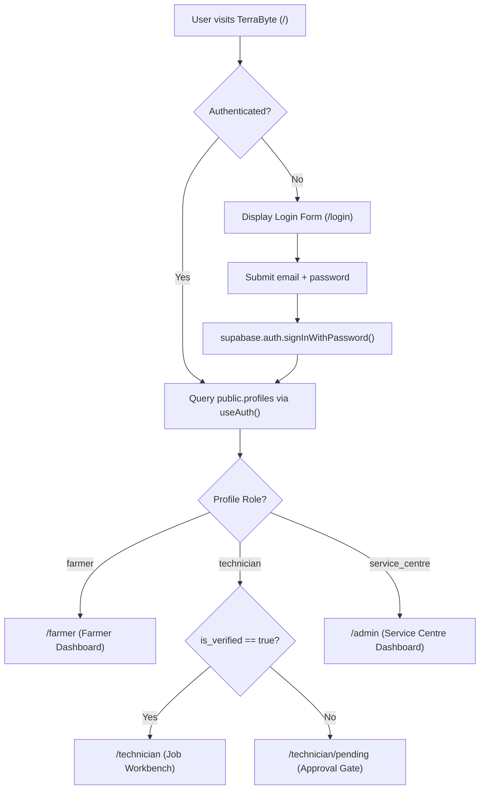
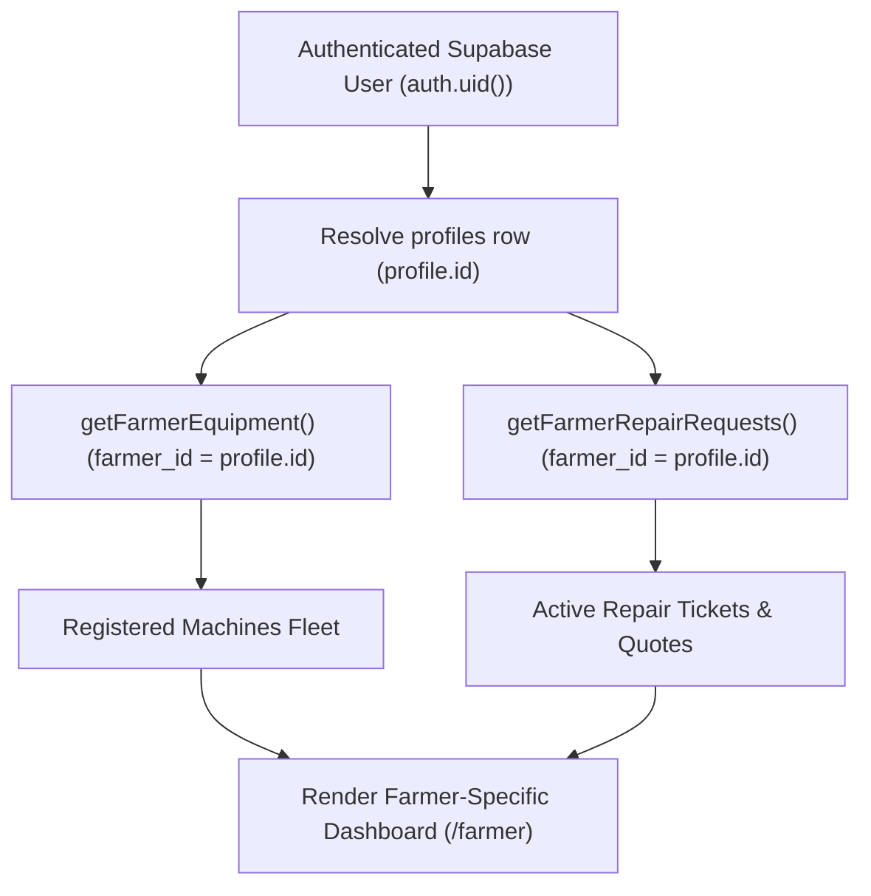
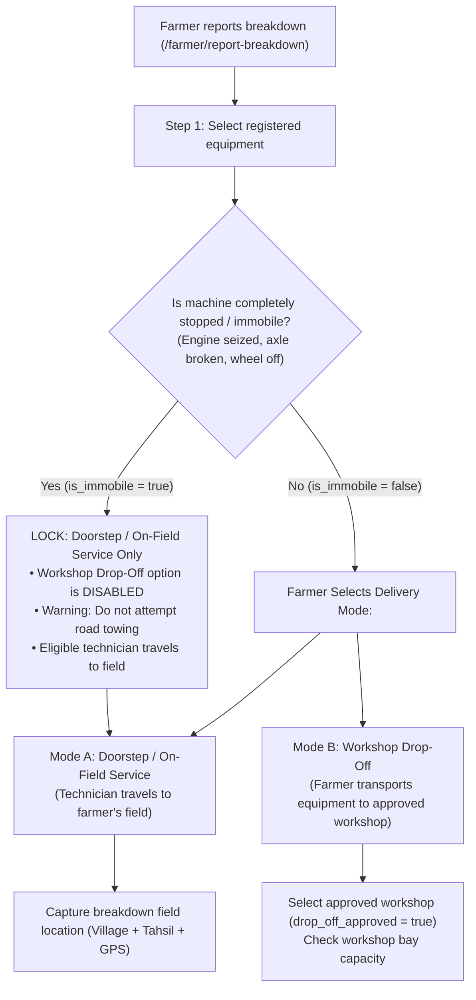
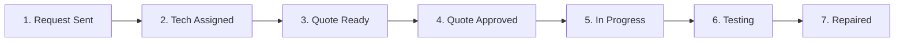
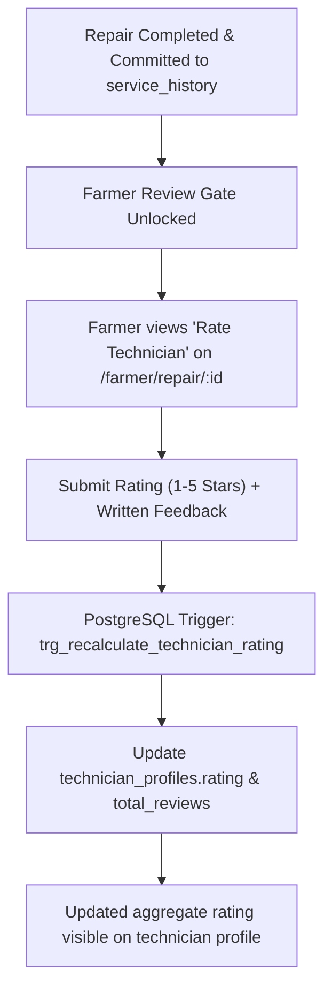
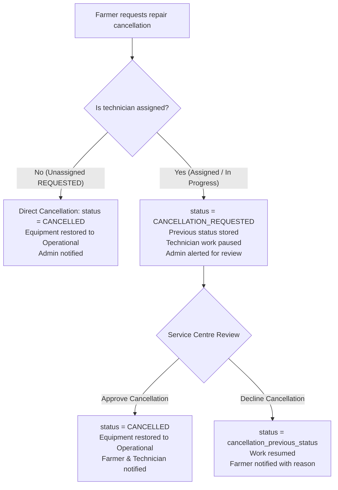
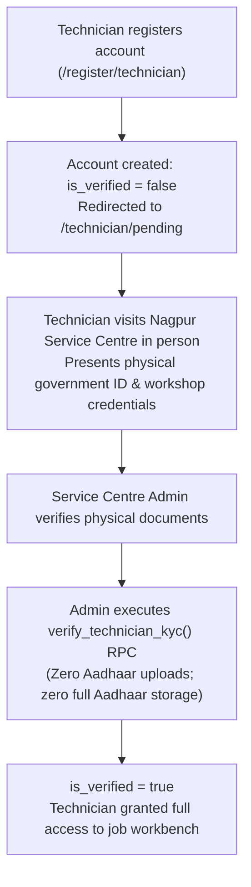
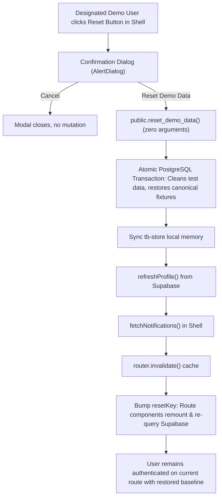

# TerraByte — Application Flow & User Journeys

## 1. Authentication & Role Resolution Architecture

TerraByte uses a unified single entry point for all users, relying on native **Supabase Auth** and database-backed profile resolution:

### 1.1 Real vs Demo Identity Presentation
1. **Explicit Identity Detection**:
   - The system checks whether the authenticated user's email strictly matches one of the canonical demo evaluation personas (`isDesignatedDemoAccount(email)`):
     - `farmer.nagpur@terrabyte.demo` (Balasaheb Patil)
     - `tech.nagpur@terrabyte.demo` (Ramesh Kumar)
     - `admin.nagpur@terrabyte.demo` (Nagpur Service Centre)
2. **Badge Presentation (`DemoTag`)**:
   - **Canonical Demo Accounts**: Render the `"DEMO DATA"` badge in the dashboard header.
   - **Real Users (e.g. Ankit Chamke)**: `DemoTag` returns `null`. Real users NEVER see `"DEMO DATA"` anywhere in the interface.
3. **Reset Demo Visibility**:
   - The `RotateCcw` reset button in the Shell header is strictly visible only to authenticated users belonging to the canonical demo accounts. Real users never see this button or dialog.

---

## 2. Farmer User Journey

### 2.1 Live Data Resolution Architecture

The Farmer experience is strictly scoped to the authenticated caller's identity:

1. **Authentication & Identity**: Caller signs in $\rightarrow$ `useAuth()` resolves `public.profiles` for `auth.uid()`, determining the unique `profile.id`. In-flight promise deduplication ensures `loadProfile()` runs only once during initial mount.
2. **Concurrent Independent Fetching**: Once `profile.id` is available, `getFarmerEquipment(profile.id)` and `getFarmerRepairRequests(profile.id, { activeOnly: true })` load in parallel without waterfall latency or redundant profile lookups.
3. **Equipment Scoping**: `getFarmerEquipment()` queries `public.equipment` filtered strictly by `.eq("farmer_id", profile.id)`.
4. **Repair Requests Scoping & Status Filtering**:
   - `getFarmerRepairRequests()` queries `public.repair_requests` filtered strictly by `.eq("farmer_id", profile.id)` and `.not("status", "in", '("COMPLETED","CANCELLED")')`.
   - **Active vs. Completed Filtering**: The home dashboard prioritizes genuinely active repairs and genuine pending farmer actions (`QUOTE_PENDING`, `QUOTE_REVISED`, and unassigned requested repairs).
   - **Service History Flow**: Completed repairs whose handover is confirmed and committed to `service_history` do not clutter the home page active stack. They flow to Service History (`/farmer/equipment`), machine logbooks (`/farmer/equipment/$id`), and direct repair links.
5. **Dashboard Rendering**: Displays solely the caller's active repair cards (e.g. `TB-8841` for Balasaheb Patil, `TB-8902` for Suresh Jadhav, `TB-8898` for Anil Pawar, or 0 active repairs for newly onboarded farmers) and their registered fleet. No mock data, first-row fallbacks, or historical completed repairs override this view.

---

### 2.2 Dual Service Delivery Modes & Immobile Decision Gate

During breakdown intake, the system coordinates two distinct service delivery paths based on machine operational condition:

1. **Immobile Decision Gate**:
   - If the machine is marked immobile (`is_immobile = true`), **Workshop Drop-Off is strictly disabled**.
   - The farmer is warned against attempting dangerous tractor towing or tractor-implement hauling across rural highways.
   - The ticket is locked to **Doorstep / On-Field Service**; a technician will travel directly to the field.
2. **Flow A (Doorstep / On-Field Service)**:
   - Technician travels from their registered workshop to the farmer's breakdown site.
   - Road distance and travel duration calculated via OSRM routing.
3. **Flow B (Workshop Drop-Off Service)**:
   - Farmer brings operable equipment to an approved workshop (`drop_off_approved = true`).
   - The facility must have available capacity (`active_repairs < max_equipment_capacity`).
   - Upon physical drop-off, the workshop generates an official Check-in Receipt (`RCP-TB-xxxx`).

---

### 2.3 Breakdown Reporting Wizard with Gemini AI Diagnostics (Phase 11)

1. From `/farmer`, farmer taps **"Report Equipment Breakdown"** $\rightarrow$ opens `/farmer/report-breakdown`.
2. **Step 1: Machine Selection & Mobility**:
   - Chooses broken machine from registered fleet.
   - Sets mobility status toggle (*"Is machine completely stopped / immobile?"*).
3. **Step 2: Symptoms Selection**:
   - Toggles visual symptom chips (e.g. *"Loss of power"*, *"Hydraulic lift failure"*, *"Black smoke"*, *"Starting trouble"*).
4. **Step 3: Breakdown Location & Problem Description**:
   - **Coarse Service Location**: Village text (prefilled from farmer profile if available) and selection from the 14 official Nagpur District Tahsils (`src/lib/location.ts`).
   - **Optional Precise GPS Capture**: Farmer can click "Use Current Location" to capture device GPS coordinates (`navigator.geolocation.getCurrentPosition`). Shows accuracy indicator (`±Xm`) and feedback. GPS coordinates remain in-memory only and are strictly excluded from browser `localStorage` drafts, URL query strings, and public queues.
   - **Problem Description**: Enters description via keyboard or 1-tap **voice typing** (Web Speech API / Whisper transcription with Hindi and Marathi support).
5. **Step 4: Field Photos & AI Consent**:
   - Attaches equipment photos (JPEG/PNG/WebP $\le 4\text{ MB}$).
   - **Fail-Closed Consent Authorization**: The farmer must explicitly check *"Allow AI visual analysis of equipment photos"*. Without opt-in, image bytes are **never** transmitted to Google Gemini.
6. **Step 5: Assistive Preliminary Assessment & Breakdown Logging**:
   - Reviews summary showing coarse location and GPS badge (if captured).
   - If consent is granted, the app invokes `/api/assess-visual-defect` with ephemeral claim token.
   - **Fail-Open Submission**: If Gemini times out, returns 429, or fails, the breakdown submission **succeeds seamlessly** with deterministic rule-based symptom assessment. Gemini failure never blocks ticket creation.
   - Diagnostic card renders:
     - Component identification (e.g., *Fuel injection pump / High pressure line*).
     - Visual defect summary.
     - Severity rating (`CRITICAL`, `MAJOR`, `MODERATE`, `MINOR`).
     - Confidence score and immediate safety recommendations.
     - Assistive disclaimer: *"Assistive preliminary assessment; confirmed diagnosis made on site by certified technician."*
   - Ticket is inserted into Supabase (`status = 'REQUESTED'`, `technician_id = null`, timeline event: "Breakdown reported").
7. **Action-Needed State Machine & Technician Request Dispatch**:
   - **Breakdown Reported (Technician Not Yet Requested)**:
     - Status: `REQUESTED`, `technician_id: null`.
     - Farmer Home presentation: **"Action needed"** (accent border and header banner).
     - Status pill: *"Send request to technician"*.
     - Card CTA button: *"Send request to technician"*.
     - *Crucial Semantic Rule*: The UI does **not** falsely display *"Finding Your Technician"* until the farmer has actually initiated the technician request/dispatch flow.
   - **Technician Request Initiated**:
     - From `/farmer/repair/$id`, the farmer reviews matched certified technicians and clicks **"Request Repair"** or broadcasts to the Service Centre.
     - Status transitions to *"Finding Your Technician"*.

---

### 2.4 Monitoring Repair & Approving Quotation

1. Farmer tracks repair status via 7-step visual stepper.
2. When technician submits a quote (`QUOTE_PENDING`):
   - Farmer inspects itemized parts table (names, part specs, unit rates, supplier origin) and labour charges.
   - Farmer taps **"Approve Quote"** (work commences) or **"Request Revision"** (technician adjusts pricing).
3. If quote revision is active (`QUOTE_REVISED`):
   - Farmer home renders ticket under **"Action needed · Revised Quote Ready"** once updated pricing is prepared.
   - Displays technician clarification notes alongside original quote items with line-by-line diffing (`<QuoteComparison />`).
4. If parts are missing (`WAITING_FOR_PARTS`):
   - Displays warning pill with missing part details and updated arrival ETA.
5. When technician completes testing and finalizes repair (`COMPLETED`):
   - Technician performs final test run under operational load and taps **"Complete & sign off"**.
   - Machinery status is updated to `Operational`.
   - Permanent service history record is automatically generated in `service_history` bound to equipment ID (idempotent; 0 duplicates).
   - Farmer receives notification: *"Repair TB-xxxx has been completed and saved to service history."*
   - Service Centre admin receives actionable notification: *"Repair TB-xxxx completed & verified by technician. Ready for review."*
   - Farmer repair detail displays *"Repair Complete & Saved to Service History"* with completed work notes, parts replaced, final amount, and link to permanent machine logbook.
   - Technician workbench displays *"Repair completed and recorded in equipment service history."*
   - Admin workbench displays **Completion Details** card and hides reassignment actions.

---

### 2.5 Equipment Collection & Workshop Check-in Receipts (`RCP-TB-xxxx`)

For repairs conducted under Flow B (Workshop Drop-Off):

1. **Intake & Receipt Generation**:
   - When equipment arrives at an approved workshop, the workshop manager or technician generates an official **Workshop Check-in Receipt** (`RCP-TB-xxxx`).
   - Captures equipment intake condition, fuel level, hour-meter reading, and initial visual defects.
   - Farmer receives digital copy in their repair view.
2. **Collection Authorization**:
   - Once repair is marked `COMPLETED` and quotation is settled, the system issues an **Equipment Collection Authorization**.
   - Farmer presents collection token/receipt code at the workshop.
   - Workshop verifies collection authorization before releasing machinery, ensuring strict physical asset accountability.

---

### 2.6 Verified Ratings & Feedback Flow

1. **Gated Submission**:
   - A farmer can submit a rating and review **only** after a repair has an immutable, completed record in `service_history`.
   - Direct review submissions without a verified completed repair are rejected by PostgreSQL RLS.
2. **Transparent Rating Displays**:
   - Technicians with zero reviews display `NULL` / *"New / Unrated"*.
   - Static 5.00 default ratings are completely eliminated.
3. **Atomic Recalculation**:
   - PostgreSQL trigger recalculates the technician's average rating and total review count upon review INSERT, UPDATE, or DELETE.

---

### 2.7 Governed Cancellation Approval Flow

1. **Unassigned Direct Cancellation**:
   - Newly requested repairs without an assigned technician (`status = 'REQUESTED'`, `technician_id IS NULL`) display the bottom action `"Cancel request"`.
   - Clicking opens the accessible Radix `Dialog` detailing that cancellation is immediate.
   - Farmer selects a structured reason from `CANCELLATION_REASONS` with optional context notes.
   - Confirming calls `cancelRepairRequest()`, restores equipment to `Operational`, shows a success toast, and navigates back to `/farmer`.
2. **Governed Cancellation Requests**:
   - Assigned or in-flight repairs (`REQUESTED` + assigned, `ACCEPTED`, `QUOTE_PENDING`, `QUOTE_REVISED`, `IN_PROGRESS`, `WAITING_FOR_PARTS`) display `"Request cancellation"`.
   - Clicking opens the Radix `Dialog` explaining that the request is placed under Service Centre review and pauses the repair.
   - Farmer selects a structured reason and optional explanation.
   - Confirming calls `requestCancellation()`, transitions status to `CANCELLATION_REQUESTED`, snapshots `cancellation_previous_status`, displays a confirmation toast, and reloads the ticket in-place.
3. **Technician Work-Hold**:
   - Jobs in `CANCELLATION_REQUESTED` appear in a dedicated **`On hold · Cancellation pending`** section on the technician workbench.
   - Progression actions (quote submission, parts hold, testing, complete repair) are strictly suppressed while on hold.
4. **Service Centre Decision**:
   - Admin reviews cancellation in `/admin/repair/:id`.
   - **Approve**: Transitions status to `CANCELLED`, restores equipment to `Operational`, notifies farmer and technician.
   - **Decline**: Reverts ticket to `cancellation_previous_status` with mandatory written justification; technician work resumes.

---

## 3. Field Technician User Journey

### 3.1 Onboarding & Physical In-Person KYC Flow

1. **Privacy-Conscious Physical KYC**:
   - Zero Aadhaar document uploads; zero full Aadhaar number storage.
   - Physical document inspection conducted in person at the central Nagpur Service Centre.
   - Admin-only RPC `verify_technician_kyc()` validates credentials and activates account.
2. **Workshop Association**:
   - Technicians belong to a physical workshop (`repair_facilities`) as active members.
   - Dispatches and travel routes originate from the technician's registered workshop coordinates.

---

### 3.2 Job Execution & Workshop-Based OSRM Routing

1. **Workbench Feed (`/technician/`)**:
   - Queries assigned active jobs and nearby requests.
2. **OSRM Route Navigation**:
   - View displays driving road distance and travel ETA calculated via OSRM from the registered workshop to the breakdown site.
   - Straight-line Haversine distance is **strictly banned**.
   - If OSRM is unreachable, the workbench displays *"Road Distance Temporarily Unavailable"*.
3. **On-Site Diagnostics & Quoting**:
   - Reviews symptom chips and Gemini visual assessment card (`<VisualDiagnosticsCard />`).
   - Conducts physical inspection, formulates itemized quote (parts + labor), and submits for farmer approval.
4. **Parts Depot Requisitions (Phase 9)**:
   - Requisitions parts from central Nagpur depot against approved quotes.
   - When parts require external sourcing, transitions ticket to `WAITING_FOR_PARTS` with supplier ETA.
5. **Load Testing & Sign-Off**:
   - Completes mechanical repair and advances ticket to `IN_PROGRESS (Testing)`.
   - Conducts rigorous field run under operational load (plowing, hydraulic pressure, pump cycling).
   - Taps **"Complete & sign off"**, triggering atomic generation of permanent `service_history` record (`INV-TB-xxxx`).

---

## 4. Service Centre Operations (Nagpur Central Command)

1. **Operations Dispatch Board (`/admin`)**:
   - Central overview of district repairs with dedicated filter tabs: `"All"`, `"Assigned"`, `"Quotes"`, `"In Progress"`, `"Cancellation Requests"`, `"Completed"`, and `"Cancelled"`.
   - Closed repairs (`COMPLETED`, `CANCELLED`) isolated from active operational triage.
2. **Dispatch & Workshop Oversight**:
   - Matches incoming breakdown requests to eligible technicians based on workshop road distance and approved brand expertise.
   - Approves workshops for public farmer drop-offs (`drop_off_approved = true`).
   - Reviews AI-suggested technician skills and brand tags before authorizing public display.
3. **Nagpur Central Spare Parts Depot (`/admin/parts-desk`)**:
   - Manages inventory in `service_centre_parts` with atomic row locking (`FOR UPDATE`).
   - Confirms technician parts handoffs via atomic RPC `confirm_service_centre_part_handoff()`.
   - Audits stock adjustments with operator UUID and change reasons.
   - Farmer privacy quarantine: internal wholesale pricing and inventory telemetry strictly hidden from farmers.

---

## 5. Demo Reset Flow (Evaluation Personas Only)

1. **Access Gate**: Trigger is visible **only** to designated demo accounts (`farmer.nagpur@terrabyte.demo`, `tech.nagpur@terrabyte.demo`, `admin.nagpur@terrabyte.demo`). Real users never see this control.
2. **Confirmation**: Modal explains that demo equipment, repairs, quotes, and timeline return to baseline while user accounts and real user records remain unaffected.
3. **Execution**: Backend RPC executes an atomic transaction. Client refreshes profile, notifications, invalidates router cache, and remounts child route components deterministically.

---

*App Flow updated: 2026-11-04 — Synchronized with Master Project Architecture & Approved Decisions*