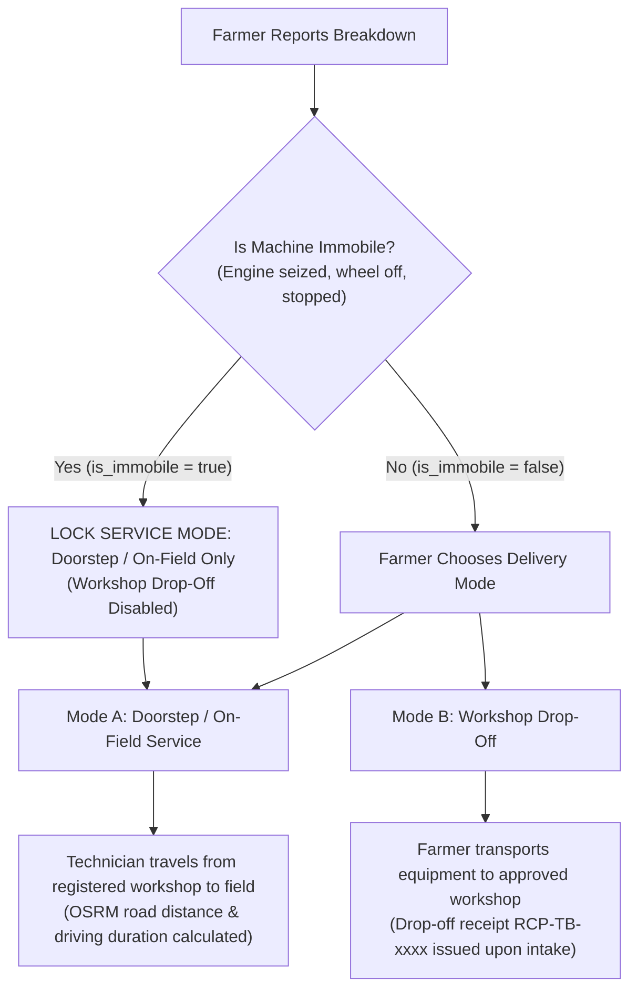

# TerraByte — Project Vision & Requirements

## What This Is

TerraByte is an end-to-end digital agricultural equipment repair operating system connecting farmers, certified field technicians, and central service centres. Built for **Nagpur RISE 2026 (Stage 1)**, it coordinates the complete machinery maintenance lifecycle across Maharashtra's Vidarbha agrarian heartland: from rapid breakdown intake and assistive multimodal AI diagnostics to qualified workshop-based dispatch, transparent itemized quotation, live tracking with parts blocker visibility, physical handover verification, and permanent asset service logs.

## Core Value

**Dramatically compress the time between machinery breakdown and getting back to work in the field.**

---

## Strict Budget & Operating Constraints

- **$0.00 Free-Tier Budget Constraint**: TerraByte is engineered to operate strictly within 100% free-tier services. Zero paid external API dependencies, zero automatic billing upgrades, and zero risk of unexpected charges.
  - **Database & Auth**: Supabase Free Tier (PostgreSQL 17, native GoTrue auth, Row Level Security).
  - **Hosting & Serverless**: Vercel Hobby / Nitro serverless deployment.
  - **AI Diagnostics**: Google Gemini 3.5 Flash-Lite under free-tier quota limits (with strict rate-limit backpressure guards and non-blocking fail-open execution).
  - **Routing & Maps**: Free, unauthenticated Open Source Routing Machine (OSRM) driving route calculations.
- **VCS & Editor Sync**: Connected to Lovable (`phase-11` branch). Never execute destructive Git history commands (`push --force`, rebase, amend).
- **Security & Authorization**: All data access governed by PostgreSQL Row Level Security (RLS) driven by native Supabase Auth. Clerk is permanently banned.
- **Source of Truth**: Live Supabase PostgreSQL is the sole source of truth. Mock stores (`tb-store.ts`) serve strictly as offline fallback fixtures.
- **Farmer Privacy**: Farmers must never access internal depot inventory counts, wholesale costs, or staff audit notes. Exact GPS coordinates are restricted to assigned technicians. Full Aadhaar numbers and document uploads are strictly prohibited.

---

## Regional & Agrarian Context

- **Anchor Geography**: **Nagpur District & Vidarbha Region, Maharashtra**.
- **Key Agrarian Hubs & Tahsils**:
  - **Katol & Narkhed**: Orange and citrus heartland; extensive use of light tractors (35–45 HP), power tillers, and micro-irrigation pump sets.
  - **Saoner & Kalmeshwar**: Intensive cotton and soybean cultivation; high demand for 45–55 HP general-purpose tractors, multi-crop seed drills, and power weeders.
  - **Umred & Bhivapur**: Paddy and chili belt; high reliance on puddling equipment, combine harvesters, and high-pressure sprayers.
  - **Hingna, Ramtek, Kamptee, Kuhi, Mouda, Parseoni**: Mixed grain, pulse, and sugarcane farming.
- **Seasonal Maintenance Windows**:
  - **Pre-Kharif Preparation (May–June)**: Urgent overhaul window for tractors, rotavators, and disc plows prior to monsoon arrival. Machine downtime during this window directly delays sowing.
  - **Mid-Season Operations (July–September)**: Intensive spraying and inter-cultivation; sprayers, tillers, and tractor hydraulic pumps under peak load.
  - **Harvest & Rabi Sowing (October–November)**: Critical peak for combine harvesters, threshers, and transport trolleys. Any breakdown can lead to unharvested crop spoilage.
- **Target Fleet Machinery**:
  - Mahindra 575 DI / Yuvo 575 (45–47 HP)
  - Swaraj 744 FE / 855 FE (48–52 HP)
  - VST Shakti 130 DI Power Tiller (13 HP)
  - John Deere 5050 D / W70 Combine Harvester
  - Kirloskar 5 HP Diesel / Submersible Irrigation Pumpsets
- **Evaluation Personas**:
  - Farmer: Balasaheb Patil (`farmer.nagpur@terrabyte.demo`)
  - Technician: Ramesh Kumar (`tech.nagpur@terrabyte.demo`)
  - Service Centre: Nagpur Service Centre (`admin.nagpur@terrabyte.demo`)

---

## Requirements

### Validated & Verified (Shipped in Phases 1–10)
*Empirically verified with 144 passing automated tests in 1.23s and a 1.15s SSR / 2.51s client production build on 2026-11-04.*

- ✓ **Clean Full-Stack Architecture**: TanStack Start v1 (React 19) + Vite 8 + Nitro (`vercel` preset) — *Phase 1*
- ✓ **Domain Database Foundation**: PostgreSQL 17 relational schema with strict Row Level Security (RLS) across 18 tables — *Phase 2*
- ✓ **Core Breakdown Intake & Fleet Management**: 2-minute breakdown reporting, symptom selection, voice description via Web Speech API, and tractor fleet tracking — *Phase 3*
- ✓ **Quotation & Authorization State Machine**: Itemized parts & labour quotes requiring mandatory farmer approval prior to disassembly — *Phase 3*
- ✓ **Operations Triage & Notifications**: Role-specific dispatch queues, unread tracking, and real-time alerts — *Phase 4*
- ✓ **Account Lifecycle Management**: Contextual back navigation, profile management, and atomic account deletion (`public.delete_user_account()`) — *Phase 5.1*
- ✓ **Demo Hygiene & Deterministic Reset**: Dual-key authorized atomic RPC `public.reset_demo_data()` restoring baseline fixtures without touching real user records — *Phase 5.2*
- ✓ **Notification & Product Communication Polish**: Aligned completion copy (*"Repair Complete & Saved to Service History"*), bounded 25-item queries, and user-switch state flushing — *Phase 5.3*
- ✓ **Governed Cancellation Approval**: Direct cancellation for unassigned requests; structured Service Centre review and technician work-holds for active repairs — *Phase 5.4*
- ✓ **Ticket-Scoped Chat & Quote Revision**: Real-time messaging thread (`<RepairChat />`), line-by-line quote diffing (`<QuoteComparison />`), and canonical `TB-4489` baseline — *Phase 5.5*
- ✓ **Handover & Completion Sign-Off**: Technician "Complete & sign off", immediate auto-generation of immutable `service_history` (`INV-TB-xxxx`), and dedicated Closed/Cancelled tabs — *Phase 5.6*
- ✓ **Production Readiness & UI Hardening**: Component error boundaries (`<ComponentErrorBoundary />`), lightbox modal, and SEO metadata — *Phase 6*
- ✓ **Realtime WebSocket Synchronization**: Debounced event coalescing (300ms window) on `postgres_changes` across tickets and dashboards, plus Optimistic Concurrency Control (OCC) — *Phase 7*
- ✓ **Deployment Health & Route Logistics (OSRM)**: Timing-safe Bearer health check (`/api/health`), coarse village/tahsil location intake, optional device GPS capture, and OSRM in-app driving distance/ETA calculations — *Phase 8*
- ✓ **Service Centre Parts Desk & Requisitions**: Centralized Nagpur depot inventory (`/admin/parts-desk`), technician pickup requisitions (`/technician/job/:id`), and concurrency-safe atomic handoff with row locking — *Phase 9.1*
- ✓ **Stock Movements & Sales History**: Movement ledger (`RECEIVED`, `ISSUED_TO_REPAIR`, `RETURNED`, `ADJUSTMENT`), repair sales history, and quote item catalog linking (`catalog_part_id`) — *Phase 9.2*
- ✓ **Unavailable Parts Sourcing & ETA Coordination**: Per-item sourcing ETAs on requisitions, critical-path synchronization to `parts_hold`, and out-of-stock handoff locks — *Phase 9.3*
- ✓ **Parts-Specific Real-Time Notifications**: Role-specific alerts for Service Centre, assigned technician, and farmer with privacy boundaries — *Phase 9.4*
- ✓ **Profile Security Separation**: Decoupling `public.profiles` from `auth.users.id`, segregating credentials in `public.profile_auth_secrets` with zero admin read access — *Phase 10*
- ✓ **Visual Defect Diagnostics (Google Gemini AI)**: Multimodal tractor damage assessment via Google Gemini 3.5 Flash-Lite, bounded claim tokens, fail-closed consent, fail-open submission, `<DefectAnnotationCanvas />`, and `<VisualDefectDiagnosticViewer />` — *Phase 11 (Completed & Staging Verified)*

### Active Scope (Phase 12 Next)
- [ ] **Phase 12: Multilingual Farmer Experience (English + Hindi + Marathi)**: Trilingual farmer interface with Noto Sans Devanagari typography, language switcher, canonical voice transcription preservation (Groq Whisper Large V3), and English technician/admin portals.

### Planned Product Scopes (Phases 13–16)
- **Phase 13: Technician Trust, Shared Workshops & Accountability**: Independent `repair_facilities`, facility ownership vs technician membership separation, in-person physical KYC, admin-verified AI skills, and repair-gated verified reviews (null default rating).
- **Phase 14: Smart Dispatch & Emergency Response**: Registered workshop-based OSRM road distance and driving ETA matching, strict prohibition of straight-line Haversine, dual delivery modes (Doorstep vs Workshop Drop-off), Immobile machinery lock (`is_immobile = true` -> Doorstep only), and workshop bay capacity limits.
- **Phase 15: Preventive Maintenance Intelligence & Offline Field Reliability**: Rule-based Vidarbha crop heuristics, Service Worker offline ticket caching, and optimistic workbench mutations.
- **Phase 16: Master System-Wide QA, E2E Verification & Release Gate**: Comprehensive regression suite across all roles, load/stress testing, security audit, and final release sign-off.

---

## Dual Service Delivery Modes & Immobile Decision Gate

TerraByte coordinates two distinct physical repair service delivery modes:

1. **Flow A: Doorstep / On-Field Service**:
   - Technician travels from their registered workshop location to the farmer's field/village.
   - Required whenever machinery cannot be safely moved.
   - Distance and driving duration calculated authoritatively via OSRM.
2. **Flow B: Workshop Drop-Off**:
   - Farmer brings operable equipment to an approved workshop (`drop_off_approved = true`).
   - Workshop equipment check-in receipt (`RCP-TB-xxxx`) generated upon intake, recording condition and intake odometer/hours.
   - Workshop capacity tracked against `max_equipment_capacity`.
3. **Immobile Decision Gate**:
   - If farmer marks machine as completely stopped (`is_immobile = true`), **Workshop Drop-Off is strictly disabled**.
   - Farmer is warned not to attempt dangerous field towing; an eligible technician is dispatched directly to the field.

---

## Approved Product-Level Architectural Decisions

> [!IMPORTANT]
> **Product Direction Approved — Implementation Pending**:  
> The 8 decisions below represent confirmed **product-level behaviors and operational policies**. Approval of these product decisions does **NOT** automatically approve specific database schemas, table definitions, RPCs, RLS policies, or migration scripts for future phases (Phases 12–15). All database implementation designs remain proposed engineering drafts subject to explicit technical review and approval prior to implementation in their respective future phases.

| Decision ID | Title | Summary of Approved Architecture | Target Phase |
| :--- | :--- | :--- | :---: |
| **ADR-001** | Shared Workshops & Membership | Independent `repair_facilities` entity. Explicit separation between workshop ownership (`owner_profile_id`), technician membership via `facility_memberships` (`OWNER`, `MANAGER`, `TECHNICIAN` roles), and admin drop-off approval gate (`drop_off_approved`). Technician dispatch location is strictly their registered workshop location (`repair_facilities.latitude/longitude`); **no continuous live GPS tracking of technicians**. | Phase 13 |
| **ADR-002** | Immobile Machinery Protocol | Immobile machinery (`is_immobile = true`) mandates Doorstep repair. Workshop Drop-Off is locked out. Heavy towing is deferred. | Phase 14 |
| **ADR-003** | Workshop Capacity Tracking | Workshops enforce `max_equipment_capacity`. Active repairs tracked; over-capacity workshops blocked from new drop-offs. | Phase 14 |
| **ADR-004** | Privacy-Conscious Physical KYC | Physical in-person KYC at Nagpur Service Centre only. Zero Aadhaar document uploads; zero full Aadhaar number storage. Admin-only RPC verification. | Phase 13 |
| **ADR-005** | Authoritative OSRM Road Routing | Road distance and driving duration calculated from registered workshop coordinates using OSRM with **no continuous live GPS tracking**. Straight-line Haversine distance strictly banned. Graceful outage fallback: *"Road Distance Temporarily Unavailable"*. OSRM driving duration is an estimated road duration without real-time traffic conditions. | Phase 14 |
| **ADR-006** | Multilingual Scope Boundaries | Farmer UI localized in English, Hindi, and Marathi (`en` \| `hi` \| `mr`) with Noto Sans Devanagari typography. Technician/admin portals remain English. Groq Whisper voice input preserves canonical native spoken transcripts. | Phase 12 |
| **ADR-007** | Admin Gate for AI Expertise | AI suggests technician brand and skill tags based on repair history; Service Centre admin must explicitly approve tags before public display. | Phase 13 |
| **ADR-008** | Verified-Only Ratings Engine | Reviews gated strictly by completed `service_history` records. Unrated technicians default to `NULL` (*"New / Unrated"*). No fake 5.00 ratings. | Phase 13 |

---

## Out of Scope & Deferred Roadmap (Post-Hackathon)

The following capabilities are deliberately deferred post-hackathon to maintain hyper-focus on core repair execution reliability:
1. **Integrated Payment Gateway (UPI / Razorpay Escrow)**: Offline / cash-on-delivery settlement with verifiable itemized receipts.
2. **Third-Party Towing / Flatbed Dispatch**: Farmer transport or on-field repair only; specialized flatbed logistics deferred.
3. **SMS / WhatsApp Webhook Bot (Twilio / Gupshup)**: In-app real-time notifications only; avoids external telephony recurring costs.
4. **Tractor CAN Bus J1939 Telematics**: Visual photo assessment and symptom reporting replace expensive OBD/CAN hardware dongles.
5. **Multi-Depot Inter-Store Transfers**: Single central Nagpur district depot handles all parts inventory movements.
6. **Government DigiLocker / Aadhaar Online API**: Replaced by robust, privacy-safe physical in-person KYC at the central service centre.

---

*Last updated: 2026-11-04 — Synchronized with Master Project Architecture & Approved Decisions*