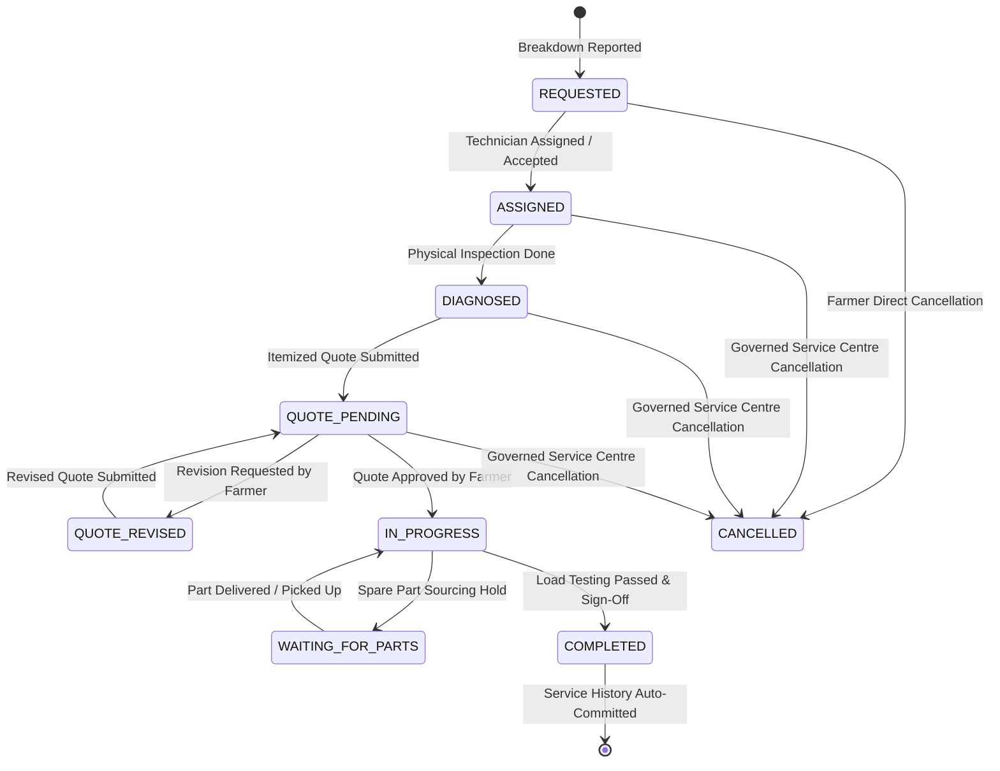
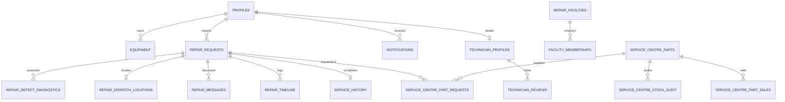

# TerraByte — Technical Requirements Document (TRD)

## 1. Project Overview & Operational Context

TerraByte is a specialized digital agricultural equipment repair operating system engineered to coordinate the complete journey from machinery breakdown to verified repair and back into the field.

- **Core Problem**: In rural agriculture—particularly across Vidarbha's cotton, soybean, and citrus belts—machinery breakdown (tractors, harvesters, power tillers, irrigation pumps) during critical seasonal sowing (*kharif*) and harvest windows causes catastrophic yield and financial loss. The conventional repair process is fragmented across unvetted mechanics, lack of diagnostic clarity, opaque parts markups, zero downtime visibility, and nonexistent service records.
- **Core Mission**: **DRAMATICALLY COMPRESS THE TIME BETWEEN MACHINERY BREAKDOWN AND GETTING BACK TO WORK IN THE FIELD.**
- **Target Geography**: Nagpur District and the broader Vidarbha agrarian region, Maharashtra (Tahsils: Katol, Saoner, Umred, Hingna, Narkhed, Ramtek, Kalmeshwar, Bhivapur, Kuhi, Kamptee, Mouda, Parseoni).
- **Core Machinery Fleet**: Mahindra 575 DI / Yuvo 575, Swaraj 744 FE / 855 FE, VST Shakti 130 DI Power Tiller, John Deere 5050 D / W70 Combine Harvester, Kirloskar 5 HP Diesel & Submersible Irrigation Pumpsets.
- **Operating Constraint**: Strict **$0.00 Free-Tier Budget Constraint**. All services must run on free-tier infrastructure (Supabase PostgreSQL free tier, Vercel Hobby serverless, Google Gemini 3.5 Flash-Lite free tier, and public OSRM routing) with zero paid fallbacks and zero billing surprise risk.

---

## 2. Technical Stack & Architectural Foundation

| Layer | Technology | Status | Architecture & Constraints |
| :--- | :--- | :---: | :--- |
| **Frontend Framework** | TanStack Start v1 (React 19) | **Implemented** | Full-stack React SSR/client hybrid with Vite 8 bundler |
| **Routing & Navigation** | TanStack Router v1 | **Implemented** | Type-safe route trees, dynamic params, and role-based guards |
| **Language & Typings** | TypeScript 5 (Strict) | **Implemented** | Strict typing across components, service layer, and Supabase client |
| **Styling & Design System** | Tailwind CSS 4 | **Implemented** | High-contrast agricultural palette (`soil`, `primary`, `accent`, `warning`) |
| **UI Components & Icons** | Radix UI + Lucide React | **Implemented** | Accessible headless primitives, responsive sheets, agricultural icons |
| **State & Cache Management**| TanStack Query v5 | **Implemented** | Query deduplication, cache invalidation, and optimistic UI updates |
| **Authentication & IAM** | Supabase Auth (Native) | **Implemented** | Email/Password, decoupled profiles (`profile_auth_secrets`), role guards |
| **Database & Schema** | Supabase (PostgreSQL 17) | **Implemented** | 20+ tables, transactional RPCs, triggers, and comprehensive RLS |
| **Real-Time Synchronization**| Supabase Realtime (WebSocket)| **Implemented** | Scoped `postgres_changes` with 300ms client debouncing & OCC |
| **AI Visual Diagnostics** | Google Gemini 3.5 Flash-Lite | **Midway (Ph 11)** | Server-side `/api/assess-visual-defect`, claim token verification, fail-closed consent, fail-open submission |
| **Routing & Distance Engine**| OSRM (Open Source Routing) | **Implemented** | Driving distance and travel ETA from workshop coordinates; Haversine banned |
| **Localization & Fonts** | English + Hindi (`en` \| `hi`)| **Planned (Ph 12)**| Noto Sans Devanagari typography; Marathi voice transcription via Whisper |
| **Hosting & Serverless** | Nitro / Vercel Serverless | **Implemented** | `vercel` serverless preset via `vite build` (1.30s build time) |

---

## 3. Role-Based Access Control & Identity Architecture

TerraByte enforces least-privilege data access governed by PostgreSQL Row Level Security (RLS) driven by native Supabase Auth identities (`auth.uid()`). Clerk is permanently excluded.

### 3.1 Primary Roles
1. **Farmer (`'farmer'`)**:
   - Manages personal equipment fleet.
   - Reports equipment breakdowns with coarse location and optional device GPS.
   - Reviews assistive diagnostics and selects matched technicians.
   - Formally approves or requests revision on itemized quotations.
   - Tracks live repair stages and parts blocker ETAs.
   - Signs off on repairs and leaves verified reviews after completion.
2. **Field / Workshop Technician (`'technician'`)**:
   - Belongs to a physical workshop (`repair_facilities`).
   - Receives and accepts/declines job dispatches based on workshop location.
   - On-site workbench: inspects symptoms, runs diagnostics, creates itemized quotes.
   - Requisitions spare parts from Nagpur central parts depot (`/admin/parts-desk`).
   - Performs mechanical repairs, puts jobs on `WAITING_FOR_PARTS` hold when necessary.
   - Conducts operational load testing and executes digital sign-off.
3. **Service Centre Administrator (`'service_centre'`)**:
   - Central operations dispatcher for the district.
   - Triages incoming breakdowns and manages manual/override dispatches.
   - Conducts physical in-person KYC verification of technicians.
   - Approves workshops for public farmer drop-offs (`drop_off_approved`).
   - Reviews and approves AI-suggested technician expertise and brand tags.
   - Operates Nagpur spare parts depot: manages inventory, fulfills technician requisitions, records stock movements.

### 3.2 Decoupled Profile Security (Phase 10)
- `public.profiles`: Contains public display information (`full_name`, `role`, `village`, `tahsil`, `is_verified`). Decoupled from `auth.users.id`.
- `public.profile_auth_secrets`: Contains authentication linkage and sensitive credentials. Strictly quarantined from client access; zero read permissions granted to administrators.
- `public.get_session_profile()`: Security definer RPC resolving the current caller's profile row safely.

---

## 4. Functional Requirements

### 4.1 Farmer Journey & Breakdown Reporting
- **FR-F01 (Fleet Management)**: Farmer registers machinery with brand, model, horsepower, serial/chassis number, and operational status.
- **FR-F02 (Breakdown Intake)**: 2-minute reporting wizard: machine selection, symptom toggles, problem description (keyboard or voice typing), coarse location (village + Nagpur tahsil), optional device GPS coordinates, and photo evidence.
- **FR-F03 (Assistive Visual AI Diagnostics — Phase 11)**:
  - Multimodal assessment of equipment photos via Google Gemini 3.5 Flash-Lite.
  - **Fail-Closed Consent**: Explicit opt-in checkbox required. Without opt-in, image is never sent to Gemini.
  - **Fail-Open Submission**: AI failure, timeout, missing key, or rate-limit 429 must never block breakdown ticket creation.
  - **Photo-Only Uploads**: Restricted strictly to photos (max 4 photos, $\le 4\text{ MB}$ each); dead video handlers eliminated.
  - **Diagnostics UI**: Reusable `<VisualDiagnosticsCard />` rendered across Farmer, Technician, and Admin views.
  - Generates structured hypothesis: affected component, visual defect summary, severity rating, and safety advisories.
- **FR-F04 (Dual Service Delivery Selection)**:
  - Farmer chooses between Flow A (Doorstep / On-Field Service) and Flow B (Workshop Drop-Off).
  - **Immobile Machine Decision Gate**: If `is_immobile = true`, Workshop Drop-Off is strictly disabled; system mandates Doorstep service.
- **FR-F05 (Technician Matching)**:
  - Matched technicians displayed with workshop driving distance and ETA calculated via OSRM.
  - Displays verified ratings and admin-approved brand expertise tags.
- **FR-F06 (Quote Review & Approval)**:
  - Transparent itemized quote review (line-item parts, labor charges, estimated completion).
  - Supports 1-click approval or quote revision request with line-by-line diffing (`<QuoteComparison />`).
- **FR-F07 (Live Tracking & Downtime Visibility)**:
  - 7-step repair stepper tracking progress.
  - Prominent alert when repair is on `WAITING_FOR_PARTS` hold, showing missing part name and revised sourcing ETA.
- **FR-F08 (Verified Reviews & Ratings)**:
  - Upon verified completion (`service_history`), farmer can submit a rating (1–5 stars) and review.
  - Unrated technicians display `NULL` / *"New / Unrated"*.

### 4.2 Technician Workbench & Field Execution
- **FR-T01 (Job Intake Feed)**: Review incoming requests with breakdown location, machine details, symptoms, and assistive diagnostics.
- **FR-T02 (Accept / Decline)**: Accept assignments with estimated arrival time, or decline with reason to return to triage.
- **FR-T03 (OSRM Driving Route)**: View authoritative road driving distance and navigation ETA from registered workshop coordinates (`repair_facilities.latitude/longitude`) to breakdown site. Straight-line distance strictly prohibited. No continuous live GPS tracking of technicians.
- **FR-T04 (Itemized Quote Formulation)**: Formulate quotes with catalog-linked spare parts, labor costs, and estimated completion time.
- **FR-T05 (Parts Depot Requisitions — Phase 9)**:
  - Request parts from central Nagpur depot against approved quotes.
  - Sourcing ETAs synchronized to `parts_hold` when parts are out of stock.
- **FR-T06 (Load Testing & Sign-Off)**: Advance repair to `IN_PROGRESS (Testing)`, perform field run under operational load, record completion notes, and execute "Complete & sign off", auto-generating permanent `service_history` record (`INV-TB-xxxx`).
- **FR-T07 (Workshop Association — Phase 13)**: Belongs to a registered physical workshop (`repair_facilities`) as an active member via `facility_memberships` (`OWNER`, `MANAGER`, `TECHNICIAN` roles). No live GPS tracking.

### 4.3 Service Centre Operations & Spare Parts Depot
- **FR-A01 (Operations Dispatch Board)**: Real-time overview of district repairs with dedicated Active, Closed, and Cancelled queues.
- **FR-A02 (Physical In-Person KYC Verification — Phase 13)**: Verify technician identity documents physically at Nagpur Service Centre. Execute admin-only verification RPC `verify_technician_kyc()`. Zero full Aadhaar numbers stored.
- **FR-A03 (Workshop Drop-Off Certification — Phase 13)**: Inspect and approve physical workshops for public farmer drop-offs (`drop_off_approved = true`).
- **FR-A04 (AI Expertise Approval — Phase 13)**: Review AI-suggested technician brand and skill tags and approve before public display.
- **FR-A05 (Central Parts Depot Management — Phase 9)**:
  - Manage stock levels in `service_centre_parts` with atomic row locking (`FOR UPDATE`).
  - Fulfill technician requisitions via atomic RPC `confirm_service_centre_part_handoff()`.
  - Maintain immutable stock movement ledger (`RECEIVED`, `ISSUED_TO_REPAIR`, `RETURNED`, `ADJUSTMENT`).
  - Quarantine internal wholesale costs and inventory counts from farmers.

---

## 5. Domain Logic & State Machine Architecture

### 5.1 The 7-Step Repair Lifecycle
All repair tickets transition through a strictly enforced state machine:

1. **`REQUESTED`**: Breakdown logged by farmer; awaiting technician acceptance or admin dispatch.
2. **`ASSIGNED`**: Technician accepted job; travel ETA calculated via OSRM.
3. **`DIAGNOSED`**: Technician arrived on-site / workshop; initial physical inspection completed.
4. **`QUOTE_PENDING`**: Itemized quote formulated; awaiting mandatory farmer authorization.
5. **`IN_PROGRESS`**: Farmer approved quote; physical disassembly and mechanical repair underway. (Sub-state `WAITING_FOR_PARTS` triggered if parts are missing).
6. **`IN_PROGRESS (Testing)`**: Mechanical repair complete; machine undergoing field testing under operational load.
7. **`COMPLETED`**: Final sign-off executed; permanent immutable `service_history` record (`INV-TB-xxxx`) committed instantly; equipment restored to `Operational`.

### 5.2 Immobile Machinery Protocol
- Machine marked `is_immobile = true` $\rightarrow$ System mandates Flow A (Doorstep / On-Field).
- Workshop Drop-Off option is disabled in intake UI.
- Technician matched based on road distance from workshop to field.

### 5.3 Routing Engine & OSRM Outage Invariant
- Driving distance and travel ETA calculated authoritatively from workshop coordinates to field location using public OSRM.
- **Strict Prohibition**: Straight-line Haversine calculations must **never** be displayed to users or used for matching decisions.
- **Outage Fallback**: If OSRM is unavailable, render `"Road Distance Temporarily Unavailable"`.

---

## 6. Database Schema & Migration Architecture

> [!IMPORTANT]
> **Implementation Scope & Proposed Designs Notice**:  
> Schemas, tables, RPCs, and RLS policies for future phases (Phases 12–15) represent **proposed engineering designs** for upcoming phases. They are not approved or finalized until their respective phase work begins. Approved product decisions are distinct from database implementation details.

### 6.1 Database Tables Overview (20+ Tables)

1. **Core Profiles & Auth**: `public.profiles`, `public.profile_contacts`, `public.profile_auth_secrets`.
2. **Fleet & Facilities**: `public.equipment`, `public.repair_facilities` (Phase 13), `public.facility_memberships` (Phase 13, with `OWNER`, `MANAGER`, `TECHNICIAN` roles).
3. **Repairs & Dispatch**: `public.repair_requests`, `public.repair_dispatch_locations`, `public.repair_timeline`, `public.repair_messages`, `public.repair_defect_diagnostics` (Phase 11).
4. **Technicians & Reviews**: `public.technician_profiles`, `public.technician_reviews` (Phase 13).
5. **Spare Parts Depot (Phase 9)**: `public.service_centre_parts`, `public.service_centre_part_requests`, `public.service_centre_stock_audit`, `public.service_centre_part_sales`.
6. **Operations & History**: `public.service_history`, `public.notifications`.

### 6.2 Key Security Definer RPCs
- `verify_diagnostic_claim_token(claim_token, repair_id)`: Validates single-use claim tokens for Gemini AI diagnostics.
- `reset_demo_data(passphrase)`: Dual-key atomic reset restoring canonical demo personas without touching real users.
- `confirm_service_centre_part_handoff(request_id, notes)`: Atomically decrements depot inventory with `FOR UPDATE` row locking.
- `verify_technician_kyc(technician_id, admin_notes)`: Admin-only in-person KYC verification (Phase 13).
- `get_session_profile()`: Parameterless profile resolution decoupled from `auth.users.id`.

---

## 7. Multilingual Architecture (Phase 12)

- **Scope**: Farmer Portal (`/farmer/*`, intake, stepper, quotes, fleet). Technician and Service Centre administration portals remain strictly in English.
- **Supported Languages**: English (`en`), Hindi (`hi`), and Marathi (`mr`).
- **Typography**: Noto Sans Devanagari web font stack supporting native script rendering for Hindi and Marathi ligatures and conjuncts.
- **Voice Transcription Canonical Invariant**: Groq Whisper Large V3 automatic language detection across Marathi, Hindi, and English is preserved without changes. Original spoken transcripts remain canonical and are never automatically overwritten with machine translations.
- **Zero Cost & Free-Tier Guard**: Strictly 100% free of cost. Zero paid translation APIs or services.
- **Architecture**: Lightweight, type-safe dictionary mapping (zero heavy runtime i18n bundle overhead). Language preference stored in `localStorage` and optionally synchronized with `profile.preferred_language`.
- **Responsive Mobile Invariant**: 320px–375px mobile viewport validation ensuring zero text clipping or horizontal layout breaking under Devanagari text expansion.

---

## 8. Verification & Release Criteria

- **Automated Test Suite**: 160 passing tests across 8 test suites in 1.19s (0 failures, 0 skipped, verified on 2026-11-06).
- **Production Build**: Zero TypeScript errors, built in 1.18s SSR / 3.25s client (Vite 8.1.5 + Nitro `vercel` serverless preset, verified on 2026-11-06).
- **Security Audit**: 100% of tables protected by RLS; zero unauthenticated leaks of farmer GPS, depot costs, or auth secrets.
- **Free-Tier Integrity**: $0.00 spend verified; zero paid API keys required.

---

*TRD updated: 2026-11-04 — Synchronized with Master Project Architecture & Approved Decisions*