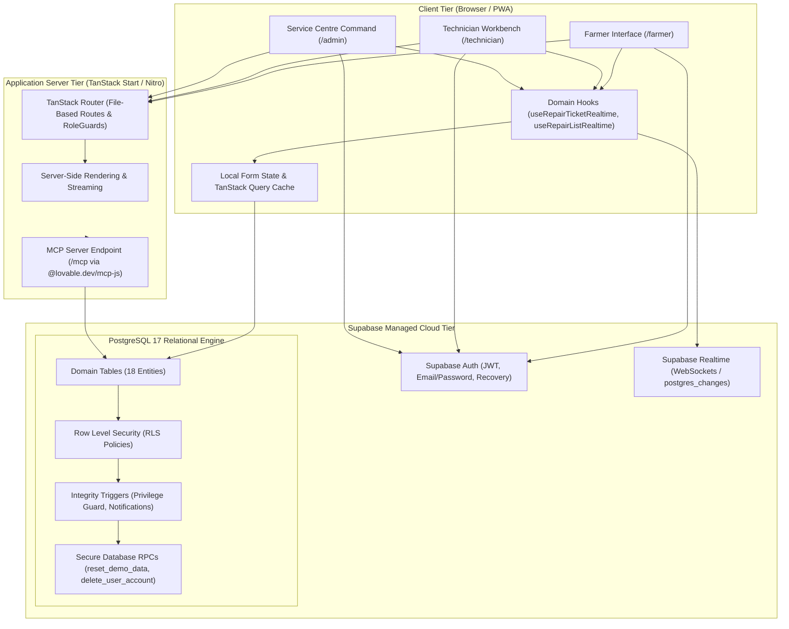
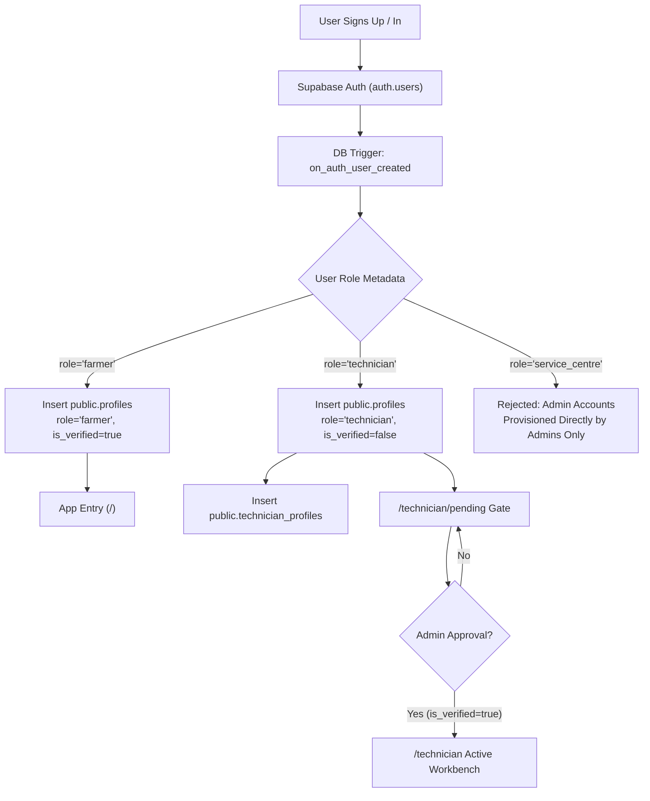
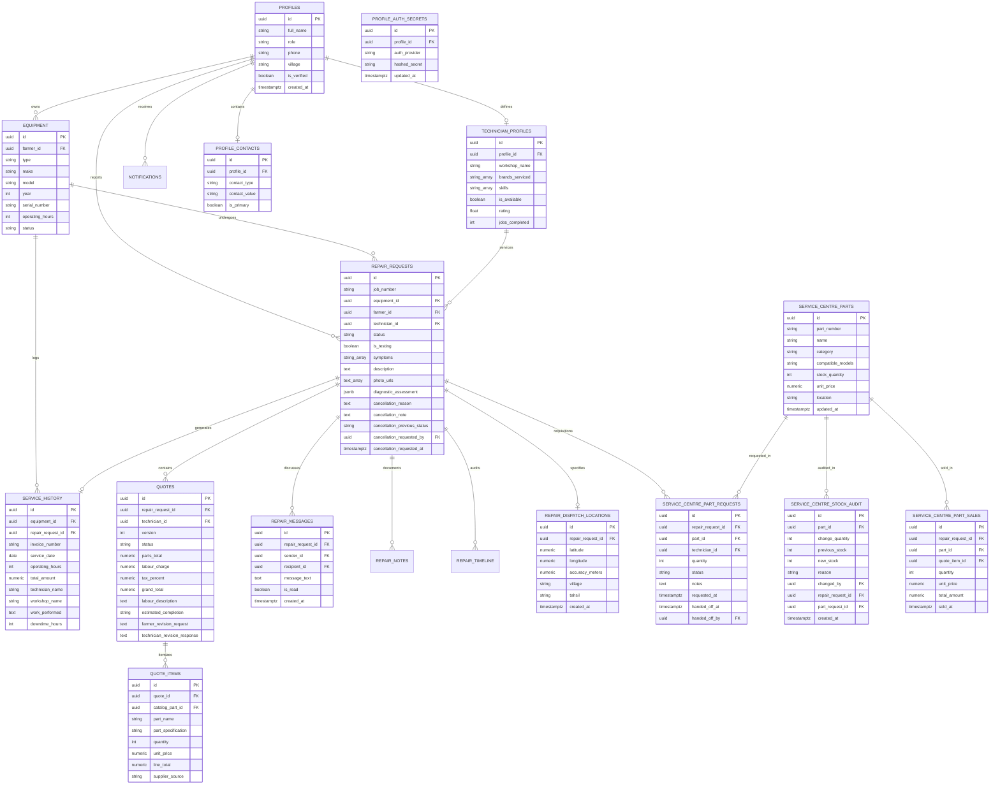
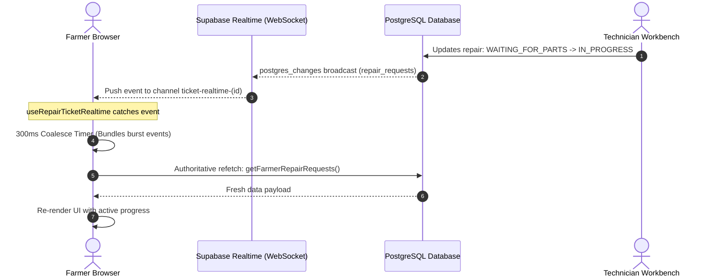
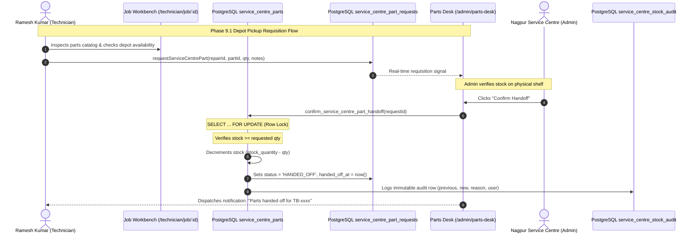

<!-- refreshed: 2026-11-04 -->
# Architecture & System Design

**Analysis Date:** 2026-11-04

## 1. High-Level System Architecture & Topology

TerraByte is architected as an integrated full-stack web application designed for high responsiveness, low-latency updates, rural network resilience, and strict data isolation:

```text
┌─────────────────────────────────────────────────────────────────────────────┐
│                       Client Tier (Browser / PWA)                            │
├──────────────────────┬──────────────────────┬───────────────────────────────┤
│    Farmer Portal     │ Technician Workbench │     Service Centre Desk       │
│  `src/routes/farmer` │`src/routes/technician`│     `src/routes/admin`        │
└──────────┬───────────┴──────────┬───────────┴───────────────┬───────────────┘
           │                      │                           │
           ▼                      ▼                           ▼
┌─────────────────────────────────────────────────────────────────────────────┐
│                    Application Server Tier (TanStack Start / Nitro)         │
│  SSR & Routing: `src/server.ts`, `src/start.ts`, `src/routes/**`             │
│  API Endpoints: `src/routes/api/health.ts`, `src/routes/api/route-estimate.ts`│
│  AI Diagnostics: `src/routes/api/assess-visual-defect.ts`                    │
│  MCP Agent Server: `src/routes/mcp.ts` (@lovable.dev/mcp-js)                 │
└─────────────────────────────────┬───────────────────────────────────────────┘
                                  │
                                  ▼
┌─────────────────────────────────────────────────────────────────────────────┐
│                     Database & Backend Tier (Supabase)                      │
│  PostgreSQL 17 Engine (18 Domain Tables, RLS Policies, Triggers, RPCs)       │
│  Realtime WebSocket Broadcasting (`src/hooks/use-repair-realtime.ts`)       │
│  Storage Buckets (`repair-photos`, `equipment-photos`, `avatars`)           │
│  External APIs: OSRM Routing, Google Routes API, Gemini 3.5, Groq Whisper    │
└─────────────────────────────────────────────────────────────────────────────┘
```



### Architectural Principles:
1. **Database as the Sole Source of Truth:** Live PostgreSQL 17 in Supabase manages all canonical domain records. Client stores provide optimistic local feedback but never supplant authoritative database queries.
2. **Actor Privilege Separation at the Database:** Authorization is not solely enforced at the UI router; every PostgreSQL table is secured with Row Level Security (RLS) evaluating native `auth.uid()`.
3. **Reactive WebSocket Signaling with Authoritative Refetch:** Real-time websocket events serve as lightweight invalidation signals; clients coalesce rapid bursts via debouncing (300ms window) and execute authoritative queries to guarantee consistent state.
4. **Governed Decision Boundaries:** High-risk operations (such as cancelling in-flight repairs with dispatches underway or registering new technician workshops) mandate human-in-the-loop review by Service Centre dispatchers.
5. **Decoupled Security Profile Architecture:** Public profiles (`public.profiles`) are decoupled from `auth.users.id`. Sensitive authentication secrets are strictly isolated in `public.profile_auth_secrets` with zero administrator read permissions.

---

## 2. Component Responsibilities

| Component | Responsibility | File |
|-----------|----------------|------|
| **Server Entry** | Normalizes SSR errors, traps h3 error bodies, and returns styled fallback pages | `src/server.ts` |
| **Start Config** | Configures CSRF protection and Supabase auth attacher middleware | `src/start.ts` |
| **Root Router** | Instantiates TanStack Router with QueryClient, scroll restoration, and meta headers | `src/router.tsx` |
| **Auth Service** | Handles sign-in, signup, sign-out, session restoration, and password reset | `src/lib/auth.ts` |
| **Repair Request Service** | Manages intake, triage assignment, status transitions, and timeline logs | `src/lib/services/repair-requests.ts` |
| **Quote Service** | Coordinates itemized estimates, revision history, and farmer approval | `src/lib/services/quotes.ts` |
| **Parts Desk Service** | Depot inventory, technician requisitions, atomic handoff, movements, and sales | `src/lib/services/parts-desk.ts` |
| **Routing Service** | Computes driving distance and ETA via OSRM with Google Routes API fallback | `src/lib/services/routing.ts` |
| **AI Diagnostics Service** | Runs multimodal tractor defect analysis via Google Gemini 3.5 Flash-Lite | `src/lib/services/gemini-diagnostic.ts` |
| **Audio Transcription** | Transcribes breakdown voice recordings via Groq Whisper Cloud API | `src/lib/services/transcription-service.ts` |
| **Realtime Hook** | Listens to Postgres changes via WebSocket and triggers coalesced cache invalidation | `src/hooks/use-repair-realtime.ts` |
| **Parts Pickup Card** | Interactive technician requisition UI for workshop and field jobs | `src/components/parts-pickup-card.tsx` |
| **Quote Comparison** | Line-by-line visual diff comparison between quote versions | `src/components/quote-comparison.tsx` |
| **Repair Chat** | Real-time messaging between farmer, assigned technician, and service centre | `src/components/repair-chat.tsx` |
| **Error Boundary** | Graceful isolation of component runtime exceptions | `src/components/component-error-boundary.tsx` |

---

## 3. Identity, Authentication & Role Hierarchy



### Role Model:
- **`farmer`**: Owners of agricultural machinery. Granted permissions to register machines, report breakdowns, review/approve quotes, communicate on tickets, and inspect service history.
- **`technician`**: Field and workshop mechanics. Granted permissions to update workshop profiles, accept dispatched jobs, formulate itemized quotes, pause for parts, conduct load testing, and sign off repairs. Blocked from workbench until verified.
- **`admin` (`service_centre`)**: Central command operators. Granted permissions to triage and assign requests, verify technicians, approve cancellation requests, oversee district parts holds, and moderate ticket communications.

### Tamper-Proofing Triggers & RPCs:
- **`guard_profile_privileges`**: An `AFTER UPDATE` trigger on `public.profiles` that raises an exception (`42501`) if a non-admin user attempts to alter their own `role` or `is_verified` columns.
- **`trg_notify_admin_on_technician_registration`**: An `AFTER INSERT` trigger on `public.technician_profiles` that dispatches an immediate administrative notification whenever a new mechanic registers for verification.
- **`public.get_session_profile()`**: Server-side RPC resolving caller profile safely without exposing sensitive authentication tokens or clerk IDs.

---

## 4. Relational Schema & Domain Data Model

The application operates across 18 core relational tables in the `public` PostgreSQL schema:



---

## 5. Row Level Security (RLS) Policy Architecture

Every table enforces PostgreSQL Row Level Security. Security boundaries are evaluated via internal SQL helper functions:
- `public.current_profile_id()`: Returns `profiles.id` corresponding to `auth.uid()`.
- `public.current_user_role()`: Returns `profiles.role` (`farmer`, `technician`, or `admin`).

### Security Matrix by Table

| Table | Operation | Enforced Policy Rules |
| :--- | :---: | :--- |
| **`equipment`** | SELECT | Owner (`farmer_id = current_profile_id()`), assigned technician on active repair, or Service Centre Admin. |
| | INSERT | Authenticated farmer only (`farmer_id = current_profile_id()`). |
| | UPDATE | Equipment owner or Service Centre Admin. |
| | DELETE | Equipment owner ONLY if `status != 'In Repair'` (protects ongoing ticket integrity). |
| **`repair_requests`**| SELECT | Ticket farmer, assigned technician, eligible technician feed (for `REQUESTED`), or Admin. |
| | INSERT | Authenticated farmer only (`farmer_id = current_profile_id()`). |
| | UPDATE | **Split across 4 purpose-driven policies**: <br/>• Farmer: may update breakdown details; can directly cancel ONLY if unassigned; must transition active tickets via `CANCELLATION_REQUESTED`. <br/>• Technician: may accept `REQUESTED` ticket, update progression (`ACCEPTED` $\rightarrow$ `QUOTE_PENDING` $\rightarrow$ `IN_PROGRESS` $\rightarrow$ `TESTING` $\rightarrow$ `COMPLETED`), or decline. Strictly prohibited from setting `CANCELLED`. <br/>• Admin: unrestricted management, manual dispatch, and cancellation resolution. <br/>• Lock: tickets in `CANCELLATION_REQUESTED` are locked against non-admin status mutation. |
| **`repair_dispatch_locations`** | SELECT | Farmer owner, assigned technician on active ticket, or Admin. Prohibited for unassigned technicians. |
| | INSERT / UPDATE | System / Ticket farmer during breakdown report flow. |
| **`quotes`** | SELECT | Farmer owning ticket, assigned technician, or Admin. |
| | INSERT | Assigned technician or Admin. Must reference valid in-flight repair. |
| | UPDATE | Assigned technician (modifying draft or building revision) or Farmer (transitioning `status` to `APPROVED` or `REVISED`). |
| **`repair_messages`**| SELECT | Ticket participants (`sender_id = current_profile_id()` OR `recipient_id = current_profile_id()`) or Admin. |
| | INSERT | Anti-spoofing check: `sender_id = current_profile_id()` AND sender is participant on `repair_request_id`. |
| | UPDATE | Recipient ONLY: allowed exclusively to update `is_read = true` (read receipts). |
| **`service_history`** | SELECT | Equipment owner, repairing technician, or Admin. |
| | INSERT | Service Centre Admin or Technician upon repair completion sign-off. |
| | UPDATE / DELETE| **BLOCKED**: Service history records are permanent, immutable ledgers. |
| **`service_centre_parts`** | SELECT | `admin` and `technician`. Farmers are strictly denied (42501/0 rows). |
| | INSERT / UPDATE / DELETE | `admin` only. Depot stock modifications require valid reasons. |
| **`service_centre_part_requests`** | SELECT | `admin` and assigned `technician` for the associated repair request. Farmers denied. |
| | INSERT | `admin` or assigned `technician` on active in-flight repairs. |
| | UPDATE | `admin` (status progression/handoff) or assigned `technician` (cancel own `PENDING` request). |
| | DELETE | `admin` only. Automatically cascades on repair request deletion. |
| **`service_centre_stock_audit`** | SELECT | `admin` only. |
| | INSERT / UPDATE / DELETE | **BLOCKED** from direct table writes; inserted strictly via `SECURITY DEFINER` atomic functions. |
| **`service_centre_part_sales`** | SELECT | `admin` only. Farmer and technician denied. |
| **`profile_auth_secrets`** | ALL | Sealed from client queries. Accessible strictly to Auth server-role routines. |

---

## 6. State Machine & Lifecycle Invariants

The repair process follows a deterministic state machine modeled around agricultural field dynamics:

```mermaid
stateDiagram-v2
    direction TB
    
    [*] --> REQUESTED: Breakdown Reported (Unassigned)
    
    REQUESTED --> CANCELLED: Farmer Cancels (Direct - Unassigned Only)
    REQUESTED --> ACCEPTED: Technician Accepts / Admin Assigns
    
    ACCEPTED --> QUOTE_PENDING: Technician Arrives & Formulates Quote
    
    QUOTE_PENDING --> QUOTE_REVISED: Farmer Requests Revision (v1)
    QUOTE_REVISED --> QUOTE_PENDING: Technician Submits Revised Quote (v2)
    
    QUOTE_PENDING --> IN_PROGRESS: Farmer Approves Quote
    
    IN_PROGRESS --> WAITING_FOR_PARTS: Spare Part Procurement Hold
    WAITING_FOR_PARTS --> IN_PROGRESS: Part Delivered, Work Resumes
    
    IN_PROGRESS --> TESTING: Mechanical Fix Complete; Field Load Testing
    TESTING --> COMPLETED: Load Verification Passes; Sign-Off
    
    ACCEPTED --> CANCELLATION_REQUESTED: Farmer Submits Cancellation
    QUOTE_PENDING --> CANCELLATION_REQUESTED: Farmer Submits Cancellation
    QUOTE_REVISED --> CANCELLATION_REQUESTED: Farmer Submits Cancellation
    IN_PROGRESS --> CANCELLATION_REQUESTED: Farmer Submits Cancellation
    WAITING_FOR_PARTS --> CANCELLATION_REQUESTED: Farmer Submits Cancellation
    
    CANCELLATION_REQUESTED --> CANCELLED: Admin Approves Cancellation
    CANCELLATION_REQUESTED --> ACCEPTED: Admin Rejects (Reverts to Previous State)
    
    COMPLETED --> [*]: Service Record Created, Equipment Operational
```

### Invariant Rules Enforced:
1. **Quotation Before Disassembly**: No ticket may transition from `ACCEPTED` directly to `IN_PROGRESS`. It must transition to `QUOTE_PENDING` and receive explicit farmer approval.
2. **Work-Hold on Cancellation Review**: While a ticket is in `CANCELLATION_REQUESTED`, technician actions (advancing status, submitting quotes, testing) are disabled in the UI and rejected by RLS.
3. **Automatic Ledger Creation**: Transitioning to `COMPLETED` requires passing testing verification and automatically generates an immutable `service_history` record with a calculated invoice number (`INV-TB-xxxx`).
4. **Equipment Availability State**: Equipment is marked `In Repair` upon breakdown creation and restored to `Operational` ONLY when all active repairs for that equipment reach `COMPLETED` or `CANCELLED`.
5. **No False Finding-State**: The UI does not display "Finding Your Technician" until the farmer has actively dispatched the technician request.

---

## 7. Concurrency Hardening & Mutation Safety (OCC)

To prevent multi-device race conditions:
```typescript
// Example: Accept repair request concurrency guard (src/lib/services/repair-requests.ts)
const { data, error } = await supabase
  .from("repair_requests")
  .update({
    technician_id: techProfileId,
    status: "ACCEPTED",
  })
  .eq("id", repairId)
  .is("technician_id", null)       // Guarantees ticket has not been claimed
  .eq("status", "REQUESTED")       // Guarantees ticket is in REQUESTED status
  .select();

if (!data || data.length === 0) {
  throw new Error("Job has already been accepted by another technician or reassigned.");
}
```

---

## 8. Supabase Realtime Architecture



### Key Realtime Attributes:
- **Change Signaling Only:** Real-time payloads are treated as signals, not authoritative data. The client triggers an authoritative database query, preventing out-of-order partial state bugs.
- **Debounced Coalescing (300ms Window):** Bundles rapid multi-event mutations into a single network refetch.
- **Window Focus Recovery:** Window focus listeners trigger immediate refetches when returning to backgrounded tabs.

---

## 9. Spare-Parts Inventory & Sourcing Coordination Architecture (Phase 9)



### Invariants:
1. **Stock Non-Negativity & Concurrency Protection:** `CHECK (stock_quantity >= 0)` constraint and row-level locks (`SELECT ... FOR UPDATE`) in `confirm_service_centre_part_handoff`.
2. **Strict Farmer Privacy Quarantine:** Farmers have zero access to depot inventory records, wholesale acquisition rates, or staff internal notes at the PostgreSQL RLS policy level.
3. **Repair State Machine Decoupling:** Requisitioning parts does not silently alter repair status. Technicians explicitly pause/resume repairs via `WAITING_FOR_PARTS`.

---

## 10. Assistive Diagnostic Rules & Model Context Protocol (MCP)

### Diagnostic Intake Engine (`src/lib/assessment.ts`)
Maps symptom combinations and keywords to:
- Affected subsystem (Fuel injection, Hydraulics, Cooling, Transmission, Electrical, Steering/Brakes)
- Preliminary severity rating (`Low`, `Moderate`, `Moderate to High`, `High`)
- Likely parts categories required for procurement
- Urgent field safety advice
- Explicit assistive disclaimer: *"This is an assistive preliminary assessment, not a confirmed diagnosis. The technician will inspect and confirm the cause on site."*

### Model Context Protocol (MCP) Server
Active at `/mcp` via `@lovable.dev/mcp-js`:
- `list_symptoms`: Returns the canonical enumeration of recognized equipment symptoms.
- `assess_breakdown`: Evaluates symptom combinations and returns structured preliminary diagnostics.
- `match_technicians`: Evaluates equipment brand, affected system, and technician database to return objectively ranked technician matches with scoring explanations.

---

## 11. Demo Data Isolation & Atomic Reset Architecture

1. **Canonical Persona Identification:** System checks `isDesignatedDemoAccount(email)` for the 3 retained evaluation accounts:
   - `farmer.nagpur@terrabyte.demo` (Balasaheb Patil)
   - `tech.nagpur@terrabyte.demo` (Ramesh Kumar)
   - `admin.nagpur@terrabyte.demo` (Nagpur Service Centre)
2. **Dual-Key Authorization:** The PostgreSQL RPC `public.reset_demo_data()` requires:
   - Authenticated caller belongs to the designated demo set.
   - Target record has `demo_code IS NOT NULL`.
3. **Real User Isolation:** Real user records (such as `Ankit Chamke` or judges) have `demo_code IS NULL` and are 100% immune from demo resets.

---

## 12. Rural Network Resilience & Mobile UX

- **Visual Feedback & Optimistic Cues:** Instant tactile UI response while network queries resolve.
- **Bounded Payloads:** Active-only query filtering (`{ activeOnly: true }`) eliminates completed historical records from initial page loads, reducing mobile data transfer by over 90%.
- **High-Contrast Agricultural Design:** High-contrast palette (`soil amber`, `forestgreen`, `warning crimson`), min 48px touch targets, and legible typography in direct sunlight.

---

*Architecture analysis: 2026-11-04*
