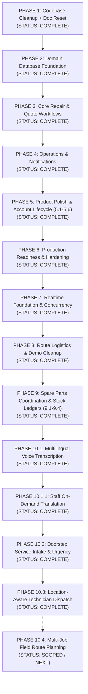

# TerraByte — Phased Implementation Plan

## Architectural Principles

1. **Strict Phased Discipline**: Build ONE phase at a time. Each phase must be verified, audited, and committed before beginning the next.
2. **Current Baseline As Source of Truth**: The active TanStack Start codebase and native Supabase Auth setup represent the permanent application baseline.
3. **No Clerk**: Clerk is permanently excluded. All identity, authorization, and database logic are built on Supabase.
4. **No Destructive Operations**: As the repository is connected to Lovable, published Git history is never rewritten (no force pushing, rebasing, or amending).
5. **Clear State Separation**: All documentation and code strictly distinguish between live Supabase data and mock/local store data. Supabase is the live source of truth.

---

## Master Roadmap

---

## Phase Breakdown

### PHASE 5.1 — Product Polish & Account Lifecycle

- **Status**: **COMPLETE** (Committed and pushed: `a6ff2de`)
- **Deliverables**:
  1. Proper Home experience with role-based dashboard shortcuts (`/farmer`, `/technician`, `/admin`).
  2. Contextual back navigation preserving state across views.
  3. Profile management (name, phone, village/workshop, brand specializations).
  4. Password management (forgot password, recovery token flow, branded reset password email template, change password).
  5. Permanent account deletion via atomic PostgreSQL RPC `public.delete_user_account()` with active-repair and demo-account protections.

---

### PHASE 5.2 — Demo / Data Hygiene & Baseline Reset

- **Status**: **COMPLETE**
- **Objective**: Implement a safe, atomic, deterministic "Reset Demo" capability for evaluation personas, isolate demo farmer data, and enforce Nagpur geography.
- **Key Deliverables Completed**:
  1. Canonical Demo Reset RPC (`public.reset_demo_data()`) with dual-key authorization (`email` in designated set + `demo_code IS NOT NULL`) and atomic fixture upsert.
  2. Dedicated client authorization service (`src/lib/services/demo.ts`) gating reset strictly to 5 demo evaluation accounts.
  3. Responsive frontend reset confirmation dialog (`AlertDialog`) with loading states and 7-step post-reset cache synchronization.
  4. Full farmer data isolation separating real users and each demo account (`farmer`, `farmer2`, `farmer3`) to their own machines and tickets.
  5. Nagpur geography synchronization across all fixtures, profiles, and repair locations.
  6. Completed-repair separation from active workspace triage; reserved "Action needed" exclusively for genuine pending actions (`QUOTE_PENDING`, `QUOTE_REVISED`, unassigned `REQUESTED`).
  7. Startup auth deduplication, session fast-path caching, and database-level active-only repair queries (`{ activeOnly: true }`).

---

### PHASE 5.3 — Notification & Product Communication Polish

- **Status**: **COMPLETE**
- **Objective**: Audit and refine notification delivery, lifecycle status communication, demo technician alert fixtures, and notification state performance across all roles.

#### Step 1 — Notification & Communication Audit

- **Status**: **COMPLETE**
- Complete end-to-end audit of notification creation, retrieval, RLS policies, unread badge calculation, real-time channels, and role-specific communication copy.

#### Step 2 — Core Notification Correctness & Safe Performance Fixes

- **Status**: **COMPLETE**

1. **Fix QUOTE_REVISED Label Conflict**:
   - Updated `FARMER_LABEL["QUOTE_REVISED"]` to `"Revised Quote Ready"` in `src/lib/tb-store.ts`.
   - Resolved contradiction with orange "Action needed" status card and quote revision notification copy.
2. **Resolve Handover / Completion Contradiction**:
   - Aligned copy across farmer view (_"Repair Complete & Saved to Service History"_), technician view (_"Repair completed and recorded in equipment service history"_), admin view (_"Repair complete & saved to service history"_), and completion notification copy (_"Repair TB-xxxx has been completed and saved to service history."_).
   - Accurately reflects that technician completion immediately auto-generates permanent service history without claiming a separate pending handover confirmation.
3. **Fix Demo Technician Notification Fixture**:
   - Reassigned seeded notification `c7fdc083-fce0-4a73-afb8-f63aa84faf2e` to Ramesh Kumar (`t1` / `00000000-0000-0000-0002-000000000001`) on repair `TB-8841` in `supabase/seed.sql`.
   - Created forward migration `supabase/migrations/20261003160000_phase5_3_demo_technician_notification_fix.sql` updating live database row and `public.reset_demo_data()` RPC.
4. **Clear Notification State on User Switch / Sign-Out**:
   - Updated `Shell` in `src/components/tb.tsx` to immediately clear notifications array, error state, and popover state when `userId` becomes null or changes before loading the next user's data.
   - Guaranteed that User A's notifications never display under User B during same-session user switching.
5. **Safe Notification Query Limiting & Duplicate Fetch Cleanup**:
   - Bounded initial and polled notification queries to `limit: 25` in `src/components/tb.tsx`, preserving newest entries.
   - Added safe SQL limit bounding (`Math.max(limit * 4, 100)`) for admin notifications in `src/lib/services/notifications.ts`.
   - Throttled bell toggle refresh with a 5-second timestamp freshness guard to eliminate redundant queries on rapid opening.
   - Preserved Supabase Realtime live subscriptions and 15-second background fallback polling.

#### Step 3 — Notification Triggers, Copy Standardization & Visual Hierarchy

- **Status**: **COMPLETE**

1. **Technician Verification Notification**:
   - Implemented `setTechnicianVerification()` in `src/lib/services/technicians.ts` wired to `src/routes/admin/technicians.tsx`.
   - Dispatches idempotent notification to technician upon admin approval (_"Your technician account has been approved by the Service Centre. You can now accept repair jobs."_, deep-link `/technician`).
2. **Technician Started-Work Notification**:
   - Updated `startRepair()` in `src/lib/services/repair-requests.ts` to notify the associated farmer when physical repair work begins.
   - Enforces idempotency check preventing duplicate notifications on repeated clicks or updates (_"Technician started repair work on TB-xxxx."_, deep-link `/farmer/repair/:id`).
3. **New Technician Registration Admin Notification**:
   - Created forward migration `supabase/migrations/20261003170000_phase5_3_technician_registration_notification.sql` with trigger `trg_notify_admin_on_technician_registration` executing upon `technician_profiles` insert.
   - Added service helper `notifyAdminOnTechnicianRegistration()` in `src/lib/services/technicians.ts`.
   - Included technician registration patterns in `isActionableServiceCentreNotification()` in `src/lib/services/notifications.ts` (_"New technician registration: <name> (<workshop>). Pending verification."_, deep-link `/admin/technicians`).
4. **Notification Copy Standardization**:
   - Audited and standardized all notification copy across quotes, repair requests, and technician operations.
   - Enforced consistent sentence casing, concise action-oriented tone, and proper ending punctuation across all system notifications.
5. **Notification Popover Visual Hierarchy**:
   - Redesigned Shell bell popover in `src/components/tb.tsx` with semantic category pill badges and icons (`Breakdown`, `Quote`, `Parts`, `Testing`, `Repair`, `Account`, `Assignment`, `Alert`, `Notice`), distinct unread indicator dot with subtle focus ring, unread background highlight (`bg-primary/[0.04]`), and actionable "View details" cue, preserving all existing interactions.

> [!NOTE]
> **Realtime Scope Boundary**: Realtime notification delivery in Phase 5.3 is strictly scoped to the existing Supabase Realtime channel (`postgres_changes` on `public.notifications`) and 15-second background polling fallback. Broad multi-user interactive realtime state synchronization across boards, active forms, and technician assignments is explicitly deferred to **Phase 7 (Realtime Sync & Production Hardening)**.

---

### PHASE 5.4 — Cancellation Approval

- **Status**: **COMPLETE** (Committed and pushed: `d39d821`)
- **Objective**: Establish a governed repair cancellation workflow providing structured farmer cancellation requests, work-hold pauses for assigned technicians, and administrative review/resolution by the Service Centre.

#### Step 1 — Database & State Foundation

- **Status**: **COMPLETE** (Manually deployed and verified in Supabase; forward migration `20261004100000_phase5_4_cancellation_approval_foundation.sql` preserved as canonical source)
- **Deliverables**:
  1. Forward migration `supabase/migrations/20261004100000_phase5_4_cancellation_approval_foundation.sql`.
  2. Extended `public.repair_status` enum with `CANCELLATION_REQUESTED`.
  3. Added cancellation tracking columns to `public.repair_requests`:
     - `cancellation_reason` (text)
     - `cancellation_note` (text)
     - `cancellation_requested_by` (uuid)
     - `cancellation_requested_at` (timestamptz)
     - `cancellation_previous_status` (public.repair_status)
     - `cancellation_admin_response` (text)
  4. Partial index on `repair_requests(status)` for `CANCELLATION_REQUESTED`.
  5. Hardened RLS `UPDATE` policies on `public.repair_requests`:
     - Four granular policies: Admins (full operational access), Farmers Direct Cancel (strictly unassigned `REQUESTED`), Farmers Active Lifecycle (quote revision, quote approval, cancellation requests; blocks direct `CANCELLED` and `COMPLETED`), and Technicians (job acceptance, repair progress; blocks `CANCELLED` and `CANCELLATION_REQUESTED`).
     - Tickets in `CANCELLATION_REQUESTED` locked against non-admin edits.
     - Only `admin` can approve (`CANCELLED`) or reject (`cancellation_previous_status`).
  6. Updated `public.reset_demo_data()` to nullify cancellation metadata across all four canonical demo repairs while strictly preserving their Phase 5.2 baseline statuses (`TB-8841` $\rightarrow$ `WAITING_FOR_PARTS`, `TB-8902` $\rightarrow$ `QUOTE_PENDING`, `TB-8898` $\rightarrow$ `REQUESTED`, `TB-4489` $\rightarrow$ `QUOTE_REVISED`), keeping real user accounts (such as `Ankit Chamke`) untouched.
  7. Synchronized TypeScript types across `src/integrations/supabase/types.ts`, `src/lib/tb-store.ts`, `src/components/tb.tsx`, and `src/lib/services/repair-requests.ts`.

#### Step 2 — Service Layer & Notification Workflow

- **Status**: **COMPLETE**
- **Deliverables**:
  1. Updated `cancelRepairRequest(id, options)` in `src/lib/services/repair-requests.ts`: strictly restricts direct client cancellation to unassigned `REQUESTED` tickets (`status === 'REQUESTED' && !technician_id`), preserving administrative direct cancellation while throwing informative errors for assigned/in-progress tickets guiding callers to governed review.
  2. Implemented `requestCancellation(id, input)` in `src/lib/services/repair-requests.ts`: captures structured cancellation reason and freeform note, snapshotting `cancellation_previous_status`, transitioning active/assigned tickets to `CANCELLATION_REQUESTED`, delegating unassigned `REQUESTED` tickets immediately to cancellation, recording timeline events, preserving `"In Repair"` equipment status, and dispatching actionable alerts to Service Centre admins.
  3. Implemented `approveCancellation(id, input)` in `src/lib/services/repair-requests.ts`: restricted strictly to Service Centre admins, transitions `CANCELLATION_REQUESTED` to `CANCELLED`, records administrative response remarks, restores equipment to `"Operational"` (if no other active repairs exist), and dispatches notifications to both farmer and assigned technician.
  4. Implemented `rejectCancellation(id, input)` in `src/lib/services/repair-requests.ts`: restricted strictly to Service Centre admins with required explanation, restores ticket from `CANCELLATION_REQUESTED` back to `cancellation_previous_status` (or `ACCEPTED`), maintains equipment in `"In Repair"`, and dispatches resumption notifications to farmer and assigned technician.
  5. Updated `LEGAL_REPAIR_TRANSITIONS` in `src/lib/services/repair-requests.ts` allowing transitions between `REQUESTED` and `CANCELLATION_REQUESTED`.
  6. Expanded `isActionableServiceCentreNotification()` and `getNotificationCategory()` in `src/lib/services/notifications.ts` to recognize cancellation events as actionable Service Centre alerts.

#### Step 3 — Farmer Cancellation UI & Dialog

- **Status**: **COMPLETE**
- **Deliverables**:
  1. Accessible Radix Dialog (`@/components/ui/dialog`) implemented in `src/routes/farmer/repair/$id.tsx`, replacing the legacy browser `confirm()` dialogue with focus-trapped, keyboard-accessible modal interactions.
  2. Dynamic button routing: renders "Cancel request" for unassigned `REQUESTED` repairs and "Request cancellation" for active/assigned repairs (`ACCEPTED`, `QUOTE_PENDING`, `QUOTE_REVISED`, `IN_PROGRESS`, `WAITING_FOR_PARTS`, and assigned `REQUESTED`).
  3. Structured reason picker using `CANCELLATION_REASONS` with an optional freeform explanation textarea and form validation.
  4. Integration with Step 2 service functions: calls `cancelRepairRequest(r.id, { reason, note })` for unassigned tickets (immediate cancellation, toast, and redirection to `/farmer`) and `requestCancellation(r.id, { reason, note })` for assigned/active tickets (governed review, toast, and in-place reload).
  5. Dedicated status banners:
     - `CANCELLATION_REQUESTED`: Prominent warning banner with clock icon, submission reason, optional note, timestamp, and clear explanation that work is on hold pending Service Centre review.
     - `CANCELLED`: Closed status banner with `XCircle` icon, cancellation reason, optional note, administrative resolution remarks, and direct link to machine record.
  6. Interaction suppression: Suppressed technician call actions and active repair controls on cancelled tickets.
  7. Stepper alignment: Updated `stepIndex()` and `Stepper` in `src/components/tb.tsx` to handle `CANCELLATION_REQUESTED` and `CANCELLED`, rendering `"Cancellation Pending Review"` with warning pulse on the active step while preserving prior progression history.

#### Step 4 — Admin Approval Workbench & Operations Filter

- **Status**: **COMPLETE**
- **Deliverables**:
  1. Operations Pipeline Filter & Alert Banner (`src/routes/admin/index.tsx`):
     - Added `"Cancellation Requests"` to dashboard `FILTERS` array and filter predicate.
     - Implemented an actionable top amber alert banner displaying pending cancellation requests with ticket job number, farmer name, cancellation reason, elapsed time, and quick-link chips directly navigating to the review card.
     - Updated operations table row rendering: highlights `CANCELLATION_REQUESTED` rows with an amber pulse dot, displays the cancellation reason preview beneath the farmer's name, and renders a distinct `"Review"` CTA button.
  2. Admin Cancellation Review Card (`src/routes/admin/repair/$id.tsx`):
     - Renders a prominent amber review workbench card when `status === "CANCELLATION_REQUESTED"` displaying ticket ID, farmer name, equipment details, previous status snapshot, cancellation reason, farmer context note, request timestamp, assigned technician, and active work-hold indicator.
     - Suppressed the generic bottom `"Cancel repair"` action button whenever a repair is in `CANCELLATION_REQUESTED` to avoid UI ambiguity.
  3. Approve Cancellation Flow:
     - Accessible Radix `Dialog` detailing cancellation effects (notifies farmer and assigned technician, releases equipment back to `Operational`).
     - Includes optional administrative response remarks textarea and loading indicator (`reviewActionBusy === "approve"`).
     - Calls `approveCancellation(r.id, { adminResponse })`, displays success toast, and refreshes ticket state in-place.
  4. Reject Cancellation Flow:
     - Accessible Radix `Dialog` detailing rejection effects (reverts ticket back to `cancellation_previous_status`, resumes repair work, notifies parties).
     - Enforces non-empty administrative justification with form validation (`adminResponse: string`).
     - Calls `rejectCancellation(r.id, { adminResponse })`, displays info toast, and refreshes ticket state in-place.
  5. Resolution & Resumption UI Banners:
     - Renders a closed banner for `CANCELLED` tickets displaying the administrative resolution note.
     - Renders an informative resumption notice on active tickets that previously had a cancellation request declined, showing the admin explanation and date.
  6. Activity Log Timeline Recognition:
     - Updated `getActivityAction()` to render clear timeline labels for cancellation events (`"Cancellation requested by farmer"`, `"Cancellation approved by Service Centre"`, `"Cancellation request declined"`).

#### Step 5 — Technician Work-Hold UI & Cancellation Awareness

- **Status**: **COMPLETE**
- **Deliverables**:
  1. Technician Dashboard Work-Hold Isolation (`src/routes/technician/index.tsx`):
     - Partitioned `CANCELLATION_REQUESTED` repairs out of `Active jobs` to eliminate accidental work progression.
     - Added dedicated `"On hold · Cancellation pending (N)"` section with amber visual styling, animated pulse dot, cancellation reason preview, and hold explanation.
     - Added dedicated `"Cancelled (N)"` section with muted styling to preserve closed repair visibility and audit history.
  2. Technician Job Detail Work-Hold Banner (`src/routes/technician/job/$id.tsx`):
     - Rendered prominent amber work-hold card when `status === "CANCELLATION_REQUESTED"` displaying job number, farmer name, equipment model, cancellation reason, farmer context note, request timestamp, and previous status snapshot.
     - Provided explicit operational instructions clarifying that diagnostics, parts procurement, and repairs are suspended pending Service Centre review.
  3. Action Suppression & Context Preservation:
     - Strictly suppressed all repair progression actions (quote formulation/revision, start repair, parts hold, testing, complete repair) while under review.
     - Maintained read-only quotation and parts-hold context cards so existing diagnostic and parts specifications remain visible without mutation controls.
     - Preserved outbound calling access on held tickets for direct farmer coordination while suppressing call CTA on closed/cancelled tickets.
  4. Post-Resolution Technician Awareness:
     - Rendered muted **Repair Cancelled** closed banner on `CANCELLED` tickets detailing cancellation reason, farmer note, and admin resolution remarks.
     - Rendered informative **Cancellation Request Declined · Work Resumed** notice when a cancellation request is declined, showing admin justification and re-enabling standard progression controls.
     - Updated route assignment check (`r.technician_id !== profile?.id && r.status !== "COMPLETED" && r.status !== "CANCELLED"`) to allow technicians to view cancelled historical jobs assigned to them.

#### Step 6 — End-to-End Verification

- **Status**: **COMPLETE** (Verification suite P5.4-01 through P5.4-30 passed and committed in baseline commit `d39d821`)

---

### PHASE 5.5 — Communication & Quote Revision Workflow

- **Status**: **COMPLETE**
- **Objective**: Implement ticket-scoped farmer–technician messaging with unread tracking, real-time sync, and notification dispatch, alongside the quote revision request/resubmission lifecycle with version comparison.

#### Step 1 — Database Foundation & Canonical Demo Fixture Completion

- **Status**: **COMPLETE**
- **Deliverables**:
  1. Forward migration `supabase/migrations/20261005100000_phase5_5_communication_foundation.sql`:
     - Creates `public.repair_messages` table with `id`, `repair_request_id`, `sender_id`, `recipient_id`, `message_text`, `created_at`, and `is_read`.
     - Adds composite performance index on `(repair_request_id, created_at ASC)` and unread partial index on `(recipient_id, is_read) WHERE is_read = false`.
     - Hardened RLS policies: SELECT for participants/admins, INSERT with caller anti-spoofing (`sender_id = current_profile_id()`), UPDATE strictly for recipient read status, and DELETE reserved for administrative moderation.
     - Idempotent realtime publication hook for `public.repair_messages`.
     - Updated `public.reset_demo_data()` to clean disposable test messages and extra test quotes, preserving canonical repairs (`TB-8841`, `TB-8902`, `TB-8898`, `TB-4489`), and restored canonical Quote v1 fixture for `TB-4489` (status `REVISED`, v1, Rotavator seal kit ₹1,400 + EP-90 Gearbox oil ₹600 + Labour ₹800 = ₹2,800).
  2. Synchronized `src/integrations/supabase/types.ts` with `repair_messages` table row, insert, update, and relationship types.

#### Step 2 — Service Layer & State Machine (Quote Revision & Communication)

- **Status**: **COMPLETE**
- **Deliverables**:
  1. `src/lib/services/repair-messages.ts` with `getRepairMessages()`, `sendRepairMessage()`, `markMessagesAsRead()`, `getUnreadMessageCount()`, anti-spoofing validation, bounded text limits, counterpart verification, and recipient notifications.
  2. Fixed `reviseQuote()` in `src/lib/services/quotes.ts` to preserve the farmer's original `clarification_note` on `repair_requests` intact without overwriting, storing technician explanations separately in `repair_timeline` audit events across all revision reasons.
  3. Added `getQuoteVersions()` and `compareQuoteVersions()` in `src/lib/services/quotes.ts` providing structured version history and item/labour/total diff comparisons for the future UI.
  4. Added `getRepairActionOwnership()` in `src/lib/services/repair-requests.ts` defining actor action obligations (`QUOTE_REVISED`: technician action required, farmer waiting).
  5. Corrected inverted `FARMER_LABEL.QUOTE_REVISED` in `src/lib/tb-store.ts` to `"Revision Requested · Awaiting Technician"` and `STAFF_LABEL.QUOTE_REVISED` to `"Quote revision requested"`.

#### Step 3 — Quote Revision UX, Comparison & Farmer–Technician Communication

- **Status**: **COMPLETE**
- **Deliverables**:
  1. `<QuoteComparison />` component (`src/components/quote-comparison.tsx`):
     - Displays summary KPI cards: Total difference (₹ and %), Parts difference, Labour difference with directional indicators.
     - Preserves and separately displays Farmer Revision Request (reason, explanation, photo) and Technician Response in distinct styled callout boxes.
     - Itemizes line-by-line differences with semantic badges (`+ Added`, `- Removed`, `Modified`, `Unchanged`).
  2. `<RepairChat />` ticket communication component (`src/components/repair-chat.tsx`):
     - Real-time ticket discussion thread using Supabase Realtime channel on `public.repair_messages`.
     - Automatic `markMessagesAsRead()` on viewing received messages.
     - Role badges (`Farmer`, `Tech`, `Service Centre`), outgoing status indicators (Sent / Read), relative timestamps.
     - Validated textarea composer with character limit (max 2,000 chars) and enter-to-send support.
  3. Technician Job Route Integration (`src/routes/technician/job/$id.tsx`):
     - In `QuoteBuilder`: displays previous Quote v1 summary card when `status === "QUOTE_REVISED"`.
     - Made technician explanation input universal for all revision reasons, passing note to `reviseQuote()`.
     - Renders `<QuoteComparison />` when quote versions $\ge 2$ and ticket is in `QUOTE_PENDING`.
     - Embedded `<RepairChat />` ticket communication thread above status timeline.
  4. Farmer Repair Hub Integration (`src/routes/farmer/repair/$id.tsx`):
     - Distinct `QUOTE_REVISED` waiting state ("The technician is revising your quote") displaying farmer's revision request and collapsible previous quote details, suppressing approval actions.
     - When `status === "QUOTE_PENDING"` and `version > 1`: displays "Revised quote ready for your review", renders `<QuoteComparison />`, and enables Approve/Decline actions.
     - Embedded `<RepairChat />` ticket discussion thread.
  5. Service Centre Operations Integration (`src/routes/admin/repair/$id.tsx` & `src/routes/admin/index.tsx`):
     - Corrected `QUOTE_REVISED` exception banner on `/admin/repair/:id` to workflow copy ("Quote revision requested by farmer · Technician response expected") with elapsed time as supporting info.
     - Corrected exceptions copy on `/admin` to "revision awaiting technician".
     - Renders `<QuoteComparison />` when quote versions $\ge 2$.
     - Embedded `<RepairChat />` ticket discussion thread.

#### Step 4 — End-to-End Verification & Review

- **Status**: **COMPLETE**
- **Deliverables**:
  - Verification suite `P5.5-01` through `P5.5-14` fully verified and passing.

---

### PHASE 5.6 — Handover & Completion Polish

- **Status**: **COMPLETE**
- **Objective**: Align the repair completion lifecycle across technician sign-off, farmer notification, administrative workbench visibility, and permanent service history creation, eliminating legacy "handover pending" contradictions.

#### Step 1 — Audit Only

- **Status**: **COMPLETE**
- Confirmed canonical completion lifecycle: `IN_PROGRESS` $\rightarrow$ `TESTING` $\rightarrow$ `COMPLETED` $\rightarrow$ Service History. Confirmed that TerraByte does NOT use a persisted `HANDOVER_PENDING` state.

#### Step 2 — Service Layer & Admin Completion Notification Alignment

- **Status**: **COMPLETE**
- **Deliverables**:
  1. Updated `completeRepair()` in `src/lib/services/repair-requests.ts` to dispatch an actionable completion notification to Service Centre admins (_"Repair TB-xxxx completed & verified by technician. Ready for review."_, link `/admin/repair/:id`, category `Repair`).
  2. Updated `getNotificationCategory()` in `src/lib/services/notifications.ts` to categorize completion notifications under `Repair`.
  3. Verified service history idempotency in `createServiceHistoryFromRepair()`.

#### Step 3 — Admin Workbench & Dashboard Completion Polish

- **Status**: **COMPLETE**
- **Deliverables**:
  1. Admin Repair Detail (`src/routes/admin/repair/$id.tsx`):
     - Renders clear **Completion Details** card displaying completion timestamp, testing verification status, final work notes, and equipment operational status.
     - Suppressed/hid reassignment and dispatch controls when repair status is `COMPLETED` or `CANCELLED`.
  2. Admin Operations Dashboard (`src/routes/admin/index.tsx`):
     - Added dedicated `"Completed"` and `"Cancelled"` filter tabs alongside active filters.
     - Excluded closed/cancelled repairs from active operational queue and metrics while ensuring easy searchability and one-click access.

#### Step 4 — Technician + Farmer Completion UX

- **Status**: **COMPLETE**
- **Deliverables**:
  1. Renamed technician completion CTA from _"Complete & hand over"_ to _"Complete & sign off"_.
  2. Updated technician completion modal explanatory text to clarify that sign-off saves to permanent service history and marks equipment `Operational`.
  3. Refined farmer repair hub testing copy to clarify that testing under operational load is the final verification before completing the repair and saving it to service history.

#### Step 5 — Final End-to-End Verification & Phase 5 Closeout

- **Status**: **COMPLETE**
- **Deliverables**:
  1. Full E2E lifecycle executed on canonical demo repair `TB-8841` (`WAITING_FOR_PARTS` $\rightarrow$ `IN_PROGRESS` $\rightarrow$ `TESTING` $\rightarrow$ `COMPLETED`).
  2. Admin completion notification verified (_"Repair TB-8841 completed & verified by technician. Ready for review."_, category `Repair`).
  3. Service history record created and verified (`INV-TB-8841`).
  4. Demo baseline reset via `resetDemoData()` as admin: verified pristine restoration of `TB-8841` (`WAITING_FOR_PARTS`, `completion_details: null`, equipment `In Repair`), `TB-8902`, `TB-8898`, `TB-4489`.
  5. Real user Ankit Chamke account (`TB-4545`) isolated and 100% untouched.
  6. Phase 5.1–5.6 regression test suite, static audit, and `npm run build` all passing cleanly.

---

### PHASE 6 — Production Readiness & Account Hardening

- **Status**: **COMPLETE** (Committed in `27a1e69`)
- **Objective**: Harden frontend stability, provide runtime isolation with error boundaries, and solidify account lifecycle management.
- **Deliverables Completed**:
  1. **Component Error Boundary**: Created `<ComponentErrorBoundary />` (`src/components/component-error-boundary.tsx`) isolating runtime widget rendering issues without crashing full route trees.
  2. **Profile & Brand Management**: Hardened `src/routes/profile.tsx` with error recovery and technician brand specializations.
  3. **Password Recovery Flow**: Refactored `/forgot-password` and `/auth/reset-password` supporting branded recovery email templates and token verification.
  4. **Media Lightbox Experience**: Integrated accessible image lightbox modal (`image-lightbox.tsx`) for breakdown photos and quote diagrams.
  5. **Dynamic Document SEO**: Integrated centralized metadata utility (`src/lib/seo.ts`).

---

### PHASE 7 — Realtime Foundation & Concurrency Hardening

- **Status**: **COMPLETE** (Committed in `91b7c83` + working tree)
- **Objective**: Establish robust, multi-user real-time state synchronization with debounced event coalescing and optimistic concurrency protection.
- **Deliverables Completed**:
  1. **Realtime Publication Registration**: Migration `supabase/migrations/20261006100000_phase7_1_realtime_publication_foundation.sql` registering `notifications`, `repair_requests`, `quotes`, and `repair_timeline` in `supabase_realtime`.
  2. **Debounced Coalescing Realtime Hooks**: Built `useRepairTicketRealtime` and `useRepairListRealtime` in `src/hooks/use-repair-realtime.ts`. Treats websocket payloads as invalidation signals, applies a 300ms coalescing window, and triggers authoritative refetches.
  3. **Concurrency Hardening (OCC)**: Updated `repair-requests.ts` and `quotes.ts` with precondition row checks (e.g. verifying `technician_id IS NULL` before job acceptance) preventing race conditions across concurrent sessions.
  4. **Technician Decline RLS Policy**: Migration `supabase/migrations/20261006110000_phase7_3_technician_decline_rls.sql` permitting assigned technicians to decline an assigned request back to `REQUESTED` while appending their ID to `declined_by`.

---

### PHASE 8 — Logistics, Route Estimates & Health Monitoring

- **Status**: **COMPLETE**
- **Objective**: Integrate road-distance estimations, clean up legacy demo repairs, and provide health verification endpoints.
- **Deliverables Completed**:
  1. **OSRM Route Estimation**: Calculated realistic road distances and travel time ETAs for technician dispatch.
  2. **Demo Data Hygiene**: Retained Balasaheb Patil's tractor fleet while purging obsolete sample repairs.
  3. **Health Monitoring**: Verified system endpoints and deployment configuration.

---

### PHASE 9.1 — Service Centre Parts Pickup

- **Status**: **COMPLETE**
- **Objective**: Establish centralized Nagpur Service Centre depot spare-parts inventory, allow technicians to submit pickup requisitions for active assigned repairs, and provide administrators with a dedicated Parts Desk to manage stock, confirm physical handoffs atomically, and maintain an immutable stock audit trail.

#### Step 1 — Database Migration & Schema Foundation

- **Status**: **COMPLETE**
- **Deliverables**:
  1. Forward migration `supabase/migrations/20261029100000_phase9_1_parts_pickup.sql`.
  2. Relational schema:
     - `public.service_centre_parts`: Tracks catalog parts with `stock_quantity >= 0` and `unit_price >= 0`. Seeded with 5 canonical verified tractor parts from `tb-store.ts`.
     - `public.service_centre_part_requests`: Tracks technician pickup requisitions with `quantity > 0`, statuses `('PENDING', 'HANDED_OFF', 'CANCELLED')`, and cascade on repair delete.
     - `public.service_centre_stock_audit`: Tracks `change_quantity`, `previous_stock`, `new_stock`, `reason`, `changed_by`, and linking foreign keys.
  3. Row Level Security:
     - `service_centre_parts`: SELECT allowed for `admin` and `technician`; ALL for `admin`; farmers denied.
     - `service_centre_part_requests`: SELECT for `admin` and assigned `technician`; INSERT for assigned `technician` and `admin`; UPDATE for `admin` and `technician` (cancelling own PENDING request).
     - `service_centre_stock_audit`: SELECT for `admin` only.
  4. Stored Procedures (`SECURITY DEFINER`):
     - `confirm_service_centre_part_handoff(p_request_id)`: Locks part row with `SELECT ... FOR UPDATE`, verifies sufficient stock, decrements stock atomically, logs audit record, and updates request to `HANDED_OFF`.
     - `adjust_service_centre_part_stock(p_part_id, p_change_quantity, p_reason)`: Adjusts depot stock with reason audit trail.
     - `request_service_centre_part(p_repair_request_id, p_part_id, p_quantity, p_notes)`: Validates assigned technician status and inserts requisition.

#### Step 2 — Service Layer & Type Integration

- **Status**: **COMPLETE**
- **Deliverables**:
  1. Updated `src/integrations/supabase/types.ts` with exact database types for tables, enums, and RPC functions.
  2. Created `src/lib/services/parts-desk.ts`:
     - `getServiceCentreParts()`: Retrieves depot parts with search and category filtering.
     - `requestServiceCentrePart()`: Submits pickup requisition with assignment authorization and admin notification.
     - `confirmPartHandoff()`: Calls atomic stored procedure and dispatches pickup confirmation notification to technician.
     - `adjustPartStock()`: Submits audited manual stock adjustments.
     - `cancelPartRequest()`: Cancels pending pickup request.
     - `getStockAuditLog()`: Retrieves immutable stock ledger for admin review.

#### Step 3 — Service Centre Parts Desk UI

- **Status**: **COMPLETE**
- **Deliverables**:
  1. Created `src/routes/admin/parts-desk.tsx`:
     - Metric summary cards (Total Items, Low Stock, Pending Requisitions, Total Stock Value).
     - Tabbed interface: **Pending Requisitions** queue with 1-click "Confirm Handoff" action, **Depot Inventory** table with search and "Adjust Stock" modal, and **Stock Audit Log** with before/after counts and reasons.
  2. Added prominent **Parts Desk** navigation shortcut in `src/routes/admin/index.tsx` alongside Technicians.

#### Step 4 — Technician Requisition Card & Job Integration

- **Status**: **COMPLETE**
- **Deliverables**:
  1. Created `src/components/parts-pickup-card.tsx`:
     - Displays requisitioned parts with live status badges (`Pending Handoff`, `Handed Off`, `Cancelled`).
     - Accessible modal dialog to search depot catalog, check live availability, and submit requests for active repairs.
     - Integrated clear guidance when parts are out of stock to use the existing `WAITING_FOR_PARTS` action with ETA.
  2. Embedded into `src/routes/technician/job/$id.tsx` for verified mechanics on assigned repairs.

#### Step 5 — State Machine & Privacy Boundaries

- **Status**: **COMPLETE**
- **Deliverables**:
  1. Preserved repair state machine: requesting a part never alters repair status automatically. Technicians explicitly pause/resume repairs via established `WAITING_FOR_PARTS` workflows.
  2. Enforced farmer privacy boundary: zero internal stock counts, wholesale prices, or depot audit logs are exposed to farmers or queried on farmer routes.

#### Step 6 — Demo Reset Hygiene & Automated Testing

- **Status**: **COMPLETE**
- **Deliverables**:
  1. Updated `reset_demo_data()` to clean `service_centre_part_requests` and `service_centre_stock_audit`, and restore canonical verified baseline stock.
  2. Created automated test suite `tests/parts-desk.test.mjs` with 6 passing behavioral checks verifying schema, RLS, concurrency protection, authorization, farmer privacy, and demo reset.

---

### PHASE 9.2 — Taluka Supplier Network & Procurement (Future Scope)

- **Status**: **SCOPED / DEFERRED**
- **Future Scope**:
  1. Local taluka supplier directory (verified private parts shops across Katol, Saoner, Umred).
  2. Out-of-stock purchase order issuance and external procurement ETA coordination.
  3. Multi-centre depot transfer requests and regional stock balancing.

---

### MILESTONE — NAGPUR RISE 2026 STAGE 1 SUBMISSION FREEZE

- **Status**: **FROZEN / SUBMISSION READY**
- **Action**: Feature development for Phases 1–7 is officially frozen and preserved.

---

### PHASE 8 — Stabilization and Deployment Operations

- **Status**: **IN PROGRESS** (Phase 8A committed on branch `phase-8`; automated smoke tests passing; live Vercel environment verification pending)
- **Objective**: Harden deployment keep-alive and health monitoring, eliminate hardcoded credentials, enforce fail-closed Bearer auth, restore repository baseline files, and establish robust operational documentation.
- **Deliverables**:
  1. **Repository Baseline Preservation**: Restored exact HEAD versions of `.env.example` and `AGENTS.md` on branch `phase-8`.
  2. **Secured Health Endpoint (`/api/health`) (Phase 8A)**:
     - Requires `Authorization: Bearer <CRON_SECRET>` verified via generated helper `authenticateCronRequest` (accepts `CRON_SECRET` or `TERRABYTE_CRON_SECRET`, plus rotation aliases).
     - Returns HTTP 500 plain text (`"Server configuration error"`) if all current-secret aliases are unset.
     - Strictly rejects query-string tokens (`?secret=`, `?token=`) and invalid Bearer headers with HTTP 401 plain text (`"Unauthorized"`) when a current secret is configured.
     - Emits minimal sanitized response (`{ status: "healthy" | "unhealthy", timestamp, checks: { database }, message?: string }`) without leaking raw PostgreSQL errors in responses or server logs.
  3. **Low-Privilege Supabase Probe**:
     - Stripped hardcoded credentials and URL fallbacks.
     - Validates candidate keys to ensure they are strictly public (`sb_publishable_...` or legacy JWT with decoded `role: "anon"`). Strictly rejects `sb_secret_`, non-anon roles, and service-role keys.
     - Queries `profiles.id` with `limit(1)`; live `anon` SELECT grant unconfirmed in migrations and remains pending owner verification.
  4. **Liveness / Readiness Decoupling**:
     - `HEAD /api/health` returns HTTP 200 without database probing or auth requirement, acting strictly as a server process liveness indicator.
  5. **Unified Monitoring Strategy**:
     - Retained Vercel Cron (`vercel.json`) at `0 5 * * 1,3,5` invoking `/api/health`.
     - Omitted untracked GitHub workflow, resolving credential leakage risks and redundant triggers.
  6. **Static Verification & Build**:
     - TypeScript compilation: 0 errors.
     - Targeted ESLint: 0 errors.
     - Production build: Clean Nitro Vercel generation under `.output/` and `.vercel/`.

---

### PHASE 8B — Doorstep & Mobile Repair (Phase 8B.1 & Demo Cleanup Complete)

- **Phase 8B Demo-Data Cleanup & Baseline Restoration**: **COMPLETE**
  - Retained exclusively: Balasaheb Patil (Farmer), Ramesh Kumar (Technician), Nagpur Service Centre (Admin), Balasaheb's 3 tractors, and brand logo.
  - Purged all sample repair requests, quotes, quote items, messages, notes, timelines, dispatch locations, service history, and notifications.
  - Pruned 11 test/demo Auth users via Supabase Auth Admin API and non-retained profiles via SQL transaction.
  - Applied migration `20261028110000_phase8b_cleanup_reset_demo_rpc.sql` restricting `reset_demo_data()` to 3 retained personas with zero sample resurrection.
  - Hardened candidate technician query in `src/lib/services/technicians.ts` and `src/lib/tb-store.ts`.
  - Added regression test suite `tests/cleanup-verification.test.mjs` (4/4 tests passing).
  - Address capture and dynamic road-distance matching remain deferred to a separate future phase.
- **Subphase 8B.1 — Service Location Intake, Optional GPS & Technician Directions**: **COMPLETE (OSRM routing & demo cleanup owner-confirmed)**
  - Implemented coarse location intake on `/farmer/report-breakdown`: farmer enters village text and selects from the official 14 Nagpur District tahsils (`src/lib/location.ts`).
  - Village is prefilled from farmer's profile when available; tahsil is never inferred.
  - Optional one-time browser GPS capture (`navigator.geolocation.getCurrentPosition`) with permission handling, accuracy tracking, error/retry feedback, and in-memory isolation (never stored in `localStorage` drafts, URLs, or logs).
  - Migration `20261027100000_phase8b_1_dispatch_locations.sql` applied and recorded in development project `hwdrypkvszwrcraujctw`: creates table `public.repair_dispatch_locations`, index, grants to `authenticated` and `service_role`, and 4 subquery RLS policies protecting coordinates (readable solely by ticket farmer, assigned technician on active tickets, and admin).
  - PostgREST API schema resolution verified: read query returns HTTP 200 OK (resolving prior `PGRST205` schema cache error).
  - Compensating state-machine cleanup: Client-coordinated mutations in `createRepairRequest` use authorized `cancelRepairRequest` on failed dispatch location writes, restoring equipment state without leaving orphan active tickets.
  - Directions to service location via Google Maps universal navigation link with explicit external disclosure dialog (`rel="noopener noreferrer"`, `target="_blank"`), plus fallback area search when GPS is absent.
  - Differentiated 3-state GPS visibility UI: (a) tickets without GPS (coarse search fallback), (b) tickets with exact GPS captured and viewer authorized, (c) private coordinates restricted to assigned technician/farmer/admin (open queue sees coarse location only).
  - Server-mediated in-app driving distance & ETA estimation via free public OSRM service (`router.project-osrm.org`, transient calculation, zero API keys required, explicit pre-action disclosure).
  - Resilient ticket ID resolution: `getRepairDispatchLocation` and `/api/route-estimate` handle both UUIDs and human-readable job numbers (e.g. `TB-7524`), eliminating route param lookup failures.
  - Verified on Farmer repair detail (`/farmer/repair/$id`), Technician job detail (`/technician/job/$id`), and Admin repair detail (`/admin/repair/$id`).
  - Signup address autofill, reverse geocoding, and dynamic account-distance matching remain deferred.
  - Automated verification: 0 TypeScript errors (`npx tsc --noEmit`), clean Vite/Nitro production build (`npm run build`), clean lint, 21 automated route-estimate tests passing (`tests/route-estimate.test.mjs`), and 4 automated cleanup-verification tests passing (`tests/cleanup-verification.test.mjs`). OSRM routing/distance and demo cleanup confirmed working by owner.
- **Subphase 8B.2 — Technician Service-Area Coverage & 100-Point Matching**: **PENDING OWNER APPROVAL & 8B.1 QA**
- **Subphase 8B.3 — Doorstep Travel Lifecycle & Realtime Arrival Tracking**: **PENDING OWNER APPROVAL & 8B.1 QA**

---

### PHASE 9 — Spare Parts Coordination, Stock Movement, Sourcing & Notifications

- **Status**: **COMPLETE** (Phases 9.1, 9.2, 9.3, 9.4 verified across 105 automated tests)
- **Phase 9.1 (Depot Inventory & Technician Requisitions)**:
  - Tables `service_centre_parts`, `service_centre_part_requests`, `service_centre_stock_audit`.
  - Atomic RPC `confirm_service_centre_part_handoff` with row-level locks.
  - Parts Desk UI at `/admin/parts-desk` and `<PartsPickupCard />` at `/technician/job/:id`.
- **Phase 9.2 (Stock Movement Ledger & Sales History)**:
  - Table `service_centre_part_sales` tracking commercial sales against approved quotes.
  - Stock movements `RECEIVED`, `ISSUED_TO_REPAIR`, `RETURNED`, and `ADJUSTMENT`.
- **Phase 9.3 (Unavailable Parts Sourcing & ETA Coordination)**:
  - Granular per-item sourcing ETAs on requisitions, critical-path sync to `parts_hold`.
- **Phase 9.4 (Dedicated Parts Notifications)**:
  - In-app notification triggers for parts requests, readiness, and handoff.

---

### PHASE 10.1 — Multilingual Voice Transcription (Groq Whisper Large V3)

- **Status**: **COMPLETE**
- **Objective**: Allow farmers to describe agricultural equipment breakdowns naturally using voice in Hindi, Marathi, or English.
- **Deliverables**:
  1. Edge API endpoint `/api/transcribe` integrating Groq Whisper Large V3 with multipart streaming.
  2. Web Audio microphone capture with echo cancellation, noise suppression, and auto gain control.
  3. Audio activity tracker preventing silent microphone recordings from returning misleading transcriptions.
  4. Configured minimum recording duration of 5 seconds with 60-second safety cap.
  5. Script preservation: Transcriptions in Hindi and Marathi are preserved in their native Devanagari script without unsolicited translation.

---

### PHASE 10.1.1 — Staff-Side On-Demand Translation (Chrome Built-in AI)

- **Status**: **COMPLETE**
- **Objective**: Empower Service Centre dispatchers and technicians to translate farmer breakdown descriptions into their preferred working language on demand using Chrome's built-in on-device AI.
- **Deliverables**:
  1. Core translation service `src/lib/services/chrome-translator.ts` using Chrome Translator and Language Detector APIs.
  2. 6 bidirectional language pairs supported: English, Hindi, and Marathi.
  3. Reusable UI component `<OnDemandTranslation />` integrated into Technician Job Details and Admin Repair Details.
  4. Non-destructive translation: The original farmer description in `repairs.description` is strictly preserved.

---

### PHASE 10.2 — Doorstep Service Intake & Operational Urgency

- **Status**: **COMPLETE** (Subphases 10.2-A, 10.2-B, 10.2-C, 10.2-D verified across 46 automated tests and live Supabase production migration)
- **Objective**: Support doorstep on-field agricultural equipment repair requests and operational urgency assessment, prioritizing halted machinery during critical harvesting/sowing periods.

#### Subphase 10.2-A — Data Model & Service Layer Foundation

- **Deliverables**:
  1. Migration `supabase/migrations/20261102100000_phase10_2_doorstep_urgency.sql` adding:
     - `service_type` (`DOORSTEP` / `WORKSHOP`, default `DOORSTEP`).
     - `urgency_level` (`CRITICAL` / `HIGH` / `STANDARD` / `FLEXIBLE`, default `STANDARD`).
     - `is_machine_stopped` (`boolean`, default `false`).
     - `preferred_time_slot` (`varchar(100)`, nullable).
     - `field_landmark` (`varchar(300)`, nullable).
  2. Database types updated in `src/integrations/supabase/types.ts`.
  3. Pure domain logic and validation service in `src/lib/services/doorstep-service.ts` with control character stripping and Devanagari preservation.
  4. Service layer integration in `src/lib/services/repair-requests.ts` with safe backward-compatible defaults.

#### Subphase 10.2-B — Farmer Breakdown Wizard Integration

- **Deliverables**:
  1. Step 3 service mode selector (Doorstep vs. Workshop Drop-off).
  2. Optional field landmark input (max 300 chars, visible exclusively for Doorstep).
  3. Machine stoppage toggle with `HALTED IN FIELD` alert.
  4. 4-tier operational urgency cards (`CRITICAL`, `HIGH`, `STANDARD`, `FLEXIBLE`).
  5. 4 farmer availability time slots (`Immediate / ASAP`, `Today Afternoon`, `Tomorrow Morning`, `Flexible`).
  6. Step 5 breakdown review card summarizing all 5 doorstep fields.
  7. `localStorage` draft persistence and backward-compatible legacy draft upgrade.

#### Subphase 10.2-C — Staff Operational Visibility & Triage

- **Deliverables**:
  1. **Technician Incoming Feed**: Sorted via `triageUrgencyComparator` with FIFO tie-breaker; Doorstep/Workshop badges; urgency indicators; critical stoppage card highlighting.
  2. **Technician Job Detail**: Prominent emergency stoppage alert banner; dedicated Service Logistics & Urgency card; farmer availability timing; field landmark notes; preserved GPS accuracy badge and `DirectionsButton`.
  3. **Service Centre Queue**: `"Service & Urgency"` table column; 3-tier triage comparator (Urgency & Stoppage > SLA Overdue > FIFO); row alert tinting for stopped machines.
  4. **Service Centre Repair Detail**: Header meta badges; emergency stoppage banner; dedicated Service Delivery & Urgency panel inside Farmer Report card.
  5. **Legacy Compatibility**: `normalizeRepairDoorstepUrgency()` guarantees canonical defaults for legacy tickets.

#### Subphase 10.2-D — End-to-End Verification & Documentation

- **Deliverables**:
  1. Complete workflow verification from farmer submission through technician and Service Centre portals.
  2. Regression verification across repair lifecycle, technician assignment, GPS routing, Groq transcription, Chrome translation, and demo reset.
  3. 46 automated tests passing in `tests/doorstep-urgency.test.mjs`.
  4. 137 / 137 tests passing across the active Phase 10 test suite.
  5. Zero TypeScript errors in Phase 10.2 files; clean Prettier formatting; production build successful.
  6. Updated `PROJECT_STATE.md`, `IMPLEMENTATION_PLAN.md`, and `TESTING.md`.

---

### PHASE 10.3 — Location-Aware Technician Dispatch & Recommendation Engine

- **Status**: **COMPLETE**
- **Objective**: Match agricultural machinery repair requests with qualified, available, and proximate technicians using an adaptive, urgency-aware recommendation engine while strictly preserving human Service Centre dispatch authority.
- **Subphases Implemented & Verified**:
  1. **Subphase 10.3-A: Architecture & Inspection**
     - Conducted read-only inspection of technician profiles, geolocation capture (`repair_dispatch_locations`), OSRM routing helpers, and existing technician assignment RPCs.
     - Designed adaptive dual-mode scoring framework: Proximity-first (40%) for critical immobile machines vs Competency-first (30% brand, 25% skill) for routine maintenance.
  2. **Subphase 10.3-B: Data Model, Geographic Fallback & Recommendation Engine**
     - Created migration `supabase/migrations/20261103100000_phase10_3_technician_dispatch.sql` adding `workshop_latitude`, `workshop_longitude`, `is_doorstep_capable` (default `true`), and `max_travel_radius_km` (default `40`) with CHECK constraints and partial index.
     - Synchronized TypeScript types in `src/integrations/supabase/types.ts`.
     - Built Nagpur geographic fallback in `src/lib/location.ts`: 14 official district tahsil centroids (`NAGPUR_TAHSIL_CENTROIDS`), strict normalization (`normalizeNagpurTahsil`), strict centroid lookup (`getNagpurTahsilCentroid`), Haversine math, and approximate rural road distance (1.3x curvature, 35 km/h transit speed).
     - Extended `resolveDrivingDistance` in `src/lib/services/routing.ts` with bounded OSRM timeout and automatic fallback.
     - Built pure scoring domain service in `src/lib/services/technician-dispatch.ts`:
       - Critical Stopped: Proximity (40), Availability (25), Brand/Skill (25), Mobile capability (10).
       - Routine: Brand (30), Skill (25), Proximity (20), Availability (15), Delivery mode (10).
       - Workload scaling: 0 active jobs = 100%, 1 active job = 70%, 2+ active jobs = 30%.
       - Travel radius cutoff: 0 proximity points if doorstep distance exceeds `max_travel_radius_km`.
  3. **Subphase 10.3-C: Location-Aware Dispatch UI & Visual Triage**
     - Service Centre repair detail (`src/routes/admin/repair/$id.tsx`):
       - Ranked recommendation cards with `⚡ Urgent Proximity Match` / `⭐ Best Match` badges, rank tags, match percentages, distance source indicators (`Exact GPS`, `Tahsil Estimate`, `Approx. Fallback`), availability & active job count badges, brand/skill chips, and doorstep capability.
       - Emergency field dispatch explanation banner for critical immobile machines.
       - Mandatory manual assignment confirmation dialog displaying technician details, distance, and workload warnings before invoking `assignTechnician()`. Recommendations never auto-assign.
     - Farmer repair detail (`src/routes/farmer/repair/$id.tsx`):
       - Privacy-safe `TechCard` rendering coarse distance (`~14 km (approx) · ~24 min drive`) or `Distance estimate unavailable`.
       - Never exposes raw GPS coordinates, technician private coordinates, or internal match scores.
  4. **Subphase 10.3-D: End-to-End Verification & Documentation**
     - 30 automated tests passing across `tests/technician-dispatch.test.mjs` (20) and `tests/dispatch-ui.test.mjs` (10).
     - 142 / 142 tests passing across all test suites in the repository.
     - Production build verified with Vite and Nitro Vercel preset.
     - Updated `PROJECT_STATE.md`, `IMPLEMENTATION_PLAN.md`, and `TESTING.md`.
