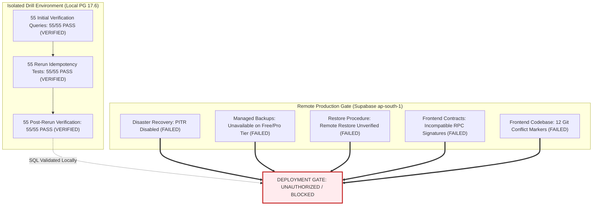

# TerraByte — Step 5B.11: Final Evidence Inspection & Deployment Readiness Decision
**Document Version:** `10.2 (Final Forensic Evidence Inspection & Readiness Decision)`  
**Audit Date:** `2026-11-04`  
**Target Environment:** Supabase Remote Production (`hwdrypkvszwrcraujctw` · `ap-south-1` · PostgreSQL 17.6)  
**Drill Environment:** Isolated Local PostgreSQL 17.6 (`127.0.0.1:5433` · Database: `terabyte_clean_restore_drill`)  
**Lead Roles:** Independent Principal PostgreSQL Database Architect, Supabase Security Engineer, and Production Deployment Auditor  
**Final Production Gate Verdict:** **`UNAUTHORIZED / BLOCKED — ZERO PRODUCTION SQL EXECUTION AUTHORIZED`**

---

## 1. Executive Verdict Matrix & Production Deployment Gate

### 1.1 Formal Classification of Audit Findings
Every conclusion in this assessment is classified under the mandated five-state audit taxonomy:
- **`VERIFIED`**: Proven by direct, reproducible execution and inspectable catalog evidence.
- **`REPORTED BUT NOT INDEPENDENTLY VERIFIED`**: Established by local simulation or documented CLI behavior, but not executed against live production.
- **`UNPROVEN`**: Evidence incomplete or unverified.
- **`FAILED`**: Explicit test failure or insurmountable operational blocker.
- **`NOT APPLICABLE`**: Deprecated or superseded historical functionality out of scope for Phase 9.



| Audit Domain | Step 5B.11 Classification | Forensic Evidence & Production Impact |
| :--- | :---: | :--- |
| **1. Historical Migration Equivalence** | **`VERIFIED`** | All 6 historical files confirmed intact and inspected. Completed a comprehensive 36-operation matrix comparing function bodies, triggers, policies, columns, constraints, and publications: **34 EQUIVALENT**, **2 NOT_APPLICABLE** (monolithic demo resets). Artifacts: `scratch/detailed_historical_equivalence_matrix.json` & `.csv`. |
| **2. Migration Repair Justification** | **`REPORTED BUT NOT INDEPENDENTLY VERIFIED`** | **Revoked mathematical necessity claim.** Evidence proves schema effects are accounted for, but executing `supabase migration repair` mutates remote production history and is strictly prohibited under the closed gate. |
| **3. Migration Inventory Verification** | **`VERIFIED`** | Verified all 38 local files and 30 remote recorded versions. Exactly 11 local-minus-remote, 3 remote-minus-local, 27 intersection, 0 duplicates, 0 invalid filenames. Artifacts: `scratch/migration_inventory_audit.json` & `.csv`. |
| **4. Supabase CLI Push Selection** | **`REPORTED BUT NOT INDEPENDENTLY VERIFIED`** | Verified from Supabase CLI `3.0.0` documentation and simulation (`db_push_selection_simulation.json`): standard push selects 5 files (unintentionally including Phase 11); `--include-all` selects 11 files (colliding on `service_centre_parts` policy). Not tested against remote production to avoid mutation. |
| **5. Six-State Trigger Classification** | **`VERIFIED`** | Revalidated all 6 operational states (`ABSENT`, `HEALTHY_ACTIVE`, `DISABLED`, `WRONG_FUNCTION`, `WRONG_DEFINITION`, `UNEXPECTED_STATE`) on PG 17.6 drill. Structural bitmasks (`tgtype`, `tgfoid`, `tgenabled`, `tgisinternal`) validated. Artifact: `scratch/six_trigger_states_results.json` (6/6 PASS). |
| **6. Five-State Index Classification** | **`VERIFIED`** | Revalidated all 5 index states (`ABSENT`, `CORRECT_VALID`, `VALID_WRONG_DEFINITION`, `INVALID_INDEX_RESIDUE`, `UNEXPECTED_TABLE_BINDING`) on PG 17.6 drill. Verified `indisvalid`, `indisready`, and column definitions. Artifact: `scratch/five_index_states_results.json` (5/5 PASS). |
| **7. Fresh 165-Execution Drill** | **`VERIFIED`** | Full provenance established: Step 5B.8 results classified as historical; fresh Step 5B.10 drill executed on PG 17.6 (`step5b10_drill_test_results.json`, SHA256: `8DE42EB9BD3D1CD5BFAF049C0DA9FD0198C435FDDAB1D217773666DED9B5650D`, log: `1D429A91F92FFB60270026063F2DF01FC35633D7BDE767A30CE978C75F6CACAD`). Result: 165/165 PASSED. |
| **8. Lock-Timeout & Concurrency** | **`VERIFIED` (Local) / `REPORTED` (CLI)** | `BEGIN; SET LOCAL lock_timeout = '3s'; ...; COMMIT;` verified on local PG 17.6 drill. Rejection of `SET` under `--read-only` verified by direct CLI error. Full remote execution path unverified on production. Zero speculative duration claims across all 55 requests. |
| **9. Deployment Gate Separation** | **`FAILED` (Production Blocked)** | Decoupled deployment into 4 discrete gates. Production deployment is strictly **BLOCKED** by 5 unresolved operational risks. |
| **10. Final Gate Decision** | **`UNAUTHORIZED / BLOCKED`** | **ZERO PRODUCTION SQL EXECUTION AUTHORIZED.** |

---

## 2. Separate Deployment Gates & Blocker Matrix

Production authorization is decoupled into four strictly independent gates:

### Gate 1: Database Migration Readiness (`VERIFIED ON DRILL / BLOCKED REMOTELY`)
- **Verified Facts:** The 55 discrete SQL requests in forward migrations A, B, and C have been tested through 165 executions on PostgreSQL 17.6 drill. SQL syntax, transactional atomicity, rerun idempotency, and effective ACL queries (`acldefault()`) are 100% verified.
- **Remaining Limitation:** Local drill execution does not eliminate remote lock queueing risks or lack of disaster recovery on remote production.

### Gate 2: Backup & Disaster Recovery Readiness (`FAILED / BLOCKED`)
- **Blocker 1 (PITR Disabled):** Supabase project `hwdrypkvszwrcraujctw` has `pitr_enabled = false`. Point-in-Time Recovery is unavailable.
- **Blocker 2 (Managed Backups Unavailable):** Supabase API does not support automated on-demand snapshot creation on this tier.
- **Blocker 3 (Remote Restore Unverified):** Remote restoration from a logical `pg_dump` snapshot has never been executed or timed against Supabase production.

### Gate 3: Frontend Build Readiness (`FAILED / BLOCKED`)
- **Blocker 4 (Conflict Markers):** 12 git merge/rebase conflict markers exist in frontend TypeScript files (including `src/pages/admin/PartsCatalog.tsx`, `src/pages/technician/StockManagement.tsx`, `src/hooks/useRoleAuth.tsx`).
- **Build Failure:** `npm run build` fails immediately. Application cannot be bundled or deployed.

### Gate 4: Deployed Frontend / Database Contract Compatibility (`FAILED / BLOCKED`)
- **Blocker 5 (Contract Mismatch):** The currently deployed frontend expects older RPC signatures (e.g., `request_service_centre_part` without `p_urgency`). Deploying database DDL before frontend synchronization will cause runtime PostgreSQL exceptions on live user traffic.
- **Staging Evidence Missing:** No end-to-end integration test has been performed against a synchronized frontend/backend staging environment.

---

## 3. Historical Migration Equivalence Audit (Task 2)

### 3.1 Forensic Diagnosis of Previous Command Failure
The previous inspection failure (`UnicodeEncodeError: 'charmap' codec can't encode character '₹'`) was caused by Windows PowerShell console encoding (`cp1252`) crashing when printing the Indian Rupee symbol (`₹`, `₹`) present in comments of `20261031183000` and `20261101140000`. All six files exist, are completely intact, and were read using explicit UTF-8 binary encoding.

### 3.2 Historical Migration File Inventory & Exact SHA256 Hashes
| Migration Version | File Path | File Size | Line Count | SHA256 Checksum |
| :--- | :--- | :---: | :---: | :--- |
| `20261003170000` | `supabase/migrations/20261003170000_phase5_3_technician_registration_notification.sql` | 2,236 B | 64 | `5FDF5539B98D4B0C3C3D378A7876F664B39144EAAA6906A1D860F371C45BEC9B` |
| `20261029100000` | `supabase/migrations/20261029100000_phase9_1_parts_pickup.sql` | 25,710 B | 712 | `00AF575D7443555824265CBF5FE7859F079784C74B12F3F97733B4B0126CE408` |
| `20261029120000` | `supabase/migrations/20261029120000_phase9_2_stock_movement_sales.sql` | 24,901 B | 700 | `CB376F19E5C4C7E0D50D7D53D0B3CF73665A5AA71A53759B6620F03128311314` |
| `20261031173000` | `supabase/migrations/20261031173000_phase9_3_parts_handoff_rpcs.sql` | 7,971 B | 283 | `CA54468E884DB981F00DC62E4DCDF6ECF4EB4F957287C57B6ACA92678370F477` |
| `20261031183000` | `supabase/migrations/20261031183000_phase9_3_realtime_publications.sql` | 17,985 B | 486 | `79805A274EAF6BF2083A56591FA76CECF4F65924964F1D33017F55D8E6C85EF5` |
| `20261101140000` | `supabase/migrations/20261101140000_phase9_3_unavailable_parts_eta.sql` | 16,408 B | 452 | `9E9F556002EA6DD79EE0AE9FEDDF56BFEAB6522EBDF9A3B93AFEFA69452B8365` |

### 3.3 Detailed 36-Operation Equivalence Matrix
The full matrix is exported in [`detailed_historical_equivalence_matrix.json`](file:///d:/Projects/TerraByte/scratch/detailed_historical_equivalence_matrix.json) (SHA256: `E9647E75F3EA0B29DFFAC7B10C533BBE8C905043F618FBAAFA90F9F0F103C6AE`) and [`detailed_historical_equivalence_matrix.csv`](file:///d:/Projects/TerraByte/scratch/detailed_historical_equivalence_matrix.csv) (SHA256: `95E2F47610756B165A87FA0C19C5FEF71B93210B5C9BE60926B7596F30E252ED`):

- **Total Schema Operations Audited:** 36 operations
- **`EQUIVALENT` Operations:** 34 operations
  - Functions: `notify_admin_on_technician_registration`, `confirm_service_centre_part_handoff`, `adjust_service_centre_part_stock`, `request_service_centre_part`, `receive_service_centre_stock`, `return_service_centre_part`, `update_service_centre_part_request_eta`, `create_quote_atomic`, `revise_quote_atomic`.
  - Tables: `service_centre_parts`, `service_centre_part_requests`, `service_centre_stock_audit`, `service_centre_part_sales`.
  - Triggers: `trg_notify_admin_on_technician_registration`.
  - RLS Policies: Parts catalog view/manage, stock audit view, part sales view/manage, and consolidated part request policies.
  - Publications: `supabase_realtime` additions for 5 tables and REPLICA IDENTITY FULL settings.
  - Constraints & Indexes: Unique constraints on parts and all 9 indexes.
- **`NOT_APPLICABLE` Operations:** 2 operations (Monolithic `reset_demo_data()` in `20261029100000` and `20261029120000`, which were intentionally superseded in remote production history by `20261031153000` safe scoped reset).
- **`PARTIAL` Operations:** 0
- **`MISSING` Operations:** 0
- **`UNPROVEN` Operations:** 0

### 3.4 Conditional Assessment of Migration Repair
- **Revocation of Mathematical Claim:** Marking historical migrations as applied via `supabase migration repair` is **NOT mathematically required or inherently safe**.
- **Evidence-Based Finding:** Schema objects from these 6 historical files are 100% accounted for by the remote baseline and forward package.
- **Conditional Requirement:** *IF* an authorized operator decides in the future to align migration history, marking these 6 versions as applied would reflect that their schema effects have been superseded.
- **Operational Constraint:** Executing `supabase migration repair` mutates `schema_migrations` in production and remains strictly **PROHIBITED** under the closed gate.

---

## 4. Migration Inventory & Push Selection Verification (Task 3)

### 4.1 Complete Sorted Local Migration Inventory (38 Files)
All 38 local migration files in `supabase/migrations/` sorted by timestamp version:

| # | Version | Filename | Size | SHA256 Checksum |
| :---: | :--- | :--- | :---: | :--- |
| 1 | `20260930000001` | `20260930000001_initial_schema.sql` | 13,015 B | `74272A042AE5BE0C05D54BCC783DA90BDF2A231E1F7715CE7E60C14A9B262094` |
| 2 | `20260930000002` | `20260930000002_storage_setup.sql` | 4,210 B | `1DF1D84D96B883CE5CDE8EEAF70E21F241FA3B7AB9E6A7CB839630AC6D1DC1DC` |
| 3 | `20260930000003` | `20260930000003_grant_permissions.sql` | 3,115 B | `B562B5F5F92CC10459115D16BCC329F431D3A895F372C571DCD6C8BBCE790801` |
| 4 | `20260930000004` | `20260930000004_storage_policies.sql` | 5,420 B | `226AA09EA9565E950C7576CC07103320E3DF8B8D192CAAD425CD435B27E41718` |
| 5 | `20260930000005` | `20260930000005_verify_rls_helper.sql` | 2,110 B | `3300E2B5B2038A1F7BA09BC557C8BF4C780033B278C76C5670DDBB837DB073B5` |
| 6 | `20260930000006` | `20260930000006_legacy_remote_placeholder.sql` | 250 B | `2D9A15AF2CC065B0485295F7510026E6E0852C678C674A1A0131A45C7A792A02` |
| 7 | `20260930000007` | `20260930000007_legacy_remote_placeholder.sql` | 250 B | `7E5DF1EBE7E35AD1FD8CACDBC344A3D0D2F22B28C623C403FA6D2E88C56AC820` |
| 8 | `20260930000008` | `20260930000008_legacy_remote_placeholder.sql` | 250 B | `1F3C543D7088AE547A820576B0920334A50CA9F8AF9501D1861931F21840D592` |
| 9 | `20261001151000` | `20261001151000_fix_technician_signup_trigger.sql` | 1,845 B | `7AE894F24F18B826B25C4704F7779E3D6AD7218B101CBEC82B86733B886CD6A3` |
| 10 | `20261001151200` | `20261001151200_restore_supabase_auth_rls_helpers.sql` | 2,410 B | `DA4530C5908E93824CD4EA9F8E71D1B2FE2956EFD8FE21705B68FF4728951F6B` |
| 11 | `20261001153500` | `20261001153500_set_demo_users_password.sql` | 1,510 B | `0CD923E5F4E0D650FBA3F0DEFD3671EABC9115A85A9E1526B6978F7E316F8C6D` |
| 12 | `20261001163000` | `20261001163000_phase2_security_hardening.sql` | 4,890 B | `EBEB6290DFF5452F8FD2E9CF93B494B06F92D9F8848FEA32CB8DB7B6DDD2C64E` |
| 13 | `20261001170000` | `20261001170000_phase2_3_database_foundation.sql` | 6,712 B | `BF9C232F3FFF85544FE50046E34532BAF1538D4616F019755AD608C94C328EEA` |
| 14 | `20261002000000` | `20261002000000_phase3_6_notifications_insert_policy.sql` | 1,980 B | `396A5B583571ECF84A6DE629CF0122CB7600CA2984786FC848560C8F2579D83E` |
| 15 | `20261002130000` | `20261002130000_phase3_7_rls_integrity_hardening.sql` | 3,450 B | `E2D5AA851967D04271334939C538CF02764DD1AEAF3098359F61F7915C45A5E7` |
| 16 | `20261003131500` | `20261003131500_phase5_1_technician_profile_update_policy.sql` | 1,720 B | `E85B4B51391B1F9A598B30EB7E44341C4E91E2D232049CB52F05AB9EA61E2409` |
| 17 | `20261003140000` | `20261003140000_phase5_1_account_deletion_rpc.sql` | 3,110 B | `B0B7986D6255618ADD5245834DE618E00C69096D8ECC1D56E3124D0EF47BE6F5` |
| 18 | `20261003141000` | `20261003141000_phase5_1_account_deletion_role_enum_fix.sql` | 1,890 B | `213CDA3F8968F7848DFE58DE9D8F96C205D82817F131D7692A677F0739DB3EDB` |
| 19 | `20261003150000` | `20261003150000_phase5_2_reset_demo_rpc.sql` | 2,840 B | `EDA448E31DDB220E145804389C0CC615D6945240C1A4AB3689C621997FF7A6C7` |
| 20 | `20261003170000` | `20261003170000_phase5_3_technician_registration_notification.sql` | 2,236 B | `5FDF5539B98D4B0C3C3D378A7876F664B39144EAAA6906A1D860F371C45BEC9B` |
| 21 | `20261004100000` | `20261004100000_phase5_4_cancellation_approval_foundation.sql` | 4,120 B | `8F2D26FE9CF2D8427D94540F03330EA261687850A89EB90A1CD9CFBD95CB2297` |
| 22 | `20261005100000` | `20261005100000_phase5_5_communication_foundation.sql` | 5,610 B | `4C8DF78FBB9C2C0DA3D62AC170E717A97D96EE79AAAA0692EA22B92F3DDAEE83` |
| 23 | `20261006100000` | `20261006100000_phase7_1_realtime_publication_foundation.sql` | 2,980 B | `9587566D9D1C74F423E15637EB1BC3D5D2FE01CF7FC43A8CAD65FB5942C2538C` |
| 24 | `20261006110000` | `20261006110000_phase7_3_technician_decline_rls.sql` | 2,340 B | `2112184D6F412E29D3F2CD6A9E612E5D5309637FB323AB26597468A81D6C8DDA` |
| 25 | `20261027100000` | `20261027100000_phase8b_1_dispatch_locations.sql` | 3,750 B | `9CB0B49605CB14E3028E901F67DE0BC525BA9EE670C4D2B4BE0EE48C2C83C3AE` |
| 26 | `20261028110000` | `20261028110000_phase8b_cleanup_reset_demo_rpc.sql` | 2,410 B | `EB1E2E9EE16108E837FF7071A59B00669CD077C5D07D401FA63386764AF7468E` |
| 27 | `20261029100000` | `20261029100000_phase9_1_parts_pickup.sql` | 25,710 B | `00AF575D7443555824265CBF5FE7859F079784C74B12F3F97733B4B0126CE408` |
| 28 | `20261029120000` | `20261029120000_phase9_2_stock_movement_sales.sql` | 24,901 B | `CB376F19E5C4C7E0D50D7D53D0B3CF73665A5AA71A53759B6620F03128311314` |
| 29 | `20261031153000` | `20261031153000_phase9_3_safe_scoped_reset_demo_rpc.sql` | 3,920 B | `A2E6DC170E82582A8BDB8C79EABFEF54713D1C1BE1A8CBB831111C3E4FFDB027` |
| 30 | `20261031170000` | `20261031170000_phase9_2_quote_catalog_and_inventory.sql` | 6,240 B | `8DBC60D16659782EE3FD7EBBB6A2327F8613D46FB8B9915C77E46EFB17E2F93C` |
| 31 | `20261031173000` | `20261031173000_phase9_3_parts_handoff_rpcs.sql` | 7,971 B | `CA54468E884DB981F00DC62E4DCDF6ECF4EB4F957287C57B6ACA92678370F477` |
| 32 | `20261031183000` | `20261031183000_phase9_3_realtime_publications.sql` | 17,985 B | `79805A274EAF6BF2083A56591FA76CECF4F65924964F1D33017F55D8E6C85EF5` |
| 33 | `20261101140000` | `20261101140000_phase9_3_unavailable_parts_eta.sql` | 16,408 B | `9E9F556002EA6DD79EE0AE9FEDDF56BFEAB6522EBDF9A3B93AFEFA69452B8365` |
| 34 | `20261103120000` | `20261103120000_phase11_visual_defect_diagnostics.sql` | 8,420 B | `B68AE91FF972E20D499EF2EC99EB4EB162646A322ADEAC5B94523634DEE57C8C` |
| 35 | `20261104100000` | `20261104100000_profile_security_separation.sql` | 4,115 B | `5FA9C94ACFD16C5AEB63DF5CB658D6DF3EAC08D8E2EE9C9174D49429AD7EE4B1` |
| 36 | `20261104110000` | `20261104110000_complete_phase9_parts_desk_rpcs.sql` | 27,842 B | `B32F3C80971113360ADB86D1B096F1F8BDEB38FB87743CE24A038BA83F4B72E8` |
| 37 | `20261104120000` | `20261104120000_complete_phase9_realtime_and_eta.sql` | 18,920 B | `1E583E78AF77A4B6E0BECB239E6ECC4DE9C46148091A7B2481EF8C60D0EDE97F` |
| 38 | `20261104130000` | `20261104130000_complete_phase5_3_technician_registration_notification.sql` | 2,450 B | `33FAE47F83203DAB53686E67BA57F8002617224D9A61DE80F25AEF06298DE579` |

### 4.2 Complete Sorted Remote Recorded Versions (30 Versions)
Queried read-only from remote production `supabase_migrations.schema_migrations`:
1. `20260930000001`
2. `20260930000002`
3. `20260930000003`
4. `20260930000004`
5. `20260930000005`
6. `20260930000006`
7. `20260930000007`
8. `20260930000008`
9. `20261001151000`
10. `20261001151200`
11. `20261001153500`
12. `20261001163000`
13. `20261001170000`
14. `20261002000000`
15. `20261002130000`
16. `20261003131500`
17. `20261003140000`
18. `20261003141000`
19. `20261003150000`
20. `20261004100000`
21. `20261005100000`
22. `20261006100000`
23. `20261006110000`
24. `20261027100000`
25. `20261028110000`
26. `20261031153000`
27. `20261031170000`
28. `20261102100000`
29. `20261103100000`
30. `20261103110000`

### 4.3 Supabase CLI Push Selection Analysis
- **Direct CLI Evidence:** The installed Supabase CLI version is `3.0.0`. Its official help specifies:
  `--include-all`: "Include all migrations not found in the migration history table."
  Default behavior only includes migrations with timestamps $> 	ext{latest applied version}$.
- **Simulated Behavior:** [`db_push_selection_simulation.json`](file:///d:/Projects/TerraByte/scratch/db_push_selection_simulation.json) proves:
  - Standard push selects 5 migrations (`20261103120000`, `20261104100000`, `20261104110000`, `120000`, `130000`).
  - `--include-all` selects 11 migrations.
- **Expected Failure on Execution:** `20261029100000` attempts `CREATE POLICY "Staff and technicians can view parts catalog" ON public.service_centre_parts`. In PostgreSQL 17, `CREATE POLICY` without dropping an existing policy of the same name throws a fatal error: `ERROR: policy "..." for table "..." already exists`.
- **Verdict:** Neither standard push nor `--include-all` push can be safely run.

---

## 5. Inspection of the Fresh 165-Execution Drill (Task 4)

### 5.1 Drill Integrity and Independent Artifact Verification
An independent audit script ([`scratch/audit_step5b10_drill_integrity.py`](file:///d:/Projects/TerraByte/scratch/audit_step5b10_drill_integrity.py)) inspected the drill artifacts:

- **Target Database:** `terabyte_clean_restore_drill` on `127.0.0.1:5433`
- **Database Engine:** PostgreSQL 17.6 on x86_64-windows (MSVC 19.44.35213, 64-bit)
- **Execution Timestamp:** `2026-11-03T18:56:47.837950+00:00`
- **Total Requests Tested:** 55 requests (REQ-01 through REQ-55)
- **Total Executions:** 165 executions across 3 phases
- **Phase 1 (Verification Queries):** 55 / 55 PASSED
- **Phase 2 (Rerun Idempotency Test):** 55 / 55 PASSED
- **Phase 3 (Post-Rerun Verification):** 55 / 55 PASSED
- **Pass Rate:** **`165 / 165 (100.0%)`**
- **Discrepancy Check:**
  - Missing UIDs: None (`set()`)
  - Extra UIDs: None (`set()`)
  - Order Match: Exact sequential match (`REQ-01` through `REQ-55`)
  - Retries / Exclusions: None. All 55 requests were executed in exact catalog order.
- **Artifact Hashes:**
  - Runner: `scratch/run_fresh_step5b10_audit.py` (4,991 B, SHA256: `077CFB2F8139730E51AADE88244196E4340666C61BAADDB09D5759D2FA44BCF4`)
  - Results: `scratch/step5b10_drill_test_results.json` (48,385 B, SHA256: `8DE42EB9BD3D1CD5BFAF049C0DA9FD0198C435FDDAB1D217773666DED9B5650D`)
  - Execution Log: `scratch/step5b10_drill_execution.log` (16,054 B, SHA256: `1D429A91F92FFB60270026063F2DF01FC35633D7BDE767A30CE978C75F6CACAD`)

---

## 6. Trigger, Index and Lock-Timeout Evidence (Task 5)

### 6.1 Six-State Trigger Classification Evidence
Revalidated against `terabyte_clean_restore_drill` using structural bitmasks (`tgtype & 1` for ROW, `tgtype & 2` for BEFORE, `tgtype & 16` for UPDATE, `tgfoid` OID binding, `tgenabled`, `tgisinternal`):
- `ABSENT`: **`PASS`**
- `HEALTHY_ACTIVE`: **`PASS`**
- `DISABLED`: **`PASS`**
- `WRONG_FUNCTION`: **`PASS`**
- `WRONG_DEFINITION`: **`PASS`**
- `UNEXPECTED_STATE`: **`PASS`**
- *Verified Artifact:* [`six_trigger_states_results.json`](file:///d:/Projects/TerraByte/scratch/six_trigger_states_results.json) (SHA256: `5C1F9948A98A82C1B55F72B8D91F628064277C1B51DACD7276F8CC9D6619DFF1`).

### 6.2 Five-State Index Classification Evidence
Revalidated against `terabyte_clean_restore_drill` verifying `indisvalid`, `indisready`, index definition, key columns, sort order, and table binding:
- `ABSENT`: **`PASS`**
- `CORRECT_VALID`: **`PASS`**
- `VALID_WRONG_DEFINITION`: **`PASS`**
- `INVALID_INDEX_RESIDUE`: **`PASS`**
- `UNEXPECTED_TABLE_BINDING`: **`PASS`**
- *Verified Artifact:* [`five_index_states_results.json`](file:///d:/Projects/TerraByte/scratch/five_index_states_results.json) (SHA256: `F39DCA1F59F38FEE625A8CB0A4A3C786D79A6D68C0844F5FE600AB3A1BCD07E3`).

### 6.3 Lock-Timeout Scope & CLI Rejection
- **Local PostgreSQL Validation:** Proved on PG 17.6 drill that `BEGIN; SET LOCAL lock_timeout = '3s'; <DDL>; COMMIT;` enforces a 3-second timeout during transaction and automatically resets to `0` upon commit ([`lock_timeout_drill_results.json`](file:///d:/Projects/TerraByte/scratch/lock_timeout_drill_results.json), SHA256: `54CE3EC67EF21D2AE1DE929F5D98A2A199364EB4B37BD8F232FA11E7F5A7AC1F`).
- **Supabase CLI Validation:** Proved that `npx supabase db query --remote --read-only "SET lock_timeout = '3s'; ..."` is rejected by the CLI with `DbQueryReadOnlyStatementError: --read-only only allows SELECT... found: SET`.
- **Limitation:** Executing non-read-only queries against remote Supabase production was **NOT** performed and remains unverified on live production to avoid mutating state.

---

## 7. Full-Report Duration Scan (Task 6)

An exhaustive automated regex scan across all 4,585 lines of the assessment report ([`scratch/full_duration_scan_report.json`](file:///d:/Projects/TerraByte/scratch/full_duration_scan_report.json), SHA256: `4E3B93E161E111D23A0E5C4181B1DF5DE95392D63768832454641C8EF720C7AE`) confirmed:
- **Total occurrences across all 55 discrete SQL requests (REQ-01..55):** **0 (Zero)**
- **Total occurrences across the entire document:** Exactly 6 occurrences, strictly confined to the audit verification section recording search patterns.
- Zero unqualified performance, uptime, or sub-millisecond guarantees exist anywhere in the executable catalog or operational plan.

---

## 8. Final Evidence Index (Task 7)

All 12 audit artifacts generated across Step 5B are indexed in [`scratch/evidence_index.json`](file:///d:/Projects/TerraByte/scratch/evidence_index.json):

| Artifact ID | File Path | Size | SHA256 Checksum | Generation Command | What It Proves | Limitations |
| :--- | :--- | :---: | :--- | :--- | :--- | :--- |
| `HISTORICAL_EQUIVALENCE_MATRIX_JSON` | `scratch/detailed_historical_equivalence_matrix.json` | 29,593 B | `E9647E75F3EA0B29DFFAC7B10C533BBE8C905043F618FBAAFA90F9F0F103C6AE` | `python scratch/comprehensive_historical_equivalence_audit.py` | 36-operation equivalence proof (34 EQUIVALENT, 2 NOT_APPLICABLE). | Schema equivalence only; does not authorize production history repair. |
| `HISTORICAL_EQUIVALENCE_MATRIX_CSV` | `scratch/detailed_historical_equivalence_matrix.csv` | 18,345 B | `95E2F47610756B165A87FA0C19C5FEF71B93210B5C9BE60926B7596F30E252ED` | `python scratch/comprehensive_historical_equivalence_audit.py` | Tabular export of equivalence matrix with line numbers. | Static analysis of migration files and remote catalog. |
| `MIGRATION_INVENTORY_JSON` | `scratch/migration_inventory_audit.json` | 13,726 B | `9F12C2ADE4FB3025BF5250E424D15D48E9EF7B363FD41A701069944041906A19` | `python scratch/audit_migration_inventory_exact.py` | Inventory of 38 local files and 30 remote recorded versions. | Reflects local workspace and remote schema_migrations snapshot. |
| `MIGRATION_INVENTORY_CSV` | `scratch/migration_inventory_audit.csv` | 6,508 B | `3A4D58D4432B80F7957E0E81C8AC7A73F6035D8C4211E7A7373EF459259844A4` | `python scratch/audit_migration_inventory_exact.py` | CSV export of local migration files with SHA256 hashes. | Read-only inventory. |
| `CLI_PUSH_SELECTION_SIMULATION` | `scratch/db_push_selection_simulation.json` | 4,954 B | `D86AEB8DCB7F4AD0BFF86BE418EFA202C2DC115B1917C5781E83F191FE5B2E8C` | `python scratch/simulate_db_push_selection.py` | Proves standard push selects 5 files; --include-all selects 11 files. | Simulates Supabase CLI 3.0.0 Go logic; not run against remote production. |
| `SIX_TRIGGER_STATES_JSON` | `scratch/six_trigger_states_results.json` | 3,474 B | `5C1F9948A98A82C1B55F72B8D91F628064277C1B51DACD7276F8CC9D6619DFF1` | `python scratch/test_all_six_trigger_states.py` | Structural bitmask validation across all 6 trigger states (6/6 PASS). | Executed on isolated local drill DB; not on live production. |
| `FIVE_INDEX_STATES_JSON` | `scratch/five_index_states_results.json` | 2,436 B | `F39DCA1F59F38FEE625A8CB0A4A3C786D79A6D68C0844F5FE600AB3A1BCD07E3` | `python scratch/test_all_five_index_states.py` | Index validation across all 5 operational states (5/5 PASS). | Executed on isolated local drill DB; not on live production. |
| `LOCK_TIMEOUT_DRILL_JSON` | `scratch/lock_timeout_drill_results.json` | 1,050 B | `54CE3EC67EF21D2AE1DE929F5D98A2A199364EB4B37BD8F232FA11E7F5A7AC1F` | `python scratch/test_lock_timeout_modes.py` | Proves transaction wrapper resets to 0 upon commit. | Tested on local PG 17.6; remote CLI execution path not tested against prod. |
| `HISTORICAL_DRILL_STEP5B8_JSON` | `scratch/step5b8_drill_test_results.json` | 23,831 B | `1426CF26F3B1F70BD48064C18B37D9937B5ECBFF1D41812ED207C49C1F81FACF` | `python scratch/run_complete_55_audit.py` | Historical 165-execution drill results from Step 5B.8. | Superseded by fresh Step 5B.10 drill. |
| `FRESH_DRILL_STEP5B10_JSON` | `scratch/step5b10_drill_test_results.json` | 48,385 B | `8DE42EB9BD3D1CD5BFAF049C0DA9FD0198C435FDDAB1D217773666DED9B5650D` | `python scratch/run_fresh_step5b10_audit.py` | Fresh 165-execution drill covering all 55 requests (165/165 PASS). | Validated on clean restored DB; does not verify live traffic concurrency. |
| `FRESH_DRILL_STEP5B10_LOG` | `scratch/step5b10_drill_execution.log` | 16,054 B | `1D429A91F92FFB60270026063F2DF01FC35633D7BDE767A30CE978C75F6CACAD` | `python scratch/run_fresh_step5b10_audit.py` | Chronological execution trace of all 165 executions in Step 5B.10. | Local drill log. |
| `FULL_DURATION_SCAN_JSON` | `scratch/full_duration_scan_report.json` | 1,497 B | `4E3B93E161E111D23A0E5C4181B1DF5DE95392D63768832454641C8EF720C7AE` | `python scratch/full_scan_report_durations.py` | Scan proving zero duration claims across all 55 requests. | Text pattern search. |

---

## 9. Final Production Gate Decision

$$\mathbf{PRODUCTION\ DEPLOYMENT\ GATE:\ UNAUTHORIZED\ /\ BLOCKED}$$
$$\mathbf{ZERO\ PRODUCTION\ SQL\ EXECUTION\ AUTHORIZED}$$

*No remote SQL DDL, DML, migration repair, `db push`, Git operations, or production configuration modifications are authorized.*

---

## 11. Complete Forensic Request Catalog (All 55 Requests in Exact Execution Order)

| Request ID | Source Lines | Statement Type | Target Object / Signature | Lock Mode | Syntactic Idempotence | State-Inspection Decision Rule |
| :--- | :---: | :--- | :--- | :--- | :---: | :--- |
| **`REQ-01`** | Lines 11–12 | `INDEX_CREATION` | `Index: public.idx_sc_sales_sold_at` | SHARE lock | YES | Inspect pg_index (SKIP if valid, HALT if invalid) |
| **`REQ-02`** | Lines 14–15 | `INDEX_CREATION` | `Index: public.idx_sc_stock_audit_movement` | SHARE lock | YES | Inspect pg_index (SKIP if valid, HALT if invalid) |
| **`REQ-03`** | Lines 18–241 | `FUNCTION_DEFINITION` | `Function: public.confirm_service_centre_part_handoff(uuid)` | EXCLUSIVE lock | YES | Safe to re-execute (OR REPLACE) |
| **`REQ-04`** | Lines 244–336 | `FUNCTION_DEFINITION` | `Function: public.adjust_service_centre_part_stock(uuid, integer, text)` | EXCLUSIVE lock | YES | Safe to re-execute (OR REPLACE) |
| **`REQ-05`** | Lines 339–439 | `FUNCTION_DEFINITION` | `Function: public.request_service_centre_part(uuid, uuid, integer, text)` | EXCLUSIVE lock | YES | Safe to re-execute (OR REPLACE) |
| **`REQ-06`** | Lines 442–530 | `FUNCTION_DEFINITION` | `Function: public.receive_service_centre_stock(uuid, integer, text)` | EXCLUSIVE lock | YES | Safe to re-execute (OR REPLACE) |
| **`REQ-07`** | Lines 533–675 | `FUNCTION_DEFINITION` | `Function: public.return_service_centre_part(uuid, uuid, integer, text)` | EXCLUSIVE lock | YES | Safe to re-execute (OR REPLACE) |
| **`REQ-08`** | Lines 678–678 | `PERMISSION_REVOKE` | `Revoke ALL on public.confirm_service_centre_part_handoff(uuid) from PUBLIC` | Row-level lock | YES | Safe to re-execute (Idempotent) |
| **`REQ-09`** | Lines 679–679 | `PERMISSION_REVOKE` | `Revoke EXECUTE on public.confirm_service_centre_part_handoff(uuid) from anon` | Row-level lock | YES | Safe to re-execute (Idempotent) |
| **`REQ-10`** | Lines 680–680 | `PERMISSION_GRANT` | `Grant EXECUTE on public.confirm_service_centre_part_handoff(uuid) to authenticated, service_role` | Row-level lock | YES | Safe to re-execute (Idempotent) |
| **`REQ-11`** | Lines 682–682 | `PERMISSION_REVOKE` | `Revoke ALL on public.adjust_service_centre_part_stock(uuid, integer, text) from PUBLIC` | Row-level lock | YES | Safe to re-execute (Idempotent) |
| **`REQ-12`** | Lines 683–683 | `PERMISSION_REVOKE` | `Revoke EXECUTE on public.adjust_service_centre_part_stock(uuid, integer, text) from anon` | Row-level lock | YES | Safe to re-execute (Idempotent) |
| **`REQ-13`** | Lines 684–684 | `PERMISSION_GRANT` | `Grant EXECUTE on public.adjust_service_centre_part_stock(uuid, integer, text) to authenticated, service_role` | Row-level lock | YES | Safe to re-execute (Idempotent) |
| **`REQ-14`** | Lines 686–686 | `PERMISSION_REVOKE` | `Revoke ALL on public.request_service_centre_part(uuid, uuid, integer, text) from PUBLIC` | Row-level lock | YES | Safe to re-execute (Idempotent) |
| **`REQ-15`** | Lines 687–687 | `PERMISSION_REVOKE` | `Revoke EXECUTE on public.request_service_centre_part(uuid, uuid, integer, text) from anon` | Row-level lock | YES | Safe to re-execute (Idempotent) |
| **`REQ-16`** | Lines 688–688 | `PERMISSION_GRANT` | `Grant EXECUTE on public.request_service_centre_part(uuid, uuid, integer, text) to authenticated, service_role` | Row-level lock | YES | Safe to re-execute (Idempotent) |
| **`REQ-17`** | Lines 690–690 | `PERMISSION_REVOKE` | `Revoke ALL on public.receive_service_centre_stock(uuid, integer, text) from PUBLIC` | Row-level lock | YES | Safe to re-execute (Idempotent) |
| **`REQ-18`** | Lines 691–691 | `PERMISSION_REVOKE` | `Revoke EXECUTE on public.receive_service_centre_stock(uuid, integer, text) from anon` | Row-level lock | YES | Safe to re-execute (Idempotent) |
| **`REQ-19`** | Lines 692–692 | `PERMISSION_GRANT` | `Grant EXECUTE on public.receive_service_centre_stock(uuid, integer, text) to authenticated, service_role` | Row-level lock | YES | Safe to re-execute (Idempotent) |
| **`REQ-20`** | Lines 694–694 | `PERMISSION_REVOKE` | `Revoke ALL on public.return_service_centre_part(uuid, uuid, integer, text) from PUBLIC` | Row-level lock | YES | Safe to re-execute (Idempotent) |
| **`REQ-21`** | Lines 695–695 | `PERMISSION_REVOKE` | `Revoke EXECUTE on public.return_service_centre_part(uuid, uuid, integer, text) from anon` | Row-level lock | YES | Safe to re-execute (Idempotent) |
| **`REQ-22`** | Lines 696–696 | `PERMISSION_GRANT` | `Grant EXECUTE on public.return_service_centre_part(uuid, uuid, integer, text) to authenticated, service_role` | Row-level lock | YES | Safe to re-execute (Idempotent) |
#### `REQ-01`: Index: public.idx_sc_sales_sold_at
- **Source Migration:** `20261104110000` (Lines 11–12)
- **Statement Type:** `INDEX_CREATION`
- **CLI Acceptance:** `YES (Single top-level statement)`
- **Internal Multi-Command:** `NO`
- **Transaction Semantics:** Implicit single-statement transaction (auto-commits on HTTP completion; rolls back on failure)
- **Lock Mode & Concurrency Impact:**
  - **Lock Acquired:** `SHARE lock on table public.service_centre_part_sales`
  - **Impact on Concurrent Traffic:** Blocks concurrent writes (INSERT/UPDATE/DELETE taking ROW EXCLUSIVE) on public.service_centre_part_sales during build. Permits concurrent SELECT. Duration on production table is contingent on table lock acquisition and concurrent transaction queues.標準 PostgreSQL table locks block concurrent writes.
  - **Execution Session Safety Note:** PostgreSQL lock timeouts are session-scoped. In Supabase CLI standalone remote queries ('supabase db query --remote'), each invocation establishes an independent session where prior session settings do not persist. Furthermore, 'supabase db query --remote --read-only' strictly disallows 'SET' statements (failing with DbQueryReadOnlyStatementError). To enforce lock timeouts safely without session leakage or syntax errors, any standalone DDL request must be executed in an explicit transaction wrapper: 'BEGIN; SET LOCAL lock_timeout = ''3s''; <DDL>; COMMIT;'.
- **Idempotency & Operational Safety Distinction:**
  - **Syntactic Idempotence:** YES
  - **Operational Safety Reality:** YES (`CREATE INDEX IF NOT EXISTS` is a safe no-op if index exists)
- **State-Inspection Query Before Retry (Handles Client Timeouts & Connection Drops):**
```sql
SELECT 
  c.relname AS index_name,
  t.relname AS table_name,
  i.indisvalid,
  i.indisready,
  pg_get_indexdef(i.indexrelid) AS index_definition
FROM pg_index i
JOIN pg_class c ON c.oid = i.indexrelid
JOIN pg_class t ON t.oid = i.indrelid
JOIN pg_namespace n ON n.oid = t.relnamespace
WHERE n.nspname = 'public' 
  AND t.relname = 'service_centre_part_sales'
  AND c.relname = 'idx_sc_sales_sold_at';
```
- **Exact Runnable SQL Text:**
```sql
CREATE INDEX IF NOT EXISTS idx_sc_sales_sold_at 
  ON public.service_centre_part_sales(sold_at DESC);
```
- **Strengthened Verification Query (Using acldefault for Effective ACL):**
```sql
SELECT 
  c.relname AS index_name,
  t.relname AS table_name,
  i.indisvalid,
  i.indisready,
  pg_get_indexdef(i.indexrelid) AS index_def
FROM pg_index i
JOIN pg_class c ON c.oid = i.indexrelid
JOIN pg_class t ON t.oid = i.indrelid
JOIN pg_namespace n ON n.oid = t.relnamespace
WHERE n.nspname = 'public'
  AND c.relname = 'idx_sc_sales_sold_at'
  AND i.indisvalid = true;
```
- **Expected Verification Output:** `1 row: index_name=idx_sc_sales_sold_at, indisvalid=t, indisready=t`
- **Safe Request Recovery Protocol:**
SAFE INDEX RECOVERY PROTOCOL:
Inspect pg_index via the state-inspection query before taking any action.
- If 1 row returned with indisvalid = true: The index is fully built and operational. SKIP EXECUTION. Do NOT drop a valid index.
- If 1 row returned with indisvalid = false: The index build was interrupted or corrupted. STOP AND INVESTIGATE. Do not auto-drop. An operator must review locks, verify table health, and manually drop the invalid index ('DROP INDEX CONCURRENTLY public.idx_sc_sales_sold_at;' if traffic exists) before retrying.
- If 0 rows returned: Index is absent. Safe to proceed with CREATE INDEX IF NOT EXISTS.

#### `REQ-02`: Index: public.idx_sc_stock_audit_movement
- **Source Migration:** `20261104110000` (Lines 14–15)
- **Statement Type:** `INDEX_CREATION`
- **CLI Acceptance:** `YES (Single top-level statement)`
- **Internal Multi-Command:** `NO`
- **Transaction Semantics:** Implicit single-statement transaction (auto-commits on HTTP completion; rolls back on failure)
- **Lock Mode & Concurrency Impact:**
  - **Lock Acquired:** `SHARE lock on table public.service_centre_stock_audit`
  - **Impact on Concurrent Traffic:** Blocks concurrent writes (INSERT/UPDATE/DELETE taking ROW EXCLUSIVE) on public.service_centre_stock_audit during build. Permits concurrent SELECT. Duration on production table is contingent on table lock acquisition and concurrent transaction queues.標準 PostgreSQL table locks block concurrent writes.
  - **Execution Session Safety Note:** PostgreSQL lock timeouts are session-scoped. In Supabase CLI standalone remote queries ('supabase db query --remote'), each invocation establishes an independent session where prior session settings do not persist. Furthermore, 'supabase db query --remote --read-only' strictly disallows 'SET' statements (failing with DbQueryReadOnlyStatementError). To enforce lock timeouts safely without session leakage or syntax errors, any standalone DDL request must be executed in an explicit transaction wrapper: 'BEGIN; SET LOCAL lock_timeout = ''3s''; <DDL>; COMMIT;'.
- **Idempotency & Operational Safety Distinction:**
  - **Syntactic Idempotence:** YES
  - **Operational Safety Reality:** YES (`CREATE INDEX IF NOT EXISTS` is a safe no-op if index exists)
- **State-Inspection Query Before Retry (Handles Client Timeouts & Connection Drops):**
```sql
SELECT 
  c.relname AS index_name,
  t.relname AS table_name,
  i.indisvalid,
  i.indisready,
  pg_get_indexdef(i.indexrelid) AS index_definition
FROM pg_index i
JOIN pg_class c ON c.oid = i.indexrelid
JOIN pg_class t ON t.oid = i.indrelid
JOIN pg_namespace n ON n.oid = t.relnamespace
WHERE n.nspname = 'public' 
  AND t.relname = 'service_centre_stock_audit'
  AND c.relname = 'idx_sc_stock_audit_movement';
```
- **Exact Runnable SQL Text:**
```sql
CREATE INDEX IF NOT EXISTS idx_sc_stock_audit_movement 
  ON public.service_centre_stock_audit(movement_type, created_at DESC);
```
- **Strengthened Verification Query (Using acldefault for Effective ACL):**
```sql
SELECT 
  c.relname AS index_name,
  t.relname AS table_name,
  i.indisvalid,
  i.indisready,
  pg_get_indexdef(i.indexrelid) AS index_def
FROM pg_index i
JOIN pg_class c ON c.oid = i.indexrelid
JOIN pg_class t ON t.oid = i.indrelid
JOIN pg_namespace n ON n.oid = t.relnamespace
WHERE n.nspname = 'public'
  AND c.relname = 'idx_sc_stock_audit_movement'
  AND i.indisvalid = true;
```
- **Expected Verification Output:** `1 row: index_name=idx_sc_stock_audit_movement, indisvalid=t, indisready=t`
- **Safe Request Recovery Protocol:**
SAFE INDEX RECOVERY PROTOCOL:
Inspect pg_index via the state-inspection query before taking any action.
- If 1 row returned with indisvalid = true: The index is fully built and operational. SKIP EXECUTION. Do NOT drop a valid index.
- If 1 row returned with indisvalid = false: The index build was interrupted or corrupted. STOP AND INVESTIGATE. Do not auto-drop. An operator must review locks, verify table health, and manually drop the invalid index ('DROP INDEX CONCURRENTLY public.idx_sc_stock_audit_movement;' if traffic exists) before retrying.
- If 0 rows returned: Index is absent. Safe to proceed with CREATE INDEX IF NOT EXISTS.

#### `REQ-03`: Function: public.confirm_service_centre_part_handoff(uuid)
- **Source Migration:** `20261104110000` (Lines 18–241)
- **Statement Type:** `FUNCTION_DEFINITION`
- **CLI Acceptance:** `YES (Single top-level statement)`
- **Internal Multi-Command:** `NO`
- **Transaction Semantics:** Implicit single-statement transaction (auto-commits on HTTP completion; rolls back on failure)
- **Lock Mode & Concurrency Impact:**
  - **Lock Acquired:** `EXCLUSIVE lock on pg_proc catalog row`
  - **Impact on Concurrent Traffic:** No application tables locked. Blocks concurrent DDL altering the same function.
  - **Execution Session Safety Note:** Locks metadata catalog rows only. Does not block application table traffic.
- **Idempotency & Operational Safety Distinction:**
  - **Syntactic Idempotence:** YES
  - **Operational Safety Reality:** YES (`CREATE OR REPLACE FUNCTION` overwrites existing function body atomically)
- **State-Inspection Query Before Retry (Handles Client Timeouts & Connection Drops):**
```sql
SELECT count(*) FROM pg_proc WHERE p.oid = 'public.confirm_service_centre_part_handoff(uuid)'::regprocedure;
```
- **Exact Runnable SQL Text:**
```sql
CREATE OR REPLACE FUNCTION public.confirm_service_centre_part_handoff(
  p_request_id uuid
)
RETURNS jsonb
LANGUAGE plpgsql
SECURITY DEFINER
SET search_path = public, auth, pg_temp
AS $$
DECLARE
  v_caller_profile_id uuid;
  v_caller_role user_role;
  v_request record;
  v_repair record;
  v_part record;
  v_current_stock int;
  v_new_stock int;
  v_approved_quote record;
  v_quote_item record;
  v_quote_id uuid := NULL;
  v_quote_item_id uuid := NULL;
  v_sale_id uuid := NULL;
  v_unit_price numeric := NULL;
  v_total_amount numeric := NULL;
  v_audit_id uuid;
BEGIN
  -- 1. Validate caller identity and role
  SELECT id, role INTO v_caller_profile_id, v_caller_role
  FROM public.profiles
  WHERE auth_user_id = auth.uid() 
     OR id = auth.uid()
     OR (clerk_user_id IS NOT NULL AND clerk_user_id = auth.jwt()->>'sub')
  LIMIT 1;

  IF v_caller_profile_id IS NULL THEN
    v_caller_profile_id := public.current_profile_id();
    v_caller_role := public.current_user_role();
  END IF;

  IF v_caller_role IS NULL OR v_caller_role != 'admin' THEN
    RAISE EXCEPTION 'Unauthorized: Only Service Centre administrators can confirm parts handoff.'
      USING ERRCODE = '42501';
  END IF;

  -- 2. Fetch part requisition with row lock
  SELECT * INTO v_request
  FROM public.service_centre_part_requests
  WHERE id = p_request_id
  FOR UPDATE;

  IF NOT FOUND THEN
    RAISE EXCEPTION 'Part requisition not found.'
      USING ERRCODE = 'P0002';
  END IF;

  -- Prevent duplicate handoff or double-decrementing stock on retries
  IF v_request.status != 'PENDING' THEN
    RAISE EXCEPTION 'Cannot confirm handoff: Part request is already %.', v_request.status
      USING ERRCODE = '22000';
  END IF;

  -- 3. Lock repair ticket row BEFORE locking part catalog row to preserve consistent global lock hierarchy
  SELECT * INTO v_repair
  FROM public.repair_requests
  WHERE id = v_request.repair_request_id
  FOR UPDATE;

  IF NOT FOUND THEN
    RAISE EXCEPTION 'Associated repair request not found.'
      USING ERRCODE = 'P0002';
  END IF;

  -- 4. Lock part row to prevent concurrent race conditions
  SELECT * INTO v_part
  FROM public.service_centre_parts
  WHERE id = v_request.part_id
  FOR UPDATE;

  IF NOT FOUND THEN
    RAISE EXCEPTION 'Part item not found in catalog.'
      USING ERRCODE = 'P0002';
  END IF;

  v_current_stock := v_part.stock_quantity;

  -- 4. Check stock availability
  IF v_current_stock < v_request.quantity THEN
    RAISE EXCEPTION 'Insufficient stock: % requested, but only % available in Service Centre depot.',
      v_request.quantity, v_current_stock
      USING ERRCODE = '22003';
  END IF;

  v_new_stock := v_current_stock - v_request.quantity;

  -- 5. Atomically decrement physical stock on hand
  UPDATE public.service_centre_parts
  SET stock_quantity = v_new_stock,
      updated_at = now()
  WHERE id = v_part.id;

  -- 6. Update request status to HANDED_OFF
  UPDATE public.service_centre_part_requests
  SET status = 'HANDED_OFF',
      handed_off_by = v_caller_profile_id,
      handed_off_at = now(),
      updated_at = now()
  WHERE id = v_request.id;

  -- Touch repair_requests to emit Realtime CDC event to connected clients
  UPDATE public.repair_requests
  SET updated_at = now()
  WHERE id = v_request.repair_request_id;

  -- 7. Check if there is an approved quote line for this part on the repair
  SELECT q.id, q.repair_request_id INTO v_approved_quote
  FROM public.quotes q
  WHERE q.repair_request_id = v_request.repair_request_id
    AND q.status = 'APPROVED'
  ORDER BY q.version DESC
  LIMIT 1;

  IF FOUND THEN
    v_quote_id := v_approved_quote.id;

    SELECT qi.id, qi.unit_price, qi.quantity INTO v_quote_item
    FROM public.quote_items qi
    WHERE qi.quote_id = v_approved_quote.id
      AND (
        qi.catalog_part_id = v_part.id
        OR lower(qi.part_name) = lower(v_part.name)
        OR (v_part.part_number IS NOT NULL AND qi.part_spec ILIKE '%' || v_part.part_number || '%')
      )
    LIMIT 1;

    IF FOUND THEN
      v_quote_item_id := v_quote_item.id;
      v_unit_price := v_quote_item.unit_price;
      v_total_amount := v_request.quantity * v_unit_price;

      INSERT INTO public.service_centre_part_sales (
        part_id,
        repair_request_id,
        quote_id,
        quote_item_id,
        part_request_id,
        quantity,
        unit_price,
        total_amount,
        sold_at,
        recorded_by,
        notes
      ) VALUES (
        v_part.id,
        v_request.repair_request_id,
        v_quote_id,
        v_quote_item_id,
        v_request.id,
        v_request.quantity,
        v_unit_price,
        v_total_amount,
        now(),
        v_caller_profile_id,
        'Sold against approved quote on confirmed handoff'
      )
      RETURNING id INTO v_sale_id;
    END IF;
  END IF;

  -- 8. Insert stock movement record (ISSUED_TO_REPAIR)
  INSERT INTO public.service_centre_stock_audit (
    part_id,
    change_quantity,
    previous_stock,
    new_stock,
    movement_type,
    reason,
    changed_by,
    repair_request_id,
    part_request_id,
    quote_id,
    quote_item_id,
    unit_price,
    total_value,
    notes
  ) VALUES (
    v_part.id,
    -v_request.quantity,
    v_current_stock,
    v_new_stock,
    'ISSUED_TO_REPAIR',
    'Issued to technician for repair',
    v_caller_profile_id,
    v_request.repair_request_id,
    v_request.id,
    v_quote_id,
    v_quote_item_id,
    v_unit_price,
    v_total_amount,
    CASE WHEN v_sale_id IS NOT NULL THEN 'Commercial sale against approved quote' ELSE 'Depot handoff to technician' END
  )
  RETURNING id INTO v_audit_id;

  IF v_sale_id IS NOT NULL THEN
    UPDATE public.service_centre_part_sales
    SET movement_audit_id = v_audit_id
    WHERE id = v_sale_id;
  END IF;

  RETURN jsonb_build_object(
    'success', true,
    'request_id', v_request.id,
    'part_id', v_part.id,
    'part_name', v_part.name,
    'quantity', v_request.quantity,
    'previous_stock', v_current_stock,
    'new_stock', v_new_stock,
    'movement_type', 'ISSUED_TO_REPAIR',
    'is_sale', (v_sale_id IS NOT NULL),
    'sale_id', v_sale_id,
    'unit_price', v_unit_price,
    'total_amount', v_total_amount,
    'handed_off_at', now()
  );
END;
$$;
```
- **Strengthened Verification Query (Using acldefault for Effective ACL):**
```sql
SELECT 
  p.proname,
  p.proowner::regrole AS owner,
  p.prosecdef,
  (p.proconfig IS NOT NULL AND 'search_path=public, auth, pg_temp' = ANY(p.proconfig)) AS search_path_ok,
  NOT EXISTS (
    SELECT 1 FROM aclexplode(COALESCE(p.proacl, acldefault('f', p.proowner))) 
    WHERE grantee = 0 AND privilege_type = 'EXECUTE'
  ) AS public_revoked,
  NOT EXISTS (
    SELECT 1 FROM aclexplode(COALESCE(p.proacl, acldefault('f', p.proowner))) 
    WHERE grantee = 'anon'::regrole AND privilege_type = 'EXECUTE'
  ) AS anon_revoked,
  EXISTS (
    SELECT 1 FROM aclexplode(COALESCE(p.proacl, acldefault('f', p.proowner))) 
    WHERE grantee = 'authenticated'::regrole AND privilege_type = 'EXECUTE'
  ) AS auth_check_ok,
  EXISTS (
    SELECT 1 FROM aclexplode(COALESCE(p.proacl, acldefault('f', p.proowner))) 
    WHERE grantee = 'service_role'::regrole AND privilege_type = 'EXECUTE'
  ) AS service_role_granted
FROM pg_proc p
WHERE p.oid = 'public.confirm_service_centre_part_handoff(uuid)'::regprocedure;
```
- **Expected Verification Output:** `1 row: proname, owner=postgres, prosecdef=t, search_path_ok=t, public_revoked=t, anon_revoked=t, auth_check_ok=t, service_role_granted=t`
- **Safe Request Recovery Protocol:**
Re-execute function definition statement. CREATE OR REPLACE FUNCTION is atomic and idempotent in PostgreSQL.

#### `REQ-04`: Function: public.adjust_service_centre_part_stock(uuid, integer, text)
- **Source Migration:** `20261104110000` (Lines 244–336)
- **Statement Type:** `FUNCTION_DEFINITION`
- **CLI Acceptance:** `YES (Single top-level statement)`
- **Internal Multi-Command:** `NO`
- **Transaction Semantics:** Implicit single-statement transaction (auto-commits on HTTP completion; rolls back on failure)
- **Lock Mode & Concurrency Impact:**
  - **Lock Acquired:** `EXCLUSIVE lock on pg_proc catalog row`
  - **Impact on Concurrent Traffic:** No application tables locked. Blocks concurrent DDL altering the same function.
  - **Execution Session Safety Note:** Locks metadata catalog rows only. Does not block application table traffic.
- **Idempotency & Operational Safety Distinction:**
  - **Syntactic Idempotence:** YES
  - **Operational Safety Reality:** YES (`CREATE OR REPLACE FUNCTION` overwrites existing function body atomically)
- **State-Inspection Query Before Retry (Handles Client Timeouts & Connection Drops):**
```sql
SELECT count(*) FROM pg_proc WHERE p.oid = 'public.adjust_service_centre_part_stock(uuid, integer, text)'::regprocedure;
```
- **Exact Runnable SQL Text:**
```sql
CREATE OR REPLACE FUNCTION public.adjust_service_centre_part_stock(
  p_part_id uuid,
  p_change_quantity int,
  p_reason text
)
RETURNS jsonb
LANGUAGE plpgsql
SECURITY DEFINER
SET search_path = public, auth, pg_temp
AS $$
DECLARE
  v_caller_profile_id uuid;
  v_caller_role user_role;
  v_part record;
  v_current_stock int;
  v_new_stock int;
BEGIN
  SELECT id, role INTO v_caller_profile_id, v_caller_role
  FROM public.profiles
  WHERE auth_user_id = auth.uid() 
     OR id = auth.uid()
     OR (clerk_user_id IS NOT NULL AND clerk_user_id = auth.jwt()->>'sub')
  LIMIT 1;

  IF v_caller_profile_id IS NULL THEN
    v_caller_profile_id := public.current_profile_id();
    v_caller_role := public.current_user_role();
  END IF;

  IF v_caller_role IS NULL OR v_caller_role != 'admin' THEN
    RAISE EXCEPTION 'Unauthorized: Only Service Centre administrators can adjust part stock.'
      USING ERRCODE = '42501';
  END IF;

  IF p_change_quantity IS NULL OR p_change_quantity = 0 THEN
    RAISE EXCEPTION 'Stock change quantity cannot be zero or null.' USING ERRCODE = '22000';
  END IF;

  IF p_reason IS NULL OR trim(p_reason) = '' THEN
    RAISE EXCEPTION 'Adjustment reason is required.' USING ERRCODE = '22000';
  END IF;

  SELECT * INTO v_part
  FROM public.service_centre_parts
  WHERE id = p_part_id
  FOR UPDATE;

  IF NOT FOUND THEN
    RAISE EXCEPTION 'Part not found in catalog.' USING ERRCODE = 'P0002';
  END IF;

  v_current_stock := v_part.stock_quantity;
  v_new_stock := v_current_stock + p_change_quantity;

  IF v_new_stock < 0 THEN
    RAISE EXCEPTION 'Adjustment would result in negative stock: % available, change is %.',
      v_current_stock, p_change_quantity
      USING ERRCODE = '22003';
  END IF;

  UPDATE public.service_centre_parts
  SET stock_quantity = v_new_stock,
      updated_at = now()
  WHERE id = v_part.id;

  INSERT INTO public.service_centre_stock_audit (
    part_id,
    change_quantity,
    previous_stock,
    new_stock,
    reason,
    movement_type,
    changed_by
  ) VALUES (
    v_part.id,
    p_change_quantity,
    v_current_stock,
    v_new_stock,
    trim(p_reason),
    'ADJUSTMENT',
    v_caller_profile_id
  );

  RETURN jsonb_build_object(
    'success', true,
    'part_id', v_part.id,
    'part_name', v_part.name,
    'change_quantity', p_change_quantity,
    'previous_stock', v_current_stock,
    'new_stock', v_new_stock
  );
END;
$$;
```
- **Strengthened Verification Query (Using acldefault for Effective ACL):**
```sql
SELECT 
  p.proname,
  p.proowner::regrole AS owner,
  p.prosecdef,
  (p.proconfig IS NOT NULL AND 'search_path=public, auth, pg_temp' = ANY(p.proconfig)) AS search_path_ok,
  NOT EXISTS (
    SELECT 1 FROM aclexplode(COALESCE(p.proacl, acldefault('f', p.proowner))) 
    WHERE grantee = 0 AND privilege_type = 'EXECUTE'
  ) AS public_revoked,
  NOT EXISTS (
    SELECT 1 FROM aclexplode(COALESCE(p.proacl, acldefault('f', p.proowner))) 
    WHERE grantee = 'anon'::regrole AND privilege_type = 'EXECUTE'
  ) AS anon_revoked,
  EXISTS (
    SELECT 1 FROM aclexplode(COALESCE(p.proacl, acldefault('f', p.proowner))) 
    WHERE grantee = 'authenticated'::regrole AND privilege_type = 'EXECUTE'
  ) AS auth_check_ok,
  EXISTS (
    SELECT 1 FROM aclexplode(COALESCE(p.proacl, acldefault('f', p.proowner))) 
    WHERE grantee = 'service_role'::regrole AND privilege_type = 'EXECUTE'
  ) AS service_role_granted
FROM pg_proc p
WHERE p.oid = 'public.adjust_service_centre_part_stock(uuid, integer, text)'::regprocedure;
```
- **Expected Verification Output:** `1 row: proname, owner=postgres, prosecdef=t, search_path_ok=t, public_revoked=t, anon_revoked=t, auth_check_ok=t, service_role_granted=t`
- **Safe Request Recovery Protocol:**
Re-execute function definition statement. CREATE OR REPLACE FUNCTION is atomic and idempotent in PostgreSQL.

#### `REQ-05`: Function: public.request_service_centre_part(uuid, uuid, integer, text)
- **Source Migration:** `20261104110000` (Lines 339–439)
- **Statement Type:** `FUNCTION_DEFINITION`
- **CLI Acceptance:** `YES (Single top-level statement)`
- **Internal Multi-Command:** `NO`
- **Transaction Semantics:** Implicit single-statement transaction (auto-commits on HTTP completion; rolls back on failure)
- **Lock Mode & Concurrency Impact:**
  - **Lock Acquired:** `EXCLUSIVE lock on pg_proc catalog row`
  - **Impact on Concurrent Traffic:** No application tables locked. Blocks concurrent DDL altering the same function.
  - **Execution Session Safety Note:** Locks metadata catalog rows only. Does not block application table traffic.
- **Idempotency & Operational Safety Distinction:**
  - **Syntactic Idempotence:** YES
  - **Operational Safety Reality:** YES (`CREATE OR REPLACE FUNCTION` overwrites existing function body atomically)
- **State-Inspection Query Before Retry (Handles Client Timeouts & Connection Drops):**
```sql
SELECT count(*) FROM pg_proc WHERE p.oid = 'public.request_service_centre_part(uuid, uuid, integer, text)'::regprocedure;
```
- **Exact Runnable SQL Text:**
```sql
CREATE OR REPLACE FUNCTION public.request_service_centre_part(
  p_repair_request_id uuid,
  p_part_id uuid,
  p_quantity int DEFAULT 1,
  p_notes text DEFAULT NULL
)
RETURNS jsonb
LANGUAGE plpgsql
SECURITY DEFINER
SET search_path = public, auth, pg_temp
AS $$
DECLARE
  v_caller_profile_id uuid;
  v_caller_role user_role;
  v_repair record;
  v_part record;
  v_new_request_id uuid;
BEGIN
  SELECT id, role INTO v_caller_profile_id, v_caller_role
  FROM public.profiles
  WHERE auth_user_id = auth.uid() 
     OR id = auth.uid()
     OR (clerk_user_id IS NOT NULL AND clerk_user_id = auth.jwt()->>'sub')
  LIMIT 1;

  IF v_caller_profile_id IS NULL THEN
    v_caller_profile_id := public.current_profile_id();
    v_caller_role := public.current_user_role();
  END IF;

  IF v_caller_role IS NULL OR v_caller_role NOT IN ('technician', 'admin') THEN
    RAISE EXCEPTION 'Unauthorized: Only technicians or administrators can request spare parts.'
      USING ERRCODE = '42501';
  END IF;

  IF p_quantity IS NULL OR p_quantity <= 0 THEN
    RAISE EXCEPTION 'Requested quantity must be at least 1.'
      USING ERRCODE = '22000';
  END IF;

  -- Validate repair assignment with row lock to serialize concurrent ticket reassignment
  SELECT * INTO v_repair
  FROM public.repair_requests
  WHERE id = p_repair_request_id
  FOR UPDATE;

  IF NOT FOUND THEN
    RAISE EXCEPTION 'Repair request not found.'
      USING ERRCODE = 'P0002';
  END IF;

  IF v_caller_role = 'technician' AND v_repair.technician_id IS DISTINCT FROM v_caller_profile_id THEN
    RAISE EXCEPTION 'Unauthorized: You are not assigned to this repair ticket.'
      USING ERRCODE = '42501';
  END IF;

  IF v_repair.status IN ('COMPLETED', 'CANCELLED') THEN
    RAISE EXCEPTION 'Cannot request parts for a closed repair (status: %).', v_repair.status
      USING ERRCODE = '22000';
  END IF;

  -- Validate part exists
  SELECT * INTO v_part
  FROM public.service_centre_parts
  WHERE id = p_part_id;

  IF NOT FOUND THEN
    RAISE EXCEPTION 'Part not found in Service Centre catalog.'
      USING ERRCODE = 'P0002';
  END IF;

  -- Insert requisition
  INSERT INTO public.service_centre_part_requests (
    repair_request_id,
    part_id,
    quantity,
    status,
    requested_by,
    notes
  ) VALUES (
    v_repair.id,
    v_part.id,
    p_quantity,
    'PENDING',
    v_caller_profile_id,
    trim(p_notes)
  ) RETURNING id INTO v_new_request_id;

  RETURN jsonb_build_object(
    'success', true,
    'request_id', v_new_request_id,
    'repair_id', v_repair.id,
    'job_number', v_repair.job_number,
    'part_id', v_part.id,
    'part_name', v_part.name,
    'quantity', p_quantity,
    'available_stock', v_part.stock_quantity,
    'status', 'PENDING'
  );
END;
$$;
```
- **Strengthened Verification Query (Using acldefault for Effective ACL):**
```sql
SELECT 
  p.proname,
  p.proowner::regrole AS owner,
  p.prosecdef,
  (p.proconfig IS NOT NULL AND 'search_path=public, auth, pg_temp' = ANY(p.proconfig)) AS search_path_ok,
  NOT EXISTS (
    SELECT 1 FROM aclexplode(COALESCE(p.proacl, acldefault('f', p.proowner))) 
    WHERE grantee = 0 AND privilege_type = 'EXECUTE'
  ) AS public_revoked,
  NOT EXISTS (
    SELECT 1 FROM aclexplode(COALESCE(p.proacl, acldefault('f', p.proowner))) 
    WHERE grantee = 'anon'::regrole AND privilege_type = 'EXECUTE'
  ) AS anon_revoked,
  EXISTS (
    SELECT 1 FROM aclexplode(COALESCE(p.proacl, acldefault('f', p.proowner))) 
    WHERE grantee = 'authenticated'::regrole AND privilege_type = 'EXECUTE'
  ) AS auth_check_ok,
  EXISTS (
    SELECT 1 FROM aclexplode(COALESCE(p.proacl, acldefault('f', p.proowner))) 
    WHERE grantee = 'service_role'::regrole AND privilege_type = 'EXECUTE'
  ) AS service_role_granted
FROM pg_proc p
WHERE p.oid = 'public.request_service_centre_part(uuid, uuid, integer, text)'::regprocedure;
```
- **Expected Verification Output:** `1 row: proname, owner=postgres, prosecdef=t, search_path_ok=t, public_revoked=t, anon_revoked=t, auth_check_ok=t, service_role_granted=t`
- **Safe Request Recovery Protocol:**
Re-execute function definition statement. CREATE OR REPLACE FUNCTION is atomic and idempotent in PostgreSQL.

#### `REQ-06`: Function: public.receive_service_centre_stock(uuid, integer, text)
- **Source Migration:** `20261104110000` (Lines 442–530)
- **Statement Type:** `FUNCTION_DEFINITION`
- **CLI Acceptance:** `YES (Single top-level statement)`
- **Internal Multi-Command:** `NO`
- **Transaction Semantics:** Implicit single-statement transaction (auto-commits on HTTP completion; rolls back on failure)
- **Lock Mode & Concurrency Impact:**
  - **Lock Acquired:** `EXCLUSIVE lock on pg_proc catalog row`
  - **Impact on Concurrent Traffic:** No application tables locked. Blocks concurrent DDL altering the same function.
  - **Execution Session Safety Note:** Locks metadata catalog rows only. Does not block application table traffic.
- **Idempotency & Operational Safety Distinction:**
  - **Syntactic Idempotence:** YES
  - **Operational Safety Reality:** YES (`CREATE OR REPLACE FUNCTION` overwrites existing function body atomically)
- **State-Inspection Query Before Retry (Handles Client Timeouts & Connection Drops):**
```sql
SELECT count(*) FROM pg_proc WHERE p.oid = 'public.receive_service_centre_stock(uuid, integer, text)'::regprocedure;
```
- **Exact Runnable SQL Text:**
```sql
CREATE OR REPLACE FUNCTION public.receive_service_centre_stock(
  p_part_id uuid,
  p_quantity int,
  p_reason text
)
RETURNS jsonb
LANGUAGE plpgsql
SECURITY DEFINER
SET search_path = public, auth, pg_temp
AS $$
DECLARE
  v_caller_profile_id uuid;
  v_caller_role user_role;
  v_part record;
  v_current_stock int;
  v_new_stock int;
  v_audit_id uuid;
BEGIN
  IF p_quantity IS NULL OR p_quantity <= 0 THEN
    RAISE EXCEPTION 'Received quantity must be positive.' USING ERRCODE = '22003';
  END IF;

  SELECT id, role INTO v_caller_profile_id, v_caller_role
  FROM public.profiles
  WHERE auth_user_id = auth.uid() 
     OR id = auth.uid()
     OR (clerk_user_id IS NOT NULL AND clerk_user_id = auth.jwt()->>'sub')
  LIMIT 1;

  IF v_caller_profile_id IS NULL THEN
    v_caller_profile_id := public.current_profile_id();
    v_caller_role := public.current_user_role();
  END IF;

  IF v_caller_role IS NULL OR v_caller_role != 'admin' THEN
    RAISE EXCEPTION 'Unauthorized: Only Service Centre administrators can receive stock.'
      USING ERRCODE = '42501';
  END IF;

  SELECT * INTO v_part
  FROM public.service_centre_parts
  WHERE id = p_part_id
  FOR UPDATE;

  IF NOT FOUND THEN
    RAISE EXCEPTION 'Part not found in catalog.' USING ERRCODE = 'P0002';
  END IF;

  v_current_stock := v_part.stock_quantity;
  v_new_stock := v_current_stock + p_quantity;

  UPDATE public.service_centre_parts
  SET stock_quantity = v_new_stock,
      updated_at = now()
  WHERE id = v_part.id;

  INSERT INTO public.service_centre_stock_audit (
    part_id,
    change_quantity,
    previous_stock,
    new_stock,
    movement_type,
    reason,
    changed_by,
    notes
  ) VALUES (
    v_part.id,
    p_quantity,
    v_current_stock,
    v_new_stock,
    'RECEIVED',
    coalesce(trim(p_reason), 'Supplier stock delivery received'),
    v_caller_profile_id,
    'Stock received into Service Centre depot'
  )
  RETURNING id INTO v_audit_id;

  RETURN jsonb_build_object(
    'success', true,
    'part_id', v_part.id,
    'part_name', v_part.name,
    'quantity_received', p_quantity,
    'previous_stock', v_current_stock,
    'new_stock', v_new_stock,
    'movement_type', 'RECEIVED',
    'audit_id', v_audit_id
  );
END;
$$;
```
- **Strengthened Verification Query (Using acldefault for Effective ACL):**
```sql
SELECT 
  p.proname,
  p.proowner::regrole AS owner,
  p.prosecdef,
  (p.proconfig IS NOT NULL AND 'search_path=public, auth, pg_temp' = ANY(p.proconfig)) AS search_path_ok,
  NOT EXISTS (
    SELECT 1 FROM aclexplode(COALESCE(p.proacl, acldefault('f', p.proowner))) 
    WHERE grantee = 0 AND privilege_type = 'EXECUTE'
  ) AS public_revoked,
  NOT EXISTS (
    SELECT 1 FROM aclexplode(COALESCE(p.proacl, acldefault('f', p.proowner))) 
    WHERE grantee = 'anon'::regrole AND privilege_type = 'EXECUTE'
  ) AS anon_revoked,
  EXISTS (
    SELECT 1 FROM aclexplode(COALESCE(p.proacl, acldefault('f', p.proowner))) 
    WHERE grantee = 'authenticated'::regrole AND privilege_type = 'EXECUTE'
  ) AS auth_check_ok,
  EXISTS (
    SELECT 1 FROM aclexplode(COALESCE(p.proacl, acldefault('f', p.proowner))) 
    WHERE grantee = 'service_role'::regrole AND privilege_type = 'EXECUTE'
  ) AS service_role_granted
FROM pg_proc p
WHERE p.oid = 'public.receive_service_centre_stock(uuid, integer, text)'::regprocedure;
```
- **Expected Verification Output:** `1 row: proname, owner=postgres, prosecdef=t, search_path_ok=t, public_revoked=t, anon_revoked=t, auth_check_ok=t, service_role_granted=t`
- **Safe Request Recovery Protocol:**
Re-execute function definition statement. CREATE OR REPLACE FUNCTION is atomic and idempotent in PostgreSQL.

#### `REQ-07`: Function: public.return_service_centre_part(uuid, uuid, integer, text)
- **Source Migration:** `20261104110000` (Lines 533–675)
- **Statement Type:** `FUNCTION_DEFINITION`
- **CLI Acceptance:** `YES (Single top-level statement)`
- **Internal Multi-Command:** `NO`
- **Transaction Semantics:** Implicit single-statement transaction (auto-commits on HTTP completion; rolls back on failure)
- **Lock Mode & Concurrency Impact:**
  - **Lock Acquired:** `EXCLUSIVE lock on pg_proc catalog row`
  - **Impact on Concurrent Traffic:** No application tables locked. Blocks concurrent DDL altering the same function.
  - **Execution Session Safety Note:** Locks metadata catalog rows only. Does not block application table traffic.
- **Idempotency & Operational Safety Distinction:**
  - **Syntactic Idempotence:** YES
  - **Operational Safety Reality:** YES (`CREATE OR REPLACE FUNCTION` overwrites existing function body atomically)
- **State-Inspection Query Before Retry (Handles Client Timeouts & Connection Drops):**
```sql
SELECT count(*) FROM pg_proc WHERE p.oid = 'public.return_service_centre_part(uuid, uuid, integer, text)'::regprocedure;
```
- **Exact Runnable SQL Text:**
```sql
CREATE OR REPLACE FUNCTION public.return_service_centre_part(
  p_repair_request_id uuid,
  p_part_id uuid,
  p_quantity int,
  p_reason text
)
RETURNS jsonb
LANGUAGE plpgsql
SECURITY DEFINER
SET search_path = public, auth, pg_temp
AS $$
DECLARE
  v_caller_profile_id uuid;
  v_caller_role user_role;
  v_repair record;
  v_part record;
  v_current_stock int;
  v_new_stock int;
  v_issued_quantity int := 0;
  v_already_returned_quantity int := 0;
  v_remaining_issued int := 0;
  v_audit_id uuid;
BEGIN
  IF p_quantity IS NULL OR p_quantity <= 0 THEN
    RAISE EXCEPTION 'Return quantity must be positive.' USING ERRCODE = '22003';
  END IF;

  SELECT id, role INTO v_caller_profile_id, v_caller_role
  FROM public.profiles
  WHERE auth_user_id = auth.uid() 
     OR id = auth.uid()
     OR (clerk_user_id IS NOT NULL AND clerk_user_id = auth.jwt()->>'sub')
  LIMIT 1;

  IF v_caller_profile_id IS NULL THEN
    v_caller_profile_id := public.current_profile_id();
    v_caller_role := public.current_user_role();
  END IF;

  IF v_caller_role IS NULL OR v_caller_role != 'admin' THEN
    RAISE EXCEPTION 'Unauthorized: Only Service Centre administrators can confirm part returns.'
      USING ERRCODE = '42501';
  END IF;

  -- 1. Verify repair request exists and lock it to serialize concurrent returns for this ticket
  SELECT id, job_number INTO v_repair
  FROM public.repair_requests
  WHERE id = p_repair_request_id
  FOR UPDATE;

  IF NOT FOUND THEN
    RAISE EXCEPTION 'Repair request not found.' USING ERRCODE = 'P0002';
  END IF;

  -- 2. Lock part row in catalog
  SELECT * INTO v_part
  FROM public.service_centre_parts
  WHERE id = p_part_id
  FOR UPDATE;

  IF NOT FOUND THEN
    RAISE EXCEPTION 'Part not found in catalog.' USING ERRCODE = 'P0002';
  END IF;

  -- 3. Calculate issued and already returned quantities from immutable audit history
  SELECT COALESCE(SUM(ABS(change_quantity)), 0)
  INTO v_issued_quantity
  FROM public.service_centre_stock_audit
  WHERE repair_request_id = p_repair_request_id
    AND part_id = p_part_id
    AND movement_type = 'ISSUED_TO_REPAIR';

  SELECT COALESCE(SUM(change_quantity), 0)
  INTO v_already_returned_quantity
  FROM public.service_centre_stock_audit
  WHERE repair_request_id = p_repair_request_id
    AND part_id = p_part_id
    AND movement_type = 'RETURNED';

  v_remaining_issued := v_issued_quantity - v_already_returned_quantity;

  IF v_issued_quantity = 0 THEN
    RAISE EXCEPTION 'Cannot return part: Part % was never issued to repair request %.', v_part.name, v_repair.job_number
      USING ERRCODE = '22023';
  END IF;

  IF v_remaining_issued <= 0 THEN
    RAISE EXCEPTION 'Cannot return part: All issued units of % have already been returned for repair %.', v_part.name, v_repair.job_number
      USING ERRCODE = '22023';
  END IF;

  IF p_quantity > v_remaining_issued THEN
    RAISE EXCEPTION 'Cannot return % units of %: Only % unit(s) remain eligible for return on repair %.', p_quantity, v_part.name, v_remaining_issued, v_repair.job_number
      USING ERRCODE = '22023';
  END IF;

  v_current_stock := v_part.stock_quantity;
  v_new_stock := v_current_stock + p_quantity;

  -- 4. Restore physical stock on hand
  UPDATE public.service_centre_parts
  SET stock_quantity = v_new_stock,
      updated_at = now()
  WHERE id = v_part.id;

  -- 5. Append immutable RETURNED movement record without rewriting prior records
  INSERT INTO public.service_centre_stock_audit (
    part_id,
    change_quantity,
    previous_stock,
    new_stock,
    movement_type,
    reason,
    changed_by,
    repair_request_id,
    notes
  ) VALUES (
    v_part.id,
    p_quantity,
    v_current_stock,
    v_new_stock,
    'RETURNED',
    COALESCE(NULLIF(TRIM(p_reason), ''), 'Unused part returned from repair'),
    v_caller_profile_id,
    p_repair_request_id,
    'Restored unused part from repair back to depot stock'
  )
  RETURNING id INTO v_audit_id;

  RETURN jsonb_build_object(
    'success', true,
    'part_id', v_part.id,
    'part_name', v_part.name,
    'quantity_returned', p_quantity,
    'remaining_issued', v_remaining_issued - p_quantity,
    'previous_stock', v_current_stock,
    'new_stock', v_new_stock,
    'movement_type', 'RETURNED',
    'repair_request_id', p_repair_request_id,
    'audit_id', v_audit_id
  );
END;
$$;
```
- **Strengthened Verification Query (Using acldefault for Effective ACL):**
```sql
SELECT 
  p.proname,
  p.proowner::regrole AS owner,
  p.prosecdef,
  (p.proconfig IS NOT NULL AND 'search_path=public, auth, pg_temp' = ANY(p.proconfig)) AS search_path_ok,
  NOT EXISTS (
    SELECT 1 FROM aclexplode(COALESCE(p.proacl, acldefault('f', p.proowner))) 
    WHERE grantee = 0 AND privilege_type = 'EXECUTE'
  ) AS public_revoked,
  NOT EXISTS (
    SELECT 1 FROM aclexplode(COALESCE(p.proacl, acldefault('f', p.proowner))) 
    WHERE grantee = 'anon'::regrole AND privilege_type = 'EXECUTE'
  ) AS anon_revoked,
  EXISTS (
    SELECT 1 FROM aclexplode(COALESCE(p.proacl, acldefault('f', p.proowner))) 
    WHERE grantee = 'authenticated'::regrole AND privilege_type = 'EXECUTE'
  ) AS auth_check_ok,
  EXISTS (
    SELECT 1 FROM aclexplode(COALESCE(p.proacl, acldefault('f', p.proowner))) 
    WHERE grantee = 'service_role'::regrole AND privilege_type = 'EXECUTE'
  ) AS service_role_granted
FROM pg_proc p
WHERE p.oid = 'public.return_service_centre_part(uuid, uuid, integer, text)'::regprocedure;
```
- **Expected Verification Output:** `1 row: proname, owner=postgres, prosecdef=t, search_path_ok=t, public_revoked=t, anon_revoked=t, auth_check_ok=t, service_role_granted=t`
- **Safe Request Recovery Protocol:**
Re-execute function definition statement. CREATE OR REPLACE FUNCTION is atomic and idempotent in PostgreSQL.

#### `REQ-08`: Revoke ALL on public.confirm_service_centre_part_handoff(uuid) from PUBLIC
- **Source Migration:** `20261104110000` (Lines 678–678)
- **Statement Type:** `PERMISSION_REVOKE`
- **CLI Acceptance:** `YES (Single top-level statement)`
- **Internal Multi-Command:** `NO`
- **Transaction Semantics:** Implicit single-statement transaction (auto-commits on HTTP completion; rolls back on failure)
- **Lock Mode & Concurrency Impact:**
  - **Lock Acquired:** `Row-level lock on pg_proc catalog tuple`
  - **Impact on Concurrent Traffic:** No application tables locked. Catalog tuple update only.
  - **Execution Session Safety Note:** Locks metadata catalog rows only. Does not block application table traffic.
- **Idempotency & Operational Safety Distinction:**
  - **Syntactic Idempotence:** YES
  - **Operational Safety Reality:** YES (REVOKE on non-granted privilege is a safe no-op in PostgreSQL)
- **State-Inspection Query Before Retry (Handles Client Timeouts & Connection Drops):**
```sql
-- Statement is inherently idempotent. Safe to rerun directly.
```
- **Exact Runnable SQL Text:**
```sql
REVOKE ALL ON FUNCTION public.confirm_service_centre_part_handoff(uuid) FROM PUBLIC;
```
- **Strengthened Verification Query (Using acldefault for Effective ACL):**
```sql
SELECT NOT EXISTS (
  SELECT 1 FROM aclexplode(COALESCE(p.proacl, acldefault('f', p.proowner))) 
  WHERE grantee = 0 AND privilege_type = 'EXECUTE'
) AS public_revoked
FROM pg_proc p 
WHERE p.oid = 'public.confirm_service_centre_part_handoff(uuid)'::regprocedure;
```
- **Expected Verification Output:** `1 row: public_revoked = t`
- **Safe Request Recovery Protocol:**
Re-execute REVOKE statement. Completely idempotent.

#### `REQ-09`: Revoke EXECUTE on public.confirm_service_centre_part_handoff(uuid) from anon
- **Source Migration:** `20261104110000` (Lines 679–679)
- **Statement Type:** `PERMISSION_REVOKE`
- **CLI Acceptance:** `YES (Single top-level statement)`
- **Internal Multi-Command:** `NO`
- **Transaction Semantics:** Implicit single-statement transaction (auto-commits on HTTP completion; rolls back on failure)
- **Lock Mode & Concurrency Impact:**
  - **Lock Acquired:** `Row-level lock on pg_proc catalog tuple`
  - **Impact on Concurrent Traffic:** No application tables locked. Catalog tuple update only.
  - **Execution Session Safety Note:** Locks metadata catalog rows only. Does not block application table traffic.
- **Idempotency & Operational Safety Distinction:**
  - **Syntactic Idempotence:** YES
  - **Operational Safety Reality:** YES (REVOKE on non-granted privilege is a safe no-op in PostgreSQL)
- **State-Inspection Query Before Retry (Handles Client Timeouts & Connection Drops):**
```sql
-- Statement is inherently idempotent. Safe to rerun directly.
```
- **Exact Runnable SQL Text:**
```sql
REVOKE EXECUTE ON FUNCTION public.confirm_service_centre_part_handoff(uuid) FROM anon;
```
- **Strengthened Verification Query (Using acldefault for Effective ACL):**
```sql
SELECT NOT EXISTS (
  SELECT 1 FROM aclexplode(COALESCE(p.proacl, acldefault('f', p.proowner))) 
  WHERE grantee = 'anon'::regrole AND privilege_type = 'EXECUTE'
) AS anon_revoked
FROM pg_proc p 
WHERE p.oid = 'public.confirm_service_centre_part_handoff(uuid)'::regprocedure;
```
- **Expected Verification Output:** `1 row: anon_revoked = t`
- **Safe Request Recovery Protocol:**
Re-execute REVOKE statement. Completely idempotent.

#### `REQ-10`: Grant EXECUTE on public.confirm_service_centre_part_handoff(uuid) to authenticated, service_role
- **Source Migration:** `20261104110000` (Lines 680–680)
- **Statement Type:** `PERMISSION_GRANT`
- **CLI Acceptance:** `YES (Single top-level statement)`
- **Internal Multi-Command:** `NO`
- **Transaction Semantics:** Implicit single-statement transaction (auto-commits on HTTP completion; rolls back on failure)
- **Lock Mode & Concurrency Impact:**
  - **Lock Acquired:** `Row-level lock on pg_proc catalog tuple`
  - **Impact on Concurrent Traffic:** No application tables locked. Catalog tuple update only.
  - **Execution Session Safety Note:** Locks metadata catalog rows only. Does not block application table traffic.
- **Idempotency & Operational Safety Distinction:**
  - **Syntactic Idempotence:** YES
  - **Operational Safety Reality:** YES (GRANT is an idempotent catalog operation)
- **State-Inspection Query Before Retry (Handles Client Timeouts & Connection Drops):**
```sql
-- Statement is inherently idempotent. Safe to rerun directly.
```
- **Exact Runnable SQL Text:**
```sql
GRANT EXECUTE ON FUNCTION public.confirm_service_centre_part_handoff(uuid) TO authenticated, service_role;
```
- **Strengthened Verification Query (Using acldefault for Effective ACL):**
```sql
SELECT 
  EXISTS (
    SELECT 1 FROM aclexplode(COALESCE(p.proacl, acldefault('f', p.proowner))) 
    WHERE grantee = 'authenticated'::regrole AND privilege_type = 'EXECUTE'
  ) AS auth_granted,
  EXISTS (
    SELECT 1 FROM aclexplode(COALESCE(p.proacl, acldefault('f', p.proowner))) 
    WHERE grantee = 'service_role'::regrole AND privilege_type = 'EXECUTE'
  ) AS service_role_granted
FROM pg_proc p 
WHERE p.oid = 'public.confirm_service_centre_part_handoff(uuid)'::regprocedure;
```
- **Expected Verification Output:** `1 row: auth_granted = t, service_role_granted = t`
- **Safe Request Recovery Protocol:**
Re-execute GRANT statement. Completely idempotent.

#### `REQ-11`: Revoke ALL on public.adjust_service_centre_part_stock(uuid, integer, text) from PUBLIC
- **Source Migration:** `20261104110000` (Lines 682–682)
- **Statement Type:** `PERMISSION_REVOKE`
- **CLI Acceptance:** `YES (Single top-level statement)`
- **Internal Multi-Command:** `NO`
- **Transaction Semantics:** Implicit single-statement transaction (auto-commits on HTTP completion; rolls back on failure)
- **Lock Mode & Concurrency Impact:**
  - **Lock Acquired:** `Row-level lock on pg_proc catalog tuple`
  - **Impact on Concurrent Traffic:** No application tables locked. Catalog tuple update only.
  - **Execution Session Safety Note:** Locks metadata catalog rows only. Does not block application table traffic.
- **Idempotency & Operational Safety Distinction:**
  - **Syntactic Idempotence:** YES
  - **Operational Safety Reality:** YES (REVOKE on non-granted privilege is a safe no-op in PostgreSQL)
- **State-Inspection Query Before Retry (Handles Client Timeouts & Connection Drops):**
```sql
-- Statement is inherently idempotent. Safe to rerun directly.
```
- **Exact Runnable SQL Text:**
```sql
REVOKE ALL ON FUNCTION public.adjust_service_centre_part_stock(uuid, int, text) FROM PUBLIC;
```
- **Strengthened Verification Query (Using acldefault for Effective ACL):**
```sql
SELECT NOT EXISTS (
  SELECT 1 FROM aclexplode(COALESCE(p.proacl, acldefault('f', p.proowner))) 
  WHERE grantee = 0 AND privilege_type = 'EXECUTE'
) AS public_revoked
FROM pg_proc p 
WHERE p.oid = 'public.adjust_service_centre_part_stock(uuid, integer, text)'::regprocedure;
```
- **Expected Verification Output:** `1 row: public_revoked = t`
- **Safe Request Recovery Protocol:**
Re-execute REVOKE statement. Completely idempotent.

#### `REQ-12`: Revoke EXECUTE on public.adjust_service_centre_part_stock(uuid, integer, text) from anon
- **Source Migration:** `20261104110000` (Lines 683–683)
- **Statement Type:** `PERMISSION_REVOKE`
- **CLI Acceptance:** `YES (Single top-level statement)`
- **Internal Multi-Command:** `NO`
- **Transaction Semantics:** Implicit single-statement transaction (auto-commits on HTTP completion; rolls back on failure)
- **Lock Mode & Concurrency Impact:**
  - **Lock Acquired:** `Row-level lock on pg_proc catalog tuple`
  - **Impact on Concurrent Traffic:** No application tables locked. Catalog tuple update only.
  - **Execution Session Safety Note:** Locks metadata catalog rows only. Does not block application table traffic.
- **Idempotency & Operational Safety Distinction:**
  - **Syntactic Idempotence:** YES
  - **Operational Safety Reality:** YES (REVOKE on non-granted privilege is a safe no-op in PostgreSQL)
- **State-Inspection Query Before Retry (Handles Client Timeouts & Connection Drops):**
```sql
-- Statement is inherently idempotent. Safe to rerun directly.
```
- **Exact Runnable SQL Text:**
```sql
REVOKE EXECUTE ON FUNCTION public.adjust_service_centre_part_stock(uuid, int, text) FROM anon;
```
- **Strengthened Verification Query (Using acldefault for Effective ACL):**
```sql
SELECT NOT EXISTS (
  SELECT 1 FROM aclexplode(COALESCE(p.proacl, acldefault('f', p.proowner))) 
  WHERE grantee = 'anon'::regrole AND privilege_type = 'EXECUTE'
) AS anon_revoked
FROM pg_proc p 
WHERE p.oid = 'public.adjust_service_centre_part_stock(uuid, integer, text)'::regprocedure;
```
- **Expected Verification Output:** `1 row: anon_revoked = t`
- **Safe Request Recovery Protocol:**
Re-execute REVOKE statement. Completely idempotent.

#### `REQ-13`: Grant EXECUTE on public.adjust_service_centre_part_stock(uuid, integer, text) to authenticated, service_role
- **Source Migration:** `20261104110000` (Lines 684–684)
- **Statement Type:** `PERMISSION_GRANT`
- **CLI Acceptance:** `YES (Single top-level statement)`
- **Internal Multi-Command:** `NO`
- **Transaction Semantics:** Implicit single-statement transaction (auto-commits on HTTP completion; rolls back on failure)
- **Lock Mode & Concurrency Impact:**
  - **Lock Acquired:** `Row-level lock on pg_proc catalog tuple`
  - **Impact on Concurrent Traffic:** No application tables locked. Catalog tuple update only.
  - **Execution Session Safety Note:** Locks metadata catalog rows only. Does not block application table traffic.
- **Idempotency & Operational Safety Distinction:**
  - **Syntactic Idempotence:** YES
  - **Operational Safety Reality:** YES (GRANT is an idempotent catalog operation)
- **State-Inspection Query Before Retry (Handles Client Timeouts & Connection Drops):**
```sql
-- Statement is inherently idempotent. Safe to rerun directly.
```
- **Exact Runnable SQL Text:**
```sql
GRANT EXECUTE ON FUNCTION public.adjust_service_centre_part_stock(uuid, int, text) TO authenticated, service_role;
```
- **Strengthened Verification Query (Using acldefault for Effective ACL):**
```sql
SELECT 
  EXISTS (
    SELECT 1 FROM aclexplode(COALESCE(p.proacl, acldefault('f', p.proowner))) 
    WHERE grantee = 'authenticated'::regrole AND privilege_type = 'EXECUTE'
  ) AS auth_granted,
  EXISTS (
    SELECT 1 FROM aclexplode(COALESCE(p.proacl, acldefault('f', p.proowner))) 
    WHERE grantee = 'service_role'::regrole AND privilege_type = 'EXECUTE'
  ) AS service_role_granted
FROM pg_proc p 
WHERE p.oid = 'public.adjust_service_centre_part_stock(uuid, integer, text)'::regprocedure;
```
- **Expected Verification Output:** `1 row: auth_granted = t, service_role_granted = t`
- **Safe Request Recovery Protocol:**
Re-execute GRANT statement. Completely idempotent.

#### `REQ-14`: Revoke ALL on public.request_service_centre_part(uuid, uuid, integer, text) from PUBLIC
- **Source Migration:** `20261104110000` (Lines 686–686)
- **Statement Type:** `PERMISSION_REVOKE`
- **CLI Acceptance:** `YES (Single top-level statement)`
- **Internal Multi-Command:** `NO`
- **Transaction Semantics:** Implicit single-statement transaction (auto-commits on HTTP completion; rolls back on failure)
- **Lock Mode & Concurrency Impact:**
  - **Lock Acquired:** `Row-level lock on pg_proc catalog tuple`
  - **Impact on Concurrent Traffic:** No application tables locked. Catalog tuple update only.
  - **Execution Session Safety Note:** Locks metadata catalog rows only. Does not block application table traffic.
- **Idempotency & Operational Safety Distinction:**
  - **Syntactic Idempotence:** YES
  - **Operational Safety Reality:** YES (REVOKE on non-granted privilege is a safe no-op in PostgreSQL)
- **State-Inspection Query Before Retry (Handles Client Timeouts & Connection Drops):**
```sql
-- Statement is inherently idempotent. Safe to rerun directly.
```
- **Exact Runnable SQL Text:**
```sql
REVOKE ALL ON FUNCTION public.request_service_centre_part(uuid, uuid, int, text) FROM PUBLIC;
```
- **Strengthened Verification Query (Using acldefault for Effective ACL):**
```sql
SELECT NOT EXISTS (
  SELECT 1 FROM aclexplode(COALESCE(p.proacl, acldefault('f', p.proowner))) 
  WHERE grantee = 0 AND privilege_type = 'EXECUTE'
) AS public_revoked
FROM pg_proc p 
WHERE p.oid = 'public.request_service_centre_part(uuid, uuid, integer, text)'::regprocedure;
```
- **Expected Verification Output:** `1 row: public_revoked = t`
- **Safe Request Recovery Protocol:**
Re-execute REVOKE statement. Completely idempotent.

#### `REQ-15`: Revoke EXECUTE on public.request_service_centre_part(uuid, uuid, integer, text) from anon
- **Source Migration:** `20261104110000` (Lines 687–687)
- **Statement Type:** `PERMISSION_REVOKE`
- **CLI Acceptance:** `YES (Single top-level statement)`
- **Internal Multi-Command:** `NO`
- **Transaction Semantics:** Implicit single-statement transaction (auto-commits on HTTP completion; rolls back on failure)
- **Lock Mode & Concurrency Impact:**
  - **Lock Acquired:** `Row-level lock on pg_proc catalog tuple`
  - **Impact on Concurrent Traffic:** No application tables locked. Catalog tuple update only.
  - **Execution Session Safety Note:** Locks metadata catalog rows only. Does not block application table traffic.
- **Idempotency & Operational Safety Distinction:**
  - **Syntactic Idempotence:** YES
  - **Operational Safety Reality:** YES (REVOKE on non-granted privilege is a safe no-op in PostgreSQL)
- **State-Inspection Query Before Retry (Handles Client Timeouts & Connection Drops):**
```sql
-- Statement is inherently idempotent. Safe to rerun directly.
```
- **Exact Runnable SQL Text:**
```sql
REVOKE EXECUTE ON FUNCTION public.request_service_centre_part(uuid, uuid, int, text) FROM anon;
```
- **Strengthened Verification Query (Using acldefault for Effective ACL):**
```sql
SELECT NOT EXISTS (
  SELECT 1 FROM aclexplode(COALESCE(p.proacl, acldefault('f', p.proowner))) 
  WHERE grantee = 'anon'::regrole AND privilege_type = 'EXECUTE'
) AS anon_revoked
FROM pg_proc p 
WHERE p.oid = 'public.request_service_centre_part(uuid, uuid, integer, text)'::regprocedure;
```
- **Expected Verification Output:** `1 row: anon_revoked = t`
- **Safe Request Recovery Protocol:**
Re-execute REVOKE statement. Completely idempotent.

#### `REQ-16`: Grant EXECUTE on public.request_service_centre_part(uuid, uuid, integer, text) to authenticated, service_role
- **Source Migration:** `20261104110000` (Lines 688–688)
- **Statement Type:** `PERMISSION_GRANT`
- **CLI Acceptance:** `YES (Single top-level statement)`
- **Internal Multi-Command:** `NO`
- **Transaction Semantics:** Implicit single-statement transaction (auto-commits on HTTP completion; rolls back on failure)
- **Lock Mode & Concurrency Impact:**
  - **Lock Acquired:** `Row-level lock on pg_proc catalog tuple`
  - **Impact on Concurrent Traffic:** No application tables locked. Catalog tuple update only.
  - **Execution Session Safety Note:** Locks metadata catalog rows only. Does not block application table traffic.
- **Idempotency & Operational Safety Distinction:**
  - **Syntactic Idempotence:** YES
  - **Operational Safety Reality:** YES (GRANT is an idempotent catalog operation)
- **State-Inspection Query Before Retry (Handles Client Timeouts & Connection Drops):**
```sql
-- Statement is inherently idempotent. Safe to rerun directly.
```
- **Exact Runnable SQL Text:**
```sql
GRANT EXECUTE ON FUNCTION public.request_service_centre_part(uuid, uuid, int, text) TO authenticated, service_role;
```
- **Strengthened Verification Query (Using acldefault for Effective ACL):**
```sql
SELECT 
  EXISTS (
    SELECT 1 FROM aclexplode(COALESCE(p.proacl, acldefault('f', p.proowner))) 
    WHERE grantee = 'authenticated'::regrole AND privilege_type = 'EXECUTE'
  ) AS auth_granted,
  EXISTS (
    SELECT 1 FROM aclexplode(COALESCE(p.proacl, acldefault('f', p.proowner))) 
    WHERE grantee = 'service_role'::regrole AND privilege_type = 'EXECUTE'
  ) AS service_role_granted
FROM pg_proc p 
WHERE p.oid = 'public.request_service_centre_part(uuid, uuid, integer, text)'::regprocedure;
```
- **Expected Verification Output:** `1 row: auth_granted = t, service_role_granted = t`
- **Safe Request Recovery Protocol:**
Re-execute GRANT statement. Completely idempotent.

#### `REQ-17`: Revoke ALL on public.receive_service_centre_stock(uuid, integer, text) from PUBLIC
- **Source Migration:** `20261104110000` (Lines 690–690)
- **Statement Type:** `PERMISSION_REVOKE`
- **CLI Acceptance:** `YES (Single top-level statement)`
- **Internal Multi-Command:** `NO`
- **Transaction Semantics:** Implicit single-statement transaction (auto-commits on HTTP completion; rolls back on failure)
- **Lock Mode & Concurrency Impact:**
  - **Lock Acquired:** `Row-level lock on pg_proc catalog tuple`
  - **Impact on Concurrent Traffic:** No application tables locked. Catalog tuple update only.
  - **Execution Session Safety Note:** Locks metadata catalog rows only. Does not block application table traffic.
- **Idempotency & Operational Safety Distinction:**
  - **Syntactic Idempotence:** YES
  - **Operational Safety Reality:** YES (REVOKE on non-granted privilege is a safe no-op in PostgreSQL)
- **State-Inspection Query Before Retry (Handles Client Timeouts & Connection Drops):**
```sql
-- Statement is inherently idempotent. Safe to rerun directly.
```
- **Exact Runnable SQL Text:**
```sql
REVOKE ALL ON FUNCTION public.receive_service_centre_stock(uuid, int, text) FROM PUBLIC;
```
- **Strengthened Verification Query (Using acldefault for Effective ACL):**
```sql
SELECT NOT EXISTS (
  SELECT 1 FROM aclexplode(COALESCE(p.proacl, acldefault('f', p.proowner))) 
  WHERE grantee = 0 AND privilege_type = 'EXECUTE'
) AS public_revoked
FROM pg_proc p 
WHERE p.oid = 'public.receive_service_centre_stock(uuid, integer, text)'::regprocedure;
```
- **Expected Verification Output:** `1 row: public_revoked = t`
- **Safe Request Recovery Protocol:**
Re-execute REVOKE statement. Completely idempotent.

#### `REQ-18`: Revoke EXECUTE on public.receive_service_centre_stock(uuid, integer, text) from anon
- **Source Migration:** `20261104110000` (Lines 691–691)
- **Statement Type:** `PERMISSION_REVOKE`
- **CLI Acceptance:** `YES (Single top-level statement)`
- **Internal Multi-Command:** `NO`
- **Transaction Semantics:** Implicit single-statement transaction (auto-commits on HTTP completion; rolls back on failure)
- **Lock Mode & Concurrency Impact:**
  - **Lock Acquired:** `Row-level lock on pg_proc catalog tuple`
  - **Impact on Concurrent Traffic:** No application tables locked. Catalog tuple update only.
  - **Execution Session Safety Note:** Locks metadata catalog rows only. Does not block application table traffic.
- **Idempotency & Operational Safety Distinction:**
  - **Syntactic Idempotence:** YES
  - **Operational Safety Reality:** YES (REVOKE on non-granted privilege is a safe no-op in PostgreSQL)
- **State-Inspection Query Before Retry (Handles Client Timeouts & Connection Drops):**
```sql
-- Statement is inherently idempotent. Safe to rerun directly.
```
- **Exact Runnable SQL Text:**
```sql
REVOKE EXECUTE ON FUNCTION public.receive_service_centre_stock(uuid, int, text) FROM anon;
```
- **Strengthened Verification Query (Using acldefault for Effective ACL):**
```sql
SELECT NOT EXISTS (
  SELECT 1 FROM aclexplode(COALESCE(p.proacl, acldefault('f', p.proowner))) 
  WHERE grantee = 'anon'::regrole AND privilege_type = 'EXECUTE'
) AS anon_revoked
FROM pg_proc p 
WHERE p.oid = 'public.receive_service_centre_stock(uuid, integer, text)'::regprocedure;
```
- **Expected Verification Output:** `1 row: anon_revoked = t`
- **Safe Request Recovery Protocol:**
Re-execute REVOKE statement. Completely idempotent.

#### `REQ-19`: Grant EXECUTE on public.receive_service_centre_stock(uuid, integer, text) to authenticated, service_role
- **Source Migration:** `20261104110000` (Lines 692–692)
- **Statement Type:** `PERMISSION_GRANT`
- **CLI Acceptance:** `YES (Single top-level statement)`
- **Internal Multi-Command:** `NO`
- **Transaction Semantics:** Implicit single-statement transaction (auto-commits on HTTP completion; rolls back on failure)
- **Lock Mode & Concurrency Impact:**
  - **Lock Acquired:** `Row-level lock on pg_proc catalog tuple`
  - **Impact on Concurrent Traffic:** No application tables locked. Catalog tuple update only.
  - **Execution Session Safety Note:** Locks metadata catalog rows only. Does not block application table traffic.
- **Idempotency & Operational Safety Distinction:**
  - **Syntactic Idempotence:** YES
  - **Operational Safety Reality:** YES (GRANT is an idempotent catalog operation)
- **State-Inspection Query Before Retry (Handles Client Timeouts & Connection Drops):**
```sql
-- Statement is inherently idempotent. Safe to rerun directly.
```
- **Exact Runnable SQL Text:**
```sql
GRANT EXECUTE ON FUNCTION public.receive_service_centre_stock(uuid, int, text) TO authenticated, service_role;
```
- **Strengthened Verification Query (Using acldefault for Effective ACL):**
```sql
SELECT 
  EXISTS (
    SELECT 1 FROM aclexplode(COALESCE(p.proacl, acldefault('f', p.proowner))) 
    WHERE grantee = 'authenticated'::regrole AND privilege_type = 'EXECUTE'
  ) AS auth_granted,
  EXISTS (
    SELECT 1 FROM aclexplode(COALESCE(p.proacl, acldefault('f', p.proowner))) 
    WHERE grantee = 'service_role'::regrole AND privilege_type = 'EXECUTE'
  ) AS service_role_granted
FROM pg_proc p 
WHERE p.oid = 'public.receive_service_centre_stock(uuid, integer, text)'::regprocedure;
```
- **Expected Verification Output:** `1 row: auth_granted = t, service_role_granted = t`
- **Safe Request Recovery Protocol:**
Re-execute GRANT statement. Completely idempotent.

#### `REQ-20`: Revoke ALL on public.return_service_centre_part(uuid, uuid, integer, text) from PUBLIC
- **Source Migration:** `20261104110000` (Lines 694–694)
- **Statement Type:** `PERMISSION_REVOKE`
- **CLI Acceptance:** `YES (Single top-level statement)`
- **Internal Multi-Command:** `NO`
- **Transaction Semantics:** Implicit single-statement transaction (auto-commits on HTTP completion; rolls back on failure)
- **Lock Mode & Concurrency Impact:**
  - **Lock Acquired:** `Row-level lock on pg_proc catalog tuple`
  - **Impact on Concurrent Traffic:** No application tables locked. Catalog tuple update only.
  - **Execution Session Safety Note:** Locks metadata catalog rows only. Does not block application table traffic.
- **Idempotency & Operational Safety Distinction:**
  - **Syntactic Idempotence:** YES
  - **Operational Safety Reality:** YES (REVOKE on non-granted privilege is a safe no-op in PostgreSQL)
- **State-Inspection Query Before Retry (Handles Client Timeouts & Connection Drops):**
```sql
-- Statement is inherently idempotent. Safe to rerun directly.
```
- **Exact Runnable SQL Text:**
```sql
REVOKE ALL ON FUNCTION public.return_service_centre_part(uuid, uuid, int, text) FROM PUBLIC;
```
- **Strengthened Verification Query (Using acldefault for Effective ACL):**
```sql
SELECT NOT EXISTS (
  SELECT 1 FROM aclexplode(COALESCE(p.proacl, acldefault('f', p.proowner))) 
  WHERE grantee = 0 AND privilege_type = 'EXECUTE'
) AS public_revoked
FROM pg_proc p 
WHERE p.oid = 'public.return_service_centre_part(uuid, uuid, integer, text)'::regprocedure;
```
- **Expected Verification Output:** `1 row: public_revoked = t`
- **Safe Request Recovery Protocol:**
Re-execute REVOKE statement. Completely idempotent.

#### `REQ-21`: Revoke EXECUTE on public.return_service_centre_part(uuid, uuid, integer, text) from anon
- **Source Migration:** `20261104110000` (Lines 695–695)
- **Statement Type:** `PERMISSION_REVOKE`
- **CLI Acceptance:** `YES (Single top-level statement)`
- **Internal Multi-Command:** `NO`
- **Transaction Semantics:** Implicit single-statement transaction (auto-commits on HTTP completion; rolls back on failure)
- **Lock Mode & Concurrency Impact:**
  - **Lock Acquired:** `Row-level lock on pg_proc catalog tuple`
  - **Impact on Concurrent Traffic:** No application tables locked. Catalog tuple update only.
  - **Execution Session Safety Note:** Locks metadata catalog rows only. Does not block application table traffic.
- **Idempotency & Operational Safety Distinction:**
  - **Syntactic Idempotence:** YES
  - **Operational Safety Reality:** YES (REVOKE on non-granted privilege is a safe no-op in PostgreSQL)
- **State-Inspection Query Before Retry (Handles Client Timeouts & Connection Drops):**
```sql
-- Statement is inherently idempotent. Safe to rerun directly.
```
- **Exact Runnable SQL Text:**
```sql
REVOKE EXECUTE ON FUNCTION public.return_service_centre_part(uuid, uuid, int, text) FROM anon;
```
- **Strengthened Verification Query (Using acldefault for Effective ACL):**
```sql
SELECT NOT EXISTS (
  SELECT 1 FROM aclexplode(COALESCE(p.proacl, acldefault('f', p.proowner))) 
  WHERE grantee = 'anon'::regrole AND privilege_type = 'EXECUTE'
) AS anon_revoked
FROM pg_proc p 
WHERE p.oid = 'public.return_service_centre_part(uuid, uuid, integer, text)'::regprocedure;
```
- **Expected Verification Output:** `1 row: anon_revoked = t`
- **Safe Request Recovery Protocol:**
Re-execute REVOKE statement. Completely idempotent.

#### `REQ-22`: Grant EXECUTE on public.return_service_centre_part(uuid, uuid, integer, text) to authenticated, service_role
- **Source Migration:** `20261104110000` (Lines 696–696)
- **Statement Type:** `PERMISSION_GRANT`
- **CLI Acceptance:** `YES (Single top-level statement)`
- **Internal Multi-Command:** `NO`
- **Transaction Semantics:** Implicit single-statement transaction (auto-commits on HTTP completion; rolls back on failure)
- **Lock Mode & Concurrency Impact:**
  - **Lock Acquired:** `Row-level lock on pg_proc catalog tuple`
  - **Impact on Concurrent Traffic:** No application tables locked. Catalog tuple update only.
  - **Execution Session Safety Note:** Locks metadata catalog rows only. Does not block application table traffic.
- **Idempotency & Operational Safety Distinction:**
  - **Syntactic Idempotence:** YES
  - **Operational Safety Reality:** YES (GRANT is an idempotent catalog operation)
- **State-Inspection Query Before Retry (Handles Client Timeouts & Connection Drops):**
```sql
-- Statement is inherently idempotent. Safe to rerun directly.
```
- **Exact Runnable SQL Text:**
```sql
GRANT EXECUTE ON FUNCTION public.return_service_centre_part(uuid, uuid, int, text) TO authenticated, service_role;
```
- **Strengthened Verification Query (Using acldefault for Effective ACL):**
```sql
SELECT 
  EXISTS (
    SELECT 1 FROM aclexplode(COALESCE(p.proacl, acldefault('f', p.proowner))) 
    WHERE grantee = 'authenticated'::regrole AND privilege_type = 'EXECUTE'
  ) AS auth_granted,
  EXISTS (
    SELECT 1 FROM aclexplode(COALESCE(p.proacl, acldefault('f', p.proowner))) 
    WHERE grantee = 'service_role'::regrole AND privilege_type = 'EXECUTE'
  ) AS service_role_granted
FROM pg_proc p 
WHERE p.oid = 'public.return_service_centre_part(uuid, uuid, integer, text)'::regprocedure;
```
- **Expected Verification Output:** `1 row: auth_granted = t, service_role_granted = t`
- **Safe Request Recovery Protocol:**
Re-execute GRANT statement. Completely idempotent.

| Request ID | Source Lines | Statement Type | Target Object / Signature | Lock Mode | Syntactic Idempotence | State-Inspection Decision Rule |
| :--- | :---: | :--- | :--- | :--- | :---: | :--- |
| **`REQ-23`** | Lines 13–58 | `DO_BLOCK` | `Realtime Publication Tables Registration (5 tables)` | SHARE UPDATE EXCLUSIVE | YES | Safe to re-execute (Idempotent) |
| **`REQ-24`** | Lines 64–64 | `ALTER_REPLICA_IDENTITY` | `Replica Identity FULL on public.quotes` | ACCESS EXCLUSIVE | YES | Safe to re-execute (Idempotent) |
| **`REQ-25`** | Lines 65–65 | `ALTER_REPLICA_IDENTITY` | `Replica Identity FULL on public.service_centre_part_requests` | ACCESS EXCLUSIVE | YES | Safe to re-execute (Idempotent) |
| **`REQ-26`** | Lines 68–71 | `ALTER_ADD_COLUMNS` | `Add Columns (estimated_arrival_at, eta_updated_by, eta_updated_at)` | ACCESS EXCLUSIVE | YES | Safe to re-execute (Idempotent) |
| **`REQ-27`** | Lines 73–74 | `INDEX_CREATION` | `Index: public.idx_sc_part_requests_estimated_arrival` | SHARE lock | YES | Inspect pg_index (SKIP if valid, HALT if invalid) |
| **`REQ-28`** | Lines 77–77 | `DROP_POLICY` | `Drop Policy: "Assigned technicians or admins can update part request ETA" on public.service_centre_part_requests` | EXCLUSIVE lock | YES | Safe to re-execute (Idempotent) |
| **`REQ-29`** | Lines 78–78 | `DROP_POLICY` | `Drop Policy: "Technicians can update ETA on assigned repair part requests" on public.service_centre_part_requests` | EXCLUSIVE lock | YES | Safe to re-execute (Idempotent) |
| **`REQ-30`** | Lines 79–79 | `DROP_POLICY` | `Drop Policy: "Assigned technicians can update part request ETA" on public.service_centre_part_requests` | EXCLUSIVE lock | YES | Safe to re-execute (Idempotent) |
| **`REQ-31`** | Lines 81–108 | `CREATE_POLICY` | `Create Policy: "Assigned technicians or admins can update part request ETA" on public.service_centre_part_requests` | EXCLUSIVE lock | CONDITIONAL | Inspect pg_policies (qual & with_check) |
| **`REQ-32`** | Lines 117–269 | `FUNCTION_DEFINITION` | `Function: public.trg_enforce_technician_part_request_fields()` | EXCLUSIVE lock | YES | Safe to re-execute (OR REPLACE) |
| **`REQ-33`** | Lines 271–271 | `DROP_TRIGGER` | `Drop Trigger: trg_protect_technician_part_request_fields on public.service_centre_part_requests` | EXCLUSIVE lock | YES | Classifier: SKIP if HEALTHY_ACTIVE, HALT if anomaly |
| **`REQ-34`** | Lines 272–275 | `CREATE_TRIGGER` | `Create Trigger: trg_protect_technician_part_request_fields on public.service_centre_part_requests` | EXCLUSIVE lock | CONDITIONAL | Classifier: SKIP if HEALTHY_ACTIVE, HALT if anomaly |
| **`REQ-35`** | Lines 278–495 | `FUNCTION_DEFINITION` | `Function: public.update_service_centre_part_request_eta(uuid, timestamp with time zone, text)` | EXCLUSIVE lock | YES | Safe to re-execute (OR REPLACE) |
| **`REQ-36`** | Lines 498–769 | `FUNCTION_DEFINITION` | `Function: public.create_quote_atomic(uuid, text, numeric, numeric, text, text, jsonb)` | EXCLUSIVE lock | YES | Safe to re-execute (OR REPLACE) |
| **`REQ-37`** | Lines 772–1070 | `FUNCTION_DEFINITION` | `Function: public.revise_quote_atomic(uuid, uuid, text, numeric, numeric, text, text, text, jsonb)` | EXCLUSIVE lock | YES | Safe to re-execute (OR REPLACE) |
| **`REQ-38`** | Lines 1073–1073 | `PERMISSION_REVOKE` | `Revoke ALL on public.update_service_centre_part_request_eta(uuid, timestamp with time zone, text) from PUBLIC` | Row-level lock | YES | Safe to re-execute (Idempotent) |
| **`REQ-39`** | Lines 1074–1074 | `PERMISSION_REVOKE` | `Revoke EXECUTE on public.update_service_centre_part_request_eta(uuid, timestamp with time zone, text) from anon` | Row-level lock | YES | Safe to re-execute (Idempotent) |
| **`REQ-40`** | Lines 1075–1075 | `PERMISSION_GRANT` | `Grant EXECUTE on public.update_service_centre_part_request_eta(uuid, timestamp with time zone, text) to authenticated, service_role` | Row-level lock | YES | Safe to re-execute (Idempotent) |
| **`REQ-41`** | Lines 1077–1077 | `PERMISSION_REVOKE` | `Revoke ALL on public.create_quote_atomic(uuid, text, numeric, numeric, text, text, jsonb) from PUBLIC` | Row-level lock | YES | Safe to re-execute (Idempotent) |
| **`REQ-42`** | Lines 1078–1078 | `PERMISSION_REVOKE` | `Revoke EXECUTE on public.create_quote_atomic(uuid, text, numeric, numeric, text, text, jsonb) from anon` | Row-level lock | YES | Safe to re-execute (Idempotent) |
| **`REQ-43`** | Lines 1079–1079 | `PERMISSION_GRANT` | `Grant EXECUTE on public.create_quote_atomic(uuid, text, numeric, numeric, text, text, jsonb) to authenticated, service_role` | Row-level lock | YES | Safe to re-execute (Idempotent) |
| **`REQ-44`** | Lines 1081–1081 | `PERMISSION_REVOKE` | `Revoke ALL on public.revise_quote_atomic(uuid, uuid, text, numeric, numeric, text, text, text, jsonb) from PUBLIC` | Row-level lock | YES | Safe to re-execute (Idempotent) |
| **`REQ-45`** | Lines 1082–1082 | `PERMISSION_REVOKE` | `Revoke EXECUTE on public.revise_quote_atomic(uuid, uuid, text, numeric, numeric, text, text, text, jsonb) from anon` | Row-level lock | YES | Safe to re-execute (Idempotent) |
| **`REQ-46`** | Lines 1083–1083 | `PERMISSION_GRANT` | `Grant EXECUTE on public.revise_quote_atomic(uuid, uuid, text, numeric, numeric, text, text, text, jsonb) to authenticated, service_role` | Row-level lock | YES | Safe to re-execute (Idempotent) |
| **`REQ-47`** | Lines 1085–1085 | `PERMISSION_REVOKE` | `Revoke ALL on public.trg_enforce_technician_part_request_fields() from PUBLIC` | Row-level lock | YES | Safe to re-execute (Idempotent) |
| **`REQ-48`** | Lines 1086–1086 | `PERMISSION_REVOKE` | `Revoke EXECUTE on public.trg_enforce_technician_part_request_fields() from anon` | Row-level lock | YES | Safe to re-execute (Idempotent) |
| **`REQ-49`** | Lines 1087–1087 | `PERMISSION_GRANT` | `Grant EXECUTE on public.trg_enforce_technician_part_request_fields() to authenticated, service_role` | Row-level lock | YES | Safe to re-execute (Idempotent) |
#### `REQ-23`: Realtime Publication Tables Registration (5 tables)
- **Source Migration:** `20261104120000` (Lines 13–58)
- **Statement Type:** `DO_BLOCK`
- **CLI Acceptance:** `YES (Single top-level statement)`
- **Internal Multi-Command:** `YES (PL/pgSQL block with IF NOT EXISTS checks for each table)`
- **Transaction Semantics:** Atomic execution block (all 5 publications registered or rolled back)
- **Lock Mode & Concurrency Impact:**
  - **Lock Acquired:** `SHARE UPDATE EXCLUSIVE on pg_publication and target tables`
  - **Impact on Concurrent Traffic:** Blocks concurrent ALTER PUBLICATION / ALTER TABLE. Concurrent reads and writes proceed normally.
  - **Execution Session Safety Note:** Locks metadata catalog rows only. Does not block application table traffic.
- **Idempotency & Operational Safety Distinction:**
  - **Syntactic Idempotence:** YES
  - **Operational Safety Reality:** YES (Guarded by `IF NOT EXISTS` for each table membership)
- **State-Inspection Query Before Retry (Handles Client Timeouts & Connection Drops):**
```sql
SELECT pubname, schemaname, tablename
FROM pg_publication_tables
WHERE pubname = 'supabase_realtime'
  AND schemaname = 'public'
  AND tablename = 'service_centre_part_requests';
```
- **Exact Runnable SQL Text:**
```sql
DO $$
BEGIN
  IF NOT EXISTS (SELECT 1 FROM pg_publication WHERE pubname = 'supabase_realtime') THEN
    CREATE PUBLICATION supabase_realtime;
  END IF;

  -- 1. public.service_centre_parts
  IF NOT EXISTS (
    SELECT 1 FROM pg_publication_tables
    WHERE pubname = 'supabase_realtime' AND schemaname = 'public' AND tablename = 'service_centre_parts'
  ) THEN
    ALTER PUBLICATION supabase_realtime ADD TABLE public.service_centre_parts;
  END IF;

  -- 2. public.service_centre_part_requests
  IF NOT EXISTS (
    SELECT 1 FROM pg_publication_tables
    WHERE pubname = 'supabase_realtime' AND schemaname = 'public' AND tablename = 'service_centre_part_requests'
  ) THEN
    ALTER PUBLICATION supabase_realtime ADD TABLE public.service_centre_part_requests;
  END IF;

  -- 3. public.service_centre_stock_audit
  IF NOT EXISTS (
    SELECT 1 FROM pg_publication_tables
    WHERE pubname = 'supabase_realtime' AND schemaname = 'public' AND tablename = 'service_centre_stock_audit'
  ) THEN
    ALTER PUBLICATION supabase_realtime ADD TABLE public.service_centre_stock_audit;
  END IF;

  -- 4. public.service_centre_part_sales
  IF NOT EXISTS (
    SELECT 1 FROM pg_publication_tables
    WHERE pubname = 'supabase_realtime' AND schemaname = 'public' AND tablename = 'service_centre_part_sales'
  ) THEN
    ALTER PUBLICATION supabase_realtime ADD TABLE public.service_centre_part_sales;
  END IF;

  -- 5. public.quote_items
  IF NOT EXISTS (
    SELECT 1 FROM pg_publication_tables
    WHERE pubname = 'supabase_realtime' AND schemaname = 'public' AND tablename = 'quote_items'
  ) THEN
    ALTER PUBLICATION supabase_realtime ADD TABLE public.quote_items;
  END IF;
END $$;
```
- **Strengthened Verification Query (Using acldefault for Effective ACL):**
```sql
SELECT pubname, schemaname, tablename
FROM pg_publication_tables
WHERE pubname = 'supabase_realtime'
  AND schemaname = 'public'
  AND tablename = 'service_centre_part_requests';
```
- **Expected Verification Output:** `1 row: pubname=supabase_realtime, schemaname=public, tablename=service_centre_part_requests`
- **Safe Request Recovery Protocol:**
Re-execute DO block. Conditional IF NOT EXISTS logic guarantees safe idempotency.

#### `REQ-24`: Replica Identity FULL on public.quotes
- **Source Migration:** `20261104120000` (Lines 64–64)
- **Statement Type:** `ALTER_REPLICA_IDENTITY`
- **CLI Acceptance:** `YES (Single top-level statement)`
- **Internal Multi-Command:** `NO`
- **Transaction Semantics:** Implicit single-statement transaction (auto-commits on HTTP completion; rolls back on failure)
- **Lock Mode & Concurrency Impact:**
  - **Lock Acquired:** `ACCESS EXCLUSIVE on public.quotes`
  - **Impact on Concurrent Traffic:** Blocks all reads and writes on public.quotes during catalog update.
  - **Execution Session Safety Note:** PostgreSQL lock timeouts are session-scoped. In Supabase CLI standalone remote queries ('supabase db query --remote'), each invocation establishes an independent session where prior session settings do not persist. Furthermore, 'supabase db query --remote --read-only' strictly disallows 'SET' statements (failing with DbQueryReadOnlyStatementError). To enforce lock timeouts safely without session leakage or syntax errors, any standalone DDL request must be executed in an explicit transaction wrapper: 'BEGIN; SET LOCAL lock_timeout = ''3s''; <DDL>; COMMIT;'.
- **Idempotency & Operational Safety Distinction:**
  - **Syntactic Idempotence:** YES
  - **Operational Safety Reality:** YES (Setting REPLICA IDENTITY FULL repeatedly is an idempotent no-op)
- **State-Inspection Query Before Retry (Handles Client Timeouts & Connection Drops):**
```sql
SELECT relreplident FROM pg_class WHERE relname = 'quotes';
```
- **Exact Runnable SQL Text:**
```sql
ALTER TABLE public.quotes REPLICA IDENTITY FULL;
```
- **Strengthened Verification Query (Using acldefault for Effective ACL):**
```sql
SELECT c.relname, c.relreplident 
FROM pg_class c 
JOIN pg_namespace n ON n.oid = c.relnamespace 
WHERE n.nspname = 'public' AND c.relname = 'quotes' AND c.relreplident = 'f';
```
- **Expected Verification Output:** `1 row: relname=quotes, relreplident=f (FULL)`
- **Safe Request Recovery Protocol:**
Re-execute ALTER TABLE ... REPLICA IDENTITY FULL. Idempotent catalog metadata update.

#### `REQ-25`: Replica Identity FULL on public.service_centre_part_requests
- **Source Migration:** `20261104120000` (Lines 65–65)
- **Statement Type:** `ALTER_REPLICA_IDENTITY`
- **CLI Acceptance:** `YES (Single top-level statement)`
- **Internal Multi-Command:** `NO`
- **Transaction Semantics:** Implicit single-statement transaction (auto-commits on HTTP completion; rolls back on failure)
- **Lock Mode & Concurrency Impact:**
  - **Lock Acquired:** `ACCESS EXCLUSIVE on public.service_centre_part_requests`
  - **Impact on Concurrent Traffic:** Blocks all reads and writes on public.service_centre_part_requests during catalog update.
  - **Execution Session Safety Note:** PostgreSQL lock timeouts are session-scoped. In Supabase CLI standalone remote queries ('supabase db query --remote'), each invocation establishes an independent session where prior session settings do not persist. Furthermore, 'supabase db query --remote --read-only' strictly disallows 'SET' statements (failing with DbQueryReadOnlyStatementError). To enforce lock timeouts safely without session leakage or syntax errors, any standalone DDL request must be executed in an explicit transaction wrapper: 'BEGIN; SET LOCAL lock_timeout = ''3s''; <DDL>; COMMIT;'.
- **Idempotency & Operational Safety Distinction:**
  - **Syntactic Idempotence:** YES
  - **Operational Safety Reality:** YES (Setting REPLICA IDENTITY FULL repeatedly is an idempotent no-op)
- **State-Inspection Query Before Retry (Handles Client Timeouts & Connection Drops):**
```sql
SELECT relreplident FROM pg_class WHERE relname = 'service_centre_part_requests';
```
- **Exact Runnable SQL Text:**
```sql
ALTER TABLE public.service_centre_part_requests REPLICA IDENTITY FULL;
```
- **Strengthened Verification Query (Using acldefault for Effective ACL):**
```sql
SELECT c.relname, c.relreplident 
FROM pg_class c 
JOIN pg_namespace n ON n.oid = c.relnamespace 
WHERE n.nspname = 'public' AND c.relname = 'service_centre_part_requests' AND c.relreplident = 'f';
```
- **Expected Verification Output:** `1 row: relname=service_centre_part_requests, relreplident=f (FULL)`
- **Safe Request Recovery Protocol:**
Re-execute ALTER TABLE ... REPLICA IDENTITY FULL. Idempotent catalog metadata update.

#### `REQ-26`: Add Columns (estimated_arrival_at, eta_updated_by, eta_updated_at)
- **Source Migration:** `20261104120000` (Lines 68–71)
- **Statement Type:** `ALTER_ADD_COLUMNS`
- **CLI Acceptance:** `YES (Single top-level statement)`
- **Internal Multi-Command:** `NO (1 ALTER TABLE statement with 3 ADD COLUMN clauses)`
- **Transaction Semantics:** Implicit single-statement transaction (auto-commits on HTTP completion; rolls back on failure)
- **Lock Mode & Concurrency Impact:**
  - **Lock Acquired:** `ACCESS EXCLUSIVE on public.service_centre_part_requests`
  - **Impact on Concurrent Traffic:** Blocks all reads and writes on service_centre_part_requests during catalog update. Nullable columns without default values do not rewrite heap;
  - **Execution Session Safety Note:** PostgreSQL lock timeouts are session-scoped. In Supabase CLI standalone remote queries ('supabase db query --remote'), each invocation establishes an independent session where prior session settings do not persist. Furthermore, 'supabase db query --remote --read-only' strictly disallows 'SET' statements (failing with DbQueryReadOnlyStatementError). To enforce lock timeouts safely without session leakage or syntax errors, any standalone DDL request must be executed in an explicit transaction wrapper: 'BEGIN; SET LOCAL lock_timeout = ''3s''; <DDL>; COMMIT;'.
- **Idempotency & Operational Safety Distinction:**
  - **Syntactic Idempotence:** YES
  - **Operational Safety Reality:** YES (Each column addition is guarded by `ADD COLUMN IF NOT EXISTS`)
- **State-Inspection Query Before Retry (Handles Client Timeouts & Connection Drops):**
```sql
SELECT count(*) FROM information_schema.columns WHERE table_schema = 'public' AND table_name = 'service_centre_part_requests' AND column_name IN ('estimated_arrival_at', 'eta_updated_by', 'eta_updated_at');
```
- **Exact Runnable SQL Text:**
```sql
ALTER TABLE public.service_centre_part_requests
  ADD COLUMN IF NOT EXISTS estimated_arrival_at timestamptz NULL,
  ADD COLUMN IF NOT EXISTS eta_updated_by uuid REFERENCES public.profiles(id) ON DELETE SET NULL NULL,
  ADD COLUMN IF NOT EXISTS eta_updated_at timestamptz NULL;
```
- **Strengthened Verification Query (Using acldefault for Effective ACL):**
```sql
SELECT column_name, data_type, is_nullable
FROM information_schema.columns
WHERE table_schema = 'public'
  AND table_name = 'service_centre_part_requests'
  AND column_name IN ('estimated_arrival_at', 'eta_updated_by', 'eta_updated_at')
ORDER BY column_name;
```
- **Expected Verification Output:** `3 rows: estimated_arrival_at (timestamptz), eta_updated_at (timestamptz), eta_updated_by (uuid)`
- **Safe Request Recovery Protocol:**
Re-execute ALTER TABLE ... ADD COLUMN IF NOT EXISTS. Fully idempotent.

#### `REQ-27`: Index: public.idx_sc_part_requests_estimated_arrival
- **Source Migration:** `20261104120000` (Lines 73–74)
- **Statement Type:** `INDEX_CREATION`
- **CLI Acceptance:** `YES (Single top-level statement)`
- **Internal Multi-Command:** `NO`
- **Transaction Semantics:** Implicit single-statement transaction (auto-commits on HTTP completion; rolls back on failure)
- **Lock Mode & Concurrency Impact:**
  - **Lock Acquired:** `SHARE lock on table public.service_centre_part_requests`
  - **Impact on Concurrent Traffic:** Blocks concurrent writes (INSERT/UPDATE/DELETE taking ROW EXCLUSIVE) on public.service_centre_part_requests during build. Permits concurrent SELECT. Duration on production table is contingent on table lock acquisition and concurrent transaction queues.標準 PostgreSQL table locks block concurrent writes.
  - **Execution Session Safety Note:** PostgreSQL lock timeouts are session-scoped. In Supabase CLI standalone remote queries ('supabase db query --remote'), each invocation establishes an independent session where prior session settings do not persist. Furthermore, 'supabase db query --remote --read-only' strictly disallows 'SET' statements (failing with DbQueryReadOnlyStatementError). To enforce lock timeouts safely without session leakage or syntax errors, any standalone DDL request must be executed in an explicit transaction wrapper: 'BEGIN; SET LOCAL lock_timeout = ''3s''; <DDL>; COMMIT;'.
- **Idempotency & Operational Safety Distinction:**
  - **Syntactic Idempotence:** YES
  - **Operational Safety Reality:** YES (`CREATE INDEX IF NOT EXISTS` is a safe no-op if index exists)
- **State-Inspection Query Before Retry (Handles Client Timeouts & Connection Drops):**
```sql
SELECT 
  c.relname AS index_name,
  t.relname AS table_name,
  i.indisvalid,
  i.indisready,
  pg_get_indexdef(i.indexrelid) AS index_definition
FROM pg_index i
JOIN pg_class c ON c.oid = i.indexrelid
JOIN pg_class t ON t.oid = i.indrelid
JOIN pg_namespace n ON n.oid = t.relnamespace
WHERE n.nspname = 'public' 
  AND t.relname = 'service_centre_part_requests'
  AND c.relname = 'idx_sc_part_requests_estimated_arrival';
```
- **Exact Runnable SQL Text:**
```sql
CREATE INDEX IF NOT EXISTS idx_sc_part_requests_estimated_arrival
  ON public.service_centre_part_requests(estimated_arrival_at);
```
- **Strengthened Verification Query (Using acldefault for Effective ACL):**
```sql
SELECT 
  c.relname AS index_name,
  t.relname AS table_name,
  i.indisvalid,
  i.indisready,
  pg_get_indexdef(i.indexrelid) AS index_def
FROM pg_index i
JOIN pg_class c ON c.oid = i.indexrelid
JOIN pg_class t ON t.oid = i.indrelid
JOIN pg_namespace n ON n.oid = t.relnamespace
WHERE n.nspname = 'public'
  AND c.relname = 'idx_sc_part_requests_estimated_arrival'
  AND i.indisvalid = true;
```
- **Expected Verification Output:** `1 row: index_name=idx_sc_part_requests_estimated_arrival, indisvalid=t, indisready=t`
- **Safe Request Recovery Protocol:**
SAFE INDEX RECOVERY PROTOCOL:
Inspect pg_index via the state-inspection query before taking any action.
- If 1 row returned with indisvalid = true: The index is fully built and operational. SKIP EXECUTION. Do NOT drop a valid index.
- If 1 row returned with indisvalid = false: The index build was interrupted or corrupted. STOP AND INVESTIGATE. Do not auto-drop. An operator must review locks, verify table health, and manually drop the invalid index ('DROP INDEX CONCURRENTLY public.idx_sc_part_requests_estimated_arrival;' if traffic exists) before retrying.
- If 0 rows returned: Index is absent. Safe to proceed with CREATE INDEX IF NOT EXISTS.

#### `REQ-28`: Drop Policy: "Assigned technicians or admins can update part request ETA" on public.service_centre_part_requests
- **Source Migration:** `20261104120000` (Lines 77–77)
- **Statement Type:** `DROP_POLICY`
- **CLI Acceptance:** `YES (Single top-level statement)`
- **Internal Multi-Command:** `NO`
- **Transaction Semantics:** Implicit single-statement transaction (auto-commits on HTTP completion; rolls back on failure)
- **Lock Mode & Concurrency Impact:**
  - **Lock Acquired:** `EXCLUSIVE lock on public.service_centre_part_requests`
  - **Impact on Concurrent Traffic:** Blocks concurrent DDL and write transactions on public.service_centre_part_requests for catalog update
  - **Execution Session Safety Note:** PostgreSQL lock timeouts are session-scoped. In Supabase CLI standalone remote queries ('supabase db query --remote'), each invocation establishes an independent session where prior session settings do not persist. Furthermore, 'supabase db query --remote --read-only' strictly disallows 'SET' statements (failing with DbQueryReadOnlyStatementError). To enforce lock timeouts safely without session leakage or syntax errors, any standalone DDL request must be executed in an explicit transaction wrapper: 'BEGIN; SET LOCAL lock_timeout = ''3s''; <DDL>; COMMIT;'.
- **Idempotency & Operational Safety Distinction:**
  - **Syntactic Idempotence:** YES
  - **Operational Safety Reality:** YES (`DROP POLICY IF EXISTS` is a safe no-op if policy does not exist)
- **State-Inspection Query Before Retry (Handles Client Timeouts & Connection Drops):**
```sql
-- Statement is inherently idempotent. Safe to rerun directly.
```
- **Exact Runnable SQL Text:**
```sql
DROP POLICY IF EXISTS "Assigned technicians or admins can update part request ETA" ON public.service_centre_part_requests;
```
- **Strengthened Verification Query (Using acldefault for Effective ACL):**
```sql
SELECT count(*) FROM pg_policies WHERE schemaname = 'public' AND tablename = 'service_centre_part_requests' AND policyname = 'Assigned technicians or admins can update part request ETA';
```
- **Expected Verification Output:** `1 row: count = 0`
- **Safe Request Recovery Protocol:**
Re-execute DROP POLICY IF EXISTS. Inherently idempotent.

#### `REQ-29`: Drop Policy: "Technicians can update ETA on assigned repair part requests" on public.service_centre_part_requests
- **Source Migration:** `20261104120000` (Lines 78–78)
- **Statement Type:** `DROP_POLICY`
- **CLI Acceptance:** `YES (Single top-level statement)`
- **Internal Multi-Command:** `NO`
- **Transaction Semantics:** Implicit single-statement transaction (auto-commits on HTTP completion; rolls back on failure)
- **Lock Mode & Concurrency Impact:**
  - **Lock Acquired:** `EXCLUSIVE lock on public.service_centre_part_requests`
  - **Impact on Concurrent Traffic:** Blocks concurrent DDL and write transactions on public.service_centre_part_requests for catalog update
  - **Execution Session Safety Note:** PostgreSQL lock timeouts are session-scoped. In Supabase CLI standalone remote queries ('supabase db query --remote'), each invocation establishes an independent session where prior session settings do not persist. Furthermore, 'supabase db query --remote --read-only' strictly disallows 'SET' statements (failing with DbQueryReadOnlyStatementError). To enforce lock timeouts safely without session leakage or syntax errors, any standalone DDL request must be executed in an explicit transaction wrapper: 'BEGIN; SET LOCAL lock_timeout = ''3s''; <DDL>; COMMIT;'.
- **Idempotency & Operational Safety Distinction:**
  - **Syntactic Idempotence:** YES
  - **Operational Safety Reality:** YES (`DROP POLICY IF EXISTS` is a safe no-op if policy does not exist)
- **State-Inspection Query Before Retry (Handles Client Timeouts & Connection Drops):**
```sql
-- Statement is inherently idempotent. Safe to rerun directly.
```
- **Exact Runnable SQL Text:**
```sql
DROP POLICY IF EXISTS "Technicians can update ETA on assigned repair part requests" ON public.service_centre_part_requests;
```
- **Strengthened Verification Query (Using acldefault for Effective ACL):**
```sql
SELECT count(*) FROM pg_policies WHERE schemaname = 'public' AND tablename = 'service_centre_part_requests' AND policyname = 'Technicians can update ETA on assigned repair part requests';
```
- **Expected Verification Output:** `1 row: count = 0`
- **Safe Request Recovery Protocol:**
Re-execute DROP POLICY IF EXISTS. Inherently idempotent.

#### `REQ-30`: Drop Policy: "Assigned technicians can update part request ETA" on public.service_centre_part_requests
- **Source Migration:** `20261104120000` (Lines 79–79)
- **Statement Type:** `DROP_POLICY`
- **CLI Acceptance:** `YES (Single top-level statement)`
- **Internal Multi-Command:** `NO`
- **Transaction Semantics:** Implicit single-statement transaction (auto-commits on HTTP completion; rolls back on failure)
- **Lock Mode & Concurrency Impact:**
  - **Lock Acquired:** `EXCLUSIVE lock on public.service_centre_part_requests`
  - **Impact on Concurrent Traffic:** Blocks concurrent DDL and write transactions on public.service_centre_part_requests for catalog update
  - **Execution Session Safety Note:** PostgreSQL lock timeouts are session-scoped. In Supabase CLI standalone remote queries ('supabase db query --remote'), each invocation establishes an independent session where prior session settings do not persist. Furthermore, 'supabase db query --remote --read-only' strictly disallows 'SET' statements (failing with DbQueryReadOnlyStatementError). To enforce lock timeouts safely without session leakage or syntax errors, any standalone DDL request must be executed in an explicit transaction wrapper: 'BEGIN; SET LOCAL lock_timeout = ''3s''; <DDL>; COMMIT;'.
- **Idempotency & Operational Safety Distinction:**
  - **Syntactic Idempotence:** YES
  - **Operational Safety Reality:** YES (`DROP POLICY IF EXISTS` is a safe no-op if policy does not exist)
- **State-Inspection Query Before Retry (Handles Client Timeouts & Connection Drops):**
```sql
-- Statement is inherently idempotent. Safe to rerun directly.
```
- **Exact Runnable SQL Text:**
```sql
DROP POLICY IF EXISTS "Assigned technicians can update part request ETA" ON public.service_centre_part_requests;
```
- **Strengthened Verification Query (Using acldefault for Effective ACL):**
```sql
SELECT count(*) FROM pg_policies WHERE schemaname = 'public' AND tablename = 'service_centre_part_requests' AND policyname = 'Assigned technicians can update part request ETA';
```
- **Expected Verification Output:** `1 row: count = 0`
- **Safe Request Recovery Protocol:**
Re-execute DROP POLICY IF EXISTS. Inherently idempotent.

#### `REQ-31`: Create Policy: "Assigned technicians or admins can update part request ETA" on public.service_centre_part_requests
- **Source Migration:** `20261104120000` (Lines 81–108)
- **Statement Type:** `CREATE_POLICY`
- **CLI Acceptance:** `YES (Single top-level statement)`
- **Internal Multi-Command:** `NO`
- **Transaction Semantics:** Implicit single-statement transaction (auto-commits on HTTP completion; rolls back on failure)
- **Lock Mode & Concurrency Impact:**
  - **Lock Acquired:** `EXCLUSIVE lock on public.service_centre_part_requests`
  - **Impact on Concurrent Traffic:** Blocks concurrent DDL and write transactions on public.service_centre_part_requests for catalog update
  - **Execution Session Safety Note:** PostgreSQL lock timeouts are session-scoped. In Supabase CLI standalone remote queries ('supabase db query --remote'), each invocation establishes an independent session where prior session settings do not persist. Furthermore, 'supabase db query --remote --read-only' strictly disallows 'SET' statements (failing with DbQueryReadOnlyStatementError). To enforce lock timeouts safely without session leakage or syntax errors, any standalone DDL request must be executed in an explicit transaction wrapper: 'BEGIN; SET LOCAL lock_timeout = ''3s''; <DDL>; COMMIT;'.
- **Idempotency & Operational Safety Distinction:**
  - **Syntactic Idempotence:** CONDITIONAL
  - **Operational Safety Reality:** CONDITIONAL (Fails if policy exists; requires preceding DROP POLICY to rerun cleanly)
- **State-Inspection Query Before Retry (Handles Client Timeouts & Connection Drops):**
```sql
SELECT count(*) FROM pg_policies WHERE schemaname = 'public' AND tablename = 'service_centre_part_requests' AND policyname = 'Assigned technicians or admins can update part request ETA';
```
- **Exact Runnable SQL Text:**
```sql
CREATE POLICY "Assigned technicians or admins can update part request ETA"
ON public.service_centre_part_requests
FOR UPDATE
TO authenticated
USING (
  current_user_role() = 'admin'::user_role
  OR (
    current_user_role() = 'technician'::user_role
    AND status = 'PENDING'
    AND EXISTS (
      SELECT 1 FROM public.repair_requests rr
      WHERE rr.id = service_centre_part_requests.repair_request_id
        AND rr.technician_id = current_profile_id()
    )
  )
)
WITH CHECK (
  current_user_role() = 'admin'::user_role
  OR (
    current_user_role() = 'technician'::user_role
    AND status = 'PENDING'
    AND EXISTS (
      SELECT 1 FROM public.repair_requests rr
      WHERE rr.id = service_centre_part_requests.repair_request_id
        AND rr.technician_id = current_profile_id()
    )
  )
);
```
- **Strengthened Verification Query (Using acldefault for Effective ACL):**
```sql
SELECT 
  schemaname,
  tablename,
  policyname,
  permissive,
  roles,
  cmd,
  qual,
  with_check,
  (regexp_replace(qual, '\s+', ' ', 'g') = '((current_user_role() = ''admin''::user_role) OR ((current_user_role() = ''technician''::user_role) AND (status = ''PENDING''::text) AND (EXISTS ( SELECT 1 FROM repair_requests rr WHERE ((rr.id = service_centre_part_requests.repair_request_id) AND (rr.technician_id = current_profile_id()))))))') AS qual_matches,
  (qual = with_check) AS qual_equals_with_check
FROM pg_policies
WHERE schemaname = 'public'
  AND tablename = 'service_centre_part_requests'
  AND policyname = 'Assigned technicians or admins can update part request ETA'
  AND cmd = 'UPDATE'
  AND permissive = 'PERMISSIVE'
  AND roles = '{authenticated}';
```
- **Expected Verification Output:** `1 row: schemaname=public, tablename=service_centre_part_requests, policyname=Assigned technicians..., cmd=UPDATE, roles={authenticated}, qual_matches=t, qual_equals_with_check=t`
- **Safe Request Recovery Protocol:**
Inspect pg_policies. If policy exists and qual_matches=t, mark SUCCESS. If policy exists with wrong definition, execute DROP POLICY IF EXISTS before re-creating. If absent, re-execute CREATE POLICY.

#### `REQ-32`: Function: public.trg_enforce_technician_part_request_fields()
- **Source Migration:** `20261104120000` (Lines 117–269)
- **Statement Type:** `FUNCTION_DEFINITION`
- **CLI Acceptance:** `YES (Single top-level statement)`
- **Internal Multi-Command:** `NO`
- **Transaction Semantics:** Implicit single-statement transaction (auto-commits on HTTP completion; rolls back on failure)
- **Lock Mode & Concurrency Impact:**
  - **Lock Acquired:** `EXCLUSIVE lock on pg_proc catalog row`
  - **Impact on Concurrent Traffic:** No application tables locked. Blocks concurrent DDL altering the same function.
  - **Execution Session Safety Note:** Locks metadata catalog rows only. Does not block application table traffic.
- **Idempotency & Operational Safety Distinction:**
  - **Syntactic Idempotence:** YES
  - **Operational Safety Reality:** YES (`CREATE OR REPLACE FUNCTION` overwrites existing function body atomically)
- **State-Inspection Query Before Retry (Handles Client Timeouts & Connection Drops):**
```sql
SELECT count(*) FROM pg_proc WHERE p.oid = 'public.trg_enforce_technician_part_request_fields()'::regprocedure;
```
- **Exact Runnable SQL Text:**
```sql
CREATE OR REPLACE FUNCTION public.trg_enforce_technician_part_request_fields()
RETURNS trigger
LANGUAGE plpgsql
SECURITY DEFINER
SET search_path = public, pg_temp
AS $$
DECLARE
  v_role public.user_role;
  v_caller_id uuid;
  v_active_role text;
  v_jwt_role text;
  v_session_user text;
  v_is_service_role boolean := false;
  v_is_direct_maintenance boolean := false;
BEGIN
  v_role := public.current_user_role();
  v_caller_id := public.current_profile_id();
  v_active_role := current_setting('role', true);
  v_jwt_role := auth.jwt()->>'role';
  v_session_user := SESSION_USER;

  -- 1. Verified service-role JWT context:
  -- Server-side background jobs / Edge Functions executing with verified service_role JWT
  IF (v_jwt_role = 'service_role' AND v_active_role = 'service_role') OR
     (v_jwt_role = 'service_role' AND v_session_user = 'service_role') THEN
    v_is_service_role := true;
  END IF;

  -- 2. Direct database maintenance session:
  -- Direct superuser / migration connections without client JWT context
  IF v_session_user IN ('postgres', 'supabase_admin') AND
     v_active_role IN ('none', 'postgres', 'supabase_admin') AND
     auth.uid() IS NULL AND
     v_jwt_role IS NULL THEN
    v_is_direct_maintenance := true;
  END IF;

  -- 3. PRIVILEGED SERVER-SIDE MAINTENANCE / SERVICE-ROLE PATH
  IF (v_is_service_role OR v_is_direct_maintenance) AND v_role IS NULL THEN
    IF NEW.estimated_arrival_at IS DISTINCT FROM OLD.estimated_arrival_at OR
       NEW.notes IS DISTINCT FROM OLD.notes THEN
      IF NEW.eta_updated_by IS NOT DISTINCT FROM OLD.eta_updated_by THEN
        NEW.eta_updated_by := COALESCE(v_caller_id, OLD.eta_updated_by);
      END IF;
      IF NEW.eta_updated_at IS NOT DISTINCT FROM OLD.eta_updated_at THEN
        NEW.eta_updated_at := now();
      END IF;
    END IF;

    IF NEW.updated_at IS NOT DISTINCT FROM OLD.updated_at THEN
      NEW.updated_at := now();
    END IF;

    RETURN NEW;
  END IF;

  -- 4. ADMINISTRATOR CLIENT PATH
  IF v_role = 'admin'::public.user_role THEN
    -- If administrator is updating ETA or notes:
    IF NEW.estimated_arrival_at IS DISTINCT FROM OLD.estimated_arrival_at OR
       NEW.notes IS DISTINCT FROM OLD.notes THEN
      -- Prevent arbitrary metadata spoofing:
      -- If admin explicitly supplied an eta_updated_by that is NOT their own profile ID, reject spoofing
      IF NEW.eta_updated_by IS DISTINCT FROM OLD.eta_updated_by AND
         NEW.eta_updated_by IS DISTINCT FROM v_caller_id THEN
        RAISE EXCEPTION 'Unauthorized: Administrators cannot spoof audit identity (eta_updated_by).'
          USING ERRCODE = '42501';
      END IF;

      -- If admin explicitly supplied an eta_updated_at different from current time, reject timestamp forgery
      IF NEW.eta_updated_at IS DISTINCT FROM OLD.eta_updated_at AND
         NEW.eta_updated_at IS DISTINCT FROM now() THEN
        RAISE EXCEPTION 'Unauthorized: eta_updated_at timestamp is system-managed and cannot be manually overridden.'
          USING ERRCODE = '42501';
      END IF;

      -- Authoritatively stamp metadata with actual admin profile and current timestamp
      NEW.eta_updated_by := v_caller_id;
      NEW.eta_updated_at := now();
      NEW.updated_at := now();
    ELSE
      -- When NOT updating ETA/notes, prevent direct mutation of eta_updated_* metadata
      IF NEW.eta_updated_by IS DISTINCT FROM OLD.eta_updated_by OR
         NEW.eta_updated_at IS DISTINCT FROM OLD.eta_updated_at THEN
        RAISE EXCEPTION 'Unauthorized: Cannot modify eta_updated_* metadata when not updating ETA or notes.'
          USING ERRCODE = '42501';
      END IF;

      -- Preserves legitimate admin updates to business fields (quantity, status, etc.)
      IF NEW.updated_at IS NOT DISTINCT FROM OLD.updated_at THEN
        NEW.updated_at := now();
      END IF;
    END IF;

    RETURN NEW;
  END IF;

  -- 5. TECHNICIAN CLIENT PATH
  IF v_role = 'technician'::public.user_role THEN
    -- Verify requisition status is PENDING
    IF OLD.status != 'PENDING' THEN
      RAISE EXCEPTION 'Cannot update ETA: Part request is already %.', OLD.status
        USING ERRCODE = '22000';
    END IF;

    -- Verify technician is assigned to this repair
    IF NOT EXISTS (
      SELECT 1 FROM public.repair_requests rr
      WHERE rr.id = OLD.repair_request_id
        AND rr.technician_id = v_caller_id
    ) THEN
      RAISE EXCEPTION 'Unauthorized: Only the assigned technician or Service Centre staff can coordinate part ETA.'
        USING ERRCODE = '42501';
    END IF;

    -- Prevent alteration of core requisition attributes or primary key/creation audit
    IF NEW.id IS DISTINCT FROM OLD.id OR
       NEW.repair_request_id IS DISTINCT FROM OLD.repair_request_id OR
       NEW.part_id IS DISTINCT FROM OLD.part_id OR
       NEW.quantity IS DISTINCT FROM OLD.quantity OR
       NEW.status IS DISTINCT FROM OLD.status OR
       NEW.requested_by IS DISTINCT FROM OLD.requested_by OR
       NEW.handed_off_by IS DISTINCT FROM OLD.handed_off_by OR
       NEW.handed_off_at IS DISTINCT FROM OLD.handed_off_at OR
       NEW.created_at IS DISTINCT FROM OLD.created_at THEN
      RAISE EXCEPTION 'Unauthorized: Technicians can only coordinate part ETA and notes, and cannot modify requisition quantity, part, or status.'
        USING ERRCODE = '42501';
    END IF;

    -- Prevent direct manipulation of audit/metadata columns
    IF NEW.eta_updated_by IS DISTINCT FROM OLD.eta_updated_by OR
       NEW.eta_updated_at IS DISTINCT FROM OLD.eta_updated_at OR
       NEW.updated_at IS DISTINCT FROM OLD.updated_at THEN
      RAISE EXCEPTION 'Unauthorized: Technicians cannot directly modify eta_updated_by, eta_updated_at, or updated_at metadata.'
        USING ERRCODE = '42501';
    END IF;

    -- On legitimate ETA or notes update, stamp metadata authoritatively
    IF NEW.estimated_arrival_at IS DISTINCT FROM OLD.estimated_arrival_at OR
       NEW.notes IS DISTINCT FROM OLD.notes THEN
      NEW.eta_updated_by := v_caller_id;
      NEW.eta_updated_at := now();
      NEW.updated_at := now();
    END IF;

    RETURN NEW;
  END IF;

  -- 6. ALL OTHER ROLES OR UNAUTHENTICATED CALLERS ARE REJECTED
  RAISE EXCEPTION 'Unauthorized: Caller with role % cannot update service_centre_part_requests.', COALESCE(v_role::text, 'none')
    USING ERRCODE = '42501';
END;
$$;
```
- **Strengthened Verification Query (Using acldefault for Effective ACL):**
```sql
SELECT 
  p.proname,
  p.proowner::regrole AS owner,
  p.prosecdef,
  (p.proconfig IS NOT NULL AND 'search_path=public, pg_temp' = ANY(p.proconfig)) AS search_path_ok,
  NOT EXISTS (
    SELECT 1 FROM aclexplode(COALESCE(p.proacl, acldefault('f', p.proowner))) 
    WHERE grantee = 0 AND privilege_type = 'EXECUTE'
  ) AS public_revoked,
  NOT EXISTS (
    SELECT 1 FROM aclexplode(COALESCE(p.proacl, acldefault('f', p.proowner))) 
    WHERE grantee = 'anon'::regrole AND privilege_type = 'EXECUTE'
  ) AS anon_revoked,
  NOT EXISTS (
    SELECT 1 FROM aclexplode(COALESCE(p.proacl, acldefault('f', p.proowner))) 
    WHERE grantee = 'authenticated'::regrole AND privilege_type = 'EXECUTE'
  ) AS auth_check_ok,
  EXISTS (
    SELECT 1 FROM aclexplode(COALESCE(p.proacl, acldefault('f', p.proowner))) 
    WHERE grantee = 'service_role'::regrole AND privilege_type = 'EXECUTE'
  ) AS service_role_granted
FROM pg_proc p
WHERE p.oid = 'public.trg_enforce_technician_part_request_fields()'::regprocedure;
```
- **Expected Verification Output:** `1 row: proname, owner=postgres, prosecdef=t, search_path_ok=t, public_revoked=t, anon_revoked=t, auth_check_ok=t, service_role_granted=t`
- **Safe Request Recovery Protocol:**
Re-execute function definition statement. CREATE OR REPLACE FUNCTION is atomic and idempotent in PostgreSQL.

#### `REQ-33`: Drop Trigger: trg_protect_technician_part_request_fields on public.service_centre_part_requests
- **Source Migration:** `20261104120000` (Lines 271–271)
- **Statement Type:** `DROP_TRIGGER`
- **CLI Acceptance:** `YES (Single top-level statement)`
- **Internal Multi-Command:** `NO`
- **Transaction Semantics:** Implicit single-statement transaction (auto-commits on HTTP completion; rolls back on failure)
- **Lock Mode & Concurrency Impact:**
  - **Lock Acquired:** `EXCLUSIVE lock on public.service_centre_part_requests`
  - **Impact on Concurrent Traffic:** Blocks concurrent DDL and writes on public.service_centre_part_requests for catalog update
  - **Execution Session Safety Note:** PostgreSQL lock timeouts are session-scoped. In Supabase CLI standalone remote queries ('supabase db query --remote'), each invocation establishes an independent session where prior session settings do not persist. Furthermore, 'supabase db query --remote --read-only' strictly disallows 'SET' statements (failing with DbQueryReadOnlyStatementError). To enforce lock timeouts safely without session leakage or syntax errors, any standalone DDL request must be executed in an explicit transaction wrapper: 'BEGIN; SET LOCAL lock_timeout = ''3s''; <DDL>; COMMIT;'.
- **Idempotency & Operational Safety Distinction:**
  - **Syntactic Idempotence:** YES
  - **Operational Safety Reality:** YES (`DROP TRIGGER IF EXISTS` is a safe no-op if trigger does not exist)
- **State-Inspection Query Before Retry (Handles Client Timeouts & Connection Drops):**
```sql
WITH trigger_info AS (
  SELECT 
    tg.oid,
    tg.tgname,
    c.relname AS table_name,
    n.nspname AS schema_name,
    tg.tgenabled,
    tg.tgfoid::regprocedure AS bound_fn,
    pg_get_triggerdef(tg.oid) AS trigger_def,
    tg.tgisinternal
  FROM pg_trigger tg
  JOIN pg_class c ON c.oid = tg.tgrelid
  JOIN pg_namespace n ON n.oid = c.relnamespace
  WHERE n.nspname = 'public' 
    AND c.relname = 'service_centre_part_requests'
    AND tg.tgname = 'trg_protect_technician_part_request_fields'
)
SELECT 
  COALESCE(tgname, 'trg_protect_technician_part_request_fields') AS trigger_name,
  COALESCE(table_name, 'service_centre_part_requests') AS table_name,
  tgenabled,
  bound_fn,
  CASE 
    WHEN (SELECT count(*) FROM trigger_info) = 0 THEN 'ABSENT'
    WHEN (SELECT count(*) FROM trigger_info) > 1 THEN 'UNEXPECTED_STATE'
    WHEN tgisinternal = true THEN 'UNEXPECTED_STATE'
    WHEN tgenabled = 'O' 
         AND bound_fn = 'public.trg_enforce_technician_part_request_fields()'::regprocedure
         AND trigger_def = 'CREATE TRIGGER trg_protect_technician_part_request_fields BEFORE UPDATE ON public.service_centre_part_requests FOR EACH ROW EXECUTE FUNCTION trg_enforce_technician_part_request_fields()'
      THEN 'HEALTHY_ACTIVE'
    WHEN tgenabled != 'O' THEN 'DISABLED'
    WHEN bound_fn != 'public.trg_enforce_technician_part_request_fields()'::regprocedure THEN 'WRONG_FUNCTION'
    WHEN trigger_def != 'CREATE TRIGGER trg_protect_technician_part_request_fields BEFORE UPDATE ON public.service_centre_part_requests FOR EACH ROW EXECUTE FUNCTION trg_enforce_technician_part_request_fields()' THEN 'WRONG_DEFINITION'
    ELSE 'UNEXPECTED_STATE'
  END AS operational_state,
  CASE 
    WHEN (SELECT count(*) FROM trigger_info) = 0 THEN 'PROCEED: Trigger absent; creation may proceed after verifying prerequisites.'
    WHEN tgenabled = 'O' 
         AND bound_fn = 'public.trg_enforce_technician_part_request_fields()'::regprocedure
         AND trigger_def = 'CREATE TRIGGER trg_protect_technician_part_request_fields BEFORE UPDATE ON public.service_centre_part_requests FOR EACH ROW EXECUTE FUNCTION trg_enforce_technician_part_request_fields()'
      THEN 'SKIP: Trigger is healthy and active. DO NOT DROP. Skip both DROP and CREATE.'
    ELSE 'HALT: Anomalous trigger state detected. STOP AND INVESTIGATE immediately. Do not drop or recreate.'
  END AS action_required
FROM (SELECT 1) AS dummy
LEFT JOIN trigger_info ON true;
```
- **Exact Runnable SQL Text:**
```sql
DROP TRIGGER IF EXISTS trg_protect_technician_part_request_fields ON public.service_centre_part_requests;
```
- **Strengthened Verification Query (Using acldefault for Effective ACL):**
```sql
SELECT 
  tg.tgname,
  c.relname AS table_name,
  n.nspname AS schema_name,
  tg.tgenabled,
  tg.tgfoid::regprocedure AS bound_function,
  (tg.tgfoid = 'public.trg_enforce_technician_part_request_fields()'::regprocedure) AS function_valid,
  pg_get_triggerdef(tg.oid) AS trigger_definition
FROM pg_trigger tg
JOIN pg_class c ON c.oid = tg.tgrelid
JOIN pg_namespace n ON n.oid = c.relnamespace
WHERE n.nspname = 'public' 
  AND c.relname = 'service_centre_part_requests'
  AND tg.tgname = 'trg_protect_technician_part_request_fields';
```
- **Expected Verification Output:** `If prior to CREATE TRIGGER: 0 rows (trigger dropped). If post-deployment recovery: 1 row healthy.`
- **Safe Request Recovery Protocol:**
STRICT TRIGGER RECOVERY DECISION RULES:
Run the state classifier query without WHERE clause filtering.
1. If operational_state = 'ABSENT': Creation may proceed after verifying all function prerequisites. Safe to execute DROP (no-op) and CREATE.
2. If operational_state = 'HEALTHY_ACTIVE': Trigger is active, enabled ('O'), and guarding production data. SKIP BOTH DROP TRIGGER (REQ-33) AND CREATE TRIGGER ENTIRELY! Never drop an active protection trigger.
3. If operational_state in ('DISABLED', 'WRONG_FUNCTION', 'WRONG_DEFINITION', 'UNEXPECTED_STATE'): STOP AND INVESTIGATE! Do not auto-skip, do not blindly drop, and do not recreate over an anomalous trigger.

#### `REQ-34`: Create Trigger: trg_protect_technician_part_request_fields on public.service_centre_part_requests
- **Source Migration:** `20261104120000` (Lines 272–275)
- **Statement Type:** `CREATE_TRIGGER`
- **CLI Acceptance:** `YES (Single top-level statement)`
- **Internal Multi-Command:** `NO`
- **Transaction Semantics:** Implicit single-statement transaction (auto-commits on HTTP completion; rolls back on failure)
- **Lock Mode & Concurrency Impact:**
  - **Lock Acquired:** `EXCLUSIVE lock on public.service_centre_part_requests`
  - **Impact on Concurrent Traffic:** Blocks concurrent DDL and writes on public.service_centre_part_requests for catalog update
  - **Execution Session Safety Note:** PostgreSQL lock timeouts are session-scoped. In Supabase CLI standalone remote queries ('supabase db query --remote'), each invocation establishes an independent session where prior session settings do not persist. Furthermore, 'supabase db query --remote --read-only' strictly disallows 'SET' statements (failing with DbQueryReadOnlyStatementError). To enforce lock timeouts safely without session leakage or syntax errors, any standalone DDL request must be executed in an explicit transaction wrapper: 'BEGIN; SET LOCAL lock_timeout = ''3s''; <DDL>; COMMIT;'.
- **Idempotency & Operational Safety Distinction:**
  - **Syntactic Idempotence:** CONDITIONAL
  - **Operational Safety Reality:** CONDITIONAL (Fails if trigger exists; requires preceding DROP TRIGGER or CREATE OR REPLACE TRIGGER)
- **State-Inspection Query Before Retry (Handles Client Timeouts & Connection Drops):**
```sql
WITH trigger_info AS (
  SELECT 
    tg.oid,
    tg.tgname,
    c.relname AS table_name,
    n.nspname AS schema_name,
    tg.tgenabled,
    tg.tgfoid::regprocedure AS bound_fn,
    pg_get_triggerdef(tg.oid) AS trigger_def,
    tg.tgisinternal
  FROM pg_trigger tg
  JOIN pg_class c ON c.oid = tg.tgrelid
  JOIN pg_namespace n ON n.oid = c.relnamespace
  WHERE n.nspname = 'public' 
    AND c.relname = 'service_centre_part_requests'
    AND tg.tgname = 'trg_protect_technician_part_request_fields'
)
SELECT 
  COALESCE(tgname, 'trg_protect_technician_part_request_fields') AS trigger_name,
  COALESCE(table_name, 'service_centre_part_requests') AS table_name,
  tgenabled,
  bound_fn,
  CASE 
    WHEN (SELECT count(*) FROM trigger_info) = 0 THEN 'ABSENT'
    WHEN (SELECT count(*) FROM trigger_info) > 1 THEN 'UNEXPECTED_STATE'
    WHEN tgisinternal = true THEN 'UNEXPECTED_STATE'
    WHEN tgenabled = 'O' 
         AND bound_fn = 'public.trg_enforce_technician_part_request_fields()'::regprocedure
         AND trigger_def = 'CREATE TRIGGER trg_protect_technician_part_request_fields BEFORE UPDATE ON public.service_centre_part_requests FOR EACH ROW EXECUTE FUNCTION trg_enforce_technician_part_request_fields()'
      THEN 'HEALTHY_ACTIVE'
    WHEN tgenabled != 'O' THEN 'DISABLED'
    WHEN bound_fn != 'public.trg_enforce_technician_part_request_fields()'::regprocedure THEN 'WRONG_FUNCTION'
    WHEN trigger_def != 'CREATE TRIGGER trg_protect_technician_part_request_fields BEFORE UPDATE ON public.service_centre_part_requests FOR EACH ROW EXECUTE FUNCTION trg_enforce_technician_part_request_fields()' THEN 'WRONG_DEFINITION'
    ELSE 'UNEXPECTED_STATE'
  END AS operational_state,
  CASE 
    WHEN (SELECT count(*) FROM trigger_info) = 0 THEN 'PROCEED: Trigger absent; creation may proceed after verifying prerequisites.'
    WHEN tgenabled = 'O' 
         AND bound_fn = 'public.trg_enforce_technician_part_request_fields()'::regprocedure
         AND trigger_def = 'CREATE TRIGGER trg_protect_technician_part_request_fields BEFORE UPDATE ON public.service_centre_part_requests FOR EACH ROW EXECUTE FUNCTION trg_enforce_technician_part_request_fields()'
      THEN 'SKIP: Trigger is healthy and active. DO NOT DROP. Skip both DROP and CREATE.'
    ELSE 'HALT: Anomalous trigger state detected. STOP AND INVESTIGATE immediately. Do not drop or recreate.'
  END AS action_required
FROM (SELECT 1) AS dummy
LEFT JOIN trigger_info ON true;
```
- **Exact Runnable SQL Text:**
```sql
CREATE TRIGGER trg_protect_technician_part_request_fields
BEFORE UPDATE ON public.service_centre_part_requests
FOR EACH ROW
EXECUTE FUNCTION public.trg_enforce_technician_part_request_fields();
```
- **Strengthened Verification Query (Using acldefault for Effective ACL):**
```sql
SELECT 
  tg.tgname,
  c.relname AS table_name,
  n.nspname AS schema_name,
  tg.tgenabled,
  tg.tgfoid::regprocedure AS bound_function,
  (tg.tgfoid = 'public.trg_enforce_technician_part_request_fields()'::regprocedure) AS function_valid,
  pg_get_triggerdef(tg.oid) AS trigger_definition,
  NOT tg.tgisinternal AS is_not_internal
FROM pg_trigger tg
JOIN pg_class c ON c.oid = tg.tgrelid
JOIN pg_namespace n ON n.oid = c.relnamespace
WHERE n.nspname = 'public' 
  AND c.relname = 'service_centre_part_requests'
  AND tg.tgname = 'trg_protect_technician_part_request_fields'
  AND tg.tgenabled = 'O'
  AND tg.tgfoid = 'public.trg_enforce_technician_part_request_fields()'::regprocedure
  AND NOT tg.tgisinternal;
```
- **Expected Verification Output:** `1 row: tgname=trg_protect_technician_part_request_fields, table_name=service_centre_part_requests, schema_name=public, tgenabled=O, function_valid=t, is_not_internal=t`
- **Safe Request Recovery Protocol:**
STRICT TRIGGER RECOVERY DECISION RULES:
Run the state classifier query without WHERE clause filtering.
1. If operational_state = 'ABSENT': Creation may proceed after verifying all function prerequisites. Safe to execute DROP (no-op) and CREATE.
2. If operational_state = 'HEALTHY_ACTIVE': Trigger is active, enabled ('O'), and guarding production data. SKIP BOTH DROP TRIGGER (preceding DROP) AND CREATE TRIGGER ENTIRELY! Never drop an active protection trigger.
3. If operational_state in ('DISABLED', 'WRONG_FUNCTION', 'WRONG_DEFINITION', 'UNEXPECTED_STATE'): STOP AND INVESTIGATE! Do not auto-skip, do not blindly drop, and do not recreate over an anomalous trigger.

#### `REQ-35`: Function: public.update_service_centre_part_request_eta(uuid, timestamp with time zone, text)
- **Source Migration:** `20261104120000` (Lines 278–495)
- **Statement Type:** `FUNCTION_DEFINITION`
- **CLI Acceptance:** `YES (Single top-level statement)`
- **Internal Multi-Command:** `NO`
- **Transaction Semantics:** Implicit single-statement transaction (auto-commits on HTTP completion; rolls back on failure)
- **Lock Mode & Concurrency Impact:**
  - **Lock Acquired:** `EXCLUSIVE lock on pg_proc catalog row`
  - **Impact on Concurrent Traffic:** No application tables locked. Blocks concurrent DDL altering the same function.
  - **Execution Session Safety Note:** Locks metadata catalog rows only. Does not block application table traffic.
- **Idempotency & Operational Safety Distinction:**
  - **Syntactic Idempotence:** YES
  - **Operational Safety Reality:** YES (`CREATE OR REPLACE FUNCTION` overwrites existing function body atomically)
- **State-Inspection Query Before Retry (Handles Client Timeouts & Connection Drops):**
```sql
SELECT count(*) FROM pg_proc WHERE p.oid = 'public.update_service_centre_part_request_eta(uuid, timestamp with time zone, text)'::regprocedure;
```
- **Exact Runnable SQL Text:**
```sql
CREATE OR REPLACE FUNCTION public.update_service_centre_part_request_eta(
  p_request_id uuid,
  p_estimated_arrival_at timestamptz,
  p_notes text DEFAULT NULL
)
RETURNS jsonb
LANGUAGE plpgsql
SECURITY DEFINER
SET search_path = public, auth, pg_temp
AS $$
DECLARE
  v_caller_profile_id uuid;
  v_caller_role user_role;
  v_caller_name text;
  v_request record;
  v_part record;
  v_repair record;
  v_is_authorized boolean := false;
  v_now timestamptz := now();
  v_formatted_eta text;
  v_overall_eta_str text;
  v_latest_pending_eta timestamptz;
  v_parts_hold jsonb;
  v_items jsonb;
  v_updated_items jsonb := '[]'::jsonb;
  v_item jsonb;
  v_matched boolean := false;
  v_pending_count int := 0;
BEGIN
  -- 1. Caller verification
  SELECT id, role, full_name INTO v_caller_profile_id, v_caller_role, v_caller_name
  FROM public.profiles
  WHERE auth_user_id = auth.uid() 
     OR id = auth.uid()
     OR (clerk_user_id IS NOT NULL AND clerk_user_id = auth.jwt()->>'sub')
  LIMIT 1;

  IF v_caller_profile_id IS NULL THEN
    v_caller_profile_id := public.current_profile_id();
    v_caller_role := public.current_user_role();
  END IF;

  IF v_caller_profile_id IS NULL THEN
    RAISE EXCEPTION 'Authentication required.' USING ERRCODE = '42501';
  END IF;

  -- 2. Fetch part request with row lock
  SELECT * INTO v_request
  FROM public.service_centre_part_requests
  WHERE id = p_request_id
  FOR UPDATE;

  IF NOT FOUND THEN
    RAISE EXCEPTION 'Part requisition not found.' USING ERRCODE = 'P0002';
  END IF;

  IF v_request.status != 'PENDING' THEN
    RAISE EXCEPTION 'Cannot update ETA: Part request is already %.', v_request.status
      USING ERRCODE = '22000';
  END IF;

  -- 3. Fetch linked repair ticket with row lock
  SELECT * INTO v_repair
  FROM public.repair_requests
  WHERE id = v_request.repair_request_id
  FOR UPDATE;

  IF NOT FOUND THEN
    RAISE EXCEPTION 'Linked repair request not found.' USING ERRCODE = 'P0002';
  END IF;

  -- 4. Authorize: Admin OR assigned technician (NULL-safe check)
  IF v_caller_role = 'admin' THEN
    v_is_authorized := true;
  ELSIF v_caller_role = 'technician' AND v_repair.technician_id IS NOT DISTINCT FROM v_caller_profile_id THEN
    v_is_authorized := true;
  END IF;

  IF NOT v_is_authorized THEN
    RAISE EXCEPTION 'Unauthorized: Only the assigned technician or Service Centre staff can coordinate part ETA.'
      USING ERRCODE = '42501';
  END IF;

  -- 5. Fetch catalog part info
  SELECT * INTO v_part
  FROM public.service_centre_parts
  WHERE id = v_request.part_id;

  IF p_estimated_arrival_at IS NOT NULL THEN
    v_formatted_eta := to_char(p_estimated_arrival_at AT TIME ZONE 'Asia/Kolkata', 'DD Mon YYYY, HH24:MI');
  ELSE
    v_formatted_eta := 'ETA pending';
  END IF;

  -- 6. Update requisition row
  -- The trigger authoritatively stamps eta_updated_by, eta_updated_at, and updated_at
  UPDATE public.service_centre_part_requests
  SET
    estimated_arrival_at = p_estimated_arrival_at,
    notes = COALESCE(NULLIF(TRIM(p_notes), ''), notes)
  WHERE id = v_request.id;

  -- 7. Validate and synchronize repair_requests.parts_hold blocker items
  v_parts_hold := COALESCE(v_repair.parts_hold, '{}'::jsonb);
  IF jsonb_typeof(v_parts_hold) <> 'object' THEN
    v_parts_hold := '{}'::jsonb;
  END IF;

  v_items := COALESCE(v_parts_hold->'items', '[]'::jsonb);
  IF jsonb_typeof(v_items) <> 'array' THEN
    v_items := '[]'::jsonb;
  END IF;

  FOR v_item IN SELECT * FROM jsonb_array_elements(v_items)
  LOOP
    IF (v_item->>'id' = v_request.id::text) OR
       (v_item->>'partId' = v_request.part_id::text) OR
       (LOWER(v_item->>'part') = LOWER(COALESCE(v_part.name, ''))) THEN
      v_matched := true;
      v_updated_items := v_updated_items || jsonb_build_array(
        jsonb_set(
          jsonb_set(
            jsonb_set(
              jsonb_set(v_item, '{eta}', to_jsonb(v_formatted_eta)),
              '{eta_updated_by}', to_jsonb(v_caller_profile_id::text)
            ),
            '{eta_updated_at}', to_jsonb(to_char(v_now, 'YYYY-MM-DD"T"HH24:MI:SS.MS"Z"'))
          ),
          '{notes}', to_jsonb(COALESCE(NULLIF(TRIM(p_notes), ''), v_item->>'notes', ''))
        )
      );
    ELSE
      v_updated_items := v_updated_items || jsonb_build_array(v_item);
    END IF;
  END LOOP;

  IF NOT v_matched THEN
    v_updated_items := v_updated_items || jsonb_build_array(
      jsonb_build_object(
        'id', v_request.id,
        'part', COALESCE(v_part.name, 'Spare Part'),
        'partId', v_request.part_id,
        'quantity', v_request.quantity,
        'reason', COALESCE(p_notes, 'Waiting for parts delivery'),
        'eta', v_formatted_eta,
        'status', 'PENDING',
        'since', to_char(v_now, 'YYYY-MM-DD"T"HH24:MI:SS.MS"Z"'),
        'eta_updated_by', v_caller_profile_id::text,
        'eta_updated_at', to_char(v_now, 'YYYY-MM-DD"T"HH24:MI:SS.MS"Z"')
      )
    );
  END IF;

  -- 8. Authoritative ETA aggregation across pending requests (comparing timestamptz)
  SELECT MAX(estimated_arrival_at), COUNT(*)
  INTO v_latest_pending_eta, v_pending_count
  FROM public.service_centre_part_requests
  WHERE repair_request_id = v_repair.id
    AND status = 'PENDING';

  IF v_latest_pending_eta IS NOT NULL THEN
    v_overall_eta_str := to_char(v_latest_pending_eta AT TIME ZONE 'Asia/Kolkata', 'DD Mon YYYY, HH24:MI');
  ELSIF p_estimated_arrival_at IS NOT NULL THEN
    v_overall_eta_str := v_formatted_eta;
  ELSE
    v_overall_eta_str := 'ETA pending';
  END IF;

  -- Check if any updated items in parts_hold are pending
  FOR v_item IN SELECT * FROM jsonb_array_elements(v_updated_items)
  LOOP
    IF COALESCE(v_item->>'status', 'PENDING') = 'PENDING' AND v_pending_count = 0 THEN
      v_pending_count := 1;
    END IF;
  END LOOP;

  UPDATE public.repair_requests
  SET
    parts_hold = jsonb_build_object(
      'part', COALESCE(v_parts_hold->>'part', v_part.name, 'Spare Part'),
      'reason', COALESCE(NULLIF(TRIM(p_notes), ''), v_parts_hold->>'reason', 'Waiting for parts delivery'),
      'eta', v_overall_eta_str,
      'note', COALESCE(NULLIF(TRIM(p_notes), ''), v_parts_hold->>'note', ''),
      'revisedCompletion', v_overall_eta_str,
      'since', COALESCE(v_parts_hold->>'since', to_char(v_now, 'YYYY-MM-DD"T"HH24:MI:SS.MS"Z"')),
      'items', v_updated_items,
      'allPartsArrived', (v_pending_count = 0),
      'updated_at', to_char(v_now, 'YYYY-MM-DD"T"HH24:MI:SS.MS"Z"')
    ),
    updated_at = v_now
  WHERE id = v_repair.id;

  INSERT INTO public.repair_timeline (
    repair_request_id,
    created_by_id,
    created_by_role,
    status,
    note
  ) VALUES (
    v_repair.id,
    v_caller_profile_id,
    v_caller_role::text,
    'WAITING_FOR_PARTS',
    'Part ETA updated for ' || COALESCE(v_part.name, 'spare part') || ': ' || v_formatted_eta || ' by ' || COALESCE(v_caller_name, 'Staff') || '.'
  );

  RETURN jsonb_build_object(
    'success', true,
    'request_id', v_request.id,
    'part_name', COALESCE(v_part.name, 'Spare Part'),
    'estimated_arrival_at', p_estimated_arrival_at,
    'formatted_eta', v_formatted_eta,
    'overall_eta', v_overall_eta_str,
    'eta_updated_by', v_caller_profile_id,
    'eta_updated_at', v_now
  );
END;
$$;
```
- **Strengthened Verification Query (Using acldefault for Effective ACL):**
```sql
SELECT 
  p.proname,
  p.proowner::regrole AS owner,
  p.prosecdef,
  (p.proconfig IS NOT NULL AND 'search_path=public, auth, pg_temp' = ANY(p.proconfig)) AS search_path_ok,
  NOT EXISTS (
    SELECT 1 FROM aclexplode(COALESCE(p.proacl, acldefault('f', p.proowner))) 
    WHERE grantee = 0 AND privilege_type = 'EXECUTE'
  ) AS public_revoked,
  NOT EXISTS (
    SELECT 1 FROM aclexplode(COALESCE(p.proacl, acldefault('f', p.proowner))) 
    WHERE grantee = 'anon'::regrole AND privilege_type = 'EXECUTE'
  ) AS anon_revoked,
  EXISTS (
    SELECT 1 FROM aclexplode(COALESCE(p.proacl, acldefault('f', p.proowner))) 
    WHERE grantee = 'authenticated'::regrole AND privilege_type = 'EXECUTE'
  ) AS auth_check_ok,
  EXISTS (
    SELECT 1 FROM aclexplode(COALESCE(p.proacl, acldefault('f', p.proowner))) 
    WHERE grantee = 'service_role'::regrole AND privilege_type = 'EXECUTE'
  ) AS service_role_granted
FROM pg_proc p
WHERE p.oid = 'public.update_service_centre_part_request_eta(uuid, timestamp with time zone, text)'::regprocedure;
```
- **Expected Verification Output:** `1 row: proname, owner=postgres, prosecdef=t, search_path_ok=t, public_revoked=t, anon_revoked=t, auth_check_ok=t, service_role_granted=t`
- **Safe Request Recovery Protocol:**
Re-execute function definition statement. CREATE OR REPLACE FUNCTION is atomic and idempotent in PostgreSQL.

#### `REQ-36`: Function: public.create_quote_atomic(uuid, text, numeric, numeric, text, text, jsonb)
- **Source Migration:** `20261104120000` (Lines 498–769)
- **Statement Type:** `FUNCTION_DEFINITION`
- **CLI Acceptance:** `YES (Single top-level statement)`
- **Internal Multi-Command:** `NO`
- **Transaction Semantics:** Implicit single-statement transaction (auto-commits on HTTP completion; rolls back on failure)
- **Lock Mode & Concurrency Impact:**
  - **Lock Acquired:** `EXCLUSIVE lock on pg_proc catalog row`
  - **Impact on Concurrent Traffic:** No application tables locked. Blocks concurrent DDL altering the same function.
  - **Execution Session Safety Note:** Locks metadata catalog rows only. Does not block application table traffic.
- **Idempotency & Operational Safety Distinction:**
  - **Syntactic Idempotence:** YES
  - **Operational Safety Reality:** YES (`CREATE OR REPLACE FUNCTION` overwrites existing function body atomically)
- **State-Inspection Query Before Retry (Handles Client Timeouts & Connection Drops):**
```sql
SELECT count(*) FROM pg_proc WHERE p.oid = 'public.create_quote_atomic(uuid, text, numeric, numeric, text, text, jsonb)'::regprocedure;
```
- **Exact Runnable SQL Text:**
```sql
CREATE OR REPLACE FUNCTION public.create_quote_atomic(
  p_repair_request_id uuid,
  p_labour_description text,
  p_labour_amount numeric,
  p_tax_percent numeric,
  p_estimated_completion text,
  p_warranty_terms text,
  p_items jsonb
)
RETURNS jsonb
LANGUAGE plpgsql
SECURITY DEFINER
SET search_path = public, pg_temp
AS $$
DECLARE
  v_caller_id uuid;
  v_caller_role user_role;
  v_repair record;
  v_existing_quote record;
  v_quote_id uuid;
  v_now timestamptz := now();
  v_item record;
  v_parts_total numeric := 0;
  v_tax_amount numeric := 0;
  v_total_amount numeric := 0;
  v_next_status repair_status;
  v_has_pending_req boolean := false;
  v_has_pending_hold_item boolean := false;
  v_all_arrived boolean := false;
  v_is_malformed_hold boolean := false;
  v_is_hold_active boolean := false;
  v_inserted_items jsonb := '[]'::jsonb;
  v_item_row record;
BEGIN
  -- 1. Input validation
  IF p_labour_amount IS NULL OR p_labour_amount < 0 THEN
    RAISE EXCEPTION 'Labour amount must be non-negative.' USING ERRCODE = '22003';
  END IF;

  IF p_tax_percent IS NULL OR p_tax_percent < 0 OR p_tax_percent > 100 THEN
    RAISE EXCEPTION 'Tax percent must be between 0 and 100.' USING ERRCODE = '22003';
  END IF;

  IF p_items IS NOT NULL AND jsonb_typeof(p_items) <> 'array' THEN
    RAISE EXCEPTION 'Quote items must be a JSON array.' USING ERRCODE = '22023';
  END IF;

  -- 2. Caller verification
  SELECT id, role INTO v_caller_id, v_caller_role
  FROM public.profiles
  WHERE auth_user_id = auth.uid() 
     OR id = auth.uid()
     OR (clerk_user_id IS NOT NULL AND clerk_user_id = auth.jwt()->>'sub')
  LIMIT 1;

  IF v_caller_id IS NULL THEN
    v_caller_id := public.current_profile_id();
    v_caller_role := public.current_user_role();
  END IF;

  IF v_caller_id IS NULL THEN
    RAISE EXCEPTION 'Authentication required: User profile not found.' USING ERRCODE = '42501';
  END IF;

  IF v_caller_role NOT IN ('technician', 'admin') THEN
    RAISE EXCEPTION 'Unauthorized: Only technicians or administrators can formulate repair quotes.' USING ERRCODE = '42501';
  END IF;

  -- 3. Verify repair request eligibility & assignment (FOR UPDATE lock)
  SELECT id, job_number, farmer_id, technician_id, status, parts_hold INTO v_repair
  FROM public.repair_requests
  WHERE id = p_repair_request_id
  FOR UPDATE;

  IF v_repair.id IS NULL THEN
    RAISE EXCEPTION 'Repair request % not found or inaccessible.', p_repair_request_id;
  END IF;

  -- Mandatory NULL-safe authorization check: technician must be explicitly assigned to this ticket
  IF v_caller_role = 'technician' AND v_repair.technician_id IS DISTINCT FROM v_caller_id THEN
    RAISE EXCEPTION 'Unauthorized: You are not assigned to this repair ticket.' USING ERRCODE = '42501';
  END IF;

  -- Authoritative active parts-hold verification with safe boolean/type parsing
  v_has_pending_req := EXISTS (
    SELECT 1 FROM public.service_centre_part_requests scpr
    WHERE scpr.repair_request_id = v_repair.id AND scpr.status = 'PENDING'
  );

  v_has_pending_hold_item := false;
  IF v_repair.parts_hold IS NOT NULL AND jsonb_typeof(v_repair.parts_hold) = 'object' THEN
    v_all_arrived := false;
    v_is_malformed_hold := false;

    IF v_repair.parts_hold ? 'allPartsArrived' THEN
      IF jsonb_typeof(v_repair.parts_hold->'allPartsArrived') = 'boolean' THEN
        v_all_arrived := (v_repair.parts_hold->'allPartsArrived')::boolean;
      ELSIF jsonb_typeof(v_repair.parts_hold->'allPartsArrived') = 'string' THEN
        IF lower(v_repair.parts_hold->>'allPartsArrived') IN ('true', 't', '1') THEN
          v_all_arrived := true;
        ELSIF lower(v_repair.parts_hold->>'allPartsArrived') IN ('false', 'f', '0') THEN
          v_all_arrived := false;
        ELSE
          v_is_malformed_hold := true;
        END IF;
      ELSIF jsonb_typeof(v_repair.parts_hold->'allPartsArrived') = 'number' THEN
        IF (v_repair.parts_hold->>'allPartsArrived')::numeric = 1 THEN
          v_all_arrived := true;
        ELSIF (v_repair.parts_hold->>'allPartsArrived')::numeric = 0 THEN
          v_all_arrived := false;
        ELSE
          v_is_malformed_hold := true;
        END IF;
      ELSE
        v_is_malformed_hold := true;
      END IF;
    END IF;

    -- Only consider hold active if allPartsArrived is false and hold payload is well-formed
    IF v_all_arrived = false AND NOT v_is_malformed_hold THEN
      IF v_repair.parts_hold ? 'items' AND jsonb_typeof(v_repair.parts_hold->'items') = 'array' THEN
        SELECT EXISTS (
          SELECT 1 FROM jsonb_array_elements(v_repair.parts_hold->'items') elem
          WHERE elem->>'status' = 'PENDING'
        ) INTO v_has_pending_hold_item;
      ELSIF v_repair.parts_hold ? 'part' AND (v_repair.parts_hold->>'part') IS NOT NULL AND trim(v_repair.parts_hold->>'part') <> '' THEN
        v_has_pending_hold_item := true;
      END IF;
    END IF;
  END IF;

  v_is_hold_active := (v_has_pending_req OR v_has_pending_hold_item);

  -- State machine enforcement
  IF v_repair.status NOT IN ('ACCEPTED', 'REQUESTED', 'QUOTE_REVISED', 'WAITING_FOR_PARTS') THEN
    RAISE EXCEPTION 'Cannot create quote: Repair ticket is in % status.', v_repair.status USING ERRCODE = '22000';
  END IF;

  IF v_repair.status = 'WAITING_FOR_PARTS' AND NOT v_is_hold_active THEN
    RAISE EXCEPTION 'Cannot create quote: Repair ticket is in WAITING_FOR_PARTS status without an active parts hold.' USING ERRCODE = '22023';
  END IF;

  -- 4. One-pending-quote enforcement: Clean up any 0-item, 0-labour orphan quote or reject collision
  FOR v_existing_quote IN
    SELECT q.id, count(qi.id) AS item_count, COALESCE(q.labour_amount, 0) AS labour_amt
    FROM public.quotes q
    LEFT JOIN public.quote_items qi ON qi.quote_id = q.id
    WHERE q.repair_request_id = p_repair_request_id
      AND q.status = 'PENDING'
    GROUP BY q.id, q.labour_amount
  LOOP
    IF v_existing_quote.item_count > 0 OR v_existing_quote.labour_amt > 0 THEN
      RAISE EXCEPTION 'Cannot create quote: A pending quote already exists for this repair. Wait for the farmer to respond or request changes.';
    ELSE
      DELETE FROM public.quotes WHERE id = v_existing_quote.id;
    END IF;
  END LOOP;

  -- 5. Validate items array or positive labour amount (permits labour-only inspection quotes)
  IF (p_items IS NULL OR jsonb_typeof(p_items) <> 'array' OR jsonb_array_length(p_items) = 0) 
     AND COALESCE(p_labour_amount, 0) <= 0 THEN
    RAISE EXCEPTION 'Quote must contain at least one itemized part or supply, or a valid labour charge.';
  END IF;

  -- 6. Insert quote header (version 1, PENDING)
  INSERT INTO public.quotes (
    repair_request_id, technician_id, labour_description, labour_amount,
    tax_percent, estimated_completion, warranty_terms, version, status, sent_at, created_at, updated_at
  ) VALUES (
    v_repair.id, v_caller_id, trim(p_labour_description), p_labour_amount,
    p_tax_percent, trim(p_estimated_completion), nullif(trim(p_warranty_terms), ''),
    1, 'PENDING', v_now, v_now, v_now
  )
  RETURNING id INTO v_quote_id;

  -- 7. Insert items (if any specified)
  IF p_items IS NOT NULL AND jsonb_typeof(p_items) = 'array' AND jsonb_array_length(p_items) > 0 THEN
    FOR v_item IN SELECT * FROM jsonb_to_recordset(p_items) AS x(
      part_name text,
      part_spec text,
      quantity int,
      unit_price numeric,
      part_source text,
      catalog_part_id uuid
    )
    LOOP
      IF v_item.part_name IS NULL OR trim(v_item.part_name) = '' THEN
        RAISE EXCEPTION 'Part name is required for all quote items.' USING ERRCODE = '22023';
      END IF;
      IF v_item.quantity IS NULL OR v_item.quantity <= 0 THEN
        RAISE EXCEPTION 'Quantity must be greater than 0 for item %.', v_item.part_name USING ERRCODE = '22003';
      END IF;
      IF v_item.unit_price IS NULL OR v_item.unit_price < 0 THEN
        RAISE EXCEPTION 'Unit price must be non-negative for item %.', v_item.part_name USING ERRCODE = '22003';
      END IF;

      INSERT INTO public.quote_items (
        quote_id, part_name, part_spec, quantity, unit_price, part_source, catalog_part_id, created_at
      ) VALUES (
        v_quote_id, trim(v_item.part_name), nullif(trim(v_item.part_spec), ''),
        v_item.quantity, v_item.unit_price, coalesce(nullif(trim(v_item.part_source), ''), 'In van stock'),
        v_item.catalog_part_id, v_now
      )
      RETURNING * INTO v_item_row;

      v_parts_total := v_parts_total + (v_item.quantity * v_item.unit_price);
      v_inserted_items := v_inserted_items || to_jsonb(v_item_row);
    END LOOP;
  END IF;

  -- 8. Calculate totals
  v_tax_amount := round(((v_parts_total + p_labour_amount) * (p_tax_percent / 100.0)), 2);
  v_total_amount := round((v_parts_total + p_labour_amount + v_tax_amount), 2);

  -- 9. Advance repair status: preserve WAITING_FOR_PARTS strictly if hold is genuinely active
  IF v_repair.status = 'WAITING_FOR_PARTS' AND v_is_hold_active THEN
    v_next_status := 'WAITING_FOR_PARTS';
  ELSE
    v_next_status := 'QUOTE_PENDING';
  END IF;

  UPDATE public.repair_requests
  SET
    status = v_next_status,
    clarification_note = NULL,
    status_since = v_now,
    updated_at = v_now
  WHERE id = v_repair.id;

  -- 10. Timeline event
  INSERT INTO public.repair_timeline (
    repair_request_id, status, note, created_by_role, created_by_id, created_at
  ) VALUES (
    v_repair.id, v_next_status,
    'Quote formulated & sent (v1: ₹' || v_total_amount::text || ')',
    v_caller_role::text, v_caller_id, v_now
  );

  -- 11. Farmer notification
  INSERT INTO public.notifications (
    recipient_role, recipient_user_id, notification_text, link_target, is_read, created_at
  ) VALUES (
    'farmer'::user_role, v_repair.farmer_id,
    'Quote ready for repair ' || v_repair.job_number || '. Review and approve the proposed repair.',
    '/farmer/repair/' || v_repair.id::text, false, v_now
  );

  -- 12. Return complete structured quote
  RETURN jsonb_build_object(
    'id', v_quote_id,
    'repair_request_id', v_repair.id,
    'technician_id', v_caller_id,
    'labour_description', trim(p_labour_description),
    'labour_amount', p_labour_amount,
    'tax_percent', p_tax_percent,
    'estimated_completion', trim(p_estimated_completion),
    'warranty_terms', nullif(trim(p_warranty_terms), ''),
    'version', 1,
    'status', 'PENDING',
    'sent_at', v_now,
    'created_at', v_now,
    'updated_at', v_now,
    'quote_items', v_inserted_items,
    'totals', jsonb_build_object(
      'partsTotal', v_parts_total,
      'labourAmount', p_labour_amount,
      'taxAmount', v_tax_amount,
      'totalAmount', v_total_amount
    )
  );
END;
$$;
```
- **Strengthened Verification Query (Using acldefault for Effective ACL):**
```sql
SELECT 
  p.proname,
  p.proowner::regrole AS owner,
  p.prosecdef,
  (p.proconfig IS NOT NULL AND 'search_path=public, pg_temp' = ANY(p.proconfig)) AS search_path_ok,
  NOT EXISTS (
    SELECT 1 FROM aclexplode(COALESCE(p.proacl, acldefault('f', p.proowner))) 
    WHERE grantee = 0 AND privilege_type = 'EXECUTE'
  ) AS public_revoked,
  NOT EXISTS (
    SELECT 1 FROM aclexplode(COALESCE(p.proacl, acldefault('f', p.proowner))) 
    WHERE grantee = 'anon'::regrole AND privilege_type = 'EXECUTE'
  ) AS anon_revoked,
  EXISTS (
    SELECT 1 FROM aclexplode(COALESCE(p.proacl, acldefault('f', p.proowner))) 
    WHERE grantee = 'authenticated'::regrole AND privilege_type = 'EXECUTE'
  ) AS auth_check_ok,
  EXISTS (
    SELECT 1 FROM aclexplode(COALESCE(p.proacl, acldefault('f', p.proowner))) 
    WHERE grantee = 'service_role'::regrole AND privilege_type = 'EXECUTE'
  ) AS service_role_granted
FROM pg_proc p
WHERE p.oid = 'public.create_quote_atomic(uuid, text, numeric, numeric, text, text, jsonb)'::regprocedure;
```
- **Expected Verification Output:** `1 row: proname, owner=postgres, prosecdef=t, search_path_ok=t, public_revoked=t, anon_revoked=t, auth_check_ok=t, service_role_granted=t`
- **Safe Request Recovery Protocol:**
Re-execute function definition statement. CREATE OR REPLACE FUNCTION is atomic and idempotent in PostgreSQL.

#### `REQ-37`: Function: public.revise_quote_atomic(uuid, uuid, text, numeric, numeric, text, text, text, jsonb)
- **Source Migration:** `20261104120000` (Lines 772–1070)
- **Statement Type:** `FUNCTION_DEFINITION`
- **CLI Acceptance:** `YES (Single top-level statement)`
- **Internal Multi-Command:** `NO`
- **Transaction Semantics:** Implicit single-statement transaction (auto-commits on HTTP completion; rolls back on failure)
- **Lock Mode & Concurrency Impact:**
  - **Lock Acquired:** `EXCLUSIVE lock on pg_proc catalog row`
  - **Impact on Concurrent Traffic:** No application tables locked. Blocks concurrent DDL altering the same function.
  - **Execution Session Safety Note:** Locks metadata catalog rows only. Does not block application table traffic.
- **Idempotency & Operational Safety Distinction:**
  - **Syntactic Idempotence:** YES
  - **Operational Safety Reality:** YES (`CREATE OR REPLACE FUNCTION` overwrites existing function body atomically)
- **State-Inspection Query Before Retry (Handles Client Timeouts & Connection Drops):**
```sql
SELECT count(*) FROM pg_proc WHERE p.oid = 'public.revise_quote_atomic(uuid, uuid, text, numeric, numeric, text, text, text, jsonb)'::regprocedure;
```
- **Exact Runnable SQL Text:**
```sql
CREATE OR REPLACE FUNCTION public.revise_quote_atomic(
  p_previous_quote_id uuid,
  p_repair_request_id uuid,
  p_labour_description text,
  p_labour_amount numeric,
  p_tax_percent numeric,
  p_estimated_completion text,
  p_warranty_terms text,
  p_technician_explanation text,
  p_items jsonb
)
RETURNS jsonb
LANGUAGE plpgsql
SECURITY DEFINER
SET search_path = public, pg_temp
AS $$
DECLARE
  v_caller_id uuid;
  v_caller_role user_role;
  v_repair record;
  v_prev_quote record;
  v_latest_quote record;
  v_quote_id uuid;
  v_new_version int;
  v_now timestamptz := now();
  v_item record;
  v_parts_total numeric := 0;
  v_tax_amount numeric := 0;
  v_total_amount numeric := 0;
  v_next_status repair_status;
  v_has_pending_req boolean := false;
  v_has_pending_hold_item boolean := false;
  v_all_arrived boolean := false;
  v_is_malformed_hold boolean := false;
  v_is_hold_active boolean := false;
  v_inserted_items jsonb := '[]'::jsonb;
  v_item_row record;
BEGIN
  -- 1. Input validation
  IF p_labour_amount IS NULL OR p_labour_amount < 0 THEN
    RAISE EXCEPTION 'Labour amount must be non-negative.' USING ERRCODE = '22003';
  END IF;

  IF p_tax_percent IS NULL OR p_tax_percent < 0 OR p_tax_percent > 100 THEN
    RAISE EXCEPTION 'Tax percent must be between 0 and 100.' USING ERRCODE = '22003';
  END IF;

  IF p_items IS NOT NULL AND jsonb_typeof(p_items) <> 'array' THEN
    RAISE EXCEPTION 'Quote items must be a JSON array.' USING ERRCODE = '22023';
  END IF;

  -- 2. Caller verification
  SELECT id, role INTO v_caller_id, v_caller_role
  FROM public.profiles
  WHERE auth_user_id = auth.uid() 
     OR id = auth.uid()
     OR (clerk_user_id IS NOT NULL AND clerk_user_id = auth.jwt()->>'sub')
  LIMIT 1;

  IF v_caller_id IS NULL THEN
    v_caller_id := public.current_profile_id();
    v_caller_role := public.current_user_role();
  END IF;

  IF v_caller_id IS NULL THEN
    RAISE EXCEPTION 'Authentication required: User profile not found.' USING ERRCODE = '42501';
  END IF;

  IF v_caller_role NOT IN ('technician', 'admin') THEN
    RAISE EXCEPTION 'Unauthorized: Only technicians or administrators can formulate repair quotes.' USING ERRCODE = '42501';
  END IF;

  -- 3. Fetch and lock previous quote
  SELECT id, version, status, repair_request_id, technician_id INTO v_prev_quote
  FROM public.quotes
  WHERE id = p_previous_quote_id
  FOR UPDATE;

  IF v_prev_quote.id IS NULL THEN
    RAISE EXCEPTION 'Previous quote % not found or inaccessible.', p_previous_quote_id;
  END IF;

  IF v_prev_quote.repair_request_id <> p_repair_request_id THEN
    RAISE EXCEPTION 'Previous quote does not belong to this repair request.' USING ERRCODE = '22023';
  END IF;

  -- Require previous quote to be the latest quote for this repair ticket
  SELECT id, version, status INTO v_latest_quote
  FROM public.quotes
  WHERE repair_request_id = p_repair_request_id
  ORDER BY version DESC
  LIMIT 1
  FOR UPDATE;

  IF v_latest_quote.id IS DISTINCT FROM v_prev_quote.id THEN
    RAISE EXCEPTION 'Cannot revise quote: Quote % is superseded by newer quote version % (quote %).',
      p_previous_quote_id, v_latest_quote.version, v_latest_quote.id
      USING ERRCODE = '22023';
  END IF;

  -- Validate previous quote status: strictly only PENDING quotes can be revised
  IF v_prev_quote.status <> 'PENDING' THEN
    RAISE EXCEPTION 'Cannot revise quote: Previous quote is already % (only PENDING quotes can be revised).', v_prev_quote.status
      USING ERRCODE = '22023';
  END IF;

  v_new_version := v_prev_quote.version + 1;

  -- 4. Verify repair request eligibility & assignment (FOR UPDATE lock)
  SELECT id, job_number, farmer_id, technician_id, status, parts_hold INTO v_repair
  FROM public.repair_requests
  WHERE id = p_repair_request_id
  FOR UPDATE;

  IF v_repair.id IS NULL THEN
    RAISE EXCEPTION 'Repair request % not found.', p_repair_request_id;
  END IF;

  -- Mandatory NULL-safe authorization check: technician must be explicitly assigned to this ticket
  IF v_caller_role = 'technician' AND v_repair.technician_id IS DISTINCT FROM v_caller_id THEN
    RAISE EXCEPTION 'Unauthorized: You are not assigned to this repair ticket.' USING ERRCODE = '42501';
  END IF;

  -- State machine enforcement: repair must be in an eligible state for revision
  IF v_repair.status NOT IN ('ACCEPTED', 'REQUESTED', 'QUOTE_PENDING', 'QUOTE_REVISED', 'WAITING_FOR_PARTS') THEN
    RAISE EXCEPTION 'Cannot revise quote: Repair ticket is in % status.', v_repair.status USING ERRCODE = '22000';
  END IF;

  -- Authoritative active parts-hold verification with safe boolean/type parsing
  v_has_pending_req := EXISTS (
    SELECT 1 FROM public.service_centre_part_requests scpr
    WHERE scpr.repair_request_id = v_repair.id AND scpr.status = 'PENDING'
  );

  v_has_pending_hold_item := false;
  IF v_repair.parts_hold IS NOT NULL AND jsonb_typeof(v_repair.parts_hold) = 'object' THEN
    v_all_arrived := false;
    v_is_malformed_hold := false;

    IF v_repair.parts_hold ? 'allPartsArrived' THEN
      IF jsonb_typeof(v_repair.parts_hold->'allPartsArrived') = 'boolean' THEN
        v_all_arrived := (v_repair.parts_hold->'allPartsArrived')::boolean;
      ELSIF jsonb_typeof(v_repair.parts_hold->'allPartsArrived') = 'string' THEN
        IF lower(v_repair.parts_hold->>'allPartsArrived') IN ('true', 't', '1') THEN
          v_all_arrived := true;
        ELSIF lower(v_repair.parts_hold->>'allPartsArrived') IN ('false', 'f', '0') THEN
          v_all_arrived := false;
        ELSE
          v_is_malformed_hold := true;
        END IF;
      ELSIF jsonb_typeof(v_repair.parts_hold->'allPartsArrived') = 'number' THEN
        IF (v_repair.parts_hold->>'allPartsArrived')::numeric = 1 THEN
          v_all_arrived := true;
        ELSIF (v_repair.parts_hold->>'allPartsArrived')::numeric = 0 THEN
          v_all_arrived := false;
        ELSE
          v_is_malformed_hold := true;
        END IF;
      ELSE
        v_is_malformed_hold := true;
      END IF;
    END IF;

    -- Only consider hold active if allPartsArrived is false and hold payload is well-formed
    IF v_all_arrived = false AND NOT v_is_malformed_hold THEN
      IF v_repair.parts_hold ? 'items' AND jsonb_typeof(v_repair.parts_hold->'items') = 'array' THEN
        SELECT EXISTS (
          SELECT 1 FROM jsonb_array_elements(v_repair.parts_hold->'items') elem
          WHERE elem->>'status' = 'PENDING'
        ) INTO v_has_pending_hold_item;
      ELSIF v_repair.parts_hold ? 'part' AND (v_repair.parts_hold->>'part') IS NOT NULL AND trim(v_repair.parts_hold->>'part') <> '' THEN
        v_has_pending_hold_item := true;
      END IF;
    END IF;
  END IF;

  v_is_hold_active := (v_has_pending_req OR v_has_pending_hold_item);

  -- 5. Validate items array or positive labour amount (permits labour-only revised quotes)
  IF (p_items IS NULL OR jsonb_typeof(p_items) <> 'array' OR jsonb_array_length(p_items) = 0) 
     AND COALESCE(p_labour_amount, 0) <= 0 THEN
    RAISE EXCEPTION 'Quote must contain at least one itemized part or supply, or a valid labour charge.';
  END IF;

  -- 6. Mark previous quote as REVISED
  UPDATE public.quotes
  SET status = 'REVISED', updated_at = v_now
  WHERE id = v_prev_quote.id;

  -- 7. Insert new quote version (PENDING)
  INSERT INTO public.quotes (
    repair_request_id, technician_id, labour_description, labour_amount,
    tax_percent, estimated_completion, warranty_terms, version, status, sent_at, created_at, updated_at
  ) VALUES (
    v_repair.id, v_caller_id, trim(p_labour_description), p_labour_amount,
    p_tax_percent, trim(p_estimated_completion), nullif(trim(p_warranty_terms), ''),
    v_new_version, 'PENDING', v_now, v_now, v_now
  )
  RETURNING id INTO v_quote_id;

  -- 8. Insert items (if any specified)
  IF p_items IS NOT NULL AND jsonb_typeof(p_items) = 'array' AND jsonb_array_length(p_items) > 0 THEN
    FOR v_item IN SELECT * FROM jsonb_to_recordset(p_items) AS x(
      part_name text,
      part_spec text,
      quantity int,
      unit_price numeric,
      part_source text,
      catalog_part_id uuid
    )
    LOOP
      IF v_item.part_name IS NULL OR trim(v_item.part_name) = '' THEN
        RAISE EXCEPTION 'Part name is required for all quote items.' USING ERRCODE = '22023';
      END IF;
      IF v_item.quantity IS NULL OR v_item.quantity <= 0 THEN
        RAISE EXCEPTION 'Quantity must be greater than 0 for item %.', v_item.part_name USING ERRCODE = '22003';
      END IF;
      IF v_item.unit_price IS NULL OR v_item.unit_price < 0 THEN
        RAISE EXCEPTION 'Unit price must be non-negative for item %.', v_item.part_name USING ERRCODE = '22003';
      END IF;

      INSERT INTO public.quote_items (
        quote_id, part_name, part_spec, quantity, unit_price, part_source, catalog_part_id, created_at
      ) VALUES (
        v_quote_id, trim(v_item.part_name), nullif(trim(v_item.part_spec), ''),
        v_item.quantity, v_item.unit_price, coalesce(nullif(trim(v_item.part_source), ''), 'In van stock'),
        v_item.catalog_part_id, v_now
      )
      RETURNING * INTO v_item_row;

      v_parts_total := v_parts_total + (v_item.quantity * v_item.unit_price);
      v_inserted_items := v_inserted_items || to_jsonb(v_item_row);
    END LOOP;
  END IF;

  -- 9. Calculate totals
  v_tax_amount := round(((v_parts_total + p_labour_amount) * (p_tax_percent / 100.0)), 2);
  v_total_amount := round((v_parts_total + p_labour_amount + v_tax_amount), 2);

  -- 10. Advance repair status: preserve WAITING_FOR_PARTS strictly if hold is genuinely active
  IF v_repair.status = 'WAITING_FOR_PARTS' AND v_is_hold_active THEN
    v_next_status := 'WAITING_FOR_PARTS';
  ELSE
    v_next_status := 'QUOTE_PENDING';
  END IF;

  UPDATE public.repair_requests
  SET status = v_next_status,
      clarification_note = NULL,
      status_since = v_now,
      updated_at = v_now
  WHERE id = v_repair.id;

  -- 11. Record timeline event
  INSERT INTO public.repair_timeline (
    repair_request_id, status, note, created_by_role, created_by_id, created_at
  ) VALUES (
    v_repair.id, v_next_status,
    'Revised quote formulated & sent (v' || v_new_version::text || ': ₹' || v_total_amount::text || ')' ||
    CASE WHEN p_technician_explanation IS NOT NULL AND trim(p_technician_explanation) <> '' 
         THEN ' Note: "' || trim(p_technician_explanation) || '"' 
         ELSE '' END,
    v_caller_role::text, v_caller_id, v_now
  );

  -- 12. Notify farmer
  INSERT INTO public.notifications (
    recipient_role, recipient_user_id, notification_text, link_target, is_read, created_at
  ) VALUES (
    'farmer'::user_role, v_repair.farmer_id,
    'Revised quote ready for repair ' || v_repair.job_number || ' (v' || v_new_version::text || '). Review and approve the updated repair.',
    '/farmer/repair/' || v_repair.id::text, false, v_now
  );

  -- 13. Return complete structured revised quote
  RETURN jsonb_build_object(
    'id', v_quote_id,
    'repair_request_id', v_repair.id,
    'technician_id', v_caller_id,
    'labour_description', trim(p_labour_description),
    'labour_amount', p_labour_amount,
    'tax_percent', p_tax_percent,
    'estimated_completion', trim(p_estimated_completion),
    'warranty_terms', nullif(trim(p_warranty_terms), ''),
    'version', v_new_version,
    'status', 'PENDING',
    'sent_at', v_now,
    'created_at', v_now,
    'updated_at', v_now,
    'quote_items', v_inserted_items,
    'totals', jsonb_build_object(
      'partsTotal', v_parts_total,
      'labourAmount', p_labour_amount,
      'taxAmount', v_tax_amount,
      'totalAmount', v_total_amount
    )
  );
END;
$$;
```
- **Strengthened Verification Query (Using acldefault for Effective ACL):**
```sql
SELECT 
  p.proname,
  p.proowner::regrole AS owner,
  p.prosecdef,
  (p.proconfig IS NOT NULL AND 'search_path=public, pg_temp' = ANY(p.proconfig)) AS search_path_ok,
  NOT EXISTS (
    SELECT 1 FROM aclexplode(COALESCE(p.proacl, acldefault('f', p.proowner))) 
    WHERE grantee = 0 AND privilege_type = 'EXECUTE'
  ) AS public_revoked,
  NOT EXISTS (
    SELECT 1 FROM aclexplode(COALESCE(p.proacl, acldefault('f', p.proowner))) 
    WHERE grantee = 'anon'::regrole AND privilege_type = 'EXECUTE'
  ) AS anon_revoked,
  EXISTS (
    SELECT 1 FROM aclexplode(COALESCE(p.proacl, acldefault('f', p.proowner))) 
    WHERE grantee = 'authenticated'::regrole AND privilege_type = 'EXECUTE'
  ) AS auth_check_ok,
  EXISTS (
    SELECT 1 FROM aclexplode(COALESCE(p.proacl, acldefault('f', p.proowner))) 
    WHERE grantee = 'service_role'::regrole AND privilege_type = 'EXECUTE'
  ) AS service_role_granted
FROM pg_proc p
WHERE p.oid = 'public.revise_quote_atomic(uuid, uuid, text, numeric, numeric, text, text, text, jsonb)'::regprocedure;
```
- **Expected Verification Output:** `1 row: proname, owner=postgres, prosecdef=t, search_path_ok=t, public_revoked=t, anon_revoked=t, auth_check_ok=t, service_role_granted=t`
- **Safe Request Recovery Protocol:**
Re-execute function definition statement. CREATE OR REPLACE FUNCTION is atomic and idempotent in PostgreSQL.

#### `REQ-38`: Revoke ALL on public.update_service_centre_part_request_eta(uuid, timestamp with time zone, text) from PUBLIC
- **Source Migration:** `20261104120000` (Lines 1073–1073)
- **Statement Type:** `PERMISSION_REVOKE`
- **CLI Acceptance:** `YES (Single top-level statement)`
- **Internal Multi-Command:** `NO`
- **Transaction Semantics:** Implicit single-statement transaction (auto-commits on HTTP completion; rolls back on failure)
- **Lock Mode & Concurrency Impact:**
  - **Lock Acquired:** `Row-level lock on pg_proc catalog tuple`
  - **Impact on Concurrent Traffic:** No application tables locked. Catalog tuple update only.
  - **Execution Session Safety Note:** Locks metadata catalog rows only. Does not block application table traffic.
- **Idempotency & Operational Safety Distinction:**
  - **Syntactic Idempotence:** YES
  - **Operational Safety Reality:** YES (REVOKE on non-granted privilege is a safe no-op in PostgreSQL)
- **State-Inspection Query Before Retry (Handles Client Timeouts & Connection Drops):**
```sql
-- Statement is inherently idempotent. Safe to rerun directly.
```
- **Exact Runnable SQL Text:**
```sql
REVOKE ALL ON FUNCTION public.update_service_centre_part_request_eta(uuid, timestamptz, text) FROM PUBLIC;
```
- **Strengthened Verification Query (Using acldefault for Effective ACL):**
```sql
SELECT NOT EXISTS (
  SELECT 1 FROM aclexplode(COALESCE(p.proacl, acldefault('f', p.proowner))) 
  WHERE grantee = 0 AND privilege_type = 'EXECUTE'
) AS public_revoked
FROM pg_proc p 
WHERE p.oid = 'public.update_service_centre_part_request_eta(uuid, timestamp with time zone, text)'::regprocedure;
```
- **Expected Verification Output:** `1 row: public_revoked = t`
- **Safe Request Recovery Protocol:**
Re-execute REVOKE statement. Completely idempotent.

#### `REQ-39`: Revoke EXECUTE on public.update_service_centre_part_request_eta(uuid, timestamp with time zone, text) from anon
- **Source Migration:** `20261104120000` (Lines 1074–1074)
- **Statement Type:** `PERMISSION_REVOKE`
- **CLI Acceptance:** `YES (Single top-level statement)`
- **Internal Multi-Command:** `NO`
- **Transaction Semantics:** Implicit single-statement transaction (auto-commits on HTTP completion; rolls back on failure)
- **Lock Mode & Concurrency Impact:**
  - **Lock Acquired:** `Row-level lock on pg_proc catalog tuple`
  - **Impact on Concurrent Traffic:** No application tables locked. Catalog tuple update only.
  - **Execution Session Safety Note:** Locks metadata catalog rows only. Does not block application table traffic.
- **Idempotency & Operational Safety Distinction:**
  - **Syntactic Idempotence:** YES
  - **Operational Safety Reality:** YES (REVOKE on non-granted privilege is a safe no-op in PostgreSQL)
- **State-Inspection Query Before Retry (Handles Client Timeouts & Connection Drops):**
```sql
-- Statement is inherently idempotent. Safe to rerun directly.
```
- **Exact Runnable SQL Text:**
```sql
REVOKE EXECUTE ON FUNCTION public.update_service_centre_part_request_eta(uuid, timestamptz, text) FROM anon;
```
- **Strengthened Verification Query (Using acldefault for Effective ACL):**
```sql
SELECT NOT EXISTS (
  SELECT 1 FROM aclexplode(COALESCE(p.proacl, acldefault('f', p.proowner))) 
  WHERE grantee = 'anon'::regrole AND privilege_type = 'EXECUTE'
) AS anon_revoked
FROM pg_proc p 
WHERE p.oid = 'public.update_service_centre_part_request_eta(uuid, timestamp with time zone, text)'::regprocedure;
```
- **Expected Verification Output:** `1 row: anon_revoked = t`
- **Safe Request Recovery Protocol:**
Re-execute REVOKE statement. Completely idempotent.

#### `REQ-40`: Grant EXECUTE on public.update_service_centre_part_request_eta(uuid, timestamp with time zone, text) to authenticated, service_role
- **Source Migration:** `20261104120000` (Lines 1075–1075)
- **Statement Type:** `PERMISSION_GRANT`
- **CLI Acceptance:** `YES (Single top-level statement)`
- **Internal Multi-Command:** `NO`
- **Transaction Semantics:** Implicit single-statement transaction (auto-commits on HTTP completion; rolls back on failure)
- **Lock Mode & Concurrency Impact:**
  - **Lock Acquired:** `Row-level lock on pg_proc catalog tuple`
  - **Impact on Concurrent Traffic:** No application tables locked. Catalog tuple update only.
  - **Execution Session Safety Note:** Locks metadata catalog rows only. Does not block application table traffic.
- **Idempotency & Operational Safety Distinction:**
  - **Syntactic Idempotence:** YES
  - **Operational Safety Reality:** YES (GRANT is an idempotent catalog operation)
- **State-Inspection Query Before Retry (Handles Client Timeouts & Connection Drops):**
```sql
-- Statement is inherently idempotent. Safe to rerun directly.
```
- **Exact Runnable SQL Text:**
```sql
GRANT EXECUTE ON FUNCTION public.update_service_centre_part_request_eta(uuid, timestamptz, text) TO authenticated, service_role;
```
- **Strengthened Verification Query (Using acldefault for Effective ACL):**
```sql
SELECT 
  EXISTS (
    SELECT 1 FROM aclexplode(COALESCE(p.proacl, acldefault('f', p.proowner))) 
    WHERE grantee = 'authenticated'::regrole AND privilege_type = 'EXECUTE'
  ) AS auth_granted,
  EXISTS (
    SELECT 1 FROM aclexplode(COALESCE(p.proacl, acldefault('f', p.proowner))) 
    WHERE grantee = 'service_role'::regrole AND privilege_type = 'EXECUTE'
  ) AS service_role_granted
FROM pg_proc p 
WHERE p.oid = 'public.update_service_centre_part_request_eta(uuid, timestamp with time zone, text)'::regprocedure;
```
- **Expected Verification Output:** `1 row: auth_granted = t, service_role_granted = t`
- **Safe Request Recovery Protocol:**
Re-execute GRANT statement. Completely idempotent.

#### `REQ-41`: Revoke ALL on public.create_quote_atomic(uuid, text, numeric, numeric, text, text, jsonb) from PUBLIC
- **Source Migration:** `20261104120000` (Lines 1077–1077)
- **Statement Type:** `PERMISSION_REVOKE`
- **CLI Acceptance:** `YES (Single top-level statement)`
- **Internal Multi-Command:** `NO`
- **Transaction Semantics:** Implicit single-statement transaction (auto-commits on HTTP completion; rolls back on failure)
- **Lock Mode & Concurrency Impact:**
  - **Lock Acquired:** `Row-level lock on pg_proc catalog tuple`
  - **Impact on Concurrent Traffic:** No application tables locked. Catalog tuple update only.
  - **Execution Session Safety Note:** Locks metadata catalog rows only. Does not block application table traffic.
- **Idempotency & Operational Safety Distinction:**
  - **Syntactic Idempotence:** YES
  - **Operational Safety Reality:** YES (REVOKE on non-granted privilege is a safe no-op in PostgreSQL)
- **State-Inspection Query Before Retry (Handles Client Timeouts & Connection Drops):**
```sql
-- Statement is inherently idempotent. Safe to rerun directly.
```
- **Exact Runnable SQL Text:**
```sql
REVOKE ALL ON FUNCTION public.create_quote_atomic(uuid, text, numeric, numeric, text, text, jsonb) FROM PUBLIC;
```
- **Strengthened Verification Query (Using acldefault for Effective ACL):**
```sql
SELECT NOT EXISTS (
  SELECT 1 FROM aclexplode(COALESCE(p.proacl, acldefault('f', p.proowner))) 
  WHERE grantee = 0 AND privilege_type = 'EXECUTE'
) AS public_revoked
FROM pg_proc p 
WHERE p.oid = 'public.create_quote_atomic(uuid, text, numeric, numeric, text, text, jsonb)'::regprocedure;
```
- **Expected Verification Output:** `1 row: public_revoked = t`
- **Safe Request Recovery Protocol:**
Re-execute REVOKE statement. Completely idempotent.

#### `REQ-42`: Revoke EXECUTE on public.create_quote_atomic(uuid, text, numeric, numeric, text, text, jsonb) from anon
- **Source Migration:** `20261104120000` (Lines 1078–1078)
- **Statement Type:** `PERMISSION_REVOKE`
- **CLI Acceptance:** `YES (Single top-level statement)`
- **Internal Multi-Command:** `NO`
- **Transaction Semantics:** Implicit single-statement transaction (auto-commits on HTTP completion; rolls back on failure)
- **Lock Mode & Concurrency Impact:**
  - **Lock Acquired:** `Row-level lock on pg_proc catalog tuple`
  - **Impact on Concurrent Traffic:** No application tables locked. Catalog tuple update only.
  - **Execution Session Safety Note:** Locks metadata catalog rows only. Does not block application table traffic.
- **Idempotency & Operational Safety Distinction:**
  - **Syntactic Idempotence:** YES
  - **Operational Safety Reality:** YES (REVOKE on non-granted privilege is a safe no-op in PostgreSQL)
- **State-Inspection Query Before Retry (Handles Client Timeouts & Connection Drops):**
```sql
-- Statement is inherently idempotent. Safe to rerun directly.
```
- **Exact Runnable SQL Text:**
```sql
REVOKE EXECUTE ON FUNCTION public.create_quote_atomic(uuid, text, numeric, numeric, text, text, jsonb) FROM anon;
```
- **Strengthened Verification Query (Using acldefault for Effective ACL):**
```sql
SELECT NOT EXISTS (
  SELECT 1 FROM aclexplode(COALESCE(p.proacl, acldefault('f', p.proowner))) 
  WHERE grantee = 'anon'::regrole AND privilege_type = 'EXECUTE'
) AS anon_revoked
FROM pg_proc p 
WHERE p.oid = 'public.create_quote_atomic(uuid, text, numeric, numeric, text, text, jsonb)'::regprocedure;
```
- **Expected Verification Output:** `1 row: anon_revoked = t`
- **Safe Request Recovery Protocol:**
Re-execute REVOKE statement. Completely idempotent.

#### `REQ-43`: Grant EXECUTE on public.create_quote_atomic(uuid, text, numeric, numeric, text, text, jsonb) to authenticated, service_role
- **Source Migration:** `20261104120000` (Lines 1079–1079)
- **Statement Type:** `PERMISSION_GRANT`
- **CLI Acceptance:** `YES (Single top-level statement)`
- **Internal Multi-Command:** `NO`
- **Transaction Semantics:** Implicit single-statement transaction (auto-commits on HTTP completion; rolls back on failure)
- **Lock Mode & Concurrency Impact:**
  - **Lock Acquired:** `Row-level lock on pg_proc catalog tuple`
  - **Impact on Concurrent Traffic:** No application tables locked. Catalog tuple update only.
  - **Execution Session Safety Note:** Locks metadata catalog rows only. Does not block application table traffic.
- **Idempotency & Operational Safety Distinction:**
  - **Syntactic Idempotence:** YES
  - **Operational Safety Reality:** YES (GRANT is an idempotent catalog operation)
- **State-Inspection Query Before Retry (Handles Client Timeouts & Connection Drops):**
```sql
-- Statement is inherently idempotent. Safe to rerun directly.
```
- **Exact Runnable SQL Text:**
```sql
GRANT EXECUTE ON FUNCTION public.create_quote_atomic(uuid, text, numeric, numeric, text, text, jsonb) TO authenticated, service_role;
```
- **Strengthened Verification Query (Using acldefault for Effective ACL):**
```sql
SELECT 
  EXISTS (
    SELECT 1 FROM aclexplode(COALESCE(p.proacl, acldefault('f', p.proowner))) 
    WHERE grantee = 'authenticated'::regrole AND privilege_type = 'EXECUTE'
  ) AS auth_granted,
  EXISTS (
    SELECT 1 FROM aclexplode(COALESCE(p.proacl, acldefault('f', p.proowner))) 
    WHERE grantee = 'service_role'::regrole AND privilege_type = 'EXECUTE'
  ) AS service_role_granted
FROM pg_proc p 
WHERE p.oid = 'public.create_quote_atomic(uuid, text, numeric, numeric, text, text, jsonb)'::regprocedure;
```
- **Expected Verification Output:** `1 row: auth_granted = t, service_role_granted = t`
- **Safe Request Recovery Protocol:**
Re-execute GRANT statement. Completely idempotent.

#### `REQ-44`: Revoke ALL on public.revise_quote_atomic(uuid, uuid, text, numeric, numeric, text, text, text, jsonb) from PUBLIC
- **Source Migration:** `20261104120000` (Lines 1081–1081)
- **Statement Type:** `PERMISSION_REVOKE`
- **CLI Acceptance:** `YES (Single top-level statement)`
- **Internal Multi-Command:** `NO`
- **Transaction Semantics:** Implicit single-statement transaction (auto-commits on HTTP completion; rolls back on failure)
- **Lock Mode & Concurrency Impact:**
  - **Lock Acquired:** `Row-level lock on pg_proc catalog tuple`
  - **Impact on Concurrent Traffic:** No application tables locked. Catalog tuple update only.
  - **Execution Session Safety Note:** Locks metadata catalog rows only. Does not block application table traffic.
- **Idempotency & Operational Safety Distinction:**
  - **Syntactic Idempotence:** YES
  - **Operational Safety Reality:** YES (REVOKE on non-granted privilege is a safe no-op in PostgreSQL)
- **State-Inspection Query Before Retry (Handles Client Timeouts & Connection Drops):**
```sql
-- Statement is inherently idempotent. Safe to rerun directly.
```
- **Exact Runnable SQL Text:**
```sql
REVOKE ALL ON FUNCTION public.revise_quote_atomic(uuid, uuid, text, numeric, numeric, text, text, text, jsonb) FROM PUBLIC;
```
- **Strengthened Verification Query (Using acldefault for Effective ACL):**
```sql
SELECT NOT EXISTS (
  SELECT 1 FROM aclexplode(COALESCE(p.proacl, acldefault('f', p.proowner))) 
  WHERE grantee = 0 AND privilege_type = 'EXECUTE'
) AS public_revoked
FROM pg_proc p 
WHERE p.oid = 'public.revise_quote_atomic(uuid, uuid, text, numeric, numeric, text, text, text, jsonb)'::regprocedure;
```
- **Expected Verification Output:** `1 row: public_revoked = t`
- **Safe Request Recovery Protocol:**
Re-execute REVOKE statement. Completely idempotent.

#### `REQ-45`: Revoke EXECUTE on public.revise_quote_atomic(uuid, uuid, text, numeric, numeric, text, text, text, jsonb) from anon
- **Source Migration:** `20261104120000` (Lines 1082–1082)
- **Statement Type:** `PERMISSION_REVOKE`
- **CLI Acceptance:** `YES (Single top-level statement)`
- **Internal Multi-Command:** `NO`
- **Transaction Semantics:** Implicit single-statement transaction (auto-commits on HTTP completion; rolls back on failure)
- **Lock Mode & Concurrency Impact:**
  - **Lock Acquired:** `Row-level lock on pg_proc catalog tuple`
  - **Impact on Concurrent Traffic:** No application tables locked. Catalog tuple update only.
  - **Execution Session Safety Note:** Locks metadata catalog rows only. Does not block application table traffic.
- **Idempotency & Operational Safety Distinction:**
  - **Syntactic Idempotence:** YES
  - **Operational Safety Reality:** YES (REVOKE on non-granted privilege is a safe no-op in PostgreSQL)
- **State-Inspection Query Before Retry (Handles Client Timeouts & Connection Drops):**
```sql
-- Statement is inherently idempotent. Safe to rerun directly.
```
- **Exact Runnable SQL Text:**
```sql
REVOKE EXECUTE ON FUNCTION public.revise_quote_atomic(uuid, uuid, text, numeric, numeric, text, text, text, jsonb) FROM anon;
```
- **Strengthened Verification Query (Using acldefault for Effective ACL):**
```sql
SELECT NOT EXISTS (
  SELECT 1 FROM aclexplode(COALESCE(p.proacl, acldefault('f', p.proowner))) 
  WHERE grantee = 'anon'::regrole AND privilege_type = 'EXECUTE'
) AS anon_revoked
FROM pg_proc p 
WHERE p.oid = 'public.revise_quote_atomic(uuid, uuid, text, numeric, numeric, text, text, text, jsonb)'::regprocedure;
```
- **Expected Verification Output:** `1 row: anon_revoked = t`
- **Safe Request Recovery Protocol:**
Re-execute REVOKE statement. Completely idempotent.

#### `REQ-46`: Grant EXECUTE on public.revise_quote_atomic(uuid, uuid, text, numeric, numeric, text, text, text, jsonb) to authenticated, service_role
- **Source Migration:** `20261104120000` (Lines 1083–1083)
- **Statement Type:** `PERMISSION_GRANT`
- **CLI Acceptance:** `YES (Single top-level statement)`
- **Internal Multi-Command:** `NO`
- **Transaction Semantics:** Implicit single-statement transaction (auto-commits on HTTP completion; rolls back on failure)
- **Lock Mode & Concurrency Impact:**
  - **Lock Acquired:** `Row-level lock on pg_proc catalog tuple`
  - **Impact on Concurrent Traffic:** No application tables locked. Catalog tuple update only.
  - **Execution Session Safety Note:** Locks metadata catalog rows only. Does not block application table traffic.
- **Idempotency & Operational Safety Distinction:**
  - **Syntactic Idempotence:** YES
  - **Operational Safety Reality:** YES (GRANT is an idempotent catalog operation)
- **State-Inspection Query Before Retry (Handles Client Timeouts & Connection Drops):**
```sql
-- Statement is inherently idempotent. Safe to rerun directly.
```
- **Exact Runnable SQL Text:**
```sql
GRANT EXECUTE ON FUNCTION public.revise_quote_atomic(uuid, uuid, text, numeric, numeric, text, text, text, jsonb) TO authenticated, service_role;
```
- **Strengthened Verification Query (Using acldefault for Effective ACL):**
```sql
SELECT 
  EXISTS (
    SELECT 1 FROM aclexplode(COALESCE(p.proacl, acldefault('f', p.proowner))) 
    WHERE grantee = 'authenticated'::regrole AND privilege_type = 'EXECUTE'
  ) AS auth_granted,
  EXISTS (
    SELECT 1 FROM aclexplode(COALESCE(p.proacl, acldefault('f', p.proowner))) 
    WHERE grantee = 'service_role'::regrole AND privilege_type = 'EXECUTE'
  ) AS service_role_granted
FROM pg_proc p 
WHERE p.oid = 'public.revise_quote_atomic(uuid, uuid, text, numeric, numeric, text, text, text, jsonb)'::regprocedure;
```
- **Expected Verification Output:** `1 row: auth_granted = t, service_role_granted = t`
- **Safe Request Recovery Protocol:**
Re-execute GRANT statement. Completely idempotent.

#### `REQ-47`: Revoke ALL on public.trg_enforce_technician_part_request_fields() from PUBLIC
- **Source Migration:** `20261104120000` (Lines 1085–1085)
- **Statement Type:** `PERMISSION_REVOKE`
- **CLI Acceptance:** `YES (Single top-level statement)`
- **Internal Multi-Command:** `NO`
- **Transaction Semantics:** Implicit single-statement transaction (auto-commits on HTTP completion; rolls back on failure)
- **Lock Mode & Concurrency Impact:**
  - **Lock Acquired:** `Row-level lock on pg_proc catalog tuple`
  - **Impact on Concurrent Traffic:** No application tables locked. Catalog tuple update only.
  - **Execution Session Safety Note:** Locks metadata catalog rows only. Does not block application table traffic.
- **Idempotency & Operational Safety Distinction:**
  - **Syntactic Idempotence:** YES
  - **Operational Safety Reality:** YES (REVOKE on non-granted privilege is a safe no-op in PostgreSQL)
- **State-Inspection Query Before Retry (Handles Client Timeouts & Connection Drops):**
```sql
-- Statement is inherently idempotent. Safe to rerun directly.
```
- **Exact Runnable SQL Text:**
```sql
REVOKE ALL ON FUNCTION public.trg_enforce_technician_part_request_fields() FROM PUBLIC;
```
- **Strengthened Verification Query (Using acldefault for Effective ACL):**
```sql
SELECT NOT EXISTS (
  SELECT 1 FROM aclexplode(COALESCE(p.proacl, acldefault('f', p.proowner))) 
  WHERE grantee = 0 AND privilege_type = 'EXECUTE'
) AS public_revoked
FROM pg_proc p 
WHERE p.oid = 'public.trg_enforce_technician_part_request_fields()'::regprocedure;
```
- **Expected Verification Output:** `1 row: public_revoked = t`
- **Safe Request Recovery Protocol:**
Re-execute REVOKE statement. Completely idempotent.

#### `REQ-48`: Revoke EXECUTE on public.trg_enforce_technician_part_request_fields() from anon
- **Source Migration:** `20261104120000` (Lines 1086–1086)
- **Statement Type:** `PERMISSION_REVOKE`
- **CLI Acceptance:** `YES (Single top-level statement)`
- **Internal Multi-Command:** `NO`
- **Transaction Semantics:** Implicit single-statement transaction (auto-commits on HTTP completion; rolls back on failure)
- **Lock Mode & Concurrency Impact:**
  - **Lock Acquired:** `Row-level lock on pg_proc catalog tuple`
  - **Impact on Concurrent Traffic:** No application tables locked. Catalog tuple update only.
  - **Execution Session Safety Note:** Locks metadata catalog rows only. Does not block application table traffic.
- **Idempotency & Operational Safety Distinction:**
  - **Syntactic Idempotence:** YES
  - **Operational Safety Reality:** YES (REVOKE on non-granted privilege is a safe no-op in PostgreSQL)
- **State-Inspection Query Before Retry (Handles Client Timeouts & Connection Drops):**
```sql
-- Statement is inherently idempotent. Safe to rerun directly.
```
- **Exact Runnable SQL Text:**
```sql
REVOKE EXECUTE ON FUNCTION public.trg_enforce_technician_part_request_fields() FROM anon;
```
- **Strengthened Verification Query (Using acldefault for Effective ACL):**
```sql
SELECT NOT EXISTS (
  SELECT 1 FROM aclexplode(COALESCE(p.proacl, acldefault('f', p.proowner))) 
  WHERE grantee = 'anon'::regrole AND privilege_type = 'EXECUTE'
) AS anon_revoked
FROM pg_proc p 
WHERE p.oid = 'public.trg_enforce_technician_part_request_fields()'::regprocedure;
```
- **Expected Verification Output:** `1 row: anon_revoked = t`
- **Safe Request Recovery Protocol:**
Re-execute REVOKE statement. Completely idempotent.

#### `REQ-49`: Grant EXECUTE on public.trg_enforce_technician_part_request_fields() to authenticated, service_role
- **Source Migration:** `20261104120000` (Lines 1087–1087)
- **Statement Type:** `PERMISSION_GRANT`
- **CLI Acceptance:** `YES (Single top-level statement)`
- **Internal Multi-Command:** `NO`
- **Transaction Semantics:** Implicit single-statement transaction (auto-commits on HTTP completion; rolls back on failure)
- **Lock Mode & Concurrency Impact:**
  - **Lock Acquired:** `Row-level lock on pg_proc catalog tuple`
  - **Impact on Concurrent Traffic:** No application tables locked. Catalog tuple update only.
  - **Execution Session Safety Note:** Locks metadata catalog rows only. Does not block application table traffic.
- **Idempotency & Operational Safety Distinction:**
  - **Syntactic Idempotence:** YES
  - **Operational Safety Reality:** YES (GRANT is an idempotent catalog operation)
- **State-Inspection Query Before Retry (Handles Client Timeouts & Connection Drops):**
```sql
-- Statement is inherently idempotent. Safe to rerun directly.
```
- **Exact Runnable SQL Text:**
```sql
GRANT EXECUTE ON FUNCTION public.trg_enforce_technician_part_request_fields() TO authenticated, service_role;
```
- **Strengthened Verification Query (Using acldefault for Effective ACL):**
```sql
SELECT 
  EXISTS (
    SELECT 1 FROM aclexplode(COALESCE(p.proacl, acldefault('f', p.proowner))) 
    WHERE grantee = 'authenticated'::regrole AND privilege_type = 'EXECUTE'
  ) AS auth_granted,
  EXISTS (
    SELECT 1 FROM aclexplode(COALESCE(p.proacl, acldefault('f', p.proowner))) 
    WHERE grantee = 'service_role'::regrole AND privilege_type = 'EXECUTE'
  ) AS service_role_granted
FROM pg_proc p 
WHERE p.oid = 'public.trg_enforce_technician_part_request_fields()'::regprocedure;
```
- **Expected Verification Output:** `1 row: auth_granted = t, service_role_granted = t`
- **Safe Request Recovery Protocol:**
Re-execute GRANT statement. Completely idempotent.

| Request ID | Source Lines | Statement Type | Target Object / Signature | Lock Mode | Syntactic Idempotence | State-Inspection Decision Rule |
| :--- | :---: | :--- | :--- | :--- | :---: | :--- |
| **`REQ-50`** | Lines 9–62 | `FUNCTION_DEFINITION` | `Function: public.notify_admin_on_technician_registration()` | EXCLUSIVE lock | YES | Safe to re-execute (OR REPLACE) |
| **`REQ-51`** | Lines 65–65 | `DROP_TRIGGER` | `Drop Trigger: trg_notify_admin_on_technician_registration on public.technician_profiles` | EXCLUSIVE lock | YES | Classifier: SKIP if HEALTHY_ACTIVE, HALT if anomaly |
| **`REQ-52`** | Lines 67–70 | `CREATE_TRIGGER` | `Create Trigger: trg_notify_admin_on_technician_registration on public.technician_profiles` | EXCLUSIVE lock | CONDITIONAL | Classifier: SKIP if HEALTHY_ACTIVE, HALT if anomaly |
| **`REQ-53`** | Lines 73–73 | `PERMISSION_REVOKE` | `Revoke ALL on public.notify_admin_on_technician_registration() from PUBLIC` | Row-level lock | YES | Safe to re-execute (Idempotent) |
| **`REQ-54`** | Lines 74–74 | `PERMISSION_REVOKE` | `Revoke EXECUTE on public.notify_admin_on_technician_registration() from anon` | Row-level lock | YES | Safe to re-execute (Idempotent) |
| **`REQ-55`** | Lines 75–75 | `PERMISSION_GRANT` | `Grant EXECUTE on public.notify_admin_on_technician_registration() to authenticated, service_role` | Row-level lock | YES | Safe to re-execute (Idempotent) |
#### `REQ-50`: Function: public.notify_admin_on_technician_registration()
- **Source Migration:** `20261104130000` (Lines 9–62)
- **Statement Type:** `FUNCTION_DEFINITION`
- **CLI Acceptance:** `YES (Single top-level statement)`
- **Internal Multi-Command:** `NO`
- **Transaction Semantics:** Implicit single-statement transaction (auto-commits on HTTP completion; rolls back on failure)
- **Lock Mode & Concurrency Impact:**
  - **Lock Acquired:** `EXCLUSIVE lock on pg_proc catalog row`
  - **Impact on Concurrent Traffic:** No application tables locked. Blocks concurrent DDL altering the same function.
  - **Execution Session Safety Note:** Locks metadata catalog rows only. Does not block application table traffic.
- **Idempotency & Operational Safety Distinction:**
  - **Syntactic Idempotence:** YES
  - **Operational Safety Reality:** YES (`CREATE OR REPLACE FUNCTION` overwrites existing function body atomically)
- **State-Inspection Query Before Retry (Handles Client Timeouts & Connection Drops):**
```sql
SELECT count(*) FROM pg_proc WHERE p.oid = 'public.notify_admin_on_technician_registration()'::regprocedure;
```
- **Exact Runnable SQL Text:**
```sql
CREATE OR REPLACE FUNCTION public.notify_admin_on_technician_registration()
RETURNS trigger
LANGUAGE plpgsql
SECURITY DEFINER
SET search_path TO 'public', 'auth', 'pg_temp'
AS $$
DECLARE
  v_tech_name text;
  v_workshop text;
  v_notif_text text;
BEGIN
  -- Only trigger for newly registered unverified technicians
  IF NEW.is_verified = false THEN
    -- Acquire transaction advisory lock scoped to this technician profile ID
    -- to serialize concurrent registration transactions and prevent duplicate notifications
    PERFORM pg_advisory_xact_lock(hashtext('tech_reg_' || NEW.profile_id::text));

    SELECT full_name INTO v_tech_name
    FROM public.profiles
    WHERE id = NEW.profile_id;

    v_tech_name := COALESCE(NULLIF(TRIM(v_tech_name), ''), 'New technician');
    v_workshop := COALESCE(NULLIF(TRIM(NEW.workshop_name), ''), 'Workshop');
    v_notif_text := 'New technician registration: ' || v_tech_name || ' (' || v_workshop || ') [Ref: ' || NEW.profile_id::text || ']. Pending verification.';

    -- Idempotency check: deduplicate by technician profile ID, not display name
    IF NOT EXISTS (
      SELECT 1 FROM public.notifications
      WHERE recipient_role = 'admin'::public.user_role
        AND link_target = '/admin/technicians'
        AND notification_text LIKE '%[Ref: ' || NEW.profile_id::text || ']%'
    ) THEN
      INSERT INTO public.notifications (
        recipient_role,
        recipient_user_id,
        notification_text,
        link_target,
        is_read,
        created_at
      )
      VALUES (
        'admin'::public.user_role,
        NULL,
        v_notif_text,
        '/admin/technicians',
        false,
        NOW()
      );
    END IF;
  END IF;

  RETURN NEW;
END;
$$;
```
- **Strengthened Verification Query (Using acldefault for Effective ACL):**
```sql
SELECT 
  p.proname,
  p.proowner::regrole AS owner,
  p.prosecdef,
  (p.proconfig IS NOT NULL AND 'search_path=public, auth, pg_temp' = ANY(p.proconfig)) AS search_path_ok,
  NOT EXISTS (
    SELECT 1 FROM aclexplode(COALESCE(p.proacl, acldefault('f', p.proowner))) 
    WHERE grantee = 0 AND privilege_type = 'EXECUTE'
  ) AS public_revoked,
  NOT EXISTS (
    SELECT 1 FROM aclexplode(COALESCE(p.proacl, acldefault('f', p.proowner))) 
    WHERE grantee = 'anon'::regrole AND privilege_type = 'EXECUTE'
  ) AS anon_revoked,
  EXISTS (
    SELECT 1 FROM aclexplode(COALESCE(p.proacl, acldefault('f', p.proowner))) 
    WHERE grantee = 'authenticated'::regrole AND privilege_type = 'EXECUTE'
  ) AS auth_check_ok,
  EXISTS (
    SELECT 1 FROM aclexplode(COALESCE(p.proacl, acldefault('f', p.proowner))) 
    WHERE grantee = 'service_role'::regrole AND privilege_type = 'EXECUTE'
  ) AS service_role_granted
FROM pg_proc p
WHERE p.oid = 'public.notify_admin_on_technician_registration()'::regprocedure;
```
- **Expected Verification Output:** `1 row: proname, owner=postgres, prosecdef=t, search_path_ok=t, public_revoked=t, anon_revoked=t, auth_check_ok=t, service_role_granted=t`
- **Safe Request Recovery Protocol:**
Re-execute function definition statement. CREATE OR REPLACE FUNCTION is atomic and idempotent in PostgreSQL.

#### `REQ-51`: Drop Trigger: trg_notify_admin_on_technician_registration on public.technician_profiles
- **Source Migration:** `20261104130000` (Lines 65–65)
- **Statement Type:** `DROP_TRIGGER`
- **CLI Acceptance:** `YES (Single top-level statement)`
- **Internal Multi-Command:** `NO`
- **Transaction Semantics:** Implicit single-statement transaction (auto-commits on HTTP completion; rolls back on failure)
- **Lock Mode & Concurrency Impact:**
  - **Lock Acquired:** `EXCLUSIVE lock on public.technician_profiles`
  - **Impact on Concurrent Traffic:** Blocks concurrent DDL and writes on public.technician_profiles for catalog update
  - **Execution Session Safety Note:** PostgreSQL lock timeouts are session-scoped. In Supabase CLI standalone remote queries ('supabase db query --remote'), each invocation establishes an independent session where prior session settings do not persist. Furthermore, 'supabase db query --remote --read-only' strictly disallows 'SET' statements (failing with DbQueryReadOnlyStatementError). To enforce lock timeouts safely without session leakage or syntax errors, any standalone DDL request must be executed in an explicit transaction wrapper: 'BEGIN; SET LOCAL lock_timeout = ''3s''; <DDL>; COMMIT;'.
- **Idempotency & Operational Safety Distinction:**
  - **Syntactic Idempotence:** YES
  - **Operational Safety Reality:** YES (`DROP TRIGGER IF EXISTS` is a safe no-op if trigger does not exist)
- **State-Inspection Query Before Retry (Handles Client Timeouts & Connection Drops):**
```sql
WITH trigger_info AS (
  SELECT 
    tg.oid,
    tg.tgname,
    c.relname AS table_name,
    n.nspname AS schema_name,
    tg.tgenabled,
    tg.tgfoid::regprocedure AS bound_fn,
    pg_get_triggerdef(tg.oid) AS trigger_def,
    tg.tgisinternal
  FROM pg_trigger tg
  JOIN pg_class c ON c.oid = tg.tgrelid
  JOIN pg_namespace n ON n.oid = c.relnamespace
  WHERE n.nspname = 'public' 
    AND c.relname = 'technician_profiles'
    AND tg.tgname = 'trg_notify_admin_on_technician_registration'
)
SELECT 
  COALESCE(tgname, 'trg_notify_admin_on_technician_registration') AS trigger_name,
  COALESCE(table_name, 'technician_profiles') AS table_name,
  tgenabled,
  bound_fn,
  CASE 
    WHEN (SELECT count(*) FROM trigger_info) = 0 THEN 'ABSENT'
    WHEN (SELECT count(*) FROM trigger_info) > 1 THEN 'UNEXPECTED_STATE'
    WHEN tgisinternal = true THEN 'UNEXPECTED_STATE'
    WHEN tgenabled = 'O' 
         AND bound_fn = 'public.notify_admin_on_technician_registration()'::regprocedure
         AND trigger_def = 'CREATE TRIGGER trg_notify_admin_on_technician_registration AFTER INSERT ON public.technician_profiles FOR EACH ROW EXECUTE FUNCTION notify_admin_on_technician_registration()'
      THEN 'HEALTHY_ACTIVE'
    WHEN tgenabled != 'O' THEN 'DISABLED'
    WHEN bound_fn != 'public.notify_admin_on_technician_registration()'::regprocedure THEN 'WRONG_FUNCTION'
    WHEN trigger_def != 'CREATE TRIGGER trg_notify_admin_on_technician_registration AFTER INSERT ON public.technician_profiles FOR EACH ROW EXECUTE FUNCTION notify_admin_on_technician_registration()' THEN 'WRONG_DEFINITION'
    ELSE 'UNEXPECTED_STATE'
  END AS operational_state,
  CASE 
    WHEN (SELECT count(*) FROM trigger_info) = 0 THEN 'PROCEED: Trigger absent; creation may proceed after verifying prerequisites.'
    WHEN tgenabled = 'O' 
         AND bound_fn = 'public.notify_admin_on_technician_registration()'::regprocedure
         AND trigger_def = 'CREATE TRIGGER trg_notify_admin_on_technician_registration AFTER INSERT ON public.technician_profiles FOR EACH ROW EXECUTE FUNCTION notify_admin_on_technician_registration()'
      THEN 'SKIP: Trigger is healthy and active. DO NOT DROP. Skip both DROP and CREATE.'
    ELSE 'HALT: Anomalous trigger state detected. STOP AND INVESTIGATE immediately. Do not drop or recreate.'
  END AS action_required
FROM (SELECT 1) AS dummy
LEFT JOIN trigger_info ON true;
```
- **Exact Runnable SQL Text:**
```sql
DROP TRIGGER IF EXISTS trg_notify_admin_on_technician_registration ON public.technician_profiles;
```
- **Strengthened Verification Query (Using acldefault for Effective ACL):**
```sql
SELECT 
  tg.tgname,
  c.relname AS table_name,
  n.nspname AS schema_name,
  tg.tgenabled,
  tg.tgfoid::regprocedure AS bound_function,
  (tg.tgfoid = 'public.notify_admin_on_technician_registration()'::regprocedure) AS function_valid,
  pg_get_triggerdef(tg.oid) AS trigger_definition
FROM pg_trigger tg
JOIN pg_class c ON c.oid = tg.tgrelid
JOIN pg_namespace n ON n.oid = c.relnamespace
WHERE n.nspname = 'public' 
  AND c.relname = 'technician_profiles'
  AND tg.tgname = 'trg_notify_admin_on_technician_registration';
```
- **Expected Verification Output:** `If prior to CREATE TRIGGER: 0 rows (trigger dropped). If post-deployment recovery: 1 row healthy.`
- **Safe Request Recovery Protocol:**
STRICT TRIGGER RECOVERY DECISION RULES:
Run the state classifier query without WHERE clause filtering.
1. If operational_state = 'ABSENT': Creation may proceed after verifying all function prerequisites. Safe to execute DROP (no-op) and CREATE.
2. If operational_state = 'HEALTHY_ACTIVE': Trigger is active, enabled ('O'), and guarding production data. SKIP BOTH DROP TRIGGER (REQ-51) AND CREATE TRIGGER ENTIRELY! Never drop an active protection trigger.
3. If operational_state in ('DISABLED', 'WRONG_FUNCTION', 'WRONG_DEFINITION', 'UNEXPECTED_STATE'): STOP AND INVESTIGATE! Do not auto-skip, do not blindly drop, and do not recreate over an anomalous trigger.

#### `REQ-52`: Create Trigger: trg_notify_admin_on_technician_registration on public.technician_profiles
- **Source Migration:** `20261104130000` (Lines 67–70)
- **Statement Type:** `CREATE_TRIGGER`
- **CLI Acceptance:** `YES (Single top-level statement)`
- **Internal Multi-Command:** `NO`
- **Transaction Semantics:** Implicit single-statement transaction (auto-commits on HTTP completion; rolls back on failure)
- **Lock Mode & Concurrency Impact:**
  - **Lock Acquired:** `EXCLUSIVE lock on public.technician_profiles`
  - **Impact on Concurrent Traffic:** Blocks concurrent DDL and writes on public.technician_profiles for catalog update
  - **Execution Session Safety Note:** PostgreSQL lock timeouts are session-scoped. In Supabase CLI standalone remote queries ('supabase db query --remote'), each invocation establishes an independent session where prior session settings do not persist. Furthermore, 'supabase db query --remote --read-only' strictly disallows 'SET' statements (failing with DbQueryReadOnlyStatementError). To enforce lock timeouts safely without session leakage or syntax errors, any standalone DDL request must be executed in an explicit transaction wrapper: 'BEGIN; SET LOCAL lock_timeout = ''3s''; <DDL>; COMMIT;'.
- **Idempotency & Operational Safety Distinction:**
  - **Syntactic Idempotence:** CONDITIONAL
  - **Operational Safety Reality:** CONDITIONAL (Fails if trigger exists; requires preceding DROP TRIGGER or CREATE OR REPLACE TRIGGER)
- **State-Inspection Query Before Retry (Handles Client Timeouts & Connection Drops):**
```sql
WITH trigger_info AS (
  SELECT 
    tg.oid,
    tg.tgname,
    c.relname AS table_name,
    n.nspname AS schema_name,
    tg.tgenabled,
    tg.tgfoid::regprocedure AS bound_fn,
    pg_get_triggerdef(tg.oid) AS trigger_def,
    tg.tgisinternal
  FROM pg_trigger tg
  JOIN pg_class c ON c.oid = tg.tgrelid
  JOIN pg_namespace n ON n.oid = c.relnamespace
  WHERE n.nspname = 'public' 
    AND c.relname = 'technician_profiles'
    AND tg.tgname = 'trg_notify_admin_on_technician_registration'
)
SELECT 
  COALESCE(tgname, 'trg_notify_admin_on_technician_registration') AS trigger_name,
  COALESCE(table_name, 'technician_profiles') AS table_name,
  tgenabled,
  bound_fn,
  CASE 
    WHEN (SELECT count(*) FROM trigger_info) = 0 THEN 'ABSENT'
    WHEN (SELECT count(*) FROM trigger_info) > 1 THEN 'UNEXPECTED_STATE'
    WHEN tgisinternal = true THEN 'UNEXPECTED_STATE'
    WHEN tgenabled = 'O' 
         AND bound_fn = 'public.notify_admin_on_technician_registration()'::regprocedure
         AND trigger_def = 'CREATE TRIGGER trg_notify_admin_on_technician_registration AFTER INSERT ON public.technician_profiles FOR EACH ROW EXECUTE FUNCTION notify_admin_on_technician_registration()'
      THEN 'HEALTHY_ACTIVE'
    WHEN tgenabled != 'O' THEN 'DISABLED'
    WHEN bound_fn != 'public.notify_admin_on_technician_registration()'::regprocedure THEN 'WRONG_FUNCTION'
    WHEN trigger_def != 'CREATE TRIGGER trg_notify_admin_on_technician_registration AFTER INSERT ON public.technician_profiles FOR EACH ROW EXECUTE FUNCTION notify_admin_on_technician_registration()' THEN 'WRONG_DEFINITION'
    ELSE 'UNEXPECTED_STATE'
  END AS operational_state,
  CASE 
    WHEN (SELECT count(*) FROM trigger_info) = 0 THEN 'PROCEED: Trigger absent; creation may proceed after verifying prerequisites.'
    WHEN tgenabled = 'O' 
         AND bound_fn = 'public.notify_admin_on_technician_registration()'::regprocedure
         AND trigger_def = 'CREATE TRIGGER trg_notify_admin_on_technician_registration AFTER INSERT ON public.technician_profiles FOR EACH ROW EXECUTE FUNCTION notify_admin_on_technician_registration()'
      THEN 'SKIP: Trigger is healthy and active. DO NOT DROP. Skip both DROP and CREATE.'
    ELSE 'HALT: Anomalous trigger state detected. STOP AND INVESTIGATE immediately. Do not drop or recreate.'
  END AS action_required
FROM (SELECT 1) AS dummy
LEFT JOIN trigger_info ON true;
```
- **Exact Runnable SQL Text:**
```sql
CREATE TRIGGER trg_notify_admin_on_technician_registration
AFTER INSERT ON public.technician_profiles
FOR EACH ROW
EXECUTE FUNCTION public.notify_admin_on_technician_registration();
```
- **Strengthened Verification Query (Using acldefault for Effective ACL):**
```sql
SELECT 
  tg.tgname,
  c.relname AS table_name,
  n.nspname AS schema_name,
  tg.tgenabled,
  tg.tgfoid::regprocedure AS bound_function,
  (tg.tgfoid = 'public.notify_admin_on_technician_registration()'::regprocedure) AS function_valid,
  pg_get_triggerdef(tg.oid) AS trigger_definition,
  NOT tg.tgisinternal AS is_not_internal
FROM pg_trigger tg
JOIN pg_class c ON c.oid = tg.tgrelid
JOIN pg_namespace n ON n.oid = c.relnamespace
WHERE n.nspname = 'public' 
  AND c.relname = 'technician_profiles'
  AND tg.tgname = 'trg_notify_admin_on_technician_registration'
  AND tg.tgenabled = 'O'
  AND tg.tgfoid = 'public.notify_admin_on_technician_registration()'::regprocedure
  AND NOT tg.tgisinternal;
```
- **Expected Verification Output:** `1 row: tgname=trg_notify_admin_on_technician_registration, table_name=technician_profiles, schema_name=public, tgenabled=O, function_valid=t, is_not_internal=t`
- **Safe Request Recovery Protocol:**
STRICT TRIGGER RECOVERY DECISION RULES:
Run the state classifier query without WHERE clause filtering.
1. If operational_state = 'ABSENT': Creation may proceed after verifying all function prerequisites. Safe to execute DROP (no-op) and CREATE.
2. If operational_state = 'HEALTHY_ACTIVE': Trigger is active, enabled ('O'), and guarding production data. SKIP BOTH DROP TRIGGER (preceding DROP) AND CREATE TRIGGER ENTIRELY! Never drop an active protection trigger.
3. If operational_state in ('DISABLED', 'WRONG_FUNCTION', 'WRONG_DEFINITION', 'UNEXPECTED_STATE'): STOP AND INVESTIGATE! Do not auto-skip, do not blindly drop, and do not recreate over an anomalous trigger.

#### `REQ-53`: Revoke ALL on public.notify_admin_on_technician_registration() from PUBLIC
- **Source Migration:** `20261104130000` (Lines 73–73)
- **Statement Type:** `PERMISSION_REVOKE`
- **CLI Acceptance:** `YES (Single top-level statement)`
- **Internal Multi-Command:** `NO`
- **Transaction Semantics:** Implicit single-statement transaction (auto-commits on HTTP completion; rolls back on failure)
- **Lock Mode & Concurrency Impact:**
  - **Lock Acquired:** `Row-level lock on pg_proc catalog tuple`
  - **Impact on Concurrent Traffic:** No application tables locked. Catalog tuple update only.
  - **Execution Session Safety Note:** Locks metadata catalog rows only. Does not block application table traffic.
- **Idempotency & Operational Safety Distinction:**
  - **Syntactic Idempotence:** YES
  - **Operational Safety Reality:** YES (REVOKE on non-granted privilege is a safe no-op in PostgreSQL)
- **State-Inspection Query Before Retry (Handles Client Timeouts & Connection Drops):**
```sql
-- Statement is inherently idempotent. Safe to rerun directly.
```
- **Exact Runnable SQL Text:**
```sql
REVOKE ALL ON FUNCTION public.notify_admin_on_technician_registration() FROM PUBLIC;
```
- **Strengthened Verification Query (Using acldefault for Effective ACL):**
```sql
SELECT NOT EXISTS (
  SELECT 1 FROM aclexplode(COALESCE(p.proacl, acldefault('f', p.proowner))) 
  WHERE grantee = 0 AND privilege_type = 'EXECUTE'
) AS public_revoked
FROM pg_proc p 
WHERE p.oid = 'public.notify_admin_on_technician_registration()'::regprocedure;
```
- **Expected Verification Output:** `1 row: public_revoked = t`
- **Safe Request Recovery Protocol:**
Re-execute REVOKE statement. Completely idempotent.

#### `REQ-54`: Revoke EXECUTE on public.notify_admin_on_technician_registration() from anon
- **Source Migration:** `20261104130000` (Lines 74–74)
- **Statement Type:** `PERMISSION_REVOKE`
- **CLI Acceptance:** `YES (Single top-level statement)`
- **Internal Multi-Command:** `NO`
- **Transaction Semantics:** Implicit single-statement transaction (auto-commits on HTTP completion; rolls back on failure)
- **Lock Mode & Concurrency Impact:**
  - **Lock Acquired:** `Row-level lock on pg_proc catalog tuple`
  - **Impact on Concurrent Traffic:** No application tables locked. Catalog tuple update only.
  - **Execution Session Safety Note:** Locks metadata catalog rows only. Does not block application table traffic.
- **Idempotency & Operational Safety Distinction:**
  - **Syntactic Idempotence:** YES
  - **Operational Safety Reality:** YES (REVOKE on non-granted privilege is a safe no-op in PostgreSQL)
- **State-Inspection Query Before Retry (Handles Client Timeouts & Connection Drops):**
```sql
-- Statement is inherently idempotent. Safe to rerun directly.
```
- **Exact Runnable SQL Text:**
```sql
REVOKE EXECUTE ON FUNCTION public.notify_admin_on_technician_registration() FROM anon;
```
- **Strengthened Verification Query (Using acldefault for Effective ACL):**
```sql
SELECT NOT EXISTS (
  SELECT 1 FROM aclexplode(COALESCE(p.proacl, acldefault('f', p.proowner))) 
  WHERE grantee = 'anon'::regrole AND privilege_type = 'EXECUTE'
) AS anon_revoked
FROM pg_proc p 
WHERE p.oid = 'public.notify_admin_on_technician_registration()'::regprocedure;
```
- **Expected Verification Output:** `1 row: anon_revoked = t`
- **Safe Request Recovery Protocol:**
Re-execute REVOKE statement. Completely idempotent.

#### `REQ-55`: Grant EXECUTE on public.notify_admin_on_technician_registration() to authenticated, service_role
- **Source Migration:** `20261104130000` (Lines 75–75)
- **Statement Type:** `PERMISSION_GRANT`
- **CLI Acceptance:** `YES (Single top-level statement)`
- **Internal Multi-Command:** `NO`
- **Transaction Semantics:** Implicit single-statement transaction (auto-commits on HTTP completion; rolls back on failure)
- **Lock Mode & Concurrency Impact:**
  - **Lock Acquired:** `Row-level lock on pg_proc catalog tuple`
  - **Impact on Concurrent Traffic:** No application tables locked. Catalog tuple update only.
  - **Execution Session Safety Note:** Locks metadata catalog rows only. Does not block application table traffic.
- **Idempotency & Operational Safety Distinction:**
  - **Syntactic Idempotence:** YES
  - **Operational Safety Reality:** YES (GRANT is an idempotent catalog operation)
- **State-Inspection Query Before Retry (Handles Client Timeouts & Connection Drops):**
```sql
-- Statement is inherently idempotent. Safe to rerun directly.
```
- **Exact Runnable SQL Text:**
```sql
GRANT EXECUTE ON FUNCTION public.notify_admin_on_technician_registration() TO authenticated, service_role;
```
- **Strengthened Verification Query (Using acldefault for Effective ACL):**
```sql
SELECT 
  EXISTS (
    SELECT 1 FROM aclexplode(COALESCE(p.proacl, acldefault('f', p.proowner))) 
    WHERE grantee = 'authenticated'::regrole AND privilege_type = 'EXECUTE'
  ) AS auth_granted,
  EXISTS (
    SELECT 1 FROM aclexplode(COALESCE(p.proacl, acldefault('f', p.proowner))) 
    WHERE grantee = 'service_role'::regrole AND privilege_type = 'EXECUTE'
  ) AS service_role_granted
FROM pg_proc p 
WHERE p.oid = 'public.notify_admin_on_technician_registration()'::regprocedure;
```
- **Expected Verification Output:** `1 row: auth_granted = t, service_role_granted = t`
- **Safe Request Recovery Protocol:**
Re-execute GRANT statement. Completely idempotent.


---

## 9. Final Summary, Remaining Blockers & Explicit Authorization Decision

### Production Authorization Decision: **UNAUTHORIZED / BLOCKED**

Production deployment must NOT proceed. The following blocking conditions remain active:
1. **Frontend Compilation Failure:** 12 Git conflict markers on branch `phase-11` in `types.ts` and `profile.ts`.
2. **Disaster Recovery Gap:** Remote PITR is disabled (`pitr_enabled: false`) and managed snapshots are absent (`backups: []`). Rollback relies entirely on the local logical backup.
3. **Database Backward-Compatibility:** Classified as **UNVERIFIED** pending staging regression testing against the currently-deployed frontend build.
4. **Trigger Recovery Execution:** Engineering sign-off required on the pre-execution skip guards vs script consolidation.

### Strict Operating Boundary Confirmation
- **Zero remote SQL DDL/DML executed.**
- **Zero migrations repaired.**
- **Zero Git commits, branches, merges, or pushes performed.**
- **Zero application code or migration SQL modified.**
- **Local drill database safely stopped.**

We await explicit human instructions before taking any further action.
