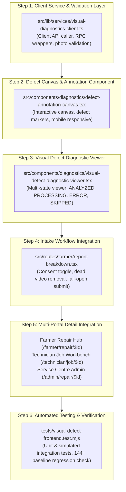

# TerraByte — Phase 11: Visual Defect Diagnostics — Frontend Implementation & Integration Plan

**Document Version:** `1.0 (Detailed Engineering Plan)`  
**Date:** `2026-11-04`  
**Status:** `APPROVED FOR EXECUTION`  
**Branch:** `phase-11`  
**Target Architecture:** React 19 SPA + TanStack Router + Vite 8 + Nitro (`vercel` preset) + Supabase + Google Gemini 3.5 Flash-Lite (Free-Tier)

---

## 1. Executive Summary & Baseline Audit

### 1.1 Current Implementation State

A rigorous inspection of the codebase confirms:

1. **Database Layer (100% Implemented & Tested)**:
   - Migration `20261103120000_phase11_visual_defect_diagnostics.sql` provides 6 `SECURITY DEFINER` RPCs:
     - `claim_repair_visual_diagnostic`: Atomic claim token generation, 30s cooldown, max 3 attempts, max 5 rescans, strict fail-closed farmer consent check.
     - `save_repair_visual_diagnostic`: Service-role only, strict catalog verification against `service_centre_parts` with machine-model compatibility filtering.
     - `finalize_repair_visual_diagnostic_failure`: Service-role only, sanitized error codes (`TIMEOUT`, `RATE_LIMITED`, `PROVIDER_UNAVAILABLE`, `SCHEMA_VALIDATION_ERROR`, `CONFIG_ERROR`, `NETWORK_ERROR`).
     - `revoke_repair_visual_consent`: Farmer/admin consent revocation (transitions ticket to `SKIPPED`).
     - `grant_repair_visual_consent`: Strictly owning farmer consent grant.
     - `admin_repair_corrupted_diagnostic`: Admin recovery for corrupted metadata.
2. **Backend API Route (100% Implemented & Tested)**:
   - `src/routes/api/assess-visual-defect.ts`: Nitro POST endpoint authenticating caller JWT, resolving caller profile via `get_session_profile`, enforcing RLS claim token creation, and coordinating inference.
3. **AI Vision Service (100% Implemented & Tested)**:
   - `src/lib/services/gemini-diagnostic.ts`: Interfacing with Google Gemini 3.5 Flash-Lite under free-tier limits, 9-second SLA timeout, 750ms in-flight consent cancellation poller, 4MB per photo limit (16MB total payload).
4. **Contract Test Suite (100% Passing)**:
   - `tests/diagnostics-contract.test.mjs`: 5/5 passing unit tests verifying security definer search paths, privilege isolation, and bounded integer parsing.

### 1.2 Missing Frontend Capabilities

The following components and integration points are absent or incomplete:

- **`VisualDefectDiagnosticViewer` Component**: Required UI component displaying multimodal AI visual findings, confidence levels, severity ratings, catalog-staged parts, and safety instructions.
- **Defect Annotation & Canvas Components (`DefectAnnotationCanvas`)**: Interactive photo inspection canvas rendering visual defect bounding markers, interactive pinpoints, coordinate mapping, and zoom/pan controls.
- **Intake Photo & Consent Management (`src/routes/farmer/report-breakdown.tsx`)**:
  - Remove dead `video/*` upload filter and unhandled video toast.
  - Restrict strictly to compressed photos (`image/jpeg`, `image/png`, `image/webp`, $\le 4\text{ MB}$, max 4 photos).
  - Explicit Farmer Consent toggle checkbox with plain-language privacy notice.
  - Fail-Open ticket submission: If Gemini API fails, times out, or quota is exhausted, breakdown creation is never blocked.
- **Client Service Layer (`src/lib/services/visual-diagnostics-client.ts`)**: Client-side invocation helper for `/api/assess-visual-defect` and consent management RPCs.
- **Multi-Portal Integration**: Embed `VisualDefectDiagnosticViewer` in:
  - Farmer Repair Hub (`/farmer/repair/$id`)
  - Technician Job Workbench (`/technician/job/$id`)
  - Service Centre Dispatch Detail (`/admin/repair/$id`)
- **Automated Frontend & Integration Tests**: Comprehensive tests covering upload limits, consent fail-closed behavior, fail-open submission, and canvas interactions.

---

## 2. Architectural Principles & Invariants

1. **Free-Tier Constraint (Absolute $0.00 Spend)**:
   - Dedicated exclusively to `gemini-3.5-flash-lite` (free-tier).
   - Zero paid fallback models (e.g. no automatic upgrade to paid Gemini Pro or GPT-4o).
   - Zero billing upgrades.
   - All API keys held server-side in environment variables (`GEMINI_API_KEY`).
2. **Assistive Non-Authority**:
   - AI visual diagnostics are strictly assistive decision support.
   - Never commits repair tickets, never commits quote line items, never replaces physical on-site inspection.
   - Mandatory disclaimer rendered on all diagnostic displays:
     > _"Assistive preliminary analysis only. Physical on-site inspection by a certified technician is authoritative. Does not commit parts, quotes, or repair authorization."_
3. **Fail-Closed Consent Authorization**:
   - Without explicit farmer opt-in boolean `true`, image bytes are **never** transmitted to Gemini.
   - If consent is revoked in-flight, background analysis is aborted and discarded immediately.
4. **Fail-Open Breakdown Submission**:
   - Gemini service unavailability, missing API key, timeout, or HTTP 429 quota exhaustion must **never** prevent a farmer from reporting a breakdown.
   - The breakdown ticket is created with standard deterministic rule-based triage (`assess(...)`), ensuring zero disruption to field operations.
5. **Farmer Description & Transcript Preservation**:
   - The farmer's original description and voice transcript are immutable and never overwritten or summarized away by AI output.
6. **No Breaking Changes to Core Workflows**:
   - Existing breakdown submission, role resolution (`get_session_profile`), quotes, parts desk requisitions, and technician dispatch are 100% preserved.

---

## 3. Step-by-Step Implementation Roadmap

### Detailed Task Breakdown:

### Task 1: Client Service & Validation Layer (`src/lib/services/visual-diagnostics-client.ts`)

- `validateDiagnosticPhoto(file: File)`:
  - Check file type: `image/jpeg`, `image/png`, `image/webp`.
  - Check file size: $\le 4\text{ MB}$ (`DIAGNOSTIC_LIMITS.MAX_RAW_PHOTO_BYTES`).
- `triggerVisualDiagnostic(repairRequestId: string, forceRescan?: boolean)`:
  - Acquire session bearer token from `supabase.auth.getSession()`.
  - POST to `/api/assess-visual-defect` with `{ repairRequestId, forceRescan }`.
  - Return typed result or throw sanitized error.
- `grantFarmerVisualConsent(repairRequestId: string)`:
  - Calls `supabase.rpc("grant_repair_visual_consent", { p_repair_request_id: repairRequestId })`.
- `revokeFarmerVisualConsent(repairRequestId: string)`:
  - Calls `supabase.rpc("revoke_repair_visual_consent", { p_repair_request_id: repairRequestId })`.

### Task 2: Defect Canvas & Annotation Component (`src/components/diagnostics/defect-annotation-canvas.tsx`)

- Renders breakdown photo on HTML5 Canvas / SVG container.
- Photo selector tabs/thumbnails when multiple photos exist (up to 4 photos).
- Overlays anomaly markers:
  - Colored indicator pins based on severity:
    - `CRITICAL`: Red (`destructive`)
    - `HIGH`: Amber/Orange (`warning`)
    - `MEDIUM`: Blue (`info`)
    - `LOW`: Muted
  - Anomaly callout cards on marker click or hover.
  - Interactive bidirectional highlight: clicking an anomaly badge or card highlights the corresponding pin on the canvas.
- Mobile touch-friendly, responsive scaling (aspect ratio maintained, no image distortion).
- Interactive user pin feature: click/tap on photo to drop an inspection pin or view coordinate details.

### Task 3: Visual Defect Diagnostic Viewer Component (`src/components/diagnostics/visual-defect-diagnostic-viewer.tsx`)

- Exports `VisualDefectDiagnosticViewer`.
- Props:
  - `repairId: string`
  - `visualDiagnostics: VisualDiagnosticsData | null | undefined`
  - `photos: string[]`
  - `equipment?: { make: string; model: string; year?: number | null }`
  - `userRole: "farmer" | "technician" | "admin"`
  - `isAssignedTechnician?: boolean`
  - `onRefresh?: () => Promise<void> | void`
- State views:
  1. **`ANALYZED` State**:
     - Visual Confidence Badge (`HIGH`, `MEDIUM`, `LOW`).
     - Overall visual findings summary.
     - `DefectAnnotationCanvas` with photo switcher and defect markers.
     - Visual Anomalies cards: System, Defect Type, Severity, Observation, Recommendation.
     - Staged Central Nagpur Depot Parts: Part number, item name, quantity, confidence, reasoning, live stock indicator.
     - Safety Guidance alert box: Pre-inspection safety procedures.
     - Mandatory Assistive Disclaimer banner.
     - Re-scan action for staff (technician / admin) with cooldown protection.
  2. **`PROCESSING` State**:
     - Animated pulse banner with spinner.
     - Clear copy: _"AI visual analysis in progress. Examining machinery photos for component defects..."_
     - Auto-polling or manual refresh button.
  3. **`RETRYABLE_ERROR` / `FAILED` State**:
     - Warning banner with sanitized user-facing error message (e.g. rate limit cooldown, service timeout).
     - "Retry Analysis" button (triggers force rescan or claim retry).
  4. **`SKIPPED` State**:
     - Informative notice: _"AI visual defect diagnostics skipped (consent not granted or withdrawn)."_
     - For farmer: "Grant Consent & Analyze" action.
  5. **`NOT_REQUESTED` State**:
     - Notice indicating photos are available. Option to initiate analysis if farmer consent is granted.

### Task 4: Intake Workflow Integration (`src/routes/farmer/report-breakdown.tsx`)

- Clean up obsolete code:
  - Remove `video/*` from `accept` attribute in Step 4.
  - Remove video toast stub.
  - Restrict input to `image/jpeg,image/png,image/webp`.
- Add Farmer Consent Opt-In Checkbox:
  - Label: _"Allow AI visual defect analysis of breakdown photos"_
  - Description: _"Google Gemini 3.5 Flash-Lite assistive AI will inspect your photos to highlight defects and recommend compatible parts. Data is never used for public training."_
  - Persist in draft state (`aiConsent: boolean`, default `true`).
- Fail-Open Submission:
  - Submit breakdown ticket with deterministic triage (`assess(...)`).
  - Pass initial consent state into `assessment.visualDiagnostics.consent`.
  - If consented and photos present, trigger `/api/assess-visual-defect` in the background.
  - If visual diagnostic call fails (timeout, 429, missing key), do NOT block or fail ticket creation; notify farmer that standard triage was saved.

### Task 5: Multi-Portal Detail Integration

- Farmer Repair Hub (`src/routes/farmer/repair/$id.tsx`):
  - Embed `VisualDefectDiagnosticViewer` in repair details tab.
  - Allow farmer to view findings, view annotations, and manage consent.
- Technician Job Workbench (`src/routes/technician/job/$id.tsx`):
  - Embed `VisualDefectDiagnosticViewer` above quote builder.
  - Provide technician with pre-dispatch defect and staged parts visibility.
  - Allow technician to trigger force rescan if ticket is in terminal/retryable state.
- Service Centre Admin Detail (`src/routes/admin/repair/$id.tsx`):
  - Embed `VisualDefectDiagnosticViewer` on admin repair detail screen.
  - Enable staff force rescan and defect overview.

### Task 6: Automated Testing & Safety Verification

- Author `tests/visual-defect-frontend.test.mjs` verifying:
  - Image size and MIME validation logic.
  - Fail-closed consent evaluation on client.
  - Fail-open breakdown submission on simulated Gemini outage (503, 504, 429).
  - Anomaly coordinate normalization and marker rendering logic.
  - Multi-state rendering transitions.
  - Assistive disclaimer verification.
- Run complete test suite (`npm test`), TypeScript verification (`npx tsc --noEmit`), and production bundle build (`npm run build`).

---

## 4. Verification & Acceptance Criteria

- [ ] Photo upload rejects files $> 4\text{ MB}$ or unsupported MIME types.
- [ ] Dead video handler code is eliminated.
- [ ] Farmer consent checkbox is functional and defaults to opt-in with explicit legal disclaimer.
- [ ] If farmer opts out, image bytes are never sent to Gemini API.
- [ ] If Gemini API returns 429 or fails, breakdown submission creates the ticket without error.
- [ ] `VisualDefectDiagnosticViewer` renders all 5 states (`ANALYZED`, `PROCESSING`, `FAILED`, `SKIPPED`, `NOT_REQUESTED`).
- [ ] `DefectAnnotationCanvas` displays markers on photos with interactive selection.
- [ ] Staged parts match Central Nagpur Depot catalog context.
- [ ] Mandatory assistive disclaimer is visible across farmer, technician, and admin portals.
- [ ] All 144 baseline automated tests continue to pass with zero regressions.
- [ ] `npx tsc --noEmit` and `npm run build` succeed with zero errors.
