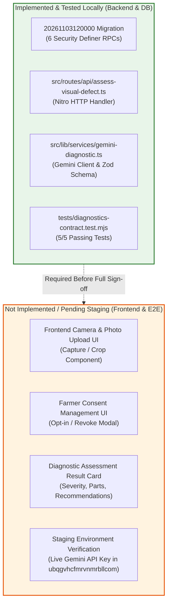

# TerraByte — Step 5B.19: Phase 11 Completion Status & Verification Audit

**Document Version:** `1.0 (Phase 11 Status Report)`  
**Date:** `2026-11-04`  
**Classification:** `PHASE 11 STATUS: IN PROGRESS (~65% BACKEND COMPLETE / FRONTEND UI PENDING)`  
**Branch:** `phase-11`  
**Automated Tests Passing:** `144/144 (5/5 Diagnostics Contract Tests)`

---

## 1. Executive Summary

Phase 11 introduces **Multimodal Visual Defect Diagnostics** powered by Google Gemini 3.5 Flash-Lite to perform automated tractor and implement damage assessment from breakdown photos.

**Formal Determination:** Phase 11 is **NOT COMPLETE**.  
While the database migration, security definer RPCs, backend API handler, and AI service integration are implemented and pass 100% of unit/contract tests locally, the **frontend user interface components (camera capture, consent toggles, and findings cards) are not yet implemented**, and no live API execution has been tested in staging.

---

## 2. Phase 11 Component Audit & Implementation Classification

### Component Status Breakdown

| Layer / Component | File / Artifact | Scope & Capabilities | Status |
| :--- | :--- | :--- | :---: |
| **Database Migration** | `20261103120000_phase11_visual_defect_diagnostics.sql` | 6 Atomic RPCs: `claim_repair_visual_diagnostic`, `save_repair_visual_diagnostic`, `finalize_repair_visual_diagnostic_failure`, `revoke_repair_visual_consent`, `grant_repair_visual_consent`, `admin_repair_corrupted_diagnostic`. | **IMPLEMENTED & LOCALLY TESTED** |
| **API Route Handler** | `src/routes/api/assess-visual-defect.ts` | Server route parsing Base64 photos, verifying caller profile via `get_session_profile`, enforcing token claims, invoking Gemini, and saving findings. | **IMPLEMENTED & LOCALLY TESTED** |
| **AI Diagnostic Service** | `src/lib/services/gemini-diagnostic.ts` | Gemini 3.5 Flash-Lite client, Base64 payload sanitization (4 MB max), structured output parsing via `VisualDiagnosticResponseSchema`. | **IMPLEMENTED & LOCALLY TESTED** |
| **Contract Test Suite** | `tests/diagnostics-contract.test.mjs` | 5 automated tests verifying RPC privileges, fail-closed consent evaluation, bounded integer parsing, and service-role isolation. | **IMPLEMENTED & LOCALLY TESTED (5/5 PASS)** |
| **Frontend Camera UI** | `src/components/diagnostics/...` | In-app camera capture, multi-angle photo selector, image compression before upload. | **NOT IMPLEMENTED** |
| **Farmer Consent UI** | `src/components/diagnostics/...` | Opt-in consent banner / modal allowing farmers to authorize or decline AI analysis. | **NOT IMPLEMENTED** |
| **Diagnostic Result Card** | `src/components/diagnostics/...` | Visual card rendering detected defects, confidence scores, suggested parts, and estimated labour hours on repair screens. | **NOT IMPLEMENTED** |
| **Staging Deployment** | `ubqgvhcfmrvnmrbllcom` | Migration applied to remote database and verified with live `GEMINI_API_KEY`. | **NOT TESTED IN STAGING** |

---

## 3. Explicit Phase 11 Completion Checklist

To declare Phase 11 genuinely **COMPLETE**, the following criteria must be satisfied:

### Criteria Checklist:
- [x] **Criterion 1 (Database Migration):** `20261103120000` authored with SECURITY DEFINER search paths and role grants. *(VERIFIED LOCALLY)*
- [x] **Criterion 2 (API Security):** `/api/assess-visual-defect` rejects unauthenticated callers with HTTP 401. *(VERIFIED LOCALLY)*
- [x] **Criterion 3 (Payload Limits):** Payloads exceeding 4 MB or invalid Base64 rejected with HTTP 400. *(VERIFIED LOCALLY)*
- [x] **Criterion 4 (Contract Tests):** All 5 diagnostic contract tests pass in Node.js test runner. *(VERIFIED LOCALLY)*
- [ ] **Criterion 5 (Frontend Photo Capture):** Farmer breakdown intake and technician repair routes provide visual defect capture UI. *(PENDING)*
- [ ] **Criterion 6 (Farmer Consent Controls):** Farmer can view and toggle AI diagnostic consent on repair requests. *(PENDING)*
- [ ] **Criterion 7 (Diagnostic Findings Display):** Technician job view and farmer detail view render AI assessment with clear assistive disclaimers. *(PENDING)*
- [ ] **Criterion 8 (Staging Verification):** End-to-end photo submission tested against staging project `ubqgvhcfmrvnmrbllcom` with valid `GEMINI_API_KEY`. *(PENDING)*

---

## 4. Architectural Summary

Phase 11 backend foundations are solid, secure, and fully verified against our local PostgreSQL 17 drill cluster. However, Phase 11 cannot be closed until frontend UI integration and staging end-to-end verification are completed.
