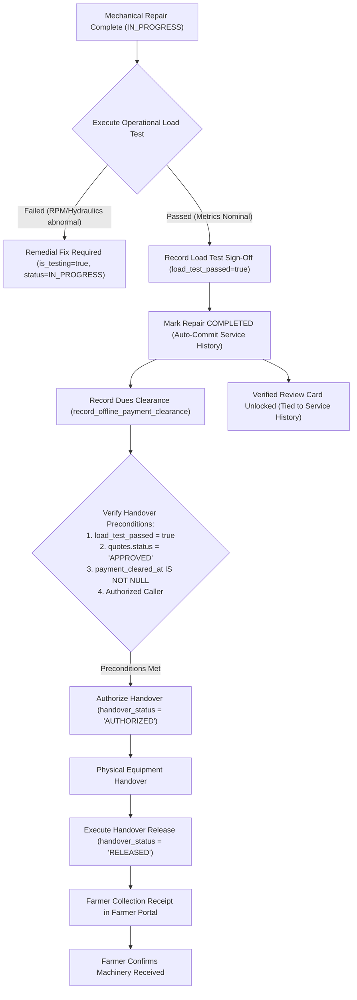
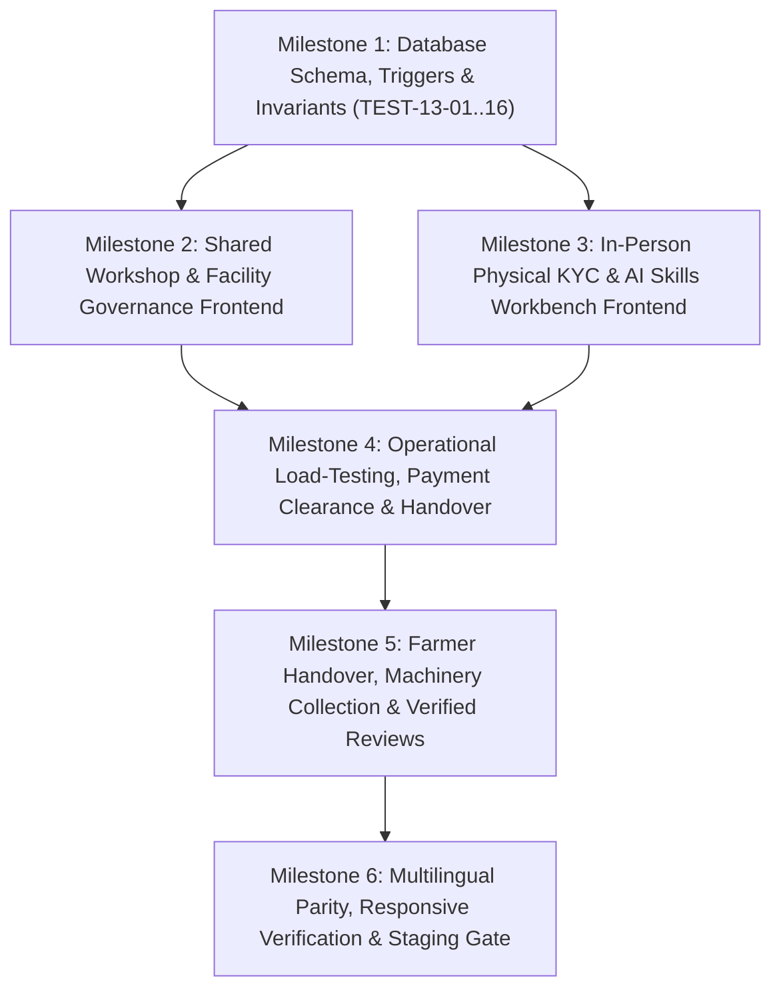

# Phase 13: Technician Trust, Shared Workshops & Accountability — Implementation Specification

> **Phase**: Phase 13 — Technician Trust, Shared Workshops & Accountability  
> **Target Branch**: `phase-13`  
> **Status**: SPECIFICATION FINALIZED & READY FOR IMPLEMENTATION (Read-Only Planning Pass)  
> **Dependencies**: Phase 12 (Completed & Staging Verified at commit `7996ccc`)  
> **Environment Target**: Supabase Staging (`ubqgvhcfmrvnmrbllcom`)  
> **Author**: TerraByte Architecture Team  
> **Date**: 2026-11-06  

---

## 1. Executive Summary & Approved Scope

Phase 13 establishes enterprise-grade technician trust, physical identity verification, shared facility management, verifiable reputation metrics, and governed physical machinery handover across Maharashtra's Vidarbha agrarian region.

### Core Objectives & Approved Roadmap Scope:
1. **Shared Workshops & Facility Membership (`public.repair_facilities` & `public.facility_memberships`)**: Model physical agricultural workshops across Vidarbha. Decouple facility ownership from technician membership. Enforce an atomic single-owner invariant and secure permission matrix across `OWNER`, `MANAGER`, and `TECHNICIAN`.
2. **Technician Operational Base**: Enforce the technician's registered workshop location (`repair_facilities.latitude/longitude`) as the authoritative origin for all field dispatch distance calculations. Maintain a strict **zero continuous live GPS tracking** policy to protect technician privacy and operate reliably in low-bandwidth rural environments.
3. **Public Drop-Off Gate (`drop_off_approved`)**: Gated exclusively by Service Centre administrators. Workshop owners cannot self-certify facilities for public drop-offs; enforced via database trigger.
4. **Privacy-Conscious In-Person Physical KYC**: Technicians present physical government credentials in person at the central Nagpur Service Centre (MIDC Hingna Road). Completely eliminate digital Aadhaar uploads, full 12-digit Aadhaar storage, or commercial third-party KYC APIs. Gated via admin-only `SECURITY DEFINER` RPC `verify_technician_kyc()`.
5. **Admin-Gated AI Expertise Certification**: AI suggestions for brand tags and skill endorsements remain strictly quarantined in `ai_suggested_skills` until explicitly reviewed and approved by Service Centre administrators. Only approved skills populate `verified_skills`.
6. **Verified-Only Ratings & Reputation Engine**: Reviews are permitted only for farmers who have an immutable, completed `service_history` record with the assigned technician. Default rating is `NULL` (*"New / Unrated"*); static 5.00 default ratings are completely eliminated. Concurrency-safe triggers maintain rolling averages.
7. **Complete Equipment Handover & Collection Lifecycle**: Full physical machine release protocol advancing through `PENDING` $\rightarrow$ `AUTHORIZED` $\rightarrow$ `RELEASED`, requiring operational load testing sign-off, quote/payment clearance, releasing agent validation, and farmer collection confirmation.

---

## 2. Approved Architecture Decision Records (ADRs)

- **ADR-001 (Shared Workshops & Membership)**: Independent `repair_facilities` entity; explicit role separation via `facility_memberships` (`OWNER`, `MANAGER`, `TECHNICIAN`); Service Centre admin gate for public drop-offs (`drop_off_approved`); registered workshop location as dispatch origin; zero live GPS tracking.
- **ADR-004 (Privacy-Conscious In-Person Physical KYC)**: In-person credential inspection at Nagpur Service Centre; zero Aadhaar scans or full numbers; audit metadata only (document type, masked last-4, timestamp, verifying officer ID).
- **ADR-007 (Administrative Approval Gate for AI Expertise)**: AI suggests tags based on repair history; mandatory human-in-the-loop admin sign-off before public rendering.
- **ADR-008 (Verified-Only Ratings Engine with Null Default)**: Reviews permitted only for farmers with completed `service_history` with the assigned technician; default rating is `NULL` (*"New / Unrated"*); PostgreSQL trigger maintains aggregate stats.

---

## 3. Actual Schema Dependencies (Existing vs. Required Additions)

An audit of existing Supabase PostgreSQL migrations and TypeScript definitions (`src/integrations/supabase/types.ts`) establishes the exact baseline dependencies:

| Table Name | Existing Columns Utilized | Required Additions / Alterations in Phase 13 |
| :--- | :--- | :--- |
| `public.repair_requests` | `id`, `farmer_id`, `technician_id`, `equipment_id`, `status`, `is_testing`, `completion_details`, `job_number`, `verified_at` | **NEW**: `facility_id` (UUID FK -> `repair_facilities` ON DELETE SET NULL), `load_test_passed` (BOOLEAN DEFAULT FALSE), `load_test_notes` (TEXT), `load_tested_at` (TIMESTAMPTZ), `load_tested_by` (UUID FK -> `profiles`), `payment_cleared_at` (TIMESTAMPTZ), `payment_cleared_by` (UUID FK -> `profiles`), `payment_method` (TEXT), `payment_reference` (TEXT), `handover_status` (TEXT DEFAULT 'PENDING' CHECK (handover_status IN ('PENDING', 'AUTHORIZED', 'RELEASED'))), `handover_authorized_at` (TIMESTAMPTZ), `handover_authorized_by` (UUID FK -> `profiles`), `handover_released_at` (TIMESTAMPTZ), `handover_released_by` (UUID FK -> `profiles`), `handover_notes` (TEXT), `farmer_collection_confirmed` (BOOLEAN DEFAULT FALSE), `farmer_collection_confirmed_at` (TIMESTAMPTZ). |
| `public.quotes` | `id`, `repair_request_id`, `technician_id`, `labour_amount`, `status` (`'PENDING'`, `'APPROVED'`, `'REVISED'`, `'REJECTED'`), `version` | *No schema modifications*. Handover clearance queries `status = 'APPROVED'`. |
| `public.service_centre_part_requests` | `id`, `repair_request_id`, `part_id`, `quantity`, `status` (`'PENDING'`, `'HANDED_OFF'`, `'CANCELLED'`) | *No schema modifications*. Handover clearance verifies `NOT EXISTS (status = 'PENDING')`. |
| `public.service_history` | `id`, `equipment_id`, `repair_request_id`, `service_date`, `operating_hours`, `parts_replaced`, `labour_cost`, `total_cost`, `technician_name`, `workshop_name`, `invoice_reference` | **NEW**: `technician_profile_id` (UUID FK -> `profiles` ON DELETE SET NULL DEFAULT NULL), `facility_id` (UUID FK -> `repair_facilities` ON DELETE SET NULL DEFAULT NULL) for referential integrity. Existing historical rows remain valid with `NULL`. |
| `public.technician_profiles` | `profile_id`, `workshop_name`, `rating`, `brands`, `skills`, `is_available`, `is_verified` | **ALTER**: `rating` altered to `NUMERIC(3, 2) DEFAULT NULL` (nullable). **NEW**: `primary_facility_id` (UUID FK -> `repair_facilities` ON DELETE SET NULL), `review_count` (INT DEFAULT 0), `kyc_verified` (BOOLEAN DEFAULT FALSE), `kyc_verified_at` (TIMESTAMPTZ), `kyc_verified_by` (UUID FK -> `profiles`), `kyc_document_type` (TEXT), `kyc_masked_id` (TEXT), `kyc_remarks` (TEXT), `ai_suggested_skills` (JSONB DEFAULT '[]'::jsonb), `verified_skills` (JSONB DEFAULT '[]'::jsonb). |
| `public.repair_facilities` | *Table does not exist* | **NEW TABLE**: Complete physical workshop entity. |
| `public.facility_memberships` | *Table does not exist* | **NEW TABLE**: Role association between facilities and technicians. |
| `public.technician_reviews` | *Table does not exist* | **NEW TABLE**: Verified rating and feedback entity. |

---

## 4. Hardened Database Architecture & Security Definer Standards

### 4.1 Strict Function Hardening Invariant
Every `SECURITY DEFINER` function authored in Phase 13 must strictly adhere to the following security controls:
1. **Search Path Hardening**: Must declare `SET search_path = ''`.
2. **Explicit Qualification**: All table, function, schema, and type references must be fully schema-qualified (e.g. `public.profiles`, `public.current_profile_id()`, `pg_catalog.now()`, `pg_catalog.round()`).
3. **Execution Grants**:
   - `REVOKE ALL ON FUNCTION ... FROM PUBLIC;`
   - `REVOKE EXECUTE ON FUNCTION ... FROM anon;`
   - `GRANT EXECUTE ON FUNCTION ... TO authenticated;`
   - `service_role` is granted **only** where automated background jobs or serverless webhooks require it, with recorded justification.
4. **Internal Authorization**: Every function verifies caller identity via `public.current_profile_id()` and role via `public.current_user_role()`.

---

### 4.2 Table Definitions & Constraints

#### 1. `public.repair_facilities`
```sql
CREATE TABLE public.repair_facilities (
  id UUID PRIMARY KEY DEFAULT gen_random_uuid(),
  name TEXT NOT NULL,
  owner_profile_id UUID NOT NULL REFERENCES public.profiles(id) ON DELETE RESTRICT,
  phone TEXT NOT NULL,
  email TEXT,
  address TEXT NOT NULL,
  village TEXT NOT NULL,
  tahsil TEXT NOT NULL,
  latitude NUMERIC(10, 7) NOT NULL,
  longitude NUMERIC(10, 7) NOT NULL,
  max_equipment_capacity INTEGER NOT NULL DEFAULT 4,
  drop_off_approved BOOLEAN NOT NULL DEFAULT FALSE,
  drop_off_approved_at TIMESTAMPTZ,
  drop_off_approved_by UUID REFERENCES public.profiles(id),
  is_active BOOLEAN NOT NULL DEFAULT TRUE,
  operating_hours JSONB NOT NULL DEFAULT '{"open":"08:00","close":"19:00","days":["MON","TUE","WED","THU","FRI","SAT"]}'::jsonb,
  created_at TIMESTAMPTZ NOT NULL DEFAULT pg_catalog.now(),
  updated_at TIMESTAMPTZ NOT NULL DEFAULT pg_catalog.now(),
  CONSTRAINT check_facility_coordinates CHECK (
    latitude BETWEEN -90.0 AND 90.0 AND
    longitude BETWEEN -180.0 AND 180.0 AND
    (latitude != 0.0 OR longitude != 0.0)
  ),
  CONSTRAINT check_facility_capacity CHECK (max_equipment_capacity > 0)
);

CREATE INDEX idx_repair_facilities_tahsil ON public.repair_facilities(tahsil) WHERE is_active = TRUE;
CREATE INDEX idx_repair_facilities_owner ON public.repair_facilities(owner_profile_id);

##### Database Scope Delineation (Approved Columns vs. Deferred UI Ideas)
To prevent unapproved schema inflation, Phase 13 strictly binds database migrations and RPCs to approved attributes only:
- **Approved Phase 13 Columns (Database Invariant)**: `id`, `name`, `owner_profile_id`, `phone`, `email`, `address`, `village`, `tahsil`, `latitude`, `longitude`, `max_equipment_capacity`, `drop_off_approved`, `drop_off_approved_at`, `drop_off_approved_by`, `is_active`, `operating_hours`, `created_at`, `updated_at`.
- **Deferred / Unsupported UI Ideas (Zero Database Scope in Phase 13)**:
  - `facility_type` (`MAIN_WORKSHOP`, `SATELLITE_BAY`, `FIELD_STATION`): **Deferred to Phase 14** (Smart Dispatch). Not added as a column in Phase 13.
  - `tooling_checklist` (hydraulic press, compressor, torque wrenches): **Deferred to Phase 15/16**. Not added as a column in Phase 13.
  - `equipment_specializations`: Covered by existing `technician_profiles.brands` and `technician_profiles.skills`. Not duplicated on `repair_facilities`.
  The frontend `RegisterWorkshopDialog` in Phase 13 will collect strictly the 10 approved columns.
```

#### 2. `public.facility_memberships`
```sql
CREATE TABLE public.facility_memberships (
  id UUID PRIMARY KEY DEFAULT gen_random_uuid(),
  facility_id UUID NOT NULL REFERENCES public.repair_facilities(id) ON DELETE CASCADE,
  technician_profile_id UUID NOT NULL REFERENCES public.profiles(id) ON DELETE CASCADE,
  role TEXT NOT NULL CHECK (role IN ('OWNER', 'MANAGER', 'TECHNICIAN')),
  status TEXT NOT NULL DEFAULT 'ACTIVE' CHECK (status IN ('ACTIVE', 'INVITED', 'SUSPENDED', 'RESIGNED')),
  joined_at TIMESTAMPTZ NOT NULL DEFAULT pg_catalog.now(),
  created_at TIMESTAMPTZ NOT NULL DEFAULT pg_catalog.now(),
  updated_at TIMESTAMPTZ NOT NULL DEFAULT pg_catalog.now(),
  CONSTRAINT unique_facility_technician UNIQUE(facility_id, technician_profile_id)
);

-- Database-enforced Single Owner Invariant per facility:
CREATE UNIQUE INDEX idx_single_facility_owner
  ON public.facility_memberships(facility_id)
  WHERE role = 'OWNER';

CREATE INDEX idx_facility_memberships_tech ON public.facility_memberships(technician_profile_id);
```

#### 3. `public.technician_reviews`
```sql
CREATE TABLE public.technician_reviews (
  id UUID PRIMARY KEY DEFAULT gen_random_uuid(),
  repair_id UUID NOT NULL UNIQUE REFERENCES public.repair_requests(id) ON DELETE RESTRICT,
  service_history_id UUID NOT NULL REFERENCES public.service_history(id) ON DELETE RESTRICT,
  farmer_profile_id UUID NOT NULL REFERENCES public.profiles(id) ON DELETE RESTRICT,
  technician_profile_id UUID NOT NULL REFERENCES public.profiles(id) ON DELETE RESTRICT,
  facility_id UUID REFERENCES public.repair_facilities(id) ON DELETE SET NULL,
  rating INTEGER NOT NULL CHECK (rating BETWEEN 1 AND 5),
  comment TEXT,
  timeliness_rating INTEGER CHECK (timeliness_rating BETWEEN 1 AND 5),
  quality_rating INTEGER CHECK (quality_rating BETWEEN 1 AND 5),
  is_published BOOLEAN NOT NULL DEFAULT TRUE,
  created_at TIMESTAMPTZ NOT NULL DEFAULT pg_catalog.now(),
  updated_at TIMESTAMPTZ NOT NULL DEFAULT pg_catalog.now()
);

CREATE INDEX idx_technician_reviews_tech ON public.technician_reviews(technician_profile_id) WHERE is_published = TRUE;
CREATE INDEX idx_technician_reviews_farmer ON public.technician_reviews(farmer_profile_id);
```

---

### 4.3 Database Triggers & Invariant Enforcement

#### Invariant A: Exactly One Owner & Automatic Membership Provisioning
When a facility is created, the owner is atomically provisioned as `OWNER` in `facility_memberships`:
```sql
CREATE OR REPLACE FUNCTION public.handle_facility_owner_membership()
RETURNS TRIGGER
LANGUAGE plpgsql
SECURITY DEFINER
SET search_path = ''
AS $$
BEGIN
  IF TG_OP = 'INSERT' THEN
    INSERT INTO public.facility_memberships (facility_id, technician_profile_id, role, status)
    VALUES (NEW.id, NEW.owner_profile_id, 'OWNER', 'ACTIVE')
    ON CONFLICT (facility_id, technician_profile_id) DO UPDATE
    SET role = 'OWNER', status = 'ACTIVE', updated_at = pg_catalog.now();
  END IF;
  RETURN NEW;
END;
$$;

CREATE TRIGGER trg_facility_owner_membership
AFTER INSERT ON public.repair_facilities
FOR EACH ROW EXECUTE FUNCTION public.handle_facility_owner_membership();
```

#### Invariant B: Database Enforcement Against Direct Mutation of `OWNER` Memberships
Eliminates client-settable session settings. Instead, direct table mutations cannot create, delete, or demote an `OWNER` membership row on `facility_memberships`:
```sql
CREATE OR REPLACE FUNCTION public.guard_owner_membership_mutation()
RETURNS TRIGGER
LANGUAGE plpgsql
SECURITY DEFINER
SET search_path = ''
AS $$
DECLARE
  v_current_owner_id UUID;
BEGIN
  -- 1. Prevent direct DELETE of an OWNER membership while the facility exists
  IF TG_OP = 'DELETE' AND OLD.role = 'OWNER' THEN
    IF EXISTS (SELECT 1 FROM public.repair_facilities WHERE id = OLD.facility_id) THEN
      RAISE EXCEPTION 'CANNOT_DELETE_FACILITY_OWNER: Facility owner membership cannot be deleted while facility exists. Transfer ownership first.'
        USING ERRCODE = '23503';
    END IF;
    RETURN OLD;
  END IF;

  -- 2. Prevent inserting role = 'OWNER' directly unless matching repair_facilities.owner_profile_id
  IF (TG_OP = 'INSERT' OR TG_OP = 'UPDATE') AND NEW.role = 'OWNER' THEN
    SELECT owner_profile_id INTO v_current_owner_id
    FROM public.repair_facilities
    WHERE id = NEW.facility_id;

    IF v_current_owner_id IS NULL OR v_current_owner_id != NEW.technician_profile_id THEN
      RAISE EXCEPTION 'FORBIDDEN_OWNER_ROLE: Only the verified owner_profile_id of the facility can hold role = OWNER.'
        USING ERRCODE = '42501';
    END IF;
  END IF;

  -- 3. Prevent demoting the verified owner while repair_facilities.owner_profile_id still points to them
  IF TG_OP = 'UPDATE' AND OLD.role = 'OWNER' AND NEW.role != 'OWNER' THEN
    SELECT owner_profile_id INTO v_current_owner_id
    FROM public.repair_facilities
    WHERE id = NEW.facility_id;

    IF v_current_owner_id = OLD.technician_profile_id THEN
      RAISE EXCEPTION 'CANNOT_DEMOTE_FACILITY_OWNER: Cannot demote facility owner while owner_profile_id points to them. Execute transfer_facility_ownership first.'
        USING ERRCODE = '42501';
    END IF;
  END IF;

  RETURN NEW;
END;
$$;

CREATE TRIGGER trg_guard_owner_membership_mutation
BEFORE INSERT OR UPDATE OR DELETE ON public.facility_memberships
FOR EACH ROW EXECUTE FUNCTION public.guard_owner_membership_mutation();
```

#### Invariant C: Atomic Facility Ownership Transfer Trigger & RPC
Ownership transfer is initiated strictly by modifying `repair_facilities.owner_profile_id` via an authorized RPC. The `AFTER UPDATE OF owner_profile_id ON public.repair_facilities` trigger performs the atomic demotion and promotion:
```sql
CREATE OR REPLACE FUNCTION public.handle_facility_ownership_transfer()
RETURNS TRIGGER
LANGUAGE plpgsql
SECURITY DEFINER
SET search_path = ''
AS $$
BEGIN
  IF NEW.owner_profile_id IS DISTINCT FROM OLD.owner_profile_id THEN
    -- Demote old owner to MANAGER in memberships
    UPDATE public.facility_memberships
    SET role = 'MANAGER', updated_at = pg_catalog.now()
    WHERE facility_id = NEW.id AND technician_profile_id = OLD.owner_profile_id;

    -- Promote / insert new owner
    INSERT INTO public.facility_memberships (facility_id, technician_profile_id, role, status)
    VALUES (NEW.id, NEW.owner_profile_id, 'OWNER', 'ACTIVE')
    ON CONFLICT (facility_id, technician_profile_id) DO UPDATE
    SET role = 'OWNER', status = 'ACTIVE', updated_at = pg_catalog.now();
  END IF;
  RETURN NEW;
END;
$$;

CREATE TRIGGER trg_facility_ownership_transfer
AFTER UPDATE OF owner_profile_id ON public.repair_facilities
FOR EACH ROW EXECUTE FUNCTION public.handle_facility_ownership_transfer();

CREATE OR REPLACE FUNCTION public.transfer_facility_ownership(
  p_facility_id UUID,
  p_new_owner_profile_id UUID
)
RETURNS JSONB
LANGUAGE plpgsql
SECURITY DEFINER
SET search_path = ''
AS $$
DECLARE
  v_caller_profile_id UUID := public.current_profile_id();
  v_caller_role public.user_role := public.current_user_role();
  v_facility RECORD;
  v_new_owner_profile RECORD;
BEGIN
  -- 1. Lock Facility
  SELECT id, owner_profile_id INTO v_facility
  FROM public.repair_facilities
  WHERE id = p_facility_id
  FOR UPDATE;

  IF NOT FOUND THEN
    RAISE EXCEPTION 'NOT_FOUND: Facility does not exist.' USING ERRCODE = '02000';
  END IF;

  -- 2. Authorization: Current owner or Service Centre admin only
  IF NOT (v_caller_role = 'service_centre' OR v_facility.owner_profile_id = v_caller_profile_id) THEN
    RAISE EXCEPTION 'UNAUTHORIZED: Only current owner or Service Centre admin can transfer facility ownership.'
      USING ERRCODE = '42501';
  END IF;

  -- 3. Validate Target Persona
  SELECT id, role INTO v_new_owner_profile
  FROM public.profiles
  WHERE id = p_new_owner_profile_id;

  IF NOT FOUND OR v_new_owner_profile.role != 'technician' THEN
    RAISE EXCEPTION 'INVALID_TARGET: Target profile must be a registered technician.' USING ERRCODE = '22000';
  END IF;

  -- 4. Update Facility (Trigger trg_facility_ownership_transfer handles atomic membership demotion/promotion)
  UPDATE public.repair_facilities
  SET owner_profile_id = p_new_owner_profile_id, updated_at = pg_catalog.now()
  WHERE id = p_facility_id;

  RETURN pg_catalog.jsonb_build_object(
    'success', true,
    'facility_id', p_facility_id,
    'previous_owner_id', v_facility.owner_profile_id,
    'new_owner_id', p_new_owner_profile_id
  );
END;
$$;

REVOKE ALL ON FUNCTION public.transfer_facility_ownership(UUID, UUID) FROM PUBLIC;
REVOKE EXECUTE ON FUNCTION public.transfer_facility_ownership(UUID, UUID) FROM anon;
GRANT EXECUTE ON FUNCTION public.transfer_facility_ownership(UUID, UUID) TO authenticated;
```

#### Invariant D: Drop-Off Gate Protection Trigger
Guarantees workshop owners and technicians cannot self-approve facilities for public farmer drop-offs:
```sql
CREATE OR REPLACE FUNCTION public.guard_facility_drop_off_approval()
RETURNS TRIGGER
LANGUAGE plpgsql
SECURITY DEFINER
SET search_path = ''
AS $$
BEGIN
  IF NEW.drop_off_approved IS DISTINCT FROM OLD.drop_off_approved THEN
    IF public.current_user_role() != 'service_centre' THEN
      RAISE EXCEPTION 'ACCESS_DENIED: Only Service Centre administrators can modify drop_off_approved status.'
        USING ERRCODE = '42501';
    END IF;
  END IF;
  RETURN NEW;
END;
$$;

CREATE TRIGGER trg_guard_facility_drop_off_approval
BEFORE UPDATE ON public.repair_facilities
FOR EACH ROW EXECUTE FUNCTION public.guard_facility_drop_off_approval();
```

### 4.4 Facility Membership Invitation Flow & Authorized RPC
To prevent arbitrary user account lookups or unauthorized membership assignments, technician invitations are mediated through a dedicated `SECURITY DEFINER` routine that validates identity, phone number, and technician verification status:

```sql
CREATE OR REPLACE FUNCTION public.invite_technician_to_facility(
  p_facility_id UUID,
  p_technician_phone TEXT,
  p_role TEXT
)
RETURNS JSONB
LANGUAGE plpgsql
SECURITY DEFINER
SET search_path = ''
AS $$
DECLARE
  v_caller_profile_id UUID := public.current_profile_id();
  v_caller_role public.user_role := public.current_user_role();
  v_facility RECORD;
  v_target_profile RECORD;
  v_target_tp RECORD;
  v_is_authorized BOOLEAN := FALSE;
  v_clean_phone TEXT := pg_catalog.regexp_replace(p_technician_phone, '[^0-9]', '', 'g');
BEGIN
  -- 1. Validate requested role (cannot invite as OWNER)
  IF p_role NOT IN ('MANAGER', 'TECHNICIAN') THEN
    RAISE EXCEPTION 'INVALID_ROLE: Facility members can only be invited as MANAGER or TECHNICIAN.'
      USING ERRCODE = '22000';
  END IF;

  -- 2. Authorization check: Caller must be OWNER or MANAGER of the facility, or Service Centre admin
  IF v_caller_role = 'service_centre' THEN
    v_is_authorized := TRUE;
  ELSE
    SELECT EXISTS (
      SELECT 1 FROM public.facility_memberships
      WHERE facility_id = p_facility_id
        AND technician_profile_id = v_caller_profile_id
        AND role IN ('OWNER', 'MANAGER')
        AND status = 'ACTIVE'
    ) INTO v_is_authorized;
  END IF;

  IF NOT v_is_authorized THEN
    RAISE EXCEPTION 'UNAUTHORIZED: Only facility owners, managers, or Service Centre admins can invite members.'
      USING ERRCODE = '42501';
  END IF;

  -- 3. Lookup technician strictly by registered 10-digit phone number
  IF pg_catalog.length(v_clean_phone) < 10 THEN
    RAISE EXCEPTION 'INVALID_PHONE: Please provide a valid 10-digit registered technician phone number.'
      USING ERRCODE = '22000';
  END IF;

  SELECT p.id, p.full_name, p.role
  INTO v_target_profile
  FROM public.profiles p
  JOIN public.profile_contacts pc ON pc.profile_id = p.id
  WHERE pc.phone LIKE '%' || pg_catalog.substr(v_clean_phone, -10)
    AND p.role = 'technician'
  LIMIT 1;

  IF NOT FOUND THEN
    SELECT p.id, p.full_name, p.role
    INTO v_target_profile
    FROM public.profiles p
    WHERE p.phone LIKE '%' || pg_catalog.substr(v_clean_phone, -10)
      AND p.role = 'technician'
    LIMIT 1;
  END IF;

  IF NOT FOUND THEN
    RAISE EXCEPTION 'TECHNICIAN_NOT_FOUND: No registered technician account found with this phone number.'
      USING ERRCODE = '02000';
  END IF;

  -- 4. Check if technician is approved and verified
  SELECT profile_id, is_verified, kyc_verified
  INTO v_target_tp
  FROM public.technician_profiles
  WHERE profile_id = v_target_profile.id;

  IF NOT FOUND OR NOT (COALESCE(v_target_tp.is_verified, FALSE)) THEN
    RAISE EXCEPTION 'TECHNICIAN_NOT_VERIFIED: Only verified technician accounts can be affiliated with facilities.'
      USING ERRCODE = '22000';
  END IF;

  -- 5. Prevent duplicate membership or pending invitation
  IF EXISTS (
    SELECT 1 FROM public.facility_memberships
    WHERE facility_id = p_facility_id
      AND technician_profile_id = v_target_profile.id
      AND status IN ('ACTIVE', 'INVITED')
  ) THEN
    RAISE EXCEPTION 'MEMBERSHIP_EXISTS: This technician already holds an active membership or pending invitation at this facility.'
      USING ERRCODE = '23505';
  END IF;

  -- 6. Insert PENDING invitation (Does NOT silently become active)
  INSERT INTO public.facility_memberships (
    facility_id,
    technician_profile_id,
    role,
    status
  ) VALUES (
    p_facility_id,
    v_target_profile.id,
    p_role,
    'INVITED'
  );

  -- 7. Audit notification to target technician
  SELECT name INTO v_facility FROM public.repair_facilities WHERE id = p_facility_id;
  INSERT INTO public.notifications (recipient_user_id, title, message, type)
  VALUES (
    v_target_profile.id,
    'Workshop Membership Invitation',
    'You have been invited to join ' || COALESCE(v_facility.name, 'a workshop facility') || ' as ' || p_role || '. Please review and respond in your workshop portal.',
    'facility_invitation'
  );

  RETURN pg_catalog.jsonb_build_object(
    'success', true,
    'facility_id', p_facility_id,
    'technician_id', v_target_profile.id,
    'technician_name', v_target_profile.full_name,
    'role', p_role,
    'status', 'INVITED'
  );
END;
$$;

REVOKE ALL ON FUNCTION public.invite_technician_to_facility(UUID, TEXT, TEXT) FROM PUBLIC;
REVOKE EXECUTE ON FUNCTION public.invite_technician_to_facility(UUID, TEXT, TEXT) FROM anon;
GRANT EXECUTE ON FUNCTION public.invite_technician_to_facility(UUID, TEXT, TEXT) TO authenticated;

#### Invitation Acceptance, Rejection & Revocation RPCs

```sql
-- 1. Accept Invitation (Invited technician only)
CREATE OR REPLACE FUNCTION public.accept_facility_invitation(
  p_membership_id UUID
)
RETURNS JSONB
LANGUAGE plpgsql
SECURITY DEFINER
SET search_path = ''
AS $$
DECLARE
  v_caller_profile_id UUID := public.current_profile_id();
  v_membership RECORD;
BEGIN
  SELECT id, facility_id, technician_profile_id, role, status, created_at
  INTO v_membership
  FROM public.facility_memberships
  WHERE id = p_membership_id
  FOR UPDATE;

  IF NOT FOUND THEN
    RAISE EXCEPTION 'NOT_FOUND: Membership invitation does not exist.' USING ERRCODE = '02000';
  END IF;

  IF v_membership.technician_profile_id != v_caller_profile_id THEN
    RAISE EXCEPTION 'UNAUTHORIZED: Only the invited technician can accept this invitation.' USING ERRCODE = '42501';
  END IF;

  IF v_membership.status != 'INVITED' THEN
    RAISE EXCEPTION 'INVALID_STATE: Invitation is not in INVITED status.' USING ERRCODE = '22000';
  END IF;

  -- 14-day expiration guard
  IF v_membership.created_at < (pg_catalog.now() - interval '14 days') THEN
    UPDATE public.facility_memberships SET status = 'RESIGNED', updated_at = pg_catalog.now() WHERE id = p_membership_id;
    RAISE EXCEPTION 'INVITATION_EXPIRED: This invitation has expired (valid for 14 days).' USING ERRCODE = '22000';
  END IF;

  UPDATE public.facility_memberships
  SET status = 'ACTIVE',
      joined_at = pg_catalog.now(),
      updated_at = pg_catalog.now()
  WHERE id = p_membership_id;

  RETURN pg_catalog.jsonb_build_object(
    'success', true,
    'membership_id', p_membership_id,
    'status', 'ACTIVE',
    'joined_at', pg_catalog.now()
  );
END;
$$;

-- 2. Reject Invitation (Invited technician only)
CREATE OR REPLACE FUNCTION public.reject_facility_invitation(
  p_membership_id UUID
)
RETURNS JSONB
LANGUAGE plpgsql
SECURITY DEFINER
SET search_path = ''
AS $$
DECLARE
  v_caller_profile_id UUID := public.current_profile_id();
  v_membership RECORD;
BEGIN
  SELECT id, technician_profile_id, status
  INTO v_membership
  FROM public.facility_memberships
  WHERE id = p_membership_id
  FOR UPDATE;

  IF NOT FOUND THEN
    RAISE EXCEPTION 'NOT_FOUND: Membership invitation does not exist.' USING ERRCODE = '02000';
  END IF;

  IF v_membership.technician_profile_id != v_caller_profile_id THEN
    RAISE EXCEPTION 'UNAUTHORIZED: Only the invited technician can reject this invitation.' USING ERRCODE = '42501';
  END IF;

  IF v_membership.status != 'INVITED' THEN
    RAISE EXCEPTION 'INVALID_STATE: Only pending invitations can be rejected.' USING ERRCODE = '22000';
  END IF;

  DELETE FROM public.facility_memberships WHERE id = p_membership_id;

  RETURN pg_catalog.jsonb_build_object('success', true, 'action', 'REJECTED');
END;
$$;

-- 3. Revoke Invitation (Facility Owner, Manager, or Admin only)
CREATE OR REPLACE FUNCTION public.revoke_facility_invitation(
  p_membership_id UUID
)
RETURNS JSONB
LANGUAGE plpgsql
SECURITY DEFINER
SET search_path = ''
AS $$
DECLARE
  v_caller_profile_id UUID := public.current_profile_id();
  v_caller_role public.user_role := public.current_user_role();
  v_membership RECORD;
  v_is_authorized BOOLEAN := FALSE;
BEGIN
  SELECT id, facility_id, status
  INTO v_membership
  FROM public.facility_memberships
  WHERE id = p_membership_id
  FOR UPDATE;

  IF NOT FOUND THEN
    RAISE EXCEPTION 'NOT_FOUND: Membership invitation does not exist.' USING ERRCODE = '02000';
  END IF;

  IF v_membership.status != 'INVITED' THEN
    RAISE EXCEPTION 'INVALID_STATE: Only pending invitations can be revoked.' USING ERRCODE = '22000';
  END IF;

  IF v_caller_role = 'service_centre' THEN
    v_is_authorized := TRUE;
  ELSE
    SELECT EXISTS (
      SELECT 1 FROM public.facility_memberships
      WHERE facility_id = v_membership.facility_id
        AND technician_profile_id = v_caller_profile_id
        AND role IN ('OWNER', 'MANAGER')
        AND status = 'ACTIVE'
    ) INTO v_is_authorized;
  END IF;

  IF NOT v_is_authorized THEN
    RAISE EXCEPTION 'UNAUTHORIZED: Only facility owners, managers, or Service Centre admins can revoke invitations.'
      USING ERRCODE = '42501';
  END IF;

  DELETE FROM public.facility_memberships WHERE id = p_membership_id;

  RETURN pg_catalog.jsonb_build_object('success', true, 'action', 'REVOKED');
END;
$$;

REVOKE ALL ON FUNCTION public.accept_facility_invitation(UUID) FROM PUBLIC, anon;
GRANT EXECUTE ON FUNCTION public.accept_facility_invitation(UUID) TO authenticated;
REVOKE ALL ON FUNCTION public.reject_facility_invitation(UUID) FROM PUBLIC, anon;
GRANT EXECUTE ON FUNCTION public.reject_facility_invitation(UUID) TO authenticated;
REVOKE ALL ON FUNCTION public.revoke_facility_invitation(UUID) FROM PUBLIC, anon;
GRANT EXECUTE ON FUNCTION public.revoke_facility_invitation(UUID) TO authenticated;

### 4.5 Workshop Data Access & Multi-Tier Privacy Matrix
To prevent the exposure of private facility operational details and technician identities, workshop fields are partitioned into four distinct visibility tiers:

| Field Name | Public / Unauthenticated | Farmer (Active Ticket at Facility) | Facility Member (Tech/Manager/Owner) | Service Centre Administrator |
| :--- | :---: | :---: | :---: | :---: |
| `name`, `village`, `tahsil` | **VISIBLE** (if `drop_off_approved`) | **VISIBLE** | **VISIBLE** | **VISIBLE** |
| `operating_hours` | **VISIBLE** (if `drop_off_approved`) | **VISIBLE** | **VISIBLE** | **VISIBLE** |
| `address` (physical street line) | **HIDDEN** | **VISIBLE** (for drop-off/pickup via RPC) | **VISIBLE** | **VISIBLE** |
| `phone` (counter / dispatch contact) | **HIDDEN** | **VISIBLE** (for active logistics via RPC) | **VISIBLE** | **VISIBLE** |
| `latitude`, `longitude` | **HIDDEN** (coarse tahsil centroid) | **VISIBLE** (routing strictly during active handover RPC) | **VISIBLE** | **VISIBLE** |
| `email` | **HIDDEN** | **HIDDEN** | **VISIBLE** | **VISIBLE** |
| `max_equipment_capacity` | **HIDDEN** | **HIDDEN** | **VISIBLE** | **VISIBLE** |
| `owner_profile_id` | **HIDDEN** | **HIDDEN** | **VISIBLE** | **VISIBLE** |
| Member Roster & Individual Roles | **HIDDEN** | **HIDDEN** | **VISIBLE** (own facility only) | **VISIBLE** (all facilities) |
| `drop_off_approved_by` / Audit | **HIDDEN** | **HIDDEN** | **HIDDEN** | **VISIBLE** |

> [!IMPORTANT]
> **Historical Completion Privacy Invariant**: Historical repair records in `public.service_history` and `public.technician_reviews` expose only public attribution (`technician_name`, `workshop_name`, village, tahsil). Historical completion alone does **never** expose private facility coordinates (`latitude`, `longitude`), counter phone, email, or capacity to farmers. Turn-by-turn routing coordinates are exposed to the farmer strictly during the active equipment pickup window (`handover_status = 'AUTHORIZED'`) and are revoked once equipment is released.

### 4.6 Workshop Coordinate & Private Contact Column Security Architecture

#### Verified Fact: Row-Level Security Does Not Filter Columns
In PostgreSQL, Row-Level Security (RLS) evaluates access at the **row** level, not at the column level. If an authenticated user is granted `SELECT` on a table with a policy that evaluates to `TRUE`, that user can query *every single column* in that row. Therefore, relying on RLS alone to protect `repair_facilities.latitude`, `longitude`, `phone`, `email`, and `address` is fundamentally insecure.

#### Column-Level Privilege Partitioning on `public.repair_facilities`
To mathematically guarantee that private coordinates and contacts cannot be read via direct client queries (such as `supabase.from('repair_facilities').select('*')`), table-level `SELECT` is revoked and column-level privileges are explicitly partitioned:

```sql
-- 1. Revoke table-level access from anon and authenticated
REVOKE ALL ON TABLE public.repair_facilities FROM anon, PUBLIC;
REVOKE SELECT ON TABLE public.repair_facilities FROM authenticated;

-- 2. Grant column-level SELECT strictly on safe, coarse public attributes:
GRANT SELECT (id, name, village, tahsil, operating_hours, drop_off_approved, is_active, created_at, updated_at)
  ON TABLE public.repair_facilities TO authenticated;

-- Service role retains full table access for administrative workers
GRANT ALL ON TABLE public.repair_facilities TO service_role;
```

#### Authorized Handover Location RPC (`get_facility_handover_location`)
Exact coordinates, physical address, and workshop counter phone are retrieved exclusively through a `SECURITY DEFINER` routine that validates the caller's ticket relationship and enforces state-bounded access:

```sql
CREATE OR REPLACE FUNCTION public.get_facility_handover_location(
  p_repair_request_id UUID
)
RETURNS JSONB
LANGUAGE plpgsql
SECURITY DEFINER
SET search_path = ''
AS $$
DECLARE
  v_caller_profile_id UUID := public.current_profile_id();
  v_caller_role public.user_role := public.current_user_role();
  v_repair RECORD;
  v_facility RECORD;
BEGIN
  -- 1. Fetch & Verify Repair Ticket
  SELECT id, farmer_id, technician_id, facility_id, handover_status, status
  INTO v_repair
  FROM public.repair_requests
  WHERE id = p_repair_request_id;

  IF NOT FOUND THEN
    RAISE EXCEPTION 'NOT_FOUND: Repair request does not exist.' USING ERRCODE = '02000';
  END IF;

  IF v_repair.facility_id IS NULL THEN
    RAISE EXCEPTION 'NO_FACILITY: Repair is not associated with a workshop facility.' USING ERRCODE = '22000';
  END IF;

  -- 2. Strict Authorization Evaluation
  IF v_caller_role = 'service_centre' THEN
    -- Administrator: Full operational access
    NULL;
  ELSIF v_repair.technician_id = v_caller_profile_id THEN
    -- Assigned Technician: Operational access
    NULL;
  ELSIF EXISTS (
    SELECT 1 FROM public.facility_memberships
    WHERE facility_id = v_repair.facility_id
      AND technician_profile_id = v_caller_profile_id
      AND status = 'ACTIVE'
  ) THEN
    -- Active Facility Member: Operational access
    NULL;
  ELSIF v_repair.farmer_id = v_caller_profile_id THEN
    -- Owning Farmer: Strictly gated by active handover window
    IF v_repair.status = 'CANCELLED' THEN
      RAISE EXCEPTION 'ACCESS_DENIED: Workshop coordinates are not accessible for cancelled repairs.'
        USING ERRCODE = '42501';
    END IF;

    IF v_repair.handover_status = 'PENDING' THEN
      RAISE EXCEPTION 'ACCESS_DENIED: Workshop pickup details are not available until equipment handover is authorized.'
        USING ERRCODE = '42501';
    ELSIF v_repair.handover_status = 'RELEASED' THEN
      RAISE EXCEPTION 'ACCESS_DENIED: Equipment has already been released. Workshop handover access is closed.'
        USING ERRCODE = '42501';
    ELSIF v_repair.handover_status != 'AUTHORIZED' THEN
      RAISE EXCEPTION 'ACCESS_DENIED: Equipment handover is not authorized.'
        USING ERRCODE = '42501';
    END IF;
  ELSE
    RAISE EXCEPTION 'ACCESS_DENIED: Caller is not authorized to access workshop location for this repair.'
      USING ERRCODE = '42501';
  END IF;

  -- 3. Fetch Facility Record
  SELECT id, name, address, village, tahsil, phone, latitude, longitude, operating_hours
  INTO v_facility
  FROM public.repair_facilities
  WHERE id = v_repair.facility_id;

  IF NOT FOUND THEN
    RAISE EXCEPTION 'NOT_FOUND: Workshop facility record does not exist.' USING ERRCODE = '02000';
  END IF;

  RETURN pg_catalog.jsonb_build_object(
    'facility_id', v_facility.id,
    'name', v_facility.name,
    'address', v_facility.address,
    'village', v_facility.village,
    'tahsil', v_facility.tahsil,
    'phone', v_facility.phone,
    'latitude', v_facility.latitude,
    'longitude', v_facility.longitude,
    'operating_hours', v_facility.operating_hours
  );
END;
$$;

REVOKE ALL ON FUNCTION public.get_facility_handover_location(UUID) FROM PUBLIC, anon;
GRANT EXECUTE ON FUNCTION public.get_facility_handover_location(UUID) TO authenticated;
```

#### Revocation on Handover Release or Ticket Cancellation
1. **On Release (`RELEASED`)**: When `execute_equipment_handover_release()` executes, `handover_status` is updated to `'RELEASED'`. Any subsequent call to `get_facility_handover_location()` by the farmer immediately encounters the `v_repair.handover_status = 'RELEASED'` guard and raises `ACCESS_DENIED: Equipment has already been released. Workshop handover access is closed.`.
2. **On Cancellation (`CANCELLED`)**: If a repair ticket is cancelled, `repair_requests.status` becomes `'CANCELLED'`. The guard immediately raises `ACCESS_DENIED: Workshop coordinates are not accessible for cancelled repairs.`.
3. **Zero Base Table Bypass**: Because `latitude`, `longitude`, `phone`, and `address` are omitted from the column-level `GRANT SELECT` on `public.repair_facilities`, farmers and unauthenticated callers cannot bypass the RPC via direct PostgREST table queries.

---

## 5. Physical KYC Architecture & Privacy Hardening

### 5.1 Verification Workflow & Privacy Rules
- **Physical In-Person Verification**: Technicians present physical government credentials in person at the Nagpur Service Centre.
- **Zero Digital Document Uploads**: No image, PDF, or scan files are ever uploaded, processed, or stored.
- **One Canonical Masked Format Per Document Type**: Every document type enforces strictly ONE canonical masked format:
  - `AADHAAR_PHYSICAL`: `XXXX-XXXX-1234` (pattern: `^XXXX-XXXX-[0-9]{4}$`)
  - `PAN_CARD`: `PAN-XX-1234` (pattern: `^PAN-XX-[0-9A-Z]{4}$`)
  - `VOTER_ID`: `VID-XX-1234` (pattern: `^VID-XX-[0-9A-Z]{4}$`)
  - `DRIVING_LICENSE`: `DL-XX-1234` (pattern: `^DL-XX-[0-9A-Z]{4}$`)
  - `WORKSHOP_TRADE_LICENSE`: `TL-XX-1234` (pattern: `^TL-XX-[0-9A-Z]{4}$`)
- **Complete Identifier Rejection**: Any complete document identifier (12-digit Aadhaar, 10-char PAN, 10-char Voter ID, Driving License number, Trade License number) is strictly rejected by the database.
- **Elimination of Free-Text Notes**: The unrestricted `kyc_notes` field is replaced by `kyc_remarks` restricted to a sanitized physical inspection remark (strictly blocking digits/PII $\ge 6$ contiguous digits).
- **Notification Hygiene**: Masked credentials never enter notification titles or messages.

### 5.2 Server-Side KYC Verification RPC
```sql
CREATE OR REPLACE FUNCTION public.verify_technician_kyc(
  p_technician_profile_id UUID,
  p_document_type TEXT,
  p_masked_id TEXT,
  p_remarks TEXT
)
RETURNS JSONB
LANGUAGE plpgsql
SECURITY DEFINER
SET search_path = ''
AS $$
DECLARE
  v_admin_profile_id UUID := public.current_profile_id();
  v_admin_role public.user_role := public.current_user_role();
  v_target_profile RECORD;
  v_trimmed_id TEXT := pg_catalog.trim(p_masked_id);
  v_trimmed_remarks TEXT := pg_catalog.trim(p_remarks);
BEGIN
  -- 1. Authorization: Service Centre Admin Only
  IF v_admin_role != 'service_centre' THEN
    RAISE EXCEPTION 'UNAUTHORIZED: Only Service Centre administrators can verify technician KYC.'
      USING ERRCODE = '42501';
  END IF;

  -- 2. Validate Target Persona
  SELECT id, role INTO v_target_profile
  FROM public.profiles
  WHERE id = p_technician_profile_id;

  IF NOT FOUND OR v_target_profile.role != 'technician' THEN
    RAISE EXCEPTION 'INVALID_TARGET: Target profile does not exist or is not a technician.'
      USING ERRCODE = '22000';
  END IF;

  -- 3. Reject NULL or Empty Masked ID
  IF v_trimmed_id IS NULL OR v_trimmed_id = '' THEN
    RAISE EXCEPTION 'EMPTY_IDENTIFIER: Masked identifier cannot be empty or whitespace.'
      USING ERRCODE = '22000';
  END IF;

  -- 4. Reject Any Complete Identifiers (Strict Anti-PII Guards)
  IF v_trimmed_id ~* '^[0-9]{12}$' THEN
    RAISE EXCEPTION 'ILLEGAL_FULL_UID_STORAGE: Storing full 12-digit Aadhaar numbers is strictly prohibited.'
      USING ERRCODE = '22000';
  END IF;

  IF v_trimmed_id ~* '^[A-Z]{5}[0-9]{4}[A-Z]$' THEN
    RAISE EXCEPTION 'ILLEGAL_FULL_PAN_STORAGE: Storing complete PAN numbers is strictly prohibited.'
      USING ERRCODE = '22000';
  END IF;

  IF v_trimmed_id ~* '^[A-Z]{3}[0-9]{7}$' THEN
    RAISE EXCEPTION 'ILLEGAL_FULL_VOTER_ID_STORAGE: Storing complete Voter IDs is strictly prohibited.'
      USING ERRCODE = '22000';
  END IF;

  -- 5. Enforce Canonical Masked Format Per Document Type (Exact Match Frontend & DB)
  CASE p_document_type
    WHEN 'AADHAAR_PHYSICAL' THEN
      IF NOT (v_trimmed_id ~* '^XXXX-XXXX-[0-9]{4}$') THEN
        RAISE EXCEPTION 'INVALID_AADHAAR_MASK: Physical Aadhaar must be masked strictly as XXXX-XXXX-1234.'
          USING ERRCODE = '22000';
      END IF;
    WHEN 'PAN_CARD' THEN
      IF NOT (v_trimmed_id ~* '^PAN-XX-[0-9A-Z]{4}$') THEN
        RAISE EXCEPTION 'INVALID_PAN_MASK: PAN card must be masked strictly as PAN-XX-1234.'
          USING ERRCODE = '22000';
      END IF;
    WHEN 'VOTER_ID' THEN
      IF NOT (v_trimmed_id ~* '^VID-XX-[0-9A-Z]{4}$') THEN
        RAISE EXCEPTION 'INVALID_VOTER_ID_MASK: Voter ID must be masked strictly as VID-XX-1234.'
          USING ERRCODE = '22000';
      END IF;
    WHEN 'DRIVING_LICENSE' THEN
      IF NOT (v_trimmed_id ~* '^DL-XX-[0-9A-Z]{4}$') THEN
        RAISE EXCEPTION 'INVALID_DL_MASK: Driving license must be masked strictly as DL-XX-1234.'
          USING ERRCODE = '22000';
      END IF;
    WHEN 'WORKSHOP_TRADE_LICENSE' THEN
      IF NOT (v_trimmed_id ~* '^TL-XX-[0-9A-Z]{4}$') THEN
        RAISE EXCEPTION 'INVALID_TRADE_LICENSE_MASK: Trade license must be masked strictly as TL-XX-1234.'
          USING ERRCODE = '22000';
      END IF;
    ELSE
      RAISE EXCEPTION 'UNSUPPORTED_DOCUMENT_TYPE: Document type % is not recognized.', p_document_type
        USING ERRCODE = '22000';
  END CASE;

  -- 6. Privacy Guard on Remarks: Disallow inserting full number strings in remarks
  IF v_trimmed_remarks ~* '[0-9]{6,}' THEN
    RAISE EXCEPTION 'SENSITIVE_DATA_IN_REMARKS: Remarks must not contain credential numbers.'
      USING ERRCODE = '22000';
  END IF;

  -- 7. Atomic Record Update
  UPDATE public.technician_profiles
  SET kyc_verified = TRUE,
      kyc_verified_at = pg_catalog.now(),
      kyc_verified_by = v_admin_profile_id,
      kyc_document_type = p_document_type,
      kyc_masked_id = v_trimmed_id,
      kyc_remarks = v_trimmed_remarks,
      is_verified = TRUE,
      updated_at = pg_catalog.now()
  WHERE profile_id = p_technician_profile_id;

  UPDATE public.profiles
  SET is_verified = TRUE,
      updated_at = pg_catalog.now()
  WHERE id = p_technician_profile_id;

  -- 8. Audit Notification (Masked ID strictly omitted from notification body)
  INSERT INTO public.notifications (recipient_user_id, title, message, type)
  VALUES (
    p_technician_profile_id,
    'Identity KYC Verified',
    'Your technician credentials have been verified in person at the Nagpur Service Centre.',
    'kyc_verified'
  );

  RETURN pg_catalog.jsonb_build_object(
    'success', true,
    'technician_id', p_technician_profile_id,
    'verified_at', pg_catalog.now()
  );
END;
$$;

REVOKE ALL ON FUNCTION public.verify_technician_kyc(UUID, TEXT, TEXT, TEXT) FROM PUBLIC;
REVOKE EXECUTE ON FUNCTION public.verify_technician_kyc(UUID, TEXT, TEXT, TEXT) FROM anon;
GRANT EXECUTE ON FUNCTION public.verify_technician_kyc(UUID, TEXT, TEXT, TEXT) TO authenticated;
```

### 5.3 AI Skill Certification & Dismissal RPCs
AI suggestions generated by diagnosis heuristics remain quarantined in `technician_profiles.ai_suggested_skills` until certified by Service Centre staff. Technicians cannot promote their own skills.

#### 1. Skill Approval RPC
```sql
CREATE OR REPLACE FUNCTION public.approve_technician_skill(
  p_technician_profile_id UUID,
  p_skill TEXT
)
RETURNS JSONB
LANGUAGE plpgsql
SECURITY DEFINER
SET search_path = ''
AS $$
DECLARE
  v_admin_role public.user_role := public.current_user_role();
  v_trimmed_skill TEXT := pg_catalog.trim(p_skill);
  v_tp RECORD;
  v_new_suggested JSONB;
  v_new_verified JSONB;
BEGIN
  -- 1. Authorization: Service Centre Admin Only
  IF v_admin_role != 'service_centre' THEN
    RAISE EXCEPTION 'UNAUTHORIZED: Only Service Centre administrators can approve technician skills.'
      USING ERRCODE = '42501';
  END IF;

  -- 2. Input validation
  IF v_trimmed_skill IS NULL OR v_trimmed_skill = '' THEN
    RAISE EXCEPTION 'EMPTY_SKILL: Skill cannot be empty or whitespace.'
      USING ERRCODE = '22000';
  END IF;

  -- 3. Fetch technician profile with lock
  SELECT profile_id, ai_suggested_skills, verified_skills
  INTO v_tp
  FROM public.technician_profiles
  WHERE profile_id = p_technician_profile_id
  FOR UPDATE;

  IF NOT FOUND THEN
    RAISE EXCEPTION 'NOT_FOUND: Technician profile does not exist.' USING ERRCODE = '02000';
  END IF;

  -- 4. Remove skill from ai_suggested_skills (if present)
  SELECT pg_catalog.coalesce(
    pg_catalog.jsonb_agg(elem),
    '[]'::jsonb
  )
  INTO v_new_suggested
  FROM pg_catalog.jsonb_array_elements_text(COALESCE(v_tp.ai_suggested_skills, '[]'::jsonb)) elem
  WHERE elem != v_trimmed_skill;

  -- 5. Add skill to verified_skills (preventing duplicates)
  IF NOT (COALESCE(v_tp.verified_skills, '[]'::jsonb) ? v_trimmed_skill) THEN
    v_new_verified := COALESCE(v_tp.verified_skills, '[]'::jsonb) || pg_catalog.to_jsonb(v_trimmed_skill);
  ELSE
    v_new_verified := COALESCE(v_tp.verified_skills, '[]'::jsonb);
  END IF;

  -- 6. Update technician_profiles
  UPDATE public.technician_profiles
  SET ai_suggested_skills = v_new_suggested,
      verified_skills = v_new_verified,
      updated_at = pg_catalog.now()
  WHERE profile_id = p_technician_profile_id;

  RETURN pg_catalog.jsonb_build_object(
    'success', true,
    'technician_id', p_technician_profile_id,
    'skill', v_trimmed_skill,
    'action', 'APPROVED',
    'verified_skills', v_new_verified
  );
END;
$$;

REVOKE ALL ON FUNCTION public.approve_technician_skill(UUID, TEXT) FROM PUBLIC;
REVOKE EXECUTE ON FUNCTION public.approve_technician_skill(UUID, TEXT) FROM anon;
GRANT EXECUTE ON FUNCTION public.approve_technician_skill(UUID, TEXT) TO authenticated;
```

#### 2. Skill Dismissal RPC
```sql
CREATE OR REPLACE FUNCTION public.dismiss_technician_skill(
  p_technician_profile_id UUID,
  p_skill TEXT
)
RETURNS JSONB
LANGUAGE plpgsql
SECURITY DEFINER
SET search_path = ''
AS $$
DECLARE
  v_admin_role public.user_role := public.current_user_role();
  v_trimmed_skill TEXT := pg_catalog.trim(p_skill);
  v_tp RECORD;
  v_new_suggested JSONB;
BEGIN
  -- 1. Authorization: Service Centre Admin Only
  IF v_admin_role != 'service_centre' THEN
    RAISE EXCEPTION 'UNAUTHORIZED: Only Service Centre administrators can dismiss technician skills.'
      USING ERRCODE = '42501';
  END IF;

  -- 2. Input validation
  IF v_trimmed_skill IS NULL OR v_trimmed_skill = '' THEN
    RAISE EXCEPTION 'EMPTY_SKILL: Skill cannot be empty or whitespace.'
      USING ERRCODE = '22000';
  END IF;

  -- 3. Fetch technician profile with lock
  SELECT profile_id, ai_suggested_skills
  INTO v_tp
  FROM public.technician_profiles
  WHERE profile_id = p_technician_profile_id
  FOR UPDATE;

  IF NOT FOUND THEN
    RAISE EXCEPTION 'NOT_FOUND: Technician profile does not exist.' USING ERRCODE = '02000';
  END IF;

  -- 4. Remove skill from ai_suggested_skills
  SELECT pg_catalog.coalesce(
    pg_catalog.jsonb_agg(elem),
    '[]'::jsonb
  )
  INTO v_new_suggested
  FROM pg_catalog.jsonb_array_elements_text(COALESCE(v_tp.ai_suggested_skills, '[]'::jsonb)) elem
  WHERE elem != v_trimmed_skill;

  -- 5. Update technician_profiles
  UPDATE public.technician_profiles
  SET ai_suggested_skills = v_new_suggested,
      updated_at = pg_catalog.now()
  WHERE profile_id = p_technician_profile_id;

  RETURN pg_catalog.jsonb_build_object(
    'success', true,
    'technician_id', p_technician_profile_id,
    'skill', v_trimmed_skill,
    'action', 'DISMISSED',
    'ai_suggested_skills', v_new_suggested
  );
END;
$$;

REVOKE ALL ON FUNCTION public.dismiss_technician_skill(UUID, TEXT) FROM PUBLIC;
REVOKE EXECUTE ON FUNCTION public.dismiss_technician_skill(UUID, TEXT) FROM anon;
GRANT EXECUTE ON FUNCTION public.dismiss_technician_skill(UUID, TEXT) TO authenticated;
```

---

## 6. Equipment Handover & Collection Architecture

### 6.1 Handover Lifecycle State Machine
Handover advances strictly through three discrete states:
1. **`PENDING`**: Mechanical repair complete; awaiting operational load testing sign-off and payment clearance.
2. **`AUTHORIZED`**: Load test passed; itemized quote verified approved; dues cleared; authorized releasing agent confirmed.
3. **`RELEASED`**: Equipment physically collected and handed over; farmer receives release receipt; farmer confirms collection.



---

### 6.2 Hardened Operational Load Testing Sign-Off RPC & Completion Trigger
```sql
CREATE OR REPLACE FUNCTION public.record_load_test_signoff(
  p_repair_request_id UUID,
  p_passed BOOLEAN,
  p_notes TEXT
)
RETURNS JSONB
LANGUAGE plpgsql
SECURITY DEFINER
SET search_path = ''
AS $$
DECLARE
  v_caller_profile_id UUID := public.current_profile_id();
  v_caller_role public.user_role := public.current_user_role();
  v_repair RECORD;
  v_is_facility_member BOOLEAN := FALSE;
BEGIN
  -- 1. Lock Target Repair
  SELECT id, status, technician_id, facility_id, load_test_passed
  INTO v_repair
  FROM public.repair_requests
  WHERE id = p_repair_request_id
  FOR UPDATE;

  IF NOT FOUND THEN
    RAISE EXCEPTION 'NOT_FOUND: Repair request does not exist.' USING ERRCODE = '02000';
  END IF;

  -- 2. Immutability Guard: Cannot alter load test after COMPLETED
  IF v_repair.status = 'COMPLETED' THEN
    RAISE EXCEPTION 'IMMUTABLE_RECORD: Load test results cannot be modified after repair is completed.'
      USING ERRCODE = '42501';
  END IF;

  -- 3. Authorization Check
  IF v_repair.facility_id IS NOT NULL THEN
    SELECT EXISTS (
      SELECT 1 FROM public.facility_memberships
      WHERE facility_id = v_repair.facility_id
        AND technician_profile_id = v_caller_profile_id
        AND status = 'ACTIVE'
    ) INTO v_is_facility_member;
  END IF;

  IF NOT (
    v_caller_role = 'service_centre' OR
    v_repair.technician_id = v_caller_profile_id OR
    v_is_facility_member
  ) THEN
    RAISE EXCEPTION 'UNAUTHORIZED: Only assigned technician, facility technician, or Service Centre admin can record load testing.'
      USING ERRCODE = '42501';
  END IF;

  -- 4. Minimum Notes Validation (at least 10 characters documenting operational metrics)
  IF p_notes IS NULL OR pg_catalog.length(pg_catalog.trim(p_notes)) < 10 THEN
    RAISE EXCEPTION 'INSUFFICIENT_NOTES: Load test notes must detail operational metrics (engine temperature, pressure, etc.).'
      USING ERRCODE = '22000';
  END IF;

  -- 5. Record Result
  UPDATE public.repair_requests
  SET load_test_passed = p_passed,
      load_test_notes = p_notes,
      load_tested_at = pg_catalog.now(),
      load_tested_by = v_caller_profile_id,
      updated_at = pg_catalog.now()
  WHERE id = p_repair_request_id;

  RETURN pg_catalog.jsonb_build_object(
    'success', true,
    'repair_id', p_repair_request_id,
    'load_test_passed', p_passed,
    'recorded_at', pg_catalog.now()
  );
END;
$$;

-- Database-Level Completion Guard: Prevents marking repair COMPLETED without passing load test
CREATE OR REPLACE FUNCTION public.guard_repair_completion_load_test()
RETURNS TRIGGER
LANGUAGE plpgsql
SECURITY DEFINER
SET search_path = ''
AS $$
BEGIN
  IF NEW.status = 'COMPLETED' AND OLD.status != 'COMPLETED' THEN
    IF NEW.load_test_passed IS NOT TRUE THEN
      RAISE EXCEPTION 'CANNOT_COMPLETE_WITHOUT_LOAD_TEST: Repair cannot be marked COMPLETED without a passed operational load test.'
        USING ERRCODE = '22000';
    END IF;
  END IF;

  -- Lock load test fields from post-completion mutation
  IF OLD.status = 'COMPLETED' THEN
    IF (NEW.load_test_passed IS DISTINCT FROM OLD.load_test_passed) OR
       (NEW.load_test_notes IS DISTINCT FROM OLD.load_test_notes) OR
       (NEW.load_tested_at IS DISTINCT FROM OLD.load_tested_at) OR
       (NEW.load_tested_by IS DISTINCT FROM OLD.load_tested_by) THEN
      RAISE EXCEPTION 'IMMUTABLE_LOAD_TEST_RECORD: Load test evidence cannot be modified after repair is completed.'
        USING ERRCODE = '42501';
    END IF;
  END IF;

  RETURN NEW;
END;
$$;

CREATE TRIGGER trg_guard_repair_completion_load_test
BEFORE UPDATE ON public.repair_requests
FOR EACH ROW EXECUTE FUNCTION public.guard_repair_completion_load_test();
```

---

### 6.3 Authoritative Dues / Payment Clearance RPC
Eliminates caller-supplied booleans and resolves payment architecture:
- **Integrated Payment Gateway / Online UPI**: **NOT SUPPORTED** in Phase 13 (deferred per `.planning/PROJECT.md` and `.planning/STATE.md` to preserve the strict $0.00 free-tier architecture).
- **Offline Settlement**: Payment clearance is strictly an administrative/technician acknowledgment of an offline physical transaction.
- **Offline Peer-to-Peer UPI (`DIRECT_UPI`)**: Supported strictly as an offline manual clearance method where the farmer scans a counter/field QR code and the technician records the verified 12-digit bank UTR reference number.
- **Authoritative Database Representation**: The database does NOT have an `is_payment_cleared` boolean column. Payment clearance is authoritatively defined as `payment_cleared_at IS NOT NULL`. The frontend derives `isPaymentCleared = Boolean(r.payment_cleared_at)`.

```sql
CREATE OR REPLACE FUNCTION public.record_offline_payment_clearance(
  p_repair_request_id UUID,
  p_payment_method TEXT,
  p_payment_reference TEXT
)
RETURNS JSONB
LANGUAGE plpgsql
SECURITY DEFINER
SET search_path = ''
AS $$
DECLARE
  v_caller_profile_id UUID := public.current_profile_id();
  v_caller_role public.user_role := public.current_user_role();
  v_repair RECORD;
  v_is_facility_member BOOLEAN := FALSE;
  v_has_approved_quote BOOLEAN := FALSE;
  v_trimmed_ref TEXT := pg_catalog.trim(p_payment_reference);
BEGIN
  -- 1. Fetch Repair with Lock
  SELECT id, status, technician_id, facility_id, payment_cleared_at
  INTO v_repair
  FROM public.repair_requests
  WHERE id = p_repair_request_id
  FOR UPDATE;

  IF NOT FOUND THEN
    RAISE EXCEPTION 'NOT_FOUND: Repair request does not exist.' USING ERRCODE = '02000';
  END IF;

  -- 2. Authorization
  IF v_repair.facility_id IS NOT NULL THEN
    SELECT EXISTS (
      SELECT 1 FROM public.facility_memberships
      WHERE facility_id = v_repair.facility_id
        AND technician_profile_id = v_caller_profile_id
        AND role IN ('OWNER', 'MANAGER')
        AND status = 'ACTIVE'
    ) INTO v_is_facility_member;
  END IF;

  IF NOT (
    v_caller_role = 'service_centre' OR
    v_repair.technician_id = v_caller_profile_id OR
    v_is_facility_member
  ) THEN
    RAISE EXCEPTION 'UNAUTHORIZED: Only assigned technician, facility manager, or Service Centre admin can record payment clearance.'
      USING ERRCODE = '42501';
  END IF;

  -- 3. Verify Approved Quote Exists
  SELECT EXISTS (
    SELECT 1 FROM public.quotes
    WHERE repair_request_id = p_repair_request_id AND status = 'APPROVED'
  ) INTO v_has_approved_quote;

  IF NOT v_has_approved_quote THEN
    RAISE EXCEPTION 'QUOTE_NOT_APPROVED: An approved itemized quote is required before payment clearance can be recorded.'
      USING ERRCODE = '22000';
  END IF;

  -- 4. Validate Method & Mandatory Reference
  IF p_payment_method NOT IN ('CASH_ON_DELIVERY', 'DIRECT_UPI', 'DIRECT_BANK_TRANSFER', 'OFFLINE_CHEQUE', 'WAIVED_WARRANTY') THEN
    RAISE EXCEPTION 'INVALID_PAYMENT_METHOD: Supported offline methods: CASH_ON_DELIVERY, DIRECT_UPI, DIRECT_BANK_TRANSFER, OFFLINE_CHEQUE, WAIVED_WARRANTY.'
      USING ERRCODE = '22000';
  END IF;

  IF p_payment_method IN ('DIRECT_UPI', 'DIRECT_BANK_TRANSFER', 'OFFLINE_CHEQUE') THEN
    IF v_trimmed_ref IS NULL OR pg_catalog.length(v_trimmed_ref) < 4 THEN
      RAISE EXCEPTION 'MISSING_PAYMENT_REFERENCE: A valid transaction reference or cheque number is required for %.', p_payment_method
        USING ERRCODE = '22000';
    END IF;
  END IF;

  -- 5. Record Authoritative Clearance
  UPDATE public.repair_requests
  SET payment_cleared_at = pg_catalog.now(),
      payment_cleared_by = v_caller_profile_id,
      payment_method = p_payment_method,
      payment_reference = v_trimmed_ref,
      updated_at = pg_catalog.now()
  WHERE id = p_repair_request_id;

  RETURN pg_catalog.jsonb_build_object(
    'success', true,
    'repair_id', p_repair_request_id,
    'payment_cleared_at', pg_catalog.now(),
    'payment_method', p_payment_method,
    'payment_reference', v_trimmed_ref,
    'payment_cleared_by', v_caller_profile_id
  );
END;
$$;

REVOKE ALL ON FUNCTION public.record_offline_payment_clearance(UUID, TEXT, TEXT) FROM PUBLIC;
REVOKE EXECUTE ON FUNCTION public.record_offline_payment_clearance(UUID, TEXT, TEXT) FROM anon;
GRANT EXECUTE ON FUNCTION public.record_offline_payment_clearance(UUID, TEXT, TEXT) TO authenticated;

#### Verified Privilege Facts & Safer Column-Level UPDATE Privilege Strategy

1. **Existing Schema Grants (Verified Fact)**: In migration `20260930000003_grant_permissions.sql`, `public.repair_requests` received blanket table-level privileges for all roles (`GRANT SELECT, INSERT, UPDATE, DELETE ON ALL TABLES IN SCHEMA public TO anon, authenticated, service_role;`).
2. **Reassessment of Trigger-Based Authorization Guards**: Relying on a `BEFORE UPDATE` trigger that evaluates `pg_catalog.current_user` or `current_setting('role', true)` to distinguish direct client mutations from RPC execution is fundamentally flawed and unsafe:
   - In PostgreSQL, inside a `SECURITY DEFINER` routine owned by `postgres`, `pg_catalog.current_user` switches to `postgres`. Testing `current_user` inside definer routines or triggers can create inverted logic or dead checks.
   - In pooled Supabase configurations (transaction pooler / pgbouncer), session-level GUC settings can leak across pooled connections or be influenced by client headers.
3. **The Robust Discretionary Access Control (DAC) Alternative**:
   PostgreSQL natively provides granular column-level privilege enforcement that operates at query planning time:
   - **Step 1**: Completely revoke table-level `UPDATE`, `INSERT`, and `DELETE` on `public.repair_requests` from `anon` and `PUBLIC`.
   - **Step 2**: Completely revoke broad table-level `UPDATE` on `public.repair_requests` from `authenticated`.
   - **Step 3**: Reinspect every direct frontend/service update in the codebase and grant column-level `UPDATE` **strictly** on the verified operational columns.
   - **Step 4**: Omit payment clearance columns (`payment_cleared_at`, `payment_cleared_by`, `payment_method`, `payment_reference`) from the column grant list. Direct client mutations immediately fail with PostgreSQL error `42501 (permission denied for column ...)`.
   - **Step 5**: Because `record_offline_payment_clearance()` is a `SECURITY DEFINER` routine owned by `postgres`, it executes under table-owner privileges and updates the clearance columns safely.

#### Accurate Inventory of Genuine Direct Updates on `public.repair_requests`
Every direct Supabase `.from(...)` mutation across the entire application codebase was reinspected to differentiate genuine `repair_requests` operations from other entity updates:

| Source File & Location | Caller Function | Target Table in `.from(...)` | Exact Columns in `.update(...)` | Operation Type |
| :--- | :--- | :--- | :--- | :--- |
| `src/lib/services/repair-requests.ts:518` | `cancelRepairRequest()` | `repair_requests` | `status`, `status_since`, `cancellation_reason` *(optional)*, `cancellation_note` *(optional)* | Direct Client Update |
| `src/lib/services/repair-requests.ts:676` | `requestCancellation()` | `repair_requests` | `status`, `status_since`, `cancellation_previous_status`, `cancellation_reason`, `cancellation_note`, `cancellation_requested_by`, `cancellation_requested_at`, `cancellation_admin_response` | Direct Client Update |
| `src/lib/services/repair-requests.ts:777` | `approveCancellation()` | `repair_requests` | `status`, `status_since`, `cancellation_admin_response` | Direct Client Update |
| `src/lib/services/repair-requests.ts:917` | `declineCancellation()` | `repair_requests` | `status`, `status_since`, `cancellation_admin_response` | Direct Client Update |
| `src/lib/services/repair-requests.ts:1217` | `acceptRepairRequest()` | `repair_requests` | `status`, `status_since` | Direct Client Update |
| `src/lib/services/repair-requests.ts:1321` | `declineRepairRequest()` | `repair_requests` | `technician_id` *(set null)*, `status`, `declined_by`, `status_since` | Direct Client Update |
| `src/lib/services/repair-requests.ts:1431` | `startRepairWork()` | `repair_requests` | `updated_at` | Direct Client Update |
| `src/lib/services/repair-requests.ts:1632` | `createPartsHold()` | `repair_requests` | `status`, `is_testing`, `parts_hold`, `status_since` | Direct Client Update |
| `src/lib/services/repair-requests.ts:1770` | `updatePartsHold()` | `repair_requests` | `parts_hold` | Direct Client Update |
| `src/lib/services/repair-requests.ts:1894` | `resumeRepair()` | `repair_requests` | `status`, `parts_hold`, `status_since` | Direct Client Update |
| `src/lib/services/repair-requests.ts:2025` | `toggleTestingMode()` | `repair_requests` | `is_testing` | Direct Client Update |
| `src/lib/services/repair-requests.ts:2126` | `reportTestingFailure()` | `repair_requests` | `is_testing` | Direct Client Update |
| `src/lib/services/repair-requests.ts:2305` | `completeRepairRequest()` | `repair_requests` | `status`, `is_testing`, `completion_details`, `status_since` | Direct Client Update |
| `src/lib/services/technicians.ts:273` | `assignTechnician()` | `repair_requests` | `technician_id`, `status_since` | Direct Client Update |
| `src/lib/services/quotes.ts:797` | `createQuote()` | `repair_requests` | `status`, `clarification_note` *(set null)*, `status_since` | Direct Client Fallback *(when RPC not used)* |
| `src/lib/services/quotes.ts:1070` | `reviseQuote()` | `repair_requests` | `status`, `status_since` | Direct Client Fallback *(when RPC not used)* |
| `src/lib/services/quotes.ts:1211` | `acceptQuote()` | `repair_requests` | `status`, `status_since` | Direct Client Update |
| `src/lib/services/quotes.ts:1456` | `rejectQuote()` | `repair_requests` | `status`, `clarification_note`, `status_since` | Direct Client Update |
| `src/lib/services/parts-desk.ts:535` | `requestServiceCentrePart()` | `repair_requests` | `status`, `status_since`, `parts_hold` | Direct Client Update |
| `src/lib/services/parts-desk.ts:891` | `confirmServiceCentrePartHandoff()` | `repair_requests` | `updated_at` | Direct Client Update *(CDC broadcast touch)* |
| `src/lib/services/parts-desk.ts:1111` | `syncHoldOnHandoff()` | `repair_requests` | `parts_hold`, `updated_at` | Direct Client Update |
| `src/lib/services/parts-desk.ts:1548` | `updateServiceCentrePartRequestEta()` | `repair_requests` | `parts_hold`, `updated_at` | Direct Client Update |
| `src/lib/services/repair-notes.ts:288` | `updateDiagnosticAssessment()` | `repair_requests` | `assessment` | Direct Client Update |

> [!NOTE]
> **Strict Non-`repair_requests` Exclusions**: Reinspection verified that operations in `quotes.ts` modifying quote status operate on `.from("quotes")`; operations modifying line items operate on `.from("quote_items")`; operations in `parts-desk.ts` modifying requisition statuses operate on `.from("service_centre_part_requests")`; operations updating stock levels operate on `.from("service_centre_parts")`; equipment status changes in `repair-requests.ts` operate on `.from("equipment")`; and availability updates in `technicians.ts` operate on `.from("technician_profiles")`. These non-target table operations are strictly excluded from the `repair_requests` column-grant list.

#### Exact Deduplicated Column-Grant List on `public.repair_requests`
The exact deduplicated set of operational columns required by the application frontend comprises strictly 16 columns:
1. `status`
2. `status_since`
3. `technician_id`
4. `declined_by`
5. `assessment`
6. `completion_details`
7. `is_testing`
8. `parts_hold`
9. `clarification_note`
10. `cancellation_reason`
11. `cancellation_note`
12. `cancellation_requested_by`
13. `cancellation_requested_at`
14. `cancellation_previous_status`
15. `cancellation_admin_response`
16. `updated_at`

#### Exact SQL Grants & Privilege Hardening

```sql
-- 1. Revoke broad table-level write privileges from anonymous callers and PUBLIC
REVOKE ALL ON TABLE public.repair_requests FROM anon, PUBLIC;

-- 2. Revoke broad table-level UPDATE and DELETE from authenticated callers
REVOKE UPDATE, DELETE ON TABLE public.repair_requests FROM authenticated;

-- 3. Defensively revoke any preexisting column-level UPDATE on payment clearance audit columns
-- (In PostgreSQL, REVOKE UPDATE ON TABLE does NOT remove independently granted column ACLs in pg_attribute.attacl)
REVOKE UPDATE (payment_cleared_at, payment_cleared_by, payment_method, payment_reference)
  ON TABLE public.repair_requests FROM authenticated, anon, PUBLIC;

-- 4. Explicitly grant column-level UPDATE on verified legitimate frontend operational fields only (16 columns):
GRANT UPDATE (
  status,
  status_since,
  technician_id,
  declined_by,
  assessment,
  completion_details,
  is_testing,
  parts_hold,
  clarification_note,
  cancellation_reason,
  cancellation_note,
  cancellation_requested_by,
  cancellation_requested_at,
  cancellation_previous_status,
  cancellation_admin_response,
  updated_at
) ON TABLE public.repair_requests TO authenticated;

-- 5. Service role retains full table-level privileges for administrative / background routines
GRANT ALL ON TABLE public.repair_requests TO service_role;
```

#### Effective Column Privileges & Catalog Verification
1. **Migration History Audit**:
   - Inspection of all migrations from `20260930000001_initial_schema.sql` through `20261106153000_phase12_staging_reset_demo_rpc_pair_auth.sql` confirms that only `20260930000003_grant_permissions.sql` ever granted privileges on `public.repair_requests` (`GRANT SELECT, INSERT, UPDATE, DELETE ON ALL TABLES IN SCHEMA public TO anon, authenticated, service_role`).
   - Across the entire repository, zero column-level `GRANT UPDATE` statements have ever targeted `public.repair_requests` (the only column-level grants in the repo were on `repair_messages(is_read)` and `profiles(full_name, phone, village, updated_at)`).
2. **Decoupled Privilege Rule (`relacl` vs. `attacl`)**:
   - In PostgreSQL, table-level privileges (`pg_class.relacl`) and column-level privileges (`pg_attribute.attacl`) are stored and evaluated independently.
   - If a column-level grant exists, executing `REVOKE UPDATE ON TABLE ...` clears table-level UPDATE from `relacl` but leaves `attacl` intact.
   - To guarantee complete immunity against dirty developer databases or prior manual grants, Step 3 explicitly issues `REVOKE UPDATE (payment_cleared_at, payment_cleared_by, payment_method, payment_reference) ...`.
3. **Executable PostgreSQL Catalog Verification Queries**:
   The following catalog queries provide verifiable proof that effective column privileges are strictly partitioned:

   ```sql
   -- Query 1: Effective column privilege inspection for client roles using has_column_privilege()
   -- Evaluates the net result of table-level grants, column-level grants, and PUBLIC inheritance.
   -- (Note: PUBLIC is a pseudo-role, not a pg_roles entry; effective checks run against genuine roles).
   SELECT
     c.column_name,
     has_column_privilege('authenticated', 'public.repair_requests', c.column_name, 'UPDATE') AS authenticated_can_update,
     has_column_privilege('anon', 'public.repair_requests', c.column_name, 'UPDATE') AS anon_can_update,
     has_column_privilege('service_role', 'public.repair_requests', c.column_name, 'UPDATE') AS service_role_can_update
   FROM information_schema.columns c
   WHERE c.table_schema = 'public'
     AND c.table_name = 'repair_requests'
   ORDER BY c.ordinal_position;

   -- Query 2: Direct catalog assertion query for payment clearance audit columns (MUST RETURN ZERO ROWS)
   -- Tests effective client role privileges AND inspects raw ACL catalogs using aclexplode()
   -- where grantee = 0 canonically represents the pseudo-role PUBLIC in PostgreSQL.
   SELECT column_name, 'effective_client_role_grant' AS failure_reason
   FROM information_schema.columns
   WHERE table_schema = 'public'
     AND table_name = 'repair_requests'
     AND column_name IN ('payment_cleared_at', 'payment_cleared_by', 'payment_method', 'payment_reference')
     AND (
       has_column_privilege('authenticated', 'public.repair_requests', column_name, 'UPDATE')
       OR has_column_privilege('anon', 'public.repair_requests', column_name, 'UPDATE')
     )
   UNION ALL
   -- Explicit verification that PUBLIC holds no column-level UPDATE in pg_attribute.attacl (grantee = 0)
   SELECT a.attname AS column_name, 'public_column_attacl_update' AS failure_reason
   FROM pg_catalog.pg_attribute a
   CROSS JOIN LATERAL pg_catalog.aclexplode(a.attacl) expl
   WHERE a.attrelid = 'public.repair_requests'::regclass
     AND a.attname IN ('payment_cleared_at', 'payment_cleared_by', 'payment_method', 'payment_reference')
     AND expl.grantee = 0
     AND expl.privilege_type = 'UPDATE'
   UNION ALL
   -- Explicit verification that PUBLIC holds no table-level UPDATE in pg_class.relacl (grantee = 0)
   SELECT 'TABLE_LEVEL_PUBLIC' AS column_name, 'public_table_relacl_update' AS failure_reason
   FROM pg_catalog.pg_class c
   CROSS JOIN LATERAL pg_catalog.aclexplode(c.relacl) expl
   WHERE c.oid = 'public.repair_requests'::regclass
     AND expl.grantee = 0
     AND expl.privilege_type = 'UPDATE';

   -- Query 3: Table-level UPDATE privilege assertion in information_schema (MUST RETURN ZERO ROWS)
   SELECT grantee, privilege_type
   FROM information_schema.table_privileges
   WHERE table_schema = 'public'
     AND table_name = 'repair_requests'
     AND privilege_type = 'UPDATE'
     AND grantee IN ('authenticated', 'anon', 'PUBLIC');

   -- Query 4: Raw catalog inspection using aclexplode() on table and column catalogs
   -- Confirms that neither table relacl nor column attacl grants UPDATE to PUBLIC (grantee = 0), anon, or authenticated.
   SELECT
     COALESCE(a.attname, 'TABLE') AS target_entity,
     expl.grantee,
     CASE WHEN expl.grantee = 0 THEN 'PUBLIC' ELSE r.rolname END AS grantee_name,
     expl.privilege_type,
     expl.is_grantable
   FROM pg_catalog.pg_class c
   LEFT JOIN pg_catalog.pg_attribute a
     ON a.attrelid = c.oid
    AND a.attname IN ('payment_cleared_at', 'payment_cleared_by', 'payment_method', 'payment_reference')
    AND a.attnum > 0
   CROSS JOIN LATERAL pg_catalog.aclexplode(COALESCE(a.attacl, c.relacl)) expl
   LEFT JOIN pg_catalog.pg_roles r ON r.oid = expl.grantee
   WHERE c.oid = 'public.repair_requests'::regclass
     AND expl.privilege_type = 'UPDATE'
     AND (expl.grantee = 0 OR r.rolname IN ('authenticated', 'anon'));
   ```

#### Final Privilege Inheritance & Role Boundary Analysis
1. **Inheritance Verification**:
   - `anon` and `authenticated` inherit from `PUBLIC`.
   - By revoking table-level privileges on `repair_requests` from `PUBLIC`, `anon`, and `authenticated`, no ambient or inherited table-level `UPDATE` permission exists.
   - Column-level `UPDATE` is granted exclusively to `authenticated` on the 16 verified operational columns.
   - Neither `PUBLIC` nor `anon` holds any column-level `UPDATE` grant.
   - `payment_cleared_at`, `payment_cleared_by`, `payment_method`, and `payment_reference` are omitted from all grants to `authenticated`, `anon`, and `PUBLIC`.
   - Consequently, direct client attempts to update clearance audit fields are rejected during statement preparation with `42501 (permission denied for column ...)`.
2. **Role Isolation**:
   - Supabase connects ordinary users under the `authenticated` role (or `anon`). Neither role is a member of `postgres` or `service_role`.
   - RLS policy `"Authorized participants can update repair requests"` acts as a mandatory secondary row-filtering layer. Both DAC (column privileges) and MAC (RLS row policies) are evaluated.
3. **RPC Execution Grants for `record_offline_payment_clearance`**:
   - Exact Signature: `public.record_offline_payment_clearance(uuid, text, text)`
   - Execution Statements:
     ```sql
     REVOKE ALL ON FUNCTION public.record_offline_payment_clearance(uuid, text, text) FROM PUBLIC;
     REVOKE EXECUTE ON FUNCTION public.record_offline_payment_clearance(uuid, text, text) FROM anon;
     GRANT EXECUTE ON FUNCTION public.record_offline_payment_clearance(uuid, text, text) TO authenticated;
     ```
   - Role Justifications:
     - `anon`: Revoked. Zero unauthenticated execution.
     - `PUBLIC`: Revoked. Eliminates default PostgreSQL public execution permissions.
     - `authenticated`: Granted. Strictly required for interactive technician and Service Centre admin invocations from the frontend UI.
     - `service_role`: Not granted (Revoked). The function internally requires `current_profile_id()` and an authorized application role (`service_centre`, assigned technician, or active workshop owner/manager). Raw `service_role` calls lack an authenticated caller JWT and evaluate `current_profile_id()` as `NULL`, failing authorization with `UNAUTHORIZED (42501)`. Because no legitimate background daemon or unauthenticated service worker records offline payment clearance without an authenticated staff persona, `service_role` execution is omitted, preserving authenticated-only execution.
   - SECURITY DEFINER Hardening & Authoritative Caller Checks:
     - Declared `SECURITY DEFINER` with `SET search_path = ''` and owned by `postgres` (table owner).
     - Authoritatively resolves caller profile identity via `public.current_profile_id()` (which reads `auth.uid()`) and role via `public.current_user_role()`.
     - Caller Authorization: Rejects any caller who is not a `service_centre` administrator, the assigned technician, or an active workshop `OWNER` / `MANAGER` with exception `UNAUTHORIZED (42501)`.
     - Precondition Guards: Itemized quote must be in `APPROVED` status; payment method must match whitelist (`CASH_ON_DELIVERY`, `DIRECT_UPI`, `DIRECT_BANK_TRANSFER`, `OFFLINE_CHEQUE`, `WAIVED_WARRANTY`); transaction reference must have $\ge 4$ characters for non-cash methods.

---

### 6.4 Handover Authorization RPC (`PENDING` $\rightarrow$ `AUTHORIZED`)
Queries authoritative database records: `load_test_passed`, `quotes.status = 'APPROVED'`, `service_centre_part_requests`, and `payment_cleared_at`:
```sql
CREATE OR REPLACE FUNCTION public.authorize_equipment_handover(
  p_repair_request_id UUID,
  p_authorization_notes TEXT
)
RETURNS JSONB
LANGUAGE plpgsql
SECURITY DEFINER
SET search_path = ''
AS $$
DECLARE
  v_caller_profile_id UUID := public.current_profile_id();
  v_caller_role public.user_role := public.current_user_role();
  v_repair RECORD;
  v_is_facility_manager BOOLEAN := FALSE;
  v_has_approved_quote BOOLEAN := FALSE;
  v_has_pending_parts BOOLEAN := FALSE;
BEGIN
  -- 1. Fetch & Lock Repair
  SELECT id, status, technician_id, facility_id, load_test_passed, handover_status, payment_cleared_at
  INTO v_repair
  FROM public.repair_requests
  WHERE id = p_repair_request_id
  FOR UPDATE;

  IF NOT FOUND THEN
    RAISE EXCEPTION 'NOT_FOUND: Repair request does not exist.' USING ERRCODE = '02000';
  END IF;

  -- 2. State Guard
  IF v_repair.status != 'COMPLETED' THEN
    RAISE EXCEPTION 'PRECONDITION_FAILED: Repair must be COMPLETED before authorizing equipment handover.'
      USING ERRCODE = '22000';
  END IF;

  IF NOT v_repair.load_test_passed THEN
    RAISE EXCEPTION 'LOAD_TEST_REQUIRED: Operational load test must be verified before handover authorization.'
      USING ERRCODE = '22000';
  END IF;

  IF v_repair.handover_status != 'PENDING' THEN
    RAISE EXCEPTION 'INVALID_STATE: Handover is already %.', v_repair.handover_status
      USING ERRCODE = '22000';
  END IF;

  -- 3. Authorization: Assigned Tech, Facility Owner/Manager, or Admin
  IF v_repair.facility_id IS NOT NULL THEN
    SELECT EXISTS (
      SELECT 1 FROM public.facility_memberships
      WHERE facility_id = v_repair.facility_id
        AND technician_profile_id = v_caller_profile_id
        AND role IN ('OWNER', 'MANAGER')
        AND status = 'ACTIVE'
    ) INTO v_is_facility_manager;
  END IF;

  IF NOT (
    v_caller_role = 'service_centre' OR
    v_repair.technician_id = v_caller_profile_id OR
    v_is_facility_manager
  ) THEN
    RAISE EXCEPTION 'UNAUTHORIZED: Ordinary facility technicians cannot authorize equipment release.'
      USING ERRCODE = '42501';
  END IF;

  -- 4. Verify Quote Approval in Database
  SELECT EXISTS (
    SELECT 1 FROM public.quotes
    WHERE repair_request_id = p_repair_request_id AND status = 'APPROVED'
  ) INTO v_has_approved_quote;

  IF NOT v_has_approved_quote THEN
    RAISE EXCEPTION 'QUOTE_NOT_APPROVED: An approved itemized quote is required before release.'
      USING ERRCODE = '22000';
  END IF;

  -- 5. Verify No Unfulfilled Depot Parts Holds (actual table: service_centre_part_requests)
  IF pg_catalog.to_regclass('public.service_centre_part_requests') IS NOT NULL THEN
    EXECUTE 'SELECT EXISTS (
      SELECT 1 FROM public.service_centre_part_requests
      WHERE repair_request_id = $1 AND status = ''PENDING''
    )' INTO v_has_pending_parts USING p_repair_request_id;

    IF v_has_pending_parts THEN
      RAISE EXCEPTION 'PENDING_PARTS_HOLD: Requisitioned parts are still PENDING and must be handed off or cancelled.'
        USING ERRCODE = '22000';
    END IF;
  END IF;

  -- 6. Authoritative Payment Clearance Check
  IF v_repair.payment_cleared_at IS NULL THEN
    RAISE EXCEPTION 'PAYMENT_NOT_CLEARED: Offline payment clearance must be recorded in the database before handover can be authorized.'
      USING ERRCODE = '22000';
  END IF;

  -- 7. Advance to AUTHORIZED
  UPDATE public.repair_requests
  SET handover_status = 'AUTHORIZED',
      handover_authorized_at = pg_catalog.now(),
      handover_authorized_by = v_caller_profile_id,
      handover_notes = p_authorization_notes,
      updated_at = pg_catalog.now()
  WHERE id = p_repair_request_id;

  RETURN pg_catalog.jsonb_build_object(
    'success', true,
    'repair_id', p_repair_request_id,
    'handover_status', 'AUTHORIZED'
  );
END;
$$;

REVOKE ALL ON FUNCTION public.authorize_equipment_handover(UUID, TEXT) FROM PUBLIC;
REVOKE EXECUTE ON FUNCTION public.authorize_equipment_handover(UUID, TEXT) FROM anon;
GRANT EXECUTE ON FUNCTION public.authorize_equipment_handover(UUID, TEXT) TO authenticated;
```

---

### 6.5 Physical Release RPC (`AUTHORIZED` $\rightarrow$ `RELEASED`)
Revalidates repair state, assigned technician, facility membership, and handover state:
```sql
CREATE OR REPLACE FUNCTION public.execute_equipment_handover_release(
  p_repair_request_id UUID,
  p_release_notes TEXT
)
RETURNS JSONB
LANGUAGE plpgsql
SECURITY DEFINER
SET search_path = ''
AS $$
DECLARE
  v_caller_profile_id UUID := public.current_profile_id();
  v_caller_role public.user_role := public.current_user_role();
  v_repair RECORD;
  v_is_facility_member BOOLEAN := FALSE;
BEGIN
  -- 1. Fetch & Lock Repair
  SELECT id, status, technician_id, farmer_id, facility_id, handover_status
  INTO v_repair
  FROM public.repair_requests
  WHERE id = p_repair_request_id
  FOR UPDATE;

  IF NOT FOUND THEN
    RAISE EXCEPTION 'NOT_FOUND: Repair request does not exist.' USING ERRCODE = '02000';
  END IF;

  -- 2. State Verification: Must be AUTHORIZED
  IF v_repair.handover_status != 'AUTHORIZED' THEN
    RAISE EXCEPTION 'NOT_AUTHORIZED: Equipment handover must be in AUTHORIZED status before executing release.'
      USING ERRCODE = '22000';
  END IF;

  -- 3. Authorization Check
  IF v_repair.facility_id IS NOT NULL THEN
    SELECT EXISTS (
      SELECT 1 FROM public.facility_memberships
      WHERE facility_id = v_repair.facility_id
        AND technician_profile_id = v_caller_profile_id
        AND status = 'ACTIVE'
    ) INTO v_is_facility_member;
  END IF;

  IF NOT (
    v_caller_role = 'service_centre' OR
    v_repair.technician_id = v_caller_profile_id OR
    v_is_facility_member
  ) THEN
    RAISE EXCEPTION 'UNAUTHORIZED: Caller is not authorized to release this equipment.'
      USING ERRCODE = '42501';
  END IF;

  -- 4. Execute Physical Release
  UPDATE public.repair_requests
  SET handover_status = 'RELEASED',
      handover_released_at = pg_catalog.now(),
      handover_released_by = v_caller_profile_id,
      handover_notes = pg_catalog.coalesce(handover_notes || E'\nRelease: ' || p_release_notes, p_release_notes),
      updated_at = pg_catalog.now()
  WHERE id = p_repair_request_id;

  -- 5. Notify Farmer
  INSERT INTO public.notifications (recipient_user_id, title, message, type, link_target)
  VALUES (
    v_repair.farmer_id,
    'Equipment Handed Over',
    'Your machinery has been physically handed over. Please confirm receipt in the Farmer Portal.',
    'equipment_released',
    '/farmer/repair/' || p_repair_request_id::text
  );

  RETURN pg_catalog.jsonb_build_object(
    'success', true,
    'repair_id', p_repair_request_id,
    'handover_status', 'RELEASED'
  );
END;
$$;

REVOKE ALL ON FUNCTION public.execute_equipment_handover_release(UUID, TEXT) FROM PUBLIC;
REVOKE EXECUTE ON FUNCTION public.execute_equipment_handover_release(UUID, TEXT) FROM anon;
GRANT EXECUTE ON FUNCTION public.execute_equipment_handover_release(UUID, TEXT) TO authenticated;
```

---

### 6.6 Farmer Collection Confirmation (Independent from Review Eligibility)
Collection confirmation is a customer receipt acknowledgment and does **not** block review submission:
```sql
CREATE OR REPLACE FUNCTION public.confirm_farmer_equipment_collection(
  p_repair_request_id UUID
)
RETURNS JSONB
LANGUAGE plpgsql
SECURITY DEFINER
SET search_path = ''
AS $$
DECLARE
  v_caller_profile_id UUID := public.current_profile_id();
  v_repair RECORD;
BEGIN
  SELECT id, farmer_id, handover_status, farmer_collection_confirmed
  INTO v_repair
  FROM public.repair_requests
  WHERE id = p_repair_request_id
  FOR UPDATE;

  IF NOT FOUND THEN
    RAISE EXCEPTION 'NOT_FOUND: Repair request does not exist.' USING ERRCODE = '02000';
  END IF;

  IF v_repair.farmer_id != v_caller_profile_id THEN
    RAISE EXCEPTION 'UNAUTHORIZED: Only the owning farmer can confirm equipment collection.'
      USING ERRCODE = '42501';
  END IF;

  IF v_repair.handover_status != 'RELEASED' THEN
    RAISE EXCEPTION 'PRECONDITION_FAILED: Equipment must be in RELEASED status before collection can be confirmed.'
      USING ERRCODE = '22000';
  END IF;

  IF v_repair.farmer_collection_confirmed THEN
    RETURN pg_catalog.jsonb_build_object(
      'success', true,
      'already_confirmed', true,
      'confirmed_at', v_repair.farmer_collection_confirmed_at
    );
  END IF;

  UPDATE public.repair_requests
  SET farmer_collection_confirmed = TRUE,
      farmer_collection_confirmed_at = pg_catalog.now(),
      updated_at = pg_catalog.now()
  WHERE id = p_repair_request_id;

  RETURN pg_catalog.jsonb_build_object(
    'success', true,
    'repair_id', p_repair_request_id,
    'farmer_collection_confirmed', true,
    'confirmed_at', pg_catalog.now()
  );
END;
$$;

REVOKE ALL ON FUNCTION public.confirm_farmer_equipment_collection(UUID) FROM PUBLIC;
REVOKE EXECUTE ON FUNCTION public.confirm_farmer_equipment_collection(UUID) FROM anon;
GRANT EXECUTE ON FUNCTION public.confirm_farmer_equipment_collection(UUID) TO authenticated;
```

---

## 7. Rating Concurrency & Historical Service Record Strategy

### 7.1 Actual `service_history` Schema & Authoritative Review Eligibility
Inspection of the actual repository database schema confirms that `public.service_history` has **no `status` column**.
- **Existing Schema Columns**: `id`, `equipment_id`, `repair_request_id`, `service_date`, `operating_hours`, `service_type`, `issue_description`, `parts_replaced`, `labour_cost`, `total_cost`, `technician_name`, `workshop_name`, `technician_notes`, `maintenance_advice`, `downtime_hours`, `invoice_reference`, `demo_code`, `created_at`.
- **Phase 13 Additions**: `technician_profile_id UUID REFERENCES public.profiles(id) DEFAULT NULL`, `facility_id UUID REFERENCES public.repair_facilities(id) DEFAULT NULL`. Existing historical rows remain valid with `NULL`.

#### Authoritative Completion & Review Eligibility Invariants
1. **Completion Evidence**: Completion is established strictly by:
   - `public.repair_requests.status = 'COMPLETED'`
   - An existing linked record in `public.service_history` where `service_history.repair_request_id = repair_requests.id`.
2. **Farmer Ownership**: Only the farmer who owns the repair ticket can submit a review (`repair_requests.farmer_id = public.current_profile_id()`).
3. **Repair Association**: The review is directly foreign-keyed to the repair ticket (`technician_reviews.repair_id = repair_requests.id`).
4. **Assigned Technician Association**: The review targets the specific technician assigned to the repair (`technician_reviews.technician_profile_id = repair_requests.technician_id`).
5. **Immutable History Association**: The review links to the immutable service history entry (`technician_reviews.service_history_id = service_history.id`).
6. **One Review Per Repair**: Enforced by the table-level constraint `repair_id UUID NOT NULL UNIQUE` on `public.technician_reviews`.
7. **Independence from Custody Confirmation**: Farmer collection confirmation (`repair_requests.farmer_collection_confirmed`) is a customer receipt acknowledgment and is **strictly independent** of review eligibility. Reviews unlock as soon as the repair is `COMPLETED` and written to `service_history`.

#### Verified Fact: Foreign Keys Do Not Guarantee Immutability
A foreign key constraint ensures referential existence, but does **not** prevent records from being updated or deleted, nor does it prevent modification of the underlying parent repair attributes that govern review eligibility.

#### Complete Service History Immutability & Anti-Tamper Architecture

1. **SQL Privilege Layer**:
   ```sql
   -- Revoke all write mutations (UPDATE, DELETE, TRUNCATE) on public.service_history from ALL client and service roles:
   REVOKE UPDATE, DELETE, TRUNCATE ON TABLE public.service_history FROM authenticated, anon, PUBLIC, service_role;

   -- Reviews once submitted are completely immutable across ALL client and service roles:
   REVOKE UPDATE, DELETE, TRUNCATE ON TABLE public.technician_reviews FROM authenticated, anon, PUBLIC, service_role;
   ```

2. **Permanent Immutability Trigger (`trg_guard_service_history_immutability`)**:
   Service history entries represent authoritative, auditable completed machinery logs. Updates are unconditionally and permanently forbidden for all database roles:
   ```sql
   CREATE OR REPLACE FUNCTION public.guard_service_history_immutability()
   RETURNS TRIGGER
   LANGUAGE plpgsql
   AS $$
   BEGIN
     RAISE EXCEPTION 'IMMUTABLE_RECORD: Service history records are permanent and immutable. Updates are strictly prohibited.'
       USING ERRCODE = '42501';
   END;
   $$;

   DROP TRIGGER IF EXISTS trg_guard_service_history_immutability ON public.service_history;
   CREATE TRIGGER trg_guard_service_history_immutability
   BEFORE UPDATE ON public.service_history
   FOR EACH ROW
   EXECUTE FUNCTION public.guard_service_history_immutability();
   ```
   *Security Note*: This trigger function is declared as standard `SECURITY INVOKER` (not `SECURITY DEFINER`) and contains zero flawed `current_user` assertions. It unconditionally halts any `UPDATE` attempt at the engine level.

3. **Completed Repair Relational Anti-Tamper Guard (`trg_guard_completed_repair_relationships`)**:
   Prevents hijacking or forging review eligibility by altering `farmer_id`, `technician_id`, or `equipment_id` either after a repair is completed OR in the exact transaction that transitions a repair into `COMPLETED`:
   ```sql
   CREATE OR REPLACE FUNCTION public.guard_completed_repair_relationships()
   RETURNS TRIGGER
   LANGUAGE plpgsql
   SECURITY DEFINER
   SET search_path = ''
   AS $$
   BEGIN
     -- 1. Ensure core relational identities cannot be altered AFTER completion OR DURING transition to COMPLETED
     IF OLD.status = 'COMPLETED' OR NEW.status = 'COMPLETED' THEN
       IF (NEW.farmer_id IS DISTINCT FROM OLD.farmer_id OR
           NEW.technician_id IS DISTINCT FROM OLD.technician_id OR
           NEW.equipment_id IS DISTINCT FROM OLD.equipment_id) THEN
         RAISE EXCEPTION 'RELATIONSHIP_FROZEN: Core relational identities (farmer, technician, equipment) cannot be altered when transitioning to or remaining in COMPLETED status.'
           USING ERRCODE = '42501';
       END IF;
     END IF;

     -- 2. Prevent transitioning away from COMPLETED once completed
     IF OLD.status = 'COMPLETED' AND NEW.status != 'COMPLETED' THEN
       RAISE EXCEPTION 'INVALID_TRANSITION: Completed repair tickets cannot be reverted to any prior status.'
         USING ERRCODE = '42501';
     END IF;

     -- 3. Require assigned technician on completion
     IF NEW.status = 'COMPLETED' AND NEW.technician_id IS NULL THEN
       RAISE EXCEPTION 'INVALID_COMPLETION: Repair request cannot be completed without an assigned technician.'
         USING ERRCODE = '22000';
     END IF;

     RETURN NEW;
   END;
   $$;

   DROP TRIGGER IF EXISTS trg_guard_completed_repair_relationships ON public.repair_requests;
   CREATE TRIGGER trg_guard_completed_repair_relationships
   BEFORE UPDATE ON public.repair_requests
   FOR EACH ROW
   EXECUTE FUNCTION public.guard_completed_repair_relationships();
   ```

4. **Foreign-Key Cascade Hardening (Elimination of Redundant Deletion Triggers)**:
   - **Verified Schema Vulnerability**: Inspection of initial migration `20260930000001_initial_schema.sql` revealed that `service_history.repair_request_id` was declared with `ON DELETE SET NULL`, and `service_history.equipment_id` with `ON DELETE CASCADE`. If a completed repair request or equipment were deleted, the historical link would be severed or deleted, destroying review integrity.
   - **Declarative Foreign Key Enforcement**: Phase 13 hardens these foreign keys directly to `ON DELETE RESTRICT`:
     ```sql
     ALTER TABLE public.service_history
       DROP CONSTRAINT IF EXISTS service_history_repair_request_id_fkey,
       ADD CONSTRAINT service_history_repair_request_id_fkey
         FOREIGN KEY (repair_request_id) REFERENCES public.repair_requests(id) ON DELETE RESTRICT;

     ALTER TABLE public.service_history
       DROP CONSTRAINT IF EXISTS service_history_equipment_id_fkey,
       ADD CONSTRAINT service_history_equipment_id_fkey
         FOREIGN KEY (equipment_id) REFERENCES public.equipment(id) ON DELETE RESTRICT;
     ```
   - **Trigger Redundancy Verification**: With declarative `ON DELETE RESTRICT` constraints active:
     1. Any attempt to delete a repair request that has an associated `service_history` record is unconditionally halted by PostgreSQL's foreign key constraint engine with error `23503 (foreign_key_violation)`.
     2. In addition, `REVOKE DELETE, TRUNCATE ON TABLE public.repair_requests FROM authenticated, anon, PUBLIC;` prevents ordinary client roles from executing `DELETE` on repair requests altogether.
     3. Consequently, the previously proposed trigger `guard_repair_request_deletion()` is **completely redundant and eliminated**. Relying on native, declarative `ON DELETE RESTRICT` foreign keys eliminates trigger execution overhead and removes fragile user-switch assertions completely.

5. **System-Controlled Creation Hardening**:
   The existing `INSERT` policy on `public.service_history` is strengthened so records can only be created against genuine `COMPLETED` repairs by the assigned technician or Service Centre administrator:
   ```sql
   DROP POLICY IF EXISTS "Service history insert policy" ON public.service_history;
   CREATE POLICY "Service history insert policy"
     ON public.service_history FOR INSERT
     TO authenticated
     WITH CHECK (
       public.current_user_role() IN ('technician', 'admin')
       AND EXISTS (
         SELECT 1 FROM public.repair_requests r
         WHERE r.id = service_history.repair_request_id
           AND r.status = 'COMPLETED'
           AND (r.technician_id = public.current_profile_id() OR public.current_user_role() = 'admin')
       )
     );
   ```
   *Workflow Preservation*: This directly preserves the existing `createServiceHistory()` workflow in `src/lib/services/service-history.ts` while mathematically prohibiting rogue or unassigned insertions.

#### 7.1.1 Service-History Deletion Boundaries & Staging Demo-Reset Isolation

Inspection of the entire codebase and SQL catalog verifies the exact deletion boundaries for completed service records:

1. **Ordinary Authenticated & Anonymous Callers**:
   - `REVOKE UPDATE, DELETE, TRUNCATE ON TABLE public.service_history FROM authenticated, anon, PUBLIC;` guarantees at the SQL privilege layer that no client session can issue an `UPDATE`, `DELETE`, or `TRUNCATE` statement.
   - Zero `DELETE` policies exist on `public.service_history`, ensuring PostgREST completely denies client-initiated deletes.
2. **Service Role Direct Mutation Revocation**:
   - `REVOKE UPDATE, DELETE, TRUNCATE ON TABLE public.service_history FROM service_role;` and `REVOKE UPDATE, DELETE, TRUNCATE ON TABLE public.technician_reviews FROM service_role;` guarantee that even direct database connections or administrative PostgREST calls using the `service_role` key cannot directly delete or alter completed service history or review records.
   - Inspection confirms that no legitimate service_role direct deletion use case exists in production.
   - Staging demo reset `reset_demo_data()` does **not** require `service_role` table privileges because it is declared `SECURITY DEFINER` and executes under its function owner `postgres` (the table owner).
3. **Production Application Workflows**:
   - Codebase inspection of all production services (`src/lib/services/service-history.ts`, `repair-requests.ts`, `quotes.ts`, `parts-desk.ts`, `technicians.ts`, `profile.ts`) confirms that **no production workflow ever issues a `DELETE` on `service_history`**.
   - `UPDATE` mutations are unconditionally and permanently halted for all roles by the `SECURITY INVOKER` trigger `trg_guard_service_history_immutability` (raising exception `IMMUTABLE_RECORD (42501)`).
   - The user account deletion routine `delete_user_account()` ([`20261104100000_profile_security_separation.sql`](file:///d:/Projects/TerraByte/supabase/migrations/20261104100000_profile_security_separation.sql#L719)) strictly preserves business records: when historical repairs exist, it anonymizes profile PII and never deletes service history.
4. **Staging Demo-Reset Protection (Phase 12 Forward Migration)**:
   - In migration [`20261106153000_phase12_staging_reset_demo_rpc_pair_auth.sql`](file:///d:/Projects/TerraByte/supabase/migrations/20261106153000_phase12_staging_reset_demo_rpc_pair_auth.sql), `reset_demo_data()` is the **only** routine in the entire database containing `DELETE FROM public.service_history`.
   - It executes as its owner `postgres`, preserving functionality without requiring client role `DELETE` grants.
   - It enforces multi-tier staging-only security:
     - **Caller Authentication**: Requires valid `auth.uid()`.
     - **Exact ID-and-Email Pair Matching**: Caller `auth.uid()` and `auth.users.email` must match one of the 6 designated demo personas (e.g., `farmer.staging@terrabyte.app`, `tech.staging@terrabyte.app`, `admin.staging@terrabyte.app`, `farmer.nagpur@terrabyte.demo`). Cross-pairing is strictly blocked.
     - **Dual-Key Secret Validation**: Requires valid `demo_code` in `public.profile_auth_secrets`.
     - **Strictly Scoped Deletion & Referential Order**: Deletes strictly demo rows matching `repair_request_id = ANY(v_demo_repair_ids)` in exact dependency order: `public.technician_reviews` $\rightarrow$ `public.service_history` $\rightarrow$ `public.repair_requests`. Production data is never matched or deleted.
5. **Zero General-Purpose Deletion RPCs**:
   - Verification confirms that no generic `delete_service_history` or administrative bulk-purge RPC exists in the repository.
   - Completed service history records cannot be removed through any general-purpose API, frontend UI action, or cascade trigger.

#### Reconciled Phase 13 Privilege & Access Control Matrix

The following matrix distinguishes direct table/column Discretionary Access Control (DAC) privileges from `SECURITY DEFINER` routine execution authority across all database roles:

| Database Entity / Operation | `anon` | `authenticated` | `service_role` | Function Owner (`postgres`) | Enforcement Mechanism |
| :--- | :--- | :--- | :--- | :--- | :--- |
| **`repair_requests` Direct SELECT** | REVOKED | GRANTED (Subject to RLS) | GRANTED | GRANTED | Table DAC + RLS Row Filter |
| **`repair_requests` Direct INSERT** | REVOKED | GRANTED (Subject to RLS) | GRANTED | GRANTED | Table DAC + RLS Row Filter |
| **`repair_requests` Direct Table UPDATE** | REVOKED | REVOKED | GRANTED | GRANTED | Table DAC (`REVOKE UPDATE`) |
| **`repair_requests` 16 Operational Columns UPDATE** | REVOKED | GRANTED (Subject to RLS) | GRANTED | GRANTED | Column DAC (`GRANT UPDATE (...)`) + RLS |
| **`repair_requests` 4 Payment Clearance Columns UPDATE** | REVOKED (`42501`) | REVOKED (`42501`) | GRANTED | GRANTED | Column DAC (Omitted from grants + Defensively Revoked) |
| **`repair_requests` Direct DELETE** | REVOKED (`42501`) | REVOKED (`42501`) | GRANTED (Blocked if history exists) | GRANTED (Subject to FK `23503`) | Table DAC + `service_history.repair_request_id ON DELETE RESTRICT` |
| **`service_history` Direct SELECT** | REVOKED | GRANTED (Subject to RLS) | GRANTED | GRANTED | Table DAC + RLS Row Filter |
| **`service_history` Direct INSERT** | REVOKED | GRANTED (Technician / Admin only) | GRANTED | GRANTED | Table DAC + RLS `WITH CHECK` (Completed repair only) |
| **`service_history` Direct UPDATE** | REVOKED (`42501`) | REVOKED (`42501`) | REVOKED (`42501`) | REVOKED (Trigger `42501`) | Table DAC + Trigger `trg_guard_service_history_immutability` |
| **`service_history` Direct DELETE** | REVOKED (`42501`) | REVOKED (`42501`) | REVOKED (`42501`) | GRANTED | Table DAC (`REVOKE DELETE FROM authenticated, anon, PUBLIC, service_role`) |
| **`technician_reviews` Direct UPDATE / DELETE** | REVOKED (`42501`) | REVOKED (`42501`) | REVOKED (`42501`) | GRANTED | Table DAC (`REVOKE UPDATE, DELETE FROM authenticated, anon, PUBLIC, service_role`) |
| **RPC `record_offline_payment_clearance`** | REVOKED (`42501`) | GRANTED (EXECUTE) | REVOKED (`42501`) | EXECUTES (SECURITY DEFINER) | Routine DAC (authenticated-only) + Internal Caller Auth (`current_profile_id()`) |
| **RPC `reset_demo_data`** | REVOKED (`42501`) | GRANTED (EXECUTE) | GRANTED (EXECUTE) | EXECUTES (SECURITY DEFINER) | Routine DAC + Strict 6-Persona Pair Auth & Demo Code |

```sql
-- Enforced RLS Policy on public.technician_reviews
ALTER TABLE public.technician_reviews ENABLE ROW LEVEL SECURITY;

CREATE POLICY "Farmers can insert reviews for completed repairs with service history"
  ON public.technician_reviews
  FOR INSERT
  WITH CHECK (
    farmer_profile_id = public.current_profile_id()
    AND EXISTS (
      SELECT 1 FROM public.service_history sh
      JOIN public.repair_requests r ON r.id = sh.repair_request_id
      WHERE sh.id = technician_reviews.service_history_id
        AND r.id = technician_reviews.repair_id
        AND r.farmer_id = public.current_profile_id()
        AND r.technician_id = technician_reviews.technician_profile_id
        AND r.status = 'COMPLETED'
    )
  );

CREATE POLICY "Public and authenticated users can view published reviews"
  ON public.technician_reviews
  FOR SELECT
  USING (is_published = TRUE);
```

### 7.2 Concurrency Row-Locking Recalculation Trigger
```sql
CREATE OR REPLACE FUNCTION public.recalculate_technician_rating()
RETURNS TRIGGER
LANGUAGE plpgsql
SECURITY DEFINER
SET search_path = ''
AS $$
DECLARE
  v_tech_1 UUID;
  v_tech_2 UUID;
  v_avg NUMERIC(3, 2);
  v_count INT;
BEGIN
  -- Determine affected technician profile IDs
  IF TG_OP = 'INSERT' THEN
    v_tech_1 := NEW.technician_profile_id;
  ELSIF TG_OP = 'DELETE' THEN
    v_tech_1 := OLD.technician_profile_id;
  ELSIF TG_OP = 'UPDATE' THEN
    IF OLD.technician_profile_id IS DISTINCT FROM NEW.technician_profile_id THEN
      v_tech_1 := pg_catalog.least(OLD.technician_profile_id, NEW.technician_profile_id);
      v_tech_2 := pg_catalog.greatest(OLD.technician_profile_id, NEW.technician_profile_id);
    ELSE
      v_tech_1 := NEW.technician_profile_id;
    END IF;
  END IF;

  -- 1. Lock First Technician Profile Row
  IF v_tech_1 IS NOT NULL THEN
    PERFORM profile_id FROM public.technician_profiles WHERE profile_id = v_tech_1 FOR UPDATE;

    SELECT pg_catalog.round(pg_catalog.avg(rating)::numeric, 2), pg_catalog.count(*)
    INTO v_avg, v_count
    FROM public.technician_reviews
    WHERE technician_profile_id = v_tech_1 AND is_published = TRUE;

    IF v_count = 0 THEN v_avg := NULL; END IF;

    UPDATE public.technician_profiles
    SET rating = v_avg, review_count = v_count, updated_at = pg_catalog.now()
    WHERE profile_id = v_tech_1;
  END IF;

  -- 2. Lock Second Technician Profile Row (if reassigned)
  IF v_tech_2 IS NOT NULL THEN
    PERFORM profile_id FROM public.technician_profiles WHERE profile_id = v_tech_2 FOR UPDATE;

    SELECT pg_catalog.round(pg_catalog.avg(rating)::numeric, 2), pg_catalog.count(*)
    INTO v_avg, v_count
    FROM public.technician_reviews
    WHERE technician_profile_id = v_tech_2 AND is_published = TRUE;

    IF v_count = 0 THEN v_avg := NULL; END IF;

    UPDATE public.technician_profiles
    SET rating = v_avg, review_count = v_count, updated_at = pg_catalog.now()
    WHERE profile_id = v_tech_2;
  END IF;

  RETURN NULL;
END;
$$;

CREATE TRIGGER trg_recalculate_technician_rating
AFTER INSERT OR UPDATE OR DELETE ON public.technician_reviews
FOR EACH ROW EXECUTE FUNCTION public.recalculate_technician_rating();
```

---

## 8. Staging Demo Reset Compatibility (`reset_demo_data()`)

Preserves all Phase 12 staging-only authorization safeguards (`v_caller_id` / `v_caller_email` exact pair matching and `demo_code` check):
```sql
-- 1. Pre-Delete Scoped Reviews to Prevent Foreign Key Collisions:
IF pg_catalog.to_regclass('public.technician_reviews') IS NOT NULL THEN
  EXECUTE 'DELETE FROM public.technician_reviews WHERE repair_id = ANY($1) OR farmer_profile_id = $2'
  USING v_demo_repair_ids, v_demo_farmer_id;
END IF;

-- 2. Re-Seed Canonical Phase 13 Demo Facility:
IF pg_catalog.to_regclass('public.repair_facilities') IS NOT NULL THEN
  INSERT INTO public.repair_facilities (
    id, name, owner_profile_id, phone, email, address, village, tahsil,
    latitude, longitude, max_equipment_capacity, drop_off_approved, is_active
  ) VALUES (
    '00000000-0000-0000-0020-000000000001'::uuid,
    'Nagpur Central Agro Repairs & Workshop, Hingna',
    v_demo_tech_id,
    '+91-98230-11223',
    'workshop.hingna@terrabyte.demo',
    'Plot 14, MIDC Agro Complex, Hingna Road',
    'Hingna',
    'Hingna',
    21.0965,
    78.9876,
    4,
    TRUE,
    TRUE
  ) ON CONFLICT (id) DO UPDATE SET
    name = EXCLUDED.name,
    owner_profile_id = EXCLUDED.owner_profile_id,
    drop_off_approved = TRUE,
    is_active = TRUE,
    updated_at = pg_catalog.now();
END IF;

-- 3. Reset Demo Technician Baseline State:
UPDATE public.technician_profiles
SET primary_facility_id = '00000000-0000-0000-0020-000000000001'::uuid,
    rating = NULL,
    review_count = 0,
    kyc_verified = TRUE,
    is_verified = TRUE,
    is_available = TRUE,
    verified_skills = '["Mahindra 575 DI specialist", "Hydraulics expert"]'::jsonb,
    ai_suggested_skills = '["Rotavator Gearbox Specialist"]'::jsonb,
    updated_at = pg_catalog.now()
WHERE profile_id = v_demo_tech_id;
```

---

## 9. Comprehensive Verification Matrix (TEST-13-01 through TEST-13-16)

| Test ID | Scope | Preconditions | Actor / Role | Operation | Expected Result | Invariant Verified |
| :--- | :--- | :--- | :--- | :--- | :--- | :--- |
| **TEST-13-01** | Facility RLS & Identity | Workshop `F1` owned by `O1` | `O1` (`farmer` or `tech`) | `UPDATE repair_facilities SET address = 'Plot 5'` | **PASS (200)**: Update succeeds. | Decoupled identity resolution via `public.current_profile_id()`. |
| **TEST-13-02** | Drop-off Tamper Guard | `F1.drop_off_approved = false` | `O1` (Owner, non-admin) | `UPDATE repair_facilities SET drop_off_approved = true` | **FAIL (42501)**: Exception `ACCESS_DENIED`. | Non-admins cannot self-certify facilities for public drop-offs. |
| **TEST-13-03** | In-Person KYC Authorization | Unverified tech `T1` | `T1` (tech) or Farmer | Calls `verify_technician_kyc(T1, ...)` | **FAIL (42501)**: Exception `UNAUTHORIZED`. | KYC verification restricted strictly to `service_centre` role. |
| **TEST-13-04** | Aadhaar 12-Digit Rejection | Admin session | `service_centre` admin | Calls `verify_technician_kyc(..., p_masked_id = '123456789012')` | **FAIL (22000)**: Exception `ILLEGAL_FULL_UID_STORAGE`. | Zero 12-digit Aadhaar storage enforced at database level. |
| **TEST-13-05** | Empty Masked ID Rejection | Admin session | `service_centre` admin | Calls `verify_technician_kyc(..., p_masked_id = '')` | **FAIL (22000)**: Exception `EMPTY_IDENTIFIER`. | Masked identifier cannot be blank or whitespace. |
| **TEST-13-06** | AI Skill Privilege Boundary | Tech `T1` has suggested skill `S1` | `T1` (technician) | Direct update modifying `verified_skills` | **FAIL (42501)**: Column update permission denied. | Technicians cannot self-promote AI suggestions to verified skills. |
| **TEST-13-07** | Review Eligibility Gate | Repair `R1` in `IN_PROGRESS` | `F1` (farmer) | `INSERT INTO technician_reviews (repair_id = R1, ...)` | **FAIL (42501 / 23503)**: RLS / FK check fails. | Reviews permitted only after completed `service_history` auto-commit. |
| **TEST-13-08** | Review Cross-Tenant Spoofing | Completed repair `R2` owned by `F2` | `F1` (unrelated farmer) | `INSERT INTO technician_reviews (repair_id = R2, ...)` | **FAIL (42501)**: RLS check fails. | Farmers cannot review tickets belonging to other farmers. |
| **TEST-13-09** | Null Default & Trigger Arithmetic | Tech `T2` with 0 reviews; receives 5★ review; review deleted | System trigger | Review INSERT followed by review DELETE | **PASS**: Rating starts `NULL` $\rightarrow$ becomes `5.00` $\rightarrow$ restores to `NULL`. | Default rating is `NULL` (*"New / Unrated"*); zero hardcoded 5.00 defaults. |
| **TEST-13-10** | Single Owner Invariant | Facility `F1` has owner `O1` | `M1` (facility manager) | `INSERT INTO facility_memberships (facility_id=F1, role='OWNER')` | **FAIL (23505)**: Unique index violation `idx_single_facility_owner`. | Exactly one `OWNER` membership row permitted per facility. |
| **TEST-13-11** | Unauthorized Owner Transfer | Facility `F1` owned by `O1` | `M1` (facility manager) | Calls `transfer_facility_ownership(F1, M1)` | **FAIL (42501)**: Exception `UNAUTHORIZED`. | Managers cannot transfer facility ownership or demote owners. |
| **TEST-13-12** | Load Test Authorization | Repair `R1` assigned to `T1` | Unrelated Tech `T3` | Calls `record_load_test_signoff(R1, true, ...)` | **FAIL (42501)**: Exception `UNAUTHORIZED`. | Only assigned technician, facility technician, or admin can sign off. |
| **TEST-13-13** | Failed Load Test Gate | Repair `R1` has `load_test_passed = false` | Assigned Tech `T1` | Calls `authorize_equipment_handover(R1, ...)` | **FAIL (22000)**: Exception `LOAD_TEST_REQUIRED`. | Failed load test strictly prevents handover authorization. |
| **TEST-13-14** | Payment Clearance Rejection | Repair `R1` with approved quote | Tech `T1` | Calls `authorize_equipment_handover(R1, ...)` before dues cleared | **FAIL (22000)**: Exception `PAYMENT_NOT_CLEARED`. | Handover authorization blocked until dues are confirmed cleared in database. |
| **TEST-13-15** | Farmer Collection Ownership | Repair `R1` owned by `F1` (released) | `F2` (unrelated farmer) | Calls `confirm_farmer_equipment_collection(R1)` | **FAIL (42501)**: Exception `UNAUTHORIZED`. | Only owning farmer can confirm machinery collection. |
| **TEST-13-16** | Concurrent Rating Serialization | Tech `T1` receives 5 concurrent review submissions | 5 simulated farmer clients | Concurrent review INSERTS | **PASS**: Row lock serializes execution; final average matches arithmetic mean. | Concurrency lock eliminates rating race conditions. |

---

## 10. Phase 13 Frontend Implementation Workstream

Phase 13 delivers an end-to-end, multi-persona experience across the Farmer, Technician, and Service Centre portals. This section specifies the frontend architecture, component hierarchy, user journeys, state transitions, form validations, accessibility standards, and trilingual localisation rules required to implement the Phase 13 roadmap.

### 10.1 Frontend Architecture Inspection & Source-of-Truth Mapping

The existing frontend architecture has been audited directly against repository evidence. All proposed changes map to existing files, routes, components, and service layers without inventing arbitrary abstractions:

| File Path | Persona / Layer | Current Responsibilities | Phase 13 Frontend Additions |
| :--- | :--- | :--- | :--- |
| `src/routes/technician/index.tsx` | Technician Portal | Job pipeline, availability toggle (Online/Busy), incoming and active repair sections. | • Display primary workshop and affiliated facilities card.<br>• Display physical KYC verified badge with issuing centre details.<br>• Display public vs. private skills (verified vs. AI-suggested).<br>• Add workshop registration and management dialog triggers.<br>• Nullable rating rendering (`"New / Unrated"`). |
| `src/routes/technician/job/$id.tsx` | Technician Portal | Repair lifecycle execution, work notes, visual defect review, quote builder, parts requisition, testing toggle, repair completion. | • Dedicated **Operational Load-Testing Workbench** with metrics capture (temperature, pressure, RPM).<br>• Load-test pass/fail status banner and completion blocking guard.<br>• **Offline Payment Clearance** modal (cash/UPI/bank transfer).<br>• **Equipment Handover Authorization Card** (`PENDING` $\rightarrow$ `AUTHORIZED`).<br>• **Equipment Handover Release Action** (`AUTHORIZED` $\rightarrow$ `RELEASED`). |
| `src/routes/admin/index.tsx` | Service Centre Admin | Operational dashboard, pipeline counts, overdue repairs, technician workload widget, parts desk navigation. | • Add navigation link to **Workshop Governance** (`/admin/facilities`).<br>• Service Centre overview of registered Vidarbha workshops and public drop-off points. |
| `src/routes/admin/technicians.tsx` | Service Centre Admin | Technician account verification toggle (`is_verified` boolean). | • **In-Person Physical KYC Verification Dialog** (document type select, masked last-4 input with strict regex, sanitized remarks).<br>• **AI-Suggested Skills Workbench** (per-technician skill review with 1-click Approve and Dismiss actions).<br>• Verification audit history display. |
| `src/routes/admin/facilities.tsx` *(New Route)* | Service Centre Admin | *New dedicated administration screen.* | • List all registered workshops across Vidarbha talukas.<br>• Inspect workshop owners, bay capacity, and active technician memberships.<br>• Admin toggle for `drop_off_approved` status (enforces `trg_guard_facility_drop_off_approval`). |
| `src/routes/farmer/index.tsx` | Farmer Portal | Farmer equipment overview, active repairs, trilingual language switcher, report breakdown button. | • Display workshop drop-off badges on repair status cards.<br>• Null-safe technician rating display (`"New / Unrated"`). |
| `src/routes/farmer/repair/$id.tsx` | Farmer Portal | Repair Hub, progress stepper, AI visual diagnostics, quote review/approval, chat, completion banner. | • **Equipment Handover Tracker** (`PENDING` $\rightarrow$ `AUTHORIZED` $\rightarrow$ `RELEASED`).<br>• **Farmer Collection Confirmation Action** ("Confirm Machinery Received").<br>• **Verified Technician Review Submission Form** (1–5 star overall, timeliness, quality, optional feedback; unlocked immediately upon completed `service_history`). |
| `src/components/repair-parts.tsx` | Shared Component | `TechCard`, `AssessmentCard`, `QuoteTable`. | • Update `TechCard` to render `"New / Unrated"` when `rating === null`.<br>• Add KYC Verified Shield icon and badge.<br>• Separate verified skills from AI suggestions. |
| `src/lib/services/technicians.ts` | API Client | Technician profile queries, availability updates, assignment matching. | • Add client methods: `verifyTechnicianKyc()`, `approveTechnicianSkill()`, `dismissTechnicianSkill()`, `getMyWorkshopMemberships()`. |
| `src/lib/services/repair-requests.ts` | API Client | Repair lifecycle RPC calls (`startTesting`, `failTesting`, `completeRepair`). | • Add client methods: `recordLoadTestSignoff()`, `recordOfflinePaymentClearance()`, `authorizeEquipmentHandover()`, `executeEquipmentHandoverRelease()`, `confirmFarmerEquipmentCollection()`. |
| `src/lib/services/facilities.ts` *(New Service)* | API Client | *New service layer for workshop facilities.* | • Add methods: `getRepairFacilities()`, `registerFacility()`, `updateFacility()`, `transferFacilityOwnership()`, `getFacilityMembers()`, `inviteFacilityMember()`, `removeFacilityMember()`. |
| `src/lib/services/reviews.ts` *(New Service)* | API Client | *New service layer for technician reviews.* | • Add methods: `getTechnicianReviews()`, `submitTechnicianReview()`, `getReviewForRepair()`. |
| `src/lib/i18n/dictionaries/` (`en.ts`, `hi.ts`, `mr.ts`) | Shared i18n | Trilingual dictionaries for Farmer UI. | • Add localized keys across English, Hindi, and Marathi for Handover, Collection, Testing, KYC, and Reviews with strict key parity. |

---

### 10.2 Persona-Specific Frontend Workstreams & Screen Modifications

#### 10.2.1 Technician Experience

1. **Workshop Affiliations & Primary Workshop (`src/routes/technician/index.tsx`)**:
   - Header enhancement: Beside the technician's name and workshop name, render a clickable badge indicating the primary workshop (e.g., `"Kisan Agri Workshop, Hingna (Main Workshop)"`).
   - Add a dedicated **"Workshop & Bays"** card above incoming requests:
     - Lists all facilities where the technician holds active membership.
     - Displays the technician's membership role (`OWNER`, `MANAGER`, `TECHNICIAN`) via color-coded badges (`OWNER`: primary brand colour; `MANAGER`: secondary purple; `TECHNICIAN`: subtle muted badge).
     - Displays the facility's drop-off status (`"Approved Drop-Off Point"` vs `"Private Field Base"`).
     - Includes a `"Register New Workshop"` button that opens the `RegisterWorkshopDialog`.
     - For facilities where the technician is `OWNER` or `MANAGER`, provides a `"Manage Workshop"` button opening the `ManageWorkshopDialog`.

2. **Physical KYC Trust Badge & Verification Status**:
   - In `src/routes/technician/index.tsx` header:
     - If `kyc_verified = true`: Renders a green shield with `"Physical KYC Verified · Nagpur Service Centre"`.
     - If `kyc_verified = false`: Renders an amber pill `"KYC Verification Pending · Visit Nagpur Service Centre"`. Clicking opens an informational popover explaining the in-person verification process at MIDC Hingna Road, Nagpur.

3. **Separation of Verified Skills from AI Suggestions**:
   - In the technician profile summary card:
     - **Verified Skills**: Rendered with solid green badges and a checkmark (e.g., `✓ Mahindra 575 DI Specialist`, `✓ Hydraulics Diagnostics`).
     - **AI-Suggested Skills**: Rendered with dashed amber borders and a sparkle icon (e.g., `✦ Rotavator Gearbox Specialist · AI Suggested (Pending Admin Review)`).
     - Help tooltip: *"AI suggested skills are inferred from your diagnostic notes and repair history. They become public on your profile once certified in-person or approved by the Nagpur Service Centre."*
     - Direct editing of `verified_skills` is disabled on the client; the UI explains that skills are verified by Service Centre administrators.

4. **Public Reviews & Nullable Rating Display**:
   - In the technician profile summary and public `TechCard`:
     - If `rating === null`: Renders a neutral pill `★ New / Unrated (0 reviews)` instead of hardcoded 5.00 or 4.8.
     - If `rating !== null`: Renders `★ {rating.toFixed(1)} · ({reviewCount} verified reviews)` with star rating.
     - A collapsible section displays recent farmer reviews showing overall star rating, timeliness rating, quality rating, date, and anonymized farmer village (e.g., *"Farmer from Katol"*).

---

#### 10.2.2 Shared Workshop & Facility Management UI

1. **Workshop Registration Dialog (`RegisterWorkshopDialog`)**:
   - Accessible from `src/routes/technician/index.tsx`.
   - **Form Fields (Strictly Grounded in `public.repair_facilities` Columns)**:
     - Workshop Name (`name`: required text, min 3 chars).
     - Address (`address`: required street line/location).
     - Village (`village`: required village/taluka hub).
     - Tahsil (`tahsil`: dropdown select of the 12 Vidarbha tahsils: Nagpur, Hingna, Katol, Kalmeshwar, Saoner, Ramtek, Umred, Narkhed, Kuhi, Bhiwapur, Mouda, Kamptee, Parseoni).
     - Contact Phone (`phone`: required 10-digit Indian mobile number).
     - Contact Email (`email`: optional valid email address).
     - Coordinates (`latitude`, `longitude`: optional capture via browser geolocation; defaults to tahsil centroid).
     - Maximum Machinery Capacity (`max_equipment_capacity`: number, min 1, default 4).
     - Operating Hours (`operating_hours`: standard JSON structure, e.g. Mon–Sat 08:00–19:00).
   - **Explicit Scope Delineation**:
     - `facility_type`, `tooling_checklist`, and `equipment_specializations` are **omitted from Phase 13 forms** (deferred to Phase 14/15/16). Zero unapproved database columns are written.
   - **Validation & Submission**:
     - Client validates mandatory fields and format constraints.
     - Submits `INSERT INTO public.repair_facilities` (enforcing database trigger `handle_facility_owner_membership` which atomically assigns caller as `OWNER` in `public.facility_memberships`).
     - Toast: `"Workshop registered successfully. Nagpur Service Centre will review for public drop-off approval."`

2. **Workshop Management Dialog (`ManageWorkshopDialog`)**:
   - Accessible by users holding `OWNER` or `MANAGER` membership role in the target facility.
   - Tabs:
     - **Details**: Edit contact phone, email, max equipment capacity, operating hours.
     - **Members**: Lists all affiliated technicians with their roles (`OWNER`, `MANAGER`, `TECHNICIAN`) and membership status (`ACTIVE`, `INVITED`).
       - **Technician Invitation Flow**:
         - Click `"Invite Technician"`.
         - Input: Enter technician's registered 10-digit mobile phone number (strictly prevents arbitrary user search or browsing).
         - Role selection: Select `MANAGER` or `TECHNICIAN` (`OWNER` is strictly forbidden).
         - Invokes `invite_technician_to_facility(facility_id, phone, role)`.
         - **Pending Invitation Invariant**: The membership is created strictly in `INVITED` status (valid for 14 days). An invitation **does not** grant active membership privileges, bay access, or private workshop data until explicitly accepted by the invited technician.
         - The invited technician receives an in-app notification and must explicitly invoke `accept_facility_invitation()` to become an `ACTIVE` member.
         - Pending invitations can be declined via `reject_facility_invitation()` or revoked by facility owners/managers via `revoke_facility_invitation()`.
       - **Member Removal Flow**:
         - `OWNER` can remove any active member (except self).
         - `MANAGER` can remove `TECHNICIAN` members only.
         - Demoting or deleting the `OWNER` membership directly is blocked by `trg_guard_owner_membership_mutation`.
     - **Governance & Ownership**:
       - Visible strictly to the current `OWNER` (or Service Centre administrator).
       - Houses the **Atomic Ownership Transfer Workflow**.

3. **Atomic Ownership Transfer Workflow (`TransferOwnershipDialog`)**:
   - High-friction security pattern:
     - Step 1: Warning banner: *"Transferring ownership will permanently relinquish your primary governance over this facility. You will be automatically reassigned as a MANAGER. This action is atomic and irreversible without the new owner's consent."*
     - Step 2: Select New Owner: Dropdown listing only currently active `MANAGER` or `TECHNICIAN` members of the facility.
     - Step 3: Type Confirmation: Caller must type the facility name into an input box to confirm intent.
     - Step 4: Execution: Invokes `transfer_facility_ownership(facility_id, new_owner_id)`.
     - Error handling: Catches `UNAUTHORIZED`, `SELF_TRANSFER_DISALLOWED`, `INVALID_NEW_OWNER`.
     - On success: Closes dialog, refreshes memberships, updates caller's badge to `MANAGER`, and displays toast: `"Facility ownership transferred successfully."`

---

#### 10.2.3 Service Centre Administration UI

1. **Physical KYC Verification Workflow (`src/routes/admin/technicians.tsx`)**:
   - Replaces the simple boolean toggle with a dedicated modal: `"In-Person KYC Verification"`.
   - Admin action: Clicking `"Verify KYC (In-Person)"` opens the dialog.
   - Form fields:
     - **Target Technician**: Name, registered phone, workshop.
     - **Document Presented**: Select strictly aligned document types:
       - `AADHAAR_PHYSICAL` (Physical Aadhaar card inspected at counter)
       - `PAN_CARD` (Permanent Account Number card)
       - `VOTER_ID` (Election Commission Voter Identity card)
       - `DRIVING_LICENSE` (State Transport Driving License)
       - `WORKSHOP_TRADE_LICENSE` (Municipal / Gram Panchayat Trade License)
     - **Masked Identifier Input**:
       - Canonical Formats & Placeholders (Strictly One Canonical Format Per Document Type):
         - `AADHAAR_PHYSICAL`: `XXXX-XXXX-1234` (Strict pattern: `^XXXX-XXXX-[0-9]{4}$`)
         - `PAN_CARD`: `PAN-XX-1234` (Strict pattern: `^PAN-XX-[0-9A-Z]{4}$`)
         - `VOTER_ID`: `VID-XX-1234` (Strict pattern: `^VID-XX-[0-9A-Z]{4}$`)
         - `DRIVING_LICENSE`: `DL-XX-1234` (Strict pattern: `^DL-XX-[0-9A-Z]{4}$`)
         - `WORKSHOP_TRADE_LICENSE`: `TL-XX-1234` (Strict pattern: `^TL-XX-[0-9A-Z]{4}$`)
       - Regex validation: Client strictly enforces canonical per-document regex matching backend database RPC 100%. Rejects any non-conforming or unmasked formats.
       - Strict guard: If admin enters 12 contiguous digits (full Aadhaar) or 10-char alphanumeric string (full PAN/Voter ID), client displays an immediate red warning: *"Storing full government credentials is strictly prohibited. Enter masked format only (last 4 characters)."* and disables submission.
     - **Physical Verification Remarks**:
       - Pre-filled with: `"Physically verified in person at Nagpur Service Centre (MIDC Hingna Road). Original credentials inspected."`
       - Minimum 10 characters; regex blocks insertion of raw credential numbers ($\ge 6$ contiguous digits).
   - Submission:
     - Calls `verify_technician_kyc(p_technician_profile_id, p_document_type, p_masked_id, p_remarks)`.
     - On success: Row updates with green badge: `✓ KYC Verified (Aadhaar · XXXX-1234)`, showing timestamp and verifying admin.

2. **AI-Suggested Skills Workbench (`src/routes/admin/technicians.tsx`)**:
   - Each technician card includes an expandable **"Skills & Specializations"** workbench:
     - Displays `verified_skills` with a trash icon to remove.
     - Displays `ai_suggested_skills` with clear AI badges:
       - Beside each suggested skill:
         - Green `"Approve"` button: Calls `approve_technician_skill(technicianId, skill)` (atomically removes from `ai_suggested_skills` and adds to `verified_skills`).
         - Red `"Dismiss"` button: Calls `dismiss_technician_skill(technicianId, skill)` (atomically removes from `ai_suggested_skills` without certifying).
     - Manual skill addition: Input field for admin to add a verified skill directly.

3. **Workshop Facility Governance (`src/routes/admin/facilities.tsx`)**:
   - New dedicated admin page accessible via navigation from `src/routes/admin/index.tsx`.
   - Displays all registered repair facilities across Vidarbha:
     - Workshop Name, Tahsil, Village, Address, Contact Phone.
     - Current Owner (`profiles.full_name` + phone).
     - Active Members count.
     - Maximum Machinery Capacity (`max_equipment_capacity`).
     - **Public Drop-Off Approval Toggle**:
       - Switch control for `drop_off_approved`.
       - Admin toggle updates `repair_facilities.drop_off_approved`.
       - Non-admin attempts fail via `trg_guard_facility_drop_off_approval`.
       - Toast confirmation on update: `"Drop-off status updated for {facility.name}"`.

---

#### 10.2.4 Repair & Operational Workflow UI

1. **Facility Association for Repair Tickets**:
   - In `src/routes/technician/job/$id.tsx` and `src/routes/admin/repair/$id.tsx`:
     - Displays assigned facility: e.g., `"Assigned Facility: Kisan Agri Workshop (Hingna)"`.
     - If unassigned, technician or admin can associate the ticket with one of the technician's affiliated facilities.

2. **Operational Load-Testing Sign-Off Workbench (`src/routes/technician/job/$id.tsx`)**:
   - Active when repair status is `IN_PROGRESS`:
     - Step 1: Click `"Start Operational Load Testing"` $\rightarrow$ sets `is_testing = true`.
     - Step 2: Testing active banner appears with real-time status.
     - Step 3: **Load-Testing Sign-Off Form**:
       - Operating Temperature (°C): Numeric input (e.g., `82` °C).
       - Hydraulic System Pressure (bar): Numeric input (e.g., `180` bar).
       - Engine Speed (RPM): Numeric input (e.g., `1800` RPM under implement load).
       - Test Observations & Sign-Off Notes: Textarea, minimum 10 characters (e.g., `"Tractor run under rotavator load for 30 minutes. Oil pressure stable, zero hydraulic leaks."`).
       - Test Outcome Buttons:
         - Green `"Pass Load Test & Certify Operational"`: Calls `record_load_test_signoff(repairId, true, notes)`. Sets `load_test_passed = true`.
         - Red `"Fail Load Test — Resume Repair"`: Calls `record_load_test_signoff(repairId, false, notes)`. Sets `load_test_passed = false`, clears testing flag, returns machine to active repair.
     - Status Display:
       - **Passed**: Green banner: `✓ Operational Load Test Passed · Temp: 82°C · Pressure: 180 bar · RPM: 1800`.
       - **Failed**: Red banner: `✗ Load Test Failed: Secondary hydraulic leak observed. Repair completion blocked.`
     - **Completion Guard**: The `"Complete & Sign Off"` repair button is strictly disabled if `load_test_passed !== true`. Hovering or clicking displays warning toast: *"Operational load test must be passed before completing repair."*

3. **Offline Payment Clearance Workflow (`src/routes/technician/job/$id.tsx`)**:
   - Reconciled payment architecture:
     - **Integrated Online Gateway / UPI**: **UNSUPPORTED** (preserves $0.00 free-tier constraints).
     - **Authoritative Database Representation**: The database does NOT have an `is_payment_cleared` column. Payment clearance is authoritatively defined as `payment_cleared_at IS NOT NULL`. The UI derives `const isPaymentCleared = Boolean(r.payment_cleared_at);`.
   - Displayed in the repair completion section:
     - Quotation total amount and payment clearance state:
       - If `r.payment_cleared_at !== null`: Green badge `✓ Dues Cleared · Method: {r.payment_method} · Ref: {r.payment_reference || 'N/A'} · Cleared at {formatTime(r.payment_cleared_at)}`.
       - If `r.payment_cleared_at === null`: Amber alert `⚠ Payment Pending · Amount Due: ₹{totalQuoteAmount}`.
     - Button: `"Record Payment Clearance"` opens modal:
       - **Payment Method Dropdown**: Select strictly aligned offline enum:
         - `CASH_ON_DELIVERY`: Cash collected in person by technician / cashier. Reference optional.
         - `DIRECT_UPI`: Offline peer-to-peer UPI transfer (QR code scan at counter/field). 12-digit bank UTR reference number mandatory.
         - `DIRECT_BANK_TRANSFER`: Offline NEFT/RTGS/IMPS to workshop bank account. Transaction reference mandatory.
         - `OFFLINE_CHEQUE`: Physical cheque handed over. Cheque number mandatory.
         - `WAIVED_WARRANTY`: Authorized warranty or goodwill waiver. Authorization note mandatory.
       - **Payment Reference / Receipt #**: Text input (mandatory for `DIRECT_UPI`, `DIRECT_BANK_TRANSFER`, and `OFFLINE_CHEQUE`).
       - **Notes**: Textarea (optional).
       - Execution: Calls `record_offline_payment_clearance(repairId, method, reference)`.
       - **Exact Consumed Response Fields**:
         `{ success: boolean, repair_id: string, payment_cleared_at: string, payment_method: string, payment_reference: string, payment_cleared_by: string }`.

4. **Equipment Handover Lifecycle Cards (`src/routes/technician/job/$id.tsx`)**:
   - Active once the repair is `COMPLETED`:
     - **State: `PENDING`**:
       - Banner: *"Repair complete. Equipment is in PENDING handover state."*
       - Requirements checklist:
         - `[✓] Operational Load Test Passed` (`load_test_passed = true`)
         - `[✓] Dues / Payment Cleared` (`payment_cleared_at IS NOT NULL`)
       - Action Button: `"Authorize Equipment Handover"`.
       - Disabled if load test is not passed or `payment_cleared_at` is null.
       - Submits `authorize_equipment_handover(repairId, notes)`.
       - Transitions state to `AUTHORIZED`.
     - **State: `AUTHORIZED`**:
       - Banner: *"Equipment AUTHORIZED for release. Machinery is ready for farmer collection."*
       - Action Button: `"Record Physical Equipment Release"`.
       - Clicking opens physical release dialog, submits `execute_equipment_handover_release(repairId, notes)`.
       - Transitions state to `RELEASED`.
     - **State: `RELEASED`**:
       - Banner: *"Equipment physically released from workshop on {releaseDate}."*
       - Shows permanent audit trail: authorized by, released by, timestamps.

---

#### 10.2.5 Farmer Experience UI

1. **Equipment Handover Status Tracker (`src/routes/farmer/repair/$id.tsx`)**:
   - Displayed prominently in the completed repair card:
     - **When `handover_status === 'PENDING'`**:
       - Status badge: Amber pill `"Work Complete · Workshop Clearance in Progress"`.
       - Message: *"Your machinery has been repaired and tested. The workshop is completing final documentation and clearance."*
     - **When `handover_status === 'AUTHORIZED'`**:
       - Status badge: Green pulsing pill `"Ready for Pickup / Handover"`.
       - Details card:
         - Workshop Name & Physical Address.
         - Contact number with one-click call button.
         - Directions button opening Google Maps / Turn-by-Turn to workshop coordinates.
         - Instructions: *"Your machinery is ready for collection. Please visit the workshop or coordinate handover with the technician."*
     - **When `handover_status === 'RELEASED'`**:
       - Status badge: Green pill `"Equipment Released by Workshop"`.
       - Release timestamp and notes.

2. **Farmer Collection Confirmation Action**:
   - In `src/routes/farmer/repair/$id.tsx`:
     - Visible once `handover_status === 'RELEASED'` (or completed):
       - If `farmer_collection_confirmed = false`:
         - Card with prominent call-to-action button: `"Confirm Machinery Received"` (`btn.primary`, height 56px, high touch target).
         - Confirmation modal: *"Have you physically received your machine in operational working order?"*
         - On click: Calls `confirm_farmer_equipment_collection(repairId)`.
         - On success: State immediately updates in UI with green checkmark: `"Machinery received and confirmed on {date}"`.
       - If `farmer_collection_confirmed = true`:
         - Displays verified customer custody acknowledgment: `"✓ You confirmed receipt of this equipment on {timestamp}"`.

3. **Verified Technician Review Submission Form**:
   - **Gating Invariant**: Review submission is unlocked as soon as authoritative repair completion is verified (`public.repair_requests.status = 'COMPLETED'` AND linked record exists in `public.service_history` where `service_history.repair_request_id = repair_requests.id`). *(Note: `public.service_history` has no `status` column; completion status is strictly governed on `repair_requests`).*
   - **Independence Contract**: Review submission does **NOT** depend on `farmer_collection_confirmed`. A farmer can submit a review immediately after the repair is completed and committed to `service_history`.
   - UI presentation on `src/routes/farmer/repair/$id.tsx`:
     - If the farmer has not reviewed yet:
       - Displays a prominent review prompt card: `"Rate your technician's repair service"`.
       - **Overall Rating**: Interactive 5-star selector (1 to 5 stars, mandatory, minimum touch target 48x48px per star, accessible via keyboard and screen reader).
       - **Timeliness Rating**: 5-star selector (optional sub-rating: *"Was the technician prompt and on schedule?"*).
       - **Quality of Work Rating**: 5-star selector (optional sub-rating: *"How satisfied are you with the repair quality?"*).
       - **Comments / Feedback**: Textarea with placeholder: *"Share feedback about the repair, equipment performance, or technician professionalism…"*
       - Submit Button: `"Submit Review"` (`btn.primary`).
       - Submission: Inserts row into `public.technician_reviews` with `repair_id`, `service_history_id`, `farmer_profile_id`, `technician_profile_id`, `rating`, `timeliness_rating`, `quality_rating`, `comment`.
       - Feedback: Toast `"Thank you! Your verified review has been submitted."`
     - If the farmer has already reviewed:
       - Displays the submitted review card:
         - Star rating display (`★★★★★`).
         - Sub-ratings for Timeliness and Quality.
         - Submitted feedback comment.
         - Badge: `"Verified Customer Review"`.
         - RLS ensures the farmer cannot submit duplicate reviews for the same repair ticket.

4. **Accurate Rating & KYC Trust Display in Farmer UI**:
   - In `TechCard` (`src/components/repair-parts.tsx`), repair list, and repair hub:
     - Rating display:
       - If `rating === null`: Renders `"New / Unrated"` (neutral badge) instead of hardcoded 5.00 or 4.8.
       - If `rating !== null`: Renders `★ {rating.toFixed(1)} · {jobsDone} repairs`.
     - Trust Badges:
       - When `kyc_verified = true`: Displays a green shield icon with `"KYC Verified Technician"`.
       - Displays workshop affiliation: `"{workshop_name} · Approved Facility"`.

---

### 10.3 UX & Component Engineering Specifications

#### 10.3.1 Component Architecture Hierarchy

```
src/
├── components/
│   ├── repair-parts.tsx                     [MODIFIED: Null-safe rating, KYC trust badge, verified skills]
│   ├── farmer-language-selector.tsx         [PRESERVED: Trilingual language selector]
│   ├── workshop-registration-dialog.tsx     [NEW: Facility registration modal]
│   ├── manage-workshop-dialog.tsx           [NEW: Workshop memberships, invites, member removal]
│   ├── transfer-ownership-dialog.tsx        [NEW: Atomic facility ownership transfer]
│   ├── load-test-signoff-card.tsx           [NEW: Operational metrics capture & pass/fail sign-off]
│   ├── offline-payment-dialog.tsx           [NEW: Authoritative offline dues clearance modal]
│   ├── equipment-handover-card.tsx          [NEW: Handover lifecycle state tracker & release actions]
│   └── technician-review-modal.tsx          [NEW: Farmer 1-5 star review form with sub-ratings]
├── routes/
│   ├── technician/
│   │   ├── index.tsx                        [MODIFIED: Workshop cards, KYC badge, skills separation]
│   │   └── job/$id.tsx                      [MODIFIED: Load testing workbench, handover cards, payment clearance]
│   ├── admin/
│   │   ├── index.tsx                        [MODIFIED: Navigation to workshop governance]
│   │   ├── technicians.tsx                  [MODIFIED: In-person KYC modal, AI skill review workbench]
│   │   └── facilities.tsx                   [NEW: Workshop governance & drop-off approval screen]
│   └── farmer/
│       ├── index.tsx                        [MODIFIED: Null-safe technician rating display]
│       └── repair/$id.tsx                   [MODIFIED: Handover status, collection confirmation, review form]
└── lib/
    ├── services/
    │   ├── facilities.ts                    [NEW: Facility API client & queries]
    │   ├── reviews.ts                       [NEW: Review submission API client & queries]
    │   ├── technicians.ts                   [MODIFIED: KYC verification & skill certification methods]
    │   └── repair-requests.ts               [MODIFIED: Load test, handover, and collection methods]
    └── i18n/
        └── dictionaries/
            ├── en.ts                        [MODIFIED: Phase 13 English keys]
            ├── hi.ts                        [MODIFIED: Phase 13 Hindi keys]
            └── mr.ts                        [MODIFIED: Phase 13 Marathi keys]
```

#### 10.3.2 Permissions & Role Access Matrix

| UI Component / Action | Farmer Role | Technician Role | Service Centre Admin Role | Unauthenticated / Public |
| :--- | :--- | :--- | :--- | :--- |
| View Workshop Affiliations | Hidden | Visible (own memberships) | Visible (all facilities) | Hidden |
| Register New Workshop | Disabled | Enabled (registered techs) | Enabled | Redirect to Login |
| Manage Workshop Members | Hidden | Enabled for `OWNER` / `MANAGER` | Enabled (override) | Hidden |
| Transfer Facility Ownership | Hidden | Enabled for `OWNER` only | Enabled (admin override) | Hidden |
| Toggle `drop_off_approved` | Hidden | Hidden / Read-only | Enabled (admin only) | Hidden |
| Perform In-Person KYC | Hidden | Hidden / Read-only | Enabled (admin only) | Hidden |
| Approve / Dismiss AI Skills | Hidden | View suggestions only | Enabled (admin only) | Hidden |
| Record Load-Test Sign-Off | Hidden | Assigned tech or facility member | Enabled | Hidden |
| Record Offline Payment | Hidden | Assigned tech or facility member | Enabled | Hidden |
| Authorize Equipment Handover | Hidden | Assigned tech or facility manager | Enabled | Hidden |
| Execute Equipment Release | Hidden | Assigned tech or facility member | Enabled | Hidden |
| Confirm Machinery Collection | Enabled (ticket owner) | Read-only | Read-only | Hidden |
| Submit Technician Review | Enabled (ticket owner) | Hidden | Hidden | Hidden |
| View Technician Rating | Visible (`"New / Unrated"` safe) | Visible | Visible | Visible |

#### 10.3.3 Comprehensive Multi-State Workflow Specifications

Each major frontend workflow specifies deterministic handling for Loading, Empty, Error, Unauthorized, and Success states:

| Workflow Area | Loading State | Empty State | Error State | Unauthorized State | Success State |
| :--- | :--- | :--- | :--- | :--- | :--- |
| **1. Workshop Registration & Management** | Spinner on submit button; form inputs disabled; modal prevents dismissal during transit. | "No workshop affiliations found. Register your facility to receive drop-off jobs." with action button. | Inline alert banner displaying sanitized Postgres error message; fields retain input. | Error toast: "Unauthorized: Only facility owners and managers can modify workshop settings." Form closes. | Modal dismisses; toast: "Workshop updated successfully"; affiliation list refreshes with new role badge. |
| **2. In-Person KYC Verification** | Shimmer overlay on target technician card; "Submitting verification…" on admin modal button. | N/A (Admin selects existing technician row). | Client-side red warning on regex mismatch / 12-digit Aadhaar input; server errors shown in modal alert. | Modal disallows render for non-`service_centre` role; redirects with 403 alert. | Modal closes; green shield badge `✓ KYC Verified (Aadhaar · XXXX-1234)` appears; audit notification created. |
| **3. AI Skill Certification Workbench** | Pulsing badge skeleton on suggested skills list while approve/dismiss RPC is in-flight. | "No pending AI suggestions for this technician. All identified specializations are verified." | Toast alert: "Failed to update skill: {error.message}"; skill chip restores to previous list. | Buttons hidden for technicians; read-only view with tooltip: "Certified by Service Centre staff." | Chip animates out of suggested list into `verified_skills` with green checkmark or disappears if dismissed. |
| **4. Operational Load-Testing Sign-Off** | Spinner inside "Pass" / "Fail" buttons; inputs disabled during RPC call. | N/A (Structured metrics form with default empty numeric inputs). | Banner: "Sign-off rejected: {error.message}" (e.g. "Notes must detail operational metrics, min 10 chars"). | Controls hidden for unassigned technicians; informational callout: "Only assigned technician can test." | Card switches to permanent green banner: `✓ Load Test Passed · Temp: 82°C · Pressure: 180 bar`; unlocks repair completion. |
| **5. Offline Payment Clearance** | "Recording clearance…" spinner on modal submit button; amount input locked. | N/A (Pre-populated from approved quote total). | Modal error alert: "Clearance rejected: {error.message}" (e.g. "Missing transaction reference for UPI"). | Clearance button hidden for non-members / farmers; shows "Awaiting workshop payment clearance." | Modal dismisses; badge updates to `✓ Dues Cleared (DIRECT_UPI · Ref: UTR-9842)`; handover card unlocks. |
| **6. Equipment Handover Authorization & Release** | In-flight spinner on authorization / release button; audit trail reflects pending status. | N/A (State is driven by `repair_requests.handover_status`). | Toast: "Handover action failed: {error.message}" (e.g. "Payment clearance must be recorded first"). | Action button disabled with tooltip: "Requires facility manager, assigned technician, or admin role." | Handover status stepper advances (`PENDING` $\rightarrow$ `AUTHORIZED` $\rightarrow$ `RELEASED`); timestamped release receipt renders. |
| **7. Farmer Collection Confirmation** | Button displays spinner: "Confirming receipt…"; high touch target button disabled. | N/A (Status badge renders "Equipment Released — Ready for Customer Confirmation"). | Toast: "Confirmation failed: {error.message}"; retry button remains accessible. | Button hidden for non-owners; read-only custody banner displayed to technicians and admins. | Button replaced with permanent green receipt: `✓ Machinery receipt confirmed on {timestamp}`. |
| **8. Farmer Verified Review Submission** | "Submitting review…" spinner on submit button; star controls locked to prevent double-click. | When technician has 0 reviews: "New technician · No reviews yet. Be the first to review after completion." | Alert banner in modal: "Failed to record review: {error.message}"; entered comment preserved. | Review form completely hidden for non-farmers or incomplete repairs (`service_history` missing). | Form replaced with read-only review card; toast: "Thank you for your verified review!"; rating recalculates. |

#### 10.3.4 Mobile Responsiveness & Form Validation Standards

1. **Mobile Farmer View (320px – 375px)**:
   - Full touch targets ($\ge 44\text{px}$ height/width) for all interactive buttons (`"Confirm Machinery Received"`, star selectors, `"Call Technician"`).
   - Star rating inputs: 48x48px touch bounding box per star to prevent accidental selection on budget smartphones.
   - Forms use single-column layouts with full-width buttons on mobile viewports.
2. **Desktop Admin View (1024px – 1440px)**:
   - Multi-column tables with sorting, filtering by taluka, and batch actions.
   - Side-by-side modal for KYC inspection (document details on left, action controls on right).
3. **Form Validation Rules**:
   - **Masked ID**: Enforces strictly ONE canonical format per document type:
     - `AADHAAR_PHYSICAL`: `^XXXX-XXXX-[0-9]{4}$` (e.g., `XXXX-XXXX-1234`)
     - `PAN_CARD`: `^PAN-XX-[0-9A-Z]{4}$` (e.g., `PAN-XX-1234`)
     - `VOTER_ID`: `^VID-XX-[0-9A-Z]{4}$` (e.g., `VID-XX-1234`)
     - `DRIVING_LICENSE`: `^DL-XX-[0-9A-Z]{4}$` (e.g., `DL-XX-1234`)
     - `WORKSHOP_TRADE_LICENSE`: `^TL-XX-[0-9A-Z]{4}$` (e.g., `TL-XX-1234`)
     Strictly rejects pure 12-digit strings (Aadhaar) or 10-char alphanumeric strings (full PAN/Voter ID). Matches database RPC regex validation 100%.
   - **Load Test Metrics**:
     - `temp_celsius`: Numeric, range 40–120°C.
     - `hydraulic_pressure_bar`: Numeric, range 50–350 bar.
     - `rpm`: Integer, range 500–3500 RPM.
     - `notes`: String, trimmed length $\ge 10$ characters detailing operational metrics.
   - **Payment Reference**: Mandatory string ($\ge 4$ characters) for `DIRECT_UPI`, `DIRECT_BANK_TRANSFER`, and `OFFLINE_CHEQUE`. Optional for `CASH_ON_DELIVERY`.
   - **Review Stars**: Integer strictly between 1 and 5.
   - **Review Text**: String, trimmed length $\le 1000$ characters.
4. **Accessibility (WCAG 2.1 AA)**:
   - Contrast ratio $\ge 4.5:1$ across all normal text and interactive elements.
   - All modal dialogs implement focus trapping, `aria-modal="true"`, and `Escape` key dismissal.
   - Star rating controls implement `role="radiogroup"` with `aria-label="Rating: X of 5 stars"`.
   - Live regions (`aria-live="polite"`) announce handover state changes and load-test sign-offs.

---

### 10.4 Trilingual Farmer Localization Specification

Farmer-facing UI elements must support English (`en`), Hindi (`hi`), and Marathi (`mr`) with strict dictionary key parity. Admin and Technician portals remain strictly in English. Spoken voice transcripts in repair requests are **never** auto-translated or overwritten.

#### Trilingual Key Mapping (Vidarbha Agrarian Terminology)

| Key Path | English (`en.ts`) | Hindi (`hi.ts`) | Marathi (`mr.ts`) | Usage Context |
| :--- | :--- | :--- | :--- | :--- |
| `repair.handoverTitle` | Equipment Handover | उपकरण सुपुर्दगी | यंत्र सुपूर्दी | Handover card header |
| `repair.handoverPending` | Handover Pending | सुपुर्दगी प्रलंबित | सुपूर्दी प्रलंबित | Handover status `PENDING` |
| `repair.handoverAuthorized` | Ready for Pickup | मशीन प्राप्त करने हेतु तैयार | यंत्र ताब्यात घेण्यास तयार | Handover status `AUTHORIZED` |
| `repair.handoverReleased` | Machinery Released | उपकरण सौंप दिया गया | यंत्र सुपूर्द केले | Handover status `RELEASED` |
| `repair.btnConfirmCollection` | Confirm Machinery Received | मशीन प्राप्त हुई (पुष्टि करें) | यंत्र ताब्यात मिळाले (खात्री करा) | Farmer collection button |
| `repair.collectionConfirmed` | Machinery receipt confirmed on {date} | मशीन प्राप्ति की पुष्टि {date} को की गई | यंत्र ताब्यात मिळाल्याची खात्री {date} रोजी केली | Customer receipt badge |
| `repair.loadTestTitle` | Operational Load Testing | परिचालन लोड परीक्षण | कार्यक्षम लोड चाचणी | Operational testing card |
| `repair.loadTestPassed` | Load test passed under operational conditions | परिचालन स्थितियों में लोड टेस्ट सफल रहा | प्रत्यक्ष कामाच्या स्थितीत लोड चाचणी यशस्वी | Passed test indicator |
| `repair.loadTestInProgress` | Machine is undergoing operational load testing | मशीन का परिचालन लोड परीक्षण चल रहा है | यंत्राची कार्यक्षम लोड चाचणी सुरू आहे | Testing in progress |
| `repair.duesCleared` | Payment Cleared | भुगतान पूर्ण हुआ | देय रक्कम जमा झाली | Payment status badge |
| `repair.duesPending` | Payment Clearance Pending | भुगतान बकाया है | देय रक्कम बाकी आहे | Payment pending badge |
| `reviews.cardTitle` | Rate Your Repair Service | सेवा का मूल्यांकन करें | दुरुस्ती सेवेचे मूल्यांकन करा | Review section header |
| `reviews.overallRating` | Overall Rating | समग्र रेटिंग | एकूण रेटिंग | 1-5 star overall label |
| `reviews.timelinessRating` | Timeliness & Promptness | समयबद्धता | वेळेचे पालन | Sub-rating label |
| `reviews.qualityRating` | Work Quality & Reliability | कार्य गुणवत्ता | कामाचा दर्जा | Sub-rating label |
| `reviews.commentsLabel` | Feedback & Comments (Optional) | अपनी राय साझा करें (वैकल्पिक) | अभिप्राय व सूचना (ऐच्छिक) | Feedback textarea label |
| `reviews.commentsPlaceholder` | Describe how your machine is performing after repair… | बताएं कि मरम्मत के बाद आपकी मशीन कैसा काम कर रही है… | दुरुस्तीनंतर यंत्र शेतात कसे चालत आहे ते सांगा… | Textarea placeholder |
| `reviews.btnSubmit` | Submit Verified Review | समीक्षा जमा करें | पुनरावलोकन सबमिट करा | Review submission button |
| `reviews.submittedNotice` | Thank you! Your verified review has been recorded. | धन्यवाद! आपकी प्रामाणिक समीक्षा दर्ज कर ली गई है। | धन्यवाद! तुमचे पुनरावलोकन नोंदवले गेले आहे. | Success notice |
| `reviews.unratedBadge` | New / Unrated | नया / बिना रेटिंग | नवीन / रेट केलेले नाही | Nullable rating fallback |
| `reviews.verifiedCustomer` | Verified Repair Customer | सत्यापित ग्राहक | प्रमाणित ग्राहक | Reviewer badge |
| `technician.kycVerified` | KYC Verified Technician | केवायसी सत्यापित कारीगर | केवायसी प्रमाणित तंत्रज्ञ | Trust shield badge |
| `technician.nagpurVerified` | Physically verified at Nagpur Service Centre | नागपुर सेवा केंद्र पर व्यक्तिगत रूप से सत्यापित | नागपूर सेवा केंद्रात प्रत्यक्ष तपासणी पूर्ण | Trust tooltip |
| `technician.verifiedSkills` | Certified Skills | प्रमाणित कौशल | प्रमाणित कौशल्ये | Verified skills header |
| `technician.workshopFacility` | Workshop Facility | कार्यशाळा / वर्कशॉप | कार्यशाळा / वर्कशॉप | Facility label |

---

## 11. Milestone Integration, Sequencing & End-to-End Acceptance Checklist

### 11.1 Milestone Integration Matrix

The Phase 13 frontend implementation is strictly sequenced across 6 coherent delivery milestones. Frontend deliverables build directly upon corresponding database migrations and RPCs:



| Milestone | Scope & Focus | Backend / Database Deliverables | Frontend Workstream Deliverables | Automated Test Verification |
| :--- | :--- | :--- | :--- | :--- |
| **Milestone 1** | Hardened Database Foundations | • Schema: `repair_facilities`, `facility_memberships`, `technician_reviews`.<br>• Alter `technician_profiles`, `repair_requests`, `service_history` (declarative `ON DELETE RESTRICT` foreign-key hardening).<br>• Triggers: `handle_facility_owner_membership`, `guard_owner_membership_mutation`, `guard_facility_drop_off_approval`, `recalculate_technician_rating`, `guard_service_history_immutability` (SECURITY INVOKER), `guard_completed_repair_relationships`.<br>• DAC Column-level UPDATE privilege partitioning on `repair_requests` (16 legitimate operational columns; defensive revoke on 4 payment clearance fields).<br>• Revoke direct UPDATE/DELETE/TRUNCATE on `service_history` and `technician_reviews` from all roles (`authenticated, anon, PUBLIC, service_role`).<br>• Base table column privilege partitioning & `get_facility_handover_location()` RPC.<br>• Single owner unique partial index. | • None (Pure Database / Schema layer). | `npm test`<br>Passes TEST-13-01 through TEST-13-16 in `tests/phase-13-db-invariants.test.mjs`. |
| **Milestone 2** | Shared Workshop Management | • `transfer_facility_ownership()` RPC.<br>• `invite_technician_to_facility()` RPC.<br>• Membership RLS policies & data access tier views. | • `src/lib/services/facilities.ts`.<br>• `RegisterWorkshopDialog` on `/technician` (10 approved columns only).<br>• `ManageWorkshopDialog` (members, roles, phone-based invite).<br>• `TransferOwnershipDialog` (atomic transfer).<br>• `/admin/facilities.tsx` (drop-off approval toggle). | `tests/phase-13-workshop-management.test.mjs` verifying registration, phone lookup, owner transfer, and drop-off gate. |
| **Milestone 3** | In-Person KYC & AI Skills | • `verify_technician_kyc()` RPC (strict masked validation, Aadhaar 12-digit rejection, whitelisted types).<br>• `approve_technician_skill()` & `dismiss_technician_skill()` RPCs. | • `src/routes/admin/technicians.tsx`: In-person KYC dialog with masked regex guard.<br>• AI-suggested skills review workbench.<br>• `src/routes/technician/index.tsx`: KYC verified shield badge, public verified skills vs. private AI suggestions. | `tests/phase-13-kyc-and-skills.test.mjs` verifying masked Aadhaar/PAN formats, 12-digit rejection, and skill promotion/dismissal. |
| **Milestone 4** | Load Testing, Payments & Handover | • `record_load_test_signoff()` RPC.<br>• `guard_repair_completion_load_test` trigger.<br>• `record_offline_payment_clearance()` RPC (aligned offline enum: `CASH_ON_DELIVERY`, `DIRECT_UPI`, `DIRECT_BANK_TRANSFER`, `OFFLINE_CHEQUE`, `WAIVED_WARRANTY`).<br>• `authorize_equipment_handover()` RPC.<br>• `execute_equipment_handover_release()` RPC. | • `src/routes/technician/job/$id.tsx`: Structured load-testing workbench (temp, pressure, RPM inputs).<br>• Failed test red banner & completion blocking guard.<br>• Offline payment clearance dialog (exact JSONB response consumption).<br>• Handover authorization card (`PENDING` $\rightarrow$ `AUTHORIZED`).<br>• Equipment release execution card (`AUTHORIZED` $\rightarrow$ `RELEASED`). | `tests/phase-13-payment-and-handover.test.mjs` verifying load-test gating, offline clearance, and handover state progression. |
| **Milestone 5** | Farmer Handover & Verified Reviews | • `confirm_farmer_equipment_collection()` RPC.<br>• `technician_reviews` RLS & foreign key to completed `service_history`.<br>• Review immutability and uniqueness per repair. | • `src/routes/farmer/repair/$id.tsx`: Handover status display (`PENDING`/`AUTHORIZED`/`RELEASED`).<br>• Farmer collection confirmation button & customer receipt.<br>• Verified review submission form (1–5 stars, timeliness, quality, comments; unlocked immediately upon completed `service_history`).<br>• `src/components/repair-parts.tsx`: `TechCard` renders `"New / Unrated"` when `rating === null`. | `tests/phase-13-reviews-and-ratings.test.mjs` verifying review independence from collection, rating averaging, and null defaults. |
| **Milestone 6** | Multilingual Parity & Staging Verification | • `reset_demo_data()` updated for Phase 13 tables (`repair_facilities`, `facility_memberships`, `technician_reviews`). | • Update `src/lib/i18n/dictionaries/` (`en.ts`, `hi.ts`, `mr.ts`) with 100% key parity.<br>• Responsive verification across 320px–1440px.<br>• End-to-end integration test suite (`tests/phase-13-*.test.mjs`). | All tests pass (171 + new suite). Staging demo reset succeeds without FK or RLS violations. |

---

### 11.2 Complete Frontend Acceptance Checklist

Every item in this checklist must be satisfied and verified before Phase 13 can be marked complete:

#### Group A: Shared Workshop & Facility Governance
- [ ] **AC-13-F01**: Technician can view all affiliated workshops on `/technician`, with distinct role badges (`OWNER`, `MANAGER`, `TECHNICIAN`) and facility drop-off status.
- [ ] **AC-13-F02**: Technician can register a new workshop facility via `RegisterWorkshopDialog` collecting strictly the 10 approved columns; upon creation, technician is automatically provisioned as `OWNER`.
- [ ] **AC-13-F03**: Facility `OWNER` and `MANAGER` can view member technicians in `ManageWorkshopDialog` and invite technicians strictly by 10-digit registered phone (preventing arbitrary user lookup).
- [ ] **AC-13-F04**: Non-owners cannot transfer facility ownership. Facility `OWNER` can transfer ownership to an active member via `TransferOwnershipDialog` with 2-step confirmation; upon transfer, old owner's role immediately updates to `MANAGER`.
- [ ] **AC-13-F05**: Service Centre Admin can navigate to `/admin/facilities`, view all Vidarbha workshops, and toggle `drop_off_approved`. Non-admins attempting to change this toggle are blocked by database triggers.
- [ ] **AC-13-F06**: Public users and farmers cannot view private facility details (capacity, internal rosters, counter contacts); base table column-level privileges and `get_facility_handover_location()` RPC reveal exact coordinates and contact phone strictly during active `AUTHORIZED` handover window (immediate revocation upon release or cancellation).

#### Group B: In-Person KYC & AI Skill Certification
- [ ] **AC-13-F07**: Service Centre Admin can open the in-person KYC dialog on `/admin/technicians`, select document type (`AADHAAR_PHYSICAL`, `PAN_CARD`, `VOTER_ID`, `DRIVING_LICENSE`, `WORKSHOP_TRADE_LICENSE`), enter masked last-4 identifier, and submit verification.
- [ ] **AC-13-F08**: KYC dialog rejects 12-digit Aadhaar numbers and unmasked credential strings on the client side with an explanatory warning banner; accepts strictly the canonical masked format per document type (`XXXX-XXXX-1234`, `PAN-XX-1234`, `VID-XX-1234`, `DL-XX-1234`, `TL-XX-1234`).
- [ ] **AC-13-F09**: Technician portal and public `TechCard` display the green `"KYC Verified"` trust shield only after successful verification; unverified technicians display `"Verification Pending"`.
- [ ] **AC-13-F10**: Admin can review `ai_suggested_skills` on `/admin/technicians` and approve or dismiss individual skills. Approved skills immediately move to `verified_skills`.
- [ ] **AC-13-F11**: Technician portal clearly differentiates public `verified_skills` from private `ai_suggested_skills`; technician cannot self-promote AI suggestions to verified skills.

#### Group C: Operational Load Testing & Equipment Handover
- [ ] **AC-13-F12**: Technician on `/technician/job/$id` can input operational metrics (temperature, hydraulic pressure, RPM) and submit load-test sign-off with detailed observations ($\ge 10$ chars).
- [ ] **AC-13-F13**: If load test fails, UI displays a prominent red warning banner and strictly disables the `"Complete & Sign Off"` repair action.
- [ ] **AC-13-F14**: Technician or admin can record offline payment clearance via `record_offline_payment_clearance()` RPC (direct client updates to clearance audit fields blocked by DAC column-level privilege boundaries); repair card consumes exact response fields and updates `payment_cleared_at` badge.
- [ ] **AC-13-F15**: Completed repairs transition to `PENDING` handover state. Handover authorization button is enabled only when load test is passed AND `payment_cleared_at IS NOT NULL`.
- [ ] **AC-13-F16**: Authorized repairs can be physically released by technician or workshop manager, advancing status to `RELEASED` with timestamp and release notes.

#### Group D: Farmer Experience, Collection & Verified Reviews
- [ ] **AC-13-F17**: Farmer on `/farmer/repair/$id` sees live handover status (`PENDING` $\rightarrow$ `AUTHORIZED` $\rightarrow$ `RELEASED`) and workshop pickup details when authorized.
- [ ] **AC-13-F18**: Farmer can click `"Confirm Machinery Received"` to record customer custody receipt; UI permanently displays confirmation timestamp.
- [ ] **AC-13-F19**: Farmer can submit a 1–5 star review with timeliness, quality, and text feedback as soon as repair status is `COMPLETED` and recorded in `public.service_history` (strictly independent of collection confirmation). Once submitted, review is displayed in read-only mode and technician average rating recalculates automatically.
- [ ] **AC-13-F20**: `TechCard` renders `"New / Unrated"` when technician rating is `null`, never defaulting to 5.00 or 4.8.
- [ ] **AC-13-F21**: All Farmer-facing Phase 13 strings are fully translated and verified across English (`en`), Hindi (`hi`), and Marathi (`mr`) with 100% key parity and authentic Vidarbha terminology.
- [ ] **AC-13-F22**: Farmer UI is fully responsive and touch-accessible on mobile viewports down to 320px–375px; all touch targets $\ge 44\text{px}$; contrast $\ge 4.5:1$.

---

*Specification updated: 2026-11-06 — Comprehensive Phase 13 Architecture, Backend Standards, Database Security & Complete Frontend Implementation Workstream (ADR-001 through ADR-008)*
