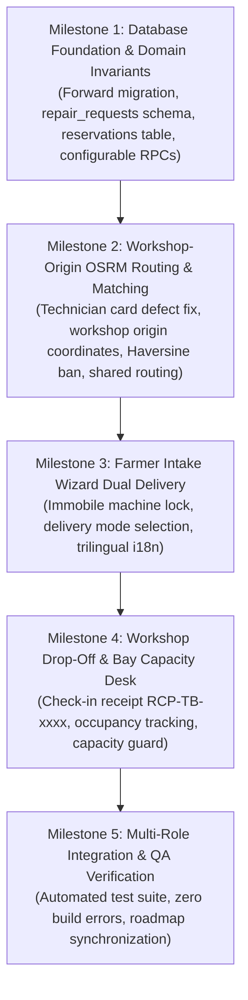

# Phase 14: Smart Dispatch & Emergency Response — Implementation Specification

> **Phase**: Phase 14 — Smart Dispatch & Emergency Response (Smart Dispatch & Workshop Drop-Off)  
> **Target Branch**: `phase-14`  
> **Status**: AUTHORITATIVE IMPLEMENTATION SPECIFICATION (Approved Architectural Baseline)  
> **Base Commit**: `f14c2e0` (`test(phase-13): complete integration and security QA`)  
> **Environment Targets**: Supabase Staging (`ubqgvhcfmrvnmrbllcom`) / Air-gapped Production (`hwdrypkvszwrcraujctw`)  
> **Author**: TerraByte Senior Technical Architect  
> **Date**: 2026-11-08  

---

## 1. Executive Summary & Approved Scope

Phase 14 of TerraByte coordinates **Smart Dispatch & Emergency Response** across the Vidarbha agricultural machinery repair network. Built on top of the verified physical workshop entity (`repair_facilities`), multi-technician membership governance (`facility_memberships`), and physical in-person KYC verified in Phase 13, Phase 14 delivers intelligent, road-network-accurate technician matching and dual service delivery workflows while strictly honoring worker privacy, physical capacity constraints, and data integrity.

### 1.1 Approved Core Capabilities
1. **Registered Workshop-Based Routing (ADR-001, ADR-005)**:
   - Dispatch origin coordinates are sourced authoritatively from the technician's registered workshop (`repair_facilities.latitude/longitude`).
   - **Strict Zero Continuous Live GPS Tracking**: Technicians are never subjected to background or real-time location pings. Worker privacy and battery/bandwidth constraints in rural Vidarbha are strictly protected.
   - Google Maps external navigation URLs (`https://www.google.com/maps/dir/...`) generated from registered workshop coordinates to farmer breakdown coordinates.
2. **Authoritative OSRM Road Distance Only & Strict Haversine Ban (ADR-005, TRD 5.3)**:
   - All driving distances and estimated durations are computed authoritatively via the Open Source Routing Machine (OSRM) using public road networks.
   - **Strict Haversine Ban**: Straight-line (crow-flies) calculations are **strictly prohibited** from UI display, candidate technician matching, and sorting algorithms.
   - **Graceful Outage Fallback**: If the OSRM server is unreachable, times out, or returns a non-OK status, the UI must render:  
     `"Road Distance Temporarily Unavailable"`  
     Under no circumstances shall the application fall back to Haversine in the UI or disqualify eligible technicians.
   - **Traffic Disclaimer**: Standard disclaimer displayed alongside driving durations:  
     *"Estimated standard driving duration. Real-time rural road and weather conditions may vary."*
3. **Technician Card Routing Defect Remediation & Shared Authoritative Routing**:
   - The legacy technician card displays hardcoded `0 km · ~45 min` due to reading static, unpopulated database default columns on `technician_profiles`.
   - Phase 14 establishes **one authoritative routing result** computed between the registered workshop origin and breakdown destination, shared consistently between candidate matching algorithms and UI technician cards.
   - Routing values are strictly **nullable** with explicit status enums (`AVAILABLE`, `EXTENDED`, `UNAVAILABLE`, `CALCULATING`).
   - Missing coordinates display `"Distance Unavailable"`; network failures display `"Road Distance Temporarily Unavailable"`. Zero fabricated `0 km` or `45 min` defaults. Zero stale ETAs or distances rendered after a routing failure.
4. **Dual Delivery Modes & Immobile Machinery Invariant (ADR-002, TRD 4.1 & 5.2)**:
   - **Flow A: Doorstep / On-Field Service**: Technician travels from registered workshop to farmer's field coordinates.
   - **Flow B: Workshop Drop-Off**: Farmer transports equipment to an approved workshop (`drop_off_approved = true`).
   - **Immobile Machine Decision Gate**: If `is_immobile = true` (machine completely stopped/inoperable), the system **locks service mode to Doorstep only**. Workshop Drop-Off is disabled in the intake wizard, and the farmer is advised not to attempt hazardous road towing.
5. **Workshop Bay Capacity, Reservation Lifecycle & Physical Occupancy (ADR-003, Approved Decisions 1–7)**:
   - Every facility has a configurable physical bay capacity (`max_equipment_capacity`).
   - Pre-arrival bookings create a separate temporary capacity reservation with an expiry and release lifecycle (`facility_bay_reservations`).
   - Default reservation expiry is **24 hours**, and expiry duration remains **configurable** via system parameters.
   - Farmers may renew an active reservation from their portal (limited to **one self-renewal extension** per reservation, subject to capacity).
   - Service Centre administrators may renew reservations with mandatory audit records (`renewal_notes`, `renewed_by`).
   - **Dual-Path Physical Check-in & Receipt Generation**:
     - **Active, Unexpired Reservation**: Verifies physical occupancy is strictly below `max_equipment_capacity`. If bays are open, it atomically transitions to `CLAIMED`, marks equipment drop-off, and generates an immutable custody receipt (`RCP-TB-YYYYMMDD-XXXX`). If physical bays are full due to facility capacity downsizing, check-in is deferred safely with original priority timestamp preserved (`DOWNSIZED_CAPACITY_HELD`), generating dispatcher alerts and assisted rerouting without false entry guarantees.
     - **Expired Reservation / Standby Arrival**: Evaluated under the facility row lock (`SELECT ... FOR UPDATE`). Permitted **only if** $\text{Physical Occupancy} + \text{Active Unexpired Reservations} < \text{max\_equipment\_capacity}$. Standby arrivals can **never** usurp or consume another farmer's active reservation. If capacity is unavailable, check-in is strictly rejected, audited in `repair_timeline`, and dispatcher-assisted rerouting or rebooking is offered.
   - **Strict Separation of Ticket Cancellation and Physical Occupancy**:
     - Ticket cancellation alone does **never** release physical workshop occupancy.
     - Equipment physically present inside workshop bays continues to consume physical capacity until an authorized physical removal/release is recorded via dedicated RPC `release_cancelled_workshop_equipment`.
     - Doorstep repairs are strictly excluded from workshop bay accounting via `delivery_mode = 'WORKSHOP_DROPOFF'`.
   - Expired reservations can **never** release or modify physically occupied equipment capacity.
   - Capacity reductions are permitted without evicting active repairs. New allocations are blocked while physical capacity is exhausted.
   - Zero emergency overrides beyond actual physical capacity. Service Centre dispatchers may prioritize and reroute requests.
6. **Road Distance Threshold & Extended Travel Classification (Approved Decisions 9–10)**:
   - Default road-distance matching threshold is **50 km**.
   - Road distance above 50 km is **informational only**, classified and displayed as *Extended Travel*.
   - Technicians beyond 50 km are **not** automatically disqualified.
   - Zero travel surcharges are introduced in Phase 14; existing manual/offline payment architecture is preserved intact.
7. **Trilingual Farmer Experience (ADR-006 Amendment)**:
   - 100% dictionary key parity across English (`en`), Hindi (`hi`), and Marathi (`mr`) for all new dispatch, delivery mode, immobile hazard, and capacity strings.

---

## 2. Preflight Audit & Approved Architectural Decisions Alignment

A thorough inspection of `.planning/ROADMAP.md`, `.planning/STATE.md`, `.planning/DECISIONS.md`, `.planning/TRD.md`, `.planning/TESTING.md`, Phase 13 Milestone reports, and `PHASE14_PREFLIGHT_REPORT.md` establishes the canonical architectural decisions:

| Feature / Area | Canonical Baseline | Final Approved Architectural Decision |
| :--- | :--- | :--- |
| **Phase Title** | `ROADMAP.md` uses *Smart Dispatch & Emergency Response*; `STATE.md` uses *Smart Dispatch & Workshop Drop-Off*. | Both titles designate the exact same Phase 14 scope. Official title: **Phase 14: Smart Dispatch & Emergency Response**. |
| **Reservation Expiry Duration** | Open question in preflight report. | **Approved Decision**: Default reservation expiry is **24 hours**, while remaining **configurable** via database parameters (`p_expiry_interval`). |
| **Farmer Reservation Renewal** | Open question in preflight report. | **Approved Decision**: Farmers may renew their active reservation from the portal, limited to **one self-renewal extension** per reservation, subject to live bay capacity and authorization checks. |
| **Admin Reservation Renewal** | Open question in preflight report. | **Approved Decision**: Service Centre administrators may renew reservations, with mandatory audit records (`renewal_notes`, `renewed_by`). |
| **Expired Reservation Check-in** | Open question in preflight report. | **Approved Decision**: Expired reservation (standby) arrivals may be accepted **only if** $\text{Physical Occupancy} + \text{Active Unexpired Reservations} < \text{max\_equipment\_capacity}$ under row lock. Must never consume another farmer's active reservation. Rejected arrivals log audit trail; dispatcher rerouting/rebooking offered. |
| **Occupancy Decoupling & Cancellation Invariant** | Critical architectural invariant. | **Approved Decision**: Expiration and ticket cancellation release reservation capacity only. Cancellation alone **never** frees physical occupancy. Cancelled drop-off machinery continues occupying bay capacity until authorized physical removal via dedicated RPC `release_cancelled_workshop_equipment`. Phase 13 completed-repair handover protections remain completely untouched. |
| **Extended Travel Policy** | Open question in preflight report. | **Approved Decision**: Road distance $> 50\text{ km}$ is **informational only**, displayed as *Extended Travel*. Candidates are not disqualified. Zero travel surcharges in Phase 14; offline payment preserved. |
| **Emergency Capacity Override** | Ambiguity in preflight report draft. | **Approved Decision**: Never permit emergency overrides beyond actual physical capacity. Dispatchers may prioritize and reroute, but physical bay capacity is a hard ceiling. |
| **Receipt Format** | `DECISIONS.md` Decision 7. | **Approved Decision**: Canonical format `RCP-TB-YYYYMMDD-XXXX`, generated server-side, uniquely, only after successful physical check-in. |
| **Capacity Downsizing & Reservation Priority** | `DECISIONS.md` Decision 10 & Approved Decisions. | **Approved Decision**: Permit capacity reduction without evicting existing repairs or active reservations. Block new allocations while committed $\ge$ max. Active reservations arriving at a downsized-full facility are deferred with original `reserved_at` priority intact (`DOWNSIZED_CAPACITY_HELD`), generating proactive dispatcher overcommitment alerts and assisted rerouting without false entry guarantees. |
| **Traffic Disclaimer** | `DECISIONS.md` Decision 18. | **Approved Decision**: Standard copy: *"Estimated standard driving duration. Real-time rural road and weather conditions may vary."* |

---

## 3. Root Cause Analysis: Technician Card Routing Defect

### 3.1 Empirical Defect Manifestation
On both the Farmer Repair Detail view (`/farmer/repair/$id`) and the Service Centre Dispatch view (`/admin/repair/$id`), technician cards currently render:
```text
0 km · ~45 min
4.9 · 42 repairs
```
While ratings (`4.9`) and jobs completed (`42 repairs`) function correctly, the distance is stuck at `0 km` and duration is stuck at `~45 min`.

### 3.2 Root Cause Findings
1. **Hardcoded Database Column Defaults**:
   - In `supabase/migrations/20260930000001_initial_schema.sql`, `technician_profiles` was created with static columns:
     ```sql
     distance_km NUMERIC(5, 1) NOT NULL DEFAULT 0.0,
     eta_minutes INTEGER NOT NULL DEFAULT 45,
     ```
   - In PostgreSQL, these static columns default to `0.0` and `45`. They were never updated dynamically based on the farmer's breakdown location.
2. **Missing Dynamic Routing Query in Discovery**:
   - In `src/lib/services/technicians.ts`, `getEligibleTechnicians` selects `distance_km` and `eta_minutes` directly from `technician_profiles` table:
     ```typescript
     const proximityScore = Math.max(0, 10 - (t.eta_minutes ?? 45) / 10);
     ```
   - It never queries OSRM between the technician's registered workshop location (`repair_facilities.latitude/longitude`) and the breakdown site (`repair_dispatch_locations` or coarse `tahsil` coordinates).
3. **Rigid Frontend Contract & Fallback Fabrications**:
   - In `src/lib/tb-store.ts`, the `Technician` interface enforces non-nullable primitives:
     ```typescript
     export interface Technician {
       distanceKm: number;
       etaMin: number;
       ...
     }
     ```
   - In `src/routes/farmer/repair/$id.tsx`, `formatTechCardData` forces defaults:
     ```typescript
     distanceKm: t.distance_km ?? 0,
     etaMin: t.eta_minutes ?? 45,
     ```
   - In `src/components/repair-parts.tsx`, `TechCard` renders:
     ```tsx
     <MapPin className="h-4 w-4" />
     {t.distanceKm} km · ~{t.etaMin} min
     ```
   - This guarantees that every technician card displays `0 km · ~45 min`.

### 3.3 Prescribed Solution & Authoritative Shared Routing Architecture
1. **Type Definition Update**: Update `Technician` in `src/lib/tb-store.ts` to enforce nullable metrics and explicit statuses:
   ```typescript
   export type TechnicianRoutingStatus = 'AVAILABLE' | 'EXTENDED' | 'UNAVAILABLE' | 'CALCULATING';

   export interface Technician {
     id: string;
     name: string;
     workshop: string;
     brands: string[];
     skills: string[];
     verified: boolean;
     distanceKm: number | null;
     etaMin: number | null;
     routingStatus: TechnicianRoutingStatus;
     available: boolean;
     rating: number | null;
     jobsDone: number;
     phone: string;
   }
   ```
2. **Single Authoritative Routing Source**:
   - When `getEligibleTechnicians` executes, it performs OSRM routing from the technician's registered workshop (`primary_facility_id` -> `repair_facilities.latitude/longitude`) to the repair destination (`repair_dispatch_locations` or coarse tahsil GPS).
   - The resulting metrics (`distanceKm`, `etaMin`, `routingStatus`) are embedded directly into `ScoredTechnicianMatch.technician`.
   - Both the candidate ranking algorithm and the UI rendering components (`TechCard`, `formatTechCardData`, `/admin/repair/$id`) consume this identical routing result. There are **zero disparate calculations**.
3. **Coordinate Validation & Missing Coordinate Handling**:
   - Origin Coordinates: Retrieved from `repair_facilities.latitude/longitude` via the technician's primary workshop membership.
   - Destination Coordinates: Retrieved from `repair_dispatch_locations` (exact farmer GPS) or fallback coarse `TAHSIL_COORDINATES[tahsil]`.
   - If either origin or destination coordinates are missing, out of range, or invalid:
     - Set `distanceKm = null`, `etaMin = null`, `routingStatus = 'UNAVAILABLE'`.
     - The OSRM API call is bypassed.
     - The UI renders: `"Distance Unavailable"`.
4. **Outage Handling & Stale Value Elimination**:
   - If OSRM times out, returns HTTP error, or network fails:
     - Set `distanceKm = null`, `etaMin = null`, `routingStatus = 'UNAVAILABLE'`.
     - Any previously cached or in-memory route estimate is explicitly cleared. **No stale ETA or distance is ever displayed alongside an outage**.
     - UI renders: `"Road Distance Temporarily Unavailable"`.
     - The technician remains eligible for assignment; proximity score defaults to neutral without disqualifying the technician.
5. **Haversine Ban**:
   - Straight-line Haversine math is strictly prohibited from candidate matching, sorting, and UI display. If road distance is unavailable, it remains unavailable.

---

## 4. Workshop Bay Capacity & Reservation Architecture

### 4.1 Capacity Accounting Model
Every physical workshop facility has a fixed capacity: `repair_facilities.max_equipment_capacity` (e.g. 4 bays).

A facility's total committed capacity is composed of:
$$\text{Total Committed Capacity} = \text{Physical Occupancy} + \text{Active Unexpired Reservations}$$

Where:
- **Physical Occupancy**: Count of machinery physically present inside the workshop bays:
  $$\text{repair\_requests.facility\_id} = \text{facility\_id} \land \text{repair\_requests.delivery\_mode} = \text{'WORKSHOP\_DROPOFF'} \land \text{dropped\_off\_at IS NOT NULL} \land \text{handover\_status} \ne \text{'RELEASED'}$$
- **Active Unexpired Reservations**: Count of valid, unexpired temporary drop-off reservations for machines currently in transit:
  $$\text{facility\_bay\_reservations.facility\_id} = \text{facility\_id} \land \text{status} = \text{'RESERVED'} \land \text{expires\_at} > \text{now()}$$

$$\text{Available Capacity} = \max(0, \text{max\_equipment\_capacity} - \text{Total Committed Capacity})$$

#### Strict Separation of Cancellation, Equipment Removal & Occupancy Release
To preserve physical safety and accurate bay scheduling, the architecture enforces a strict distinction between three separate concepts:
1. **Repair Lifecycle Cancellation**: An administrative or farmer decision that aborts the repair ticket, setting `repair_requests.status = 'CANCELLED'`. Ticket cancellation alone does **never** imply or prove that machinery has physically exited the workshop premises.
2. **Physical Equipment Removal / Pickup**: The physical real-world event where the farmer or designated towing operator arrives at the facility to retrieve the machinery.
3. **Physical Occupancy Release**: The authoritative database transition (`handover_status = 'RELEASED'`) executed by authorized workshop staff or admin that officially terminates physical custody and decrements physical bay occupancy.

A cancelled repair whose equipment remains at the facility **must continue consuming physical capacity**. Bay capacity is freed **only** when physical removal is officially verified and recorded. Furthermore, requiring `delivery_mode = 'WORKSHOP_DROPOFF'` ensures Doorstep / On-Field repairs can never accidentally consume workshop bay capacity.

### 4.2 Complete Reservation & Physical Occupancy Lifecycle State Machine

```mermaid
stateDiagram-v2
    [*] --> RESERVED: Farmer submits Workshop Drop-Off (facility_id bound, expires_at = now() + 24h)
    RESERVED --> CLAIMED: Path A: Active Check-in (Physical Occupancy < max_capacity)
    RESERVED --> RESERVED: Renewal (Farmer: max 1; Admin: auditable)
    RESERVED --> EXPIRED: now() > expires_at without arrival (Reservation slot freed)
    RESERVED --> RELEASED: Dispatcher reroutes ticket (Reservation slot freed)
    RESERVED --> CANCELLED: Pre-arrival ticket cancellation (Reservation slot freed)
    EXPIRED --> CLAIMED: Path B: Standby Check-in (Physical + Active Reservations < max_capacity)
    EXPIRED --> [*]: Standby Rejected (Capacity full -> Audit Logged -> Reroute / Rebook)
    CLAIMED --> COMPLETED: Repair completed & load tested
    COMPLETED --> RELEASED: Handover Authorized & Released (Phase 13 Flow -> Bay freed)
    CLAIMED --> CANCELLED_IN_BAY: Ticket cancelled post-arrival (Equipment remains in bay)
    CANCELLED_IN_BAY --> RELEASED: Authorized Physical Removal (release_cancelled_workshop_equipment -> Bay freed)
    RELEASED --> [*]: Bay capacity released
```



#### Detailed State Transitions:
1. **Creation (`RESERVED`)**:
   - Farmer completes breakdown wizard with `delivery_mode = 'WORKSHOP_DROPOFF'` and chooses an approved facility (`drop_off_approved = true`).
   - RPC `reserve_workshop_bay` executes with row-level lock (`SELECT ... FOR UPDATE ON public.repair_facilities`).
   - Verifies:
     $$\text{Total Committed Capacity} < \text{max\_equipment\_capacity}$$
   - Inserts row into `public.facility_bay_reservations`:
     - `status = 'RESERVED'`
     - `expires_at = now() + p_expiry_interval` (configurable; default: 24 hours)
     - `renewal_count = 0`
   - Binds `repair_requests.facility_id`.

2. **Physical Arrival & Check-in (`CLAIMED`) — Two Distinct Paths & RPC Response Contract**:
   When equipment physically arrives at the workshop, workshop staff or Service Centre admin initiates check-in via `execute_workshop_dropoff_checkin`. The RPC acquires a row lock on `repair_facilities` (`SELECT ... FOR UPDATE`) and executes one of two strictly differentiated paths:

   - **Path A: Active, Unexpired Reservation Arrival**:
     - Precondition: `status = 'RESERVED'` and `now() <= expires_at`.
     - Capacity Check: Verifies physical bay capacity under row lock:
       - **Normal Case ($\text{Physical Occupancy} < \text{max\_equipment\_capacity}$)**:
         - Physical bay is open.
         - Atomically updates:
           - `repair_requests.dropped_off_at = now()`
           - `repair_requests.dropped_off_by = current_profile_id()`
           - `repair_requests.drop_off_receipt_number = v_receipt_number` (`RCP-TB-YYYYMMDD-XXXX`)
           - `facility_bay_reservations.status = 'CLAIMED'`, `claimed_at = now()`
         - Returns structured success response:
           ```json
           {
             "success": true,
             "receipt_number": "RCP-TB-20261108-0042",
             "dropped_off_at": "2026-11-08T10:30:00Z"
           }
           ```
         - Idempotent: Repeated execution returns existing receipt without duplicate writes.
       - **Downsized Overcommitment Edge Case ($\text{Physical Occupancy} \ge \text{max\_equipment\_capacity}$)**:
         - Occurs *only* if the workshop owner reduced `max_equipment_capacity` after this reservation was booked, and all reduced physical bays are currently occupied by active repairs.
         - **Physical Safety Invariant**: Physical bay capacity is a hard ceiling and can **never** be exceeded. The arriving machine cannot physically enter a full bay.
         - **Reservation Preservation**: The reservation is **never silently evicted, reordered, or cancelled**. It remains in `'RESERVED'` status with its original `reserved_at` priority timestamp intact.
         - **Expiry Rule**: Its existing expiry clock remains in effect unless an extension is explicitly authorized and audited by a Service Centre dispatcher.
         - **Timeline Audit & Structured Business Rejection**: Inserts a mandatory event into `public.repair_timeline` and returns a structured deferral result without raising an unhandled DB exception (ensuring the audit record is committed):
           ```json
           {
             "success": false,
             "code": "DOWNSIZED_CAPACITY_HELD",
             "message": "Physical bays are currently full due to workshop capacity reduction. Reservation is held with original priority.",
             "reroute_eligible": true
           }
           ```
         - UI renders the **Downsized Overcommitment Desk** offering the farmer clear explanations and one-click dispatcher-assisted priority rerouting or priority queue placement for the next completing repair bay.

   - **Path B: Expired Reservation / Standby Arrival**:
     - Precondition: `status = 'EXPIRED'` or `now() > expires_at`.
     - Capacity Check: Evaluates under the facility row lock against **Total Committed Capacity**:
       $$\text{Physical Occupancy} + \text{Active Unexpired Reservations} < \text{max\_equipment\_capacity}$$
     - Invariant: A standby arrival can **never** usurp or consume another farmer's active, unexpired reservation.
     - **If Committed Capacity is Available**:
       - The standby arrival is accepted into open uncommitted bay capacity.
       - Atomically transitions reservation to `'CLAIMED'`, sets `dropped_off_at = now()`, `dropped_off_by = current_profile_id()`, generates unique `RCP-TB-YYYYMMDD-XXXX`.
       - Inserts audit record in `public.repair_timeline`:
         - `repair_request_id = p_repair_request_id`
         - `status = 'REQUESTED'`
         - `note = 'Standby arrival accepted: Equipment checked in under available workshop bay capacity.'`
         - `created_by_role = current_user_role()`, `created_by_id = current_profile_id()`
       - Returns `{ success: true, receipt_number: ..., dropped_off_at: ... }`.
     - **If Committed Capacity is Exhausted**:
       - Check-in is **strictly rejected**. Equipment cannot enter the bay.
       - Reservation remains in `'EXPIRED'` status.
       - Inserts mandatory audit record in `public.repair_timeline`:
         - `repair_request_id = p_repair_request_id`
         - `status = 'REQUESTED'`
         - `note = 'Standby check-in rejected: Workshop at full committed capacity (Physical Occupancy + Active Reservations exhausted). Dispatcher reroute offered.'`
         - `created_by_role = current_user_role()`, `created_by_id = current_profile_id()`
       - Returns structured business rejection without raising an unhandled DB exception (so the audit record commits):
         ```json
         {
           "success": false,
           "code": "CAPACITY_EXHAUSTED",
           "message": "Workshop is at full committed capacity. Standby check-in rejected.",
           "reroute_eligible": true
         }
         ```
       - UI displays high-visibility rejection alert with one-click dispatcher reroute action to adjacent facilities with open capacity.

   - **RPC Architectural Error-Boundary Invariant**:
     - **Expected Business-Level Rejections** (`CAPACITY_EXHAUSTED`, `DOWNSIZED_CAPACITY_HELD`): Return structured JSON results (`{ success: false, code: ... }`) while successfully committing the `repair_timeline` audit record.
     - **Security, Authentication & Integrity Violations**:
       - Unauthorized caller (not admin or affiliated workshop member) $\rightarrow$ `RAISE EXCEPTION 'UNAUTHORIZED' USING ERRCODE = '42501'`.
       - Invalid delivery mode (`delivery_mode != 'WORKSHOP_DROPOFF'`) $\rightarrow$ `RAISE EXCEPTION 'INVALID_DELIVERY_MODE' USING ERRCODE = '22000'`.
       - Non-existent repair request or facility $\rightarrow$ `RAISE EXCEPTION 'NOT_FOUND' USING ERRCODE = '02000'`.
       - Attempting to check in an already released or completed repair $\rightarrow$ `RAISE EXCEPTION 'INVALID_STATE' USING ERRCODE = '22000'`.
       - All security and schema invariant failures **must fail closed and abort the transaction**. Security and authorization errors must **never** be masked or swallowed as ordinary capacity rejections.

3. **Expiration (`EXPIRED`)**:
   - If equipment is not delivered before `expires_at`, the reservation evaluates to `EXPIRED`.
   - The reservation automatically ceases to count towards `Total Committed Capacity`, freeing the capacity slot for other farmers in the district.
   - **Non-Interference Invariant**: Expired reservations can **never** release or modify physically occupied equipment capacity. Physical occupancy depends strictly on `repair_requests.delivery_mode = 'WORKSHOP_DROPOFF' AND dropped_off_at IS NOT NULL AND handover_status != 'RELEASED'`, completely decoupled from reservation state.

4. **Renewal (Farmer Self-Renewal vs Administrative Renewal)**:
   - **Farmer Self-Renewal**: Farmers can renew their active reservation from the Farmer Portal, subject to:
     - Must be in active `'RESERVED'` status (`expires_at > now()`).
     - Limit: **maximum one extension per reservation** (`renewal_count < 1`).
     - Live capacity check: requires `Available Capacity > 0` at renewal time.
   - **Administrative Renewal**: Service Centre dispatchers may renew reservations:
     - Not restricted by the one-extension limit.
     - Mandatory audit records required: `renewed_by UUID REFERENCES public.profiles(id)` and `renewal_notes TEXT`.
     - Verified with row-level lock on `repair_facilities`.

5. **Release & Rerouting (`RELEASED`)**:
   - If a Service Centre dispatcher reassigns the ticket to another facility, RPC `release_workshop_bay_reservation` marks the previous reservation as `'RELEASED'`, freeing capacity at the former facility, and calls `reserve_workshop_bay` at the destination facility. All rerouting actions log dispatcher identity and timestamp in `repair_timeline`.

6. **Cancellation (`CANCELLED`) & Physical Equipment Removal Lifecycle**:
   - **Pre-Arrival Cancellation**: If the repair ticket is cancelled before physical equipment delivery (`dropped_off_at IS NULL`), the reservation transitions to `'CANCELLED'`, immediately releasing the reservation hold.
   - **Post-Arrival Cancellation (Equipment In Bay)**:
     - If a repair is cancelled after equipment has been checked in (`dropped_off_at IS NOT NULL`):
       - Repair ticket `status` transitions to `'CANCELLED'`.
       - `handover_status` remains `'PENDING'`.
       - **Equipment continues consuming physical bay capacity**: Because the tractor physically remains on the workshop floor, it is NOT removed from physical occupancy.
       - Inserts audit record in `public.repair_timeline`:
         `"Repair cancelled after equipment drop-off. Equipment remains physically present in workshop bay awaiting farmer collection."`
     - **Authorized Physical Equipment Removal / Release**:
       - When the farmer or towing contractor arrives to collect the cancelled machinery, authorized workshop personnel (`OWNER`, `MANAGER`, or active `TECHNICIAN` of the facility) or a Service Centre admin executes dedicated Phase 14 RPC:
         `public.release_cancelled_workshop_equipment(p_repair_request_id UUID, p_notes TEXT)`
       - **RPC Precondition Checks**:
         1. `delivery_mode = 'WORKSHOP_DROPOFF'`
         2. `dropped_off_at IS NOT NULL`
         3. `status = 'CANCELLED'`
         4. `handover_status = 'PENDING'` (fails closed if already released)
         5. Caller authorization: active facility member or admin
       - **Atomic Updates**:
         - `handover_status = 'RELEASED'`
         - `handover_released_at = pg_catalog.now()`
         - `handover_released_by = public.current_profile_id()`
         - `handover_notes = coalesce(handover_notes || E'\nCancelled Equipment Retrieval: ' || p_notes, p_notes)`
       - **Mandatory Audit Record**: Inserts into `public.repair_timeline`:
         - `status = 'CANCELLED'`
         - `note = 'Equipment physically removed and released to farmer following cancellation: ' || p_notes`
         - `created_by_role = public.current_user_role()`, `created_by_id = public.current_profile_id()`
       - **Capacity Decrement & Authoritative Release**:
         - Transitioning `handover_status` to `'RELEASED'` immediately terminates physical occupancy, freeing the workshop bay.
         - Staff/admin confirmation via this RPC is **authoritative** for freeing the physical bay.
         - Farmer collection confirmation may optionally occur afterward through the existing Phase 13 workflow (`public.confirm_farmer_equipment_collection`), which already requires `handover_status = 'RELEASED'`.
         - Requiring prior farmer in-app confirmation before releasing the bay is strictly prohibited, as lack of connectivity or delay by the farmer would leave the physical bay blocked indefinitely.
       - **Strict Non-Bypass of Phase 13 Protections**:
         - Phase 13's completed-repair handover pipeline (`public.authorize_equipment_handover` and `public.execute_equipment_handover_release`) remains strictly guarded for `status = 'COMPLETED'` repairs requiring load test sign-off, itemized quote approval, parts clearance, and offline payment clearance.
         - `release_cancelled_workshop_equipment` explicitly asserts `status = 'CANCELLED'`.
         - Completed repairs **cannot** invoke this RPC to bypass quality, quote, or payment gates.
         - Cancelled repairs **cannot** invoke Phase 13 handover RPCs.
         - Both lifecycles are completely segregated and fail closed.

### 4.3 Policy on Unarrived Equipment & Expired Reservation Check-in
When a farmer logs a drop-off breakdown but does not arrive before the reservation expires:
1. **Reservation Status**: Evaluates to `EXPIRED`. The reserved bay slot is immediately released and returned to the district capacity pool.
2. **Ticket Status**: The repair ticket remains active in `REQUESTED` status; it is **not** deleted or cancelled.
3. **Farmer Self-Service Options**:
   - **Re-book / Renew**: Request a new reservation at the same workshop (if bays are available) or select another approved workshop.
   - **Switch to Doorstep**: Farmer can toggle their ticket to `delivery_mode = 'DOORSTEP'` to request on-field service.
4. **Physical Arrival with Expired Reservation Policy (Standby Arrival)**:
   - If the farmer physically arrives at the workshop after their reservation has expired:
   - **Check-in Permitted ONLY IF Total Committed Capacity has Open Room**:
     $$\text{Physical Occupancy} + \text{Active Unexpired Reservations} < \text{max\_equipment\_capacity}$$
   - **If Committed Capacity is Full**: Check-in is **strictly rejected**. The machine cannot enter the physical bay. The system logs the rejection in `repair_timeline`, returns a structured `{ success: false, code: 'CAPACITY_EXHAUSTED', message: 'Workshop is at full committed capacity. Standby check-in rejected.', reroute_eligible: true }` result, and staff/dispatchers immediately initiate rerouting to an adjacent workshop with open bays or schedule a re-booking.

### 4.4 Capacity Reduction Invariant & Reservation Priority Policy (Approved Decisions 5 & 6)

#### 4.4.1 Capacity Reduction Invariant
- **Non-Eviction Invariant**: Capacity reduction **never** evicts, cancels, or interrupts existing active repairs, nor does it silently cancel or evict active reservations.
- **Metadata Update**: When a workshop owner reduces `max_equipment_capacity` (e.g. from 4 to 2 bays while 2 repairs are in bay and 2 active reservations exist):
  - The facility metadata update succeeds.
  - The system recalculates $\text{Total Committed Capacity } (4) \ge \text{new\_max\_capacity } (2)$.
  - Available capacity evaluates to $0$.
  - The workshop is badged *"At Capacity"*.
  - New reservation bookings and standby drop-off check-ins are strictly blocked.
- **Proactive Dispatcher Overcommitment Alert**:
  - If downsizing causes $\text{Total Committed Capacity} > \text{new\_max\_equipment\_capacity}$, the system immediately raises a high-priority alert on the Service Centre Dispatcher Dashboard:  
    *"Facility Capacity Reduced Below Committed Allocations: X reservations at physical risk."*
  - Dispatchers proactively contact unarrived reservation holders to offer voluntary priority rerouting to adjacent facilities before farmers travel.
- **Deferred Check-in on Overcommitted Arrival**:
  - If an active reservation holder arrives at the workshop while physical occupancy is already at the reduced maximum ($\text{Physical Occupancy} \ge \text{new\_max}$):
    - Physical entry must be deferred; physical bay capacity can **never** be exceeded.
    - The reservation remains in `'RESERVED'` status (never changed to `'CLAIMED'`, never cancelled).
    - The reservation remains subject to its existing expiry rules unless an extension is explicitly authorized and audited.
    - RPC returns structured business result `{ success: false, code: 'DOWNSIZED_CAPACITY_HELD', message: 'Physical bays are currently full due to workshop capacity reduction. Reservation is held with original priority.', reroute_eligible: true }` with timeline audit.
    - Farmer receives a clear explanation in the UI and priority dispatcher-assisted rerouting.
- **No False Guarantees**: The application, farmer portal, and notifications must never promise or imply guaranteed physical entry where the facility's reduced capacity makes entry physically impossible.

#### 4.4.2 Reservation Priority Policy (FIFO by Original Timestamp)
1. **Original Timestamp Preservation**:
   - Every reservation is stamped with an immutable `reserved_at` (and `created_at`) timestamp upon booking.
   - Earlier active reservations hold strictly higher priority for bay allocation and dispatcher assistance.
2. **Deterministic Queue Servicing**:
   - If physical bays become temporarily constrained due to facility downsizing, reservation holders arriving for physical check-in are serviced strictly in order of their original reservation timestamp (`reserved_at` FIFO) as bays free up upon repair completions.
   - The system **never** silently reorders, cancels, or extends reservations.
3. **Rerouting Priority Preservation**:
   - When a dispatcher reroutes a reservation from a downsized or overcommitted facility to an adjacent facility, the original booking timestamp is preserved in audit metadata (`priority_original_reserved_at` logged in `repair_timeline`), ensuring the farmer retains their original district queue standing.
4. **Mandatory Auditability**:
   - Every priority assignment, queue deferral, downsized alert, and dispatcher reroute must generate an immutable audit record in `public.repair_timeline`.

### 4.5 Zero Emergency Overrides Beyond Physical Capacity (Approved Decisions 7 & 8)
- Physical bay capacity is an absolute physical constraint.
- Emergency override flags that permit bookings beyond physical capacity are **strictly banned**.
- Service Centre dispatchers can manage peak seasonal surges by prioritizing active repairs and rerouting tickets across adjacent district facilities.

### 4.6 Extended Travel Classification (Approved Decisions 9 & 10)
- Road distance above 50 km is **informational only**.
- Displayed prominently in the UI as *Extended Travel*.
- Does not automatically disqualify eligible technicians.
- Zero travel surcharges are introduced in Phase 14; the existing manual/offline payment architecture (`record_offline_payment_clearance`) is preserved intact.

---

## 5. Security, Authorization & Database Invariants

1. **Authoritative Caller Identification**:
   - All Phase 14 RPCs and RLS policies resolve caller identity strictly via `public.current_profile_id()` and role via `public.current_user_role()`.
   - Never assume `profiles.id = auth.uid()` (strictly maintaining Phase 10 profile separation architecture).
2. **Discretionary Access Control (DAC) Column Hardening**:
   - Direct client `UPDATE` on `drop_off_receipt_number`, `dropped_off_at`, `dropped_off_by`, and `facility_id` on `public.repair_requests` is revoked from `authenticated`.
   - Mutations to check-in state must occur exclusively through authorized `SECURITY DEFINER` RPCs.
3. **Anti-Tamper & Concurrency Guards**:
   - `execute_workshop_dropoff_checkin`, `reserve_workshop_bay`, `renew_workshop_bay_reservation`, and `release_cancelled_workshop_equipment` execute with row-level locks (`SELECT ... FOR UPDATE`) on `repair_facilities` to eliminate race conditions during concurrent bookings and releases.
   - Check-in RPC is idempotent: if called on an already checked-in repair, it returns the existing receipt and timestamp without creating duplicates.
4. **Hardened Search Paths**:
   - Every `SECURITY DEFINER` function explicitly declares `SET search_path = ''` with fully schema-qualified identifiers (`public.repair_requests`, `pg_catalog.now()`, etc.).
   - Explicit execution privilege control:
     ```sql
     REVOKE ALL ON FUNCTION public.reserve_workshop_bay FROM PUBLIC;
     REVOKE EXECUTE ON FUNCTION public.reserve_workshop_bay FROM anon;
     GRANT EXECUTE ON FUNCTION public.reserve_workshop_bay TO authenticated;

     REVOKE ALL ON FUNCTION public.release_cancelled_workshop_equipment FROM PUBLIC;
     REVOKE EXECUTE ON FUNCTION public.release_cancelled_workshop_equipment FROM anon;
     GRANT EXECUTE ON FUNCTION public.release_cancelled_workshop_equipment TO authenticated;
     ```
5. **Database CHECK Constraints**:
   - Enforce immobility gate at database level:
     ```sql
     CONSTRAINT check_immobile_delivery_mode CHECK (
       NOT (is_immobile = TRUE AND delivery_mode = 'WORKSHOP_DROPOFF')
     )
     ```
   - Enforce delivery mode enum:
     ```sql
     CONSTRAINT check_delivery_mode CHECK (
       delivery_mode IN ('DOORSTEP', 'WORKSHOP_DROPOFF')
     )
     ```
   - Enforce non-negative renewal counts:
     ```sql
     CONSTRAINT check_renewal_count CHECK (renewal_count >= 0)
     ```
6. **Role Authorization Matrix for Phase 14 Operations**:

| Operation | Farmer | Workshop Member / Manager | Service Centre Admin |
| :--- | :---: | :---: | :---: |
| Select Delivery Mode (Doorstep vs Drop-Off) | Allowed (Own ticket) | Denied | Allowed |
| Reserve Workshop Bay | Allowed (Own ticket) | Denied | Allowed |
| Farmer Self-Renewal (Max 1) | Allowed (Own ticket, active) | Denied | Allowed |
| Admin Renewal (With audit notes) | Denied | Denied | Allowed |
| Cancel Reservation | Allowed (Own ticket) | Denied | Allowed |
| Execute Physical Arrival Check-in | **Denied** | Allowed (Affiliated facility) | Allowed (Any facility) |
| Execute Cancelled Equipment Physical Release | **Denied** | Allowed (Affiliated facility) | Allowed (Any facility) |
| Reroute Drop-Off Ticket | Denied | Denied | Allowed |
| Update Facility Bay Capacity | Denied | Allowed (`OWNER` only) | Allowed |

7. **Mandatory Audit Requirements (Auditability Invariants)**:
   Every lifecycle transition must produce an immutable audit trail in `public.repair_timeline` and related tables:
   - **Active Reservation Arrival Deferred (Downsized Capacity)**: Mandatory entry in `public.repair_timeline` when an active reservation holder arrives at a facility where physical bays are full due to downsizing, recording arrival deferral, confirmation of original `reserved_at` priority preservation, and offering priority queue hold or dispatcher rerouting.
   - **Rejected Expired-Reservation Arrival**: Mandatory entry in `public.repair_timeline` recording ticket ID, facility ID, rejection reason (capacity full: $\text{Physical} + \text{Active Reservations} \ge \text{max}$), caller profile, and timestamp.
   - **Cancelled Repair with Equipment Still In Bay**: Mandatory entry in `public.repair_timeline` when ticket cancellation occurs with `dropped_off_at IS NOT NULL`, documenting that equipment remains physically on site and continues consuming bay capacity.
   - **Authorized Physical Equipment Removal / Release**: Mandatory entry in `public.repair_timeline` generated atomically by `release_cancelled_workshop_equipment`, recording releasing actor, notes, timestamp, and confirming bay capacity release.
   - **Dispatcher Rerouting / Rebooking**: Mandatory entry in `public.repair_timeline` documenting origin facility, destination facility, old reservation cancellation, new reservation binding, original priority timestamp carryover (`priority_original_reserved_at`), and dispatcher ID.

---

## 6. Milestone Structure & Detailed Implementation Plan



---

### Milestone 1: Database Foundation & Domain Invariants

#### 1. Objective
Author and locally verify forward database migration `supabase/migrations/20261108100000_phase14_smart_dispatch_and_dropoff.sql`, introducing Phase 14 columns, constraints, the capacity reservation table with configurable expiry, renewal controls, and hardened `SECURITY DEFINER` RPCs.

#### 2. Exact Files Expected to Change
- `supabase/migrations/20261108100000_phase14_smart_dispatch_and_dropoff.sql` *(NEW forward migration)*
- `src/integrations/supabase/types.ts` *(UPDATE: Phase 14 database schema and RPC types)*
- `tests/phase-14-db-invariants.test.mjs` *(NEW: database invariants and RPC contract tests)*

#### 3. Database Changes (Forward Migration Only)
```sql
-- Phase 14 Forward Migration: Smart Dispatch, Delivery Modes & Workshop Reservations
-- File: supabase/migrations/20261108100000_phase14_smart_dispatch_and_dropoff.sql

-- 1. Extend repair_requests
ALTER TABLE public.repair_requests 
  ADD COLUMN IF NOT EXISTS delivery_mode TEXT NOT NULL DEFAULT 'DOORSTEP',
  ADD COLUMN IF NOT EXISTS is_immobile BOOLEAN NOT NULL DEFAULT FALSE,
  ADD COLUMN IF NOT EXISTS drop_off_receipt_number TEXT,
  ADD COLUMN IF NOT EXISTS dropped_off_at TIMESTAMPTZ,
  ADD COLUMN IF NOT EXISTS dropped_off_by UUID REFERENCES public.profiles(id);

-- Enforce valid delivery modes
DO $$ BEGIN
  IF NOT EXISTS (SELECT 1 FROM pg_constraint WHERE conname = 'check_repair_delivery_mode') THEN
    ALTER TABLE public.repair_requests
      ADD CONSTRAINT check_repair_delivery_mode 
      CHECK (delivery_mode IN ('DOORSTEP', 'WORKSHOP_DROPOFF'));
  END IF;
END $$;

-- Enforce immobile machinery lock
DO $$ BEGIN
  IF NOT EXISTS (SELECT 1 FROM pg_constraint WHERE conname = 'check_immobile_delivery_mode') THEN
    ALTER TABLE public.repair_requests
      ADD CONSTRAINT check_immobile_delivery_mode 
      CHECK (NOT (is_immobile = TRUE AND delivery_mode = 'WORKSHOP_DROPOFF'));
  END IF;
END $$;

-- 2. Create facility_bay_reservations
CREATE TABLE IF NOT EXISTS public.facility_bay_reservations (
  id UUID PRIMARY KEY DEFAULT gen_random_uuid(),
  facility_id UUID NOT NULL REFERENCES public.repair_facilities(id) ON DELETE CASCADE,
  repair_request_id UUID NOT NULL UNIQUE REFERENCES public.repair_requests(id) ON DELETE CASCADE,
  farmer_profile_id UUID NOT NULL REFERENCES public.profiles(id),
  status TEXT NOT NULL DEFAULT 'RESERVED',
  reserved_at TIMESTAMPTZ NOT NULL DEFAULT pg_catalog.now(),
  expires_at TIMESTAMPTZ NOT NULL,
  renewal_count INTEGER NOT NULL DEFAULT 0,
  renewed_at TIMESTAMPTZ,
  renewed_by UUID REFERENCES public.profiles(id),
  renewal_notes TEXT,
  claimed_at TIMESTAMPTZ,
  released_at TIMESTAMPTZ,
  created_at TIMESTAMPTZ NOT NULL DEFAULT pg_catalog.now(),
  updated_at TIMESTAMPTZ NOT NULL DEFAULT pg_catalog.now(),
  CONSTRAINT check_reservation_status CHECK (
    status IN ('RESERVED', 'CLAIMED', 'EXPIRED', 'RELEASED', 'CANCELLED')
  ),
  CONSTRAINT check_renewal_count CHECK (renewal_count >= 0)
);

CREATE INDEX IF NOT EXISTS idx_facility_bay_reservations_active
  ON public.facility_bay_reservations (facility_id, status)
  WHERE status = 'RESERVED';

-- Enable RLS
ALTER TABLE public.facility_bay_reservations ENABLE ROW LEVEL SECURITY;

-- 3. Hardened RPCs
-- public.get_facility_capacity_breakdown(p_facility_id UUID)
-- public.reserve_workshop_bay(p_repair_request_id UUID, p_facility_id UUID, p_expiry_interval INTERVAL DEFAULT INTERVAL '24 hours')
-- public.renew_workshop_bay_reservation(p_reservation_id UUID, p_extension_interval INTERVAL DEFAULT INTERVAL '24 hours', p_notes TEXT DEFAULT NULL)
-- public.release_workshop_bay_reservation(p_repair_request_id UUID)
-- public.execute_workshop_dropoff_checkin(p_repair_request_id UUID, p_notes TEXT)
-- public.release_cancelled_workshop_equipment(p_repair_request_id UUID, p_notes TEXT)
```

#### 4. Dependencies
Phase 13 migration `20261106160000_phase13_database_foundations.sql`.

#### 5. Implementation Sequence
1. Draft forward migration with search path hardening (`SET search_path = ''`).
2. Implement `get_facility_capacity_breakdown` computing physical occupancy (`delivery_mode = 'WORKSHOP_DROPOFF'`, `dropped_off_at IS NOT NULL`, `handover_status != 'RELEASED'`) and active unexpired reservations.
3. Implement `reserve_workshop_bay` accepting configurable expiry interval (`p_expiry_interval INTERVAL DEFAULT INTERVAL '24 hours'`) with `FOR UPDATE` lock.
4. Implement `renew_workshop_bay_reservation` enforcing max 1 farmer self-renewal or requiring admin notes.
5. Implement `execute_workshop_dropoff_checkin` with dual-path logic and explicit return contract under row lock:
   - Path A (Active reservation): verifies $\text{Physical} < \text{max\_capacity}$; if open, transitions reservation to `'CLAIMED'`, generates `RCP-TB-YYYYMMDD-XXXX`, and returns `{ success: true, receipt_number: ... }`; if physical bays are full due to downsizing, defers entry, leaves reservation as `'RESERVED'` with original priority timestamp, inserts timeline audit, and returns structured `{ success: false, code: 'DOWNSIZED_CAPACITY_HELD', ... }`.
   - Path B (Expired reservation / standby): verifies $\text{Physical} + \text{Active Reservations} < \text{max\_capacity}$; if open, transitions `'EXPIRED' \rightarrow 'CLAIMED'` and returns `{ success: true, receipt_number: ... }`; if full, strictly rejects, inserts timeline audit, and returns structured `{ success: false, code: 'CAPACITY_EXHAUSTED', ... }`.
   - Contract Boundary Invariant: Business-level capacity rejections/deferrals return structured JSON without rolling back timeline audits. Security, authorization, or schema invariant failures fail closed by raising PostgreSQL exceptions.
6. Implement `release_cancelled_workshop_equipment` allowing authorized facility staff or admin to record physical equipment removal for cancelled drop-off tickets, setting `handover_status = 'RELEASED'`, logging to `repair_timeline`, and freeing bay capacity without touching Phase 13 completed-repair handover logic.
7. Apply RLS policies on `facility_bay_reservations` and DAC privileges.
8. Author `tests/phase-14-db-invariants.test.mjs` verifying schema, constraints, and RPC behaviors.
9. Update `src/integrations/supabase/types.ts` with explicit TypeScript response types for check-in and cancelled release RPCs.

#### 6. Security Considerations
- Caller verified via `public.current_profile_id()`.
- Direct `UPDATE` on drop-off columns revoked from `authenticated`.
- Concurrency locks on `repair_facilities` prevent overbooking race conditions.
- Standby check-in, downsized deferral, and cancelled equipment release generate immutable `repair_timeline` audit events.
- Security and permission violations raise PostgreSQL exceptions and abort transactions; only business-level capacity decisions return structured JSON.

#### 7. Automated Tests
`tests/phase-14-db-invariants.test.mjs`:
- `TEST-14-DB01`: Schema columns exist on `repair_requests` with valid types.
- `TEST-14-DB02`: Constraint rejects `is_immobile = true` with `WORKSHOP_DROPOFF`.
- `TEST-14-DB03`: `facility_bay_reservations` table and status check constraint.
- `TEST-14-DB04`: Capacity breakdown correctly accounts for physical vs reserved slots (`delivery_mode = 'WORKSHOP_DROPOFF'`).
- `TEST-14-DB05`: Configurable expiry interval is respected (default 24h).
- `TEST-14-DB06`: Farmer renewal limited to 1 extension; admin renewal requires audit notes.
- `TEST-14-DB07`: Check-in RPC generates unique `RCP-TB-YYYYMMDD-XXXX` receipt.
- `TEST-14-DB08`: Check-in RPC verifies physical capacity for active reservations (admitting if open, returning `DOWNSIZED_CAPACITY_HELD` if downsized-full) and committed capacity for standby arrivals.
- `TEST-14-DB09`: Expired reservations do not decrement physical occupancy.
- `TEST-14-DB10`: Cancelled drop-off repairs with `dropped_off_at IS NOT NULL` continue consuming physical occupancy until `release_cancelled_workshop_equipment` transitions `handover_status` to `'RELEASED'`.
- `TEST-14-DB11`: Standby check-in rejection and downsized deferral insert mandatory audit records in `repair_timeline` and return structured JSON, while unauthorized callers raise exceptions.
- `TEST-14-DB12`: Downsizing alert triggered when committed capacity exceeds new max; original `reserved_at` timestamp priority preserved.

#### 8. Acceptance Criteria
- **AC-14-M1-01**: Migration executes cleanly in local PostgreSQL with zero syntax errors.
- **AC-14-M1-02**: Database constraint rejects immobile workshop drop-offs.
- **AC-14-M1-03**: Capacity RPC computes active physical and reserved occupancy, retaining occupancy for cancelled repairs awaiting physical removal.
- **AC-14-M1-04**: Check-in RPC enforces physical capacity ceiling for active reservations, committed capacity for standby arrivals, returns structured business rejection without rolling back audit, and fails closed with exceptions on security violations.
- **AC-14-M1-05**: `release_cancelled_workshop_equipment` safely releases physical bay occupancy for cancelled drop-offs with complete audit trail.

#### 9. Completion Evidence
All tests in `tests/phase-14-db-invariants.test.mjs` pass.

#### 10. Commit Checkpoint
`feat(phase-14): implement database foundations, reservations and checkin rpc`

---

### Milestone 2: Workshop-Origin OSRM Routing & Matching Integration

#### 1. Objective
Remediate the technician card routing defect (`0 km · ~45 min`), establish one authoritative routing result shared between matching and technician cards, integrate OSRM road distance and duration matching from registered workshop origin coordinates, eliminate Haversine calculations, enforce graceful outage fallback without stale data, and render the approved traffic disclaimer.

#### 2. Exact Files Expected to Change
- `src/lib/tb-store.ts` *(UPDATE: allow nullable distance/ETA on `Technician`, add `routingStatus`)*
- `src/lib/services/routing.ts` *(UPDATE: add routing status enums, outage constants, disclaimer constant)*
- `src/lib/services/routing-handler.ts` *(UPDATE: ensure consistency with registered workshop origin)*
- `src/lib/services/technicians.ts` *(UPDATE: refactor `getEligibleTechnicians` to calculate road distance from `repair_facilities.latitude/longitude`, rank by actual duration, handle OSRM outage gracefully, prevent stale values)*
- `src/components/repair-parts.tsx` *(UPDATE: refactor `TechCard` to render actual road distance, outage fallback, missing coordinates state, and extended travel tag)*
- `src/components/route-estimate-card.tsx` *(UPDATE: render registered workshop origin and approved traffic disclaimer)*
- `src/routes/farmer/repair/$id.tsx` *(UPDATE: `formatTechCardData` preserves computed OSRM routing)*
- `src/routes/admin/repair/$id.tsx` *(UPDATE: candidate list renders real OSRM road distance and ETA)*
- `tests/phase-14-routing-and-matching.test.mjs` *(NEW: test suite for routing defect and matching)*

#### 3. Database Changes
None. Queries existing `repair_facilities.latitude/longitude` and `repair_dispatch_locations`.

#### 4. Dependencies
Milestone 1, Phase 8 routing service.

#### 5. Implementation Sequence
1. Update `Technician` interface in `src/lib/tb-store.ts`:
   ```typescript
   export type TechnicianRoutingStatus = 'AVAILABLE' | 'EXTENDED' | 'UNAVAILABLE' | 'CALCULATING';

   export interface Technician {
     id: string;
     name: string;
     workshop: string;
     brands: string[];
     skills: string[];
     verified: boolean;
     distanceKm: number | null;
     etaMin: number | null;
     routingStatus: TechnicianRoutingStatus;
     available: boolean;
     rating: number | null;
     jobsDone: number;
     phone: string;
   }
   ```
2. In `src/lib/services/technicians.ts`, update `getEligibleTechnicians`:
   - Join `primary_facility_id` -> `repair_facilities(latitude, longitude)`.
   - Retrieve destination GPS from `repair_dispatch_locations` or coarse `tahsil` coordinates.
   - For each verified technician, compute road route via `computeOsrmRoute`.
   - Calculate proximity score based on actual driving duration.
   - Flag `isExtendedTravel = true` and `routingStatus = 'EXTENDED'` if `distanceKm > 50` (informational only; candidates not disqualified; no surcharges).
   - On OSRM outage/timeout, set `distanceKm = null`, `etaMin = null`, `routingStatus = 'UNAVAILABLE'`.
   - Explicitly nullify routing values on failure; never display stale or previously cached values.
   - Strict zero Haversine math.
3. In `src/components/repair-parts.tsx`, update `TechCard`:
   - Replace static distance rendering with conditional status handler:
     ```tsx
     {t.routingStatus === "UNAVAILABLE" || (t.distanceKm == null && t.etaMin == null) ? (
       <span className="flex items-center gap-1 text-xs text-muted-foreground">
         <MapPin className="h-4 w-4" />
         Road Distance Temporarily Unavailable
       </span>
     ) : (
       <span className="flex items-center gap-1">
         <MapPin className="h-4 w-4" />
         {t.distanceKm} km · ~{t.etaMin} min
         {t.routingStatus === "EXTENDED" || (t.distanceKm && t.distanceKm > 50) ? (
           <span className="ml-1 text-xs text-warning-foreground font-semibold">(Extended Travel)</span>
         ) : null}
       </span>
     )}
     ```
4. In `src/components/route-estimate-card.tsx`, add the traffic disclaimer:
   ```tsx
   <p className="text-[11px] text-muted-foreground/80 italic mt-1">
     Estimated standard driving duration. Real-time rural road and weather conditions may vary.
   </p>
   ```
5. Author `tests/phase-14-routing-and-matching.test.mjs`.

#### 6. Security Considerations
- Zero continuous live GPS tracking of technicians.
- Technician origin is public registered workshop coordinates only.
- Destination farmer GPS protected by existing RLS.

#### 7. Automated Tests
`tests/phase-14-routing-and-matching.test.mjs`:
- `TEST-14-R01`: Technician card displays actual OSRM road distance and duration.
- `TEST-14-R02`: Routing origin is verified registered workshop location (`repair_facilities`).
- `TEST-14-R03`: Hardcoded `0 km · ~45 min` default completely eliminated.
- `TEST-14-R04`: Missing coordinates render `"Distance Unavailable"`.
- `TEST-14-R05`: OSRM outage renders `"Road Distance Temporarily Unavailable"` without candidate disqualification.
- `TEST-14-R06`: Stale ETA or distance is cleared on routing failure.
- `TEST-14-R07`: Haversine formula strictly banned from code and matching.
- `TEST-14-R08`: Road distance $> 50\text{ km}$ flagged as *Extended Travel* (informational only; technician remains eligible).
- `TEST-14-R09`: Traffic disclaimer rendered on route estimate cards.

#### 8. Acceptance Criteria
- **AC-14-M2-01**: Technician card renders real OSRM road distance and ETA.
- **AC-14-M2-02**: Matching and technician card share identical authoritative routing result.
- **AC-14-M2-03**: Proximity scoring uses actual road driving duration.
- **AC-14-M2-04**: Outage renders `"Road Distance Temporarily Unavailable"` with zero stale data.
- **AC-14-M2-05**: Candidates $> 50\text{ km}$ flagged as *Extended Travel* without disqualification.

#### 9. Completion Evidence
All tests in `tests/phase-14-routing-and-matching.test.mjs` pass.

#### 10. Commit Checkpoint
`feat(phase-14): resolve technician card routing defect and integrate workshop osrm matching`

---

### Milestone 3: Farmer Intake Wizard Dual Delivery & Immobile Machinery Lock

#### 1. Objective
Update the Farmer breakdown reporting wizard (`/farmer/report-breakdown`) to incorporate machine mobility assessment (`is_immobile`), dual delivery mode selection (Doorstep vs Workshop Drop-Off), immobile machinery locking, capacity-aware workshop dropdown, reservation booking with configurable expiry, and trilingual localization parity.

#### 2. Exact Files Expected to Change
- `src/routes/farmer/report-breakdown.tsx` *(UPDATE: mobility assessment, delivery mode selection, immobile lock, workshop selector)*
- `src/lib/services/repair-requests.ts` *(UPDATE: accept `delivery_mode`, `is_immobile`, `facility_id` in intake)*
- `src/lib/services/facilities.ts` *(UPDATE: query drop-off approved facilities with available bay capacity)*
- `src/lib/i18n/dictionaries/en.ts` *(UPDATE: Phase 14 delivery mode and hazard keys)*
- `src/lib/i18n/dictionaries/hi.ts` *(UPDATE: Hindi translations with verified Devanagari script)*
- `src/lib/i18n/dictionaries/mr.ts` *(UPDATE: Marathi translations with verified Devanagari script)*
- `tests/phase-14-intake-and-immobile.test.mjs` *(NEW: intake state machine and invariant tests)*
- `tests/i18n-dictionary-parity.test.mjs` *(UPDATE: verify key parity for new Phase 14 strings)*

#### 3. Database Changes
None. Uses columns and RPCs created in Milestone 1.

#### 4. Dependencies
Milestone 1, Phase 12 trilingual dictionary framework.

#### 5. Implementation Sequence
1. Add dictionary keys across `en.ts`, `hi.ts`, and `mr.ts`:
   - `breakdown.immobileQuestion`: *"Is the machine completely stopped or inoperable?"*
   - `breakdown.immobileWarning`: *"Immobile machinery cannot be transported. Service is locked to Doorstep / On-Field."*
   - `breakdown.deliveryModeDoorstep`: *"Doorstep / On-Field Service (Technician visits your farm)"*
   - `breakdown.deliveryModeDropOff`: *"Workshop Drop-Off (Transport machine to approved workshop)"*
   - `breakdown.selectWorkshop`: *"Select an Approved Workshop"*
   - `breakdown.workshopAtCapacity`: *"At Capacity — Drop-offs Temporarily Paused"*
2. In `src/routes/farmer/report-breakdown.tsx`:
   - Add state: `isImmobile: boolean` (default `false`) and `deliveryMode: 'DOORSTEP' | 'WORKSHOP_DROPOFF'` (default `'DOORSTEP'`).
   - Add mobility toggle before delivery mode selection.
   - **Immobile Gate**: If `isImmobile === true`:
     - Force `deliveryMode = 'DOORSTEP'`.
     - Disable the `WORKSHOP_DROPOFF` radio option.
     - Render warning card advising farmer not to tow machine.
   - If `deliveryMode === 'WORKSHOP_DROPOFF'`:
     - Load approved workshops (`drop_off_approved = true`).
     - Display workshop card selector with name, address, operating hours, and available bays.
     - Workshops where `available_capacity <= 0` are disabled with *"At Capacity"* badge.
   - On submit: call `createRepairRequest` passing `delivery_mode`, `is_immobile`, and chosen `facility_id`.
   - Call `reserve_workshop_bay` RPC to acquire temporary capacity reservation.
3. Author `tests/phase-14-intake-and-immobile.test.mjs`.

#### 6. Security Considerations
- Client cannot bypass immobile lock because database CHECK constraint rejects `is_immobile = true` with `WORKSHOP_DROPOFF`.
- Farmer can select only workshops where `drop_off_approved = true`.

#### 7. Automated Tests
`tests/phase-14-intake-and-immobile.test.mjs`:
- `TEST-14-I01`: Mobility toggle updates intake form state.
- `TEST-14-I02`: `is_immobile = true` locks mode to `DOORSTEP` and disables `WORKSHOP_DROPOFF`.
- `TEST-14-I03`: Advisory warning renders against towing immobile equipment.
- `TEST-14-I04`: Workshop drop-off selector lists only approved facilities.
- `TEST-14-I05`: Workshops at capacity are disabled from selection.
- `TEST-14-I06`: 100% dictionary key parity across English, Hindi, and Marathi.

#### 8. Acceptance Criteria
- **AC-14-M3-01**: Intake wizard supports mobility check and delivery mode selection.
- **AC-14-M3-02**: Immobile machine locks mode to Doorstep.
- **AC-14-M3-03**: Drop-off selector enforces approved facilities and capacity availability.
- **AC-14-M3-04**: Trilingual dictionary parity verified across all 3 languages.

#### 9. Completion Evidence
All tests in `tests/phase-14-intake-and-immobile.test.mjs` and `tests/i18n-dictionary-parity.test.mjs` pass.

#### 10. Commit Checkpoint
`feat(phase-14): implement dual delivery intake and immobile machinery lock`

---

### Milestone 4: Workshop Drop-Off Lifecycle, Check-in Receipt & Bay Occupancy

#### 1. Objective
Implement physical equipment check-in desk workflow with dual-path validation (active reservation vs standby arrival), unique server-side custody receipt generation (`RCP-TB-YYYYMMDD-XXXX`), bay occupancy dashboard, capacity reduction protection, reservation self-renewal and admin renewal, handling for expired reservations with audit logging, dispatcher rerouting, and authorized physical equipment release for cancelled drop-offs.

#### 2. Exact Files Expected to Change
- `src/lib/services/facilities.ts` *(UPDATE: bay occupancy queries, capacity breakdown helpers, renewal handlers)*
- `src/lib/services/repair-requests.ts` *(UPDATE: check-in execution service method, `releaseCancelledWorkshopEquipment` service method)*
- `src/components/facilities/facility-card.tsx` *(UPDATE: bay occupancy bar, "At Capacity" badge)*
- `src/components/facilities/workshop-checkin-dialog.tsx` *(NEW: physical arrival check-in dialog with Path A vs Path B validation)*
- `src/routes/admin/facilities.tsx` *(UPDATE: display real-time bay occupancy metrics)*
- `src/routes/admin/repair/$id.tsx` *(UPDATE: check-in action, custody receipt display, admin renewal, dispatcher rerouting, cancelled equipment release button)*
- `src/routes/farmer/repair/$id.tsx` *(UPDATE: drop-off status card, arrival check-in confirmation, farmer self-renewal action, receipt display, cancelled pickup banner)*
- `src/routes/technician/job/$id.tsx` *(UPDATE: delivery mode badge, workshop check-in action, cancelled equipment release action)*
- `tests/phase-14-dropoff-and-capacity.test.mjs` *(NEW: check-in, receipt, renewal, and capacity tests)*

#### 3. Database Changes
None. Uses Milestone 1 schema and RPCs.

#### 4. Dependencies
Milestone 1, Milestone 3.

#### 5. Implementation Sequence
1. Author `WorkshopCheckinDialog` (`src/components/facilities/workshop-checkin-dialog.tsx`):
   - Accessible to workshop manager, owner, or Service Centre admin.
   - Displays machine details, farmer contact, intake notes.
   - Submits physical check-in via `execute_workshop_dropoff_checkin` RPC.
   - Handles **Path A** (Active reservation): verifies physical occupancy $< \text{max}$; if open, transitions to `'CLAIMED'` and renders receipt `RCP-TB-YYYYMMDD-XXXX`; if physical bays are full due to facility downsizing, handles `DOWNSIZED_CAPACITY_HELD`, explains deferral, preserves reservation with priority, and provides one-click dispatcher reroute.
   - Handles **Path B** (Expired reservation / Standby): verifies $\text{Physical} + \text{Active Reservations} < \text{max}$; if open, transitions to `'CLAIMED'` and renders receipt; if full, handles `CAPACITY_EXHAUSTED`, logs rejection event to `repair_timeline`, and presents dispatcher-assisted rerouting options.
   - Renders generated custody receipt (`RCP-TB-YYYYMMDD-XXXX`).
2. Update `facility-card.tsx` and `/admin/facilities.tsx`:
   - Display bay occupancy progress bar: `${physicalOccupied + activeReservations} / ${maxCapacity} Bays`.
   - Render high-contrast badge *"At Capacity"* when available bays $\le 0$.
   - Enforce capacity reduction behavior: allow reduction, mark at capacity, zero eviction.
3. Update Farmer Repair Detail (`/farmer/repair/$id`):
   - If `delivery_mode === 'WORKSHOP_DROPOFF'`:
     - Pre-arrival: render workshop address, operating hours, directions link, reservation expiry countdown, and farmer self-renewal button (active if `renewal_count < 1`).
     - Post-arrival: render green Check-in Confirmation card with receipt number `RCP-TB-YYYYMMDD-XXXX`, timestamp, and receiving staff name.
     - Post-arrival Cancelled: if ticket is cancelled while equipment is at the workshop, render amber banner: *"Repair Cancelled — Equipment in Workshop Bay. Please arrange pickup at workshop."*
4. Update Dispatcher Detail (`/admin/repair/$id`):
   - Add admin reservation renewal action (with mandatory audit notes).
   - Add dispatcher reroute action allowing reassignment of a pending drop-off ticket to another approved facility with available capacity, preserving original `reserved_at` priority metadata.
   - Display high-priority Overcommitment Alert on Dispatcher Dashboard when facility capacity is downsized below committed reservations.
   - If ticket is cancelled and equipment is in bay (`dropped_off_at IS NOT NULL` and `handover_status !== 'RELEASED'`), provide authorized action: **"Record Equipment Physical Release"**, invoking `release_cancelled_workshop_equipment`.
5. Author `tests/phase-14-dropoff-and-capacity.test.mjs`.

#### 6. Security Considerations
- Check-in RPC restricted to Service Centre admin and authorized workshop personnel.
- Farmer self-renewal strictly limited to one extension (`renewal_count < 1`).
- Admin renewal mandates audit trail.
- Receipt generation executed server-side via atomic SQL routine.
- Zero client-side tampering of custody receipts or occupancy counts.
- Cancelled equipment release strictly requires authorized facility personnel or admin.

#### 7. Automated Tests
`tests/phase-14-dropoff-and-capacity.test.mjs`:
- `TEST-14-D01`: Check-in RPC executes and returns unique `RCP-TB-YYYYMMDD-XXXX` receipt.
- `TEST-14-D02`: Check-in RPC is idempotent upon repeated execution.
- `TEST-14-D03`: Check-in fails closed when physical bay capacity is exhausted.
- `TEST-14-D04`: Capacity reduction permits metadata edit without evicting active repairs.
- `TEST-14-D05`: Check-in transitions reservation from `RESERVED` to `CLAIMED`.
- `TEST-14-D06`: Farmer can self-renew once; second attempt fails closed.
- `TEST-14-D07`: Admin renewal requires audit notes.
- `TEST-14-D08`: Expired reservation arrival accepted if $\text{Physical} + \text{Active Reservations} < \text{max}$; rejected with `repair_timeline` audit and returns `CAPACITY_EXHAUSTED` if full.
- `TEST-14-D09`: Dispatcher reroute releases former reservation and acquires new one, preserving original `reserved_at` priority.
- `TEST-14-D10`: Cancelled drop-off retains bay occupancy until `release_cancelled_workshop_equipment` executed; completed repair handover protections remain unaffected.
- `TEST-14-D11`: Standby check-in rejection provides dispatcher reroute workflow with audit trail.
- `TEST-14-D12`: Active reservation check-in at downsized facility returns `DOWNSIZED_CAPACITY_HELD` when bays are physically full, preserving reservation status, priority timestamp, and providing reroute.

#### 8. Acceptance Criteria
- **AC-14-M4-01**: Physical check-in generates unique `RCP-TB-YYYYMMDD-XXXX` receipt.
- **AC-14-M4-02**: Check-in strictly blocked if physical bay capacity is exhausted.
- **AC-14-M4-03**: Capacity reduction does not evict existing repairs.
- **AC-14-M4-04**: Farmer self-renewal limited to one extension.
- **AC-14-M4-05**: Expired reservation check-in enforces committed capacity ceiling ($\text{Physical} + \text{Active Reservations} < \text{max}$) and logs rejection audit.
- **AC-14-M4-06**: Custody receipt rendered in farmer and admin views.
- **AC-14-M4-07**: Dispatcher reroute reassigns facility safely, preserving original priority.
- **AC-14-M4-08**: Cancelled drop-offs retain physical bay occupancy until authorized equipment release RPC is executed.
- **AC-14-M4-09**: Active reservation arriving at physically full downsized workshop is deferred safely with `DOWNSIZED_CAPACITY_HELD` without eviction or silent cancellation.

#### 9. Completion Evidence
All tests in `tests/phase-14-dropoff-and-capacity.test.mjs` pass.

#### 10. Commit Checkpoint
`feat(phase-14): implement workshop drop-off checkin, custody receipts and bay occupancy`

---

### Milestone 5: Multi-Role Integration, Regression & QA

#### 1. Objective
Execute complete cross-portal integration verification, full test suite regression ($\ge 320$ passing tests), production build verification, author Milestone 5 audit report, and synchronize canonical planning documentation.

#### 2. Exact Files Expected to Change
- `tests/phase-14-integration-e2e.test.mjs` *(NEW: full cross-role integration test)*
- `.planning/ROADMAP.md` *(UPDATE: Phase 14 status synchronized)*
- `.planning/STATE.md` *(UPDATE: phase progress and test counts synchronized)*
- `.planning/TESTING.md` *(UPDATE: active test suite inventory synchronized)*
- `docs/audits/phase-14/PHASE14_MILESTONE5_INTEGRATION_QA_REPORT.md` *(NEW audit report)*

#### 3. Database Changes
None.

#### 4. Dependencies
Milestones 1 through 4.

#### 5. Implementation Sequence
1. Author `tests/phase-14-integration-e2e.test.mjs` simulating:
   - Scenario 1 (Doorstep Golden Path): Farmer logs breakdown $\rightarrow$ OSRM workshop origin matching $\rightarrow$ Technician assigned $\rightarrow$ Card displays real road distance.
   - Scenario 2 (Immobile Emergency): Machine marked `is_immobile = true` $\rightarrow$ Drop-off blocked $\rightarrow$ Doorstep service locked $\rightarrow$ Field dispatch.
   - Scenario 3 (Workshop Drop-Off Golden Path): Farmer selects approved workshop $\rightarrow$ Bay reserved $\rightarrow$ Machine arrives $\rightarrow$ Manager check-in $\rightarrow$ Receipt `RCP-TB-YYYYMMDD-XXXX` generated $\rightarrow$ Bay occupancy incremented $\rightarrow$ Repair completed $\rightarrow$ Handover release.
   - Scenario 4 (Routing Outage Resilience): OSRM downtime simulated $\rightarrow$ UI renders `"Road Distance Temporarily Unavailable"` $\rightarrow$ Candidate remains eligible without Haversine fallback or stale data.
   - Scenario 5 (Capacity Saturation & Dispatcher Reroute): Workshop bay capacity filled $\rightarrow$ Drop-off blocked $\rightarrow$ Dispatcher reroutes to adjacent workshop.
   - Scenario 6 (Reservation Expiry & Standby Check-in): Reservation expires $\rightarrow$ Bay released $\rightarrow$ Physical check-in succeeds only when bays free; rejected when full.
2. Run full automated test suite: `npm test`. Verify 100% pass rate.
3. Run production build: `npm run build:production`. Verify 0 errors, 0 warnings.
4. Author Milestone 5 QA report under `docs/audits/phase-14/PHASE14_MILESTONE5_INTEGRATION_QA_REPORT.md`.
5. Update canonical planning documents (`ROADMAP.md`, `STATE.md`, `TESTING.md`).

#### 6. Security Considerations
- Comprehensive RLS audit on all new tables and columns.
- Verify zero Aadhaar or PII leakage.
- Verify zero live GPS tracking.

#### 7. Automated Tests
Full test suite execution: `npm test` ($\ge 320$ tests across 21 test files).

#### 8. Acceptance Criteria
- **AC-14-M5-01**: All 6 end-to-end integration scenarios pass.
- **AC-14-M5-02**: Full test suite passes with 100% green tests ($\ge 320$ tests).
- **AC-14-M5-03**: Production build compiles in $< 2.0\text{s}$ SSR with 0 warnings/errors.
- **AC-14-M5-04**: Planning documents synchronized accurately.

#### 9. Completion Evidence
All tests pass, production build succeeds, Milestone 5 QA report generated.

#### 10. Commit Checkpoint
`test(phase-14): complete multi-role integration, regression and smart dispatch qa`

---

## 7. Master Acceptance Criteria Verification Matrix

| ID | Category | Requirement / Behavior | Verification Test |
| :--- | :--- | :--- | :--- |
| **AC-14-01** | Routing Defect | Technician card displays real OSRM road distance and duration instead of static `0 km · ~45 min`. | `tests/phase-14-routing-and-matching.test.mjs` (TEST-14-R01) |
| **AC-14-02** | Shared Routing Result | Matching algorithm and technician card consume identical authoritative routing metrics. | `tests/phase-14-routing-and-matching.test.mjs` (TEST-14-R01) |
| **AC-14-03** | Workshop Origin | Technician travel distance and duration calculate from registered workshop location (`repair_facilities`). | `tests/phase-14-routing-and-matching.test.mjs` (TEST-14-R02) |
| **AC-14-04** | Worker Privacy | Zero continuous live GPS tracking of technicians. | `tests/phase-14-routing-and-matching.test.mjs` (TEST-14-R02) |
| **AC-14-05** | Haversine Ban | Straight-line Haversine math is strictly prohibited from candidate matching and UI. | `tests/phase-14-routing-and-matching.test.mjs` (TEST-14-R07) |
| **AC-14-06** | Outage Fallback | OSRM outage renders `"Road Distance Temporarily Unavailable"` without disqualifying technician. | `tests/phase-14-routing-and-matching.test.mjs` (TEST-14-R05) |
| **AC-14-07** | No Stale Routing Data | Outage or failure explicitly clears previously cached distance and ETA. | `tests/phase-14-routing-and-matching.test.mjs` (TEST-14-R06) |
| **AC-14-08** | Missing Coordinates | Missing workshop or breakdown coordinates display `"Distance Unavailable"`. | `tests/phase-14-routing-and-matching.test.mjs` (TEST-14-R04) |
| **AC-14-09** | Extended Travel | Candidates $> 50\text{ km}$ road distance flagged as *Extended Travel* (informational only; not disqualified; no surcharges). | `tests/phase-14-routing-and-matching.test.mjs` (TEST-14-R08) |
| **AC-14-10** | Traffic Disclaimer | Renders: *"Estimated standard driving duration. Real-time rural road and weather conditions may vary."* | `tests/phase-14-routing-and-matching.test.mjs` (TEST-14-R09) |
| **AC-14-11** | Immobile Gate | Marking `is_immobile = true` disables Workshop Drop-Off and locks mode to `DOORSTEP`. | `tests/phase-14-intake-and-immobile.test.mjs` (TEST-14-I02) |
| **AC-14-12** | Immobile Warning | Advises farmer against hazardous road towing of inoperable machinery. | `tests/phase-14-intake-and-immobile.test.mjs` (TEST-14-I03) |
| **AC-14-13** | Facility Drop-Off | Drop-off selector lists only approved facilities (`drop_off_approved = true`). | `tests/phase-14-intake-and-immobile.test.mjs` (TEST-14-I04) |
| **AC-14-14** | Capacity Reservation | Booking drop-off creates temporary reservation with configurable expiry (default: 24h). | `tests/phase-14-db-invariants.test.mjs` (TEST-14-DB03) |
| **AC-14-15** | Farmer Self-Renewal | Farmer can self-renew active reservation once; second attempt fails closed. | `tests/phase-14-dropoff-and-capacity.test.mjs` (TEST-14-D06) |
| **AC-14-16** | Admin Renewal Audit | Service Centre admin can renew reservations with mandatory audit notes. | `tests/phase-14-dropoff-and-capacity.test.mjs` (TEST-14-D07) |
| **AC-14-17** | Custody Receipt | Physical check-in generates server-side receipt `RCP-TB-YYYYMMDD-XXXX`. | `tests/phase-14-dropoff-and-capacity.test.mjs` (TEST-14-D01) |
| **AC-14-18** | Capacity Ceiling | Physical check-in strictly fails if physical bay capacity is exhausted; zero emergency override. | `tests/phase-14-dropoff-and-capacity.test.mjs` (TEST-14-D03) |
| **AC-14-19** | Capacity Downsize | Owner can reduce capacity without evicting active repairs; blocks new allocations. | `tests/phase-14-dropoff-and-capacity.test.mjs` (TEST-14-D04) |
| **AC-14-20** | Expiry Decoupling | Expired reservations release hold but cannot alter or release physically occupied capacity. | `tests/phase-14-db-invariants.test.mjs` (TEST-14-DB09) |
| **AC-14-21** | Expired Standby Check-in | Expired reservation check-in accepted if physical capacity available; rejected if full. | `tests/phase-14-dropoff-and-capacity.test.mjs` (TEST-14-D08) |
| **AC-14-22** | Dispatcher Reroute | Service Centre dispatcher can prioritize and reroute pending drop-offs to other workshops. | `tests/phase-14-dropoff-and-capacity.test.mjs` (TEST-14-D09) |
| **AC-14-23** | Trilingual Parity | 100% dictionary key parity across English, Hindi, and Marathi for all Phase 14 strings. | `tests/i18n-dictionary-parity.test.mjs` |
| **AC-14-24** | Production Build | `npm run build:production` builds cleanly in $< 2.0\text{s}$ SSR with 0 errors and 0 warnings. | Build Pipeline |

---

## 8. Explicit Exclusions & Out-of-Scope Boundaries

The following items are strictly excluded from Phase 14:
1. **Live GPS Tracking**: Real-time worker tracking is strictly prohibited.
2. **Straight-Line Haversine Calculation**: Banned from UI and matching algorithms.
3. **Paid Routing APIs**: Commercial services (Google Routes live traffic, Mapbox) are banned under the $0.00 Free-Tier constraint.
4. **Commercial Towing & Flatbeds**: Heavy transport dispatch is deferred post-hackathon (ADR-002).
5. **Travel Surcharges**: Extended Travel ($> 50\text{ km}$) is informational only; zero fee modifiers or payment alterations are introduced in Phase 14.
6. **Digital KYC & Document Uploads**: Preserves Phase 13 physical in-person KYC at Nagpur Service Centre; zero Aadhaar scans or full numbers.
7. **Payment Gateways & Escrow**: Payment clearance remains offline record keeping (`record_offline_payment_clearance`).
8. **Frontend UI/UX Redesign & Responsiveness Overhaul**: Full mobile 320px responsiveness, theme contrast, and public homepage redesign belong strictly to **Phase 16**.
9. **Production Migrations & Deployment**: Production database (`hwdrypkvszwrcraujctw`) remains strictly air-gapped and untouched until **Phase 17**.

---

## 9. Approved Architectural Decisions Confirmation

All open architectural questions have been formally resolved and confirmed:

1. **Default Reservation Expiry (Approved)**:
   - Default reservation duration is **24 hours**.
   - Database RPC and schema implement configurable parameter (`p_expiry_interval INTERVAL DEFAULT INTERVAL '24 hours'`).
2. **Reservation Renewal Governance (Approved)**:
   - **Farmers**: Permitted to self-renew active reservations from the Farmer Portal, strictly limited to **one extension per reservation**, subject to live bay capacity and authorization checks.
   - **Administrators**: Service Centre dispatchers permitted to renew reservations, with mandatory audit records (`renewal_notes`, `renewed_by`).
3. **Standby Drop-Off Policy for Expired Reservations (Approved)**:
   - Expired reservation arrivals are accepted **only if actual physical bay capacity is available**.
   - If physical capacity is exhausted, check-in is strictly rejected, and dispatcher-assisted rerouting or rebooking is offered.
   - Expired reservations never release or modify physically occupied equipment capacity.
4. **Extended Travel Classification (Approved)**:
   - Road distance $> 50\text{ km}$ is **informational only**, displayed as *Extended Travel*.
   - Technicians $> 50\text{ km}$ are not disqualified.
   - No travel surcharges in Phase 14; offline payment architecture is preserved intact.

*Zero outstanding decisions remain.*

---

## 10. Git State & Preserved Working Tree Inventory

- **Branch**: `phase-14`
- **Base Commit**: `f14c2e0` (`test(phase-13): complete integration and security QA`)
- **Preserved Uncommitted Working Tree Files**:
  - `eslint.config.js`
  - `src/lib/services/technicians.ts`
  - `src/routeTree.gen.ts`
  - `docs/audits/phase-13/PHASE13_QUOTE_APPROVAL_REJECTION_BUG_AUDIT.md`
  - `docs/audits/phase-14/PHASE14_PREFLIGHT_REPORT.md`
- **Git Restrictions Enforced**: Zero commits, pushes, merges, rebases, stashes, branch switches, remote migrations, or deployments occurred during this planning refinement.

---

## 11. Summary & Sign-Off Gate

This implementation plan establishes the complete, refined technical specification for **Phase 14: Smart Dispatch & Emergency Response**.

Execution will commence in disciplined Ralph Loop iterations strictly following the milestone order upon explicit user review and sign-off.
