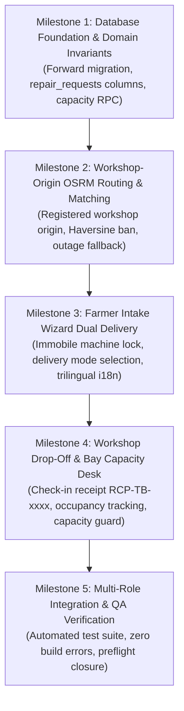

# Phase 14: Smart Dispatch & Emergency Response — Preflight Audit Report

**Date**: 2026-11-07  
**Branch**: `phase-14`  
**Base Commit**: `f14c2e0` (`test(phase-13): complete integration and security QA`)  
**Status**: **PREFLIGHT COMPLETE — READY FOR PHASE 14 PLANNING**  
**Environment Target**: Supabase Staging (`ubqgvhcfmrvnmrbllcom`) / Air-gapped Production (`hwdrypkvszwrcraujctw`)  

---

## 1. Executive Summary

Phase 14 of TerraByte introduces **Smart Dispatch & Emergency Response** across the Vidarbha agricultural machinery repair network. Building on the verified shared facility, workshop membership, and physical KYC foundation established in Phase 13, Phase 14 delivers:

1. **Registered Workshop-Based Routing**: Authoritative road distance and driving duration calculated from the technician's registered workshop location (`repair_facilities.latitude/longitude`) to the farmer's breakdown site.
2. **Authoritative OSRM Road Distance & Strict Haversine Ban**: Complete elimination of straight-line (crow-flies) Haversine distances from matching algorithms, service radius decisions, and UI displays, backed by graceful outage degradation (`"Road Distance Temporarily Unavailable"`).
3. **Dual Delivery Modes & Immobile Machinery Invariant**: Farmer selection between Doorstep / On-Field Service (Flow A) and Workshop Drop-Off (Flow B). If machinery is completely stopped/inoperable (`is_immobile = true`), service delivery is locked to Doorstep only, disabling drop-off and alerting the farmer against hazardous road towing.
4. **Workshop Bay Capacity Management**: Dynamic tracking of physical workshop bay occupancy (`current_active_repairs`), automatically flagging workshops as *"At Capacity"* when active repairs reach `max_equipment_capacity` to prevent yard congestion.
5. **Drop-Off Check-in Receipts**: Unique check-in custody tracking (`RCP-TB-xxxx`) verifying equipment intake upon physical arrival at an approved workshop (`drop_off_approved = true`).

This preflight report audits the repository Git state, verifies foundational code and documentation alignments, identifies required database migrations and file touchpoints, establishes test verification contracts, and highlights unresolved architectural decisions requiring user approval before implementation begins.

---

## 2. Git State Verification

| Verification Item | Requirement | Empirical Status | Notes |
| :--- | :--- | :--- | :--- |
| **Current Branch** | Must be `phase-14` | **PASS** (`phase-14`) | Confirmed via `git status` and `git branch -vv`. |
| **Base / Parent Commit** | Must be latest completed `phase-13` commit (`f14c2e0`) | **PASS** (`f14c2e0`) | Commit title: `test(phase-13): complete integration and security QA`. Identical to `origin/phase-13`. |
| **Remote Tracking** | Must track `origin/phase-14` | **PASS** | `phase-14` is up to date with `origin/phase-14`. |
| **Working Tree State** | Preserve pre-existing uncommitted changes | **PASS** | Pre-existing modified files preserved untouched: `eslint.config.js`, `src/lib/services/technicians.ts`, `src/routeTree.gen.ts`, and untracked `docs/audits/phase-13/PHASE13_QUOTE_APPROVAL_REJECTION_BUG_AUDIT.md`. |
| **Git Discipline** | No commits, pushes, merges, rebases, stashes, or branch switches | **PASS** | Read-only preflight operations only. |

---

## 3. Approved Phase 14 Scope (Sourced from Canonical Documentation)

The approved scope is derived exclusively from `.planning/ROADMAP.md`, `.planning/STATE.md`, `.planning/TRD.md`, and `.planning/DECISIONS.md`:

### 3.1 Objective & Title
- **Official Title**: **Phase 14: Smart Dispatch & Emergency Response** (also referenced as *Smart Dispatch & Workshop Drop-Off*).
- **Core Objective**: Implement intelligent, workshop-based technician dispatch using actual road distances and travel times, supporting both on-field doorstep service and workshop drop-off workflows across Vidarbha.

### 3.2 Approved Functional Features
1. **Registered Workshop-Based Routing (ADR-001, ADR-005)**:
   - Dispatch origin coordinates are sourced strictly from the technician's registered physical workshop (`repair_facilities.latitude/longitude`).
   - **Zero Continuous Live GPS Tracking**: Technicians are never subjected to background or real-time location pings. Worker privacy and battery/bandwidth constraints in rural Vidarbha are strictly respected.
   - Google Maps external navigation URLs (`https://www.google.com/maps/dir/...`) generated from registered workshop coordinates to farmer breakdown coordinates.

2. **Authoritative OSRM Road Distance Only & Strict Haversine Ban (ADR-005, TRD 5.3)**:
   - All driving distances and estimated durations must be computed authoritatively via the Open Source Routing Machine (OSRM) using public road networks.
   - **Strict Haversine Ban**: Straight-line (crow-flies) calculations are **strictly prohibited** from UI display, candidate technician matching, and sorting algorithms.
   - **Graceful Outage Fallback**: If the OSRM server is unreachable, times out, or returns a non-OK status, the UI must render:  
     `"Road Distance Temporarily Unavailable"`  
     Under no circumstances shall the application fall back to Haversine in the UI or disqualify eligible technicians.
   - **Traffic Disclaimer**: OSRM duration is an estimated road driving duration based on standard road speeds without real-time traffic conditions.

3. **Dual Delivery Modes & Immobile Machinery Invariant (ADR-002, TRD 4.1 & 5.2)**:
   - **Flow A: Doorstep / On-Field Service**: Technician travels from registered workshop to farmer's field coordinates.
   - **Flow B: Workshop Drop-Off**: Farmer transports equipment to an approved workshop (`drop_off_approved = true`).
   - **Immobile Machine Decision Gate**: If `is_immobile = true` (machine completely stopped/inoperable), the system **locks service mode to Doorstep only**. Workshop Drop-Off is disabled in the intake wizard, and the farmer is advised not to attempt hazardous road towing.
   - **Drop-Off Receipt**: When equipment arrives at the workshop for Flow B, a check-in receipt (`RCP-TB-xxxx`) is generated to establish formal physical custody.

4. **Workshop Bay Capacity Management (ADR-003, ROADMAP Phase 14)**:
   - Every facility has a configurable `max_equipment_capacity` (defined in Phase 13 migration).
   - System calculates active workshop repairs (`current_active_repairs` where `facility_id` is set and status is in active lifecycle: `REQUESTED`, `ASSIGNED`, `DIAGNOSED`, `QUOTE_PENDING`, `IN_PROGRESS`, `WAITING_FOR_PARTS`).
   - If `current_active_repairs >= max_equipment_capacity`, the workshop is flagged as *"At Capacity"* and excluded from receiving new drop-off allocations.

### 3.3 Explicit Exclusions & Out-of-Scope Boundaries
- **Flatbed & Towing Logistics**: Commercial flatbed recovery and heavy equipment towing dispatch are explicitly deferred to post-hackathon scope (ADR-002, ROADMAP line 174).
- **Continuous Live GPS Tracking**: Mandatory background GPS polling of technicians is strictly banned (ADR-001, ADR-005).
- **Straight-Line Haversine Calculation**: Prohibited from all user-facing screens and candidate scoring logic (ADR-005).
- **Paid Routing APIs**: Commercial routing engines requiring billing or credit card dependencies (such as Google Maps live traffic API) are strictly banned under the $0.00 Free-Tier Constraint.
- **Frontend UI/UX Redesign & Viewport Overhaul**: Full mobile responsiveness down to 320px, visual hierarchy revamp, and public homepage overhaul belong strictly to **Phase 16: Frontend UI/UX Improvement & Product Polish**.
- **Production Migrations & Final System QA**: Governed production database execution (`hwdrypkvszwrcraujctw`) belongs exclusively to **Phase 17: Master Release Gate**.

---

## 4. Candidate Milestone Breakdown

To ensure structured, test-driven delivery within bounded Ralph Loop iterations (maximum 3 iterations per workstream), Phase 14 is broken into 5 discrete milestones:



### Milestone 1: Database Foundation & Domain Invariants
- Author forward migration `supabase/migrations/20261108100000_phase14_smart_dispatch_and_dropoff.sql`.
- Add columns to `public.repair_requests`:
  - `delivery_mode TEXT NOT NULL DEFAULT 'DOORSTEP' CHECK (delivery_mode IN ('DOORSTEP', 'WORKSHOP_DROPOFF'))`
  - `is_immobile BOOLEAN NOT NULL DEFAULT FALSE`
  - `drop_off_receipt_number TEXT`
  - `dropped_off_at TIMESTAMPTZ`
  - `dropped_off_by UUID REFERENCES public.profiles(id)`
- Author atomic, security-definer helper RPC `public.get_facility_bay_occupancy(p_facility_id UUID)` returning `active_repairs`, `max_equipment_capacity`, and `is_at_capacity`.
- Author atomic check-in RPC `public.execute_workshop_dropoff_checkin()` ensuring capacity is not exceeded at check-in time.
- Verify RLS policies and Discretionary Access Control (DAC) column grants.

### Milestone 2: Workshop-Origin OSRM Routing Engine & Matching Integration
- Update `src/lib/services/routing.ts` and `src/routes/api/route-estimate.ts` to calculate travel estimates strictly between registered workshop coordinates (`repair_facilities.latitude/longitude`) and farmer breakdown coordinates.
- Refactor `getEligibleTechnicians` in `src/lib/services/technicians.ts`:
  - Derive technician location from `technician_profiles.primary_facility_id` -> `repair_facilities(latitude, longitude)`.
  - Calculate actual OSRM driving distance and duration for candidate scoring.
  - Eliminate all straight-line Haversine math.
  - Implement graceful outage degradation: if OSRM is unavailable, render `"Road Distance Temporarily Unavailable"`, maintain candidate ranking without disqualifying technicians.
  - Add standard road speed disclaimer to route estimation cards.

### Milestone 3: Farmer Intake Wizard Dual Delivery & Immobile Machinery Lock
- Update `src/routes/farmer/report-breakdown.tsx`:
  - Step update: add machinery mobility check (`is_immobile` boolean toggle: *"Is the machine completely stopped / unable to move?"*).
  - Add Delivery Mode selector: `Doorstep / On-Field Service` vs `Workshop Drop-Off`.
  - **Immobile Machinery Invariant**: When `is_immobile = true`, automatically force delivery mode to `DOORSTEP`, disable the `WORKSHOP_DROPOFF` option with an advisory warning: *"Immobile machinery cannot be transported. Our technician will visit your field directly."*
  - If `WORKSHOP_DROPOFF` is chosen, display dropdown of approved workshops (`drop_off_approved = true`) with available bay capacity. Full workshops (`is_at_capacity = true`) are visually flagged and disabled.
  - Maintain 100% dictionary key parity across English (`en`), Hindi (`hi`), and Marathi (`mr`).

### Milestone 4: Workshop Drop-Off Lifecycle, Check-in Receipt & Bay Occupancy
- Implement check-in desk workflow for workshop managers and admins (`/admin` and `/technician`):
  - Action to record machine arrival for `WORKSHOP_DROPOFF` repairs.
  - Generates immutable check-in receipt format: `RCP-TB-YYYYMMDD-XXXX`.
  - Displays dynamic bay occupancy indicator on workshop cards: `X / Y bays occupied` with a high-contrast badge if *"At Capacity"*.
  - Enforce concurrency-safe check-in rejection if facility capacity has been reached.

### Milestone 5: End-to-End Integration, Regression & QA Verification
- Author automated test suite `tests/phase-14-smart-dispatch.test.mjs` verifying:
  - TEST-14-01: Workshop-based routing origin and absence of live GPS pings.
  - TEST-14-02: Strict Haversine ban enforcement.
  - TEST-14-03: Graceful OSRM outage fallback string.
  - TEST-14-04: Immobile machine state gate locking mode to Doorstep.
  - TEST-14-05: Workshop bay capacity bounds and check-in rejection when full.
- Verify full test suite passes with 100% pass rate ($\ge 310$ tests).
- Execute clean production build (`npm run build:production`) with zero errors and zero warnings.

---

## 5. Acceptance Criteria Traceability Matrix

| Requirement ID | Acceptance Criterion | Verification Method | Target Test Suite |
| :--- | :--- | :--- | :--- |
| **AC-14-01** | Travel distance and ETA are calculated from the technician's registered workshop coordinates (`repair_facilities`). | Unit / Contract Test | `tests/phase-14-smart-dispatch.test.mjs` (TEST-14-01) |
| **AC-14-02** | Zero continuous live GPS tracking of technicians; background GPS tracking endpoints do not exist. | Architectural Invariant | `tests/phase-14-smart-dispatch.test.mjs` (TEST-14-01) |
| **AC-14-03** | Haversine straight-line distance is banned from UI and technician ranking logic. | Contract / Search Test | `tests/phase-14-smart-dispatch.test.mjs` (TEST-14-02) |
| **AC-14-04** | OSRM outage or timeout renders `"Road Distance Temporarily Unavailable"` without crashing or disqualifying candidates. | Outage Simulation Test | `tests/phase-14-smart-dispatch.test.mjs` (TEST-14-03) |
| **AC-14-05** | Marking `is_immobile = true` during breakdown intake disables Workshop Drop-Off and locks mode to `DOORSTEP`. | Form State Machine Test | `tests/phase-14-smart-dispatch.test.mjs` (TEST-14-04) |
| **AC-14-06** | Farmer choosing Workshop Drop-Off can select only facilities where `drop_off_approved = true` and `is_active = true`. | Access Control Test | `tests/phase-14-smart-dispatch.test.mjs` (TEST-14-05) |
| **AC-14-07** | Workshops with `active_repairs >= max_equipment_capacity` display *"At Capacity"* and block new drop-off allocations. | Concurrency & Capacity Test | `tests/phase-14-smart-dispatch.test.mjs` (TEST-14-05) |
| **AC-14-08** | Physical equipment arrival in Workshop Drop-Off flow generates immutable check-in receipt `RCP-TB-xxxx`. | Database / Service Test | `tests/phase-14-smart-dispatch.test.mjs` (TEST-14-05) |
| **AC-14-09** | 100% dictionary key parity across English, Hindi, and Marathi for all new Phase 14 dispatch and intake strings. | i18n Key Parity Test | `tests/i18n-dictionary-parity.test.mjs` |
| **AC-14-10** | Production build completes in $< 2.0\text{s}$ SSR with zero TypeScript errors or warnings. | Build Pipeline Test | `npm run build:production` |

---

## 6. Technical Dependencies & Risk Assessment

### 6.1 Dependencies
- **Phase 13 Shared Workshop Schema**: Requires `repair_facilities` and `facility_memberships` (defined in `20261106160000_phase13_database_foundations.sql`).
- **Public OSRM Endpoint**: Relies on `https://router.project-osrm.org/route/v1/driving/...` for free-tier driving routes.
- **Phase 12 Trilingual Architecture**: New strings must conform to existing dictionary structure in `src/lib/i18n/dictionaries/` (`en.ts`, `hi.ts`, `mr.ts`).

### 6.2 Risks & Mitigation Strategy

| Risk | Severity | Potential Impact | Mitigation Strategy |
| :--- | :---: | :--- | :--- |
| **OSRM Public Endpoint Outage or Rate Limit** | Medium | Route estimates fail during peak usage or network blips. | Graceful fallback rendering `"Road Distance Temporarily Unavailable"`. Matching algorithm falls back to brand/skill/availability scoring without discarding candidates. |
| **Bay Capacity Race Conditions** | Medium | Concurrent drop-offs push workshop occupancy beyond physical capacity. | Implement atomic row-level check via database function with `FOR UPDATE` lock on `repair_facilities` during check-in. |
| **Immobile Machine Bypass via API** | High | Farmer or external client submits `is_immobile = true` with `delivery_mode = 'WORKSHOP_DROPOFF'`. | Enforce database CHECK constraint: `CHECK (NOT (is_immobile = TRUE AND delivery_mode = 'WORKSHOP_DROPOFF'))`. |
| **Schema Cache Staleness in Client** | Low | New columns cause PostgREST schema cache misses in un-migrated environments. | Implement resilient column projection fallback following Phase A / Phase 13 pattern. |

---

## 7. Proposed Changed-File Inventory

```text
Database:
  supabase/migrations/20261108100000_phase14_smart_dispatch_and_dropoff.sql   (NEW forward migration)

Services & API:
  src/lib/services/routing.ts                                                (UPDATE: Workshop origin coordinates, OSRM outage strings)
  src/lib/services/routing-handler.ts                                        (UPDATE: Align with workshop coordinates)
  src/routes/api/route-estimate.ts                                           (UPDATE: Handler wiring)
  src/lib/services/technicians.ts                                            (UPDATE: getEligibleTechnicians road distance scoring)
  src/lib/services/facilities.ts                                             (UPDATE: Bay occupancy queries, capacity checks)
  src/lib/services/repair-requests.ts                                        (UPDATE: Drop-off check-in receipts, delivery mode types)

UI Components & Pages:
  src/routes/farmer/report-breakdown.tsx                                     (UPDATE: Immobile machine toggle, Delivery mode selector)
  src/routes/farmer/repair/$id.tsx                                           (UPDATE: Drop-off status and check-in receipt card)
  src/routes/technician/job/$id.tsx                                          (UPDATE: Delivery mode badge, workshop origin routing link)
  src/routes/admin/repair/$id.tsx                                            (UPDATE: Dispatch mode, workshop drop-off desk)
  src/components/route-estimate-card.tsx                                     (UPDATE: Registered workshop origin label, traffic disclaimer)
  src/components/facilities/facility-card.tsx                                 (UPDATE: Bay occupancy indicator, "At Capacity" badge)
  src/components/facilities/workshop-checkin-dialog.tsx                       (NEW: Physical drop-off check-in dialog)

Localization:
  src/lib/i18n/dictionaries/en.ts                                            (UPDATE: Phase 14 dispatch & delivery mode strings)
  src/lib/i18n/dictionaries/hi.ts                                            (UPDATE: Hindi translations with Devanagari script)
  src/lib/i18n/dictionaries/mr.ts                                            (UPDATE: Marathi translations with Devanagari script)

Automated Test Suites:
  tests/phase-14-smart-dispatch.test.mjs                                     (NEW: TEST-14-01 through TEST-14-05)
  tests/route-estimate.test.mjs                                              (UPDATE: Add workshop-to-field test assertions)
```

---

## 8. Database Migration Assessment

1. **Migration Policy**:
   - Committed migration `supabase/migrations/20261106160000_phase13_database_foundations.sql` remains strictly untouched.
   - Forward migration only: `20261108100000_phase14_smart_dispatch_and_dropoff.sql`.
2. **Planned Schema Additions**:
   - `ALTER TABLE public.repair_requests ADD COLUMN IF NOT EXISTS delivery_mode TEXT NOT NULL DEFAULT 'DOORSTEP';`
   - `ALTER TABLE public.repair_requests ADD COLUMN IF NOT EXISTS is_immobile BOOLEAN NOT NULL DEFAULT FALSE;`
   - `ALTER TABLE public.repair_requests ADD COLUMN IF NOT EXISTS drop_off_receipt_number TEXT;`
   - `ALTER TABLE public.repair_requests ADD COLUMN IF NOT EXISTS dropped_off_at TIMESTAMPTZ;`
   - `ALTER TABLE public.repair_requests ADD COLUMN IF NOT EXISTS dropped_off_by UUID REFERENCES public.profiles(id);`
   - Integrity constraint: `CHECK (NOT (is_immobile = TRUE AND delivery_mode = 'WORKSHOP_DROPOFF'))`.
   - Function `public.get_facility_bay_occupancy(p_facility_id UUID)`.
   - Function `public.execute_workshop_checkin(...)`.
3. **Execution Restrictions**:
   - Zero execution against remote Staging (`ubqgvhcfmrvnmrbllcom`) without explicit approval.
   - Zero execution against Production (`hwdrypkvszwrcraujctw`).

---

## 9. Unresolved Architectural Decisions Requiring User Approval

The following 6 architectural decisions directly impact Phase 14 planning and implementation. Please review and provide explicit guidance:

1. **Pre-Arrival Facility Binding (ADR Open Decision 6)**:
   - When a farmer chooses *Workshop Drop-Off* in the intake wizard, should `repair_requests.facility_id` be bound immediately at ticket creation, or should it remain `NULL` until physical arrival and check-in at the workshop?
   - *Recommendation*: Bind `facility_id` at intake so the chosen workshop's capacity can be reserved, but permit the farmer or admin to re-route prior to check-in if needed.

2. **Check-in Receipt Number Format (ADR Open Decision 7)**:
   - What is the preferred format for workshop drop-off check-in receipts?
   - *Recommendation*: Canonical format `RCP-TB-YYYYMMDD-XXXX` (matching existing `TB-XXXX` and `INV-TB-XXXX` design).

3. **Workshop Capacity Downsizing Invariant (ADR Open Decision 10)**:
   - If a workshop owner reduces `max_equipment_capacity` (e.g., from 4 bays to 2 bays) while 3 machines are currently checked in, how should the system behave?
   - *Recommendation*: Allow the metadata update, but immediately mark the workshop as *"At Capacity"* (`active_repairs >= max_capacity`) and reject new drop-offs until occupancy falls below 2. Never evict or crash active repairs.

4. **Emergency Seasonal Capacity Override (ADR Open Decision 22)**:
   - Should Service Centre administrators have override authority to bypass `max_equipment_capacity` limits during peak harvest/sowing breakdown surges (e.g. Kharif sowing)?
   - *Recommendation*: Yes, Service Centre dispatchers can optionally pass an `override_capacity = true` flag with mandatory audit remarks. Workshop managers cannot override their own limits.

5. **Maximum Allowable Road Distance Radius (ADR Open Decision 23)**:
   - What is the maximum road distance radius for doorstep technician matching across Vidarbha?
   - *Recommendation*: Default radius of **50 km** road distance. Candidates beyond 50 km are marked as *Extended Travel* rather than strictly excluded.

6. **OSRM Traffic Disclaimer Copy (ADR Open Decision 18)**:
   - What standardized copy should be rendered alongside driving duration estimates to set clear user expectations regarding rural road traffic?
   - *Recommendation*: *"Estimated standard driving duration. Real-time rural road and weather conditions may vary."*

---

## 10. Final Preflight Verdict

# READY FOR PHASE 14 PLANNING

The Git repository state is verified, baseline test health is 100% green (299/299 tests pass), the production build compiles cleanly, and approved Phase 14 scope has been sourced from canonical architecture documents.

**Next Step**: Upon user review and approval of this preflight report and guidance on the open architectural decisions, proceed to authoring the detailed `PHASE14_IMPLEMENTATION_PLAN.md` under `docs/audits/phase-14/`.
