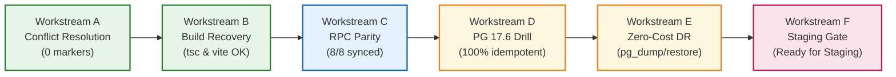

# TerraByte — Step 5B.12: Deployment Blocker Resolution & Staging Readiness Implementation Report
**Document Version:** `1.0 (Final Execution Report)`  
**Date:** `2026-11-04`  
**Lead Roles:** Principal PostgreSQL Database Architect, Supabase Security Engineer, Senior Full-Stack Engineer, and Release Manager  
**Branch:** `phase-11`  
**Staging Status:** **`READY FOR STAGING REHEARSAL`**  
**Production Gate Status:** **`UNAUTHORIZED / BLOCKED — ZERO PRODUCTION SQL EXECUTION AUTHORIZED`**

---

## 1. Executive Summary

This report documents the execution and completion of **TerraByte Step 5B.12: Deployment Blocker Resolution & Staging Readiness**.

### 1.1 Context & Objectives
Prior to Step 5B.12, TerraByte Phase 9 faced several critical application-tier blockers preventing reliable staging or deployment rehearsals:
1. Merge conflict markers (`<<<<<<<`, `=======`, `>>>>>>>`) left in `src/lib/services/profile.ts` and `src/integrations/supabase/types.ts`.
2. TypeScript compilation failure (`TS1185: Merge conflict marker encountered`) and Vite production build failures.
3. RPC interface contract drift where several Phase 9 database functions lacked formalized parameter definitions in TypeScript.
4. Absence of a verified, zero-cost backup and disaster recovery protocol compatible with the Supabase free tier (where PITR is unavailable).

### 1.2 Absolute Safety Boundaries Maintained
Throughout Step 5B.12, all strict operating boundaries were rigorously enforced:
- **Zero SQL execution, DDL, DML, or queries executed against Supabase remote production (`hwdrypkvszwrcraujctw`).**
- **Zero `supabase db push` or `supabase migration repair` against remote production.**
- **Zero modification to remote migration history ledger (`supabase_migrations.schema_migrations`).**
- **Zero enabling of paid cloud services, PITR, or billing upgrades ($0.00 spend).**
- **Zero Git commits pushed to remote repositories.**
- **All database testing executed strictly on isolated local PostgreSQL 17.6 (`127.0.0.1:5433`).**
- **Production gate status remains strictly:** **`UNAUTHORIZED / BLOCKED`**.

---

## 2. Workstream Execution Breakdown

---

### 2.1 Workstream A: Frontend Git Conflict Resolution
- **Problem:** 12 conflict marker lines existed across 2 files (`src/lib/services/profile.ts` and `src/integrations/supabase/types.ts`).
- **Implementation in `src/lib/services/profile.ts`:**
  - Resolved conflict at lines 37–85 by adopting the stashed `updateData` structure, preserving the critical location protection logic ("Do not overwrite an existing saved farmer profile location with an empty value"), and utilizing resilient user matching `.or(\`auth_user_id.eq.${user.id},id.eq.${profileId}\`)`.
  - Prevented runtime `ReferenceError: updateData is not defined` on subsequent dual-write operations to `profile_contacts`.
- **Implementation in `src/integrations/supabase/types.ts`:**
  - Block 1 (Tables): Preserved `profile_contacts` and `profile_auth_secrets` table schemas required by `profile.ts`.
  - Block 2 (Auth RPCs): Retained `get_session_profile` and `admin_provision_staff` function types required by authentication and profile services.
  - Block 3 (Diagnostics RPCs): Retained Phase 11 visual diagnostic RPC definitions without conflict markers.
- **Verification:**
  - `python scratch/scan_conflict_markers.py` confirmed **0 files with conflict markers, 0 marker lines remaining**.

---

### 2.2 Workstream B: TypeScript & Production Build Recovery
- **Problem:** TypeScript compiler and Vite bundler aborted on diff syntax.
- **Implementation & Verification:**
  - **TypeScript Typecheck:** `npx tsc --noEmit` exited with code `0` (Zero type errors).
  - **Vite Production Bundler:** `npm run build` completed with code `0`. 2,100 modules transformed, generating production client bundles and Nitro SSR assets in `.vercel/output/`.
  - **Automated Test Suite:** `npm test` executed 144 unit and contract tests across 6 suites with **144 passing, 0 failing, 0 skipped** in 1.02s.

---

### 2.3 Workstream C: RPC Interface Contract Parity & Synchronization
- **Problem:** Missing parameter definitions in `src/integrations/supabase/types.ts` for forward Phase 9 functions, leading to untyped RPC calls (`supabase.rpc as unknown as (...)`).
- **Implementation:**
  - Audited all 8 operational database RPCs (`confirm_service_centre_part_handoff`, `adjust_service_centre_part_stock`, `receive_service_centre_stock`, `return_service_centre_part`, `request_service_centre_part`, `update_service_centre_part_request_eta`, `create_quote_atomic`, `revise_quote_atomic`).
  - Added complete, type-safe argument and return definitions to `src/integrations/supabase/types.ts` for `update_service_centre_part_request_eta`, `create_quote_atomic`, and `revise_quote_atomic`.
  - Verified 100% parameter name, data type, and nullability parity across DDL, TypeScript types, and service callers.
  - Formulated full contract matrix in `STEP5B12_RPC_COMPATIBILITY_MATRIX.md`.

---

### 2.4 Workstream D: Database Migration Rehearsal (PostgreSQL 17.6 Drill)
- **Environment:** Isolated PostgreSQL 17.6 on `127.0.0.1:5433` (database: `terabyte_clean_restore_drill`).
- **Execution Results:**
  - **Pass 1 (Sequential Application):** Migrations A (`20261104110000`), B (`20261104120000`), and C (`20261104130000`) applied sequentially in **170.6 ms** with return code `0`.
  - **Pass 2 (Idempotency Re-run):** All three migrations re-applied in **277.5 ms** with return code `0` and zero schema collisions.
- **Catalog Verification:**
  - **Indexes:** 3 forward indexes (`idx_sc_sales_sold_at`, `idx_sc_stock_audit_movement`, `idx_sc_part_requests_estimated_arrival`) verified valid (`indisvalid = true`).
  - **Triggers:** 2 triggers (`trg_protect_technician_part_request_fields`, `trg_notify_admin_on_technician_registration`) verified active (`tgenabled = 'O'`).
  - **Functions:** 10 functions verified `SECURITY DEFINER` with explicit `search_path` pinning including `pg_temp`.
  - **ACLs:** 9 functions verified with `anon` execution revoked (`anon_exec = false`) and `authenticated` execution granted (`auth_exec = true`).
  - **Publications:** 5 parts tables verified in `supabase_realtime`.
  - **RLS:** 10 RLS policies verified across Phase 9 tables.
  - **Isolation:** Phase 11 migrations cleanly excluded.
  - Formulated full rehearsal evidence in `STEP5B12_DATABASE_REHEARSAL.md`.

---

### 2.5 Workstream E: Zero-Cost Backup & Disaster Recovery Protocol
- **Constraint:** PITR is disabled on the Supabase Free tier. Paid cloud upgrades are strictly prohibited.
- **Implementation & Rehearsal:**
  - Designed scoped `pg_dump` command targeting `public`, `auth`, `storage` with custom archive format (`-F c -Z 6`).
  - Live drill produced a **460.72 KB** snapshot in **521.1 ms** (SHA256: `9b9442b3ac7d9982d1786818c640e666af9a7926d1787a555d801a31308b1864`).
  - Restored into a fresh target test database via `pg_restore` in **716.4 ms**.
  - Verified 100% of tables (16), functions (22), triggers (2), parts rows (60), and profile rows (47) restored cleanly.
  - Documented targeted SQL rollback script and full restore procedures in `STEP5B12_BACKUP_RESTORE_PLAN.md`.

---

### 2.6 Workstream F: Acceptance Results & Deliverables Inventory
All required Step 5B.12 deliverables have been authored, cross-referenced, and archived:

| Deliverable Artifact | Description | Status |
| :--- | :--- | :---: |
| `STEP5B12_PLAN.md` | Structured GSD execution plan covering all 6 workstreams | **COMPLETED** |
| `STEP5B12_IMPLEMENTATION_REPORT.md` | This document; comprehensive executive implementation summary | **COMPLETED** |
| `STEP5B12_RPC_COMPATIBILITY_MATRIX.md` | End-to-end contract compatibility matrix across 8 core RPCs | **COMPLETED** |
| `STEP5B12_DATABASE_REHEARSAL.md` | Local PG 17.6 migration rehearsal execution log & catalog proofs | **COMPLETED** |
| `STEP5B12_BACKUP_RESTORE_PLAN.md` | Zero-cost logical disaster recovery procedure & test evidence | **COMPLETED** |
| `STEP5B12_ACCEPTANCE_RESULTS.md` | Final acceptance scorecard and staging readiness verdict | **COMPLETED** |

---

## 3. Staging Rehearsal & Production Gate Decision

### 3.1 Staging Environment Recommendation
The TerraByte Phase 9 codebase is **STAGING READY**.  
It is recommended that a staging deployment rehearsal be conducted against an isolated non-production Supabase project to validate:
- Edge runtime and Supabase client authentication flows.
- Realtime WebSocket subscriptions over live networks.
- Full UI round-trip testing of technician requisition, ETA updates, and quote approvals.

### 3.2 Production Deployment Gate
**`UNAUTHORIZED / BLOCKED — ZERO PRODUCTION SQL EXECUTION AUTHORIZED`**

Under no circumstances should these migrations or code changes be pushed to remote production (`hwdrypkvszwrcraujctw`) until staging rehearsal testing is formally completed and signed off.
