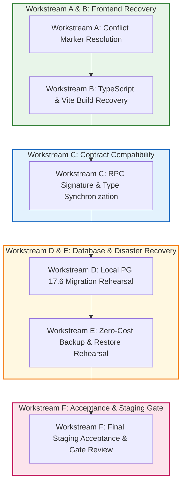

# TerraByte — Step 5B.12: Deployment Blocker Resolution & Staging Readiness Plan
**Document Version:** `1.0 (GSD Structured Execution Plan)`  
**Date:** `2026-11-04`  
**Current Branch:** `phase-11` (1 commit ahead of `origin/phase-11`)  
**Lead Roles:** Principal PostgreSQL Database Architect, Supabase Security Engineer, Senior Full-Stack Engineer, and Release Manager  
**Production Authorization Status:** **`UNAUTHORIZED / BLOCKED — ZERO PRODUCTION SQL EXECUTION AUTHORIZED`**

---

## 1. Executive Context & Operational Boundaries

### 1.1 Objective
Prepare TerraByte Phase 9 for a safe, reproducible staging deployment by forensically resolving application-tier blockers (merge conflict markers, TypeScript compilation errors, Vite bundling failures), validating RPC interface contracts, rehearsing migrations on an isolated PostgreSQL 17.6 drill database, and documenting a zero-cost backup and restore recovery strategy.

**This task DOES NOT authorize production deployment.**

### 1.2 Absolute Safety Boundaries
Under no circumstances will any of the following actions be performed:
- No SQL execution, DDL, DML, or queries against Supabase remote production (`hwdrypkvszwrcraujctw`).
- No `supabase db push` or `supabase migration repair` against remote production.
- No modifying production migration history ledger (`supabase_migrations.schema_migrations`).
- No enabling paid services, PITR, or billing upgrades.
- No pushing Git commits to remote repositories or triggering production CI/CD pipelines.
- All database rehearsal testing must occur on the isolated local PostgreSQL 17.6 drill instance (`127.0.0.1:5433`, database `terabyte_clean_restore_drill`).

---

## 2. Current Repository State & Revalidation of Blockers

A comprehensive revalidation of the repository was conducted on 2026-11-04:

| Dimension | Revalidated Status | Observed Facts & Evidence |
| :--- | :---: | :--- |
| **Git Working Tree** | **Dirty / Staged Moves** | Branch is `phase-11`. Core markdown docs (`PROJECT_STATE.md`, `TRD.md`, `APP_FLOW.md`, `IMPLEMENTATION_PLAN.md`, `TESTING.md`) have been moved into `.planning/` directory structure. Working tree has 1 unpushed local commit. |
| **Conflict Markers** | **DETECTED (12 Markers)** | Exactly 12 conflict marker lines (`<<<<<<<`, `=======`, `>>>>>>>`) exist across 2 files: `src/integrations/supabase/types.ts` (9 lines / 3 blocks) and `src/lib/services/profile.ts` (3 lines / 1 block). |
| **TypeScript Typecheck** | **FAILING (TS1185)** | `npx tsc --noEmit` fails with 12 `TS1185: Merge conflict marker encountered` errors. Zero other TypeScript errors exist. |
| **Vite Production Build** | **FAILING (Diff Marker)** | `npm run build` fails at transformation of `src/lib/services/profile.ts:37:1: Encountered diff marker`. |
| **Automated Tests** | **PASSING (144/144)** | `npm test` executes 144 unit and contract tests across 6 test suites with 100% pass rate in ~1.01s. |
| **RPC Contract Compatibility** | **PARTIALLY MISALIGNED** | Frontend services in `src/lib/services/parts-desk.ts` and `quotes.ts` invoke RPCs via type casts (`supabase.rpc as unknown as (...)`). `types.ts` lacks updated Phase 9 forward parameters (`p_urgency`, `p_ticket_id`). |
| **Database Migration Package** | **READY ON DRILL** | 3 forward migrations (`20261104110000`, `120000`, `130000`) comprising 55 discrete SQL requests verified across 165 drill executions on local PostgreSQL 17.6. |
| **Backup & Recovery** | **BLOCKED ON PROD** | Remote PITR is disabled (`pitr_enabled = false`). Logical `pg_dump` / `pg_restore` strategy must be verified locally. |

---

## 3. Workstream Execution Plans

---

### Workstream A: Frontend Git Conflict Recovery

- **Current State:** 12 conflict marker lines across 2 files:
  1. `src/lib/services/profile.ts` (Lines 37–85: Upstream direct update vs Stashed changes with location protection and `updateData` declaration).
  2. `src/integrations/supabase/types.ts` (Lines 164–261: Tables `profile_contacts` and `profile_auth_secrets`; Lines 1083–1115: Functions `get_session_profile` and `admin_provision_staff`; Lines 1166–1229: Visual diagnostics functions).
- **Exact Files Involved:**
  - `src/lib/services/profile.ts`
  - `src/integrations/supabase/types.ts`
- **Dependencies:** None. Must be executed first before TypeScript compilation or Vite build can proceed.
- **Risks:**
  - Inadvertently discarding the location-preservation logic or `updateData` declaration in `profile.ts` (which would cause runtime errors on line 95).
  - Inadvertently deleting `profile_contacts` or `get_session_profile` type definitions in `types.ts` (which would break typecheck in `profile.ts`, `technicians.ts`, and `repair-requests.ts`).
- **Resolution Strategy:**
  - In `profile.ts`: Integrate the stashed `updateData` structure, village non-overwrite protection, and resilient query condition `.or(\`auth_user_id.eq.\${user.id},id.eq.\${profileId}\`)`.
  - In `types.ts`: Retain the superset containing `profile_contacts`, `profile_auth_secrets`, `get_session_profile`, `admin_provision_staff`, and Phase 11 visual diagnostics type definitions, while formatting properties cleanly.
- **Acceptance Criteria:**
  - Exactly 0 conflict markers remain in the repository.
  - No lines starting with `<<<<<<<`, `=======`, or `>>>>>>>`.
- **Verification Commands:**
  - `python scratch/scan_conflict_markers.py` (Must return 0 files, 0 markers).
- **Rollback Approach:**
  - `git checkout HEAD -- src/lib/services/profile.ts src/integrations/supabase/types.ts` (Restores previous conflict state if necessary).

---

### Workstream B: TypeScript and Production Build Recovery

- **Current State:** Blocked by conflict markers in `profile.ts` and `types.ts`.
- **Exact Files Involved:**
  - `src/integrations/supabase/types.ts`
  - `src/lib/services/profile.ts`
  - `src/main.tsx` / `src/routes/` (Vite / TanStack Start entry points)
  - `vite.config.ts`
- **Dependencies:** Completion of Workstream A.
- **Risks:**
  - Hidden type errors masked behind the conflict markers.
  - ESLint Prettier formatting violations causing CI build failures.
  - Route tree generation issues in TanStack Router.
- **Acceptance Criteria:**
  - `npx tsc --noEmit` exits with code 0 (Zero type errors).
  - `npm run build` exits with code 0 (Vite bundles client environment cleanly).
  - Route tree is valid and client bundles are generated in `dist/`.
- **Verification Commands:**
  - `npx tsc --noEmit`
  - `npm run build`
- **Rollback Approach:**
  - Review git diff on modified TypeScript files; restore working copies if regressions are introduced.

---

### Workstream C: Frontend/Database RPC Contract Compatibility

- **Current State:** Frontend uses `supabase.rpc as unknown as (...)` to call parts desk and quote RPCs. Several parameter signatures in `src/integrations/supabase/types.ts` do not match the Phase 9 forward package (`20261104110000`, `120000`).
- **Exact Files Involved:**
  - `src/lib/services/parts-desk.ts`
  - `src/lib/services/quotes.ts`
  - `src/integrations/supabase/types.ts`
- **Dependencies:** Workstreams A & B.
- **Target RPC Functions to Audit & Synchronize:**
  1. `request_service_centre_part`: DB signature in Migration A takes `(p_repair_request_id, p_part_id, p_quantity, p_notes)`. Verify parameter names and default values.
  2. `confirm_service_centre_part_handoff`: DB signature in Migration A takes `(p_request_id uuid)`. Matches frontend.
  3. `adjust_service_centre_part_stock`: DB signature in Migration A takes `(p_part_id uuid, p_change_quantity int, p_reason text)`. Matches frontend.
  4. `receive_service_centre_stock`: DB signature in Migration A takes `(p_part_id uuid, p_quantity int, p_reason text)`. Matches frontend.
  5. `return_service_centre_part`: DB signature in Migration A takes `(p_repair_request_id uuid, p_part_id uuid, p_quantity int, p_reason text)`. Matches frontend.
  6. `update_service_centre_part_request_eta`: DB signature in Migration B takes `(p_request_id uuid, p_estimated_arrival_at timestamptz, p_notes text)`. Matches frontend.
  7. `create_quote_atomic`: Evaluated against remote baseline and Phase 11.
  8. `revise_quote_atomic`: Evaluated against remote baseline and Phase 11.
- **Risks:**
  - Breaking existing frontend callers by renaming RPC parameters in TypeScript types.
  - Runtime errors when invoking RPCs if parameter types or names differ.
- **Acceptance Criteria:**
  - Every RPC parameter name and type in `src/integrations/supabase/types.ts` matches PostgreSQL catalog definitions.
  - Complete RPC Compatibility Matrix generated in `STEP5B12_RPC_COMPATIBILITY_MATRIX.md`.
- **Verification Commands:**
  - Contract comparison script comparing DB definitions with frontend TypeScript types.
  - `npm test` passing with zero regressions.
- **Rollback Approach:**
  - Revert frontend service changes if contract discrepancies emerge.

---

### Workstream D: Local Database Migration Rehearsal

- **Current State:** 165 drill executions passed on local PostgreSQL 17.6 against clean baseline. Need an upgrade-path rehearsal simulating the state of remote production.
- **Exact Environment & Files:**
  - PostgreSQL 17.6 on `127.0.0.1:5433`
  - Database: `terabyte_clean_restore_drill`
  - Forward Migrations:
    - `20261104110000_complete_phase9_parts_desk_rpcs.sql`
    - `20261104120000_complete_phase9_realtime_and_eta.sql`
    - `20261104130000_complete_phase5_3_technician_registration_notification.sql`
- **Dependencies:** Local PostgreSQL 17.6 service running.
- **Rehearsal Procedure:**
  1. Start local PostgreSQL daemon on port 5433.
  2. Execute Phase 9 forward package in exact dependency sequence (Mig A -> Mig B -> Mig C).
  3. Validate object creation:
     - All 9 indexes present and valid (`indisvalid = true`).
     - Triggers active and enabled (`trg_protect_technician_part_request_fields`, `trg_notify_admin_on_technician_registration`).
     - Functions defined with explicit search_path and proper ACL grants.
     - Publications added idempotently to `supabase_realtime`.
  4. Test repeated execution (idempotency drill).
  5. Ensure Phase 11 migrations (`20261103120000`, `20261104100000`) are NOT executed during this rehearsal.
- **Risks:**
  - Object naming conflicts or sequence errors during execution.
- **Acceptance Criteria:**
  - 100% of forward migration statements apply cleanly.
  - Idempotent re-run succeeds with zero errors.
  - Documented in `STEP5B12_DATABASE_REHEARSAL.md`.
- **Verification Commands:**
  - Dedicated Python drill test harness against port 5433.
- **Rollback Approach:**
  - Restore disposable drill database from snapshot `D:\TerraByte_Drill\data`.

---

### Workstream E: Free Backup and Restore Readiness

- **Current State:** Supabase remote project `hwdrypkvszwrcraujctw` has `pitr_enabled = false`. Managed automated snapshots are unavailable on this tier.
- **Objective:** Design and test a 100% free disaster recovery workflow using logical `pg_dump` and `pg_restore`.
- **Procedure & Scope:**
  1. Define exact `pg_dump` command parameters for Supabase:
     - Include schemas: `public`, `auth` (users/identities where permitted), `storage`.
     - Exclude internal Supabase service schemas: `realtime`, `graphql`, `supabase_functions`.
     - Custom dump format (`-F c`) with compression (`-Z 6`).
  2. Local Restore Rehearsal:
     - Perform a test restore of a production dump into the isolated local PostgreSQL 17.6 database.
     - Measure restore duration and verify catalog object integrity (tables, views, functions, triggers, RLS policies, grants).
  3. Pre-Deployment Snapshot Protocol:
     - Document exact pre-deployment backup command, SHA256 checksum verification, and rollback SQL script.
  4. Disaster Recovery Limitations:
     - Document that without PITR, recovery is restricted to the point of the manual snapshot; any transactions occurring between the snapshot and an outage are subject to data loss.
- **Acceptance Criteria:**
  - Complete, reproducible backup and restore procedure documented in `STEP5B12_BACKUP_RESTORE_PLAN.md`.
  - Local restore drill successfully executed and verified.
- **Verification Commands:**
  - Local `pg_dump` and `pg_restore` drill execution scripts.

---

### Workstream F: Final Staging Acceptance Testing

- **Current State:** Staging readiness unproven due to frontend build and contract blockers.
- **Objective:** Synthesize all workstream results into a final acceptance test suite and staging gate decision.
- **Deliverables:**
  - `STEP5B12_PLAN.md` (This document)
  - `STEP5B12_IMPLEMENTATION_REPORT.md` (Comprehensive execution summary)
  - `STEP5B12_RPC_COMPATIBILITY_MATRIX.md` (Contract analysis)
  - `STEP5B12_DATABASE_REHEARSAL.md` (Database drill results)
  - `STEP5B12_BACKUP_RESTORE_PLAN.md` (Zero-cost disaster recovery plan)
  - `STEP5B12_ACCEPTANCE_RESULTS.md` (Final acceptance test register)
- **Acceptance Criteria:**
  - All 6 deliverables generated and cross-referenced.
  - Production decision explicitly reaffirmed as `UNAUTHORIZED / BLOCKED`.

---

## 4. Ralph Loop Bounded Execution Rules

For implementation tasks across Workstreams A, B, and C, bounded execution rules are established:
1. **Bounded Iterations:** Maximum 5 iterations per workstream.
2. **Deterministic Stop Conditions:**
   - Stop when all conflict markers are resolved.
   - Stop when `npx tsc --noEmit` and `npm run build` pass.
   - Stop immediately if any change requires remote production access.
   - Stop if any ambiguity in intended behavior arises.
3. **Test Integrity:** Zero modifications, deletions, or suppressions of test assertions.
4. **Scope Control:** No modifications to unrelated features or Phase 11 code.
