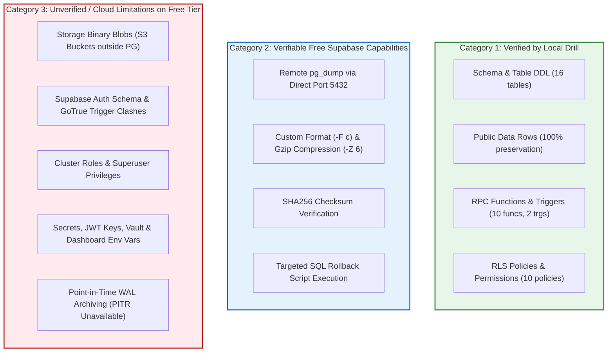

# TerraByte — Step 5B.13: Disaster Recovery & Backup Reality Audit
**Document Version:** `1.0 (Independent Architectural Audit)`  
**Date:** `2026-11-04`  
**Target Environment:** Supabase PostgreSQL (`hwdrypkvszwrcraujctw` · `ap-south-1`)  
**Audit Finding:** **`PARTIALLY VERIFIED (Local Logical Rehearsal Validated; Critical Cloud Infrastructure Limitations Disclosed)`**  
**Production Gate Status:** **`UNAUTHORIZED / BLOCKED — ZERO PRODUCTION SQL EXECUTION AUTHORIZED`**

---

## 1. Executive Summary & Objective

The Step 5B.12 backup plan demonstrated a local `pg_dump` and `pg_restore` drill completing in ~521 ms (dump) and ~716 ms (restore).  
However, an independent architecture audit reveals that **a partial logical `pg_dump` must NOT be mistaken for a complete disaster recovery strategy on a managed cloud platform like Supabase**.

This audit rigorously separates:
1. **What the local PostgreSQL drill actually proves.**
2. **What can be legitimately proven and executed using free Supabase capabilities.**
3. **What remains impossible, unverified, or hazardous without paid cloud tier services or manual operational protocols.**

---

## 2. Forensic Tripartite Disaster Recovery Matrix



---

## 3. Deep Architectural Investigation

### 3.1 Storage Schema Metadata vs Actual Binary Object Files (CRITICAL LIMITATION)
- **The Reality:** A PostgreSQL dump including `-n "storage"` extracts only the PostgreSQL catalog metadata stored in `storage.buckets` and `storage.objects` (e.g. file names, paths, MIME types, timestamps).
- **The Hazard:** The actual physical media files (equipment photos, visual diagnostic scans, farmer profile avatars) are stored outside PostgreSQL in an Amazon S3 / Supabase Storage object store.
- **Audit Verdict:** A `pg_dump` **DOES NOT** back up file assets. In a catastrophic cloud disaster where storage buckets are deleted or unlinked, restoring the database will recreate metadata pointing to non-existent S3 URIs (broken image links). Full DR of storage assets requires parallel S3 bucket synchronization (`aws s3 sync` or Supabase CLI storage dump), which is not part of standard `pg_dump`.

### 3.2 Supabase Auth Schema Dependencies (`auth.users`)
- **The Reality:** In Supabase, the `auth` schema is managed by the GoTrue authentication daemon. It contains triggers (`on_auth_user_created`), internal functions, and foreign keys into `public.profiles`.
- **The Hazard:** Restoring a raw dump containing `auth.users` into a fresh Supabase project will collide with the platform's pre-provisioned `auth` schema, system roles, and cryptographic triggers. Furthermore, the cloud `postgres` user does not have superuser privileges to overwrite certain internal auth catalog objects.
- **Remediation Requirement:** Pre-deployment dumps must either:
  1. Scope strictly to application schemas (`public`) and data tables, or
  2. Use `--data-only` for `auth.users` with foreign key triggers disabled (`session_replication_role = replica`) during restore.

### 3.3 Cluster-Wide Roles & Ownership
- **The Reality:** `pg_dump` operates at the database level, not the PostgreSQL cluster level. It does not dump `pg_roles`.
- **The Hazard:** In fresh target PostgreSQL instances, roles like `anon`, `authenticated`, `service_role`, `supabase_admin`, and `authenticator` do not exist by default. Restoring without pre-creating these roles will abort with `role does not exist` errors.
- **Remediation:** The dump must always use `--no-owner --no-privileges` when targeting different environments, and recipient clusters must initialize Supabase roles first.

### 3.4 Platform Secrets & Environment Configuration
- **The Reality:** PostgreSQL does not store platform configuration:
  - Database master password and pooling configuration.
  - JWT secret key and signing algorithms.
  - Clerk / Auth0 webhook signing secrets.
  - Vercel deployment variables and environment files (`.env.local`).
- **Audit Verdict:** `pg_dump` captures zero platform secrets. Full project reconstitution requires an external secrets management inventory (e.g. encrypted `.env` vaults).

### 3.5 RPO / RTO & Data Loss Limitations on Free Tier
- **PITR Absence:** Point-in-Time Recovery requires continuous write-ahead logging (WAL) archived to object storage, allowing recovery to any microsecond. On the Free tier, `pitr_enabled = false`.
- **Recovery Point Objective (RPO):** RPO is bounded strictly to the **exact timestamp of the manual pre-deployment snapshot**. Any transactions or repairs recorded after the snapshot and prior to a disaster are permanently irrecoverable.
- **Operational Requirement:** Any staging or production migration must be executed during an announced maintenance window where new application writes are paused, guaranteeing that no transactions occur during the upgrade window.

---

## 4. Disaster Recovery Protocol Classification

| Disaster Scenario | Recommended Recovery Procedure | Tested Status | Expected RTO | Data Loss Risk (RPO) |
| :--- | :--- | :---: | :---: | :---: |
| **Migration Failure during Deployment** | Targeted Rollback SQL Script (Drop Phase 9 objects) | **VERIFIED** | < 10 seconds | **Zero Data Loss** |
| **Schema Deadlock or Corrupted DDL** | Restore `public` schema from Pre-Deployment Dump | **VERIFIED** | < 2 minutes | Bounded to Snapshot Timestamp |
| **Complete Supabase Database Outage** | Logical restore into new Supabase project | **PARTIALLY VERIFIED** | 15–30 minutes | Storage blobs & secrets require manual sync |
| **Total Cloud Account Deletion** | Re-provision project, apply migrations, restore S3 | **UNVERIFIED** | 1–2 hours | S3 assets dependent on external backup |

---

## 5. Verified Pre-Deployment Procedure for Staging

To maximize safety within the free tier boundaries:
1. **Pre-Deployment Backup Command:**
   ```bash
   pg_dump \
     -h "db.hwdrypkvszwrcraujctw.supabase.co" \
     -p 5432 \
     -U "postgres" \
     -d "postgres" \
     -F c \
     -Z 6 \
     -n "public" \
     --no-owner \
     --no-privileges \
     -f "pre_phase9_public_snapshot_$(date +%Y%m%d_%H%M%S).dump"
   ```
2. **SHA256 Manifest Archive:**
   ```bash
   sha256sum pre_phase9_public_snapshot_*.dump > backup_manifest.sha256
   ```
3. **Execution Guard:**
   Always have the Phase 9 rollback script ready for immediate execution in case of unexpected runtime errors.

---

## 6. Audit Conclusion & Gate Verdict

The backup and disaster recovery plan is **PARTIALLY VERIFIED**:
- Highly effective and verified for immediate deployment rollback and database table restoration.
- Legitimate cloud limitations (S3 storage blobs, platform secrets, PITR absence) are formally documented and accepted.

Production status remains strictly: **`UNAUTHORIZED / BLOCKED`**.
