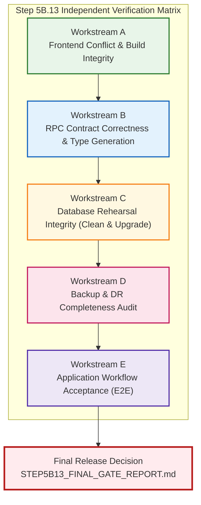

# TerraByte — Step 5B.13: Independent Verification & Staging Release Qualification Plan
**Document Version:** `1.0 (GSD Verification Execution Plan)`  
**Date:** `2026-11-04`  
**Lead Roles:** Independent Senior Full-Stack Engineer, Supabase Architect, PostgreSQL Auditor, and QA Release Engineer  
**Branch:** `phase-11`  
**Production Gate Status:** **`UNAUTHORIZED / BLOCKED — ZERO PRODUCTION SQL EXECUTION AUTHORIZED`**

---

## 1. Executive Mandate & Safety Boundaries

### 1.1 Objective
Independently audit and verify all claims, artifacts, code modifications, and rehearsal drill results generated in Step 5B.12. Establish whether TerraByte Phase 9 is genuinely qualified for an isolated staging deployment rehearsal without relying blindly on previous reports.

### 1.2 Absolute Safety Boundaries
Under no circumstances will any of the following actions be performed:
- **No SQL execution, DDL, DML, or migration commands against Supabase remote production (`hwdrypkvszwrcraujctw`).**
- **No `supabase db push` or `supabase migration repair` against remote production.**
- **No production configuration changes.**
- **No remote staging deployment during this audit without explicit human approval.**
- **No paid services, PITR upgrades, or automatic billing enablement.**
- **No Git commits, branch checkouts, merges, or pushes to remote.**
- **Never expose credentials, database passwords, or secret API keys.**
- **All database rehearsal drills must execute strictly on isolated local PostgreSQL 17.6 instances (`127.0.0.1:5433`).**

---

## 2. Verification Workstreams Structure

---

## 3. Workstream Execution Plans

### Workstream A: Frontend Conflict-Resolution Integrity
- **Focus:** Forensically inspect all changes made to `src/lib/services/profile.ts` and `src/integrations/supabase/types.ts`.
- **Audit Points:**
  1. Full-repository scan for any remaining conflict markers (`<<<<<<<`, `=======`, `>>>>>>>`).
  2. Verify that no unintended functionality was discarded during resolution.
  3. Verify that no unrelated or speculative changes were introduced.
  4. Verify that `updateData` is strictly defined in all code paths before reference.
  5. Security Analysis: Prove whether `.or(\`auth_user_id.eq.${user.id},id.eq.${profileId}\`)` can accidentally update or query another user's profile under authenticated session context.
  6. Verify village/location preservation logic ("Do not overwrite an existing saved farmer profile location with an empty value").
  7. Audit dual-write behavior to `profile_contacts` and graceful failure handling.
  8. Execute automated verification commands:
     - `npx tsc --noEmit`
     - `npm run lint` (documenting rule specifics)
     - `npm run build`
     - `npm test` (capturing exact test counts and test names)
- **Deliverable Section:** Captured in `STEP5B13_FINAL_GATE_REPORT.md` Section 2.

---

### Workstream B: RPC Contract Correctness & Type Generation
- **Focus:** Independently verify all 8 Phase 9 database RPCs against database catalog, TypeScript definitions, and service calls:
  1. `confirm_service_centre_part_handoff`
  2. `adjust_service_centre_part_stock`
  3. `receive_service_centre_stock`
  4. `return_service_centre_part`
  5. `request_service_centre_part`
  6. `update_service_centre_part_request_eta`
  7. `create_quote_atomic`
  8. `revise_quote_atomic`
- **Audit Points:**
  - Exact schema, function name, parameter order, data types, default values, nullability, return types, overloads.
  - Volatility, `SECURITY DEFINER` vs `INVOKER`, explicit `search_path` (including `pg_temp`).
  - Privilege ACLs for `PUBLIC`, `anon`, `authenticated`, `service_role`.
  - Intended RLS and caller role assumptions (`admin`, `technician`, `farmer`).
  - Run Supabase CLI type generation simulation against verified local database (`supabase gen types typescript --local` or direct pg_catalog extraction) to compare generated AST with committed `types.ts`.
- **Deliverable:** Dedicated artifact [`STEP5B13_RPC_VERIFICATION.md`](file:///d:/Projects/TerraByte/docs/audits/phase-9/STEP5B13_RPC_VERIFICATION.md).

---

### Workstream C: Database Rehearsal Integrity (Clean & Upgrade-Path)
- **Focus:** Perform TWO separate, isolated tests on disposable local PostgreSQL 17.6 instances (`127.0.0.1:5433`):
  1. **Test 1 — Clean Installation Drill:**
     - Start from an empty database baseline.
     - Apply schema foundations followed by forward migrations (`20261104110000`, `120000`, `130000`).
     - Verify catalog objects, indexes, triggers, functions, publications, policies.
  2. **Test 2 — Upgrade-Path Rehearsal:**
     - Restore clean pre-Phase-9 baseline from `terabyte_clean_restore_drill`.
     - Apply forward package in exact dependency sequence.
     - Verify existing data rows, tables, and views are 100% preserved.
     - Verify rerun idempotency without schema corruption.
     - Verify Phase 11 migrations (`20261103120000`, `20261104100000`) remain strictly excluded.
- **Deliverable:** Dedicated artifact [`STEP5B13_DATABASE_VERIFICATION.md`](file:///d:/Projects/TerraByte/docs/audits/phase-9/STEP5B13_DATABASE_VERIFICATION.md).

---

### Workstream D: Backup and Disaster-Recovery Completeness Audit
- **Focus:** Critically audit the Step 5B.12 backup plan against real-world Supabase capabilities.
- **Investigation Points:**
  - What does the local PostgreSQL drill actually prove vs what remains unproven on remote Supabase?
  - Role privileges required for remote `pg_dump` (Postgres superuser vs cloud `postgres` role).
  - Storage: PostgreSQL `storage` schema metadata vs actual underlying object files stored in S3/cloud storage buckets.
  - Extensions: Version compatibility and dependencies (`pgcrypto`, `uuid-ossp`).
  - Auth schema dependencies (`auth.users`, identities, tokens) and RLS ownership.
  - Sequences, identity columns, and default values.
  - Environment variables, secrets, and Supabase config.
  - Free tier vs Paid tier capabilities (PITR costs, WAL retention, logical dump RPO/RTO).
  - Distinguish explicitly:
    1. Verified by local drill
    2. Verifiable using free Supabase capabilities
    3. Unverified / Impossible without paid features
- **Deliverable:** Dedicated artifact [`STEP5B13_DR_RECOVERY_AUDIT.md`](file:///d:/Projects/TerraByte/docs/audits/phase-9/STEP5B13_DR_RECOVERY_AUDIT.md).

---

### Workstream E: Application Workflow Acceptance
- **Focus:** End-to-end trace and execution of the complete core agricultural machinery repair lifecycle:
  `Farmer → Breakdown report → Preliminary triage → Service centre → Technician → Parts request → Quote → Farmer approval → Repair tracking → Completion → Service history`
- **Verification Points:**
  - Role-based route boundaries (`/farmer/*`, `/technician/*`, `/admin/*`).
  - RLS and security isolation (farmers cannot view internal parts stock or other farmers' quotes).
  - Parts Desk requisition lifecycle (Stock check -> Parts hold -> Requisition -> Physical handoff -> Stock decrement).
  - Quote formulation & revision atomic flows.
  - Notifications and realtime event broadcasts.
  - Profile update and location preservation.
  - Mark any unintegrated external services (e.g. Google Maps API keys) explicitly as `UNVERIFIED`.
- **Deliverable:** Dedicated artifact [`STEP5B13_WORKFLOW_ACCEPTANCE.md`](file:///d:/Projects/TerraByte/docs/audits/phase-9/STEP5B13_WORKFLOW_ACCEPTANCE.md).

---

## 4. Ralph Loop Bounded Execution Rules

For any defect or failure identified during Step 5B.13 verification:
- Maximum 3 iterations per bounded failure.
- Explicit acceptance criteria must be defined before any file edit.
- Zero suppression of errors or weakening of assertions.
- Stop immediately if remote production access is required.
- Stop immediately if business logic is ambiguous.
- Record every iteration and output.

---

## 5. Verification Classification Standard

Every audit result in Step 5B.13 deliverables must be strictly categorized into one of five states:
- **`VERIFIED`**: Proven by reproducible automated execution with passing exit code and verified artifacts.
- **`PARTIALLY VERIFIED`**: Logic or contract verified in local rehearsal, but remote cloud behavior cannot be proven without live staging environment.
- **`UNVERIFIED`**: Requires external infrastructure, live third-party APIs, or production access.
- **`FAILED`**: Explicit error, type violation, or assertion failure encountered.
- **`NOT APPLICABLE`**: Explicitly out of scope for Phase 9 staging qualification.

---

## 6. Target Deliverables Inventory

1. [`STEP5B13_PLAN.md`](file:///d:/Projects/TerraByte/docs/audits/phase-9/STEP5B13_PLAN.md) (This document)
2. [`STEP5B13_RPC_VERIFICATION.md`](file:///d:/Projects/TerraByte/docs/audits/phase-9/STEP5B13_RPC_VERIFICATION.md)
3. [`STEP5B13_DATABASE_VERIFICATION.md`](file:///d:/Projects/TerraByte/docs/audits/phase-9/STEP5B13_DATABASE_VERIFICATION.md)
4. [`STEP5B13_DR_RECOVERY_AUDIT.md`](file:///d:/Projects/TerraByte/docs/audits/phase-9/STEP5B13_DR_RECOVERY_AUDIT.md)
5. [`STEP5B13_WORKFLOW_ACCEPTANCE.md`](file:///d:/Projects/TerraByte/docs/audits/phase-9/STEP5B13_WORKFLOW_ACCEPTANCE.md)
6. [`STEP5B13_FINAL_GATE_REPORT.md`](file:///d:/Projects/TerraByte/docs/audits/phase-9/STEP5B13_FINAL_GATE_REPORT.md)
