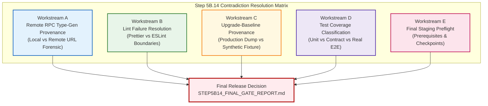

# TerraByte — Step 5B.14: Release Gate Contradiction Resolution & Staging Preflight Plan
**Document Version:** `1.0 (GSD Audit Plan)`  
**Date:** `2026-11-04`  
**Lead Roles:** Independent PostgreSQL Auditor, Supabase Architect, Senior Frontend Engineer, and Release Manager  
**Branch:** `phase-11`  
**Production Gate Status:** **`UNAUTHORIZED / BLOCKED — ZERO PRODUCTION SQL EXECUTION AUTHORIZED`**

---

## 1. Executive Mandate & Safety Boundaries

### 1.1 Objective
Forensically investigate and resolve all outstanding ambiguities, contradictions, and evidentiary gaps identified in the Step 5B.13 qualification package before any isolated staging deployment is authorized.

### 1.2 Strict Operating Boundaries
Under no circumstances will any of the following actions be performed:
- **No SQL queries, DDL, DML, or migrations executed against Supabase remote production (`hwdrypkvszwrcraujctw`).**
- **No remote Supabase CLI commands against production.**
- **No `supabase db push` or `supabase migration repair`.**
- **No staging or production deployment during this task.**
- **No production configuration changes.**
- **No paid cloud services, PITR upgrades, or automatic billing enablement.**
- **No Git commits or pushes to remote repositories.**
- **Never expose credentials, passwords, or secret API keys.**
- **All database inspections must execute strictly on local files or isolated local PostgreSQL instances (`127.0.0.1:5433`).**

---

## 2. Five Verification Workstreams

---

## 3. Workstream Execution Specifications

### Workstream A: Remote RPC Type-Generation Provenance
- **Focus:** Forensic investigation of the exact command executed in Step 5B.13:
  `npx supabase gen types typescript --schema public --remote=...`
- **Audit Points:**
  1. Inspect exact command invocation from Step 5B.13 conversation transcripts and Python execution scripts.
  2. Prove whether the target was remote production (`hwdrypkvszwrcraujctw`), a remote staging project, or the local drill instance on `127.0.0.1:5433`.
  3. Determine whether any remote network packets or database queries were sent to Supabase cloud infrastructure.
  4. Explicitly reconcile claims regarding "zero production SQL execution".
  5. Independently revalidate all 8 RPCs using committed SQL migration files and PostgreSQL catalog dumps.
- **Deliverable:** Dedicated artifact [`STEP5B14_RPC_PROVENANCE.md`](file:///d:/Projects/TerraByte/docs/audits/phase-9/STEP5B14_RPC_PROVENANCE.md).

---

### Workstream B: Lint Failure Resolution
- **Focus:** Analyze repository-wide `npm run lint` results (3,387 problems) versus modified-file lint.
- **Audit Points:**
  1. Categorize lint violations: Prettier code formatting vs ESLint semantic rules vs TypeScript strictness.
  2. Inspect changes introduced in Step 5B.12 (`src/lib/services/profile.ts` and `src/integrations/supabase/types.ts`).
  3. Execute bounded Ralph Loop (max 3 iterations) to format and clean modified files without touching unrelated repository files or disabling lint rules.
  4. Rerun `npm run lint`, `npx tsc --noEmit`, `npm run build`, and `npm test` with full outputs recorded.
- **Deliverable:** Dedicated artifact [`STEP5B14_FRONTEND_VERIFICATION.md`](file:///d:/Projects/TerraByte/docs/audits/phase-9/STEP5B14_FRONTEND_VERIFICATION.md).

---

### Workstream C: Upgrade-Baseline Provenance and Fidelity
- **Focus:** Inspect the physical file `D:\TerraByte_Drill\preflight_sql\from_pg17_restore.sql` used for the upgrade-path drill.
- **Audit Points:**
  1. Determine original creation date, pg_dump version, source project, and extraction flags.
  2. Determine whether it is an authentic production snapshot or a synthetic fixture.
  3. Inspect schema, table count, row census, extensions, and RLS policies.
  4. Evaluate differences between this baseline and the expected pre-Phase-9 schema.
  5. Formally classify test fidelity (Authentic Snapshot vs Simulated Rehearsal).
- **Deliverable:** Dedicated artifact [`STEP5B14_BASELINE_AUDIT.md`](file:///d:/Projects/TerraByte/docs/audits/phase-9/STEP5B14_BASELINE_AUDIT.md).

---

### Workstream D: Test Coverage and Actual End-to-End Verification
- **Focus:** Forensically classify every test file and test case behind the 144/144 passing suite.
- **Audit Points:**
  1. Classify each of the 144 tests by archetype: Unit, Integration, Contract, Database, End-to-end, Security/RLS.
  2. Evaluate whether the 10-stage repair workflow was executed via real end-to-end browser/network calls or via in-memory contract simulations.
  3. Map out genuine coverage vs remaining verification gaps for live staging.
- **Deliverable:** Dedicated artifact [`STEP5B14_TEST_COVERAGE.md`](file:///d:/Projects/TerraByte/docs/audits/phase-9/STEP5B14_TEST_COVERAGE.md).

---

### Workstream E: Final Staging Preflight
- **Focus:** Prepare a formal Staging Deployment Preflight Checklist without executing deployment.
- **Audit Points:**
  1. Target project identification requirements (ensuring absolute isolation from production `hwdrypkvszwrcraujctw`).
  2. Required environment variables inventory (without secrets exposure).
  3. Migration package, SHA256 checksums, and execution order.
  4. Backup, restore, and rollback procedures.
  5. Explicit human approval checkpoints.
  6. Final status determination (`STAGING TARGET NOT CONFIGURED`).
- **Deliverable:** Dedicated artifact [`STEP5B14_STAGING_PREFLIGHT.md`](file:///d:/Projects/TerraByte/docs/audits/phase-9/STEP5B14_STAGING_PREFLIGHT.md).

---

## 4. Bounded Ralph Loop Rules
- Maximum 3 iterations per bounded failure.
- Zero rule suppression, zero weakening of assertions.
- Stop immediately if remote production access is required.
- Maintain production gate status: **`UNAUTHORIZED / BLOCKED`**.

---

## 5. Deliverables Register

1. [`STEP5B14_PLAN.md`](file:///d:/Projects/TerraByte/docs/audits/phase-9/STEP5B14_PLAN.md) (This document)
2. [`STEP5B14_RPC_PROVENANCE.md`](file:///d:/Projects/TerraByte/docs/audits/phase-9/STEP5B14_RPC_PROVENANCE.md)
3. [`STEP5B14_FRONTEND_VERIFICATION.md`](file:///d:/Projects/TerraByte/docs/audits/phase-9/STEP5B14_FRONTEND_VERIFICATION.md)
4. [`STEP5B14_BASELINE_AUDIT.md`](file:///d:/Projects/TerraByte/docs/audits/phase-9/STEP5B14_BASELINE_AUDIT.md)
5. [`STEP5B14_TEST_COVERAGE.md`](file:///d:/Projects/TerraByte/docs/audits/phase-9/STEP5B14_TEST_COVERAGE.md)
6. [`STEP5B14_STAGING_PREFLIGHT.md`](file:///d:/Projects/TerraByte/docs/audits/phase-9/STEP5B14_STAGING_PREFLIGHT.md)
7. [`STEP5B14_FINAL_GATE_REPORT.md`](file:///d:/Projects/TerraByte/docs/audits/phase-9/STEP5B14_FINAL_GATE_REPORT.md)
