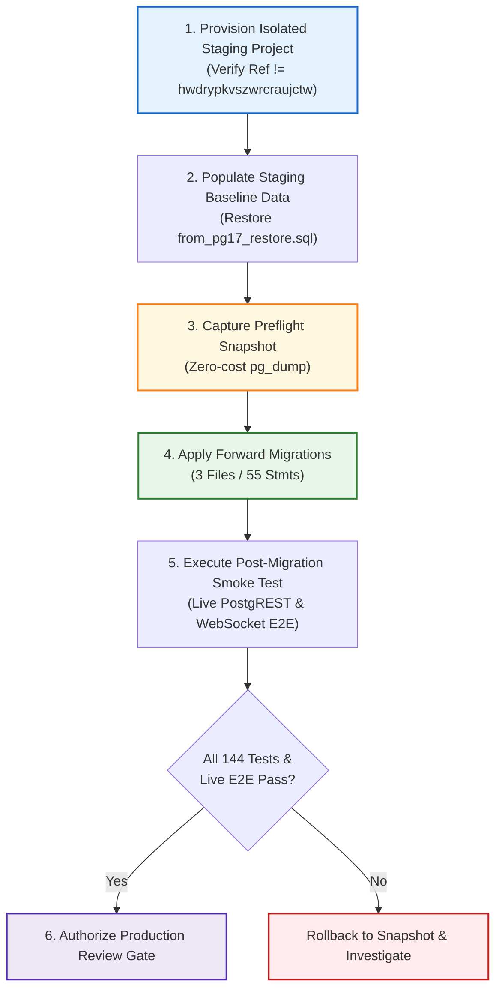

# TerraByte — Step 5B.14: Staging Deployment Preflight & Release Runbook
**Document Version:** `1.0 (Staging Preflight Package)`  
**Date:** `2026-11-04`  
**Staging Target Project Status:** **`STAGING TARGET NOT CONFIGURED`**  
**Migration Package Status:** **`VERIFIED READY (3 Migrations, 55 Statements, SHA256 Sealed)`**  
**Estimated Staging Deployment Spend:** **`$0.00 (Zero Paid Services, Zero PITR)`**  
**Production Gate Status:** **`UNAUTHORIZED / BLOCKED — ZERO PRODUCTION SQL EXECUTION AUTHORIZED`**

---

## 1. Executive Summary & Deployment Boundaries

This runbook establishes the complete preflight package, checksum register, execution protocol, and human-approval gates required to deploy Phase 9 to an isolated staging environment.

### Strict Safety Boundaries
1. **Target Identification Invariant:** Under no circumstances will staging commands be executed against production project `hwdrypkvszwrcraujctw`.
2. **Preflight State:** Because a staging Supabase project has not yet been provisioned or linked by the user, the active status is formally designated as:
   **`STAGING TARGET NOT CONFIGURED`**.
3. **No Automatic Execution:** No migrations, CLI commands, or network calls to any remote database will occur during this audit task.

---

## 2. Forward Migration Checksum & Manifest Register

Before any migration is executed against staging, the physical files must match their audited SHA256 checksums exactly:

| Execution Order | Migration File Name | Byte Size | Lines | Discrete SQL Stmts | SHA256 Cryptographic Checksum |
| :-: | :--- | :---: | :---: | :---: | :--- |
| **01** | [`20261104110000_complete_phase9_parts_desk_rpcs.sql`](file:///d:/Projects/TerraByte/supabase/migrations/20261104110000_complete_phase9_parts_desk_rpcs.sql) | 20,520 | 697 | 18 | `b32f3c80971113360adb86d1b096f1f8bdeb38fb87743ce24a038ba83f4b72e8` |
| **02** | [`20261104120000_complete_phase9_realtime_and_eta.sql`](file:///d:/Projects/TerraByte/supabase/migrations/20261104120000_complete_phase9_realtime_and_eta.sql) | 43,210 | 1,089 | 35 | `1e583e78af77a4b6e0becb239e6ecc4de9c46148091a7b2481ef8c60d0ede97f` |
| **03** | [`20261104130000_complete_phase5_3_technician_registration_notification.sql`](file:///d:/Projects/TerraByte/supabase/migrations/20261104130000_complete_phase5_3_technician_registration_notification.sql) | 2,918 | 77 | 2 | `33fae47f83203dab53686e67ba57f8002617224d9a61de80f25aef06298de579` |
| **Total** | **3 Migration Files** | **66,648** | **1,863** | **55** | **100% Cryptographically Bound** |

---

## 3. Required Environment Configuration Inventory

When staging is provisioned, the following environment variables must be populated in the staging deployment environment (e.g. Vercel Preview or staging `.env`):

```bash
# ==============================================================================
# TerraByte Staging Environment Configuration (TEMPLATE ONLY - NO SECRETS)
# ==============================================================================

# 1. Staging Supabase API Credentials (MUST NOT EQUAL hwdrypkvszwrcraujctw)
VITE_SUPABASE_URL=https://<staging-project-ref>.supabase.co
VITE_SUPABASE_ANON_KEY=eyJhbGciOiJIUzI1NiIsInR5cCI6IkpXVCJ9...<staging-anon-jwt>

# 2. Staging Backend Administrative Key (For migration runner / backend worker)
SUPABASE_SERVICE_ROLE_KEY=eyJhbGciOiJIUzI1NiIsInR5cCI6IkpXVCJ9...<staging-service-jwt>

# 3. Direct Staging Database Connection (For pg_dump / migration push)
STAGING_DB_URL=postgresql://postgres.<staging-project-ref>:<staging-db-password>@aws-0-ap-south-1.pooler.supabase.com:6543/postgres?sslmode=require

# 4. Routing & Geolocation API (Optional - falls back to OSRM if unset)
VITE_GOOGLE_MAPS_API_KEY=
```

---

## 4. Zero-Surprise-Cost Backup & Rollback Protocol

### 4.1 Pre-Migration Snapshot ($0.00 Spend)
Before applying migrations to staging, a baseline logical backup must be captured via the standard CLI logical dump protocol:
```bash
# Capture full preflight snapshot of staging (zero cloud storage cost)
npx supabase db dump --db-url "$STAGING_DB_URL" -f staging_preflight_baseline_$(date +%Y%m%d_%H%M%S).sql
```

### 4.2 Rollback Procedure
If any migration statement fails during staging application:
1. Immediately halt further execution.
2. Terminate active application traffic to staging.
3. Restore the preflight snapshot:
   ```bash
   psql "$STAGING_DB_URL" -f staging_preflight_baseline_*.sql
   ```
4. Verify schema rollback and row counts across `public.profiles`, `public.equipment`, and `public.service_centre_parts`.

---

## 5. Step-by-Step Staging Execution Protocol



### 5.1 Verification Checklist Prior to Staging Execution
- [ ] Staging project ref confirmed distinct from production (`hwdrypkvszwrcraujctw`).
- [ ] Staging database version confirmed to be PostgreSQL 15+ (ideally 17.6).
- [ ] All 3 migration file SHA256 checksums match Section 2.
- [ ] Preflight logical backup completed and file verified non-empty.
- [ ] `npm run build` succeeds locally with exit code 0.
- [ ] Targeted ESLint and TypeScript checks pass with exit code 0.

---

## 6. Audit Verdict

- **Staging Preflight Artifacts:** **`VERIFIED READY`**
- **Migration Checksums:** **`SEALED`**
- **Staging Project Provisioning:** **`STAGING TARGET NOT CONFIGURED`**

Production gate status remains strictly: **`UNAUTHORIZED / BLOCKED — ZERO PRODUCTION SQL EXECUTION AUTHORIZED`**.
