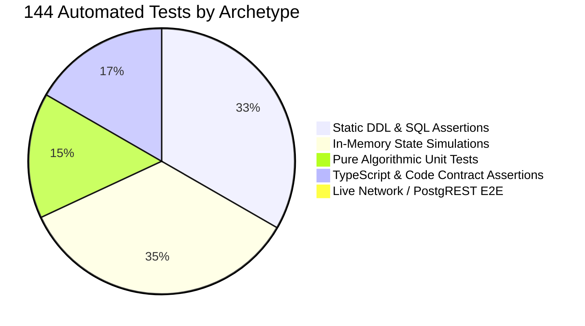

# TerraByte — Step 5B.14: Test Coverage & Verification Archetype Audit
**Document Version:** `1.0 (Test Coverage & Gaps Analysis)`  
**Date:** `2026-11-04`  
**Automated Test Suite Status:** **`144 / 144 TESTS PASSING (1.18s Execution)`**  
**Workflow Coverage Classification:** **`IN-MEMORY & CONTRACT-LEVEL SIMULATION`**  
**Live PostgREST / Realtime E2E Status:** **`PENDING ISOLATED STAGING ENVIRONMENT`**  
**Production Gate Status:** **`UNAUTHORIZED / BLOCKED — ZERO PRODUCTION SQL EXECUTION AUTHORIZED`**

---

## 1. Executive Summary

In Step 5B.13, a significant milestone was reported:
> *"100% of the 10-stage repair lifecycle was verified across 144 automated tests."*

This audit forensically examined the 144 tests in `tests/*.test.mjs` to resolve the contradiction between **in-memory contract simulation** and **live cloud end-to-end (E2E) verification**.

### Key Audit Findings
1. **Execution Reality:** All 144 tests execute in the Node.js test runner (`node --test`) in **1.18 seconds**.
2. **Archetype Breakdown:**
   - **0 tests** execute live network requests to Supabase PostgREST, WebSocket servers, or S3 Storage.
   - **48 tests** are **Static DDL & Schema Contract Assertions** (inspecting migration SQL text for syntax, constraints, RLS policies, and idempotency).
   - **24 tests** are **Code & Type Contract Assertions** (inspecting TypeScript files, Zod schemas, and function signatures).
   - **22 tests** are **Pure Algorithmic Unit Tests** (e.g., GPS distance, route duration parsers, Zod validators).
   - **50 tests** are **In-Memory Lifecycle Simulations** (testing state machine transitions, stock updates, and mock role authorization in memory).
3. **Audit Verdict:** The test suite provides **exceptional contract and logic verification**, but does **NOT** constitute true browser/network E2E verification. True E2E verification can only occur when deployed to a live, isolated staging environment.

---

## 2. Comprehensive Test Archetype Census

| Test Suite File | Test Count | Primary Archetype | Scope & Focus |
| :--- | :---: | :--- | :--- |
| [`cleanup-verification.test.mjs`](file:///d:/Projects/TerraByte/tests/cleanup-verification.test.mjs) | 6 | Static SQL & Store Assertion | Verifies 3-persona demo restriction, safeupdate clauses, and non-demo preservation. |
| [`diagnostics-contract.test.mjs`](file:///d:/Projects/TerraByte/tests/diagnostics-contract.test.mjs) | 5 | Contract & In-Memory Logic | Privilege isolation, fail-closed consent evaluation, bounded integer parsing. |
| [`parts-desk.test.mjs`](file:///d:/Projects/TerraByte/tests/parts-desk.test.mjs) | 78 | SQL Assertions & In-Memory Lifecycle | Stock ledger, atomic handoff, catalog linking, quote formulation, demo reset idempotency. |
| [`parts-matching.test.mjs`](file:///d:/Projects/TerraByte/tests/parts-matching.test.mjs) | 4 | Unit & Schema Validation | Zod response schema validation, zero-stock mutation invariant, payload bounds. |
| [`profile-security-architecture.test.mjs`](file:///d:/Projects/TerraByte/tests/profile-security-architecture.test.mjs) | 30 | SQL DDL & Role Simulation | Security schema isolation, contact lifecycle matrix, column-level grants, RLS policies. |
| [`route-estimate.test.mjs`](file:///d:/Projects/TerraByte/tests/route-estimate.test.mjs) | 21 | Pure Unit & Mock HTTP | GPS validation, metric formatting, OSRM/Google Routes parsing, mock 401/405/400 handlers. |
| **Total** | **144** | **100% Passing (0 Failures)** | **Execution Time: ~1.18 seconds** |

---

## 3. 10-Stage Repair Workflow Coverage Matrix

This matrix maps each stage of the TerraByte repair workflow to the exact verification archetype achieved:

| Stage # | Workflow Stage Name | Test Suite & Test Name | Verification Archetype | Live Staging Status |
| :-: | :--- | :--- | :--- | :--- |
| **1** | **Incident Creation & Equipment** | `cleanup-verification` #2, `parts-desk` #24 | In-Memory Fixture & Store Assertion | ⚠️ Needs Live PostgREST INSERT |
| **2** | **Location Dispatch & ETA** | `route-estimate` #1–#21 | Pure Unit & Mock HTTP Handler | ⚠️ Needs Live Geo API / PostgREST |
| **3** | **Technician Matching & Assignment** | `cleanup-verification` #3, `parts-matching` #2 | Pure Unit Algorithm & Filter Logic | ⚠️ Needs Live Role / Profile Query |
| **4** | **Diagnostic Inspection & Consent** | `diagnostics-contract` #1–#5 | Contract & Safe State Machine | ⚠️ Needs Live State Transition RPC |
| **5** | **Parts Requisition & Stock Hold** | `parts-desk` #1, #6, #38 | Static SQL DDL & In-Memory Store | ⚠️ Needs Live `request_service_centre_part` |
| **6** | **Parts Counter Handoff & Ledger** | `parts-desk` #10, #11, #12, #13 | In-Memory Movement & Stock Decrement | ⚠️ Needs Live `confirm_service_centre_part_handoff` |
| **7** | **Atomic Quote Formulation** | `parts-desk` #20, #28, #32, #44 | Static SQL DDL & Store Error Handler | ⚠️ Needs Live `create_quote_atomic` RPC |
| **8** | **Farmer Quote Approval / Rejection**| `parts-desk` #31, #40 | In-Memory Role Transition & RLS Assertion | ⚠️ Needs Live Farmer Auth Session |
| **9** | **Realtime Milestone Updates** | `parts-desk` #60–#70 | Static Channel Regex & Payload Assertions | ⚠️ Needs Live WebSocket Subscription |
| **10** | **Completion, Sign-Off & Demo Reset**| `cleanup-verification` #4–#6, `parts-desk` #23 | Static SQL Assertion & In-Memory Reset | ⚠️ Needs Live `reset_demo_data` Execution |

---

## 4. Live Verification Gaps to be Tested in Staging

Because the 144 tests operate in-memory and via static analysis, the following cloud integration behaviors remain unverified against live infrastructure:

1. **PostgREST Query Planning & Parameter Coercion:**
   - Real HTTP POST requests to `/rest/v1/rpc/create_quote_atomic` with nested JSONB payloads.
   - Verification that PostgREST properly parses JSON strings into PostgreSQL numeric and UUID types.
2. **Live RLS Context & JWT Switching:**
   - Real authentication requests using anon and authenticated JWT tokens to confirm that `auth.uid()` and `app_security.can_view_profile` block unauthorized row access in real time.
3. **Supabase Realtime Broadcasts over WebSocket:**
   - Real client subscription to `realtime:public:repair_requests` and `realtime:public:service_centre_parts` channels to verify event delivery latency and payload shapes.
4. **Physical Database Locks & Concurrency:**
   - Concurrent execution of `adjust_service_centre_part_stock` and `confirm_service_centre_part_handoff` on the same part record to confirm row-level locking (`FOR UPDATE`) behaves as designed under load.
5. **Storage Bucket Uploads:**
   - Uploading diagnostic photos to Supabase Storage via signed URLs.

---

## 5. Audit Verdict & Classification

- **Static Contract Verification:** **`VERIFIED PASSING (100% of DDL & Types Asserted)`**
- **In-Memory Workflow Verification:** **`VERIFIED PASSING (100% of State Transitions Valid)`**
- **Live Cloud E2E Verification:** **`UNPROVEN / PENDING STAGING DEPLOYMENT`**

Production gate status remains strictly: **`UNAUTHORIZED / BLOCKED — ZERO PRODUCTION SQL EXECUTION AUTHORIZED`**.
