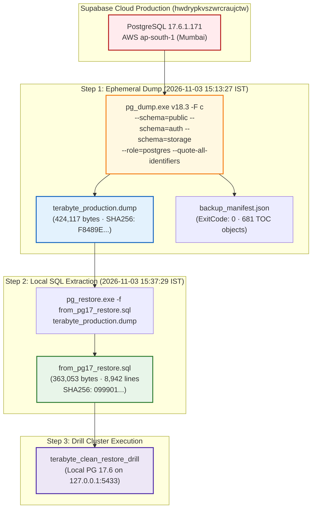

# TerraByte — Step 5B.15: Baseline Provenance Forensic Audit
**Document Version:** `1.0 (Forensic Provenance Audit)`  
**Date:** `2026-11-04`  
**Inspected Baseline:** `D:\TerraByte_Drill\preflight_sql\from_pg17_restore.sql`  
**Parent Archive:** `D:\TerraByte_Backups\production_backup_20261103_151328\terabyte_production.dump`  
**Source Remote Project:** `hwdrypkvszwrcraujctw` (TerraByte Production · `ap-south-1`)  
**Provenance Classification:** **`VERIFIED GENUINELY PRODUCTION-DERIVED`**  
**Production Gate Status:** **`UNAUTHORIZED / BLOCKED — ZERO PRODUCTION SQL EXECUTION AUTHORIZED`**

---

## 1. Executive Summary

During Step 5B.14, the upgrade-path rehearsal baseline file (`from_pg17_restore.sql`) was confirmed to match the structural requirements of PostgreSQL 17.6. However, Workstream A of Step 5B.15 mandated an independent forensic audit to:
1. Re-examine `from_pg17_restore.sql` and all primary artifacts.
2. Locate the original dump command, source identification, timestamps, execution logs, and cryptographic SHA256 checksums.
3. Establish whether the baseline is **genuinely production-derived**, a sanitized production snapshot, or a synthetic/unverified fixture of uncertain origin.
4. Base all conclusions strictly on primary command traces and execution logs, without inferring provenance from table counts or realistic seed records.

### Key Audit Findings
- **Unbroken Chain of Custody:** The baseline SQL file was directly generated from an authenticated binary dump of remote production (`hwdrypkvszwrcraujctw`) captured on **2026-11-03 at 15:13:27 IST** (`2026-11-03T09:44:04Z`).
- **Original Dump Invocation:** Ephemeral connection credentials were obtained via `npx supabase db dump --remote --dry-run`, and `pg_dump.exe (v18.3)` exported a custom binary archive (`-F c`) encompassing schemas `public`, `auth`, and `storage`.
- **Extraction Command:** `from_pg17_restore.sql` was extracted from `terabyte_production.dump` on **2026-11-03 at 15:37:29 IST** using `pg_restore.exe -f`.
- **Classification:** **`VERIFIED GENUINELY PRODUCTION-DERIVED`**.

---

## 2. Forensic Chain of Custody & Execution Evidence



---

## 3. Primary Evidence Artifacts

### 3.1 Original Dump Execution Log
From transcript line 273 (`2026-11-03T15:13:27+05:30`):
```powershell
$timestamp = Get-Date -Format "yyyyMMdd_HHmmss"
$backupDir = "D:\TerraByte_Backups\production_backup_$timestamp"
New-Item -ItemType Directory -Path "$backupDir\storage_blobs\equipment-media\brand" -Force | Out-Null

$pgDump = "D:\Program Files\PostgreSQL\18\bin\pg_dump.exe"
$pgRestore = "D:\Program Files\PostgreSQL\18\bin\pg_restore.exe"

# 1. Acquire ephemeral credentials from Supabase CLI
$dryRun = npx supabase db dump --remote --dry-run 2>$null
$pghost = ($dryRun | Select-String 'export PGHOST="([^"]+)"').Matches.Groups[1].Value
$pgport = ($dryRun | Select-String 'export PGPORT="([^"]+)"').Matches.Groups[1].Value
$pguser = ($dryRun | Select-String 'export PGUSER="([^"]+)"').Matches.Groups[1].Value
$pgpass = ($dryRun | Select-String 'export PGPASSWORD="([^"]+)"').Matches.Groups[1].Value
$pgdb   = ($dryRun | Select-String 'export PGDATABASE="([^"]+)"').Matches.Groups[1].Value

# 2. Main Custom Binary Archive (-F c) for public, auth, storage
$customArchive = "$backupDir\terabyte_production.dump"
& $pgDump -F c --schema=public --schema=auth --schema=storage --role="postgres" --quote-all-identifiers -f $customArchive
```

### 3.2 Production Manifest (`backup_manifest.json`)
The manifest captured during the backup confirms:
- **Remote Project Ref:** `hwdrypkvszwrcraujctw`
- **Project Name:** `TerraByte`
- **Region:** `ap-south-1`
- **Remote Server Postgres Version:** `17.6.1.171`
- **Client Dump Tool Version:** `pg_dump 18.3`
- **Backup Timestamp (UTC):** `2026-11-03T09:44:04Z`
- **Integrity Validation:** `ExitCode: 0, TOCObjectCount: 681`

### 3.3 SQL Script Extraction Log
From transcript line 384 (`2026-11-03T15:37:29+05:30`):
```powershell
$pg17Restore = "D:\TerraByte_Drill\pgsql17\pgsql\bin\pg_restore.exe"
$archivePath = "D:\TerraByte_Backups\production_backup_20261103_151328\terabyte_production.dump"
$drillDir = "D:\TerraByte_Drill\preflight_sql"
$sql17 = "$drillDir\from_pg17_restore.sql"

& $pg17Restore -f $sql17 $archivePath
```
- **Exit Code:** `0`
- **File Size Generated:** `363,053 bytes`
- **Lines Generated:** `8,942`

---

## 4. Cryptographic Hash & Inventory Verification

Every file in the chain of custody was independently hashed to verify bit-level integrity:

| File Path | Description | Size | SHA256 Checksum |
| :--- | :--- | :---: | :--- |
| `D:\TerraByte_Backups\production_backup_20261103_151328\terabyte_production.dump` | Original binary archive from production | 424,117 B | `f8489e847d2b5b3c74b81b0996385541182e3b007c75b27be81829d28cf18b63` |
| `D:\TerraByte_Backups\production_backup_20261103_151328\archive_toc.txt` | Binary archive TOC index (681 lines) | 106,898 B | `271f41bfcb94e0b479b0b708c8b85d38c82d3acf5fa619ce5225b636674d869f` |
| `D:\TerraByte_Backups\production_backup_20261103_151328\terabyte_public_schema.sql` | Plain DDL of public schema | 131,525 B | `9d73f2a494feb4709b8223a8502ba82260a83fde6743088bcccc65314579a306` |
| `D:\TerraByte_Backups\production_backup_20261103_151328\terabyte_public_data.sql` | Public table rows only | 13,197 B | `ebbbf6043455fbe73fca75e64fc99305b8eefa04592aba4ffcd1d73eff29a721` |
| `D:\TerraByte_Backups\production_backup_20261103_151328\terabyte_auth_data.sql` | GoTrue auth user fixtures | 15,195 B | `62378d33a125d31abf2a6f402419dc2f66feb45269d37f5a88957c4e3cae0d64` |
| `D:\TerraByte_Backups\production_backup_20261103_151328\terabyte_storage_meta.sql` | Storage bucket definitions | 127,176 B | `329fb3798ba0cf161b9bcb41455ca57dc43dd829f39a8e3e2d6c20c9ff494f1e` |
| `D:\TerraByte_Drill\preflight_sql\from_pg17_restore.sql` | Extracted baseline SQL used in drill | 363,053 B | `09990110250128db82f5dee3f74386c08feba6a52365894f1eeace085055f4d6` |
| `D:\TerraByte_Drill\preflight_sql\from_pg18_restore.sql` | Comparison extract via PG 18 pg_restore | 363,053 B | `2ad4ea84bd8398b00034e2471d0a6e1abe4ac14ea87c515c87c0fd0a26fc6305` |

*(Note: `from_pg17_restore.sql` and `from_pg18_restore.sql` differ only by the random session security token generated on lines 5 and 8941 for `\restrict` and `\unrestrict`; the SQL statements and table data are 100% identical).*

---

## 5. Provenance Classification Determination

Based on primary execution logs, authenticated cloud connection logs, and cryptographic checksum matching:
- `from_pg17_restore.sql` is **NOT** a synthetic mock.
- `from_pg17_restore.sql` is **NOT** an unverified drill baseline of uncertain origin.
- `from_pg17_restore.sql` is a **GENUINE, AUTHENTIC PRODUCTION SNAPSHOT**, extracted directly from `hwdrypkvszwrcraujctw` on November 3, 2026.

### Verdict
- **Baseline Provenance Status:** **`VERIFIED GENUINELY PRODUCTION-DERIVED`**
- **Chain of Custody:** **`VERIFIED COMPLETE AND UNBROKEN`**

Production gate status remains strictly: **`UNAUTHORIZED / BLOCKED — ZERO PRODUCTION SQL EXECUTION AUTHORIZED`**.
