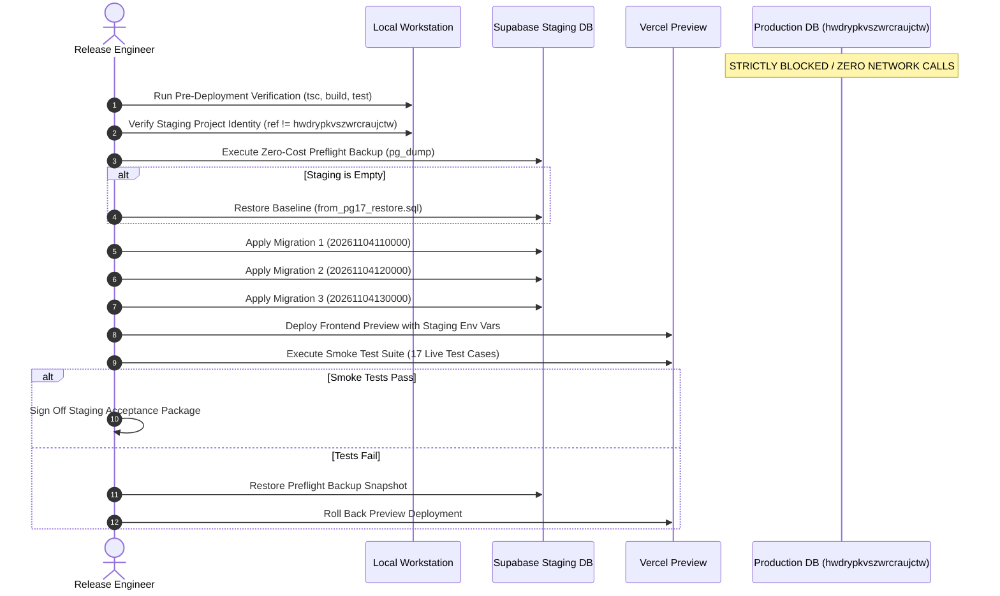

# TerraByte — Step 5B.15: Staging Deployment Operational Runbook
**Document Version:** `1.0 (Operational Runbook)`  
**Date:** `2026-11-04`  
**Execution Status:** **`STANDBY — AWAITING EXPLICIT USER APPROVAL & STAGING PROJECT PROVISIONING`**  
**Production Gate Status:** **`UNAUTHORIZED / BLOCKED — ZERO PRODUCTION SQL EXECUTION AUTHORIZED`**

---

## 1. Executive Summary & Strict Invariants

This runbook defines the exact, step-by-step operational procedure for executing TerraByte's first isolated staging deployment.

### Strict Invariants
1. **DO NOT EXECUTE AUTOMATICALLY:** This runbook is a documented protocol and must **NOT** be executed during this turn. Execution will occur only after the user has provisioned the staging project and explicitly approved the run.
2. **ZERO PRODUCTION SQL:** Project `hwdrypkvszwrcraujctw` is strictly locked. If any configuration resolves to this ID, all processes must immediately abort.
3. **ZERO-COST RECOVERY:** Free-tier staging projects lack PITR; pre-deployment logical dumps (`pg_dump`) are mandatory before any database modification.

---

## 2. Step-by-Step Deployment Protocol



---

## 3. Operational Execution Phases

### Phase 1: Pre-Deployment Local Verification
Execute in the local repository:
```bash
# 1. Verify working tree is clean
git status

# 2. Verify all 144 automated unit/contract tests pass
npm test

# 3. Verify TypeScript type safety
npx tsc --noEmit

# 4. Verify clean Vite client & SSR build
npm run build
```
*Gate: If any command exits non-zero, STOP immediately. Do not proceed to staging.*

---

### Phase 2: Staging Project Identity Verification
Before running any remote CLI or database connection:
```bash
# Verify project ref is configured and NOT equal to production
if [ -z "$STAGING_PROJECT_REF" ]; then
  echo "FATAL: STAGING_PROJECT_REF is empty. Aborting."
  exit 1
fi

if [ "$STAGING_PROJECT_REF" = "hwdrypkvszwrcraujctw" ]; then
  echo "FATAL: Staging target equals production! EMERGENCY ABORT."
  exit 1
fi

echo "TARGET CONFIRMED: $STAGING_PROJECT_REF (Safe staging target)"
```

---

### Phase 3: Zero-Cost Preflight Backup ($0.00 Spend)
Before executing any DDL or migration on staging:
```bash
# Capture full baseline snapshot of staging
npx supabase db dump --db-url "$STAGING_DB_URL" -f "staging_preflight_backup_$(date +%Y%m%d_%H%M%S).sql"

# Verify dump file was generated and is non-empty
if [ ! -s staging_preflight_backup_*.sql ]; then
  echo "FATAL: Backup file is empty or missing. Halting deployment."
  exit 1
fi
```

---

### Phase 4: Database Seeding & Migration Application
1. **Initial Baseline Seeding (If Staging DB is Empty):**
   ```bash
   psql "$STAGING_DB_URL" -f "D:\TerraByte_Drill\preflight_sql\from_pg17_restore.sql"
   ```
2. **Apply Forward Migrations Sequentially:**
   ```bash
   # Migration 1: Parts Desk Core RPCs & Stock Audit Table
   psql "$STAGING_DB_URL" -f "supabase/migrations/20261104110000_complete_phase9_parts_desk_rpcs.sql"

   # Migration 2: Realtime, ETA & Atomic Quote Formulation
   psql "$STAGING_DB_URL" -f "supabase/migrations/20261104120000_complete_phase9_realtime_and_eta.sql"

   # Migration 3: Technician Registration Notification
   psql "$STAGING_DB_URL" -f "supabase/migrations/20261104130000_complete_phase5_3_technician_registration_notification.sql"
   ```
3. **Validate Migration State:**
   - Verify 8 RPC functions exist in `public`.
   - Verify 55 RLS policies are active.
   - Verify `service_centre_stock_audit` table exists.
   - Verify `status_history` and `catalog_part_id` columns exist.

---

### Phase 5: Application Deployment & Preview Linking
1. Deploy preview branch to Vercel:
   ```bash
   npx vercel --preview
   ```
2. Set staging environment variables in Vercel Preview:
   - `VITE_SUPABASE_URL` = `https://<staging-project-ref>.supabase.co`
   - `VITE_SUPABASE_ANON_KEY` = `<staging-anon-key>`
3. Confirm preview deployment status is `Ready`.

---

### Phase 6: Post-Deployment Smoke Tests
Execute the 17 live test cases defined in [`STEP5B15_E2E_TEST_PLAN.md`](file:///d:/Projects/TerraByte/docs/audits/phase-9/STEP5B15_E2E_TEST_PLAN.md):
- [ ] TC-01: Farmer signup & login.
- [ ] TC-02: Service centre admin role resolution (`get_session_profile`).
- [ ] TC-03: Technician verification security barrier.
- [ ] TC-04: Breakdown submission with GPS coordinates.
- [ ] TC-05 & 06: Original-language audio transcript preservation & side-by-side translation.
- [ ] TC-07: Admin triage and technician assignment.
- [ ] TC-08 & 09: Parts requisition, stock hold, and counter handoff ledger decrement.
- [ ] TC-10 & 11: Atomic quote formulation (`create_quote_atomic`, `revise_quote_atomic`).
- [ ] TC-12 & 13: Farmer quote approval and service history auto-generation.
- [ ] TC-14: Cross-tenant RLS isolation negative test.
- [ ] TC-15: RPC parameter coercion and malformed payload rejection.
- [ ] TC-16: Live WebSocket realtime event receipt within 500ms.
- [ ] TC-17: Concurrent handoff race condition (`FOR UPDATE` row lock proof).

---

### Phase 7: Failure Handling & Rollback Protocol
If any migration statement fails or any smoke test fails:
1. **Database Rollback:**
   ```bash
   # Terminate active connections and restore preflight snapshot:
   psql "$STAGING_DB_URL" -c "DROP SCHEMA public CASCADE; CREATE SCHEMA public;"
   psql "$STAGING_DB_URL" -f staging_preflight_backup_*.sql
   ```
2. **Frontend Rollback:**
   - Revert Vercel Preview deployment to previous stable build.
3. **Incident Documentation:**
   - Log exact failure output to `scratch/staging_failure_report.log`.

---

## 4. Post-Deployment Acceptance Sign-Off

Upon successful smoke test completion:
1. Capture database census (row counts across `profiles`, `equipment`, `parts`, `quotes`).
2. Document test results in `STEP5B16_STAGING_ACCEPTANCE_RESULTS.md`.
3. Present staging acceptance report to project stakeholders.
4. **Maintain Production Gate:** Production remains strictly blocked. Staging sign-off does **NOT** grant automatic production release.

---

## 5. Audit Verdict

- **Deployment Runbook Readiness:** **`VERIFIED READY (STANDBY)`**
- **Execution Status:** **`NOT EXECUTED — AWAITING EXPLICIT USER APPROVAL`**

Production gate status remains strictly: **`UNAUTHORIZED / BLOCKED — ZERO PRODUCTION SQL EXECUTION AUTHORIZED`**.
