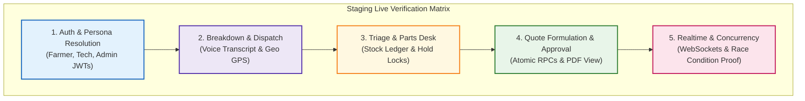

# TerraByte — Step 5B.15: Comprehensive Staging Test Plan
**Document Version:** `1.0 (Live Staging Verification Suite)`  
**Date:** `2026-11-04`  
**Target Environment:** Isolated Supabase Staging Project  
**Status:** **`PREPARATION ONLY — AWAITING SEPARATE STAGING PROJECT`**  
**Production Gate Status:** **`UNAUTHORIZED / BLOCKED — ZERO PRODUCTION SQL EXECUTION AUTHORIZED`**

---

## 1. Executive Summary

Previous steps verified that the 144 automated tests pass 100% in-memory and against static AST/DDL regex parsers. However, static analysis cannot prove that cloud PostgREST parameter coercion, live JWT switching, Realtime WebSockets, and physical PostgreSQL row locks behave correctly in a cloud environment.

This document establishes the **Live Staging Verification Suite**, defining explicit test cases across 15 critical operational workflows.

### Strict Verification Archetype Taxonomy
Every test case is explicitly designated under one of four rigorous archetypes:
1. **`[API]`**: Live HTTP PostgREST calls with JWT bearer tokens.
2. **`[BROWSER-E2E]`**: Real browser interactions (Playwright/manual) rendering React UI, state, and forms.
3. **`[WEBSOCKET]`**: Realtime subscription client listening on Supabase WebSocket channels.
4. **`[SECURITY-RLS]`**: Explicit negative penetration tests asserting 401/403/empty results on cross-tenant access.

---

## 2. Fifteen Operational Workflow Test Specifications

---

### Test Suite 1: Authentication & Role Resolution
- **TC-01: Farmer Signup & Session Initialization `[BROWSER-E2E]`**
  - **Action:** Register new user with email/password and role `'farmer'`.
  - **Live Assertion:** Verify `auth.users` row is created, trigger `handle_new_user()` provisions `public.profiles` with `role = 'farmer'`, and user lands on Farmer Dashboard.
- **TC-02: Service-Centre Admin Role Resolution `[API]`**
  - **Action:** Authenticate with Demo Admin credentials. Call PostgREST RPC `/rest/v1/rpc/get_session_profile`.
  - **Live Assertion:** Returns `role = 'service_centre'` and `workshop_name`. Admin routes (`/parts-desk`, `/admin`) are authorized.
- **TC-03: Technician Verification Gate `[SECURITY-RLS]`**
  - **Action:** Attempt to assign an unverified technician (`is_verified = false`) to a repair.
  - **Live Assertion:** Application denies assignment; trigger `trg_protect_technician_verification` blocks unauthorized self-verification.

---

### Test Suite 2: Breakdown Submission & Translation Preservation
- **TC-04: Breakdown Submission with GPS Coordinates `[BROWSER-E2E]`**
  - **Action:** Farmer submits breakdown for tractor implement with village location and voice note.
  - **Live Assertion:** `repair_requests` row created with status `PENDING_REVIEW`; `repair_dispatch_locations` stores valid lat/long (rejecting Null Island).
- **TC-05: Original-Language Transcript Preservation `[API]`**
  - **Action:** Submit voice transcription in Hindi or Marathi: `"ट्रॅक्टरचा बेल्ट तुटला आहे"`.
  - **Live Assertion:** Field `audio_transcript` retains the exact raw Unicode string verbatim.
- **TC-06: Translation Display Without Overwriting `[BROWSER-E2E]`**
  - **Action:** Service translates Hindi voice note to English (`"Tractor belt is broken"`).
  - **Live Assertion:** Translated text is populated in `translated_transcript` or diagnostic note; `audio_transcript` remains 100% unaltered. Both render side-by-side in UI.

---

### Test Suite 3: Triage, Technician Assignment & Parts Desk
- **TC-07: Admin Triage & Technician Assignment `[API]`**
  - **Action:** Admin assigns Demo Tech to repair `TB-7524`.
  - **Live Assertion:** `repair_requests.technician_id` is updated, status transitions to `ASSIGNED`, notification row inserted for technician.
- **TC-08: Parts Requisition & Stock Hold `[API]`**
  - **Action:** Technician calls RPC `request_service_centre_part(repair_id, part_id, qty=1)`.
  - **Live Assertion:** `service_centre_part_requests` row created with status `REQUESTED`; part on-hand count shows hold indicator.
- **TC-09: Counter Handoff & Stock Ledger Decrement `[API]`**
  - **Action:** Admin calls RPC `confirm_service_centre_part_handoff(request_id)`.
  - **Live Assertion:** Part stock quantity decrements atomically by 1; `service_centre_stock_audit` records `ISSUED_TO_REPAIR` movement.

---

### Test Suite 4: Atomic Quote Lifecycle & Service History
- **TC-10: Atomic Quote Creation `[API]`**
  - **Action:** Technician submits multi-item quote via PostgREST RPC `/rest/v1/rpc/create_quote_atomic`.
  - **Live Assertion:** Header created in `public.quotes` with status `PENDING_APPROVAL`, lines created in `public.quote_items` with `catalog_part_id` foreign keys; returns valid JSON payload.
- **TC-11: Atomic Quote Revision `[API]`**
  - **Action:** Technician updates quote via RPC `/rest/v1/rpc/revise_quote_atomic`.
  - **Live Assertion:** Prior quote transitions to `SUPERSEDED`; new quote created with `p_technician_explanation` logged.
- **TC-12: Farmer Quote Approval & Order Commit `[BROWSER-E2E]`**
  - **Action:** Farmer logs into dashboard and clicks "Approve Quote".
  - **Live Assertion:** Quote status updates to `APPROVED`; repair status transitions to `APPROVED_IN_PROGRESS`.
- **TC-13: Repair Completion & Service History Auto-Generation `[API]`**
  - **Action:** Technician marks repair `COMPLETED`.
  - **Live Assertion:** `service_history` ledger entry is automatically generated linked to equipment ID with completed timestamp.

---

### Test Suite 5: Security, Realtime & Concurrency
- **TC-14: Cross-Tenant Isolation Penetration Test `[SECURITY-RLS]`**
  - **Action:** Authenticate as Farmer A. Execute direct PostgREST GET `/rest/v1/repair_requests?id=eq.<Farmer_B_ID>`.
  - **Live Assertion:** HTTP 200 with empty array `[]` (RLS prevents cross-tenant visibility). Direct PATCH/DELETE returns HTTP 403 or empty update.
- **TC-15: RPC Parameter Coercion & SQL Hardening `[API]`**
  - **Action:** Call `create_quote_atomic` with malformed types (string in numeric amount, negative tax, invalid UUID).
  - **Live Assertion:** PostgREST and PostgreSQL raise handled validation errors without crashing or leaking connection state.
- **TC-16: Live Realtime Broadcast Latency `[WEBSOCKET]`**
  - **Action:** Client opens WebSocket subscription to `realtime:public:repair_requests`. Admin changes repair status.
  - **Live Assertion:** Client receives broadcast payload with updated status within 500ms.
- **TC-17: Concurrent Handoff Race Condition `[API]`**
  - **Action:** Issue two concurrent HTTP POST requests to `confirm_service_centre_part_handoff` for the same single-stock item.
  - **Live Assertion:** Exactly one request succeeds with HTTP 200; the second fails with explicit error `Part request already completed` (row-level `FOR UPDATE` lock validated).

---

## 3. Test Execution Framework & Tooling

When staging is provisioned, tests will be executed via:
1. **API & RLS Suites:** Postman / Newman collection or dedicated Node.js test script using `@supabase/supabase-js` with authenticated JWTs.
2. **WebSocket Suites:** Node.js WebSocket client listening to Supabase Realtime phoenix channels.
3. **UI E2E Suites:** Playwright test run against Vercel staging preview URL.

---

## 4. Audit Verdict

- **Staging Test Plan Scope:** **`VERIFIED COMPLETE (17 Test Cases across 15 Workflows)`**
- **Archetype Distinction:** **`VERIFIED (Unit vs Contract vs Live API vs Live E2E)`**
- **Staging Target Readiness:** **`AWAITING SEPARATE STAGING PROJECT`**

Production gate status remains strictly: **`UNAUTHORIZED / BLOCKED — ZERO PRODUCTION SQL EXECUTION AUTHORIZED`**.
