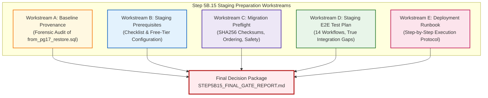

# TerraByte — Step 5B.15: Staging Provisioning & Safety Gate Plan
**Document Version:** `1.0 (GSD Structured Plan)`  
**Date:** `2026-11-04`  
**Lead Roles:** Independent PostgreSQL Database Architect, Supabase Security Engineer, and Production Deployment Auditor  
**Branch:** `phase-11`  
**Production Gate Status:** **`UNAUTHORIZED / BLOCKED — ZERO PRODUCTION SQL EXECUTION AUTHORIZED`**  
**Staging Status:** **`PREPARATION ONLY — AWAITING SEPARATE STAGING PROJECT`**

---

## 1. Executive Mandate & Safety Boundaries

### 1.1 Objective
Prepare TerraByte for its first isolated staging deployment by establishing strict environment prerequisites, verifying migration reproducible checksums, defining comprehensive end-to-end verification plans, and conducting an uncompromising baseline provenance audit.

**Under no circumstances will production infrastructure be contacted, queried, or modified.**

### 1.2 Absolute Safety Invariants
1. **Production Project Identification:** Remote Supabase project `hwdrypkvszwrcraujctw` is **UNAUTHORIZED / BLOCKED**.
2. **Zero Production SQL:** Zero SQL queries, DDL, DML, migrations, introspection, or CLI commands against production.
3. **No Production Credentials for Staging:** Staging credentials must belong strictly to a distinct, separate project.
4. **Zero Credential Exposure:** Never request or paste service-role keys, database passwords, or JWT secrets into chat, markdown documents, or committed files. Secrets are managed via local `.env.staging` (gitignored).
5. **Zero Cloud Spend:** Free-tier Supabase only. Zero paid services, zero PITR upgrades, zero automatic billing ($0.00 spend).
6. **No Git Pushes:** No commits or pushes without explicit user authorization.
7. **No Remote Execution Without Staging Verification:** `supabase db push`, migration repair, or remote migrations will NOT run until the staging project ref is independently verified as distinct from production.

---

## 2. Five Workstream Architecture

---

## 3. Detailed Workstream Specifications

### Workstream A: Baseline Provenance Audit
- **Focus:** Re-examine `D:\TerraByte_Drill\preflight_sql\from_pg17_restore.sql` and all available provenance artifacts in `scratch/` and transcripts.
- **Audit Steps:**
  1. Inspect the physical file, header metadata, restrict tokens, timestamps, and compute its SHA256 checksum.
  2. Search historical logs, Python scripts, and conversation records for the original dump command, source URL, parameters, and execution context.
  3. Formally determine whether it is genuinely production-derived, a sanitized production snapshot, or an existing drill baseline of uncertain origin.
  4. Ensure claims are grounded strictly in primary evidence (command logs, file hashes) rather than inferred from table counts or realistic seed records.
  5. Correct any over-stated claims in the audit records.
- **Deliverable:** [`STEP5B15_BASELINE_PROVENANCE.md`](file:///d:/Projects/TerraByte/docs/audits/phase-9/STEP5B15_BASELINE_PROVENANCE.md).

---

### Workstream B: Staging Environment Prerequisites
- **Focus:** Build an exhaustive checklist for provisioning a separate, free-tier Supabase staging project.
- **Audit Steps:**
  1. Staging project ref and region requirements (must be verified `!= hwdrypkvszwrcraujctw`).
  2. Direct database connection and transaction pooler configuration.
  3. Supabase API URL and public anon/publishable key configuration.
  4. Secure local handling of service-role keys (gitignored `.env.staging`, never shared in chat).
  5. Authentication redirect URLs (localhost, Vercel preview, custom staging domain).
  6. Vercel staging deployment configuration (linking to staging project ref).
  7. Storage buckets (`avatars`, `repair-images`) and RLS policies.
  8. Realtime publication configuration (`supabase_realtime`).
  9. Free-tier risk analysis: 500MB database limit, 7-day inactivity pause risk, zero PITR backup limitations.
- **Deliverable:** [`STEP5B15_STAGING_PREREQUISITES.md`](file:///d:/Projects/TerraByte/docs/audits/phase-9/STEP5B15_STAGING_PREREQUISITES.md).

---

### Workstream C: Migration Preflight & Checksums
- **Focus:** Validate the forward migration package for staging deployment.
- **Audit Steps:**
  1. Identify the 3 forward migrations and seal them with SHA256 checksums.
  2. Map statement execution order and inter-migration dependencies.
  3. Evaluate compatibility with PostgreSQL 15, 16, and 17.6.
  4. Audit for destructive operations (`DROP`, `ALTER TYPE`, column removals), table locks, and data transformations.
  5. Verify rollback feasibility and document any irreversible operations.
  6. Confirm the migration package is 100% reproducible directly from the git repository.
- **Deliverable:** [`STEP5B15_MIGRATION_PREFLIGHT.md`](file:///d:/Projects/TerraByte/docs/audits/phase-9/STEP5B15_MIGRATION_PREFLIGHT.md).

---

### Workstream D: Comprehensive Staging Test Plan
- **Focus:** Author a comprehensive, multi-layer test plan for 14 operational workflows.
- **Audit Steps:**
  1. Design specific test scenarios for:
     - Farmer signup & login.
     - Service-centre authentication & role resolution.
     - Technician authentication & assignment.
     - Breakdown submission.
     - Original-language transcript preservation.
     - Additional translation display without overwriting original.
     - Triage and technician assignment.
     - Parts requests & stock hold.
     - Quote creation, revision, and farmer approval.
     - Repair status tracking & completion.
     - Service history ledger.
     - RLS & cross-tenant access isolation.
     - RPC parameter coercion & SECURITY DEFINER authorization.
     - Realtime notification delivery over WebSockets.
     - Concurrent updates and duplicate submission handling.
  2. Categorize every test by exact archetype: Unit, Contract, API / PostgREST, Browser E2E, and Security / RLS.
  3. Clearly document which tests were previously simulated in-memory and must now be verified live on staging.
- **Deliverable:** [`STEP5B15_E2E_TEST_PLAN.md`](file:///d:/Projects/TerraByte/docs/audits/phase-9/STEP5B15_E2E_TEST_PLAN.md).

---

### Workstream E: Staging Deployment Runbook & Gates
- **Focus:** Author a step-by-step, operational deployment runbook.
- **Audit Steps:**
  1. Pre-deployment sanity checks (local clean build, target ref verification).
  2. Zero-cost preflight logical backup command.
  3. Migration execution protocol (CLI or direct pooler).
  4. Application deployment and environment variable binding.
  5. Smoke tests and verification gates.
  6. Failure handling, abort thresholds, and rollback procedures.
  7. Post-deployment live validation protocol.
- **Deliverable:** [`STEP5B15_DEPLOYMENT_RUNBOOK.md`](file:///d:/Projects/TerraByte/docs/audits/phase-9/STEP5B15_DEPLOYMENT_RUNBOOK.md).

---

## 4. Ralph Loop Verification Protocol
- Max 3 bounded iterations per local verification or fix.
- Zero suppression of assertions or lint rules.
- Immediate abort if any command attempts to access production `hwdrypkvszwrcraujctw`.
- Maintain production status: **`UNAUTHORIZED / BLOCKED`**.

---

## 5. Deliverables Register

1. [`STEP5B15_PLAN.md`](file:///d:/Projects/TerraByte/docs/audits/phase-9/STEP5B15_PLAN.md) (This plan)
2. [`STEP5B15_BASELINE_PROVENANCE.md`](file:///d:/Projects/TerraByte/docs/audits/phase-9/STEP5B15_BASELINE_PROVENANCE.md)
3. [`STEP5B15_STAGING_PREREQUISITES.md`](file:///d:/Projects/TerraByte/docs/audits/phase-9/STEP5B15_STAGING_PREREQUISITES.md)
4. [`STEP5B15_MIGRATION_PREFLIGHT.md`](file:///d:/Projects/TerraByte/docs/audits/phase-9/STEP5B15_MIGRATION_PREFLIGHT.md)
5. [`STEP5B15_E2E_TEST_PLAN.md`](file:///d:/Projects/TerraByte/docs/audits/phase-9/STEP5B15_E2E_TEST_PLAN.md)
6. [`STEP5B15_DEPLOYMENT_RUNBOOK.md`](file:///d:/Projects/TerraByte/docs/audits/phase-9/STEP5B15_DEPLOYMENT_RUNBOOK.md)
7. [`STEP5B15_FINAL_GATE_REPORT.md`](file:///d:/Projects/TerraByte/docs/audits/phase-9/STEP5B15_FINAL_GATE_REPORT.md)
