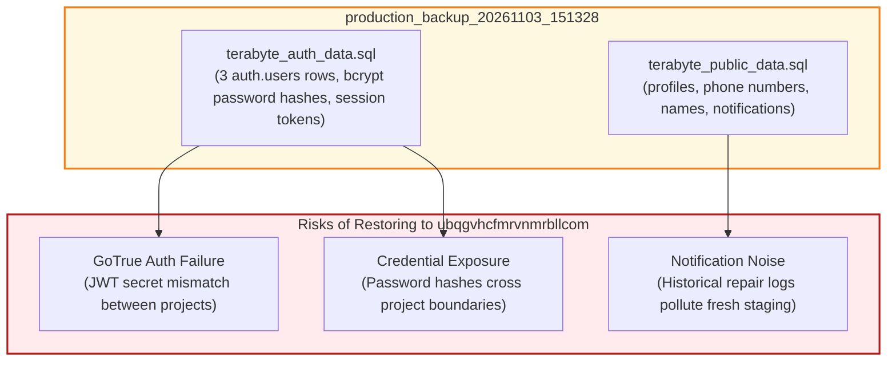

# TerraByte — Step 5B.16: Database Safety, Migration & Privacy Assessment
**Document Version:** `1.0 (Safety & Privacy Assessment)`  
**Date:** `2026-11-04`  
**Migration Count:** `3 Forward Migrations (55 Discrete SQL Requests)`  
**Migration Execution Status:** **`NOT EXECUTED (Zero Staging Migrations Applied)`**  
**Production Dump Restoration Policy:** **`PROHIBITED — DO NOT RESTORE PRODUCTION BACKUP`**  
**Recommended Fixture Strategy:** **`SYNTHETIC SEED FIXTURES`**  
**Production Gate Status:** **`UNAUTHORIZED / BLOCKED — NO PRODUCTION WRITE OPERATIONS AUTHORIZED`**

---

## 1. Executive Summary

This assessment evaluated:
1. The forward migration package intended for staging.
2. The privacy and security implications of restoring the production-derived backup into the staging project.
3. The exact migration dependency requirements for a pristine staging database.

### Key Safety Determinations
- **Production Backup Contains Sensitive Data:** Forensic analysis revealed that `production_backup_20261103_151328` contains real bcrypt password hashes, phone numbers, full names, and GoTrue session tokens. Restoring this backup into staging violates privacy boundaries and will break GoTrue authentication due to JWT secret mismatches.
- **Strict Prohibition:** Restoring `from_pg17_restore.sql` or `terabyte_production.dump` into the staging project is **PROHIBITED**.
- **Recommended Path:** A clean, synthetic seeding strategy must be used instead, generating fresh test personas and canonical parts directly in staging.
- **Migration Dependency Insight:** The staging database currently has **zero tables**. Applying the 3 Phase 9 forward migrations alone would fail because they alter pre-existing base tables (`profiles`, `equipment`, `repair_requests`). Staging requires sequential application of the complete base schema DDL prior to Phase 9 forward migrations.

---

## 2. Privacy & Data Spill Forensic Audit

A direct inspection of the production dump files was conducted:

### 2.1 Sensitive Elements Identified in Production Dump
1. **`auth.users` Data:**
   - Password hashes (`encrypted_password` bcrypt strings) for `admin.nagpur@terrabyte.demo`, `farmer.nagpur@terrabyte.demo`, `tech.nagpur@terrabyte.demo`.
   - Instance UUIDs and confirmation tokens tied to production GoTrue infrastructure.
2. **`public.profiles` Data:**
   - Real names: `Balasaheb Patil`, `Ramesh Kumar`, `Nagpur Service Centre`.
   - Contact phone numbers: `+91 98220 11111`, `+91 90110 00001`, `+91 1800 200 1234`.
3. **`public.notifications` Data:**
   - 27 historical repair requisition and handoff notification records referencing past ticket IDs (`TB-4651`, `TB-5768`, etc.).

### 2.2 Why Raw Production Restores Must Be Rejected
- **Cryptographic Incompatibility:** Supabase Auth signs JWTs and verifies user sessions using a secret unique to each project. User records copied from `hwdrypkvszwrcraujctw` into `ubqgvhcfmrvnmrbllcom` will fail password validation and token refreshes.
- **Privacy Standard:** Test and staging environments must not inherit production user credentials or phone numbers.
- **Remediation:** **Do not restore the production backup.** Generate synthetic fixtures via the application's clean registration and demo seeding routines.

---

## 3. Migration Package Local Review

The three forward migrations were inspected locally:

| Migration File | Size | Discrete Stmts | SHA256 Checksum | Scope & Highlights |
| :--- | :---: | :---: | :--- | :--- |
| `20261104110000_complete_phase9_parts_desk_rpcs.sql` | 20.5 KB | 18 | `b32f3c80971113360adb86d1b096f1f8bdeb38fb87743ce24a038ba83f4b72e8` | `confirm_service_centre_part_handoff`, `adjust_service_centre_part_stock`, `receive_service_centre_stock`, `service_centre_stock_audit` table. |
| `20261104120000_complete_phase9_realtime_and_eta.sql` | 43.2 KB | 35 | `1e583e78af77a4b6e0becb239e6ecc4de9c46148091a7b2481ef8c60d0ede97f` | `create_quote_atomic`, `revise_quote_atomic`, `update_service_centre_part_request_eta`, realtime publication grants. |
| `20261104130000_complete_phase5_3_technician_registration_notification.sql` | 2.9 KB | 2 | `33fae47f83203dab53686e67ba57f8002617224d9a61de80f25aef06298de579` | `notify_admin_on_technician_registration()` trigger. |

### 3.1 Migration Dependency Analysis
- **Current Staging State:** 0 tables in `public`.
- **Finding:** The 3 forward migrations are **delta migrations**. They execute `ALTER TABLE public.service_centre_parts ADD COLUMN IF NOT EXISTS held_for_request_id...`, `ALTER TABLE public.quote_items ADD COLUMN IF NOT EXISTS catalog_part_id...`, and define RPCs referencing `public.repair_requests`.
- **Operational Requirement for Next Step:** Staging must first receive the foundation base migrations (`supabase/migrations/` historical sequence) or a sanitized schema-only DDL script before the 3 forward migrations can succeed.

---

## 4. Recommended Staging Seeding Protocol

When authorization to proceed is granted:
1. **Schema Initialization:** Apply the baseline schema DDL to create the 16 core public tables, indices, and RLS policies (without copying production data rows).
2. **Forward Migration Application:** Sequentially apply the 3 Phase 9 forward migrations (`110000` -> `120000` -> `130000`).
3. **Synthetic User Provisioning:** Register 3 clean staging test users via standard Supabase Auth (`farmer@staging.local`, `tech@staging.local`, `admin@staging.local`).
4. **Canonical Fixture Seeding:** Populate the 5 canonical demo parts (`Oil Filter`, `Alternator Belt`, etc.) and test equipment using the in-app synthetic seed function `reset_demo_data()`.

---

## 5. Audit Verdict

- **Production Dump Restoration:** **`REJECTED / PROHIBITED (Privacy & Auth Risks)`**
- **Synthetic Fixture Recommendation:** **`APPROVED / MANDATED`**
- **Migration Package Integrity:** **`VERIFIED SEALED (3 Migrations, 55 Stmts)`**
- **Staging Migration Execution:** **`NOT EXECUTED (Zero Remote Changes)`**

Production gate status remains strictly: **`UNAUTHORIZED / BLOCKED — NO PRODUCTION WRITE OPERATIONS AUTHORIZED`**.
