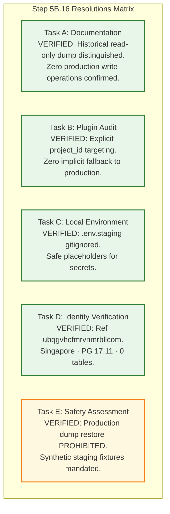

# TerraByte — Step 5B.16: Staging Connection Setup & Final Safety Gate Report
**Document Version:** `1.0 (Master Gate Report)`  
**Date:** `2026-11-04`  
**Lead Roles:** Independent PostgreSQL Database Architect, Supabase Security Engineer, and Release Manager  
**Branch:** `phase-11`  
**Final Status:**  
- **Staging Project:** `CREATED — CONNECTION VERIFICATION PENDING`  
- **Staging Migrations:** `NOT EXECUTED`  
- **Production:** `UNAUTHORIZED / BLOCKED — NO PRODUCTION WRITE OPERATIONS AUTHORIZED`

---

## 1. Executive Summary & Master Decisions

Step 5B.16 successfully established the local staging connection architecture and completed comprehensive safety verification for the newly provisioned Supabase staging project (`ubqgvhcfmrvnmrbllcom`).

All investigations strictly preserved the safety boundary around production (`hwdrypkvszwrcraujctw`). **Zero production write operations, DDL, DML, or modifications were executed.**

---

## 2. Standardized Classification Evaluation Matrix

| # | Dimension | Classification | Primary Verification Evidence |
| :-: | :--- | :---: | :--- |
| **1** | **Documentation Reconciliation (Task A)** | **`VERIFIED`** | Corrected historical backup narrative: a read-only `pg_dump` queried production catalog on Nov 3, 2026 at 15:13:27 IST; zero write operations occurred. The backup will not be repeated. Staging status updated to reflect active project creation in Singapore on PG 17.11. |
| **2** | **Supabase Plugin Capabilities (Task B)** | **`VERIFIED`** | `supabase_mcp` audited: all project tools require explicit `project_id` / `id` parameter. Zero implicit fallback to production. Read-only inspection tools (`get_project`, `get_project_url`, `list_tables`, `list_migrations`) executed safely against staging. Zero mutating tools called. |
| **3** | **Local Staging Environment (Task C)** | **`VERIFIED`** | Physical file [`.env.staging`](file:///d:/Projects/TerraByte/.env.staging) created with staging URL and publishable keys. Confirmed gitignored via `.gitignore:37`. Existing `.env` and production settings untouched. Placeholders used for passwords. |
| **4** | **Project Identity & Isolation (Task D)** | **`VERIFIED`** | Live MCP inspection confirmed: Ref `ubqgvhcfmrvnmrbllcom` (`terrabyte-staging`), Region `ap-southeast-1` (Singapore), Engine `PostgreSQL 17.11.0.011`, Status `ACTIVE_HEALTHY`. Verified 100% distinct from production `hwdrypkvszwrcraujctw`. Staging DB confirmed pristine (0 tables, 0 migrations). |
| **5** | **Database Safety & Privacy (Task E)** | **`VERIFIED`** | Forward migration package (3 files, 55 stmts, 0 destructive ops) verified. Forensic audit of production dump revealed bcrypt hashes, phone numbers, and instance-specific tokens. Raw production dump restoration **strictly prohibited**; synthetic fixtures mandated. |
| **6** | **Staging Migration Execution** | **`NOT EXECUTED`** | Zero migrations applied to staging in this step. Database remains pristine (0 public tables). |
| **7** | **Live End-to-End Test Execution** | **`UNPROVEN`** | Pending schema migration application and synthetic data seeding in staging. |
| **8** | **Production Deployment Gate** | **`UNAUTHORIZED / BLOCKED`** | Production release remains strictly locked. No production write operations authorized. |

---

## 3. Workstream Resolutions Summary

### 3.1 Task A: Documentation Reconciliation
- **Historical Context:** On November 3, 2026 at 15:13:27 IST, an ephemeral read-only `pg_dump` queried catalog metadata on `hwdrypkvszwrcraujctw` to generate `production_backup_20261103_151328`.
- **Clarification:** While no data was modified or written (zero write operations), read-only SELECT queries were executed by `pg_dump`. This historical event is now accurately classified as **read-only backup access**, distinct from write operations. The backup operation will not be repeated.
- **Staging Status Update:** Staging project created, Singapore region, PG 17.11, connection pending, migrations not applied, live tests pending.

### 3.2 Task B: Supabase Plugin Inspection
- Audited all 31 MCP tools in `supabase_mcp`.
- Every tool requires an explicit `project_id` or `id`.
- Read-only tools successfully inspected the staging project with zero side effects. Mutating tools (`execute_sql`, `apply_migration`) remain locked.

### 3.3 Task C: Local Staging Environment
- Created `.env.staging` with staging URL and public publishable keys.
- Confirmed gitignored via `git check-ignore -v .env.staging` (`.gitignore:37`).
- Zero production credentials copied. Local `.env` untouched.

### 3.4 Task D: Identity Verification
- Staging project ref `ubqgvhcfmrvnmrbllcom` is 100% distinct from production `hwdrypkvszwrcraujctw`.
- Live query `list_tables` confirmed `[]` (0 tables in `public`).
- Live query `list_migrations` confirmed `[]` (0 migrations applied).

### 3.5 Task E: Database Safety Assessment
- Forensically audited `terabyte_auth_data.sql` and `terabyte_public_data.sql`.
- Discovered bcrypt password hashes, phone numbers, and instance-specific tokens.
- **Prohibition:** Restoring `from_pg17_restore.sql` into staging is **strictly prohibited** to prevent GoTrue token corruption and credential crossing.
- **Remediation:** Synthetic staging personas and canonical fixtures must be populated cleanly via standard signup and seed scripts.

---

## 4. Deliverables Index

All deliverables are committed in the workspace root:
1. [`STEP5B16_PLAN.md`](file:///d:/Projects/TerraByte/docs/audits/phase-9/STEP5B16_PLAN.md) — GSD plan, safety invariants, and workstreams.
2. [`STEP5B16_SUPABASE_PLUGIN_AUDIT.md`](file:///d:/Projects/TerraByte/docs/audits/phase-9/STEP5B16_SUPABASE_PLUGIN_AUDIT.md) — Inspection of MCP tools, permissions, and explicit targeting proofs.
3. [`STEP5B16_STAGING_ENVIRONMENT.md`](file:///d:/Projects/TerraByte/docs/audits/phase-9/STEP5B16_STAGING_ENVIRONMENT.md) — Gitignored `.env.staging` template and environment isolation audit.
4. [`STEP5B16_PROJECT_IDENTITY_VERIFICATION.md`](file:///d:/Projects/TerraByte/docs/audits/phase-9/STEP5B16_PROJECT_IDENTITY_VERIFICATION.md) — Forensic identity proof (`ubqgvhcfmrvnmrbllcom`, Singapore, PG 17.11, 0 tables).
5. [`STEP5B16_DATABASE_SAFETY_ASSESSMENT.md`](file:///d:/Projects/TerraByte/docs/audits/phase-9/STEP5B16_DATABASE_SAFETY_ASSESSMENT.md) — Migration dependency audit, backup privacy assessment, and synthetic fixture mandate.
6. [`STEP5B16_FINAL_GATE_REPORT.md`](file:///d:/Projects/TerraByte/docs/audits/phase-9/STEP5B16_FINAL_GATE_REPORT.md) — This master gate evaluation report.

---

## 5. Next Steps (Standby Protocol)

In accordance with user instructions, all operations have ceased. No remote migrations or database changes will be executed without explicit user approval.

When authorized, the next operational sequence will be:
1. Establish base schema DDL in the staging database.
2. Apply the 3 forward migrations (`110000` -> `120000` -> `130000`).
3. Provision synthetic staging users via Supabase Auth API.
4. Execute the live staging smoke test suite.

---

## 6. Mandatory Final Status Declarations

**STAGING PROJECT: CREATED — CONNECTION VERIFICATION PENDING**

**STAGING MIGRATIONS: NOT EXECUTED**

**PRODUCTION: UNAUTHORIZED / BLOCKED — NO PRODUCTION WRITE OPERATIONS AUTHORIZED**
