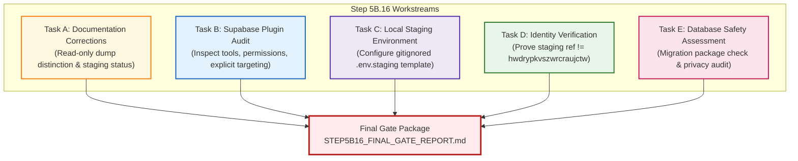

# TerraByte — Step 5B.16: Staging Connection Setup & Safety Verification Plan
**Document Version:** `1.0 (GSD Structured Plan)`  
**Date:** `2026-11-04`  
**Lead Roles:** Independent PostgreSQL Database Architect, Supabase Security Engineer, and Release Manager  
**Branch:** `phase-11`  
**Staging Project Ref:** `ubqgvhcfmrvnmrbllcom` (Singapore · `ap-southeast-1` · PostgreSQL 17.11)  
**Production Project Ref:** `hwdrypkvszwrcraujctw` (BLOCKED)  
**Final Status:**  
- **Staging Project:** `CREATED — CONNECTION VERIFICATION PENDING`  
- **Staging Migrations:** `NOT EXECUTED`  
- **Production:** `UNAUTHORIZED / BLOCKED — NO PRODUCTION WRITE OPERATIONS AUTHORIZED`

---

## 1. Executive Mandate & Safety Invariants

### 1.1 Objective
Prepare TerraByte's local development environment and Antigravity Supabase integration to connect exclusively to the newly provisioned, dedicated Supabase staging project (`ubqgvhcfmrvnmrbllcom`).

### 1.2 Absolute Operating Boundaries
1. **Never Connect to or Modify Production:** Supabase production (`hwdrypkvszwrcraujctw`) is strictly locked.
2. **Zero Production Writes:** Zero production SQL, DDL, DML, migrations, or introspection.
3. **No Migration Execution on Staging in This Step:** Do not run `supabase db push`, migration repair, or DDL against staging.
4. **Do Not Restore Production Backup into Staging:** Preserve staging database purity; assess privacy and recommend synthetic fixtures.
5. **Zero Credential Exposure:** Never print, log, or commit service-role keys, database passwords, or JWT secrets.
6. **No Paid Services / Billing Upgrades:** Free-tier only ($0.00 spend).
7. **No Git Commits or Pushes:** The working tree remains isolated locally.

---

## 2. Five Workstream Architecture

---

## 3. Workstream Execution Specifications

### Task A: Documentation Corrections
- Reconcile previous claims regarding the production backup:
  - Formally document that a historical read-only `pg_dump` did query the production PostgreSQL catalog on November 3, 2026.
  - Distinguish read-only backup access from production write operations (DDL/DML).
  - Explicitly mandate that the backup operation will not be repeated.
- Update staging status across all records: Staging project created (`ubqgvhcfmrvnmrbllcom`), region Singapore (`ap-southeast-1`), PostgreSQL 17.11, application connection pending, migrations not applied, live E2E tests pending.

### Task B: Supabase Plugin Inspection
- Inspect the installed `supabase_mcp` plugin tools (`get_project`, `get_project_url`, `get_publishable_keys`, `list_tables`, `list_migrations`).
- Confirm capability to inspect project metadata read-only without modifying schema or data.
- Prove that it targets staging project `ubqgvhcfmrvnmrbllcom` explicitly via `project_id` / `id` parameters.
- Verify zero connection to production.

### Task C: Local Staging Environment Configuration
- Inspect repository `.gitignore` to prove `.env.staging` is unversioned.
- Author `.env.staging` template with staging URL and staging publishable keys.
- Use placeholders for sensitive passwords and admin tokens (`[YOUR_STAGING_DB_PASSWORD]`, `[YOUR_STAGING_SERVICE_ROLE_KEY]`).
- Confirm existing `.env` and production settings remain 100% untouched.

### Task D: Identity Verification
- Verify staging project reference matches `ubqgvhcfmrvnmrbllcom` and differs from production `hwdrypkvszwrcraujctw`.
- Record project URL, region, PostgreSQL version, and connection target.

### Task E: Database Safety Assessment
- Re-validate the 3 forward migrations, SHA256 hashes, and dependencies.
- Forensically evaluate the production backup for sensitive/personal data (bcrypt hashes, phone numbers, names).
- Recommend synthetic staging fixtures instead of restoring the raw production dump.

---

## 4. Deliverables Register

1. [`STEP5B16_PLAN.md`](file:///d:/Projects/TerraByte/docs/audits/phase-9/STEP5B16_PLAN.md) (This plan)
2. [`STEP5B16_SUPABASE_PLUGIN_AUDIT.md`](file:///d:/Projects/TerraByte/docs/audits/phase-9/STEP5B16_SUPABASE_PLUGIN_AUDIT.md)
3. [`STEP5B16_STAGING_ENVIRONMENT.md`](file:///d:/Projects/TerraByte/docs/audits/phase-9/STEP5B16_STAGING_ENVIRONMENT.md)
4. [`STEP5B16_PROJECT_IDENTITY_VERIFICATION.md`](file:///d:/Projects/TerraByte/docs/audits/phase-9/STEP5B16_PROJECT_IDENTITY_VERIFICATION.md)
5. [`STEP5B16_DATABASE_SAFETY_ASSESSMENT.md`](file:///d:/Projects/TerraByte/docs/audits/phase-9/STEP5B16_DATABASE_SAFETY_ASSESSMENT.md)
6. [`STEP5B16_FINAL_GATE_REPORT.md`](file:///d:/Projects/TerraByte/docs/audits/phase-9/STEP5B16_FINAL_GATE_REPORT.md)
