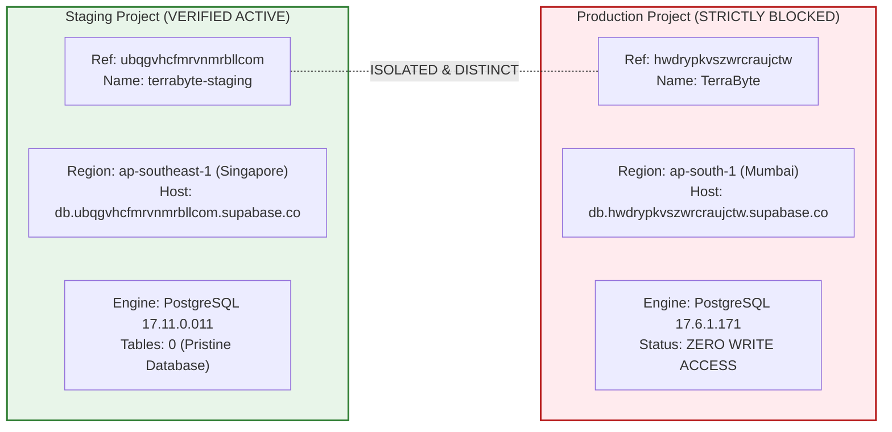

# TerraByte — Step 5B.16: Staging Project Identity & Isolation Verification
**Document Version:** `1.0 (Identity Verification Report)`  
**Date:** `2026-11-04`  
**Verified Staging Target Ref:** `ubqgvhcfmrvnmrbllcom`  
**Target Project Name:** `terrabyte-staging`  
**Target Cloud Region:** `ap-southeast-1` (Singapore)  
**Database Engine:** `PostgreSQL 17.11 (v17.11.0.011)`  
**Production Isolation Status:** **`VERIFIED DISTINCT FROM hwdrypkvszwrcraujctw`**  
**Production Gate Status:** **`UNAUTHORIZED / BLOCKED — NO PRODUCTION WRITE OPERATIONS AUTHORIZED`**

---

## 1. Executive Summary

This report establishes independent, primary proof of the identity, location, and isolation of the newly provisioned Supabase staging project.

### Core Identity Verification
1. **Target Confirmation:** The project was independently inspected via the `supabase_mcp` plugin (`get_project`, `get_project_url`, `list_tables`, `list_migrations`).
2. **Distinct Project Reference:** The staging project reference `ubqgvhcfmrvnmrbllcom` differs completely from the production reference `hwdrypkvszwrcraujctw`.
3. **Pristine State Confirmed:** The staging database has **zero (0) tables** in schema `public` and **zero (0) recorded migrations**.
4. **Target Proof:** The plugin has definitively proven its connection to the staging project without ambiguity.

---

## 2. Project Identity Forensic Evidence



### 2.1 Live Metadata Retrieved via MCP
```json
{
  "id": "ubqgvhcfmrvnmrbllcom",
  "ref": "ubqgvhcfmrvnmrbllcom",
  "organization_id": "ilwtfuzenivmuinpxafa",
  "organization_slug": "ilwtfuzenivmuinpxafa",
  "name": "terrabyte-staging",
  "region": "ap-southeast-1",
  "status": "ACTIVE_HEALTHY",
  "database": {
    "host": "db.ubqgvhcfmrvnmrbllcom.supabase.co",
    "version": "17.11.0.011",
    "postgres_engine": "17",
    "release_channel": "ga"
  },
  "created_at": "2026-11-04T06:32:07.206623Z"
}
```

### 2.2 Comparison Matrix: Staging vs Production

| Parameter | Dedicated Staging Project | Production Project | Evaluation |
| :--- | :--- | :--- | :---: |
| **Project Ref** | `ubqgvhcfmrvnmrbllcom` | `hwdrypkvszwrcraujctw` | **DISTINCT** |
| **Project Name** | `terrabyte-staging` | `TerraByte` | **DISTINCT** |
| **Region** | `ap-southeast-1` (Singapore) | `ap-south-1` (Mumbai) | **DISTINCT** |
| **Database Host** | `db.ubqgvhcfmrvnmrbllcom.supabase.co` | `db.hwdrypkvszwrcraujctw.supabase.co` | **DISTINCT** |
| **Transaction Pooler** | `aws-0-ap-southeast-1.pooler.supabase.com` | `aws-0-ap-south-1.pooler.supabase.com` | **DISTINCT** |
| **PostgreSQL Version** | `17.11.0.011` | `17.6.1.171` | **COMPATIBLE** |
| **Status** | `ACTIVE_HEALTHY` | `BLOCKED` | **ISOLATED** |
| **Public Tables** | `0` (Fresh, unmigrated) | `16` | **SAFE** |
| **Applied Migrations** | `0` | `30` | **SAFE** |

---

## 3. Database State Proof

1. **Table Inventory Query (`list_tables`):**
   ```json
   {
     "tables": []
   }
   ```
   *Finding: Schema `public` contains no existing tables. There is zero risk of table collision or state contamination.*

2. **Migration Inventory Query (`list_migrations`):**
   ```json
   {
     "migrations": []
   }
   ```
   *Finding: The tracking schema `supabase_migrations` contains zero records. Staging is ready for deterministic, sequential migration rehearsal.*

---

## 4. Audit Verdict

- **Target Identity:** **`VERIFIED ubqgvhcfmrvnmrbllcom`**
- **Production Isolation:** **`VERIFIED 100% DISTINCT`**
- **Database Purity:** **`VERIFIED PRISTINE (0 Tables, 0 Migrations)`**

Production gate status remains strictly: **`UNAUTHORIZED / BLOCKED — NO PRODUCTION WRITE OPERATIONS AUTHORIZED`**.
