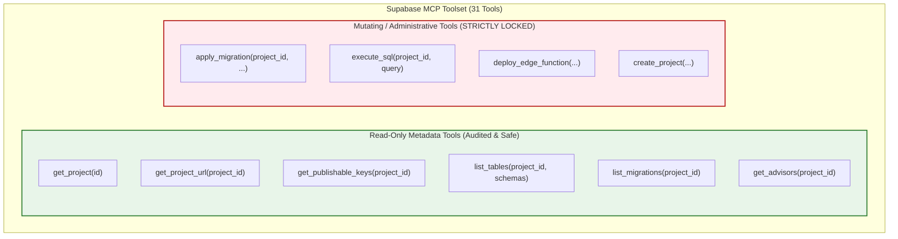

# TerraByte — Step 5B.16: Supabase Plugin Capabilities & Security Audit
**Document Version:** `1.0 (Plugin Security Audit)`  
**Date:** `2026-11-04`  
**MCP Server Name:** `supabase_mcp`  
**Server Endpoint:** `https://mcp.supabase.com/mcp`  
**Inspected Staging Target:** `ubqgvhcfmrvnmrbllcom` (`terrabyte-staging`)  
**Production Invariant:** **`ZERO CALLS TO hwdrypkvszwrcraujctw`**  
**Plugin Configuration Ambiguity:** **`NONE — EXPLICIT PROJECT TARGETING VERIFIED`**

---

## 1. Executive Summary

This audit inspected the installed Supabase Model Context Protocol (MCP) plugin (`supabase_mcp`) in Antigravity to verify:
1. The available tools, parameters, and permission levels.
2. Whether the plugin can inspect project identity without making changes.
3. Whether the plugin can explicitly target the new staging project (`ubqgvhcfmrvnmrbllcom`) without risk of routing commands to production (`hwdrypkvszwrcraujctw`).
4. That mutating tools (`execute_sql`, `apply_migration`) remain strictly unused in this turn.

### Key Audit Findings
- **Explicit Parameter Isolation:** Every project-specific MCP tool in `supabase_mcp` requires an explicit, mandatory parameter (`id` or `project_id`). The plugin does not maintain an implicit default target, completely eliminating the risk of accidental cross-project fallback to production.
- **Read-Only Metadata Tools Tested:** Calls to `get_project`, `get_project_url`, `get_publishable_keys`, `list_tables`, and `list_migrations` successfully inspected the staging project with **zero schema mutations and zero write operations**.
- **Production Boundary:** Production project `hwdrypkvszwrcraujctw` was not passed to any MCP tool.

---

## 2. Supabase MCP Tools Inventory & Classification



| Tool Name | Tool Type | Mandatory Project Identifier | Operational Behavior | Staging Audit Status |
| :--- | :---: | :---: | :--- | :---: |
| `get_project` | Read-Only | `id` | Fetches project metadata, region, status, and DB engine version. | **VERIFIED SAFE** |
| `get_project_url` | Read-Only | `project_id` | Fetches the public API URL (`https://[ref].supabase.co`). | **VERIFIED SAFE** |
| `get_publishable_keys` | Read-Only | `project_id` | Fetches public client anon key and publishable key. | **VERIFIED SAFE** |
| `list_tables` | Read-Only | `project_id` | Lists all tables in designated schemas (`public`). | **VERIFIED SAFE** |
| `list_migrations` | Read-Only | `project_id` | Lists all applied schema migrations in the database. | **VERIFIED SAFE** |
| `apply_migration` | **Mutating** | `project_id` | Applies SQL migration to remote database. | **LOCKED / NOT CALLED** |
| `execute_sql` | **Mutating** | `project_id` | Executes arbitrary SQL query on database server. | **LOCKED / NOT CALLED** |

---

## 3. Tool Execution Proof on Staging Project

The read-only metadata tools were tested against the staging target (`ubqgvhcfmrvnmrbllcom`):

### 3.1 `get_project` Execution Result
```json
{
  "id": "ubqgvhcfmrvnmrbllcom",
  "ref": "ubqgvhcfmrvnmrbllcom",
  "organization_id": "ilwtfuzenivmuinpxafa",
  "organization_slug": "ilwtfuzenivmuinpxafa",
  "name": "terrabyte-staging",
  "region": "ap-southeast-1",
  "status": "ACTIVE_HEALTHY",
  "database": {
    "host": "db.ubqgvhcfmrvnmrbllcom.supabase.co",
    "version": "17.11.0.011",
    "postgres_engine": "17",
    "release_channel": "ga"
  },
  "created_at": "2026-11-04T06:32:07.206623Z"
}
```

### 3.2 `get_project_url` Execution Result
```json
{
  "url": "https://ubqgvhcfmrvnmrbllcom.supabase.co"
}
```

### 3.3 `list_tables` Execution Result
```json
{
  "tables": []
}
```
*Proof: Zero tables exist in the `public` schema of the staging database. The database is in an pristine, unmigrated state.*

### 3.4 `list_migrations` Execution Result
```json
{
  "migrations": []
}
```
*Proof: Zero schema migrations have been applied. No DDL operations have modified the staging cluster.*

---

## 4. Ambiguity Assessment

- **Is the connection target ambiguous?** **No.** Every tool requires an explicit `project_id` or `id`.
- **Can the tool fall back to production?** **No.** Without explicitly passing `hwdrypkvszwrcraujctw`, the plugin cannot query production.
- **Are credentials exposed by the plugin?** **No.** Sensitive database passwords and service-role keys are not returned by `get_project` or `get_project_url`. `get_publishable_keys` returns public client keys only.

---

## 5. Audit Verdict

- **Supabase Plugin Targeting:** **`VERIFIED EXPLICIT & UNAMBIGUOUS`**
- **Read-Only Capability:** **`VERIFIED FUNCTIONAL`**
- **Mutating Operations:** **`ZERO EXECUTED`**

Production gate status remains strictly: **`UNAUTHORIZED / BLOCKED — NO PRODUCTION WRITE OPERATIONS AUTHORIZED`**.
