# TerraByte — Step 5B.17: Clean Install Manifest & Reconstruction Strategy
**Document Version:** `1.0 (Clean Install Architecture & Manifest)`  
**Date:** `2026-11-04`  
**Target Staging Project:** `ubqgvhcfmrvnmrbllcom` (`terrabyte-staging` · `ap-southeast-1` · PostgreSQL 17.11)  
**Production Gate Status:** **`UNAUTHORIZED / BLOCKED — NO PRODUCTION WRITE OPERATIONS AUTHORIZED`**  
**Staging Status:** **`STANDBY — RECONSTRUCTION VALIDATED LOCALLY — NO REMOTE DDL EXECUTED YET`**

---

## 1. Executive Summary & Architectural Evaluation

Workstreams A, B, and C evaluated two fundamental strategies for reconstructing the TerraByte database from scratch on a clean PostgreSQL 17 instance:

```mermaid
flowchart TD
    subgraph OptionA["Approach 1: Chronological Replay of 38 Migrations"]
        A1["Replay 20260930 to 20261104 Chronologically"] --> A2["Encounter 9 Breaking Errors (Missing Columns, FK Violations, Enum Mismatches)"]
        A2 --> A3["UNVIABLE FOR CLEAN STAGING / FAILS AT STEP 10"]
    end

    subgraph OptionB["Approach 2: Canonical DDL Baseline + Forward Migrations (RECOMMENDED)"]
        B1["Apply Canonical DDL Baseline<br>(terabyte_public_schema.sql · 131.5 KB Pure DDL)"]
        B1 --> B2["Apply Forward Migration 20261104100000<br>(Profile Security Separation)"]
        B2 --> B3["Apply Forward Migration 20261104110000<br>(Parts Desk Atomic RPCs)"]
        B3 --> B4["Apply Forward Migration 20261104120000<br>(Realtime & ETA Tracking)"]
        B4 --> B5["Apply Forward Migration 20261104130000<br>(Technician Notification Trigger)"]
        B5 --> B6["Seed Synthetic Staging Fixtures<br>(Zero PII / Zero Auth Dump Restorations)"]
        B6 --> B7["100% REPRODUCIBLE · 18 TABLES · 75 ROUTINES · 0 ERRORS"]
    end

    style OptionA fill:#ffebee,stroke:#b71c1c,stroke-width:2px
    style OptionB fill:#e8f5e9,stroke:#2e7d32,stroke-width:2px
```

### Approach Comparison Matrix

| Evaluation Criterion | Approach 1: Chronological 38-File Replay | Approach 2: Canonical DDL Baseline + Forward Migrations |
| :--- | :---: | :---: |
| **Clean Database Replay Viability** | **FAILED (9 breaking errors)** | **SUCCESS (0 errors, ExitCode 0)** |
| **Transitional Column Conflicts** | Fails on `clerk_user_id` & `email` | Fully resolved by consolidated baseline schema |
| **Demo Data Foreign Key Violations** | Fails in `20261031170000` (missing user) | Bypassed; pure DDL baseline contains 0 data rows |
| **Enum Value Casting Errors** | Fails on `'service_centre'` in `20261101140000` | Pristine enum definitions in baseline |
| **Post-Replay Object Integrity** | Broken state after failure | **18 Tables, 75 Routines, 55 RLS Policies** |
| **Privacy Compliance** | Embedded demo rows collide with prod | **100% Privacy Compliant Synthetic Fixtures** |
| **Operational Recommendation** | **REJECTED (Architecturally Obsolete)** | **APPROVED FOR STAGING INITIALIZATION** |

---

## 2. Canonical Clean-Install Manifest

The clean installation for any new environment (such as `ubqgvhcfmrvnmrbllcom`) consists of an ordered 6-stage manifest:

### Stage 1: Cloud Foundation & Extensions Preflight
*Executed automatically by Supabase cloud or verified before DDL application.*
- PostgreSQL version: `PostgreSQL 17.11`
- Extensions: `uuid-ossp`, `pgcrypto`
- Core Schemas: `public`, `auth`, `storage`
- Roles: `anon`, `authenticated`, `service_role`
- Realtime publication: `CREATE PUBLICATION supabase_realtime;`

### Stage 2: Canonical Public Schema Baseline
- **Artifact:** [`D:\TerraByte_Backups\production_backup_20261103_151328\terabyte_public_schema.sql`](file:///D:/TerraByte_Backups/production_backup_20261103_151328/terabyte_public_schema.sql)
- **Size:** `131,508 bytes` (3,339 lines)
- **Payload:** Pure DDL only (0 data rows, 0 user credentials, 0 tokens)
- **Objects Created:**
  - 5 Domain Enums: `equipment_type`, `equipment_status`, `repair_status`, `quote_status`, `user_role`
  - 16 Base Tables: `equipment`, `notifications`, `profiles`, `quote_items`, `quotes`, `repair_dispatch_locations`, `repair_messages`, `repair_notes`, `repair_requests`, `repair_timeline`, `service_centre_part_requests`, `service_centre_part_sales`, `service_centre_parts`, `service_centre_stock_audit`, `service_history`, `technician_profiles`
  - 40 Indexes & Unique Constraints
  - 49 RLS Policies (enabled on all 16 tables)
  - 8 System Triggers & 14 Baseline Routines (`check_table_rls`, `current_profile_id`, `current_user_role`, `delete_user_account`, `reset_demo_data`, `set_current_timestamp_updated_at`, etc.)

### Stage 3: Profile Security Separation Forward Migration
- **Artifact:** [`supabase/migrations/20261104100000_profile_security_separation.sql`](file:///d:/Projects/TerraByte/supabase/migrations/20261104100000_profile_security_separation.sql)
- **Size:** `57,885 bytes` (1,215 lines)
- **Objects Created / Hardened:**
  - Dedicated isolation schema: `CREATE SCHEMA app_security;`
  - Internal mapping tables: `public.profile_auth_secrets`, `public.profile_contacts`
  - Security mapping table: `app_security.profile_auth_mappings`
  - Safe parameterless hydration RPC: `public.get_session_profile()`
  - Administrative staff provisioning: `public.admin_provision_staff(...)`
  - Hardened account deletion: `public.delete_user_account()`
  - Security definer authorization helper: `app_security.can_view_profile(...)`

### Stage 4: Parts Desk Atomic RPCs Forward Migration
- **Artifact:** [`supabase/migrations/20261104110000_complete_phase9_parts_desk_rpcs.sql`](file:///d:/Projects/TerraByte/supabase/migrations/20261104110000_complete_phase9_parts_desk_rpcs.sql)
- **Size:** `20,520 bytes` (697 lines)
- **Objects Created / Hardened:**
  - Performance indexes: `idx_sc_sales_sold_at`, `idx_sc_stock_audit_movement`
  - Physical handoff RPC: `public.confirm_service_centre_part_handoff(p_request_id uuid)`
  - Stock adjustment RPC: `public.adjust_service_centre_part_stock(...)`
  - Requisition RPC: `public.request_service_centre_part(...)`
  - Stock receipt RPC: `public.receive_service_centre_stock(...)`
  - Parts return RPC: `public.return_service_centre_part(...)`

### Stage 5: Realtime Publications & ETA Tracking Forward Migration
- **Artifact:** [`supabase/migrations/20261104120000_complete_phase9_realtime_and_eta.sql`](file:///d:/Projects/TerraByte/supabase/migrations/20261104120000_complete_phase9_realtime_and_eta.sql)
- **Size:** `43,210 bytes` (1,089 lines)
- **Objects Created / Hardened:**
  - ETA tracking RPC: `public.update_service_centre_part_request_eta(...)`
  - Consolidated atomic quote formulation: `public.create_quote_atomic(...)`
  - Consolidated atomic quote revision: `public.revise_quote_atomic(...)`
  - Catalog link foreign keys & constraints on `quote_items`
  - Realtime publication registration for parts desk tables

### Stage 6: Technician Registration Administrative Notification Forward Migration
- **Artifact:** [`supabase/migrations/20261104130000_complete_phase5_3_technician_registration_notification.sql`](file:///d:/Projects/TerraByte/supabase/migrations/20261104130000_complete_phase5_3_technician_registration_notification.sql)
- **Size:** `2,918 bytes` (77 lines)
- **Objects Created / Hardened:**
  - Notification trigger routine: `public.notify_admin_on_technician_registration()`
  - System trigger: `trg_notify_admin_on_technician_registration` on `public.technician_profiles`

### Stage 7: Privacy-Compliant Synthetic Staging Seed Fixtures
- **Artifact:** `scratch/staging_synthetic_seed.sql` (to be registered as canonical seed file)
- **Payload:** 100% synthetic test identities, equipment, 5 canonical parts, and sample repair lifecycle.
- **Privacy Assurance:** Zero production customer data, zero production password hashes, zero production tokens.

---

## 3. Resulting Database Object Catalog

Upon completion of Stages 1 through 6, the resulting database contains:

| Category | Count | Verification Query Evidence |
| :--- | :---: | :--- |
| **Schemas** | 4 | `public`, `app_security`, `auth`, `storage` |
| **Public Base Tables** | 18 | `equipment`, `notifications`, `profile_auth_secrets`, `profile_contacts`, `profiles`, `quote_items`, `quotes`, `repair_dispatch_locations`, `repair_messages`, `repair_notes`, `repair_requests`, `repair_timeline`, `service_centre_part_requests`, `service_centre_part_sales`, `service_centre_parts`, `service_centre_stock_audit`, `service_history`, `technician_profiles` |
| **Domain Enums** | 5 | `equipment_type`, `equipment_status`, `repair_status`, `quote_status`, `user_role` |
| **Public Routines** | 71 | 21 application RPCs & trigger routines + 50 cryptographic/uuid helpers |
| **Row Level Security** | 18 / 18 | `ENABLE ROW LEVEL SECURITY` enforced across 100% of public tables |
| **Realtime Publications** | 1 | `supabase_realtime` bound to repairs, notifications, parts, and dispatch |

---

## 4. Idempotency & Repeatability Proof

During local drill execution on PostgreSQL 17.6 (`127.0.0.1:5433`):
1. The forward migrations (`20261104100000`, `110000`, `120000`, `130000`) were applied sequentially: **0 errors**.
2. All 4 forward migrations were immediately re-applied a second time to test idempotency: **0 errors, ExitCode 0**.
3. All `CREATE OR REPLACE FUNCTION`, `CREATE INDEX IF NOT EXISTS`, and `DROP POLICY IF EXISTS / CREATE POLICY` statements execute idempotently without side effects.
