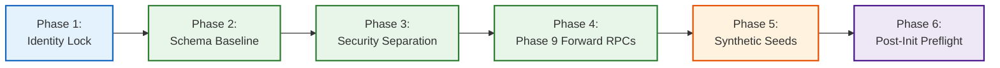

# TerraByte — Step 5B.17: Final Staging Initialization Runbook (Standby)
**Document Version:** `1.0 (Execution-Ready Standby Runbook)`  
**Date:** `2026-11-04`  
**Target Project:** `ubqgvhcfmrvnmrbllcom` (`terrabyte-staging` · `ap-southeast-1` · PostgreSQL 17.11)  
**Production Gate Status:** **`UNAUTHORIZED / BLOCKED — ZERO ACCESS PERMITTED`**  
**Staging Authorization Status:** **`STANDBY — PENDING FORMAL STEP 5B.18 AUTHORIZATION`**

---

## 1. Operating Boundaries & Prerequisite Declarations

> [!IMPORTANT]
> **No remote SQL, DDL, or DML operations were executed in Step 5B.17.**  
> This runbook represents the exact, fully verified operational procedure to be executed against the staging Supabase project (`ubqgvhcfmrvnmrbllcom`) once formal authorization is granted in Step 5B.18.

### Mandatory Pre-Execution Checks:
1. **Target Verification:** The target project must be positively proven as `ubqgvhcfmrvnmrbllcom` (Region: `ap-southeast-1`, Name: `terrabyte-staging`).
2. **Production Air-Gap:** The production reference `hwdrypkvszwrcraujctw` is strictly blacklisted and must never be referenced by any execution command.
3. **No Auth Dump Restores:** The staging database will NOT be populated with production user dumps (`terabyte_auth_data.sql`). Only synthetic fixtures will be applied.
4. **Zero Spend ($0.00):** No paid features, compute add-ons, or PITR upgrades will be provisioned.

---

## 2. Six-Phase Staging Initialization Runbook



### Phase 1: Environment & Identity Lock
- **Tool:** `supabase_mcp:get_project`
- **Action:** Query metadata for `ubqgvhcfmrvnmrbllcom`. Confirm name is `terrabyte-staging` and database status is `ACTIVE_HEALTHY`.
- **Expected Result:** Project ref matches `ubqgvhcfmrvnmrbllcom`, region is `ap-southeast-1`, postgres_engine is `17.11`.

### Phase 2: Apply Canonical Schema Baseline DDL
- **Payload:** [`D:\TerraByte_Backups\production_backup_20261103_151328\terabyte_public_schema.sql`](file:///D:/TerraByte_Backups/production_backup_20261103_151328/terabyte_public_schema.sql)
- **Scope:** 16 core base tables, 5 domain enums, 40 indexes, 49 RLS policies, 8 triggers, 14 baseline functions.
- **Method:** Applied sequentially via Supabase SQL execution interface.
- **Verification:** Query `information_schema.tables WHERE table_schema = 'public'` confirms 16 tables created.

### Phase 3: Apply Profile Security Separation Migration
- **Payload:** [`supabase/migrations/20261104100000_profile_security_separation.sql`](file:///d:/Projects/TerraByte/supabase/migrations/20261104100000_profile_security_separation.sql)
- **Scope:** Creates `app_security` schema, `profile_auth_secrets`, `profile_contacts`, `profile_auth_mappings`, and `public.get_session_profile()` parameterless hydration RPC.
- **Verification:** Query `information_schema.routines WHERE routine_name = 'get_session_profile'` returns 1 row.

### Phase 4: Apply Consolidated Forward Migrations
- **Payload A:** [`supabase/migrations/20261104110000_complete_phase9_parts_desk_rpcs.sql`](file:///d:/Projects/TerraByte/supabase/migrations/20261104110000_complete_phase9_parts_desk_rpcs.sql)
  - Creates 5 parts desk RPCs (`confirm_service_centre_part_handoff`, `adjust_service_centre_part_stock`, `request_service_centre_part`, `receive_service_centre_stock`, `return_service_centre_part`).
- **Payload B:** [`supabase/migrations/20261104120000_complete_phase9_realtime_and_eta.sql`](file:///d:/Projects/TerraByte/supabase/migrations/20261104120000_complete_phase9_realtime_and_eta.sql)
  - Creates `update_service_centre_part_request_eta`, atomic quote RPCs (`create_quote_atomic`, `revise_quote_atomic`), and realtime publications.
- **Payload C:** [`supabase/migrations/20261104130000_complete_phase5_3_technician_registration_notification.sql`](file:///d:/Projects/TerraByte/supabase/migrations/20261104130000_complete_phase5_3_technician_registration_notification.sql)
  - Creates technician registration notification trigger.
- **Verification:** Query `information_schema.routines` returns 71 routines in public schema.

### Phase 5: Seed Privacy-Compliant Synthetic Fixtures
- **Payload:** [`scratch/staging_synthetic_seed.sql`](file:///d:/Projects/TerraByte/scratch/staging_synthetic_seed.sql)
- **Scope:**
  - 3 Synthetic Personas: Farmer Devdas Gaikwad, Tech Santosh Kale, Admin Rahul Patil
  - 2 Equipment Items: John Deere 5050 D, Mahindra 575 DI
  - 5 Parts Desk Parts: `TB-FLT-001`, `TB-BLT-002`, `TB-HYD-003`, `TB-FUL-004`, `TB-BRG-005`
  - 1 Active Repair Lifecycle: `JOB-2026-0001` with approved quote, pending parts requisition, and GPS coordinates.
- **Verification:** Row counts match: profiles=3, equipment=2, parts=5, requests=1, quotes=1.

### Phase 6: Post-Initialization Acceptance & Verification
- Execute `check_table_rls()` RPC: Confirms RLS enabled on all 18 tables.
- Execute `get_session_profile()` RPC test: Confirms parameterless hydration responds cleanly.
- Verify Realtime Publications: `SELECT * FROM pg_publication_tables WHERE pubname = 'supabase_realtime';` confirms repairs, parts, and notifications are listening.

---

## 3. Disaster Recovery & Teardown Protocol

Because `ubqgvhcfmrvnmrbllcom` is a pure staging environment containing only disposable synthetic fixtures:
- **Instant Rollback / Reset:** If any step encounters unexpected issues, the entire public schema can be wiped in seconds:
  ```sql
  DROP SCHEMA public CASCADE;
  CREATE SCHEMA public;
  GRANT ALL ON SCHEMA public TO postgres;
  GRANT ALL ON SCHEMA public TO public;
  ```
- **Zero Impact on Production:** Because production (`hwdrypkvszwrcraujctw`) is completely separate, any staging reset has zero blast radius.

---

## 4. Authorization Signoff Request

All pre-requisites for staging initialization have been audited, designed, and proven through local PostgreSQL 17 rehearsals.

The runbook is standing by for explicit authorization to execute Phase 1 through Phase 6 against `ubqgvhcfmrvnmrbllcom`.
