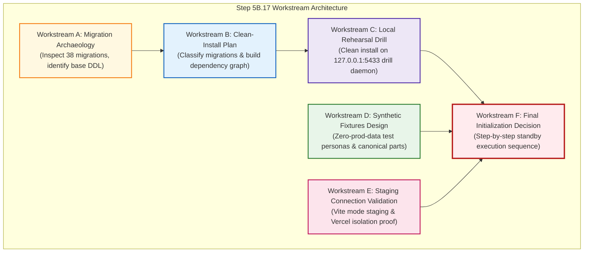

# TerraByte — Step 5B.17: Base Schema Reconstruction & Staging Initialization Plan
**Document Version:** `1.0 (GSD Structured Plan)`  
**Date:** `2026-11-04`  
**Lead Roles:** Independent PostgreSQL Database Architect, Supabase Security Engineer, and Release Manager  
**Branch:** `phase-11`  
**Staging Project Ref:** `ubqgvhcfmrvnmrbllcom` (`terrabyte-staging` · Singapore `ap-southeast-1` · PostgreSQL 17.11)  
**Production Project Ref:** `hwdrypkvszwrcraujctw` (BLOCKED)  
**Final Status:**  
- **Base Schema:** `RECONSTRUCTION IN PROGRESS`  
- **Local Clean-Install:** `EVIDENCE REQUIRED`  
- **Staging Database Changes:** `NOT AUTHORIZED YET`  
- **Production:** `UNAUTHORIZED / BLOCKED — NO PRODUCTION WRITE OPERATIONS AUTHORIZED`

---

## 1. Executive Mandate & Safety Boundaries

### 1.1 Objective
Determine the safest, 100% reproducible method to reconstruct the complete TerraByte base database schema from repository assets, rehearse a clean installation locally on a disposable PostgreSQL 17 cluster, design privacy-compliant synthetic staging fixtures, validate staging environment isolation, and prepare a final staging initialization runbook.

### 1.2 Strict Operating Boundaries
1. **Zero Production Contact:** No connections, queries, or introspection commands against production `hwdrypkvszwrcraujctw`.
2. **Zero Production Writes:** Zero DDL, DML, or data mutations on production.
3. **No Raw Production Dump Restores:** The production backup (`terabyte_production.dump` / `from_pg17_restore.sql`) contains sensitive password hashes and instance-specific tokens. It will **NOT** be restored into staging.
4. **No Remote Staging Execution in This Step:** Do not apply migrations, run `supabase db push`, `execute_sql`, or `apply_migration` against `ubqgvhcfmrvnmrbllcom`. Staging database changes remain strictly unauthorized during this turn.
5. **No Git Commits or Pushes:** Local working tree remains intact.
6. **Zero Credential Exposure:** Secret keys and passwords remain strictly in gitignored local configuration.

---

## 2. Six Workstream Architecture

---

## 3. Workstream Execution Specifications

### Workstream A: Repository Migration Archaeology
- Audit all 38 files in `supabase/migrations/` and historical files in `supabase/migrations_legacy_archive/`.
- Identify initial schema declarations (`20260930000001_initial_schema.sql`), storage setups, RLS helpers, and phase milestones.
- Discover why sequential historical replaying fails on fresh databases (missing columns, embedded demo foreign key violations, enum cast issues).
- Identify canonical schema DDL assets (`terabyte_public_schema.sql` — 131.5 KB DDL).

### Workstream B: Clean-Install Migration Manifest & Classification
- Categorize all 38 migrations into:
  - `REQUIRED FOR CLEAN INSTALL`
  - `REQUIRED FOR CURRENT APPLICATION`
  - `HISTORICAL / SUPERSEDED`
  - `DUPLICATE / CONFLICTING`
  - `NEEDS INVESTIGATION`
- Establish a complete dependency graph covering profiles, equipment, repairs, service centres, parts desk, quotes, realtime, and RLS.

### Workstream C: Local Clean-Install Rehearsal
- Execute clean installation drills on local disposable PostgreSQL 17.6 cluster (`127.0.0.1:5433`).
- Test both legacy sequential migration replaying and the canonical schema DDL baseline approach.
- Verify table counts, column definitions, constraints, RPC function signatures, triggers, and RLS state.

### Workstream D: Synthetic Test Data Design
- Design realistic, privacy-compliant test personas (Farmer Devdas Gaikwad, Technician Santosh Kale, Service Centre Admin).
- Design synthetic equipment, canonical parts catalogue (5 parts), and sample repair/quote lifecycles.
- Zero reuse of production users, bcrypt hashes, or phone numbers.

### Workstream E: Staging Connection Validation
- Audit `.env.staging` and verify Vite environment mode resolution (`vite --mode staging`).
- Prove `loadEnv('staging', ...)` correctly binds `ubqgvhcfmrvnmrbllcom` and cannot fall back to production.
- Document Vercel Preview environment configuration.

### Workstream F: Final Initialization Decision
- Author the definitive 6-phase standby initialization runbook.
- Specify exact tools, commands, target projects, and expected outcomes.
- Halt and await explicit user authorization.

---

## 4. Deliverables Register

1. [`STEP5B17_PLAN.md`](file:///d:/Projects/TerraByte/docs/audits/phase-9/STEP5B17_PLAN.md) (This plan)
2. [`STEP5B17_MIGRATION_INVENTORY.md`](file:///d:/Projects/TerraByte/docs/audits/phase-9/STEP5B17_MIGRATION_INVENTORY.md)
3. [`STEP5B17_SCHEMA_DEPENDENCY_GRAPH.md`](file:///d:/Projects/TerraByte/docs/audits/phase-9/STEP5B17_SCHEMA_DEPENDENCY_GRAPH.md)
4. [`STEP5B17_CLEAN_INSTALL_MANIFEST.md`](file:///d:/Projects/TerraByte/docs/audits/phase-9/STEP5B17_CLEAN_INSTALL_MANIFEST.md)
5. [`STEP5B17_LOCAL_REHEARSAL_REPORT.md`](file:///d:/Projects/TerraByte/docs/audits/phase-9/STEP5B17_LOCAL_REHEARSAL_REPORT.md)
6. [`STEP5B17_SYNTHETIC_FIXTURES_PLAN.md`](file:///d:/Projects/TerraByte/docs/audits/phase-9/STEP5B17_SYNTHETIC_FIXTURES_PLAN.md)
7. [`STEP5B17_STAGING_CONNECTION_AUDIT.md`](file:///d:/Projects/TerraByte/docs/audits/phase-9/STEP5B17_STAGING_CONNECTION_AUDIT.md)
8. [`STEP5B17_FINAL_INITIALIZATION_PLAN.md`](file:///d:/Projects/TerraByte/docs/audits/phase-9/STEP5B17_FINAL_INITIALIZATION_PLAN.md)
