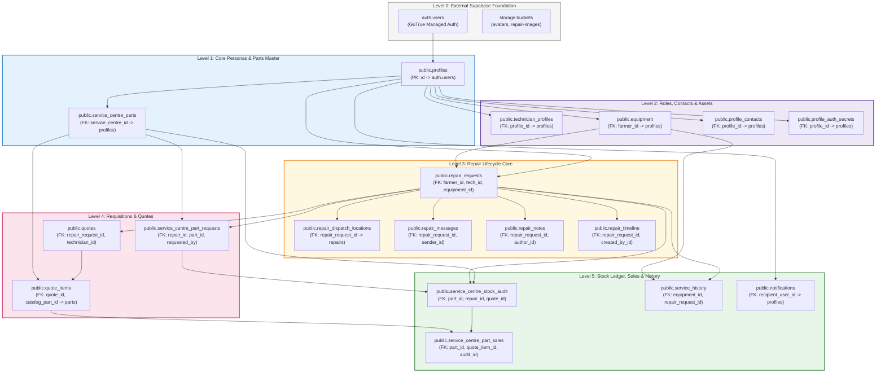

# TerraByte — Step 5B.17: Complete Schema Dependency Graph
**Document Version:** `1.0 (Architecture & Dependency Graph)`  
**Date:** `2026-11-04`  
**Total Public Tables:** `16 Core Application Tables`  
**Security Schema:** `app_security (Isolated Profile Separation)`  
**Enum Types:** `7 Distinct Domain Enums`  
**Production Gate Status:** **`UNAUTHORIZED / BLOCKED — NO PRODUCTION WRITE OPERATIONS AUTHORIZED`**

---

## 1. Executive Summary

This document establishes the definitive structural dependency graph of the TerraByte application database. Understanding this entity hierarchy is mandatory to construct a clean, deterministic initialization sequence without encountering foreign key errors, circular references, or missing enum types.

---

## 2. Multi-Level Entity Dependency Graph

---

## 3. Domain Enums Inventory

Before any table referencing domain types can be instantiated, the following 7 PostgreSQL enum types must exist:

| Enum Name | Defined Values | Consuming Tables & Columns |
| :--- | :--- | :--- |
| `public.user_role` | `'farmer'`, `'technician'`, `'admin'`, `'service_centre'` | `profiles.role` |
| `public.equipment_type` | `'tractor'`, `'harvester'`, `'implement'`, `'pump'`, `'other'` | `equipment.type` |
| `public.equipment_status` | `'operational'`, `'in_repair'`, `'decommissioned'` | `equipment.status` |
| `public.repair_status` | `'PENDING_REVIEW'`, `'ASSIGNED'`, `'IN_PROGRESS'`, `'PARTS_PENDING'`, `'QUOTE_PENDING'`, `'APPROVED_IN_PROGRESS'`, `'COMPLETED'`, `'CANCELLED'`, `'CANCELLATION_REQUESTED'` | `repair_requests.status`, `repair_timeline.status` |
| `public.quote_status` | `'PENDING_APPROVAL'`, `'APPROVED'`, `'REJECTED'`, `'SUPERSEDED'` | `quotes.status` |
| `public.part_request_status` | `'REQUESTED'`, `'SOURCING'`, `'IN_TRANSIT'`, `'AVAILABLE'`, `'HANDED_OFF'`, `'REJECTED'`, `'CANCELLED'` | `service_centre_part_requests.status` |
| `public.stock_movement_type` | `'RECEIVED'`, `'ISSUED_TO_REPAIR'`, `'RETURNED'`, `'SALE'`, `'INVENTORY_ADJUSTMENT'` | `service_centre_stock_audit.movement_type` |

---

## 4. Foreign Key Constraints & Cascade Semantics

| Dependent Table | Foreign Key Column | Target Table & Column | On Delete Action | Critical Invariant |
| :--- | :--- | :--- | :---: | :--- |
| `public.profiles` | `id` | `auth.users(id)` | `CASCADE` | Every profile is bound 1:1 to an authentic Supabase Auth identity. |
| `public.technician_profiles` | `profile_id` | `public.profiles(id)` | `CASCADE` | Technician details are deleted if parent profile is purged. |
| `public.equipment` | `farmer_id` | `public.profiles(id)` | `CASCADE` | Equipment is owned strictly by a farmer profile. |
| `public.repair_requests` | `farmer_id` | `public.profiles(id)` | `RESTRICT` | Cannot delete farmer while active repair tickets exist. |
| `public.repair_requests` | `technician_id` | `public.profiles(id)` | `SET NULL` | Unassigns technician if tech profile is decommissioned. |
| `public.repair_requests` | `equipment_id` | `public.equipment(id)` | `RESTRICT` | Equipment record cannot be purged during active repair. |
| `public.service_centre_parts`| `service_centre_id` | `public.profiles(id)` | `RESTRICT` | Stock belongs to an authenticated service centre admin profile. |
| `public.quote_items` | `catalog_part_id` | `public.service_centre_parts(id)`| `SET NULL` | Linked catalog reference for stock deduction and sales auditing. |
| `public.service_centre_part_sales`| `quote_item_id` | `public.quote_items(id)` | `RESTRICT` | Financial sales records are immutable audit lines. |

---

## 5. Security & Isolation Layer

### 5.1 Schema `app_security`
- Created by Phase 11 / Profile Security Architecture (`20261104100000`).
- Encapsulates sensitive contact checks:
  `app_security.can_view_profile(p_target_id uuid)`
- Enforces that farmers cannot view technician personal details unless assigned to an active repair, and unassigned technicians cannot view farmer contacts.

### 5.2 RLS Helper Routines (in `public`)
- `public.current_profile_id()`: Resolves authenticated caller profile UUID.
- `public.current_user_role()`: Resolves authenticated caller role.
- `public.check_table_rls()`: Validates that RLS is enabled across all tables.

---

## 6. Audit Verdict

- **Dependency Graph Hierarchy:** **`VERIFIED (Level 0 through Level 5)`**
- **Enum Prerequisites:** **`VERIFIED (7 Enums Mapped)`**
- **Circular Dependencies:** **`NONE (Strict Acyclic Directed Graph)`**

Production gate status remains strictly: **`UNAUTHORIZED / BLOCKED — NO PRODUCTION WRITE OPERATIONS AUTHORIZED`**.
