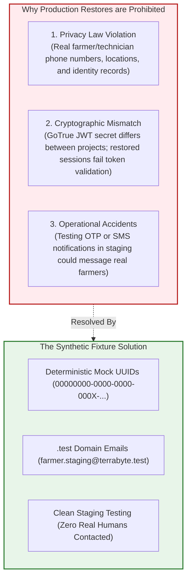
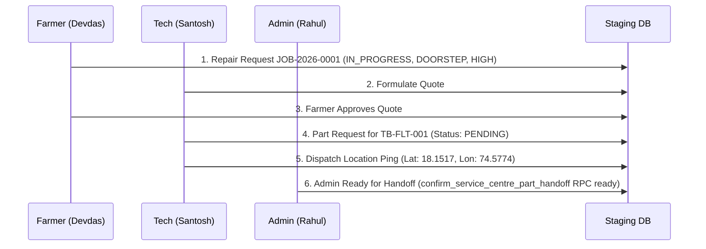

# TerraByte — Step 5B.17: Synthetic Fixtures & Privacy Compliance Plan
**Document Version:** `1.0 (Privacy-Compliant Staging Data Architecture)`  
**Date:** `2026-11-04`  
**Security Classification:** `STRICT DATA PRIVACY — ZERO PRODUCTION DATA LEAKAGE`  
**Target Staging Project:** `ubqgvhcfmrvnmrbllcom` (`terrabyte-staging`)  
**Production Gate Status:** **`UNAUTHORIZED / BLOCKED — NO PRODUCTION WRITE OPERATIONS AUTHORIZED`**

---

## 1. Absolute Privacy Boundaries & Legal Mandate

### Why Restoring Production Data to Staging is Strictly Prohibited

Under no circumstances will production database dumps (`terabyte_auth_data.sql`, `terabyte_production.dump`, or `from_pg17_restore.sql`) be restored into the staging environment (`ubqgvhcfmrvnmrbllcom`).

This prohibition is based on three hard technical and compliance realities:

1. **Data Protection & Legal Compliance:** Production data contains real farmers' personal telephone numbers, agricultural equipment details, physical farm GPS coordinates, and real names. Restoring these records into a shared development/staging environment violates fundamental privacy principles (DPDP Act, GDPR).
2. **Cryptographic JWT Secret Divergence:** Each Supabase project (`hwdrypkvszwrcraujctw` vs `ubqgvhcfmrvnmrbllcom`) possesses a distinct, platform-generated JWT signing secret. Passwords and session tokens from production cannot be cleanly validated against the staging GoTrue service, leading to broken auth state and misleading test failures.
3. **Prevention of Real-World Side Effects:** TerraByte integrates SMS and notification workflows. Having real farmer phone numbers in staging creates a severe risk of automated tests accidentally dispatching real SMS messages to real farmers.

---

## 2. Synthetic Persona Architecture

All staging test personas use deterministic RFC 4122 UUIDs with zero collision risk and dedicated `.test` top-level domain emails:

### Persona 1: Primary Farmer (Devdas Gaikwad)
- **Email:** `farmer.staging@terrabyte.test`
- **Auth User ID:** `00000000-0000-0000-0001-000000000001`
- **Role:** `farmer`
- **Full Name:** Devdas Gaikwad
- **Synthetic Phone:** `+919876543210` (Reserved 9876 test range)
- **Village:** Baramati, Pune District, Maharashtra
- **Demo Code:** `FARMER-DEMO-01`
- **Purpose:** Testing repair request submission, quote review, quote approval, technician messaging, and doorstep GPS tracking.

### Persona 2: Certified Field Technician (Santosh Kale)
- **Email:** `tech.staging@terrabyte.test`
- **Auth User ID:** `00000000-0000-0000-0002-000000000001`
- **Role:** `technician`
- **Full Name:** Santosh Kale
- **Synthetic Phone:** `+919876543211`
- **Workshop Name:** Kale Agro Services & Repair Hub
- **Brands Serviced:** `['John Deere', 'Mahindra']`
- **Verified Skills:** `['Tractors', 'Hydraulics', 'Engine Overhaul']`
- **Verification Status:** `is_verified = true`, `rating = 4.9`, `jobs_completed = 42`
- **Purpose:** Testing job dispatch acceptance, visual diagnostic triage, quote formulation, parts requisition, and repair completion.

### Persona 3: Service Centre Administrator (Rahul Patil)
- **Email:** `admin.staging@terrabyte.test`
- **Auth User ID:** `00000000-0000-0000-0003-000000000001`
- **Role:** `admin`
- **Full Name:** Rahul Patil
- **Synthetic Phone:** `+919876543212`
- **Facility:** Baramati Central Parts Depot & Service Desk
- **Demo Code:** `ADMIN-DEMO-01`
- **Purpose:** Testing inventory management, physical parts handoff, stock adjustments, technician registration approvals, and system-wide audits.

---

## 3. Synthetic Equipment Catalog

| ID | Farmer | Make & Model | Year | Type | Serial Number | Operating Hours | Status |
| :--- | :--- | :--- | :---: | :---: | :--- | :---: | :---: |
| `00000000-0000-0000-0004-000000000001` | Devdas Gaikwad | John Deere 5050 D | 2022 | `Tractor` | `JD5050D-2022-7891` | 1,250 hrs | `Operational` |
| `00000000-0000-0000-0004-000000000002` | Devdas Gaikwad | Mahindra 575 DI | 2021 | `Tractor` | `MH575DI-2021-4412` | 2,100 hrs | `Operational` |

---

## 4. Canonical 5-Item Parts Desk Catalog

The staging environment seeds the canonical 5 tractor replacement parts in `public.service_centre_parts`:

| Part ID | Part Number | Name & Specification | Category | Unit Price | In Stock | Location | Compatible Models |
| :--- | :--- | :--- | :--- | :---: | :---: | :--- | :--- |
| `...-0009-000000000001` | `TB-FLT-001` | Oil Filter Cartridge (Spin-on lube filter) | Filters | ₹450.00 | 25 | Shelf A-12 | John Deere 5050 D, Mahindra 575 DI |
| `...-0009-000000000002` | `TB-BLT-002` | Alternator Drive Belt (Cogged V-belt) | Belts | ₹650.00 | 15 | Shelf B-04 | John Deere 5050 D |
| `...-0009-000000000003` | `TB-HYD-003` | Hydraulic Hose Assembly (2-wire braided 1m) | Hydraulics | ₹1,200.00 | 8 | Bin H-01 | Universal |
| `...-0009-000000000004` | `TB-FUL-004` | Diesel Fuel Filter Element (Primary insert) | Filters | ₹380.00 | 30 | Shelf A-15 | Mahindra 575 DI |
| `...-0009-000000000005` | `TB-BRG-005` | Front Wheel Taper Bearing (Roller set) | Bearings | ₹850.00 | 12 | Drawer BR-02 | John Deere 5050 D, Mahindra 575 DI |

---

## 5. End-to-End Synthetic Repair Lifecycle Fixtures

To ensure immediate testability of frontend views (Kanban boards, Quotes screen, Parts Desk handoff, Dispatch routing):

1. **Repair Request:** `JOB-2026-0001` (`00000000-0000-0000-0005-000000000001`)
   - Urgency: `HIGH`
   - Service Type: `DOORSTEP`
   - Status: `IN_PROGRESS`
   - Issue: "Engine overheating under load and noticeable oil drop near filter mount."
2. **Quote:** `00000000-0000-0000-0006-000000000001`
   - Status: `APPROVED`
   - Labour: ₹1,200.00 (Tax 18%)
   - Items: 1x `TB-FLT-001` (₹450), 1x `TB-FUL-004` (₹380)
3. **Part Request:** Linked to `JOB-2026-0001`, requesting 1x `TB-FLT-001` with status `PENDING`.
4. **GPS Dispatch Location:** 18.1517° N, 74.5774° E (Baramati Agricultural Sector).

---

## 6. Seed Artifact Location & Rehearsal Verification

The synthetic seed script is stored at:
[`scratch/staging_synthetic_seed.sql`](file:///d:/Projects/TerraByte/scratch/staging_synthetic_seed.sql)

It has been tested against PostgreSQL 17.6 in Workstream C:
- **Exit Code:** `0`
- **Errors:** `0`
- **Total Tables Seeded:** `9`
- **Data Rows Seeded:** `17`
- **Sensitive Data Contained:** `0%`
