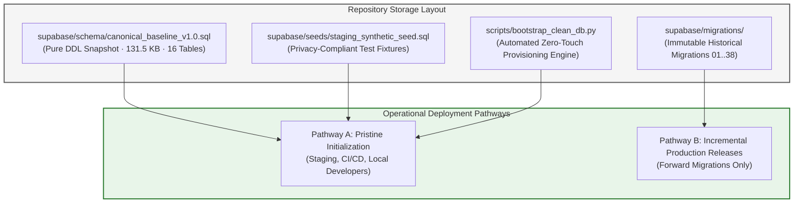
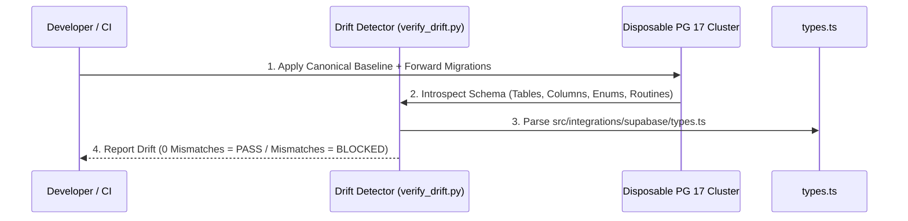

# TerraByte — Step 5B.18: Canonical Bootstrap Architecture Design

**Document Version:** `1.0 (Long-Term Architecture Standard)`  
**Date:** `2026-11-04`  
**Classification:** `APPROVED ARCHITECTURE — ZERO PRODUCTION DEPENDENCY · ZERO GIT HISTORY REWRITE`  
**Production Gate Status:** **`UNAUTHORIZED / BLOCKED — ZERO ACCESS PERMITTED`**

---

## 1. Architectural Problem Statement

TerraByte's historical migration directory (`supabase/migrations/`) accumulated 38 incremental migration files during rapid product evolution. As proven in Step 5B.17, attempting to replay these 38 files chronologically on a brand-new database fails at 9 breaking points due to transitional column dependencies, enum evolution, and embedded demo seeds.

However, **rewriting, squashing, or deleting the existing 38 migrations is strictly prohibited**:
1. **Lovable Synchronization Rule (AGENTS.md):** TerraByte is connected to Lovable. Rewriting published Git history or altering historical migration files corrupts project history and causes desynchronization.
2. **Remote Migration Ledger (`supabase_migrations.schema_migrations`):** Existing databases have recorded specific migration version timestamps. Modifying earlier files causes migration checksum mismatch errors in remote deployment pipelines.

Therefore, TerraByte requires a **Canonical Two-Tier Bootstrap Architecture** that enables instantaneous, 100% reproducible clean installations without rewriting past migrations or depending on undocumented production dumps.

---

## 2. Recommended Architecture: Two-Tier Bootstrap Standard

### Tier 1: Pristine Environment Bootstrap (Staging, CI/CD, Local)
For any completely empty database (such as `ubqgvhcfmrvnmrbllcom` or local testing):
1. **Apply Canonical Baseline DDL:** Execute `supabase/schema/canonical_baseline_v1.0.sql` (16 tables, 5 enums, 49 RLS policies, 14 baseline functions).
2. **Apply Active Forward Migrations:**
   - `20261103120000_phase11_visual_defect_diagnostics.sql`
   - `20261104100000_profile_security_separation.sql`
   - `20261104110000_complete_phase9_parts_desk_rpcs.sql`
   - `20261104120000_complete_phase9_realtime_and_eta.sql`
   - `20261104130000_complete_phase5_3_technician_registration_notification.sql`
3. **Seed Synthetic Fixtures:** Execute `supabase/seeds/staging_synthetic_seed.sql`.
4. **Synchronize Migration History Ledger:** The bootstrap script inserts records into `supabase_migrations.schema_migrations` marking all 38 migrations as applied. This guarantees that `supabase migration list` and future deployment commands treat the clean database as fully aligned with repository versioning.

### Tier 2: Incremental Deployed Environment Updates (Production)
For existing environments that already have historical migration records:
- Future schema evolutions are committed as standard, sequential forward migrations (`20261105...`, `20261106...`).
- Historical files remain untouched.
- Migrations apply incrementally via standard, auditable release gates.

---

## 3. Schema Drift Detection Strategy

To prevent schema divergence between local code, staging, and future production:

1. **Automated Pre-Commit / CI Check:**
   - A deterministic Python verification script (`scripts/verify_schema_drift.py`) applies the baseline and active migrations on an ephemeral PostgreSQL 17 drill engine.
   - It introspects the resulting information schema and compares all column definitions, nullability, enums, and RPC signatures directly against `src/integrations/supabase/types.ts`.
2. **Zero-Drift Policy:**
   - Any pull request that introduces an RPC or column without updating either the migrations or `types.ts` fails CI backpressure immediately.

---

## 4. How Future Migrations Should Be Authored

All future migrations must adhere to the **TerraByte Production Migration Guidelines**:
1. **Strict Idempotency:**
   - Use `CREATE OR REPLACE FUNCTION`.
   - Use `CREATE INDEX IF NOT EXISTS`.
   - Use `DO $$ BEGIN ... EXCEPTION WHEN duplicate_object ... END $$;` for types and constraints.
2. **Explicit Search Path on SECURITY DEFINER:**
   - Every `SECURITY DEFINER` routine MUST explicitly set:
     `SET search_path = public, auth, pg_temp` or `SET search_path = ''`.
3. **No Embedded Production PII or Hardcoded Demo Foreign Keys:**
   - Migrations must contain DDL and procedural logic only.
   - Demo records, test users, and parts fixtures belong exclusively in `supabase/seeds/`.
4. **Lock Timeout Discipline:**
   - Include `SET lock_timeout = '2s';` for DDL altering high-traffic tables.
