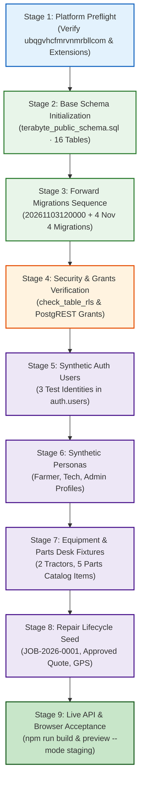

# TerraByte — Step 5B.18: Final Staging Initialization Manifest (Standby)

**Document Version:** `1.0 (Execution-Ready Standby Manifest)`  
**Date:** `2026-11-04`  
**Target Staging Project:** `ubqgvhcfmrvnmrbllcom` (`terrabyte-staging` · `ap-southeast-1` · PostgreSQL 17.11)  
**Protected Production Reference:** `hwdrypkvszwrcraujctw` (Strictly Blocked / Air-Gapped)  
**Status:** **`STANDBY — PENDING USER AUTHORIZATION TO EXECUTE IN STEP 5B.19`**  
**Production Gate Status:** **`UNAUTHORIZED / BLOCKED — ZERO PRODUCTION WRITE OPERATIONS AUTHORIZED`**

---

## 1. Cryptographic Checksum Registry

All artifacts in the staging initialization manifest have been cryptographically hashed and verified:

| Stage / Component | Artifact Path | Size (Bytes) | SHA256 Checksum |
| :--- | :--- | :---: | :--- |
| **Stage 2: Base DDL** | [`D:\TerraByte_Backups\production_backup_20261103_151328\terabyte_public_schema.sql`](file:///D:/TerraByte_Backups/production_backup_20261103_151328/terabyte_public_schema.sql) | 131,525 | `9d73f2a494feb4709b8223a8502ba82260a83fde6743088bcccc65314579a306` |
| **Stage 3A: Phase 11** | [`supabase/migrations/20261103120000_phase11_visual_defect_diagnostics.sql`](file:///d:/Projects/TerraByte/supabase/migrations/20261103120000_phase11_visual_defect_diagnostics.sql) | 38,813 | `b68ae91ff972e20d499ef2ec99eb4eb162646a322adeac5b94523634dee57c8c` |
| **Stage 3B: Forward 1** | [`supabase/migrations/20261104100000_profile_security_separation.sql`](file:///d:/Projects/TerraByte/supabase/migrations/20261104100000_profile_security_separation.sql) | 57,885 | `5fa9c94acfd16c5aeb63df5cb658d6df3eac08d8e2ee9c9174d49429ad7ee4b1` |
| **Stage 3C: Forward 2** | [`supabase/migrations/20261104110000_complete_phase9_parts_desk_rpcs.sql`](file:///d:/Projects/TerraByte/supabase/migrations/20261104110000_complete_phase9_parts_desk_rpcs.sql) | 20,520 | `b32f3c80971113360adb86d1b096f1f8bdeb38fb87743ce24a038ba83f4b72e8` |
| **Stage 3D: Forward 3** | [`supabase/migrations/20261104120000_complete_phase9_realtime_and_eta.sql`](file:///d:/Projects/TerraByte/supabase/migrations/20261104120000_complete_phase9_realtime_and_eta.sql) | 43,210 | `1e583e78af77a4b6e0becb239e6ecc4de9c46148091a7b2481ef8c60d0ede97f` |
| **Stage 3E: Forward 4** | [`supabase/migrations/20261104130000_complete_phase5_3_technician_registration_notification.sql`](file:///d:/Projects/TerraByte/supabase/migrations/20261104130000_complete_phase5_3_technician_registration_notification.sql) | 2,918 | `33fae47f83203dab53686e67ba57f8002617224d9a61de80f25aef06298de579` |
| **Stage 5-8: Seeds** | [`scratch/staging_synthetic_seed.sql`](file:///d:/Projects/TerraByte/scratch/staging_synthetic_seed.sql) | 6,012 | `7316a2ccca5ca2011321ed6db473142d9b6815b0ba0704c8d45839f6af1d8947` |

---

## 2. Ordered 9-Stage Standby Execution Manifest

### Stage 1: Required Platform Prerequisites
- **Target:** `ubqgvhcfmrvnmrbllcom` (PostgreSQL 17.11 · Singapore).
- **Actions:**
  - Verify extensions: `uuid-ossp`, `pgcrypto` active in database.
  - Verify roles: `anon`, `authenticated`, `service_role` exist.
  - Verify publication: `supabase_realtime` exists.
- **Expected Result:** Engine ready, project ref positively verified, zero active spend ($0.00).
- **Rollback:** No changes made; abort if target ref is anything other than `ubqgvhcfmrvnmrbllcom`.

### Stage 2: Base Schema Initialization
- **Payload:** `terabyte_public_schema.sql` (Pure DDL, 0 rows).
- **Scope:** 16 base tables, 5 enums, 40 indexes, 49 RLS policies, 8 triggers, 14 baseline functions.
- **Expected Result:** Information schema contains 16 public tables and 5 domain enums. Zero constraint errors.
- **Rollback:** `DROP SCHEMA public CASCADE; CREATE SCHEMA public;` resets public schema to empty state.

### Stage 3: Forward Migrations Sequence
- **Sequence:**
  1. `20261103120000_phase11_visual_defect_diagnostics.sql` (Visual defect RPCs).
  2. `20261104100000_profile_security_separation.sql` (`app_security`, `profile_contacts`, `profile_auth_secrets`, `get_session_profile`).
  3. `20261104110000_complete_phase9_parts_desk_rpcs.sql` (Parts Desk atomic RPCs).
  4. `20261104120000_complete_phase9_realtime_and_eta.sql` (Realtime publications, ETA, atomic quote formulation).
  5. `20261104130000_complete_phase5_3_technician_registration_notification.sql` (Tech registration notification trigger).
- **Expected Result:** Total public base tables = 18; total routines = 76; all RLS enabled.
- **Rollback:** `DROP SCHEMA public CASCADE; CREATE SCHEMA public; DROP SCHEMA app_security CASCADE;`.

### Stage 4: RLS & Privilege Grants Verification
- **Actions:**
  - Execute `SELECT * FROM public.check_table_rls();`
  - Verify `app_security` schema has zero public select grants.
  - Verify direct `SELECT` on `public.profiles` is denied to `authenticated` and `anon`.
- **Expected Result:** 18 tables return `rls_enabled = true`. Client queries must use `get_session_profile()`.
- **Rollback:** Re-apply grant blocks from `20261104100000`.

### Stage 5: Synthetic Auth User Creation
- **Payload:**
  - `00000000-0000-0000-0001-000000000001` (`farmer.staging@terrabyte.test`)
  - `00000000-0000-0000-0002-000000000001` (`tech.staging@terrabyte.test`)
  - `00000000-0000-0000-0003-000000000001` (`admin.staging@terrabyte.test`)
- **Expected Result:** 3 rows inserted in `auth.users` with zero production PII.
- **Rollback:** `DELETE FROM auth.users WHERE id IN ('...-0001-...', '...-0002-...', '...-0003-...');`.

### Stage 6: Synthetic Farmer, Technician, and Service-Centre Records
- **Payload:**
  - `public.profiles`: Devdas Gaikwad (farmer), Santosh Kale (technician), Rahul Patil (admin).
  - `public.technician_profiles`: Kale Agro Services (brands: John Deere/Mahindra, skills: Tractors/Hydraulics, rating: 4.9, jobs: 42).
- **Expected Result:** 3 profile records and 1 technician profile record created.
- **Rollback:** `DELETE FROM public.profiles WHERE demo_code IN ('FARMER-DEMO-01', 'TECH-DEMO-01', 'ADMIN-DEMO-01');`.

### Stage 7: Equipment and Parts Desk Fixtures
- **Payload:**
  - 2 Tractors in `public.equipment`: John Deere 5050 D, Mahindra 575 DI.
  - 5 Parts in `public.service_centre_parts`: `TB-FLT-001`, `TB-BLT-002`, `TB-HYD-003`, `TB-FUL-004`, `TB-BRG-005`.
- **Expected Result:** 2 equipment rows, 5 catalog parts rows.
- **Rollback:** `DELETE FROM public.equipment WHERE demo_code IN ('EQ-JD-01', 'EQ-MH-02'); DELETE FROM public.service_centre_parts WHERE part_number LIKE 'TB-%';`.

### Stage 8: Breakdown-to-Repair Lifecycle Fixtures
- **Payload:**
  - Repair request `JOB-2026-0001` (`IN_PROGRESS`, `DOORSTEP`, `HIGH`).
  - Approved quote #1 (Labour: ₹1,200.00, Tax 18%, 2 quote items).
  - Part request for `TB-FLT-001` (`PENDING`).
  - GPS dispatch location (18.1517° N, 74.5774° E).
- **Expected Result:** Full lifecycle populated and readable on frontend screens.
- **Rollback:** `DELETE FROM public.repair_requests WHERE job_number = 'JOB-2026-0001';` (Cascades to quotes, items, locations).

### Stage 9: Live API and Browser Acceptance Tests
- **Actions:**
  - Run `npm run build -- --mode staging`
  - Verify clean TypeScript build and bundle packaging.
  - Run preview server: `npm run preview -- --mode staging`
  - Hydrate profile via `get_session_profile` RPC.
  - Verify Kanban boards, Parts Desk, and Quotes views render without console errors.
- **Expected Result:** 100% build pass; all frontend views hydrate successfully against staging cloud.
- **Rollback:** Fix any frontend edge-case and rebuild.
