# TerraByte — Step 5B.18: GSD Master Verification Plan & Staging Gate Strategy

**Document Version:** `1.0 (Master Execution Plan)`  
**Date:** `2026-11-04`  
**Role:** Independent Principal PostgreSQL Database Architect, Supabase Security Engineer, and Release Manager  
**Target Staging Project:** `ubqgvhcfmrvnmrbllcom` (`terrabyte-staging` · `ap-southeast-1` · PostgreSQL 17.11)  
**Protected Production Project:** `hwdrypkvszwrcraujctw` (Strictly Blocked / Air-Gapped)  
**Production Gate Status:** **`UNAUTHORIZED / BLOCKED — ZERO PRODUCTION WRITE OPERATIONS AUTHORIZED`**  
**Staging Initialization Status:** **`GATE EVALUATION IN PROGRESS — ZERO REMOTE DDL IN THIS STEP`**

---

## 1. Context & Operational Objectives

Step 5B.17 completed the archaeological migration inventory, established the clean-install architecture (Canonical DDL Baseline + 4 Forward Migrations), designed the privacy-compliant synthetic fixtures, and conducted initial local rehearsals.

**Step 5B.18 is the Final Pre-Initialization Audit & Gate Decision.**  
The primary objectives are:
1. **Workstream A:** Perform an exhaustive security, privacy, and dependency audit on `terabyte_public_schema.sql` (pure DDL verification, PII check, secrets check, search_path and SECURITY DEFINER safety).
2. **Workstream B:** Conduct an exhaustive reconciliation between the baseline DDL, all 38 repository migrations, the 4 forward migrations, frontend types (`types.ts`), and frontend RPC call sites.
3. **Workstream C:** Execute a rigorous, reproducible local drill reconciling the Step 5B.17 status contradiction (`LOCAL CLEAN-INSTALL: EVIDENCE REQUIRED` vs drill pass), and document exact platform dependencies (auth, storage, realtime).
4. **Workstream D:** Design the permanent, canonical repository bootstrap architecture so any future developer or CI system can spin up an empty environment without production dependence.
5. **Workstream E:** Produce the definitive, ordered Staging Initialization Manifest with SHA256 checksums, expected outcomes, rollback procedures, and final gate recommendations.

---

## 2. Non-Negotiable Safety Boundaries

```
+-----------------------------------------------------------------------------------+
|                        ABSOLUTE OPERATING BOUNDARIES                              |
+-----------------------------------------------------------------------------------+
| 1. ZERO SQL, DDL, DML, OR MIGRATIONS AGAINST PRODUCTION (hwdrypkvszwrcraujctw).   |
| 2. ZERO SQL, DDL, DML, OR MIGRATIONS AGAINST STAGING (ubqgvhcfmrvnmrbllcom).     |
| 3. NO execute_sql, apply_migration, supabase db push, OR migration repair.        |
| 4. DO NOT RESTORE THE PRODUCTION DATA DUMP (terabyte_auth_data.sql / dump).      |
| 5. DO NOT DEPLOY APPLICATION CODE OR CHANGE VERCEL CONFIGURATION.                 |
| 6. ZERO GIT COMMITS OR GIT PUSHES.                                                |
| 7. ZERO SPEND ($0.00) — NO PAID ADD-ONS, COMPUTE UPGRADES, OR PITR PROVISIONING.  |
| 8. LOCAL DISPOSABLE DRILLS ONLY ON ISOLATED PG 17 CLUSTER (PORT 5433).            |
+-----------------------------------------------------------------------------------+
```

---

## 3. Workstream Execution Roadmap

```mermaid
flowchart TD
    subgraph WkA["Workstream A: Baseline Security Audit"]
        A1["Inspect terabyte_public_schema.sql"]
        A2["Verify Zero Data Rows / Zero PII"]
        A3["Verify Zero Secrets / Hardcoded URLs"]
        A4["Audit All 14 Functions & SECURITY DEFINER search_paths"]
    end

    subgraph WkB["Workstream B: Reconciliation & Completeness"]
        B1["Cross-Reference 38 Repo Migrations"]
        B2["Audit 4 Forward Migrations (100000..130000)"]
        B3["Validate Frontend types.ts & RPC Callsites"]
        B4["Map Missing, Superseded, & Orphan Objects"]
    end

    subgraph WkC["Workstream C: Reproducible Verification"]
        C1["Spin Up Isolated Local PG 17 Drill (Port 5433)"]
        C2["Simulate Supabase Auth/Storage/Realtime Dependencies"]
        C3["Execute End-to-End Clean Rehearsal & Idempotency Test"]
        C4["Reconcile Step 5B.17 Status Contradiction"]
    end

    subgraph WkD["Workstream D: Canonical Bootstrap Design"]
        D1["Evaluate Versioned Baseline vs Baseline Migration"]
        D2["Design Drift Detection & CI Validation Strategy"]
        D3["Define Long-Term Zero-Production-Dependency Workflow"]
    end

    subgraph WkE["Workstream E: Final Manifest & Gate Report"]
        E1["Compute SHA256 Checksums for All Manifest Artifacts"]
        E2["Generate Ordered 9-Stage Standby Manifest"]
        E3["Classify All Findings with Gate Evidence"]
        E4["Issue Staging Initialization Decision"]
    end

    WkA --> WkB
    WkB --> WkC
    WkC --> WkD
    WkD --> WkE
```



---

## 4. Evidence Classification Standard

Every finding and claim across all deliverables must be classified using the formal gate ontology:
- **`VERIFIED`**: Proven by deterministic command execution, local PostgreSQL 17 test log, or direct file inspection.
- **`REPORTED BUT NOT INDEPENDENTLY VERIFIED`**: Claimed in earlier reports or documentation but requiring confirmation in this step.
- **`UNPROVEN`**: Lacking reproducible command logs or schema proof.
- **`FAILED`**: Test or verification command returned errors, non-zero exit code, or constraint violation.
- **`NOT APPLICABLE`**: Not relevant to clean staging initialization.

---

## 5. Required Deliverables Index

1. [`STEP5B18_PLAN.md`](file:///d:/Projects/TerraByte/docs/audits/phase-9/STEP5B18_PLAN.md) — This master verification plan.
2. [`STEP5B18_BASELINE_SECURITY_AUDIT.md`](file:///d:/Projects/TerraByte/docs/audits/phase-9/STEP5B18_BASELINE_SECURITY_AUDIT.md) — Security, PII, search_path, and dependency audit of `terabyte_public_schema.sql`.
3. [`STEP5B18_SCHEMA_RECONCILIATION.md`](file:///d:/Projects/TerraByte/docs/audits/phase-9/STEP5B18_SCHEMA_RECONCILIATION.md) — Forensic cross-reconciliation against 38 migrations, 4 forward migrations, and frontend types/RPCs.
4. [`STEP5B18_REPRODUCIBILITY_REPORT.md`](file:///d:/Projects/TerraByte/docs/audits/phase-9/STEP5B18_REPRODUCIBILITY_REPORT.md) — Empirical drill verification on PG 17, resolution of 5B.17 contradiction, and platform boundary definitions.
5. [`STEP5B18_CANONICAL_BOOTSTRAP_DESIGN.md`](file:///d:/Projects/TerraByte/docs/audits/phase-9/STEP5B18_CANONICAL_BOOTSTRAP_DESIGN.md) — Repository bootstrap architecture and future migration strategy.
6. [`STEP5B18_FINAL_STAGING_MANIFEST.md`](file:///d:/Projects/TerraByte/docs/audits/phase-9/STEP5B18_FINAL_STAGING_MANIFEST.md) — Ordered 9-stage standby initialization manifest with SHA256 checksums and rollback protocols.
7. [`STEP5B18_FINAL_GATE_REPORT.md`](file:///d:/Projects/TerraByte/docs/audits/phase-9/STEP5B18_FINAL_GATE_REPORT.md) — Final executive readiness gate decision.
