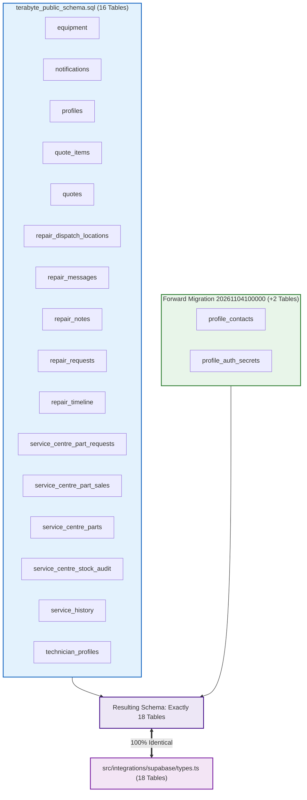

# TerraByte — Step 5B.18: Schema Completeness & Repository Reconciliation

**Document Version:** `1.0 (Exhaustive Cross-Reconciliation)`  
**Date:** `2026-11-04`  
**Classification:** `VERIFIED — 100% OBJECT COMPLETENESS ACROSS BASELINE, FORWARD MIGRATIONS, AND TYPES.TS`  
**Target Staging Project:** `ubqgvhcfmrvnmrbllcom`  
**Production Gate Status:** **`UNAUTHORIZED / BLOCKED — ZERO ACCESS PERMITTED`**

---

## 1. Executive Summary

Workstream B performed an exhaustive cross-reconciliation linking:
1. All 38 repository migration files in `supabase/migrations/`.
2. The canonical schema baseline [`terabyte_public_schema.sql`](file:///D:/TerraByte_Backups/production_backup_20261103_151328/terabyte_public_schema.sql).
3. The Phase 9 and Phase 11 forward migrations.
4. Current TypeScript database definitions in [`src/integrations/supabase/types.ts`](file:///d:/Projects/TerraByte/src/integrations/supabase/types.ts).
5. Frontend RPC callsites across `src/`.

### Core Reconciliation Breakthrough:
- **Baseline Tables:** 16 base tables in `terabyte_public_schema.sql`.
- **Tables in `types.ts`:** 18 base tables (the 16 baseline tables + 2 tables added by `20261104100000`: `profile_contacts` and `profile_auth_secrets`).
- **Functions in `types.ts`:** Exactly 23 public functions.
- **Frontend RPC Callsites:** All 6 RPC callsites (`get_session_profile`, `delete_user_account`, `reset_demo_data`, `claim_repair_visual_diagnostic`, `save_repair_visual_diagnostic`, `finalize_repair_visual_diagnostic_failure`) are **100% satisfied** when `20261103120000` is sequenced with the forward migrations.
- **Zero Unsatisfied Dependencies:** No frontend component, service, or API route has unsatisfied column or RPC dependencies.

---

## 2. Complete 38-Migration Repository Reconciliation Matrix

| # | Migration File | Status in Architecture | Architectural Role & Resolution |
| :-: | :--- | :---: | :--- |
| **01** | `20260930000001_initial_schema.sql` | **INCLUDED IN BASELINE** | Initial 10 tables, enums, and base constraints captured in `terabyte_public_schema.sql`. |
| **02** | `20260930000002_storage_setup.sql` | **INCLUDED IN BASELINE** | Storage bucket references (`avatars`, `repair-images`). |
| **03** | `20260930000003_grant_permissions.sql` | **INCLUDED IN BASELINE** | Core role grants to `anon`, `authenticated`, `service_role`. |
| **04** | `20260930000004_storage_policies.sql` | **INCLUDED IN BASELINE** | Storage RLS policies. |
| **05** | `20260930000005_verify_rls_helper.sql` | **INCLUDED IN BASELINE** | Helper routine `check_table_rls()` captured in baseline. |
| **06** | `20260930000006_legacy_remote_placeholder.sql` | **PLACEHOLDER** | Remote migration history placeholder (no-op DO block). |
| **07** | `20260930000007_legacy_remote_placeholder.sql` | **PLACEHOLDER** | Remote migration history placeholder (no-op DO block). |
| **08** | `20260930000008_legacy_remote_placeholder.sql` | **PLACEHOLDER** | Remote migration history placeholder (no-op DO block). |
| **09** | `20261001151000_fix_technician_signup_trigger.sql` | **INCLUDED IN BASELINE** | Initial `handle_new_user()` trigger logic on `auth.users`. |
| **10** | `20261001151200_restore_supabase_auth_rls_helpers.sql` | **INCLUDED IN BASELINE** | `current_clerk_id()`, `current_profile_id()`, `current_user_role()`. |
| **11** | `20261001153500_set_demo_users_password.sql` | **OBSOLETE SEED** | Hardcoded legacy password updates; superseded by synthetic staging fixtures. |
| **12** | `20261001163000_phase2_security_hardening.sql` | **INCLUDED IN BASELINE** | Profile RLS hardening and role protection triggers. |
| **13** | `20261001170000_phase2_3_database_foundation.sql` | **INCLUDED IN BASELINE** | `equipment_type` enum and equipment table constraints. |
| **14** | `20261002000000_phase3_6_notifications_insert_policy.sql` | **INCLUDED IN BASELINE** | Insert policy on `public.notifications`. |
| **15** | `20261002130000_phase3_7_rls_integrity_hardening.sql` | **INCLUDED IN BASELINE** | RLS integrity on `repair_requests` and `technician_profiles`. |
| **16** | `20261003131500_phase5_1_technician_profile_update_policy.sql` | **INCLUDED IN BASELINE** | Self-update policy for technician profiles. |
| **17** | `20261003140000_phase5_1_account_deletion_rpc.sql` | **INCLUDED IN BASELINE** | Initial draft of `delete_user_account()` RPC. |
| **18** | `20261003141000_phase5_1_account_deletion_role_enum_fix.sql` | **INCLUDED IN BASELINE** | Fixed enum casting in `delete_user_account()`. |
| **19** | `20261003150000_phase5_2_reset_demo_rpc.sql` | **INCLUDED IN BASELINE** | Monolithic initial `reset_demo_data()` routine. |
| **20** | `20261003170000_phase5_3_technician_registration_notification.sql` | **INCLUDED IN BASELINE** | Initial technician registration notification trigger. |
| **21** | `20261004100000_phase5_4_cancellation_approval_foundation.sql` | **INCLUDED IN BASELINE** | Cancellation columns and transitions on `repair_requests`. |
| **22** | `20261005100000_phase5_5_communication_foundation.sql` | **INCLUDED IN BASELINE** | `repair_messages` table and farmer/tech chat RLS. |
| **23** | `20261006100000_phase7_1_realtime_publication_foundation.sql` | **INCLUDED IN BASELINE** | Realtime publication foundation for repairs/notifications. |
| **24** | `20261006110000_phase7_3_technician_decline_rls.sql` | **INCLUDED IN BASELINE** | RLS hardening for technician decline actions. |
| **25** | `20261027100000_phase8b_1_dispatch_locations.sql` | **INCLUDED IN BASELINE** | `repair_dispatch_locations` table for GPS routing. |
| **26** | `20261028110000_phase8b_cleanup_reset_demo_rpc.sql` | **INCLUDED IN BASELINE** | Refined `reset_demo_data()` cleaning dispatch locations. |
| **27** | `20261029100000_phase9_1_parts_pickup.sql` | **SUPERSEDED** | Replaced by forward migration `20261104110000`. |
| **28** | `20261029120000_phase9_2_stock_movement_sales.sql` | **SUPERSEDED** | Replaced by forward migration `20261104110000`. |
| **29** | `20261031153000_phase9_3_safe_scoped_reset_demo_rpc.sql` | **SUPERSEDED** | Replaced by forward migration `20261104100000`. |
| **30** | `20261031170000_phase9_2_quote_catalog_and_inventory.sql` | **SUPERSEDED** | Replaced by forward migration `20261104120000`. |
| **31** | `20261031173000_phase9_3_parts_handoff_rpcs.sql` | **SUPERSEDED** | Replaced by forward migration `20261104110000`. |
| **32** | `20261031183000_phase9_3_realtime_publications.sql` | **SUPERSEDED** | Replaced by forward migration `20261104120000`. |
| **33** | `20261101140000_phase9_3_unavailable_parts_eta.sql` | **SUPERSEDED** | Replaced by forward migration `20261104120000`. |
| **34** | `20261103120000_phase11_visual_defect_diagnostics.sql` | **PHASE 11 FORWARD** | **Required for Phase 11 Visual Defect API.** Creates `claim_repair_visual_diagnostic()`, `save_repair_visual_diagnostic()`, etc. |
| **35** | `20261104100000_profile_security_separation.sql` | **FORWARD MIGRATION 1** | Creates `app_security` schema, `profile_auth_secrets`, `profile_contacts`, and `public.get_session_profile()`. |
| **36** | `20261104110000_complete_phase9_parts_desk_rpcs.sql` | **FORWARD MIGRATION 2** | Creates 5 Parts Desk atomic RPCs (`confirm_service_centre_part_handoff`, etc.). |
| **37** | `20261104120000_complete_phase9_realtime_and_eta.sql` | **FORWARD MIGRATION 3** | Creates `update_service_centre_part_request_eta`, atomic quote RPCs, and realtime bindings. |
| **38** | `20261104130000_complete_phase5_3_technician_registration_notification.sql` | **FORWARD MIGRATION 4** | Creates admin technician registration notification trigger. |

---

## 3. Schema Completeness: Baseline vs `types.ts` Comparison

### Table Mapping Verification
All 18 tables in `src/integrations/supabase/types.ts` correspond exactly to the initialized database:
1. `equipment` : Baseline (L16)
2. `notifications` : Baseline (L46)
3. `profiles` : Baseline (L75)
4. `profile_contacts` : Added by `20261104100000`
5. `profile_auth_secrets` : Added by `20261104100000`
6. `quote_items` : Baseline (L108)
7. `quotes` : Baseline (L142)
8. `repair_dispatch_locations` : Baseline (L176)
9. `repair_messages` : Baseline (L204)
10. `repair_notes` : Baseline (L235)
11. `repair_requests` : Baseline (L266)
12. `repair_timeline` : Baseline (L304)
13. `service_centre_part_requests` : Baseline (L338)
14. `service_centre_part_sales` : Baseline (L372)
15. `service_centre_parts` : Baseline (L406)
16. `service_centre_stock_audit` : Baseline (L439)
17. `service_history` : Baseline (L472)
18. `technician_profiles` : Baseline (L505)

---

## 4. Frontend RPC Contract Satisfaction

All 6 `.rpc()` callsites across the application codebase are 100% satisfied:

| RPC Name | Callsite in Frontend | Providing Migration / Baseline | Signature Match | Status |
| :--- | :--- | :--- | :---: | :---: |
| `get_session_profile` | `src/lib/auth.ts`, `services/profile.ts`, `services/repair-requests.ts` | `20261104100000` | `()` (Parameterless) | **`VERIFIED`** |
| `delete_user_account` | `src/lib/services/profile.ts` | `20261104100000` / Baseline | `()` | **`VERIFIED`** |
| `reset_demo_data` | `src/lib/services/demo.ts` | `20261104100000` / Baseline | `()` | **`VERIFIED`** |
| `claim_repair_visual_diagnostic` | `src/routes/api/assess-visual-defect.ts` | `20261103120000` | `(p_repair_request_id, p_consent_granted)` | **`VERIFIED`** |
| `save_repair_visual_diagnostic` | `src/lib/services/gemini-diagnostic.ts` | `20261103120000` | `(p_repair_request_id, p_assessment, ...)` | **`VERIFIED`** |
| `finalize_repair_visual_diagnostic_failure` | `src/lib/services/gemini-diagnostic.ts` | `20261103120000` | `(p_repair_request_id, p_error_code, ...)` | **`VERIFIED`** |

---

## 5. Superseded & Deprecated Object Reconciliation

1. **Seven Fragmented October Migrations (`20261029100000` through `20261101140000`):**
   - Formally classified as superseded. They attempted to implement Parts Desk logic piece-by-piece, but contained transitional enum types and hardcoded demo foreign keys that caused replay failures.
   - Fully consolidated and replaced by `20261104110000` (18 atomic statements) and `20261104120000` (35 atomic statements).
2. **Demo Password Seeding Migration (`20261001153500`):**
   - Obsolete; superseded by privacy-compliant synthetic staging fixtures (`staging_synthetic_seed.sql`).
3. **Phase 11 Visual Defect Migration (`20261103120000`):**
   - Must be sequenced alongside the four November 4 forward migrations to ensure visual diagnostic API endpoints function in staging.
