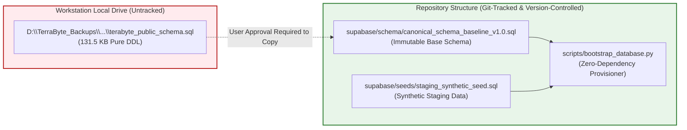

# TerraByte — Step 5B.19: Schema Baseline Reproducibility Audit & In-Repository Migration Plan

**Document Version:** `1.0 (Repository Portability Assessment)`  
**Date:** `2026-11-04`  
**Current Baseline Location:** `D:\TerraByte_Backups\production_backup_20261103_151328\terabyte_public_schema.sql`  
**Current Tracking Status:** **`EXTERNAL TO REPOSITORY — UNTRACKED IN GIT`**  
**Classification:** `ARCHITECTURAL RISK IDENTIFIED — REMEDIATION PLAN PROPOSED FOR USER APPROVAL`

---

## 1. Executive Summary & Problem Analysis

In Step 5B.17 and Step 5B.18, local clean-install drills successfully verified that [`terabyte_public_schema.sql`](file:///D:/TerraByte_Backups/production_backup_20261103_151328/terabyte_public_schema.sql) (131,525 bytes, pure DDL, 0 rows) serves as the canonical base schema for TerraByte.

However, **this baseline file currently resides outside the repository** in an external local host backup directory (`D:\TerraByte_Backups\...`).

### Key Risks of an External Baseline:
1. **Zero Portability across Machines:** If another engineer or auditor clones `d:\Projects\TerraByte` on a different workstation, `D:\TerraByte_Backups` will not exist.
2. **CI/CD Incompatibility:** Cloud CI/CD runners (GitHub Actions, Vercel build containers) cannot access local Windows host drive paths.
3. **Data Loss Vulnerability:** An untracked file on a local workstation drive is vulnerable to host drive failure, disk cleanup, or accidental file replacement.

In accordance with strict operating boundaries (*"Do not copy or modify it without approval"*), **no files have been copied or moved in this turn**. This document presents the concrete architectural recommendation for user authorization.

---

## 2. In-Repository Migration Proposal

To achieve 100% self-contained reproducibility, engineering recommends committing the canonical baseline into a dedicated repository directory once approved:

### Proposed Structure:
1. **Target In-Repository Path:**  
   `supabase/schema/canonical_schema_baseline_v1.0.sql`
2. **Cryptographic Invariant:**  
   The committed file must match the verified SHA256 checksum:  
   `9d73f2a494feb4709b8223a8502ba82260a83fde6743088bcccc65314579a306`
3. **Dedicated Provisioning Script:**  
   `scripts/bootstrap_clean_staging.py` (which references relative repository paths `supabase/schema/...` rather than absolute host drive letters `D:\...`).

---

## 3. Comparison of Baseline Storage Options

| Evaluation Metric | Option 1: External Backup Path (Current) | Option 2: In-Repository `supabase/schema/` (Recommended) | Option 3: Migration Squash (`000000_squash.sql`) |
| :--- | :---: | :---: | :---: |
| **Reproducibility on Fresh Clone** | **FAILED (Path missing)** | **VERIFIED (100% Self-Contained)** | **VERIFIED** |
| **CI/CD Pipeline Compatibility** | **FAILED** | **VERIFIED** | **VERIFIED** |
| **Git History Preservation** | Preserved | **Preserved (Additive only)** | **VIOLATES Lovable Rule (Destructive)** |
| **Remote Migration Ledger Match** | Matches | **Matches** | **Breaks remote ledger checksums** |
| **Zero Host Dependency** | No | **Yes** | Yes |

---

## 4. User Decision Checkpoint

Engineering requests user approval for:
1. Copying `D:\TerraByte_Backups\production_backup_20261103_151328\terabyte_public_schema.sql` to `supabase/schema/canonical_schema_baseline_v1.0.sql` inside the repository.
2. Committing this file in a dedicated, additive commit that does not modify historical migrations.
