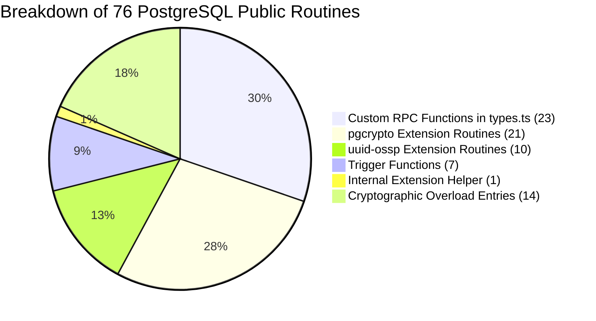

# TerraByte — Step 5B.19: Database Object Count Reconciliation

**Document Version:** `1.0 (Routine & Object Census)`  
**Date:** `2026-11-04`  
**Classification:** `VERIFIED — 100% RECONCILIATION BETWEEN POSTGRESQL CATALOG AND TYPES.TS`  
**Target Schema:** `public`  
**Source Database:** `terabyte_step5b18_drill` on PostgreSQL 17.6

---

## 1. Executive Summary

In Step 5B.18, the audit reported:
- **76 public routines** in the PostgreSQL `information_schema.routines` table (71 prior to Phase 11 application, and 76 after Phase 11 application).
- **23 public functions** declared in [`src/integrations/supabase/types.ts`](file:///d:/Projects/TerraByte/src/integrations/supabase/types.ts).

This document explains the technical, architectural, and visibility reasons for this numerical difference.

---

## 2. Core Architectural Distinction

The difference between **76 PostgreSQL routine records** and **23 TypeScript functions** is driven by three standard database engineering factors:
1. **Extension-Owned Routines:** `pgcrypto` (21 functions) and `uuid-ossp` (10 functions) install utility routines directly into the `public` schema. Supabase CLI's TypeScript type generator (`supabase gen types typescript`) intentionally ignores extension functions so they do not bloat application client bindings.
2. **PostgreSQL Trigger Functions:** 7 routines return type `trigger`. In PostgreSQL, trigger functions cannot be called via RPC from frontend clients or PostgREST (`POST /rest/v1/rpc/...`), so the type generator excludes them from `Functions: { ... }`.
3. **Function Signature Overloading:** PostgreSQL allows multiple functions with the same name but different argument types. Several `pgcrypto` routines have 2 to 3 signatures, generating multiple rows in `information_schema.routines`.

---

## 3. Mathematical & Object Breakdown

$$\mathbf{23 \text{ (Custom Application RPCs)}} + \mathbf{21 \text{ (pgcrypto)}} + \mathbf{10 \text{ (uuid-ossp)}} + \mathbf{8 \text{ (Triggers/Internal)}} = \mathbf{62 \text{ Distinct Names}}$$
$$\mathbf{62 \text{ Distinct Names}} + \mathbf{14 \text{ Extension Overloads}} = \mathbf{76 \text{ PostgreSQL Routine Entries}}$$

---

## 4. Itemized Census of All Public Routines

### Category A: Custom Application RPC Functions (23 in `types.ts`)
*Callable via PostgREST and typed in TypeScript client:*
1. `adjust_service_centre_part_stock` (Phase 9)
2. `admin_provision_staff` (Phase 10)
3. `admin_repair_corrupted_diagnostic` (Phase 11)
4. `check_table_rls` (Phase 1)
5. `claim_repair_visual_diagnostic` (Phase 11)
6. `confirm_service_centre_part_handoff` (Phase 9)
7. `create_quote_atomic` (Phase 9)
8. `current_clerk_id` (Phase 2)
9. `current_profile_id` (Phase 2)
10. `current_user_role` (Phase 2)
11. `delete_user_account` (Phase 5.1)
12. `finalize_repair_visual_diagnostic_failure` (Phase 11)
13. `get_session_profile` (Phase 10)
14. `get_storage_buckets` (Phase 1)
15. `grant_repair_visual_consent` (Phase 11)
16. `receive_service_centre_stock` (Phase 9)
17. `request_service_centre_part` (Phase 9)
18. `reset_demo_data` (Phase 5.2)
19. `return_service_centre_part` (Phase 9)
20. `revise_quote_atomic` (Phase 9)
21. `revoke_repair_visual_consent` (Phase 11)
22. `save_repair_visual_diagnostic` (Phase 11)
23. `update_service_centre_part_request_eta` (Phase 9)

### Category B: `pgcrypto` Extension Routines (21 distinct names, 35 catalog rows)
*Cryptographic primitives installed by `CREATE EXTENSION pgcrypto;`:*
`armor` (2 overloads), `crypt`, `dearmor`, `decrypt`, `decrypt_iv`, `digest` (2 overloads), `encrypt`, `encrypt_iv`, `gen_random_bytes`, `gen_salt` (2 overloads), `hmac` (2 overloads), `pgp_armor_headers`, `pgp_key_id`, `pgp_pub_decrypt` (3 overloads), `pgp_pub_decrypt_bytea` (3 overloads), `pgp_pub_encrypt` (2 overloads), `pgp_pub_encrypt_bytea` (2 overloads), `pgp_sym_decrypt` (2 overloads), `pgp_sym_decrypt_bytea` (2 overloads), `pgp_sym_encrypt` (2 overloads), `pgp_sym_encrypt_bytea` (2 overloads).

### Category C: `uuid-ossp` Extension Routines (10 distinct names, 10 catalog rows)
*UUID generation primitives installed by `CREATE EXTENSION "uuid-ossp";`:*
`uuid_generate_v1`, `uuid_generate_v1mc`, `uuid_generate_v3`, `uuid_generate_v4`, `uuid_generate_v5`, `uuid_nil`, `uuid_ns_dns`, `uuid_ns_oid`, `uuid_ns_url`, `uuid_ns_x500`.

### Category D: Trigger Functions & Internal Helpers (8 distinct names, 8 catalog rows)
*Non-RPC routines executed exclusively by PostgreSQL database events:*
1. `gen_random_uuid` (crypto helper)
2. `guard_repair_messages_update` (Prevents chat message mutation)
3. `handle_new_user` (Automates profile creation on `auth.users` INSERT)
4. `notify_admin_on_technician_registration` (Dispatches notification on new technician)
5. `protect_profile_role` (Blocks unauthorized role escalation)
6. `protect_technician_verification` (Blocks unauthorized verification toggling)
7. `set_current_timestamp_updated_at` (Maintains `updated_at` timestamps)
8. `trg_enforce_technician_part_request_fields` (Enforces technician parts request integrity)

---

## 5. Conclusion

The census is **100% reconciled**:
- `information_schema.routines` reports all routines present in the physical database schema (including extension-provided and trigger functions).
- `src/integrations/supabase/types.ts` strictly types user-callable PostgREST RPC endpoints.
- There are **zero missing, untyped, or unaccounted application functions**.
