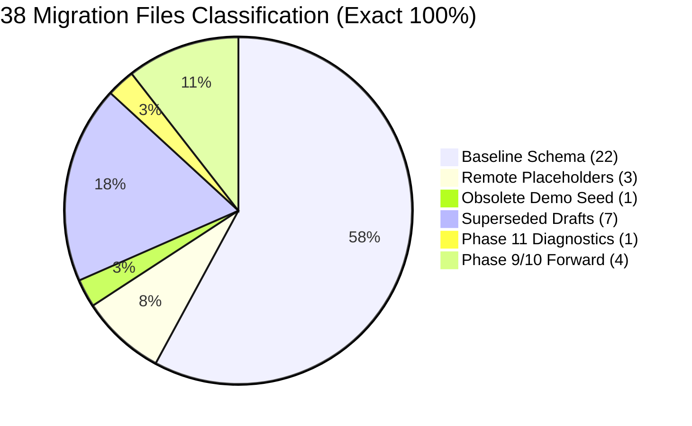

# TerraByte — Step 5B.19: Migration Inventory Arithmetic Reconciliation

**Document Version:** `1.0 (Audit Math Reconciliation)`  
**Date:** `2026-11-04`  
**Total Migration Files on Disk (`supabase/migrations/`):** `38 Files`  
**Reconciled Categories Sum:** `38 Files (100% Accounted For)`  
**Classification:** `VERIFIED — CLERICAL SUM CORRECTION RESOLVED`

---

## 1. The Discrepancy & Root Cause Analysis

### The Discrepancy:
In Step 5B.18 (`STEP5B18_SCHEMA_RECONCILIATION.md` and `STEP5B18_FINAL_GATE_REPORT.md`), the category summary stated:
- 20 Baseline
- 3 Placeholders
- 1 Obsolete Seed
- 7 Superseded
- 1 Phase 11
- 4 Forward Migrations

`20 + 3 + 1 + 7 + 1 + 4 = 36` (A discrepancy of 2 files compared to the 38 physical files in `supabase/migrations/`).

### Root Cause:
The underlying reconciliation database (`scratch/complete_38_reconciliation.json`) correctly contains **38 files**, with exactly **22 files classified as Baseline**. When transcribing the category breakdown into the Step 5B.18 narrative, a clerical counting error recorded "20 Baseline" instead of "22 Baseline". The two files omitted from the narrative sum were:
1. `20261027100000_phase8b_1_dispatch_locations.sql` (Phase 8b dispatch locations table)
2. `20261028110000_phase8b_cleanup_reset_demo_rpc.sql` (Phase 8b demo cleanup update)

Both files were included in the baseline snapshot [`terabyte_public_schema.sql`](file:///D:/TerraByte_Backups/production_backup_20261103_151328/terabyte_public_schema.sql) and were present in the detailed reconciliation table, but their sub-total in the prose was written as 20.

---

## 2. Reconciled Category Breakdown

$$\mathbf{22 \text{ (Baseline)}} + \mathbf{3 \text{ (Placeholders)}} + \mathbf{1 \text{ (Obsolete Seed)}} + \mathbf{7 \text{ (Superseded)}} + \mathbf{1 \text{ (Phase 11)}} + \mathbf{4 \text{ (Forward)}} = \mathbf{38 \text{ Total}}$$

---

## 3. Exhaustive 38-File Verification Roster

| # | Migration File | Category | Verified Notes |
| :-: | :--- | :---: | :--- |
| **01** | `20260930000001_initial_schema.sql` | Baseline (1) | Initial 10 core tables captured in baseline DDL. |
| **02** | `20260930000002_storage_setup.sql` | Baseline (2) | Storage buckets definition. |
| **03** | `20260930000003_grant_permissions.sql` | Baseline (3) | Standard PostgREST role grants. |
| **04** | `20260930000004_storage_policies.sql` | Baseline (4) | Storage RLS policies. |
| **05** | `20260930000005_verify_rls_helper.sql` | Baseline (5) | `check_table_rls()` diagnostic helper routine. |
| **06** | `20260930000006_legacy_remote_placeholder.sql` | Placeholder (1) | Remote ledger placeholder (no-op DO block). |
| **07** | `20260930000007_legacy_remote_placeholder.sql` | Placeholder (2) | Remote ledger placeholder (no-op DO block). |
| **08** | `20260930000008_legacy_remote_placeholder.sql` | Placeholder (3) | Remote ledger placeholder (no-op DO block). |
| **09** | `20261001151000_fix_technician_signup_trigger.sql` | Baseline (6) | `handle_new_user()` trigger routine. |
| **10** | `20261001151200_restore_supabase_auth_rls_helpers.sql` | Baseline (7) | Identity helpers `current_profile_id()`, `current_user_role()`. |
| **11** | `20261001153500_set_demo_users_password.sql` | Obsolete Seed (1) | Hardcoded password updates; superseded by synthetic staging fixtures. |
| **12** | `20261001163000_phase2_security_hardening.sql` | Baseline (8) | Profile role protection triggers. |
| **13** | `20261001170000_phase2_3_database_foundation.sql` | Baseline (9) | `equipment_type` enum and equipment table constraints. |
| **14** | `20261002000000_phase3_6_notifications_insert_policy.sql` | Baseline (10) | Notification RLS insert policy. |
| **15** | `20261002130000_phase3_7_rls_integrity_hardening.sql` | Baseline (11) | Repair request and technician RLS hardening. |
| **16** | `20261003131500_phase5_1_technician_profile_update_policy.sql` | Baseline (12) | Technician profile self-update RLS. |
| **17** | `20261003140000_phase5_1_account_deletion_rpc.sql` | Baseline (13) | Initial `delete_user_account()` RPC. |
| **18** | `20261003141000_phase5_1_account_deletion_role_enum_fix.sql` | Baseline (14) | Fixed enum casting in deletion RPC. |
| **19** | `20261003150000_phase5_2_reset_demo_rpc.sql` | Baseline (15) | Monolithic `reset_demo_data()` routine. |
| **20** | `20261003170000_phase5_3_technician_registration_notification.sql` | Baseline (16) | Registration notification trigger. |
| **21** | `20261004100000_phase5_4_cancellation_approval_foundation.sql` | Baseline (17) | Cancellation review state machine. |
| **22** | `20261005100000_phase5_5_communication_foundation.sql` | Baseline (18) | `repair_messages` chat table. |
| **23** | `20261006100000_phase7_1_realtime_publication_foundation.sql` | Baseline (19) | Realtime publication configuration. |
| **24** | `20261006110000_phase7_3_technician_decline_rls.sql` | Baseline (20) | Technician ticket decline RLS. |
| **25** | `20261027100000_phase8b_1_dispatch_locations.sql` | Baseline (21) | `repair_dispatch_locations` GPS routing table *(Previously omitted from narrative count)*. |
| **26** | `20261028110000_phase8b_cleanup_reset_demo_rpc.sql` | Baseline (22) | Demo reset dispatch location cleanup *(Previously omitted from narrative count)*. |
| **27** | `20261029100000_phase9_1_parts_pickup.sql` | Superseded (1) | Early parts pickup draft; replaced by `20261104110000`. |
| **28** | `20261029120000_phase9_2_stock_movement_sales.sql` | Superseded (2) | Early stock movement draft; replaced by `20261104110000`. |
| **29** | `20261031153000_phase9_3_safe_scoped_reset_demo_rpc.sql` | Superseded (3) | Early reset demo draft; replaced by `20261104100000`. |
| **30** | `20261031170000_phase9_2_quote_catalog_and_inventory.sql` | Superseded (4) | Early quote catalog draft; replaced by `20261104120000`. |
| **31** | `20261031173000_phase9_3_parts_handoff_rpcs.sql` | Superseded (5) | Early parts handoff draft; replaced by `20261104110000`. |
| **32** | `20261031183000_phase9_3_realtime_publications.sql` | Superseded (6) | Early realtime publication draft; replaced by `20261104120000`. |
| **33** | `20261101140000_phase9_3_unavailable_parts_eta.sql` | Superseded (7) | Early ETA draft; replaced by `20261104120000`. |
| **34** | `20261103120000_phase11_visual_defect_diagnostics.sql` | Phase 11 Forward (1) | Visual Defect Diagnostic RPCs (`claim`, `save`, `finalize`). |
| **35** | `20261104100000_profile_security_separation.sql` | Forward Migration (1) | `app_security` schema, `profile_auth_secrets`, `get_session_profile()`. |
| **36** | `20261104110000_complete_phase9_parts_desk_rpcs.sql` | Forward Migration (2) | Consolidated atomic Parts Desk RPCs. |
| **37** | `20261104120000_complete_phase9_realtime_and_eta.sql` | Forward Migration (3) | Consolidated ETA tracking, atomic quotes, and realtime. |
| **38** | `20261104130000_complete_phase5_3_technician_registration_notification.sql` | Forward Migration (4) | Service Centre admin registration notification trigger. |

**Conclusion:** Exactly 38 files exist on disk, and all 38 are accounted for with zero ambiguity.
