# TerraByte — Step 5B.19: Master Verification Plan & Roadmap Discovery Strategy

**Document Version:** `1.0 (Master Execution Plan)`  
**Date:** `2026-11-04`  
**Role:** Independent Principal PostgreSQL Database Architect, Supabase Security Engineer, and Release Manager  
**Target Staging Project:** `ubqgvhcfmrvnmrbllcom` (`terrabyte-staging` · `ap-southeast-1` · PostgreSQL 17.11)  
**Protected Production Reference:** `hwdrypkvszwrcraujctw` (Strictly Blocked / Air-Gapped)  
**Production Gate Status:** **`UNAUTHORIZED / BLOCKED — ZERO ACCESS PERMITTED`**  
**Staging Gate Status:** **`STANDBY — PENDING ROADMAP DISCOVERY & USER CONFIRMATION`**

---

## 1. Context & Objectives

Step 5B.18 completed the qualification of the local clean-install rehearsal. In Step 5B.19, the user notified the engineering team that **changes have been made to the planned TerraByte development phases for post-Phase 11 work**.

The primary objectives of Step 5B.19 are:
1. **Workstream A (Roadmap Discovery):** Audit existing planning files (`.planning/`, `ROADMAP.md`, `PROJECT.md`, `STATE.md`) and formulate an exhaustive, structured inquiry to discover the user's revised post-Phase 11 roadmap without making assumptions or inventing unrecorded plans.
2. **Workstream B (Phase 11 Status):** Establish the exact, rigorous status of Phase 11 (Visual Defect Diagnostics), distinguishing what is implemented, tested locally, tested in staging, not implemented, and awaiting approval.
3. **Workstream C (Step 5B.18 Reconciliation):**
   - Resolve the migration inventory counting discrepancy (explaining the 36 vs 38 total).
   - Reconcile database routine counts (explaining the difference between 76 PG routines and 23 `types.ts` functions).
   - Assess baseline reproducibility regarding `D:\TerraByte_Backups\production_backup_20261103_151328\terabyte_public_schema.sql` and design in-repository storage.
4. **Workstream D (Staging Impact):** Evaluate how the revised roadmap affects the proposed staging bootstrap, database schema, and release ordering.
5. **Workstream E (Final Decision):** Produce an authoritative release gate recommendation with explicit user review checkpoints.

---

## 2. Absolute Operating Boundaries

```
+-----------------------------------------------------------------------------------+
|                        ABSOLUTE OPERATING BOUNDARIES                              |
+-----------------------------------------------------------------------------------+
| 1. ZERO SQL, DDL, DML, OR MIGRATIONS AGAINST PRODUCTION (hwdrypkvszwrcraujctw).   |
| 2. ZERO SQL, DDL, DML, OR MIGRATIONS AGAINST STAGING (ubqgvhcfmrvnmrbllcom).     |
| 3. NO execute_sql, apply_migration, supabase db push, OR migration repair.        |
| 4. DO NOT DEPLOY APPLICATION CODE OR CHANGE VERCEL CONFIGURATION.                 |
| 5. ZERO GIT COMMITS OR GIT PUSHES (Lovable VCS protection).                       |
| 6. ZERO SPEND ($0.00) — NO PAID ADD-ONS, COMPUTE UPGRADES, OR PITR PROVISIONING.  |
| 7. DO NOT INVENT ROADMAP PHASES NOT DOCUMENTED IN THE CODEBASE.                   |
| 8. PRESERVE PHASE 11 SCOPE UNLESS EXPLICIT CORRECTION IS REQUESTED AND APPROVED.   |
+-----------------------------------------------------------------------------------+
```

---

## 3. Workstream Execution Roadmap

```mermaid
flowchart TD
    subgraph WkA["Workstream A: Roadmap Discovery"]
        A1["Inspect .planning/ROADMAP.md, PROJECT.md, STATE.md"]
        A2["Document Known Roadmap (Phases 1..11 + 5 Deferred Items)"]
        A3["Formulate Structured User Interview on Post-Phase 11 Changes"]
    end

    subgraph WkB["Workstream B: Phase 11 Completion Status"]
        B1["Inspect 20261103120000 Migration & 6 Diagnostic RPCs"]
        B2["Inspect src/routes/api/assess-visual-defect.ts & gemini-diagnostic.ts"]
        B3["Audit Frontend UI Integration & Gemini API Key Requirement"]
        B4["Construct Explicit Phase 11 Status Checklist"]
    end

    subgraph WkC["Workstream C: Step 5B.18 Inconsistency Resolution"]
        C1["Reconcile 38 Migrations (22 Baseline + 3 Placeholders + 1 Seed + 7 Superseded + 1 Phase 11 + 4 Forward = 38)"]
        C2["Reconcile Routine Counts (76 pg_proc = 23 types.ts RPCs + 21 pgcrypto + 10 uuid + 8 internal/triggers + 14 overloads)"]
        C3["Address External D: Backup Path & Design In-Repo Reproducibility"]
    end

    subgraph WkD["Workstream D: Staging Roadmap Impact"]
        D1["Assess Staging Bootstrap Alignment with Future Phases"]
        D2["Evaluate Schema Rework Risks & Dependency Flow"]
        D3["Recommend Safest Release Ordering"]
    end

    subgraph WkE["Workstream E: Final Decision & Gate Report"]
        E1["Compile Step 5B.19 Deliverables"]
        E2["Issue Standby Gate Decision & User Prompts"]
    end

    WkA --> WkB
    WkB --> WkC
    WkC --> WkD
    WkD --> WkE
```



---

## 4. Required Deliverables Index

1. [`STEP5B19_PLAN.md`](file:///d:/Projects/TerraByte/docs/audits/phase-9/STEP5B19_PLAN.md) — Master verification plan (this file).
2. [`STEP5B19_REVISED_ROADMAP_DISCOVERY.md`](file:///d:/Projects/TerraByte/docs/audits/phase-9/STEP5B19_REVISED_ROADMAP_DISCOVERY.md) — Documentation discovery and structured user interview on post-Phase 11 changes.
3. [`STEP5B19_PHASE11_COMPLETION_STATUS.md`](file:///d:/Projects/TerraByte/docs/audits/phase-11/STEP5B19_PHASE11_COMPLETION_STATUS.md) — In-depth completion checklist of Phase 11 across DB, API, UI, and tests.
4. [`STEP5B19_MIGRATION_INVENTORY_RECONCILIATION.md`](file:///d:/Projects/TerraByte/docs/audits/phase-9/STEP5B19_MIGRATION_INVENTORY_RECONCILIATION.md) — Forensic math reconciliation of all 38 migration files.
5. [`STEP5B19_DATABASE_OBJECT_COUNT_RECONCILIATION.md`](file:///d:/Projects/TerraByte/docs/audits/phase-9/STEP5B19_DATABASE_OBJECT_COUNT_RECONCILIATION.md) — Object-by-object breakdown of 76 database routines vs 23 `types.ts` functions.
6. [`STEP5B19_BOOTSTRAP_REPRODUCIBILITY.md`](file:///d:/Projects/TerraByte/docs/audits/phase-9/STEP5B19_BOOTSTRAP_REPRODUCIBILITY.md) — Analysis of external backup path and proposed in-repository migration.
7. [`STEP5B19_STAGING_ROADMAP_IMPACT.md`](file:///d:/Projects/TerraByte/docs/audits/phase-9/STEP5B19_STAGING_ROADMAP_IMPACT.md) — Impact of future roadmap on staging initialization and safest execution ordering.
8. [`STEP5B19_FINAL_GATE_REPORT.md`](file:///d:/Projects/TerraByte/docs/audits/phase-9/STEP5B19_FINAL_GATE_REPORT.md) — Executive gate report with explicit user prompt questions.
