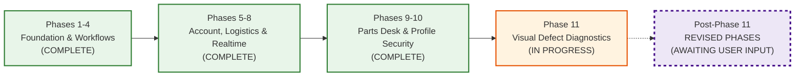

# TerraByte — Step 5B.19: Revised Roadmap Discovery & User Inquiry

**Document Version:** `1.0 (Roadmap Discovery & Direct Inquiry)`  
**Date:** `2026-11-04`  
**Classification:** `ROADMAP AUDIT — DOCUMENTED SCOPE MAPPED — USER CONFIRMATION REQUIRED`  
**Production Gate Status:** **`UNAUTHORIZED / BLOCKED — ZERO ACCESS PERMITTED`**  
**Staging Initialization Status:** **`STANDBY — PENDING ROADMAP DISCOVERY`**

---

## 1. Executive Summary

The user notified engineering that changes have been made to the planned TerraByte development phases for work intended to begin **AFTER Phase 11 is completed**.

In accordance with strict operating instructions:
- Engineering audited all existing repository documentation (`.planning/ROADMAP.md`, `.planning/PROJECT.md`, `.planning/STATE.md`, `.planning/archive/`).
- Engineering **did not invent or assume** unwritten phases.
- This document maps the documented baseline and provides a structured interview framework for the user to define the revised post-Phase 11 roadmap.

---

## 2. Documented Baseline Roadmap in Repository

### Current Phased Progression (`.planning/ROADMAP.md`):

- **Phases 1 through 10:** Documented as `COMPLETE` in `.planning/ROADMAP.md` (spanning core database, repair lifecycle, dispatch triage, demo resets, chat, quote revision, OSRM routing, parts desk logistics, and profile security separation).
- **Phase 11 (Visual Defect Diagnostics):** Documented as `IN PROGRESS` (backend API route, Gemini 3.5 Flash-Lite integration service, and database migration implemented; frontend UI and live staging tests pending).

### Documented Deferred Items (`.planning/PROJECT.md` line 41):
The repository records five potential roadmap extensions previously categorized as out-of-scope/deferred:
1. **Integrated Payment Gateway (UPI / Razorpay Escrow):** Off-platform receipt tracking currently used; escrow and in-app milestone payments deferred.
2. **Offline PWA Mutation Queue (BackgroundSync ServiceWorker):** Background offline mutation queue for low-connectivity fields.
3. **Tractor CAN Bus J1939 Telematics:** Physical OBD-II/CAN hardware dongle integration.
4. **SMS / WhatsApp Webhook Bot (Twilio / Gupshup):** Telephony gateway for automated farmer alerts.
5. **Multi-Depot Inter-Store Transfers:** Expanding beyond the single central Nagpur parts depot to multi-store inventory routing.
*(Additionally, archived `IMPLEMENTATION_PLAN.md` referenced "Taluka Supplier Network & Procurement").*

---

## 3. Direct User Inquiry on Revised Post-Phase 11 Roadmap

To ensure our database architecture, staging initialization, and release schedule align perfectly with your revised vision, please provide your instructions on the following 7 core dimensions:

### 1. Phase Definitions & Scope
- What specific phases (e.g. Phase 12, Phase 13) or major feature initiatives have been added, removed, reordered, or redesigned?
- What are their target titles, goals, and core user-facing capabilities?

### 2. Delta from Previous Plan
- What was the previous internal plan or assumption that has now been updated?
- What is the newly adopted plan that replaces it?

### 3. Approval Status
- Which of these new phases/features are **already firmly decided and approved**?
- Which elements are **still exploratory proposals or under evaluation**?

### 4. Database & Infrastructure Impact
- Do any of the revised post-Phase 11 phases introduce:
  - New database tables, columns, or enums?
  - New RPCs or trigger functions?
  - Adjustments to Row Level Security (RLS) or role permissions?
  - Supabase Storage buckets or CDN requirements?
  - Authentication changes?

### 5. AI & External Integration Requirements
- What third-party APIs or external services will the new phases depend on (e.g., payment gateways, messaging gateways, vision models, IoT telematics)?

### 6. Phase 11 Dependencies
- Do any of the newly planned phases directly depend on Phase 11 (Visual Defect Diagnostics) being finalized?
- Should Phase 11 remain strictly focused on Gemini multimodal damage triage, or has its scope been modified?

### 7. Sequencing & Staging Strategy
- Would you like staging to be initialized immediately with the current Phase 9 + Phase 11 baseline, or should any forward-looking schema adjustments for your revised phases be incorporated prior to first staging deployment?
