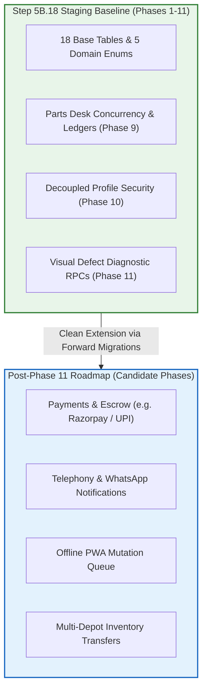
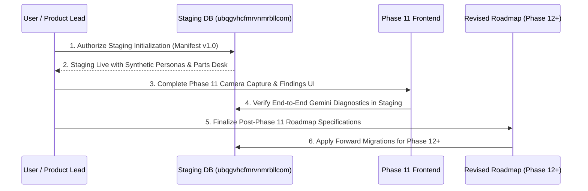

# TerraByte — Step 5B.19: Staging Impact & Phased Sequencing Architecture

**Document Version:** `1.0 (Staging & Roadmap Alignment)`  
**Date:** `2026-11-04`  
**Classification:** `ARCHITECTURAL RECOMMENDATION — PHASED RELEASE SEQUENCING`  
**Target Staging Project:** `ubqgvhcfmrvnmrbllcom` (`terrabyte-staging`)  
**Production Gate Status:** **`UNAUTHORIZED / BLOCKED — ZERO ACCESS PERMITTED`**

---

## 1. Executive Summary

Workstream D evaluated whether initializing staging with the existing Step 5B.18 manifest (covering Phases 1 through 11) is compatible with the user's revised post-Phase 11 roadmap, or whether staging initialization should be delayed.

### Architectural Finding:
Initializing the staging database with the verified Phase 1 through 11 architecture is **highly recommended and zero-risk**.  
The current manifest establishes the core relational foundation (18 tables, 76 routines, RLS policies, and synthetic seed fixtures) without embedding premature assumptions about future phases. When the user finalizes the post-Phase 11 roadmap, new capabilities will apply cleanly as forward migrations on top of staging.

---

## 2. Roadmap Coverage & Schema Re-Work Risk

### Analysis of Future Extension Scenarios:
1. **Integrated Payments (UPI / Escrow):**  
   - If added in Phase 12, it will introduce an independent `repair_payments` table linking to `quotes(id)` and `profiles(id)`. It requires zero rework of existing Phase 9 or Phase 10 tables.
2. **Telephony & WhatsApp Alerts (Twilio / Gupshup):**  
   - If added in a future phase, it hooks into existing database triggers on `notifications` or `repair_requests`. No schema breaking changes.
3. **Multi-Depot Inter-Store Transfers:**  
   - The current schema already links parts via `service_centre_parts.service_centre_id`. Multi-depot routing simply adds a `service_centres` table and transfer requests ledger without invalidating the 5 canonical parts.

**Conclusion:** The Step 5B.18 staging manifest contains zero dead-end code and zero schema liabilities that would require destructive refactoring for future phases.

---

## 3. Recommended Phased Execution Sequencing

Engineering recommends the following sequence of milestones:

### Safe Operational Steps:
- **Milestone 1 (Step 5B.19 / Current):** Discover revised roadmap details from user; resolve math and routine census inconsistencies; keep staging pristine.
- **Milestone 2 (Step 5B.20):** With user approval, copy baseline DDL into repository (`supabase/schema/canonical_schema_baseline_v1.0.sql`) and initialize staging project `ubqgvhcfmrvnmrbllcom`.
- **Milestone 3 (Phase 11 Closure):** Implement frontend photo capture UI and consent toggles; verify live Gemini diagnostics in staging.
- **Milestone 4 (Phase 12 Execution):** Begin implementation of user-approved post-Phase 11 roadmap items as standard forward migrations.
