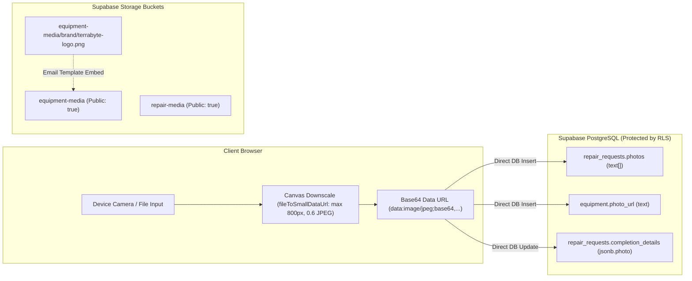

# TerraByte — Quick Demo Security Architecture: Final Decision Review (Revised)

**Document ID:** TB-ARCH-2026-002-REV2  
**Phase:** Phase A.1 Acceptance & Architectural Decision Gate  
**Auditor / Engineer:** Principal Infrastructure & Security Release Engineer  
**Date:** 2026-11-05  
**Status:** **REVISED ARCHITECTURAL REVIEW — AWAITING STAKEHOLDER APPROVAL**  
**Classification:** Technical Architecture & Threat Review  

---

## Executive Summary & Architectural Clarification

Following architectural review and clarification, this document establishes the revised security framework for the TerraByte demonstration, testing, and production environments.

### Core Architectural Principle: Shared Testing Identities
> [!IMPORTANT]
> **Demo accounts are shared operational testing identities, NOT isolated sandbox accounts.**  
> * Demo farmer (`farmer.nagpur@terrabyte.demo`), technician (`tech.nagpur@terrabyte.demo`), and service centre admin (`admin.nagpur@terrabyte.demo`) accounts are **intentionally designed** to participate in workflows involving real user accounts and real operational records (e.g., testing technician mobile dispatch to real farm coordinates, central depot inventory requisitions, and district-wide repair triage).
> * **Cross-account interaction is an intentional operational and testing requirement.**
> * PostgreSQL Row-Level Security (RLS) policies **must NOT be modified** to isolate demo accounts from real records.
> * Existing role-based workflows must be strictly preserved unless a separate, demonstrable security defect is identified.

This review re-evaluates the authentication broker, storage exposure, and database RPC safety claims with intellectual honesty, distinguishing between **hiding a secret** and **authorizing a caller**, and separating **local test evidence** from **remote production reality**.

---

## 1. Reassessing the Demo-Login Broker: Hiding Secrets vs. Authorizing Callers

A previous proposal suggested replacing hardcoded client passwords with a serverless Nitro route:
* `POST /api/demo-login`
* Server-side `DEMO_AUTH_PASSWORD`
* `DEMO_MODE=true`
* `Sec-Fetch-Site: same-origin`

### A. The Core Technical Fallacy: `Sec-Fetch-Site` is Not Authentication
`Sec-Fetch-Site`, `Origin`, `Referer`, and CORS headers are **browser-enforced mechanisms** designed to prevent unauthorized cross-origin requests originating inside a victim's web browser (e.g. Cross-Site Request Forgery). 
* **They offer zero authentication against non-browser clients.**
* Any automated script using `curl`, Python `requests`, or Postman can trivially forge these headers:
  ```bash
  curl -X POST https://terrabyte.app/api/demo-login \
    -H "Sec-Fetch-Site: same-origin" \
    -H "Origin: https://terrabyte.app" \
    -H "Content-Type: application/json" \
    -d '{"persona":"admin"}'
  ```
* Presenting `Sec-Fetch-Site` as sufficient protection against direct API abuse is a fundamental security misunderstanding.

### B. Hiding a Credential vs. Authorizing a Caller
* **Hiding a Credential:** Removing `password: "TerraByte...#2026"` from client JavaScript bundles prevents casual inspection of the plaintext string in DevTools.
* **Authorizing a Caller:** Determining whether the entity making the HTTP request has the right to assume the requested identity.
* If `POST /api/demo-login` mints a Supabase session without verifying caller entitlement, **the endpoint acts as an Open Authentication Proxy**. 
* An attacker does not need to know the password; the server will authenticate them on demand. The attacker obtains identical capabilities: a valid, signed Supabase administrative JWT (`role = 'admin'`).

---

## 2. Evaluation of Practical, Free-of-Cost Alternatives

To protect the shared demo identities without introducing paid services or breaking convenient evaluator testing, we evaluate 6 practical alternatives:

| Evaluation Dimension | Alt 1: Evaluator Passphrase Gate (`DEMO_ACCESS_KEY`) | Alt 2: Role-Tiered Broker (1-Click Farmer/Tech, Gated Admin) | Alt 3: Free Cloudflare Turnstile Bot Barrier | Alt 4: Client Proof-of-Work (PoW) Challenge | Alt 5: Naive Broker (`Sec-Fetch-Site` only) | Alt 6: Status Quo (Hardcoded in Client Bundle) |
| :--- | :--- | :--- | :--- | :--- | :--- | :--- |
| **Can unauthenticated caller obtain Admin session?** | **NO.** Requires valid `x-demo-key` or URL param. | **NO.** Admin returns 403; requires explicit manual credentials. | **NO for automated bots.** Humans in browser can. | **YES, if caller computes PoW.** Throttles bots, not humans. | **YES.** Trivial header spoofing yields admin JWT. | **YES.** Password readable in client JS bundle. |
| **Can credentials be extracted from frontend?** | **NO.** Supabase passwords and access key reside server-side. | **NO.** Server holds passwords for Farmer/Tech; Admin typed. | **NO.** Server holds Supabase credentials; Turnstile sitekey public. | **NO.** Server holds credentials; challenge is dynamic. | **NO.** Server holds credentials in environment. | **YES.** Plaintext email and password baked into client JS. |
| **How are brute-force attempts controlled?** | Nitro in-memory sliding window rate-limiter per IP (e.g. 5 attempts/min). | IP rate-limiting on broker + Supabase GoTrue rate limits on Admin. | Cloudflare managed bot & IP reputation scoring (free tier). | Computational cost (SHA-256 difficulty scales under load). | In-memory IP rate-limiting only. | Supabase GoTrue IP rate limits only. |
| **Is browser 1-click testing preserved?** | **YES.** With bookmarked `?demo_key=...` or entered once per session. | **YES for Farmer & Tech.** Admin requires 1-time password entry. | **YES.** Turnstile runs invisibly in background (zero clicks). | **YES.** Background Web Worker solves in 150ms during button click. | **YES.** Pure 1-click. | **YES.** Pure 1-click. |
| **What happens if credential leaks?** | Rotate `DEMO_ACCESS_KEY` in Vercel in 10s. Supabase password untouched. | Admin password untouched; Farmer/Tech can be reset quickly. | Rotate Turnstile secret key; Supabase credentials untouched. | Increase PoW difficulty or revoke broker route. | Anyone can call `/api/demo-login` directly until disabled. | Permanent leak; requires Supabase password rotation & redeploy. |
| **Compatibility with Nitro/Vercel architecture?** | **100% native.** Standard server route & env variable. | **100% native.** Standard server route & login form logic. | **100% native.** Client script + standard server validation call. | **100% native.** Lightweight pure JS math in browser & Nitro. | **100% native.** | **100% native.** |

---

## 3. Reassessment of Storage Exposure

A comprehensive inspection of all file and image handling across the codebase reveals the following empirical state:



### A. Actual Storage Usage Findings
1. **Base64 In-Database Storage (All Active User Media):**
   * **Farmer Breakdown Photos:** [`src/routes/farmer/report-breakdown.tsx`](file:///d:/Projects/TerraByte/src/routes/farmer/report-breakdown.tsx#L661) downscales camera captures via `fileToSmallDataUrl()` ([`src/lib/image.ts`](file:///d:/Projects/TerraByte/src/lib/image.ts#L2)) to canvas-compressed JPEG Data URLs (`data:image/jpeg;base64,...`). These strings are stored directly in PostgreSQL: `public.repair_requests.photos` (`text[]`).
   * **Equipment Photos:** [`src/routes/farmer/equipment/index.tsx`](file:///d:/Projects/TerraByte/src/routes/farmer/equipment/index.tsx#L198) downscales machine photos via `fileToSmallDataUrl()` and inserts them into `public.equipment.photo_url` (`text`).
   * **Technician Completion Photos:** [`src/routes/technician/job/$id.tsx`](file:///d:/Projects/TerraByte/src/routes/technician/job/$id.tsx#L2075) downscales proof photos via `fileToSmallDataUrl()` and updates `public.repair_requests.completion_details -> photo` (`jsonb`).
   * **Phase 11 Visual Diagnostics:** [`src/routes/api/assess-visual-defect.ts`](file:///d:/Projects/TerraByte/src/routes/api/assess-visual-defect.ts#L203) reads the base64 strings directly from `repair_requests.photos` and passes them inline to Google Gemini 3.5 Flash-Lite.
2. **Zero Client Uploads to Supabase Storage:**
   * There is **not a single call** to `supabase.storage.from(...).upload(...)` anywhere in the application source code.
3. **Storage Bucket Configuration & Email Brand Assets:**
   * [`supabase/migrations/20260930000002_storage_setup.sql`](file:///d:/Projects/TerraByte/supabase/migrations/20260930000002_storage_setup.sql#L11-L23) configures `equipment-media` and `repair-media` with `public = true`.
   * The **only** active file in storage is the brand logo embedded in transaction email templates: [`supabase/templates/confirm_signup.html`](file:///d:/Projects/TerraByte/supabase/templates/confirm_signup.html) and `reset_password.html`, which link to `https://.../storage/v1/object/public/equipment-media/brand/terrabyte-logo.png`.
4. **The `breakdown-photos` Bucket Fallback in `image-lightbox.tsx`:**
   * [`src/components/image-lightbox.tsx`](file:///d:/Projects/TerraByte/src/components/image-lightbox.tsx#L28) contains:
     ```ts
     const { data } = supabase.storage.from("breakdown-photos").getPublicUrl(cleanPath);
     ```
   * Because the function immediately returns strings starting with `data:`, `http://`, or `blob:`, and because all application photos are base64 `data:` URLs, this `getPublicUrl()` code path is **completely dormant during normal operation**. Furthermore, `"breakdown-photos"` is not even a defined bucket in the database migrations.

### B. Smallest Safe Remediation
* **Do NOT alter bucket visibility to private right now:** Converting `equipment-media` to private would break image rendering in user signup confirmation and password reset emails.
* **Revoke Anonymous Upload Policies:** Migration `20260930000002_storage_setup.sql` contains a policy `"Anon users can upload demo media"` which allows unauthenticated uploads. A forward migration should drop this policy to prevent third parties from using the bucket for arbitrary file hosting.
* **Keep User Media in PostgreSQL:** User photos remain protected by existing Row-Level Security on `repair_requests` and `equipment`.

---

## 4. Validation of Existing Safety Claims: `reset_demo_data()` and `admin_provision_staff()`

To maintain audit integrity, safety claims must be strictly differentiated across three levels:

```
[Level 1: Migration Code Inspection] ---> [Level 2: Local Automated Tests] ---> [Level 3: Remote Production Verification]
```

### A. `reset_demo_data()`
* **Level 1 (Migration Inspection):** [`supabase/migrations/20261031153000_phase9_3_safe_scoped_reset_demo_rpc.sql`](file:///d:/Projects/TerraByte/supabase/migrations/20261031153000_phase9_3_safe_scoped_reset_demo_rpc.sql#L80-L107) inspects caller UID, requiring it to match hardcoded UUIDs, verified email, and profile `demo_code`. It strictly scopes deletes to Balasaheb Patil's equipment and repairs (`WHERE farmer_id = v_demo_farmer_id`).
* **Level 2 (Local Automated Tests):** Verified in `tests/parts-desk.test.mjs` (73 tests pass). Tests confirm regex matches for safeupdate clauses, dual-key checks, and simulated cascading logic.
* **Level 3 (Remote Production Verification):** **UNVERIFIED AGAINST REMOTE DB.** Under strict instructions, no destructive RPCs have been executed against production. If production `auth.users` assigned dynamic UUIDs rather than the hardcoded fixture UUIDs (`00000000-0000-0000-0000-000000000001`), running this RPC on production will fail with `42501 Unauthorized`. **Local tests do NOT prove production execution.**

### B. `admin_provision_staff()`
* **Level 1 (Migration Inspection):** [`supabase/migrations/20261104100000_profile_security_separation.sql`](file:///d:/Projects/TerraByte/supabase/migrations/20261104100000_profile_security_separation.sql#L310-L370) defines an RPC requiring `role = 'admin'`, restricting provisioning strictly to `role = 'technician'`, and setting `is_verified = false`.
* **Level 2 (Local Automated Tests):** Verified in `tests/profile-security-architecture.test.mjs` (23 tests pass). Tests verify that the migration SQL text contains role checks, input validation, and unverified defaults.
* **Level 3 (Remote Production Verification):** **NOT DEPLOYED TO REMOTE DB.** During Phase A, it was empirically established that migration `20261104100000_profile_security_separation.sql` has **not been run** on the remote Supabase database (causing `get_session_profile` PGRST202 schema errors). Claiming `admin_provision_staff()` currently protects production is false; it exists solely as an unapplied migration script.

---

## 5. Architectural Decision Matrix

| Recommendation | Security Benefit | Impact on Shared Demo Workflow | Implementation Complexity | Remaining Risk | Approval Required |
| :--- | :--- | :--- | :--- | :--- | :--- |
| **Rec 1: Evaluator Passphrase Gate (`DEMO_ACCESS_KEY`) on `/api/demo-login`** | Prevents unauthenticated bots from minting admin sessions via cURL; hides Supabase passwords from client JS. | Evaluator enters passcode once or uses `?demo_key=...`; 1-click persona switching preserved in session. | Low (Nitro route + `sessionStorage` in client). | Passcode can be shared among human evaluators. | **YES (User Decision 1)** |
| **Rec 2: Role-Tiered Broker (1-Click Farmer/Tech, Gated Admin)** | Completely eliminates unauthorized admin session minting without requiring evaluators to enter keys for end-user testing. | 1-click for Farmer and Tech. Admin requires manual credentials or key. | Low (modify broker to reject admin persona without secret). | Farmer & Tech sessions remain mintable via cURL if broker is public. | **YES (Alternative to Rec 1)** |
| **Rec 3: Revoke Anonymous Upload Policy on Storage Buckets** | Closes anonymous file write access on `equipment-media` and `repair-media`. | Zero impact. App code does not upload files to storage buckets. | Low (single SQL migration drop policy). | Public read access remains on buckets for email logos. | **YES (User Decision 2)** |
| **Rec 4: Retain Base64 In-Database Image Storage for User Photos** | Eliminates risk of public storage scraping; photos protected by PostgreSQL RLS. | Zero impact. Preserves existing camera, breakdown, and diagnostic workflows. | Zero (preserve current working code). | PostgreSQL row size is larger (~80KB/photo); acceptable for current scale. | **YES (User Decision 3)** |
| **Rec 5: Reaffirm Zero RLS Isolation for Demo Accounts** | Preserves essential cross-account testing across real machinery and dispatch. | Essential. Guarantees demo accounts can test real life-cycle workflows. | Zero (no schema changes). | Demo accounts can modify test-shared records; mitigated by scoped reset. | **YES (User Decision 4)** |

---

## 6. Recommended Architecture & Exact Decisions Requiring Approval

### Recommended Architecture
1. **Authentication Broker:** Implement **Alternative 1 (Evaluator Passphrase Gate)**. The serverless route `POST /api/demo-login` requires header `x-demo-key` matching `process.env.DEMO_ACCESS_KEY`. Evaluators append `?demo_key=nagpur2026` once to their browser URL, which stores the key in `sessionStorage`. All 1-click buttons seamlessly function without prompts. Non-browser cURL scripts without the key receive `401 Unauthorized`.
2. **Storage:** Keep active user photos in PostgreSQL columns (base64 Data URLs) protected by RLS. Retain public read on `equipment-media` for email template brand assets. Drop the dangerous `"Anon users can upload demo media"` policy via a forward migration.
3. **Database State:** Acknowledge that `admin_provision_staff()` and `reset_demo_data()` are unverified or unapplied on the remote production database. Do not attempt remote migrations until a formal database release phase.

### Exact Decisions Requiring User Approval
* [ ] **Decision 1: Broker Authentication Strategy:** Confirm whether to proceed with **Rec 1 (Evaluator Passphrase Gate)** or **Rec 2 (Role-Tiered Broker: Public Farmer/Tech, Gated Admin)**.
* [ ] **Decision 2: Storage Bucket Forward Migration:** Authorize creating a forward migration to drop `"Anon users can upload demo media"` on `equipment-media` and `repair-media`, while keeping public read for email logo assets.
* [ ] **Decision 3: Retain In-Database Base64 User Media:** Confirm maintaining base64 photos in PostgreSQL tables (`repair_requests.photos`, `equipment.photo_url`) rather than moving to Supabase Storage.
* [ ] **Decision 4: Reaffirm Zero RLS Isolation:** Confirm that no RLS policies will be altered to isolate demo accounts from real records.

*Awaiting explicit user approval on Decisions 1–4 before implementing any changes.*
