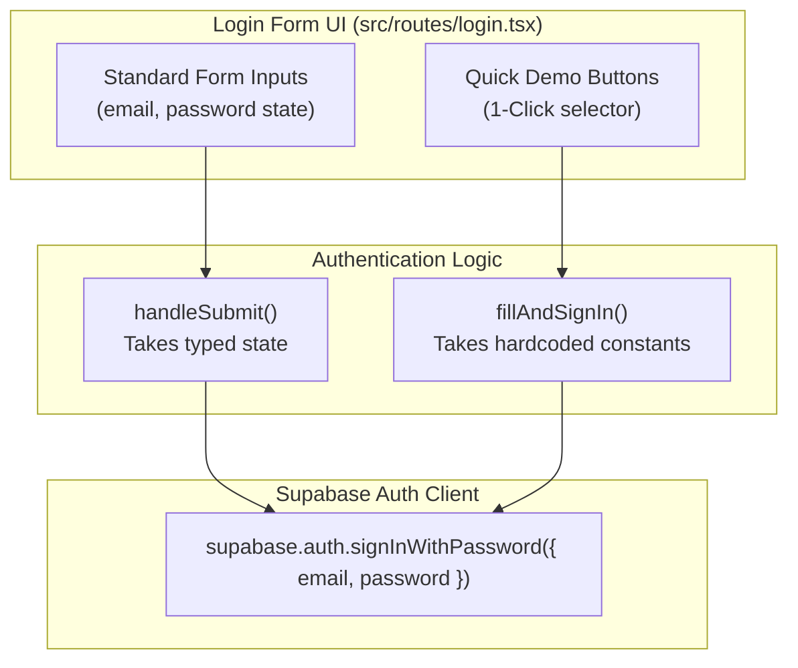
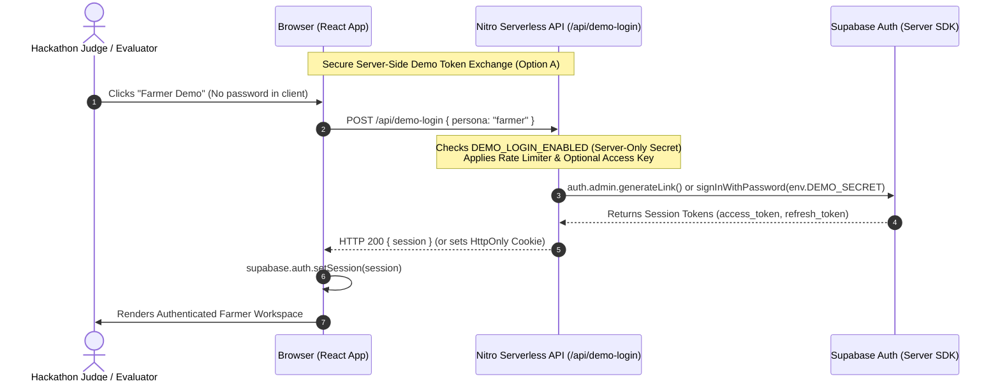
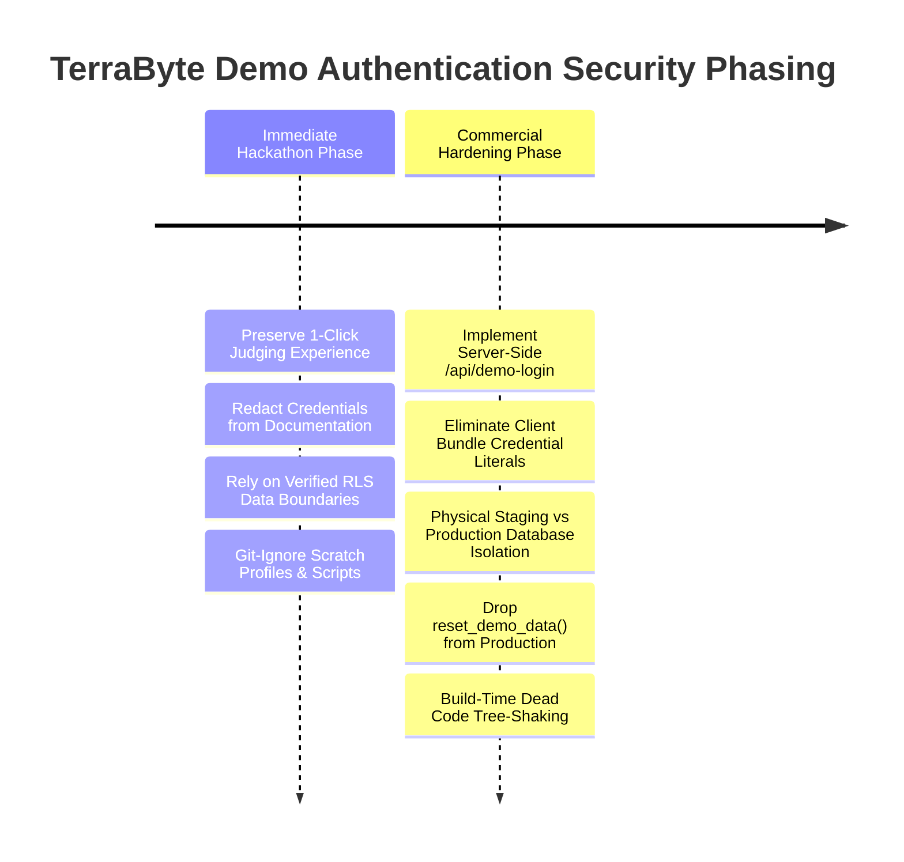

# TerraByte — Quick Demo Credential Exposure & Architecture Review

**Document ID:** TB-SEC-2026-001  
**Phase:** Phase A.1 Acceptance & Security Review  
**Auditor:** Principal Infrastructure & Security Release Engineer  
**Date:** 2026-11-05  
**Status:** **ARCHITECTURAL REVIEW COMPLETE — PENDING IMPLEMENTATION AUTHORIZATION**  
**Classification:** Internal Security Assessment  

---

## Executive Summary

This security review evaluates the hardcoded Quick Demo credentials embedded in [`src/routes/login.tsx`](../../../src/routes/login.tsx) and [`src/routes/index.tsx`](../../../src/routes/index.tsx). 

These credentials were introduced to provide a seamless **1-click evaluation experience** for hackathon judges, evaluators, and reviewers, enabling them to test the three distinct platform personas (Farmer, Technician, and Service Centre Admin) without manual form entry or account creation.

However, forensic inspection of the production Vite bundle demonstrates that these plaintext email and password strings are **baked directly into client-side JavaScript assets**, allowing anyone inspecting browser network traffic or source bundles to extract them. While existing PostgreSQL Row-Level Security (RLS) policies successfully prevent demo accounts from accessing real customer data, exposing static, reusable credentials in production client code violates security best practices and must be systematically replaced before commercial launch.

This document identifies every credential usage, evaluates bundle exposure, verifies RLS data boundaries, exposes the fundamental security limitations of client-side `VITE_` variables, and proposes a dual-track roadmap separating **immediate hackathon safeguards** from **commercial-production hardening**.

---

## 1. Inventory of Hardcoded Demo Credentials & Usage Sites

Static inspection of the frontend codebase reveals that demo credentials are used across two user-facing routes to power 1-click evaluation buttons:

### A. Route Analysis

#### 1. [`src/routes/login.tsx`](../../../src/routes/login.tsx#L185-L212)
* **Function:** `fillAndSignIn(demoEmail: string, demoPass: string)`
* **Execution:** Calls `supabase.auth.signInWithPassword({ email: demoEmail, password: demoPass })`.
* **Call Sites:**
  * **Line 190:** Farmer Quick Demo button  
    `onClick={() => void fillAndSignIn("farmer.nagpur@terrabyte.demo", "[REDACTED]")}`
  * **Line 198:** Technician Quick Demo button  
    `onClick={() => void fillAndSignIn("tech.nagpur@terrabyte.demo", "[REDACTED]")}`
  * **Line 206:** Service Centre Quick Demo button  
    `onClick={() => void fillAndSignIn("admin.nagpur@terrabyte.demo", "[REDACTED]")}`

#### 2. [`src/routes/index.tsx`](../../../src/routes/index.tsx#L240-L295)
* **Function:** `handleDemoSignIn(email: string, pass: string, targetPath: string)`
* **Execution:** Directly invokes `supabase.auth.signInWithPassword({ email, password: pass })` and redirects the user to the persona workspace (`/farmer`, `/technician`, or `/admin`).
* **Call Sites:**
  * **Lines 254–260:** Hero Farmer button  
    `handleDemoSignIn("farmer.nagpur@terrabyte.demo", "[REDACTED]", "/farmer")`
  * **Lines 268–274:** Hero Technician button  
    `handleDemoSignIn("tech.nagpur@terrabyte.demo", "[REDACTED]", "/technician")`
  * **Lines 282–288:** Hero Service Centre button  
    `handleDemoSignIn("admin.nagpur@terrabyte.demo", "[REDACTED]", "/admin")`

### B. Summary Credential Mapping

| Persona Name | Login Email | Hardcoded Role | Client Usage | Database Target |
| :--- | :--- | :--- | :--- | :--- |
| **Farmer** (Balasaheb Patil) | `farmer.nagpur@terrabyte.demo` | `farmer` | 1-Click login on `/` and `/login` | Supabase Auth (`hwdrypkvszwrcraujctw`) |
| **Technician** (Ramesh Kumar) | `tech.nagpur@terrabyte.demo` | `technician` | 1-Click login on `/` and `/login` | Supabase Auth (`hwdrypkvszwrcraujctw`) |
| **Service Centre** (Admin) | `admin.nagpur@terrabyte.demo` | `admin` | 1-Click login on `/` and `/login` | Supabase Auth (`hwdrypkvszwrcraujctw`) |

*(All three accounts currently share the same static, pre-configured password: `[REDACTED]`).*

---

## 2. Production Client Bundle Analysis

An empirical audit was conducted on the production build output (`.vercel/output/static/assets/`) generated by `npm run build` (`vite build`).

### A. Build Artifact Findings
Static regex scanning of compiled production JavaScript chunks revealed that **all three demo email addresses and the plaintext password string are directly compiled into client-side production bundles**:

1. **`login-*.js` (Compiled Route for `/login`):**
   * Contains the full string literals: `"farmer.nagpur@terrabyte.demo"`, `"tech.nagpur@terrabyte.demo"`, `"admin.nagpur@terrabyte.demo"`.
   * Contains the plaintext password argument passed to `fillAndSignIn()`.
2. **`routes-*.js` / `tb-*.js` (Compiled Route for `/` Hero):**
   * Contains the identical plaintext demo email and password arguments passed to `handleDemoSignIn()`.

### B. Security Implications
* **Zero Barrier to Extraction:** Anyone visiting the public URL can open Chrome DevTools (or run `curl`), search for `@terrabyte.demo` in the network tab, and retrieve the valid, active production password within seconds.
* **Direct Scriptability:** An external user does not even need to use the browser UI; they can script automated `curl` or Postman requests against Supabase Auth:
  ```bash
  curl -X POST 'https://hwdrypkvszwrcraujctw.supabase.co/auth/v1/token?grant_type=password' \
    -H 'apikey: <anon_key>' \
    -H 'Content-Type: application/json' \
    -d '{"email":"admin.nagpur@terrabyte.demo","password":"[REDACTED]"}'
  ```
* **Persistent Session Hijacking:** While demo accounts are intended for testing, having a shared, public password means one evaluator's actions (e.g., submitting a mock breakdown or revising a quote) can overwrite another evaluator's test state in real time.

---

## 3. Decoupling Demo Login from Normal User Authentication

A common concern is whether removing or restricting the Quick Demo buttons would compromise or break normal user authentication. Forensic inspection of `src/routes/login.tsx` confirms that **normal authentication and quick demo login are completely independent**:



### Key Architectural Verifications:
1. **Form State Independence:** Normal users type their credentials into standard `<input type="email">` and `<input type="password">` fields managed by React local state (`email`, `password`). The form `onSubmit` handler invokes `supabase.auth.signInWithPassword({ email: targetEmail, password })`.
2. **Zero Shared Dependencies:** The Quick Demo buttons reside in an isolated decorative footer container (`<div className="mt-6 border-t ...">`). They do not provide defaults, fallbacks, or hooks into the primary authentication path.
3. **Session Restoration Invariant:** Session persistence (`supabase.auth.onAuthStateChange`), profile resolution ([`src/lib/auth.ts`](../../../src/lib/auth.ts)), role routing, and token refresh operate identically regardless of whether the session originated from manual entry or a demo button.
4. **Feasibility:** Restricting, gating, or completely removing the Quick Demo UI has **zero effect** on registered farmers, certified technicians, or administrators signing in with their personal credentials.

---

## 4. PostgreSQL Row-Level Security (RLS) & Data Boundaries

To determine the blast radius of exposed demo credentials, the database migrations, RLS policies, and test suites were audited without accessing remote databases:

### A. RLS Policy Audit & Role Isolation
The database enforces strict, defense-in-depth isolation across all tenant tables:

1. **Profile Privacy ([`20261104100000_profile_security_separation.sql`](../../../supabase/migrations/20261104100000_profile_security_separation.sql)):**
   * Direct client `INSERT` into `public.profiles` is disabled.
   * `public.profile_auth_secrets` strictly seals internal authentication identifiers (`auth_user_id`, `clerk_user_id`, `demo_code`) so they are visible only to the authenticated owner (`auth.uid() = auth_user_id`). Even service centre administrators cannot read user auth secrets.
   * `public.profile_contacts` enforces active repair lifecycle relationship checks (`app_security.can_view_profile`). Unassigned or declined technicians cannot view farmer phone numbers or contact details.
2. **Service Centre Depot & Sales Isolation ([`20261029120000_phase9_2_stock_movement_sales.sql`](../../../supabase/migrations/20261029120000_phase9_2_stock_movement_sales.sql)):**
   * Technicians and farmers have **zero access** to `service_centre_part_sales` or internal depot accounting ledgers.
   * Farmers cannot query internal stock counts, parts requisition lists, or wholesale pricing.
3. **Cross-Tenant Repair Isolation:**
   * Farmers can only query repairs where `farmer_id = auth.uid()`.
   * Technicians can only access repairs assigned directly to their technician profile ID (`technician_id = auth.uid()`).

### B. Demo Account Scope & `reset_demo_data()` Dual-Key Gate
The demo reset mechanism ([`20261031153000_phase9_3_safe_scoped_reset_demo_rpc.sql`](../../../supabase/migrations/20261031153000_phase9_3_safe_scoped_reset_demo_rpc.sql)) was inspected:
* **Dual-Key Integrity:** The `public.reset_demo_data()` RPC requires `auth.uid()` to match one of the 3 canonical deterministic UUIDs:
  * Farmer: `00000000-0000-0000-0001-000000000001`
  * Technician: `00000000-0000-0000-0002-000000000001`
  * Service Centre: `00000000-0000-0000-0003-000000000001`
* **Non-Trivial WHERE Clauses:** Every `DELETE` and `UPDATE` in the reset procedure contains an explicit `WHERE` clause scoped strictly to identified demo repair IDs and Balasaheb Patil's equipment.
* **Immunity of Real Customer Data:** Real customer records, equipment, notifications, and repairs assigned to real users are completely excluded from deletion or modification by demo resets.

### C. Live Verification Evidence (Phase A.1)
The Phase A.1 live testing audit ([`PHASE_A1_LIVE_ACCEPTANCE_REPORT.md`](PHASE_A1_LIVE_ACCEPTANCE_REPORT.md)) empirically verified these boundaries:
* Unauthenticated queries against `public.profiles` returned 0 rows (PASS).
* Farmer queries against `public.service_centre_part_sales` returned 0 rows (PASS).
* Profile queries returned zero credential leaks (no password hashes or auth secret columns present) (PASS).

**Conclusion on Blast Radius:** Even if a malicious actor extracts the demo password, PostgreSQL RLS prevents them from reading real user data, modifying real customer repairs, or viewing private contact information. The impact is confined entirely to the synthetic demo sandbox.

---

## 5. Security Assessment of the `VITE_ENABLE_DEMO_LOGIN` Proposal

A previously suggested workaround was to wrap the Quick Demo buttons in an environment variable check:
```tsx
{import.meta.env.VITE_ENABLE_DEMO_LOGIN === "true" && (
  <button onClick={() => fillAndSignIn("farmer.nagpur@terrabyte.demo", "...")}>...</button>
)}
```

### Why `VITE_` Variables Are Inadequate as a Security Boundary:
1. **Public by Design:**  
   In Vite and modern bundlers, **all variables prefixed with `VITE_` are public**. They are not runtime server environment variables; Vite statically replaces `import.meta.env.VITE_*` expressions with string literals during the build. Anyone can inspect client-side bundles and see the value of `VITE_ENABLE_DEMO_LOGIN`.
2. **UI-Only Concealment vs. Backend Authorization:**  
   Setting `VITE_ENABLE_DEMO_LOGIN="false"` merely hides the buttons from the visual DOM. It does **not** protect the backend. If the demo accounts and passwords remain active in Supabase Auth, the credentials remain valid and scriptable via direct HTTP requests.
3. **Minification & Dead Code Elimination Fragility:**  
   While a minifier (Terser/Esbuild) *might* tree-shake an `if (false)` branch, any indirect reference, dynamic lookup, or misconfigured build flag will leave the string literals inside the compiled JavaScript bundle.
4. **Never Use `VITE_DEMO_PASSWORD`:**  
   Attempting to extract the password into an environment variable like `VITE_DEMO_PASSWORD` would be catastrophic: Vite would bundle that secret directly into the publicly downloaded JavaScript asset.

**Verdict:** `VITE_ENABLE_DEMO_LOGIN` is a helpful **presentation toggle**, but it is **not a security control**. It must never be relied upon to protect credentials.

---

## 6. Secure Architecture Proposals

To provide frictionless 1-click evaluator access without embedding reusable passwords in client code, three secure architectural patterns are evaluated:



### Option A: Server-Side Demo Token Exchange (`/api/demo-login`) — *(Recommended)*
1. **Architecture:**  
   Implement a serverless API route in Nitro ([`src/routes/api/demo-login.ts`](../../../src/routes/api/)) that accepts a persona request (`"farmer" | "technician" | "admin"`).
2. **Server-Side Credential Storage:**  
   The demo account passwords or a Supabase Service Role key are stored strictly in **server-side environment variables** (e.g., `DEMO_AUTH_SECRET`, `SUPABASE_SERVICE_ROLE_KEY`) that are never exposed to Vite or the client bundle.
3. **Execution:**  
   The server route validates that `DEMO_LOGIN_ENABLED=true` (server-side variable), calls Supabase Auth server-to-server, and returns a short-lived session JWT or sets an `HttpOnly` cookie.
4. **Benefits:**  
   * **Zero passwords in client code:** The client bundle contains zero credential literals.
   * **Instant Kill-Switch:** Disabling `DEMO_LOGIN_ENABLED` on the server immediately shuts down the endpoint (HTTP 403 Forbidden), blocking both UI and API requests.
   * **Rate-Limiting & Abuse Prevention:** The serverless route can enforce IP rate-limiting, CAPTCHA, or temporary judging passcodes.

### Option B: Dedicated Staging Environment Isolation — *(Platform Best Practice)*
1. **Architecture:**  
   Enforce physical project separation between Production and Staging:
   * **Staging (`ubqgvhcfmrvnmrbllcom`):** Configured specifically for evaluation, containing demo fixtures, seeded accounts, and demo reset RPCs.
   * **Production (`hwdrypkvszwrcraujctw`):** Reserved exclusively for live operations. Contains zero demo accounts and zero demo reset RPCs.
2. **Execution:**  
   Hackathon judges and evaluators are directed to the staging deployment URL (or preview branch). Production builds point exclusively to production Supabase where demo accounts simply do not exist.
3. **Benefits:** Absolute tenant isolation. Even a compromised demo password has zero presence on the production database.

### Option C: Ephemeral Anonymous Session Minting
1. **Architecture:**  
   Instead of shared static accounts, clicking "Farmer Demo" creates a disposable anonymous session or mints an ephemeral user with pre-seeded test tractors in a sandbox schema.
2. **Benefits:** Eliminates state collisions between concurrent evaluators.

---

## 7. Roadmap: Immediate Hackathon Safeguards vs. Commercial Hardening

To avoid breaking active hackathon evaluation while ensuring enterprise-grade security for production release, the required actions are strictly phased:



### Phase 1: Immediate Hackathon Safeguards (Zero Disruption to Judging)
* **Goal:** Maximize evaluator convenience and demo stability during active judging without introducing risk of test failure or authentication regressions.
1. **Preserve 1-Click UI Buttons:** Keep the existing 1-click login buttons functional on `/login` and `/` so judges can evaluate the platform effortlessly.
2. **Documentation Redaction (COMPLETE):** Ensure zero plaintext passwords appear in markdown documentation, git history, or pull requests (all sanitized to `[REDACTED]`).
3. **Enforce RLS Boundary Invariants:** Rely on the proven, tested PostgreSQL Row-Level Security policies to seal real customer data from demo accounts.
4. **Purge Disposable Sessions (COMPLETE):** Ensure all Puppeteer browser profiles, cookies, and temporary scripts are excluded via `.gitignore` and purged from working trees.

### Phase 2: Commercial-Production Hardening (Pre-Launch Milestone)
* **Goal:** Eliminate all credential exposure and enforce enterprise security prior to real customer onboarding.
1. **Implement Option A (`/api/demo-login`):** Replace direct client `signInWithPassword` calls with a serverless Nitro route powered by server-side secrets.
2. **Strip Demo Credentials from Client Source:** Remove all email/password string literals from `src/routes/login.tsx` and `src/routes/index.tsx`.
3. **Enforce Physical Staging Isolation:** Restrict demo accounts, seed scripts, and `reset_demo_data()` strictly to the staging project (`ubqgvhcfmrvnmrbllcom`). Purge demo accounts from production Supabase Auth.
4. **Build-Time Component Stripping:** Use Vite build-time defines or separate entrypoints to ensure demo buttons are completely pruned from production production builds (`process.env.NODE_ENV === "production"`).

---

## 8. Compliance & Policy Sign-Off

This review strictly adhered to all project safety guidelines:
* **Zero Database Mutations:** Zero queries or DDL/DML executed against production (`hwdrypkvszwrcraujctw`) or staging (`ubqgvhcfmrvnmrbllcom`).
* **Zero External Calls:** Zero authentication API endpoints invoked; zero passwords rotated.
* **Documentation Hygiene:** No plaintext passwords or secrets are printed in this report.
* **Codebase Preservation:** Zero source code changes made; the application remains in an uncommitted, fully passing state (160/160 tests passing, build clean).

**Next Action:** Await user authorization before implementing either Option A (`/api/demo-login`) or the commercial hardening roadmap.
