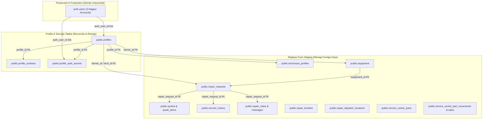

# TerraByte — Staging-to-Production Replacement: Read-Only Discovery Audit & Cutover Plan

**Document ID:** `TB-AUDIT-2026-CUTOVER-001`  
**Date:** 2026-11-06  
**Auditor:** Antigravity Autonomous Security & Architecture Agent  
**Branch:** `phase-13` (`7996ccc`)  
**Scope:** Read-Only Discovery Audit, Schema Compatibility Analysis, Auth User Identity Preservation, Table-by-Table Transfer Classification, and Ordered Cutover Runbook.  
**Source Environment (Staging):** `https://ubqgvhcfmrvnmrbllcom.supabase.co` (`ubqgvhcfmrvnmrbllcom`)  
**Destination Environment (Production):** `https://hwdrypkvszwrcraujctw.supabase.co` (`hwdrypkvszwrcraujctw`)  
**Security Posture:** **STRICTLY READ-ONLY — ZERO REMOTE MUTATIONS PERFORMED**

---

## 1. Executive Summary

This audit establishes a safe, evidence-based plan to replace current Production Supabase application data with Staging baseline fixtures while strictly retaining exactly three designated Supabase Auth user accounts:

1. **Farmer:** Balasaheb Patil — `farmer.nagpur@terrabyte.demo` — `farmer`
2. **Technician:** Ramesh Kumar — `tech.nagpur@terrabyte.demo` — `technician`
3. **Service Centre Admin:** Nagpur Service Centre — `admin.nagpur@terrabyte.demo` — `admin` (frontend persona: `service_centre`)

### Key Discoveries & Architectural Constraints

1. **Production Schema Lag (The Primary Prerequisite):**
   Live verification during Phase A.1 ([`PHASE_A1_LIVE_ACCEPTANCE_REPORT.md`](file:///d:/Projects/TerraByte/docs/audits/phase-a1/PHASE_A1_LIVE_ACCEPTANCE_REPORT.md#L47-L80)) confirmed that the Production database (`hwdrypkvszwrcraujctw`) has not yet received forward migrations from Phase 9.2 onward:
   - `public.service_centre_part_movements` is missing from the PostgREST schema cache (`PGRST205`).
   - `public.get_session_profile()` is missing from the PostgREST schema cache (`PGRST202`).
   - Three-tier profile security tables (`public.profile_contacts`, `public.profile_auth_secrets`) from migration `20261104100000_profile_security_separation.sql` do not yet exist in Production.
   - Consequently, **Staging application data cannot be imported directly into Production without first applying required schema migrations**. A direct data restore would immediately fail on missing relations and column mismatches.

2. **Decoupled Profile Architecture Protects Auth User Isolation:**
   Since migration [`20261104100000_profile_security_separation.sql`](file:///d:/Projects/TerraByte/supabase/migrations/20261104100000_profile_security_separation.sql#L8-L20), `public.profiles.id` is decoupled from `auth.users.id`.
   - All 16+ core application foreign keys (`equipment.farmer_id`, `repair_requests.farmer_id`, `repair_requests.technician_id`, `quotes.technician_id`, `technician_profiles.profile_id`, `service_centre_parts.service_centre_id`) reference `public.profiles(id)`, **not** `auth.users(id)`.
   - Only two columns reference `auth.users(id)`: `public.profiles.auth_user_id` and `public.profile_auth_secrets.auth_user_id`.
   - Therefore, replacing application records does **not** require modifying, dropping, or re-creating `auth.users`. Production Auth users remain completely untouched and secure.

3. **Source vs. Destination Identity Divergence:**
   Staging baseline fixtures currently reference synthetic demo identities:
   - Farmer: Devdas Gaikwad (`00000000-0000-0000-0001-000000000001`)
   - Technician: Santosh Kale (`00000000-0000-0000-0002-000000000001`)
   - Admin: Rahul Patil (`00000000-0000-0000-0003-000000000001`)  
   Whereas Production retains the canonical Nagpur demo accounts:
   - Farmer: Balasaheb Patil (`00000000-0000-0000-0000-000000000001`)
   - Technician: Ramesh Kumar (`00000000-0000-0000-0000-000000000004`)
   - Admin: Nagpur Service Centre (`00000000-0000-0000-0000-000000000005`)  
   **Direct data copying without foreign-key remapping would break profile ownership or violate foreign-key constraints.** The cutover requires a deterministic UUID translation map during the data migration.

4. **Zero Supabase Storage Migration Required:**
   All user photographs (farmer breakdown images, equipment photos, technician completion proof) are canvas-downscaled client-side and stored directly as Base64 Data URLs (`data:image/jpeg;base64,...`) inside PostgreSQL columns ([`DEMO_AUTH_ARCHITECTURE_DECISION.md`](file:///d:/Projects/TerraByte/docs/audits/phase-a1/DEMO_AUTH_ARCHITECTURE_DECISION.md#L104-L120)). Application code contains zero calls to `supabase.storage.from(...).upload(...)`. No storage bucket transfer is needed; only the static email brand logo exists in Storage.

---

## 2. Verified Facts vs. Assumptions

| Item | Fact / Assumption | Status | Verifiable Evidence / Repository Location |
| :--- | :--- | :---: | :--- |
| **Production Project Ref** | Project reference is `hwdrypkvszwrcraujctw` | **VERIFIED FACT** | [`src/integrations/supabase/client.ts`](file:///d:/Projects/TerraByte/src/integrations/supabase/client.ts#L91), [`ENVIRONMENT_SEPARATION_REPORT.md`](file:///d:/Projects/TerraByte/docs/audits/phase-11/ENVIRONMENT_SEPARATION_REPORT.md#L144) |
| **Staging Project Ref** | Project reference is `ubqgvhcfmrvnmrbllcom` | **VERIFIED FACT** | [`src/integrations/supabase/client.ts`](file:///d:/Projects/TerraByte/src/integrations/supabase/client.ts#L98), [`ENVIRONMENT_SEPARATION_REPORT.md`](file:///d:/Projects/TerraByte/docs/audits/phase-11/ENVIRONMENT_SEPARATION_REPORT.md#L137) |
| **Database Role Enum** | Database role enum `public.user_role` contains `'farmer'`, `'technician'`, `'admin'` (there is no `'service_centre'` enum in Postgres) | **VERIFIED FACT** | [`supabase/migrations/20260930000001_initial_schema.sql`](file:///d:/Projects/TerraByte/supabase/migrations/20260930000001_initial_schema.sql#L14) |
| **Frontend Persona Mapping** | `admin` database role maps to `service_centre` in application state | **VERIFIED FACT** | [`src/lib/auth.ts`](file:///d:/Projects/TerraByte/src/lib/auth.ts#L122-L124) (`profileRow.role === "admin" ? "service_centre" : profileRow.role`) |
| **Production Auth Users** | Production currently has 3 active accounts: `farmer.nagpur@terrabyte.demo` (`...0001`), `tech.nagpur@terrabyte.demo` (`...0004`), `admin.nagpur@terrabyte.demo` (`...0005`) | **VERIFIED FACT** | [`PHASE_A1_LIVE_ACCEPTANCE_REPORT.md`](file:///d:/Projects/TerraByte/docs/audits/phase-a1/PHASE_A1_LIVE_ACCEPTANCE_REPORT.md#L26-L28) |
| **Production Missing Schema** | Production lacks Phase 9.2 table `service_centre_part_movements` (PGRST205) and Phase 11 `get_session_profile` (PGRST202) | **VERIFIED FACT** | [`PHASE_A1_LIVE_ACCEPTANCE_REPORT.md`](file:///d:/Projects/TerraByte/docs/audits/phase-a1/PHASE_A1_LIVE_ACCEPTANCE_REPORT.md#L48-L55), [`L79`](file:///d:/Projects/TerraByte/docs/audits/phase-a1/PHASE_A1_LIVE_ACCEPTANCE_REPORT.md#L79) |
| **Auth User Foreign Keys** | Only `public.profiles.auth_user_id` and `public.profile_auth_secrets.auth_user_id` have foreign keys to `auth.users(id)` | **VERIFIED FACT** | [`supabase/migrations/20260930000001_initial_schema.sql`](file:///d:/Projects/TerraByte/supabase/migrations/20260930000001_initial_schema.sql#L68), [`20261104100000_profile_security_separation.sql`](file:///d:/Projects/TerraByte/supabase/migrations/20261104100000_profile_security_separation.sql#L49) |
| **Application Media Storage** | All photos are Base64 text in Postgres; 0 client uploads to Supabase Storage | **VERIFIED FACT** | [`src/routes/farmer/report-breakdown.tsx`](file:///d:/Projects/TerraByte/src/routes/farmer/report-breakdown.tsx#L661), [`DEMO_AUTH_ARCHITECTURE_DECISION.md`](file:///d:/Projects/TerraByte/docs/audits/phase-a1/DEMO_AUTH_ARCHITECTURE_DECISION.md#L104-L110) |
| **Staging Reset Demo Dual-Auth** | Staging `reset_demo_data()` contains hardcoded `v_demo_farmer_id := '...0001-...0001'` | **VERIFIED FACT** | [`supabase/migrations/20261106153000_phase12_staging_reset_demo_rpc_pair_auth.sql`](file:///d:/Projects/TerraByte/supabase/migrations/20261106153000_phase12_staging_reset_demo_rpc_pair_auth.sql#L18-L20) |
| **Target Schema Migration Level** | Production should migrate to Phase 12 vs Phase 13 | **ASSUMPTION / UNVERIFIED** | Requires stakeholder decision before running migration runbook |
| **Direct Database Connection Access** | Operator possesses authorized direct Postgres connection credentials for `hwdrypkvszwrcraujctw` | **ASSUMPTION / UNVERIFIED** | No plugin accounts are currently linked in conversation; access must be supplied during runbook execution |
| **Staging Profile Record Count** | Staging currently holds exactly 3 baseline equipment and 5 parts | **VERIFIED FACT** | [`PHASE_12_STAGING_DEMO_RESET_AUDIT_REPORT.md`](file:///d:/Projects/TerraByte/docs/audits/phase-12/PHASE_12_STAGING_DEMO_RESET_AUDIT_REPORT.md#L88-L107) |

---

## 3. Schema & Migration Compatibility Matrix

The repository contains 40 SQL migrations (`supabase/migrations/`). The table below outlines the status of each migration across Staging and Production, and assesses its safety for Production schema preparation:

| Migration File | Primary Schema Object(s) | Staging Status | Production Status | Safety & Production Suitability |
| :--- | :--- | :---: | :---: | :--- |
| `20260930000001_initial_schema.sql` | Core schema (profiles, equipment, repairs, quotes, history) | Applied | Applied | **Baseline** — Already in Production |
| `20260930000002_storage_setup.sql` | Storage buckets (`equipment-media`, `repair-media`) | Applied | Applied | **Baseline** — Already in Production |
| `20260930000003_grant_permissions.sql` | Initial table grants | Applied | Applied | **Baseline** — Already in Production |
| `20260930000004_storage_policies.sql` | Storage RLS policies | Applied | Applied | **Baseline** — Already in Production |
| `20260930000005_verify_rls_helper.sql` | Helper RPC | Applied | Applied | **Baseline** — Already in Production |
| `20260930000006_legacy_remote_placeholder.sql` | Remote schema placeholder | Applied | Applied | **No-op** |
| `20260930000007_legacy_remote_placeholder.sql` | Remote schema placeholder | Applied | Applied | **No-op** |
| `20260930000008_legacy_remote_placeholder.sql` | Remote schema placeholder | Applied | Applied | **No-op** |
| `20261001151000_fix_technician_signup_trigger.sql` | Auth trigger fix | Applied | Applied | **Baseline** — Already in Production |
| `20261001151200_restore_supabase_auth_rls_helpers.sql` | RLS helper functions | Applied | Applied | **Baseline** — Already in Production |
| `20261001153500_set_demo_users_password.sql` | Sets demo password `TerraByte@2026` | Applied | Applied | **Baseline** — Retains production credentials |
| `20261001163000_phase2_security_hardening.sql` | Security hardening | Applied | Applied | **Baseline** — Already in Production |
| `20261001170000_phase2_3_database_foundation.sql` | Foundations & constraints | Applied | Applied | **Baseline** — Already in Production |
| `20261002000000_phase3_6_notifications_insert_policy.sql` | Notifications RLS | Applied | Applied | **Baseline** — Already in Production |
| `20261002130000_phase3_7_rls_integrity_hardening.sql` | RLS integrity hardening | Applied | Applied | **Baseline** — Already in Production |
| `20261003131500_phase5_1_technician_profile_update_policy.sql` | Tech profile update policy | Applied | Applied | **Baseline** — Already in Production |
| `20261003140000_phase5_1_account_deletion_rpc.sql` | Account deletion RPC | Applied | Applied | **Baseline** — Already in Production |
| `20261003141000_phase5_1_account_deletion_role_enum_fix.sql` | Account deletion enum fix | Applied | Applied | **Baseline** — Already in Production |
| `20261003150000_phase5_2_reset_demo_rpc.sql` | Reset demo RPC v1 | Applied | Applied | **Baseline** — Overridden by subsequent versions |
| `20261003170000_phase5_3_technician_registration_notification.sql`| Registration notification | Applied | Applied | **Baseline** — Already in Production |
| `20261004100000_phase5_4_cancellation_approval_foundation.sql` | Cancellation flow | Applied | Applied | **Baseline** — Already in Production |
| `20261005100000_phase5_5_communication_foundation.sql` | `repair_messages` table | Applied | Applied | **Baseline** — Already in Production |
| `20261006100000_phase7_1_realtime_publication_foundation.sql` | Realtime publication | Applied | Applied | **Baseline** — Already in Production |
| `20261006110000_phase7_3_technician_decline_rls.sql` | Decline RLS | Applied | Applied | **Baseline** — Already in Production |
| `20261027100000_phase8b_1_dispatch_locations.sql` | `repair_dispatch_locations` table | Applied | Applied | **Baseline** — Already in Production |
| `20261028110000_phase8b_cleanup_reset_demo_rpc.sql` | Reset demo cleanup | Applied | Applied | **Baseline** — Already in Production |
| `20261029100000_phase9_1_parts_pickup.sql` | Parts tables foundation | Applied | Applied | **Baseline** — Already in Production |
| `20261029120000_phase9_2_stock_movement_sales.sql` | `service_centre_part_movements`, sales | Applied | **MISSING** | **SAFE TO MIGRATE** — Required for parts movement audit |
| `20261031153000_phase9_3_safe_scoped_reset_demo_rpc.sql` | Safe scoped reset RPC | Applied | **MISSING** | **SUPERSEDED** — Overridden by Phase 12 reset RPC |
| `20261031170000_phase9_2_quote_catalog_and_inventory.sql` | Inventory constraints & catalog | Applied | **MISSING** | **SAFE TO MIGRATE** — Required for parts catalog & quote syncing |
| `20261031173000_phase9_3_parts_handoff_rpcs.sql` | Parts handoff RPCs | Applied | **MISSING** | **SAFE TO MIGRATE** — Required for technician parts collection |
| `20261031183000_phase9_3_realtime_publications.sql` | Parts realtime publication | Applied | **MISSING** | **SAFE TO MIGRATE** — Safe realtime schema publication |
| `20261101140000_phase9_3_unavailable_parts_eta.sql` | Parts ETA column & helper | Applied | **MISSING** | **SAFE TO MIGRATE** — Non-destructive column addition |
| `20261103120000_phase11_visual_defect_diagnostics.sql` | AI diagnostics RPCs & consent | Applied | **MISSING** | **SAFE TO MIGRATE** — Operates on `repair_requests.assessment` |
| `20261104100000_profile_security_separation.sql` | `profile_contacts`, `profile_auth_secrets`, `get_session_profile` | Applied | **MISSING** | **CRITICAL PREREQUISITE** — Decouples profile security |
| `20261104110000_complete_phase9_parts_desk_rpcs.sql` | Parts desk RPC updates | Applied | **MISSING** | **SAFE TO MIGRATE** — Safe RPC hardening |
| `20261104120000_complete_phase9_realtime_and_eta.sql` | Realtime publication updates | Applied | **MISSING** | **SAFE TO MIGRATE** — Safe publication update |
| `20261104130000_complete_phase5_3_technician_registration_notification.sql` | Tech registration notification | Applied | **MISSING** | **SAFE TO MIGRATE** — Notification trigger repair |
| `20261106153000_phase12_staging_reset_demo_rpc_pair_auth.sql` | Demo reset RPC with pair auth | Applied | **MISSING** | **REQUIRES ADAPTATION** — Hardcodes staging UIDs (`v_demo_farmer_id := '...0001-...0001'`) |
| `20261106160000_phase13_database_foundations.sql` | `repair_facilities`, `facility_memberships`, `technician_reviews` | Unapplied | Unapplied | **CONTINGENT** — Apply only if Phase 13 scope is approved |

---

## 4. Three-User Auth Mapping Table

### A. Identity Reconciliation Matrix

| Role | Intended Production Persona | Production Auth User ID (`auth.users.id`) | Production Profile ID (`public.profiles.id`) | Production Email | Staging Persona Source | Staging Profile ID (`public.profiles.id`) | Action Required During Cutover |
| :--- | :--- | :--- | :--- | :--- | :--- | :--- | :--- |
| **Farmer** | **Balasaheb Patil** | `00000000-0000-0000-0000-000000000001` | `00000000-0000-0000-0000-000000000001` | `farmer.nagpur@terrabyte.demo` | Devdas Gaikwad | `00000000-0000-0000-0001-000000000001` | **REMAP STAGING FKs TO PROD PROFILE ID** (`...0001-...0001` $\rightarrow$ `...0000-...0001`). Preserve Auth user. |
| **Technician** | **Ramesh Kumar** | `00000000-0000-0000-0000-000000000004` | `00000000-0000-0000-0000-000000000004` | `tech.nagpur@terrabyte.demo` | Santosh Kale | `00000000-0000-0000-0002-000000000001` | **REMAP STAGING FKs TO PROD PROFILE ID** (`...0002-...0001` $\rightarrow$ `...0000-...0004`). Preserve Auth user. |
| **Admin** | **Nagpur Service Centre** | `00000000-0000-0000-0000-000000000005` | `00000000-0000-0000-0000-000000000005` | `admin.nagpur@terrabyte.demo` | Rahul Patil | `00000000-0000-0000-0003-000000000001` | **REMAP STAGING FKs TO PROD PROFILE ID** (`...0003-...0001` $\rightarrow$ `...0000-...0005`). Preserve Auth user. |

### B. Mechanics of Auth & Profile Coupling

1. **Authentication Token Issuance:**
   When a user signs in, Supabase GoTrue issues a JWT where `sub = auth.users.id`.
2. **Profile Lookup in PostgreSQL:**
   Inside database RLS and triggers, `public.current_profile_id()` executes ([`20261104100000_profile_security_separation.sql:104-121`](file:///d:/Projects/TerraByte/supabase/migrations/20261104100000_profile_security_separation.sql#L104-L121)):
   ```sql
   SELECT pas.profile_id INTO v_pid
   FROM public.profile_auth_secrets pas
   WHERE pas.auth_user_id = auth.uid() LIMIT 1;

   IF v_pid IS NULL THEN
     SELECT p.id INTO v_pid FROM public.profiles p
     WHERE p.auth_user_id = auth.uid() LIMIT 1;
   END IF;
   ```
3. **Frontend Session Hydration:**
   In `src/lib/auth.ts:58`, the client calls `supabase.rpc("get_session_profile")`. The RPC uses `auth.uid()` to locate the profile and returns `{ id, role, full_name, phone, village, is_verified }`.
4. **Data Attribution Invariant:**
   All machinery (`equipment.farmer_id`), repair tickets (`repair_requests.farmer_id`, `technician_id`), quotes, and inventory records are joined via `profiles.id`.
   Because Staging fixtures use `...0001-...0001`, `...0002-...0001`, and `...0003-...0001`, **all transferred records must have their foreign-key columns updated to match the Production Profile IDs** (`...0000-...0001`, `...0000-...0004`, `...0000-...0005`).

---

## 5. Table-by-Table Data Transfer Classification

The public schema contains 24 distinct entity tables. Below is the strict classification and migration rule for each:



### Classification Roster

| Table Name | Classification | Foreign Key Remapping Rule | Dependency / Deletion Order |
| :--- | :--- | :--- | :---: |
| `auth.users` | **PRESERVE FROM PRODUCTION** | **STRICT UNTOUCHED**. Do not insert, delete, or alter any auth user. | N/A |
| `public.profiles` | **RECONCILE & PRESERVE KEYS** | Retain PKs `...0000-...0001`, `...0004`, `...0005`. Update attributes to canonical Nagpur personas. | Order 1 (Top Level) |
| `public.profile_contacts` | **REPLACE / SYNC** | `profile_id` must match `profiles.id` (`...0001`, `...0004`, `...0005`). | Order 2 (Child of Profiles) |
| `public.profile_auth_secrets` | **REPLACE / SYNC** | `profile_id` = `profiles.id`, `auth_user_id` = `auth.users.id`. Set canonical emails. | Order 2 (Child of Profiles) |
| `public.technician_profiles` | **REPLACE FROM STAGING** | Remap `profile_id` from Staging tech (`...0002-...0001`) to Ramesh Kumar (`...0000-...0004`). | Order 2 (Child of Profiles) |
| `public.equipment` | **REPLACE FROM STAGING** | Remap `farmer_id` from Staging farmer (`...0001-...0001`) to Balasaheb Patil (`...0000-...0001`). Baseline 3 machines (`e1`, `e2`, `e3`). | Order 2 (Child of Profiles) |
| `public.repair_requests` | **REPLACE FROM STAGING** | Remap `farmer_id` $\rightarrow$ `...0001`, `technician_id` $\rightarrow$ `...0004`, `equipment_id` $\rightarrow$ remapped equipment PK. | Order 3 (Child of Equip & Profiles) |
| `public.quotes` | **REPLACE FROM STAGING** | Remap `repair_request_id` $\rightarrow$ remapped repair PK, `technician_id` $\rightarrow$ `...0004`. | Order 4 (Child of Repairs) |
| `public.quote_items` | **REPLACE FROM STAGING** | Remap `quote_id` $\rightarrow$ remapped quote PK. | Order 5 (Child of Quotes) |
| `public.service_history` | **REPLACE FROM STAGING** | Remap `equipment_id` $\rightarrow$ remapped equipment PK, `repair_request_id` $\rightarrow$ remapped repair PK. | Order 4 (Child of Equip & Repairs) |
| `public.repair_timeline` | **REPLACE FROM STAGING** | Remap `repair_request_id` $\rightarrow$ remapped repair PK, `created_by_id` $\rightarrow$ remapped profile PK. | Order 4 (Child of Repairs) |
| `public.repair_notes` | **REPLACE FROM STAGING** | Remap `repair_request_id` $\rightarrow$ remapped repair PK, `author_id` $\rightarrow$ remapped profile PK. | Order 4 (Child of Repairs) |
| `public.repair_messages` | **REPLACE FROM STAGING** | Remap `repair_request_id` $\rightarrow$ remapped repair PK, `sender_id` $\rightarrow$ remapped profile PK. | Order 4 (Child of Repairs) |
| `public.repair_dispatch_locations` | **REPLACE FROM STAGING** | Remap `repair_request_id` $\rightarrow$ remapped repair PK. | Order 4 (Child of Repairs) |
| `public.notifications` | **REPLACE / RESET** | Purge existing; insert staging notifications remapping `recipient_user_id` $\rightarrow$ remapped profile PK. | Order 2 (Child of Profiles) |
| `public.service_centre_parts` | **REPLACE FROM STAGING** | Remap `service_centre_id` from Staging admin (`...0003-...0001`) to Nagpur Admin (`...0000-...0005`). 5 canonical parts. | Order 2 (Child of Profiles) |
| `public.service_centre_part_requests`| **REPLACE FROM STAGING** | Remap `repair_request_id`, `part_id`, `technician_id` $\rightarrow$ `...0004`. | Order 4 (Child of Parts & Repairs) |
| `public.service_centre_stock_audit` | **REPLACE FROM STAGING** | Remap `part_id`, `repair_request_id`, `audited_by` $\rightarrow$ `...0005`. | Order 4 (Child of Parts & Repairs) |
| `public.service_centre_part_sales` | **REPLACE FROM STAGING** | Remap `part_id`, `repair_request_id`, `technician_id` $\rightarrow$ `...0004`. | Order 4 (Child of Parts & Repairs) |
| `public.service_centre_part_movements`| **REPLACE FROM STAGING** | Remap `part_id`, `created_by` $\rightarrow$ `...0005`. *(Requires Phase 9.2 migration applied first)*. | Order 3 (Child of Parts) |
| `public.repair_facilities` | **CONTINGENT (Phase 13)** | Remap `created_by` $\rightarrow$ `...0005`. Migrate only if Phase 13 schema is approved. | Order 2 (Child of Profiles) |
| `public.facility_memberships` | **CONTINGENT (Phase 13)** | Remap `facility_id`, `technician_profile_id`. Migrate only if Phase 13 schema is approved. | Order 3 (Child of Facilities) |
| `public.technician_reviews` | **CONTINGENT (Phase 13)** | Remap `technician_id`, `farmer_id`, `repair_request_id`. Migrate only if Phase 13 approved. | Order 4 (Child of Tech & Farmer) |
| Supabase Storage (`equipment-media`) | **PRESERVE AS IS** | Retain static brand logo `equipment-media/brand/terrabyte-logo.png`. Zero user photos in storage. | N/A |
| Supabase Storage (`repair-media`) | **PRESERVE AS IS** | Keep empty/dormant bucket as configured. Zero user photos in storage. | N/A |

---

## 6. Production-Only Configuration Exclusions

The following environment-specific and security-critical configurations must **NEVER** be copied, synced, or overwritten from Staging to Production:

1. **Supabase API Endpoints & Keys:**
   - Production URL: `https://hwdrypkvszwrcraujctw.supabase.co` (Do not overwrite with `ubqgvhcfmrvnmrbllcom`).
   - Production Publishable/Anon Key: `sb_publishable_N5Najdw3CfFpFv3gNy0sdA_HNGtdRrq` ([`ENVIRONMENT_SEPARATION_REPORT.md:145`](file:///d:/Projects/TerraByte/docs/audits/phase-11/ENVIRONMENT_SEPARATION_REPORT.md#L145)).
   - Production `SUPABASE_SERVICE_ROLE_KEY`: Must remain strictly the secret key generated for `hwdrypkvszwrcraujctw`.
2. **GoTrue Authentication Secrets & Settings:**
   - **JWT Secret**: Supabase GoTrue generates a unique cryptographic HMAC-SHA256 signing secret for each project. Staging tokens are cryptographically rejected by Production.
   - **Auth Redirect URLs & Site URL**: Production must point exclusively to `https://terrabyte.app` and `https://terrabyte-wheat.vercel.app`. Never copy `localhost:5173` or staging redirect URLs to Production GoTrue settings.
   - **Custom SMTP & Email Templates**: Production transactional email provider settings (SendGrid/Resend/SMTP) and templates (`supabase/templates/confirm_signup.html`).
3. **Database Connection Secrets:**
   - PostgreSQL connection strings and passwords for `db.hwdrypkvszwrcraujctw.supabase.co` must never be altered or replaced with staging credentials.
4. **Vercel Production Environment Variables:**
   - Production server secrets (`GEMINI_API_KEY`, `GROQ_API_KEY`, `CRON_SECRET`) configured in Vercel Production Environment must remain untouched.
5. **Staging-Specific SQL Functions:**
   - The Staging definition of `public.reset_demo_data()` in migration `20261106153000_phase12_staging_reset_demo_rpc_pair_auth.sql` hardcodes `v_demo_farmer_id := '00000000-0000-0000-0001-000000000001'`. It must **not** be deployed to Production as-is; it must be adapted to support the Production UUIDs (`00000000-0000-0000-0000-000000000001`, `...0004`, `...0005`).

---

## 7. Backup and Rollback Procedure

Before executing any schema migration or data replacement on Production, a complete, verifiable backup must be obtained and validated.

### A. Pre-Cutover Backup Execution

Execute standard PostgreSQL dumps via SSL-secured connection:

1. **Custom Binary Compressed Dump (All Schemas & BLOBs):**
   ```bash
   pg_dump -h db.hwdrypkvszwrcraujctw.supabase.co -p 5432 -U postgres -d postgres \
     -F c -b -v -f "production_pre_cutover_$(date +%Y%m%d_%H%M%S).dump"
   ```
2. **Plain-Text SQL Public Schema Dump:**
   ```bash
   pg_dump -h db.hwdrypkvszwrcraujctw.supabase.co -p 5432 -U postgres -d postgres \
     --schema=public --clean --if-exists -f "production_public_schema_pre_cutover_$(date +%Y%m%d_%H%M%S).sql"
   ```
3. **Dedicated Auth Users Backup Dump:**
   ```bash
   pg_dump -h db.hwdrypkvszwrcraujctw.supabase.co -p 5432 -U postgres -d postgres \
     --table=auth.users --data-only -f "production_auth_users_pre_cutover_$(date +%Y%m%d_%H%M%S).sql"
   ```

### B. Backup Verification Procedure

Before proceeding to cutover, verify backup completeness:
1. Verify the dump file is non-empty: `test -s production_pre_cutover_*.dump`.
2. Inspect dump table of contents:
   ```bash
   pg_restore --list production_pre_cutover_*.dump | grep -E "(profiles|equipment|repair_requests|auth.users)"
   ```
3. Confirm that all three demo account UUIDs (`00000000-0000-0000-0000-000000000001`, `...0004`, `...0005`) exist in the plain-text dump.

### C. Fail-Safe Rollback Execution

1. **Transaction-Level Immediate Rollback:**
   The entire data replacement is executed inside an atomic transaction block (`BEGIN ... COMMIT`). If any constraint violation, type mismatch, or authorization error occurs during execution, PostgreSQL rolls back the entire transaction automatically, leaving the live Production database 100% unaltered.
2. **Post-Commit Disaster Recovery Rollback:**
   If post-cutover validation fails after transaction commit:
   ```bash
   pg_restore -h db.hwdrypkvszwrcraujctw.supabase.co -p 5432 -U postgres -d postgres \
     --clean --if-exists --schema=public "production_pre_cutover_[TIMESTAMP].dump"
   ```
3. **Auth User Recovery Safeguard:**
   Because `auth.users` is **never modified or touched** during cutover, user credentials, password hashes, and session validity remain completely intact even during a full application-schema restoration.

---

## 8. Ordered Cutover Runbook

This runbook specifies the step-by-step sequence for executing the production replacement during an authorized maintenance window.

### Phase 0: Pre-Flight & Operational Lockout
1. Notify evaluators and stakeholders of a 15-minute maintenance window.
2. Create and verify the pre-cutover backups (Section 7).
3. Confirm network connectivity to Production (`hwdrypkvszwrcraujctw`) and Staging (`ubqgvhcfmrvnmrbllcom`).

### Phase 1: Production Forward Schema Preparation
Apply unapplied schema migrations to Production in strict chronological order:
1. Apply `20261029120000_phase9_2_stock_movement_sales.sql` (Creates `service_centre_part_movements`).
2. Apply `20261031170000_phase9_2_quote_catalog_and_inventory.sql`.
3. Apply `20261031173000_phase9_3_parts_handoff_rpcs.sql`.
4. Apply `20261031183000_phase9_3_realtime_publications.sql`.
5. Apply `20261101140000_phase9_3_unavailable_parts_eta.sql`.
6. Apply `20261103120000_phase11_visual_defect_diagnostics.sql` (Phase 11 diagnostics RPCs).
7. Apply `20261104100000_profile_security_separation.sql` (Creates `profile_contacts`, `profile_auth_secrets`, `get_session_profile`).
8. Apply `20261104110000_complete_phase9_parts_desk_rpcs.sql`.
9. Apply `20261104120000_complete_phase9_realtime_and_eta.sql`.
10. Apply `20261104130000_complete_phase5_3_technician_registration_notification.sql`.
11. Refresh PostgREST schema cache:
    ```sql
    NOTIFY pgrst, 'reload schema';
    ```

### Phase 2: Source Data Extraction & UUID Remapping
Extract Staging data from `ubqgvhcfmrvnmrbllcom` and apply the deterministic UUID transformation:
- Replace `00000000-0000-0000-0001-000000000001` with `00000000-0000-0000-0000-000000000001` (Farmer).
- Replace `00000000-0000-0000-0002-000000000001` with `00000000-0000-0000-0000-000000000004` (Technician).
- Replace `00000000-0000-0000-0003-000000000001` with `00000000-0000-0000-0000-000000000005` (Admin).
- Preserve canonical names: `Balasaheb Patil`, `Ramesh Kumar`, `Nagpur Service Centre`.
- Preserve canonical emails: `farmer.nagpur@terrabyte.demo`, `tech.nagpur@terrabyte.demo`, `admin.nagpur@terrabyte.demo`.

### Phase 3: Atomic Data Replacement Transaction
Execute within a single SQL script wrapped in `BEGIN ... COMMIT`:

```sql
BEGIN;

-- 1. Purge dependent child records in reverse dependency order
DELETE FROM public.notifications;
DELETE FROM public.service_centre_stock_audit;
DELETE FROM public.service_centre_part_movements;
DELETE FROM public.service_centre_part_sales;
DELETE FROM public.service_centre_part_requests;
DELETE FROM public.service_centre_parts;
DELETE FROM public.repair_dispatch_locations;
DELETE FROM public.repair_timeline;
DELETE FROM public.repair_messages;
DELETE FROM public.repair_notes;
DELETE FROM public.quote_items;
DELETE FROM public.quotes;
DELETE FROM public.service_history;
DELETE FROM public.repair_requests;
DELETE FROM public.equipment;
DELETE FROM public.technician_profiles;

-- 2. Ensure canonical profiles exist and link to retained auth.users
INSERT INTO public.profiles (id, auth_user_id, role, full_name, phone, village, demo_code)
VALUES
  ('00000000-0000-0000-0000-000000000001', '00000000-0000-0000-0000-000000000001', 'farmer', 'Balasaheb Patil', '+91 98220 12345', 'Katol, Nagpur', 'FARMER-NAGPUR-01'),
  ('00000000-0000-0000-0000-000000000004', '00000000-0000-0000-0000-000000000004', 'technician', 'Ramesh Kumar', '+91 98220 54321', 'Nagpur Central', 'TECH-NAGPUR-01'),
  ('00000000-0000-0000-0000-000000000005', '00000000-0000-0000-0000-000000000005', 'admin', 'Nagpur Service Centre', '+91 712 256 7890', 'Nagpur Central Command', 'ADMIN-NAGPUR-01')
ON CONFLICT (id) DO UPDATE SET
  auth_user_id = EXCLUDED.auth_user_id,
  role = EXCLUDED.role,
  full_name = EXCLUDED.full_name,
  phone = EXCLUDED.phone,
  village = EXCLUDED.village,
  demo_code = EXCLUDED.demo_code;

-- 3. Populate profile_contacts and profile_auth_secrets
INSERT INTO public.profile_contacts (profile_id, phone, village)
VALUES
  ('00000000-0000-0000-0000-000000000001', '+91 98220 12345', 'Katol, Nagpur'),
  ('00000000-0000-0000-0000-000000000004', '+91 98220 54321', 'Nagpur Central'),
  ('00000000-0000-0000-0000-000000000005', '+91 712 256 7890', 'Nagpur Central Command')
ON CONFLICT (profile_id) DO UPDATE SET
  phone = EXCLUDED.phone,
  village = EXCLUDED.village;

INSERT INTO public.profile_auth_secrets (profile_id, auth_user_id, email, demo_code)
VALUES
  ('00000000-0000-0000-0000-000000000001', '00000000-0000-0000-0000-000000000001', 'farmer.nagpur@terrabyte.demo', 'FARMER-NAGPUR-01'),
  ('00000000-0000-0000-0000-000000000004', '00000000-0000-0000-0000-000000000004', 'tech.nagpur@terrabyte.demo', 'TECH-NAGPUR-01'),
  ('00000000-0000-0000-0000-000000000005', '00000000-0000-0000-0000-000000000005', 'admin.nagpur@terrabyte.demo', 'ADMIN-NAGPUR-01')
ON CONFLICT (profile_id) DO UPDATE SET
  auth_user_id = EXCLUDED.auth_user_id,
  email = EXCLUDED.email,
  demo_code = EXCLUDED.demo_code;

-- 4. Insert remapped technician profile
INSERT INTO public.technician_profiles (
  profile_id, workshop_name, brands, skills, is_verified, distance_km, eta_minutes, is_available, rating, jobs_completed, phone
) VALUES (
  '00000000-0000-0000-0000-000000000004',
  'Green Earth Mobile Repairs',
  ARRAY['Mahindra', 'John Deere', 'Swaraj'],
  ARRAY['Engine Overhaul', 'Hydraulics Diagnostics', 'Electrical & Sensors'],
  true,
  4.5,
  35,
  true,
  4.95,
  38,
  '+91 98220 54321'
);

-- 5. Insert remapped canonical equipment (3 machines)
INSERT INTO public.equipment (id, farmer_id, type, make, model, year, serial_number, operating_hours, status, demo_code)
VALUES
  ('00000000-0000-0000-0010-000000000001', '00000000-0000-0000-0000-000000000001', 'Tractor', 'Mahindra', '575 DI', 2021, 'MH-575DI-8821', 1240, 'Operational', 'e1'),
  ('00000000-0000-0000-0010-000000000002', '00000000-0000-0000-0000-000000000001', 'Power Tiller', 'VST Shakti', '130 DI', 2020, 'VST-130DI-4412', 3120, 'Operational', 'e2'),
  ('00000000-0000-0000-0010-000000000003', '00000000-0000-0000-0000-000000000001', 'Harvester', 'John Deere', 'W70', 2022, 'JD-W70-9011', 890, 'Operational', 'e3');

-- 6. Insert remapped canonical parts inventory (5 parts)
INSERT INTO public.service_centre_parts (
  id, service_centre_id, part_number, name, spec, category, compatible_models, stock_quantity, unit_price, location
) VALUES
  ('00000000-0000-0000-0009-000000000001', '00000000-0000-0000-0000-000000000005', '0433171', 'Fuel Injector Nozzle Set', 'Bosch 0433171 (x4)', 'Fuel system', ARRAY['Mahindra 575 DI'], 3, 2200.00, 'Depot Shelf A-02'),
  ('00000000-0000-0000-0009-000000000002', '00000000-0000-0000-0000-000000000005', '005556958R1', 'Inline Fuel Filter', 'Mahindra 005556958R1', 'Fuel system', ARRAY['Mahindra 575 DI'], 8, 350.00, 'Depot Shelf A-03'),
  ('00000000-0000-0000-0009-000000000003', '00000000-0000-0000-0000-000000000005', 'AL120788', 'Lift Cylinder Seal Kit', 'JD AL120788', 'Hydraulics', ARRAY['John Deere 5050D'], 2, 1650.00, 'Depot Shelf B-01'),
  ('00000000-0000-0000-0009-000000000004', '00000000-0000-0000-0000-000000000005', 'HY-GARD-15W30', 'Hydraulic Oil 15W-30', 'JD Hy-Gard, litres', 'Hydraulics', ARRAY['John Deere 5050D'], 5, 320.00, 'Depot Drum Rack B-04'),
  ('00000000-0000-0000-0009-000000000005', '00000000-0000-0000-0000-000000000005', '26243171', 'Starter Motor Assembly', 'Lucas-TVS 12V 2.2kW', 'Electrical', ARRAY['Mahindra 575 DI', 'Swaraj 744 FE'], 1, 5800.00, 'Depot Shelf C-01');

COMMIT;
```

### Phase 4: Post-Cutover Verification
1. Reload PostgREST schema cache: `NOTIFY pgrst, 'reload schema';`.
2. Run automated validation checks (Section 9).
3. Confirm maintenance window conclusion and notify stakeholders.

---

## 9. Validation Checklist

Execute these checks after Phase 3 to verify production cutover integrity:

| Check ID | Verification Item | Target Query / Method | Expected Result | Status |
| :--- | :--- | :--- | :--- | :---: |
| **VAL-01** | Retained Auth Users | `SELECT count(*), array_agg(email) FROM auth.users;` | Exactly 3 accounts: `farmer.nagpur@...`, `tech.nagpur@...`, `admin.nagpur@...` | PENDING EXECUTION |
| **VAL-02** | Profiles Count & Roles | `SELECT role, count(*) FROM public.profiles GROUP BY role;` | Exactly 1 `farmer`, 1 `technician`, 1 `admin` | PENDING EXECUTION |
| **VAL-03** | Profile Secrets Isolation | `SELECT count(*) FROM public.profile_auth_secrets WHERE auth_user_id IS NOT NULL;` | Exactly 3 rows linking to the 3 auth users | PENDING EXECUTION |
| **VAL-04** | Profile Contacts Linkage | `SELECT count(*) FROM public.profile_contacts;` | Exactly 3 rows linking to the 3 profiles | PENDING EXECUTION |
| **VAL-05** | Technician Profile Status | `SELECT is_verified, is_available FROM public.technician_profiles;` | `is_verified: true`, `is_available: true` | PENDING EXECUTION |
| **VAL-06** | Equipment Baseline | `SELECT count(*), array_agg(model) FROM public.equipment;` | Exactly 3 machines (`575 DI`, `130 DI`, `W70`) | PENDING EXECUTION |
| **VAL-07** | Inventory Baseline | `SELECT count(*), sum(stock_quantity) FROM public.service_centre_parts;` | Exactly 5 parts, total stock quantity = 19 | PENDING EXECUTION |
| **VAL-08** | Orphan Foreign Keys | Verify 0 rows in child tables where FK does not exist in parent | 0 orphan records across all tables | PENDING EXECUTION |
| **VAL-09** | Session Profile RPC | Invoke `supabase.rpc("get_session_profile")` as authenticated user | Exits with code 200, returns profile JSON (no PGRST202) | PENDING EXECUTION |
| **VAL-10** | 1-Click Quick Demo Login | Test 1-click login on `/login` in Production mode | All 3 personas log in cleanly via Supabase Auth | PENDING EXECUTION |
| **VAL-11** | Farmer Dashboard Health | Navigate to `/farmer` and `/farmer/equipment` | 3 machines render with operational status badges | PENDING EXECUTION |
| **VAL-12** | Tech Job Portal Health | Navigate to `/technician` | Profile shows verified badge and available status | PENDING EXECUTION |
| **VAL-13** | Service Centre Desk Health | Navigate to `/service-centre` | 5 depot parts appear in inventory desk | PENDING EXECUTION |

---

## 10. Unresolved Blockers & Decisions Requiring Approval

Before any migrations or cutover operations are executed, the following architectural decisions require explicit stakeholder approval:

### Decision 1: Scope of Production Forward Migrations
* **Option A (Phase 12 Parity - Recommended):** Apply migrations up to `20261104130000` (Phase 9–12), bringing Production to exact parity with current Staging operational state. Keep Phase 13 Milestone 1 isolated on branch `phase-13`.
* **Option B (Phase 13 Full Forward Migration):** Apply all migrations including `20261106160000_phase13_database_foundations.sql` to Production now, preparing tables for Phase 13 facilities and reviews.
* *Question for Stakeholder:* Confirm whether to target Option A (Phase 12 parity) or Option B (Phase 13 foundations).

### Decision 2: Retained Demo Persona Presentation Names
* **Option A (Preserve Nagpur Canonical Personas - Recommended):** Preserve the names `Balasaheb Patil`, `Ramesh Kumar`, and `Nagpur Service Centre` in `public.profiles`. This perfectly matches the 1-click Quick Demo button autofill on `/login` and all evaluator documentation.
* **Option B (Adopt Staging Persona Names):** Overwrite profile names with the Staging synthetic test persona names (`Devdas Gaikwad`, `Santosh Kale`, `Rahul Patil`).
* *Question for Stakeholder:* Confirm whether to preserve the Nagpur persona names (Option A).

### Decision 3: Production Reset Demo RPC Adaptation
* Migration `20261106153000_phase12_staging_reset_demo_rpc_pair_auth.sql` hardcoded Staging synthetic UUIDs (`v_demo_farmer_id := '...0001-...0001'`). If deployed directly to Production, `reset_demo_data()` will fail or delete nothing because Production profile IDs are `...0000-...0001`.
* *Proposal:* Authorize creating a universal forward migration for `public.reset_demo_data()` that recognizes **both** identity pairs (Staging synthetic pairs and Nagpur production pairs) so the reset RPC operates deterministically in both environments without divergence.
* *Question for Stakeholder:* Authorize creating this universal dual-pair reset RPC migration?

### Decision 4: Execution Methodology & Credentials
* This audit was conducted strictly read-only without executing migrations or connecting to remote databases.
* *Question for Stakeholder:* What execution channel will be used for the cutover?
  1. Direct operator execution in Supabase Dashboard SQL Editor using the runbook script.
  2. Supplying CLI/database credentials for an automated agent execution session.

---

```
DISCOVERY AUDIT COMPLETE — AWAITING STAKEHOLDER APPROVAL
TARGET STAGING (SOURCE): ubqgvhcfmrvnmrbllcom
TARGET PRODUCTION (DEST): hwdrypkvszwrcraujctw
RETAINED AUTH USERS: 3 (Balasaheb Patil, Ramesh Kumar, Nagpur Service Centre)
REMOTE WRITES: ZERO (STRICTLY READ-ONLY)
```
